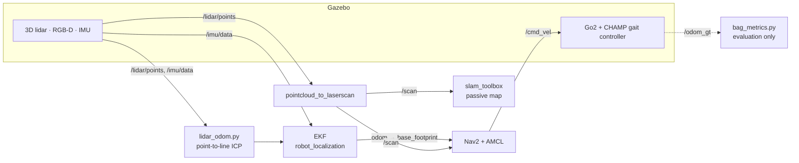

# go2-nav-sim

A Unitree Go2 in Gazebo that walks to a goal using only its own sensors: a 3D lidar, an IMU and an RGB-D camera, with Nav2
for planning. ROS 2 Humble, Ubuntu 22.04. The repo is also a step-by-step tutorial; every failure I hit along the way is
documented.

[](media/go2_a2b_dashboard.mp4)

Click the preview for the full 80 s, 1080p video, or see the [dashboard still](docs/img/dashboard.png).

## What it does

The robot starts at marker A and walks 12 m around obstacles to marker B. The pose estimate that Nav2 uses comes from lidar and
IMU, not from the simulator. Simulator ground truth is recorded separately and only used to score the run.

Three consecutive runs from a fresh start (`scripts/run_mission.sh`), same machine, final code:

| Run | Nav2 result | Time | Path | Distance to B at end | Odometry ATE (RMSE) | AMCL error (RMSE) |
|---|---|---|---|---|---|---|
| 1 | succeeded | 99.9 s | 15.1 m | 0.24 m | 3.8 cm | 11.0 cm |
| 2 | succeeded | 66.4 s | 12.4 m | 0.30 m | 2.3 cm | 10.3 cm |
| 3 (in the video) | succeeded | 57.5 s | 11.7 m | 0.26 m | 5.1 cm | 9.7 cm |

Three runs is a small sample. Earlier versions of the estimator failed in about one run in three; what went wrong is in
[chapter 4](docs/04-state-estimation.md#failures-worth-knowing-about). Per-run numbers are in `results/`.

## Quick start

```bash
git clone https://github.com/Armanasq/go2-nav-sim.git && cd go2-nav-sim
scripts/setup.sh                       # fetch upstream, patch, build (about 5 minutes)
source env.sh
scripts/up.sh                          # Gazebo + estimation + Nav2
python3 src/go2_nav_sim/scripts/go_to_goal.py
```

Install the dependencies first: [chapter 1](docs/01-prerequisites.md).

## Tutorial

1. [Prerequisites](docs/01-prerequisites.md)
2. [Install and first run](docs/02-install-and-first-run.md)
3. [Robot and sensors](docs/03-robot-and-sensors.md)
4. [State estimation](docs/04-state-estimation.md)
5. [Mapping and navigation](docs/05-mapping-and-navigation.md)
6. [Record and visualise](docs/06-record-and-visualise.md)
7. [Troubleshooting](docs/07-troubleshooting.md)

## How it fits together



## What this adds, and what it does not

The Go2/CHAMP description repo this builds on gives a Gazebo model you can teleoperate. Its own checklist marks the SLAM and
Nav2 demos as not working. This repo adds:

- a complete sensor suite on the robot, with REP-103 frames and an optical camera frame;
- a lidar-inertial odometry node and an EKF that replace CHAMP's leg odometry, which is badly wrong in Gazebo (measured in
  [chapter 4](docs/04-state-estimation.md)), scored against ground truth;
- Nav2 with AMCL and a passive `slam_toolbox` running together on a Go2;
- runs recorded to a bag and a dashboard rendered from it, so results can be re-checked without the simulator;
- a launcher that survives a busy machine, and a troubleshooting table of the failures behind it.

Limits you should know about:

- Simulation only. Nothing here talks to a real Go2.
- Navigation uses a known map. Reaching a goal in unexplored space needs exploration, which is not included
  ([why](docs/05-mapping-and-navigation.md#two-stages-on-purpose)).
- The odometry is planar and has no loop closure. The centimetre-level figures come from a small room; expect more drift elsewhere.
- AMCL is started from the true pose, as a simulation shortcut.
- Tested on one machine. The dependency list is not verified on a clean install.

## Layout

```
src/go2_nav_sim/     ROS 2 package: launch files, URDF, world, configs, nodes, tools
  scripts/           lidar_odom.py, go_to_goal.py, bag_metrics.py, render_dashboard.py, generators
patches/             small patch to the upstream Go2/CHAMP repo
scripts/             setup.sh, up.sh, stop.sh, record_bag.sh, run_mission.sh
config/              Cyclone DDS configuration
docs/                the tutorial
media/, results/     the video, and the numbers behind this README
```

The upstream repo is fetched at a pinned commit by `scripts/setup.sh` and is not copied here.
