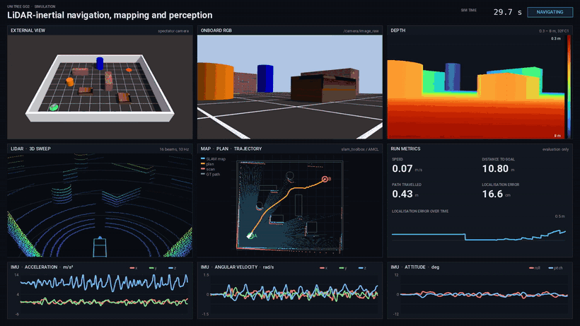
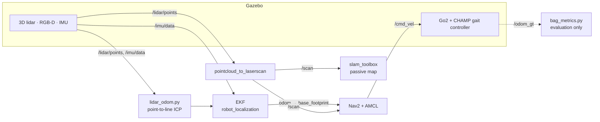

# go2-nav-sim

A Unitree Go2 in Gazebo that walks to a goal using only its own sensors: a 3D lidar, an IMU and an RGB-D camera, with Nav2
for planning. ROS 2 Humble, Ubuntu 22.04. The repo is also a step-by-step tutorial; every failure I hit along the way is
documented.

[](media/go2_a2b_dashboard.mp4)

Click the preview for the full 76 s, 1080p video, or see the [dashboard still](docs/img/dashboard.png).

## What it does

The robot starts at marker A and walks about 11.7 m around obstacles to marker B. The pose estimate that Nav2 uses comes from lidar and
IMU, not from the simulator. Simulator ground truth is used once, to initialise AMCL (`go_to_goal.py` reads `/odom_gt`), and
after that only recorded to score the run.

Three consecutive runs from a fresh start (`scripts/run_mission.sh`), same machine, final code:

| Run | Nav2 result | Time | Path | Distance to B at end | Odometry ATE, aligned | Odometry RPE per 1 m | AMCL error (RMSE) |
|---|---|---|---|---|---|---|---|
| w1 | succeeded | 54.4 s | 11.6 m | 0.25 m | 1.4 cm | 1.8 % | 8.3 cm |
| w2 (in the video) | succeeded | 54.8 s | 11.6 m | 0.21 m | 1.1 cm | 1.6 % | 10.8 cm |
| w3 | succeeded | 83.1 s | 13.8 m | 0.34 m | 1.7 cm | 2.4 % | 18.7 cm |

Distance to B is not an accuracy figure: Nav2 stops once its own estimate is inside `xy_goal_tolerance` (0.25 m in
`nav2_params.yaml`). In w3 the robot stopped 0.34 m from B because AMCL was about 10 cm off at the end; localisation, not
odometry, is the weakest part of this stack. Three runs is a small sample. Earlier versions of the estimator failed about one run in three; what went wrong is in
[chapter 9](docs/09-state-estimation.md#failures-worth-knowing-about). Time and distance to B come from the mission log
(`site/evidence/missions.txt`), the other columns from `results/run_w*.json` (computed by `bag_metrics.py`, every estimate paired with ground truth at its own timestamp). Chapter 11 on the website shows the same
table and how each column is scored.

## Quick start

```bash
git clone https://github.com/Armanasq/go2-nav-sim.git && cd go2-nav-sim
scripts/setup.sh                       # fetch upstream, patch, build (about 5 minutes)
source env.sh
scripts/up.sh                          # Gazebo + estimation + Nav2
python3 src/go2_nav_sim/scripts/go_to_goal.py
```

Install the dependencies first: [chapter 2](docs/02-prerequisites.md). Unit tests: `python3 -m pytest -q src/go2_nav_sim/test` (no ROS needed).

## Tutorial

Website: **https://armanasq.github.io/go2-nav-sim/**, built from this repository by `site/build.py`, checked by
`tools/check_site.py` and published with `scripts/publish_site.sh`. It has four sections:

- Learn: one path through chapters, projects and practical-task stages, in the order you do them. The run replay, the 3D
  lidar viewer and the architecture explorer sit in the chapters that use them (10, 8 and 0), and the measured runs in chapter 11.
- Tasks: every practical task of [the specification](curriculum/spec.md), with its status read from `tasks/sNN_*/results/`.
- Deep dives: the first-principles [modules](modules/README.md), in dependency order.
- Reference: topics, frames, parameters, commands and [troubleshooting](docs/12-troubleshooting.md).

The path, in order:

| Part | Chapters, projects and task stages |
|---|---|
| Start | [0 What you will build](docs/00-overview.md), [1 Legged robot foundations](docs/01-legged-robot-foundations.md), [2 Prerequisites](docs/02-prerequisites.md), [3 Install and first run](docs/03-install-and-first-run.md), [4 ROS 2 from scratch](docs/04-ros2-from-scratch.md), [project 1](projects/p01_first-steps/README.md) |
| The robot | [5 Frames and TF2](docs/05-frames-and-tf2.md), [6 Import the Go2](docs/06-import-the-go2.md), [stage 1](tasks/s01_import-and-inspect/README.md), [stage 2](tasks/s02_joint-and-leg-control/README.md), [7 Make it walk](docs/07-make-it-walk.md) |
| Move it | [project 2](projects/p02_teleop-and-safety/README.md), [project 3](projects/p03_move-in-shapes/README.md), [project 4](projects/p04_go-to-pose/README.md) |
| Sense and avoid | [8 Robot and sensors](docs/08-robot-and-sensors.md), [project 5](projects/p05_sense-and-stop/README.md) |
| Estimate and map | [9 State estimation](docs/09-state-estimation.md), [11 Record and visualise](docs/11-record-and-visualise.md), [10 Mapping and navigation](docs/10-mapping-and-navigation.md) |
| Navigate | [project 11](projects/p11_command-arbitration/README.md), [project 12](projects/p12_tune-nav2/README.md), [project 13](projects/p13_behaviour-trees/README.md) |
| Beyond simulation | [project 14](projects/p14_test-the-stack/README.md), [13 Toward the real Go2](docs/13-toward-the-real-go2.md) |

Stages and projects that are still being written join the path on the website as soon as their `README.md` exists; the
order is the `PATH` list in `site/build.py`.

## How it fits together



## What this adds, and what it does not

The Go2/CHAMP description repo this builds on gives a Gazebo model you can teleoperate. Its own checklist marks the SLAM and
Nav2 demos as not working. This repo adds:

- a 3D lidar and an RGB-D camera on the robot, with REP-103 frames and an optical camera frame;
- a lidar-inertial odometry node and an EKF that replace CHAMP's leg odometry, which is badly wrong in Gazebo (measured in
  [chapter 9](docs/09-state-estimation.md)), scored against ground truth;
- Nav2 with AMCL and a passive `slam_toolbox` running together on a Go2;
- runs recorded to a bag and a dashboard rendered from it, so results can be re-checked without the simulator;
- a launcher with readiness checks that retries the Nav2 bring-up on a busy machine, and a troubleshooting table of the
  failures behind it.

Limits you should know about:

- Simulation only. Nothing here talks to a real Go2.
- Navigation uses a known map. Reaching a goal in unexplored space needs exploration, which is not included
  ([why](docs/10-mapping-and-navigation.md#part-b-localise-and-navigate-without-ground-truth)).
- The odometry is planar and has no loop closure. The centimetre-level figures come from a small room; expect more drift elsewhere.
- AMCL is started from the true pose, as a simulation shortcut.
- Tested on one machine. The dependency list is not verified on a clean install.

## Layout

```
src/go2_nav_sim/     ROS 2 package: launch files, URDF, world, configs, nodes, tools
  scripts/           lidar_odom.py, go_to_goal.py, bag_metrics.py, render_dashboard.py, generators
patches/             small patch to the upstream Go2/CHAMP repo
scripts/             setup.sh, up.sh, stop.sh, record_bag.sh, run_mission.sh
config/              Cyclone DDS configuration
docs/                the tutorial
media/, results/     the video, and the numbers behind this README
```

The upstream repo is fetched at a pinned commit by `scripts/setup.sh` and is not copied here.
