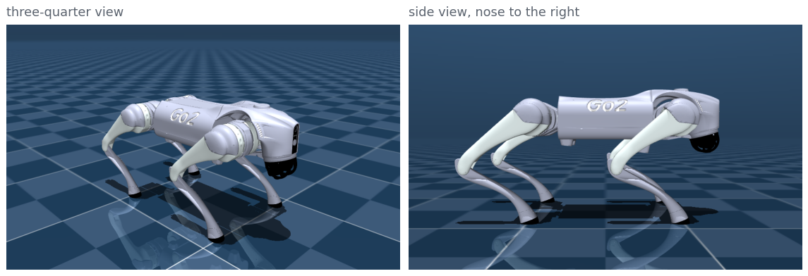
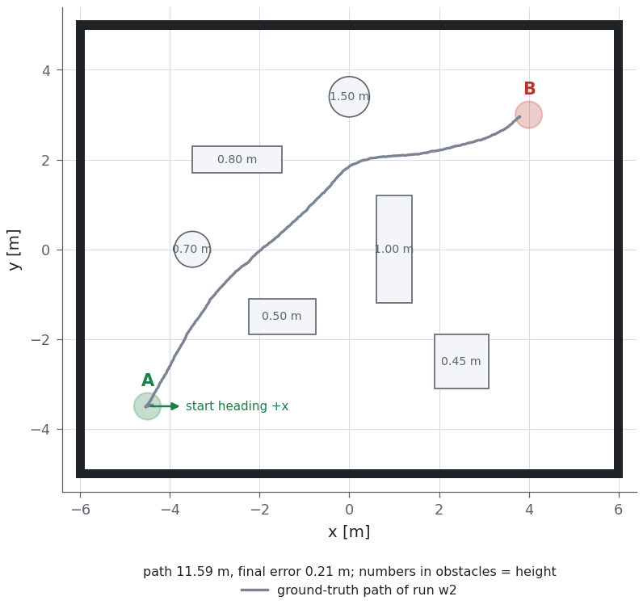
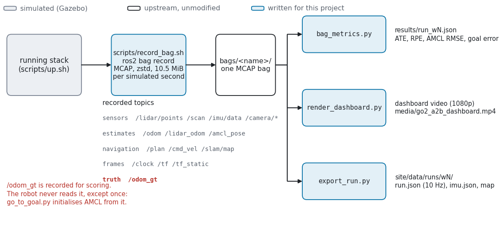
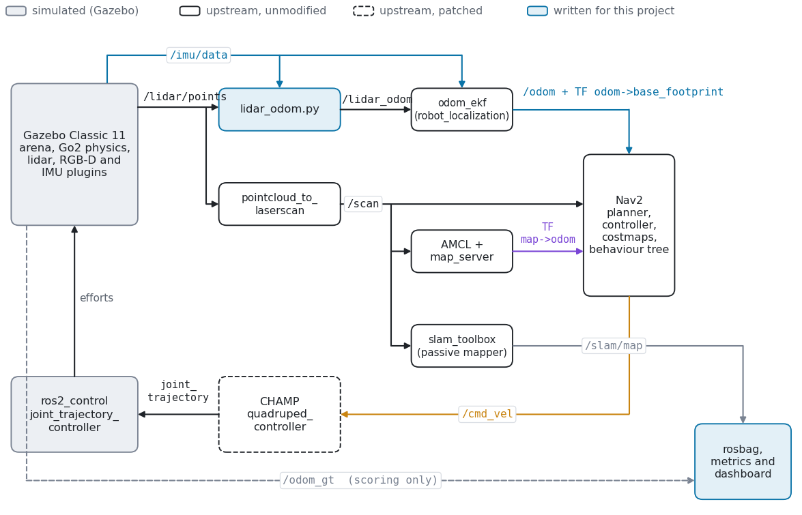
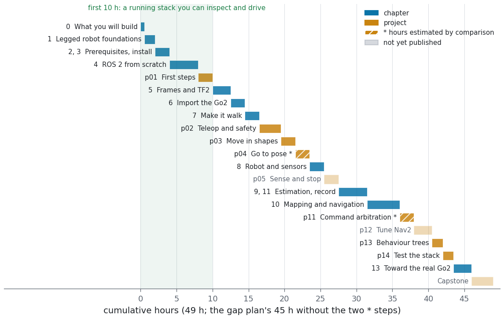
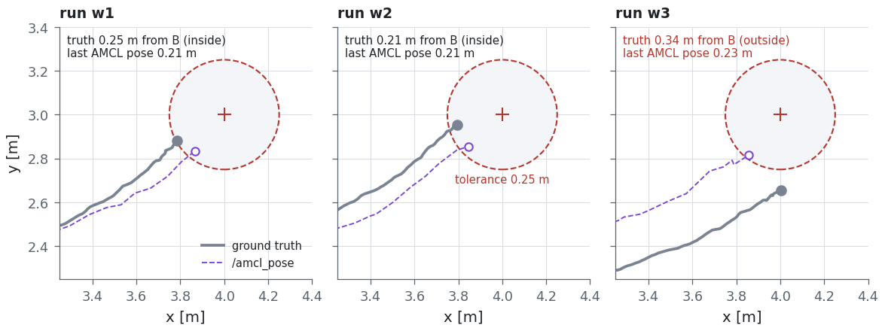

# 0. What you will build

A simulated Unitree Go2 that walks across a room to a goal, using a 3D lidar, an IMU and Nav2. The pose estimate that Nav2
uses is computed from the robot's own sensors. The simulator's ground truth is used once, to initialise AMCL, and after that
only recorded to score the run, so every run ends with numbers as well as a video.

| | |
|---|---|
| Goal | Know what the finished stack does, how its result is scored, and which chapters and projects to do in which order. |
| Time | 0.5 h |
| Before you start | Nothing. Task 1 reads files in a clone of the repository; no ROS needed. |
| You will learn | what each part of the stack does; how a run is scored against ground truth; the core path and the optional deep dives, with hours. |



*The Go2 as modelled in MuJoCo Menagerie (`modules/assets/unitree_go2`, used by the modules); the ROS stack simulates the URDF from `unitree-go2-ros2` in Gazebo.*

<video controls muted playsinline src="../media/c00-00-a2b-start.mp4"></video>

*From 0:03 to 0:15 of the dashboard video `media/go2_a2b_dashboard.mp4`: the robot stands at A, Nav2 publishes a plan (amber) and the robot starts to walk.*

## Task 1: Look at a finished run

### 1.1 Read the score of a recorded run

Objective: see what "scored against ground truth" means before you build anything.

```bash
git clone https://github.com/Armanasq/go2-nav-sim.git && cd go2-nav-sim
python3 -c "import json; r = json.load(open('results/run_w2.json')); print({k: r[k] for k in ('duration_s', 'path_m', 'odom_ate_aligned_cm', 'amcl_rmse_cm', 'goal_error_m', 'goal_tolerance_m')})"
```

```
{'duration_s': 63.5, 'path_m': 11.59, 'odom_ate_aligned_cm': 1.1, 'amcl_rmse_cm': 10.8, 'goal_error_m': 0.21, 'goal_tolerance_m': 0.25}
```

The file was written by `bag_metrics.py` from the rosbag of run w2. `duration_s` is the length of the recording in simulated
time, `path_m` the distance the robot really walked, `odom_ate_aligned_cm` the odometry error and `amcl_rmse_cm` the AMCL error,
both against ground truth, and `goal_error_m` how far from B the robot really stopped.

Check: `goal_error_m` (0.21) is smaller than `goal_tolerance_m` (0.25).



*The room, from `site/data/runs/w2/run.json`: start A at (-4.5, -3.5), goal B at (4.0, 3.0), six obstacles, and the path the robot walked in run w2.*



*How a run becomes numbers, a video and website data, from the usage lines of the three scripts and the topic list in `scripts/record_bag.sh`. `/odom_gt` is in the bag only so that it can be scored.*

### 1.2 Read the stack

Objective: know which parts you will run unmodified and which were written for this course.

Gazebo Classic simulates the robot, its CHAMP gait controller and the sensors. A lidar odometry node registers each lidar scan
against a local map, with yaw taken from the gyro. An EKF fuses that with the IMU and publishes the `odom` frame. AMCL localises
on a known map and Nav2 plans and drives. A second mapper, `slam_toolbox`, builds its own map in the background so you can
compare it with the real layout. Every run is recorded to a rosbag, scored against ground truth and rendered to a video.

```bash
ls src/go2_nav_sim/scripts/*.py | xargs -n1 basename | paste -sd' '
```

```
bag_metrics.py export_run.py go_to_goal.py gt_odom.py lidar_odom.py make_arena.py make_nav2_params.py odom_eval.py registration.py render_dashboard.py
```

| | |
|---|---|
| Simulated | the robot, its gait, the sensors and the room. Nothing here drives a physical Go2. |
| Used unmodified | Nav2, AMCL, `robot_localization`, `slam_toolbox`, `pointcloud_to_laserscan` |
| Written for this project | the lidar odometry (`lidar_odom.py` and `registration.py`), the launch and bring-up scripts, the evaluation and the dashboard. The registration has unit tests that run without ROS. |
| Shortcuts | AMCL is started from the true pose, and navigation uses a map that is known in advance. [Chapter 10](10-mapping-and-navigation.md) explains both. |

Check: `lidar_odom.py` and `registration.py` are in the list; there is no gait or planner code, because those come from CHAMP
and Nav2.



*The nodes and topics of the running stack, read from `src/go2_nav_sim/launch/*.py`; the fill says where each node comes from. `scripts/record_bag.sh` records the sensor, odometry, map, plan and command topics.*

## Task 2: Plan your route

### 2.1 Pick the core path

Objective: decide how far to go and in which order.

```bash
ls -d docs/[0-9]*.md projects/p*/
ls projects/*/README.md
```

```
docs/00-overview.md
docs/01-legged-robot-foundations.md
docs/02-prerequisites.md
docs/03-install-and-first-run.md
docs/04-ros2-from-scratch.md
docs/05-frames-and-tf2.md
docs/06-import-the-go2.md
docs/07-make-it-walk.md
docs/08-robot-and-sensors.md
docs/09-state-estimation.md
docs/10-mapping-and-navigation.md
docs/11-record-and-visualise.md
docs/12-troubleshooting.md
projects/p01_first-steps/
projects/p02_teleop-and-safety/
projects/p03_move-in-shapes/
projects/p04_go-to-pose/
projects/p05_sense-and-stop/
projects/p11_command-arbitration/
projects/p12_tune-nav2/
projects/p13_behaviour-trees/
projects/p14_test-the-stack/
projects/p01_first-steps/README.md
projects/p02_teleop-and-safety/README.md
projects/p03_move-in-shapes/README.md
projects/p04_go-to-pose/README.md
projects/p05_sense-and-stop/README.md
projects/p12_tune-nav2/README.md
projects/p13_behaviour-trees/README.md
projects/p14_test-the-stack/README.md
```

Thirteen chapters and nine project folders. p01 to p05 and p11 to p14 have a `README.md`; the other folders hold code and results
without instructions yet, so the table marks them as not yet published. Work through the steps in this
order. Hours are estimates for a beginner from `research/gap-plan.md`; two marked * were not in that plan and are my estimates:
p04 by comparison with p03, p11 from its measured runs (about 9 min of wall-clock time in my session) plus reading and typing.

| Step | Chapter or project | You end with | Hours | Total |
|---|---|---|---|---|
| 1 | [0. What you will build](00-overview.md) | this plan | 0.5 | 0.5 |
| 2 | [1. Legged robot foundations](01-legged-robot-foundations.md) | the layers between a URDF and a walking robot | 1.5 | 2 |
| 3 | [2. Prerequisites](02-prerequisites.md) and [3. Install and first run](03-install-and-first-run.md) | the stack built, running and reaching the goal | 2 | 4 |
| 4 | [4. ROS 2 from scratch](04-ros2-from-scratch.md) | the running graph inspected, a node of your own built and tested | 4 | 8 |
| 5 | [p01 First steps](../projects/p01_first-steps/README.md) | the robot walked and stopped from the command line, measured | 2 | 10 |
| 6 | [5. Frames and TF2](05-frames-and-tf2.md) | the TF tree read, one wrong transform found | 2.5 | 12.5 |
| 7 | [6. Import the Go2](06-import-the-go2.md) | how the description, ros2_control and CHAMP fit together | 2 | 14.5 |
| 8 | [7. Make it walk](07-make-it-walk.md) | velocity limits and gait parameters measured | 2 | 16.5 |
| 9 | [p02 Teleop and safety](../projects/p02_teleop-and-safety/README.md) | a dead-man timeout of your own, measured | 3 | 19.5 |
| 10 | [p03 Move in shapes](../projects/p03_move-in-shapes/README.md) | open loop vs closed loop, scored | 2 | 21.5 |
| 11 | [p04 Go to pose](../projects/p04_go-to-pose/README.md) | a polar-coordinate pose controller | 2* | 23.5 |
| 12 | [8. Robot and sensors](08-robot-and-sensors.md) | lidar, RGB-D and IMU checked in their frames | 2 | 25.5 |
| 13 | p05 Sense and stop (`projects/p05_sense-and-stop`): not yet published | a stop in front of an obstacle from `/scan` | 2 | 27.5 |
| 14 | [9. State estimation](09-state-estimation.md) and [11. Record and visualise](11-record-and-visualise.md) | odometry scored against ground truth; a bag and its dashboard | 4 | 31.5 |
| 15 | [10. Mapping and navigation](10-mapping-and-navigation.md) | Nav2 driving A to B, a map built alongside | 4.5 | 36 |
| 16 | p06 to p10 | no such folders yet | | |
| 17 | [p11 Command arbitration](../projects/p11_command-arbitration/README.md) | teleop above Nav2 through `twist_mux`, a Collision Monitor and an e-stop lock | 2* | 38 |
| 18 | p12 Tune Nav2 (`projects/p12_tune-nav2`): not yet published | Nav2 settings justified by measured runs | 2.5 | 40.5 |
| 19 | [p13 Behaviour trees](../projects/p13_behaviour-trees/README.md) | a recovery reordered in Nav2's tree, and a waypoint patrol | 1.5 | 42 |
| 20 | [p14 Test the stack](../projects/p14_test-the-stack/README.md) | a ROS-level smoke test | 1.5 | 43.5 |
| 21 | [13. Toward the real Go2](13-toward-the-real-go2.md) | the network recipe, the safety page and a `cmd_vel` bridge whose clamp and timeout logic is tested with pure-Python unit tests (`unitree_mujoco` has no sport-mode service, so it cannot test the bridge); no hardware needed | 2.5 | 46 |
| 22 | Capstone: not yet published | three goals reached while mapping, with a moved obstacle and a new start, over 3 runs | 3 | 49 |
| any | [12. Troubleshooting](12-troubleshooting.md) | a lookup table, not read front to back | | |

The plan's 45 h are steps 1 to 22 without the two starred projects; with them the route is 49 h. Steps 13, 18 and 22, 7.5 h, have
no instructions yet.



*The table above on one time axis. Hatched: the two estimates marked \*. Pale: not yet published.*

Deep dives are outside these hours and no core chapter depends on them. Each [module](../modules/README.md) solves one problem
on the Go2 model in MuJoCo and checks the result against an established library: [m00 maths](../modules/m00_math/README.md),
[m01 anatomy](../modules/m01_anatomy/README.md), [m04 kinematics](../modules/m04_kinematics/README.md). The derivations the
chapters skip live there.

Check: `ls projects/*/README.md` lists the four projects that the table links; the route adds up to 49 h. Steps 1 to 5
(10 h) already give you a running stack that you can inspect and drive.

### 2.2 Check the hardware

Objective: know before installing whether your machine can run the stack.

You need about 5 GB of disk, 8 or more CPU threads, and a GPU for the cameras and the GPU lidar. A recording
needs about 10.5 MiB per simulated second, about 0.6 GiB per simulated minute. One run of `scripts/run_mission.sh`
([chapter 3](03-install-and-first-run.md), task 3) wrote a 710.2 MiB bag (`ros2 bag info`) for 67.7 s of simulated time
(`duration_s` of `bag_metrics.py`) and 112.7 s of wall-clock time, a real-time factor of 0.60. Per wall-clock second that is
6.3 MiB/s, and that rate falls when the machine is slower.

```bash
nproc; df -h . | tail -1
```

On the test machine:

```
32
/dev/nvme1n1p2  1.9T  1.5T  288G  84% /
```

Check: `nproc` prints 8 or more, and the fourth column of `df` (free space) is above 5 GB plus 0.6 GB for each simulated minute
you plan to record. With fewer than 8 threads the simulator runs slower than real time. Every rate and time in this course is
in simulated time, so results stay comparable; only the wall-clock wait grows. [Chapter 2](02-prerequisites.md), task 1,
checks the operating system and the GPU.

## Exercise

Run 1.1 for all three recorded runs. Which run stopped outside the goal tolerance, and how far was AMCL off on average in that
run?

```bash
python3 -c "
import json, glob
for f in sorted(glob.glob('results/run_w*.json')):
    r = json.load(open(f)); print(f, r['goal_error_m'], r['goal_tolerance_m'], r['amcl_rmse_cm'])"
```

Answer:

```
results/run_w1.json 0.25 0.25 8.3
results/run_w2.json 0.21 0.25 10.8
results/run_w3.json 0.34 0.25 18.7
```

Run w3 stopped 0.34 m from B, outside the 0.25 m tolerance, and it has the largest AMCL error (18.7 cm RMSE). Nav2 stops when
its own estimate, which comes from AMCL, is inside the tolerance, so an AMCL error moves the real stopping point. Nav2 still
reported success in all three runs.



*The last metres of each run (`site/data/runs/wN/run.json`). The last `/amcl_pose` of every run lies inside the circle; the true stop of w3 lies 0.34 m from B.*

## Further reading

- F. Rico, *A Concise Introduction to Robot Programming with ROS 2*, 2025, code in `fmrico/book_ros2`: the order this course
  follows from reactive behaviour to behaviour trees to Nav2.
- Nav2, first-time robot setup guide: https://docs.nav2.org/rolling/configuration_and_development/first_time_robot_setup_guide/

Next: [1. Legged robot foundations](01-legged-robot-foundations.md)
