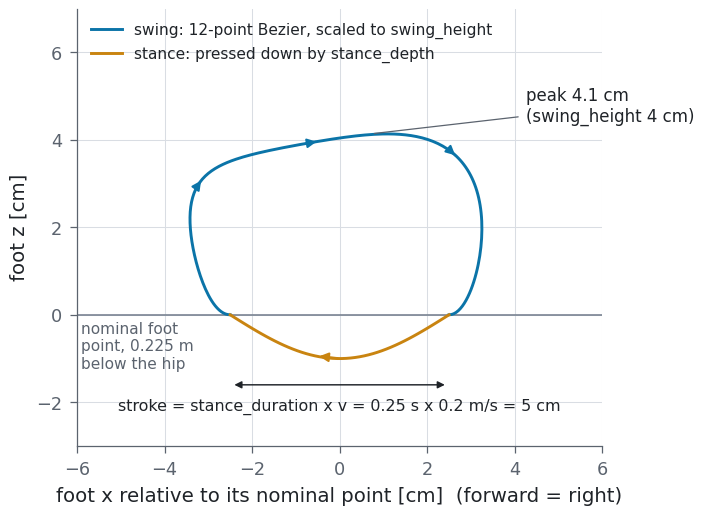
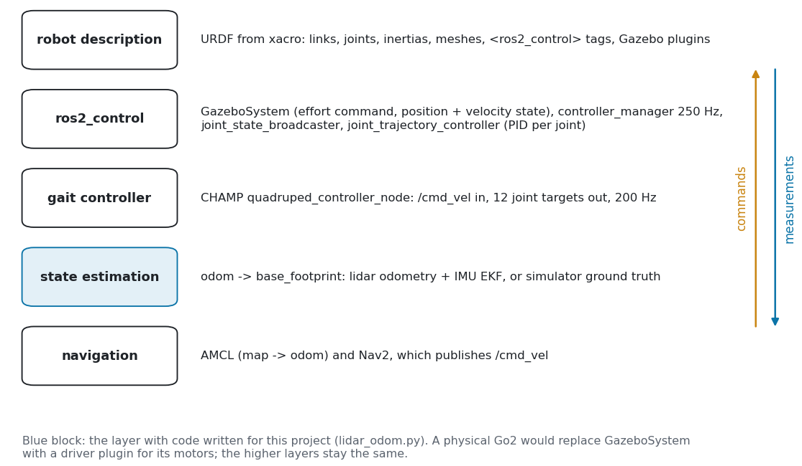
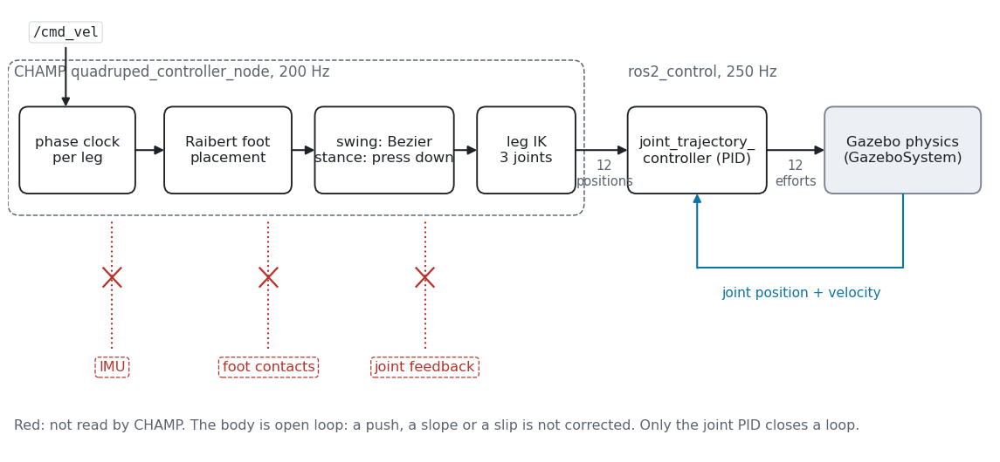
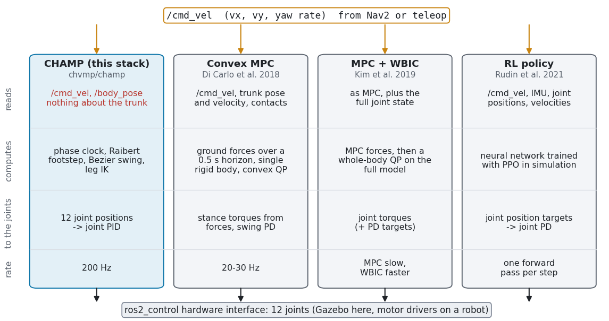
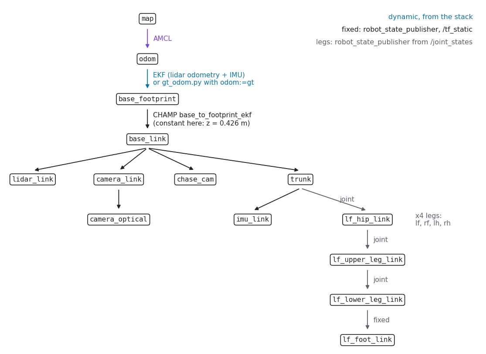
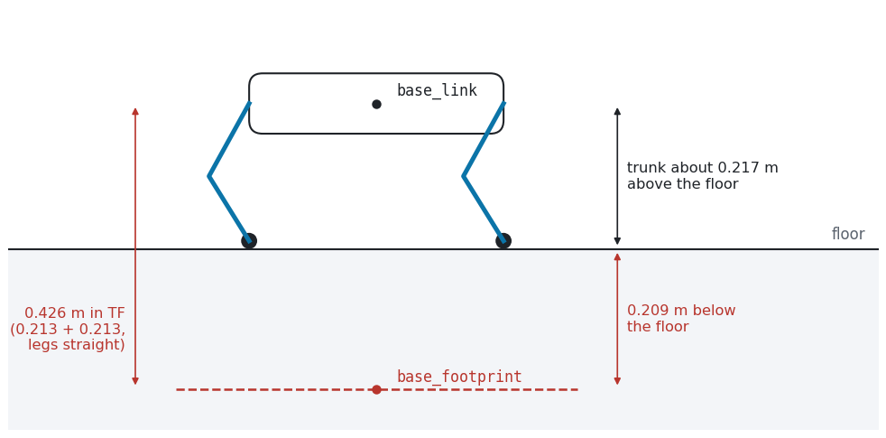
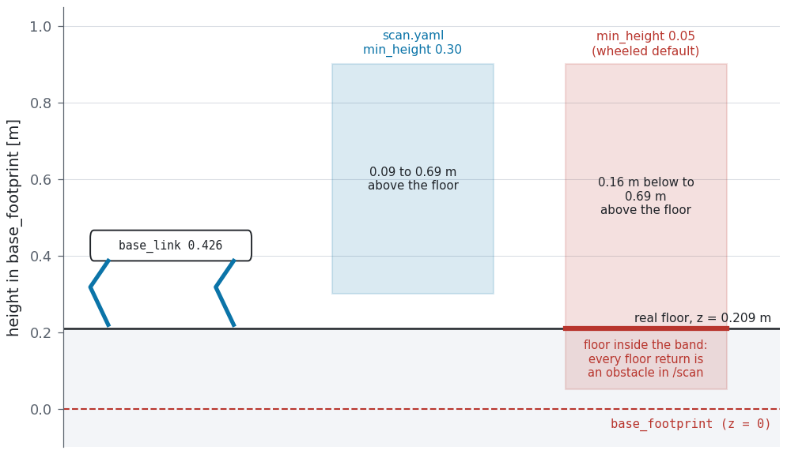

# 1. Legged robot foundations

Most ROS 2 tutorials assume a wheeled base. Its pose changes only when the wheels turn, wheel encoders give odometry, and a
diff-drive controller turns `/cmd_vel` into wheel speeds. A quadruped breaks each of these assumptions. This chapter finds the
differences in the Go2 files and maps them onto the layers of this stack.

| | |
|---|---|
| Goal | Read the Go2's joints, gait and frames from its files, and place its gait controller among the other ways to make a quadruped walk. |
| Time | 1.5 h |
| Before you start | Tasks 1 to 3 read files that `scripts/setup.sh` fetches ([chapter 3](03-install-and-first-run.md), task 1). Without them, read the outputs shown here and run the commands later. Task 4.2 needs the running stack. |
| You will learn | what a floating base and switching contacts mean for ROS; what CHAMP reads and what it ignores; how CHAMP compares with model-predictive control and a learned policy; why `base_footprint` sits 0.426 m below `base_link` here. |

## Task 1: Read the robot description

### 1.1 Count the joints and the mass

Objective: see from the URDF that the trunk is not attached to anything and the legs have 12 motors.

```bash
source env.sh
xacro src/go2_nav_sim/urdf/go2_nav.xacro > /tmp/go2.urdf
python3 - <<'EOF'
import xml.etree.ElementTree as ET
r = ET.parse('/tmp/go2.urdf').getroot()
j = [x for x in r.findall('joint') if x.get('type') == 'revolute']
print(len(j), 'revolute,', sum(x.get('type') == 'fixed' for x in r.findall('joint')), 'fixed')
for x in j[:3]:
    l = x.find('limit'); print(x.get('name'), x.find('axis').get('xyz'), l.get('lower'), l.get('upper'), l.get('effort'))
print('mass %.2f kg' % sum(float(i.find('mass').get('value')) for i in r.iter('inertial')))
EOF
```

```
12 revolute, 11 fixed
rf_hip_joint 1 0 0 -1.0472 1.0472 23.7
rf_upper_leg_joint 0 1 0 -1.5708 3.4907 23.7
rf_lower_leg_joint 0 1 0 -2.7227 -0.83776 35.55
mass 15.10 kg
```

Check: 12 revolute joints, 15.10 kg.

The root link, `base_link`, has no parent joint, so the simulator (or an estimator, on hardware) supplies all six degrees of
freedom of the trunk pose. The joint called `floating_base`, between `base_link` and `trunk`, is fixed despite its name; Gazebo
gives every root link six free degrees of freedom. Each leg has three revolute joints. The left front leg, from `const.xacro`
and `leg.xacro` (the right legs mirror the hip limits):

| Joint | Name here | Axis | Range (rad) | Effort limit (N·m) |
|---|---|---|---|---|
| hip abduction / adduction | `lf_hip_joint` | x | -1.047 to 1.047 | 23.7 |
| hip flexion (thigh) | `lf_upper_leg_joint` | y | -1.571 to 3.491 | 23.7 |
| knee (calf) | `lf_lower_leg_joint` | y | -2.723 to -0.838 | 35.55 |

The legs are `lf`, `rf`, `lh` and `rh` (left/right, front/hind). Unitree's own files call the same joints `FL_hip_joint`,
`FL_thigh_joint` and `FL_calf_joint`; a leftover `config/_robot_control.yaml` in `go2_description` still uses those names. The
foot is a fixed joint to a sphere of 2 cm radius.


*The MuJoCo Menagerie Go2 with one colour per leg, the three joint axes of the front left leg and the base frame (x red, y green, z blue). Menagerie uses Unitree's leg names; the URDF in this stack uses `lf`, `rf`, `lh`, `rh`.*


*One leg of the URDF: link lengths and hip offset from `const.xacro`, the allowed range of each joint shaded, with its effort limit from the table. The pose drawn is only an example.*

Common mistakes: `xacro: command not found` means the shell has not sourced `env.sh`.

Forward and inverse kinematics of one leg, checked against MuJoCo and Pinocchio, are in
[module 04](../modules/m04_kinematics/README.md); why the floating base cannot be actuated directly is in
[module 01](../modules/m01_anatomy/README.md).

## Task 2: See how a trot moves the feet and the trunk

### 2.1 Read the gait parameters

Objective: find the numbers that set the stride.

```bash
grep -E 'max_|swing_height|stance_depth|stance_duration|nominal_height' \
  src/third_party/unitree-go2-ros2/robots/configs/go2_config/config/gait/gait.yaml
```

```
      max_linear_velocity_x : 0.3
      max_linear_velocity_y : 0.25
      max_angular_velocity_z : 0.5
      swing_height : 0.04
      stance_depth : 0.01
      stance_duration : 0.25
      nominal_height : 0.225
```

Check: `stance_duration` is 0.25 s. CHAMP clips `/cmd_vel` to the three `max_` values.

A foot is either in stance (on the ground, carrying load) or in swing, and each switch changes which constraints act on the
body, several times per second. CHAMP walks with a trot: the diagonal pairs `lf`+`rh` and `rf`+`lh` swing together
(`phase_generator.h`). One stride is 0.25 s of stance plus 0.25 s of swing. The trunk height oscillates at 4.0 Hz while walking,
twice per stride (measured on `/odom_gt`).


*Trot timing from `phase_generator.h` and `gait.yaml`: each diagonal pair is in stance for 0.25 s while the other pair swings. The trunk-height line is a sketch of the 4.0 Hz oscillation, not data.*

<video controls muted playsinline src="../media/c00-01-trot-kinematic.mp4"></video>

*The same trot played back on the MuJoCo Go2 at quarter speed, pairs coloured as above: CHAMP's foot path at 0.2 m/s turned into joint angles with the closed-form IK of `modules/m04_kinematics`. Kinematics only; no physics and no CHAMP code runs here.*



*One foot's path at 0.2 m/s, computed from the control points in `trajectory_planner.h` and the Go2 `gait.yaml` (swing_height 0.04 m, stance_depth 0.01 m, stance_duration 0.25 s). The swing overshoots the 5 cm stroke at both ends.*

### 2.2 Note what the sensors on the trunk feel

Objective: know why sensor data from a legged robot shakes.

`site/data/runs/w2/imu.json` holds the IMU of recorded run w2 at about 20 samples per second, timed in seconds from the start
of the recording. The robot stood until about 10 s and walked from then on. This compares 6 s of standing with 20 s of walking:

```bash
python3 - <<'EOF'
import json
d = json.load(open('site/data/runs/w2/imu.json')); f = d['fields']
for name, t0, t1 in (('standing', 2, 8), ('walking', 20, 40)):
    rows = [r for r in d['rows'] if t0 <= r[0] < t1]
    print(name, '  '.join('%s %.1f to %.1f' % (k, min(r[f.index(k)] for r in rows), max(r[f.index(k)] for r in rows))
                         for k in ('az', 'gy', 'pitch_deg')))
EOF
```

```
standing az 7.0 to 12.4  gy -0.1 to 0.2  pitch_deg -0.5 to 0.0
walking az 4.6 to 18.8  gy -0.8 to 0.6  pitch_deg -2.8 to 1.1
```

Check: walking, the vertical acceleration `az` (m/s²) spans 14.2 m/s² against 5.4 m/s² standing, and the pitch rate `gy`
(rad/s) and the pitch angle span several times their standing range.

Walking at 0.2 m/s, the trunk height varied between 0.206 and 0.219 m, roll between -2.1 and 3.6 degrees and pitch between -2.0
and 1.9 degrees ([chapter 7](07-make-it-walk.md#44-measure-how-the-trunk-moves-while-walking) has the command). A sensor bolted to the trunk sees all
of that.

<video controls muted playsinline src="../media/c00-01-trunk-motion.mp4"></video>

*Ten seconds of the dashboard (`media/go2_a2b_dashboard.mp4` from 0:40) while walking: the bottom row is the IMU on the trunk, and every step shows up in acceleration, angular rate and attitude.*

There is no wheel odometry either. Joint encoders tell you where the feet are relative to the trunk; they tell you how the
trunk moved only if you know which feet are on the ground and that they did not slip. That needs contact sensing, which this
Gazebo setup does not have. [Chapter 9](09-state-estimation.md) measures how far off CHAMP's leg odometry is here and what
replaces it.

## Task 3: Place CHAMP in the control stack

### 3.1 Find what CHAMP reads

Objective: see from the source that the gait controller gets no feedback about the trunk.

```bash
grep -n -A1 'create_subscription' src/third_party/unitree-go2-ros2/champ/champ_base/src/quadruped_controller.cpp
grep -n 'double loop_rate' src/third_party/unitree-go2-ros2/champ/champ_base/src/quadruped_controller.cpp
```

```
69:    cmd_vel_subscription_ = this->create_subscription<geometry_msgs::msg::Twist>(
70-        "cmd_vel/smooth", 10, std::bind(&QuadrupedController::cmdVelCallback_, this,  std::placeholders::_1));
71:    cmd_pose_subscription_ = this->create_subscription<geometry_msgs::msg::Pose>(
72-        "body_pose", 1,  std::bind(&QuadrupedController::cmdPoseCallback_, this,  std::placeholders::_1));
49:    double loop_rate = 200.0;
```

Check: two subscriptions only. `cmd_vel/smooth` is remapped to `/cmd_vel` in `champ_bringup/launch/bringup.launch.py`
(line 179).

CHAMP reads no IMU, no contact forces and no joint feedback, and it does not plan the motion of the centre of mass. Each cycle it
advances a phase clock per leg, places the next footstep with the Raibert heuristic, draws a Bezier swing curve, presses the
stance foot down by `stance_depth`, and solves inverse kinematics for each leg. The 12 joint positions go to the
`joint_trajectory_controller`, which turns position error into effort with the PID gains in `ros_control.yaml`. On flat ground
in simulation that is enough; a push, a slope or a slippery floor is not corrected. [Chapter 7](07-make-it-walk.md) changes the
gait parameters and measures the result.



*The layers of this stack: commands go up from Nav2 to the joints, joint states and sensor data come back down. In ros2_control, `gazebo_ros2_control/GazeboSystem` offers `effort` commands and `position` and `velocity` states; on a physical robot a driver plugin takes its place and the layers above stay the same ([chapter 6](06-import-the-go2.md)).*



*CHAMP's loop. The node also subscribes to `/body_pose` (not drawn). The inputs in red are never read, so the only feedback in the loop is joint position and velocity into the PID.*

### 3.2 Compare CHAMP with other controllers

Objective: know what would replace CHAMP, and what would stay the same.

```bash
grep -n update_rate src/third_party/unitree-go2-ros2/robots/configs/go2_config/config/ros_control/ros_control.yaml
```

```
4:    update_rate: 250  # Hz
```



*Four ways to turn `/cmd_vel` into joint commands. CHAMP from its source (task 3.1); convex MPC from Di Carlo et al., IROS 2018; MPC with whole-body impulse control from Kim et al., arXiv 1909.06586; the RL policy from Rudin et al., CoRL 2021. Generated by `docs/img/c00-01-controllers.py`.*

Convex MPC plans ground reaction forces for a single rigid body over a horizon of up to 0.5 s, solved as a convex QP in under
1 ms at 20 to 30 Hz. WBIC adds a faster whole-body QP on the full model that turns those forces into joint torques. An RL policy
is a neural network trained in simulation that maps the command and proprioception to joint targets. All three read the trunk
state, which CHAMP does not. All four take the same `/cmd_vel` and drive the same ros2_control joints, so Nav2 and everything
above it would not change. None of the other three is part of this repository.

Check: `update_rate` is 250 Hz. At that rate ros2_control runs the joint PID under every column of the figure; CHAMP sends new
joint targets at 200 Hz (`loop_rate` in 3.1) and, in the figure, is the only column that reads nothing about the trunk.

## Task 4: Find where the trunk frame sits

### 4.1 Read the frame table

Objective: know which node publishes each frame.

The fixed frames come from the URDF you made in 1.1. This prints each fixed joint as parent and child, without the four feet:

```bash
python3 - <<'EOF'
import xml.etree.ElementTree as ET
r = ET.parse('/tmp/go2.urdf').getroot()
for j in r.findall('joint'):
    if j.get('type') == 'fixed' and 'foot' not in j.get('name'):
        print(j.find('parent').get('link'), '->', j.find('child').get('link'))
EOF
```

```
base_link -> trunk
trunk -> imu_link
base_link -> lidar_link
lidar_link -> lidar_visual
base_link -> camera_link
camera_link -> camera_optical
base_link -> chase_cam
```

| Frame | Meaning | Published by |
|---|---|---|
| `map` | fixed, globally consistent | AMCL (`map` to `odom`) |
| `odom` | continuous, drifts slowly | `gt_odom.py` with `odom:=gt`, or the EKF in `estimation.launch.py` |
| `base_footprint` | the trunk projected onto the ground, yaw only | CHAMP's `base_to_footprint_ekf` (`base_footprint` to `base_link`) |
| `base_link` | trunk origin, root of the URDF | |
| `trunk`, `imu_link`, `lidar_link`, ... | fixed children of `base_link` | `robot_state_publisher` |
| leg links | follow the 12 joints | `robot_state_publisher` from `/joint_states` |



*The TF tree drawn from `go2_nav.xacro`, `sensors.xacro` and the upstream `robot.xacro`, with who publishes each moving edge. `imu_link` and the legs hang from `trunk`, the sensors from `base_link`.*

The usual split is that `odom` to `base_footprint` carries x, y and yaw, and `base_footprint` to `base_link` carries the trunk
height, roll and pitch, so that TF can level a lidar mounted on `base_link`.

Check: `imu_link` hangs from `trunk`, and the lidar and camera from `base_link`, as in the figure. No line contains `map`,
`odom` or `base_footprint`: those edges move, so a node publishes them (the table), not the URDF.

### 4.2 Measure base_footprint to base_link

Objective: see that the second transform does not move in this simulation. Run it with the stack up
([chapter 3](03-install-and-first-run.md), task 2).

```bash
ros2 run tf2_ros tf2_echo base_footprint base_link
ros2 topic info /foot_contacts
```

```
At time 16.720000000
- Translation: [0.000, 0.000, 0.426]
- Rotation: in Quaternion (xyzw) [0.000, 0.000, 0.000, 1.000]
Type: champ_msgs/msg/ContactsStamped
Publisher count: 0
Subscription count: 1
```

Check: the translation stays at 0.426 m whether the robot stands or walks, and `/foot_contacts` has no publisher.

This is a known open issue of the stack. CHAMP's `state_estimation_node` synchronises `/joint_states` with `/foot_contacts`, and
nothing publishes `/foot_contacts` here: the patch removed the Gazebo contact node, and the controller publishes contacts only
when `publish_foot_contacts` is true and `gazebo` is false. The 0.426 m is the pose with all joint angles at zero, legs straight
down, 0.213 + 0.213 m (thigh and calf lengths in `const.xacro`). The real trunk is about 0.217 m above the floor, so
`base_footprint` lies 0.209 m below the floor. Trunk roll and pitch do not reach TF, and `gt_odom.py` publishes x, y and yaw
only. Code that needs gravity alignment should take roll and pitch from `/imu/data`. In this simulator the IMU orientation
equals ground truth (RMS difference 0.000 degrees against `/odom_gt` over 252 samples while walking), which a real IMU will not
do.



*Where `base_footprint` ends up in this simulation; vertical distances to scale.*

## Exercise

`src/go2_nav_sim/config/scan.yaml` turns the 3D lidar into the 2D `/scan` and keeps only points with `min_height: 0.30` to
`max_height: 0.90`, measured in `target_frame: base_footprint`. Using 4.2, which band above the real floor is that? What would a
value of `min_height: 0.05`, common on wheeled robots, do here?

Answer: the floor is 0.209 m above `base_footprint` (0.426 − 0.217 m), so the band is about 0.09 to 0.69 m above the floor. With
`min_height: 0.05` the floor itself, at 0.21 m in `base_footprint`, falls inside the band, and every floor return becomes an
obstacle in `/scan`. The comment at the top of `scan.yaml` gives the same numbers.



*The two bands of the exercise drawn in `base_footprint`, with the floor where 4.2 puts it.*

## Further reading

- R. Tedrake, *Underactuated Robotics*: https://underactuated.csail.mit.edu/
- M. Raibert, *Legged Robots That Balance*, MIT Press, 1986: https://books.google.com/books?id=EXRiBnQ37RwC
- P. Wensing et al., "Optimization-based control for dynamic legged robots", T-RO 2024: https://arxiv.org/abs/2211.11644

Next: [2. Prerequisites](02-prerequisites.md)
