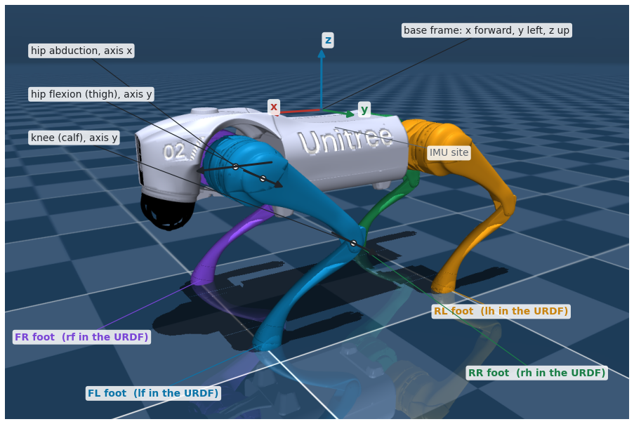
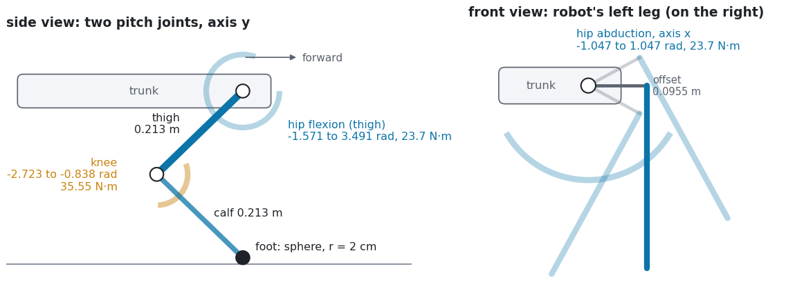
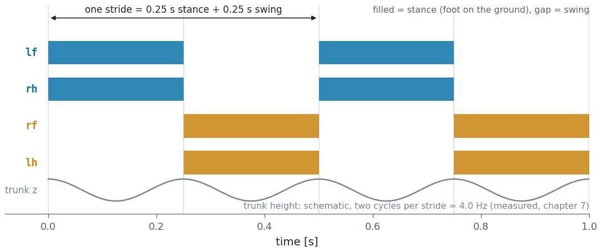

# 1. Legged robot foundations

Most ROS 2 tutorials assume a wheeled base. Its pose changes only when the wheels turn, wheel encoders give odometry, and a
diff-drive controller turns `/cmd_vel` into wheel speeds. A quadruped breaks each of these assumptions. This chapter lists the
differences and maps them onto the layers of this stack. Every number comes from the Go2 files in
`src/third_party/unitree-go2-ros2` or from a measurement in the simulator, most of them in [chapter 7](07-make-it-walk.md).

## What legs change

### The base floats

Nothing joins the trunk to the world. The root link of the URDF, `base_link`, has no parent, so the simulator (or an estimator,
on hardware) supplies all six degrees of freedom of the trunk pose. The Go2 description has a joint called `floating_base`
between `base_link` and `trunk`. Despite the name it is a fixed joint. The free joint is implicit: Gazebo gives every root link
six degrees of freedom.

### Twelve actuated joints

Each leg has three revolute joints. The values below are the left front leg, from `const.xacro` and `leg.xacro`. The right legs
mirror the hip limits.

| Joint | Name here | Axis | Range (rad) | Effort limit (N·m) |
|---|---|---|---|---|
| hip abduction / adduction | `lf_hip_joint` | x | -1.047 to 1.047 | 23.7 |
| hip flexion (thigh) | `lf_upper_leg_joint` | y | -1.571 to 3.491 | 23.7 |
| knee (calf) | `lf_lower_leg_joint` | y | -2.723 to -0.838 | 35.55 |

The legs are `lf`, `rf`, `lh` and `rh` (left/right, front/hind). Unitree's own files call the same joints `FL_hip_joint`,
`FL_thigh_joint` and `FL_calf_joint`; a leftover `config/_robot_control.yaml` in `go2_description` still uses those names. The
foot is a fixed joint to a sphere of 2 cm radius. Rendered from `go2_nav.xacro`, which adds this repository's sensors, the model
has 12 revolute and 11 fixed joints and a total mass of 15.10 kg (sum of the `<inertial>` masses).



*The MuJoCo Menagerie Go2 with one colour per leg, the three joint axes of the front left leg and the base frame (x red, y green, z blue). Menagerie uses Unitree's leg names; the URDF in this stack uses `lf`, `rf`, `lh`, `rh`.*



*One leg of the URDF: link lengths and hip offset from `const.xacro`, the allowed range of each joint shaded, with its effort limit from the table. The pose drawn is only an example.*

### Contacts switch

A foot is either in stance (on the ground, carrying load) or in swing. Each switch changes which constraints act on the body,
several times per second. CHAMP walks with a trot: the diagonal pairs `lf`+`rh` and `rf`+`lh` swing together
(`phase_generator.h`). One stride is 0.25 s of stance plus 0.25 s of swing. The trunk height oscillates at 4.0 Hz while walking,
twice per stride (measured on `/odom_gt`).



*Trot timing from `phase_generator.h` and `gait.yaml`: each diagonal pair is in stance for 0.25 s while the other pair swings. The trunk-height line is a sketch of the 4.0 Hz oscillation, not data.*

<video controls muted playsinline src="../media/c00-01-trot-kinematic.mp4"></video>

*The same trot played back on the MuJoCo Go2 at quarter speed, pairs coloured as above: CHAMP's foot path at 0.2 m/s turned into joint angles with the closed-form IK of `modules/m04_kinematics`. Kinematics only; no physics and no CHAMP code runs here.*

### There is no wheel odometry

Joint encoders tell you where the feet are relative to the trunk. They tell you how the trunk moved only if you know which feet
are on the ground and that they did not slip. That needs contact sensing, which this Gazebo setup does not have. Legged robots
therefore fuse leg kinematics with an IMU and often with a lidar or a camera. [Chapter 9](09-state-estimation.md) shows how far
off CHAMP's leg odometry is here and what replaces it.

### The trunk moves on every step

Walking at 0.2 m/s, the trunk height varied between 0.206 and 0.219 m, roll between -2.1 and 3.6 degrees and pitch between -2.0
and 1.9 degrees ([chapter 7](07-make-it-walk.md#how-the-trunk-moves)). A sensor bolted to the trunk sees all of that.

<video controls muted playsinline src="../media/c00-01-trunk-motion.mp4"></video>

*Ten seconds of the dashboard (`media/go2_a2b_dashboard.mp4` from 0:40) while walking: the bottom row is the IMU on the trunk, and every step shows up in acceleration, angular rate and attitude.*

## The layers

```
robot description   URDF from xacro: links, joints, inertias, meshes, <ros2_control> tags, Gazebo plugins
       |
ros2_control        hardware interface + controller_manager (250 Hz) + joint_state_broadcaster
       |            + joint_trajectory_controller (effort command, PID per joint)
       |
gait controller     CHAMP quadruped_controller_node: /cmd_vel in, 12 joint targets out (200 Hz)
       |
state estimation    odom -> base_footprint (lidar + IMU EKF, or simulator ground truth)
       |
navigation          AMCL (map -> odom) and Nav2, which publishes /cmd_vel
```


*The same layers: commands go up from Nav2 to the joints, joint states and sensor data come back down.*

The robot description is what Gazebo uses: it simulates the masses, inertias and collision shapes. The meshes (`.dae`) are only
drawn. The Go2 collision model is primitives: a box for the trunk and for each thigh and calf, a cylinder per hip, a sphere per
foot.

In ros2_control, a hardware interface exposes command interfaces (what a controller may write) and state interfaces (what it may
read) for each joint. Here the interface is `gazebo_ros2_control/GazeboSystem`, which offers `effort` commands and `position`
and `velocity` states. On a physical robot a hardware plugin for its motor drivers would take its place, and the layers above
would stay the same. The controller manager loads controllers that claim these interfaces. [Chapter 6](06-import-the-go2.md)
shows the exact configuration.

The gait controller, CHAMP, turns a body velocity into joint positions. Each control cycle it advances a phase clock per leg,
places the next footstep with the Raibert heuristic (foot offset = stance duration / 2 × velocity; `leg_controller.h` doubles
it, so the stroke is stance duration × velocity), draws a Bezier swing curve scaled to `swing_height`, presses the stance foot down by `stance_depth`, and solves inverse kinematics for the three joints of each
leg. The result goes out as a `JointTrajectory` with one point and 12 positions. The joint trajectory controller turns position
error into effort with the PID gains in `ros_control.yaml`.

CHAMP is open loop with respect to the body. Its controller node subscribes only to `/cmd_vel` and `/body_pose`. It reads no
IMU, no contact forces and no joint feedback, and it does not plan the motion of the centre of mass. On flat ground in
simulation that is enough. A push, a slope or a slippery floor is not corrected. Model-predictive controllers and learned
policies trained with reinforcement learning are the common alternatives. They sit in the same layer: a velocity command in,
joint targets or torques out through the same ros2_control interfaces. Neither is part of this repository.


*CHAMP's loop. The node also subscribes to `/body_pose` (not drawn). The inputs in red are never read, so the only feedback in the loop is joint position and velocity into the PID.*


*One foot's path at 0.2 m/s, computed from the control points in `trajectory_planner.h` and the Go2 `gait.yaml` (swing_height 0.04 m, stance_depth 0.01 m, stance_duration 0.25 s). The swing overshoots the 5 cm stroke at both ends.*

State estimation and navigation are the same as on a wheeled robot once something publishes a smooth `odom` to `base_footprint`
transform. Chapters [7](09-state-estimation.md) and [8](10-mapping-and-navigation.md) cover them.

## Frames

| Frame | Meaning | Published by |
|---|---|---|
| `map` | fixed, globally consistent | AMCL (`map` to `odom`) |
| `odom` | continuous, drifts slowly | `gt_odom.py` with `odom:=gt`, or the EKF in `estimation.launch.py` |
| `base_footprint` | the trunk projected onto the ground, yaw only | CHAMP's `base_to_footprint_ekf` (`base_footprint` to `base_link`) |
| `base_link` | trunk origin, root of the URDF | |
| `trunk`, `imu_link`, `lidar_link`, ... | fixed children of `base_link` | `robot_state_publisher` |
| leg links | follow the 12 joints | `robot_state_publisher` from `/joint_states` |


*The TF tree drawn from `go2_nav.xacro`, `sensors.xacro` and the upstream `robot.xacro`, with who publishes each moving edge. `imu_link` and the legs hang from `trunk`, the sensors from `base_link`.*

The usual split is that `odom` to `base_footprint` carries x, y and yaw, and `base_footprint` to `base_link` carries the trunk
height, roll and pitch, so that TF can level a lidar mounted on `base_link`.

In this simulation the second transform does not move, and nothing in TF is levelled. Measured standing and walking in the simulator alone, and again in a
running full stack:

```bash
ros2 run tf2_ros tf2_echo base_footprint base_link
# - Translation: [0.000, 0.000, 0.426]
# - Rotation: in Quaternion (xyzw) [0.000, 0.000, 0.000, 1.000]
ros2 topic info /foot_contacts
# Type: champ_msgs/msg/ContactsStamped
# Publisher count: 0
# Subscription count: 1
```

CHAMP's `state_estimation_node` synchronises `/joint_states` with `/foot_contacts`. Nothing publishes `/foot_contacts` here: the
patch removed the Gazebo contact node, and the controller publishes contacts only when `publish_foot_contacts` is true and
`gazebo` is false, which does not hold here. The 0.426 m matches the pose for all joint angles at zero, legs straight down,
0.213 + 0.213 m (thigh and calf lengths in `const.xacro`). The real trunk is about 0.217 m above the floor, so `base_footprint`
lies 0.209 m below the floor. The trunk roll and pitch do not reach TF, and `gt_odom.py` publishes x, y and yaw only. Code that
needs gravity alignment should take roll and pitch from `/imu/data`. In this simulator the IMU orientation equals ground truth
(RMS difference 0.000 degrees against `/odom_gt` over 252 samples while walking), which a real IMU will not do.


*Where `base_footprint` ends up in this simulation; vertical distances to scale.*

Next: [2. Prerequisites](02-prerequisites.md)
