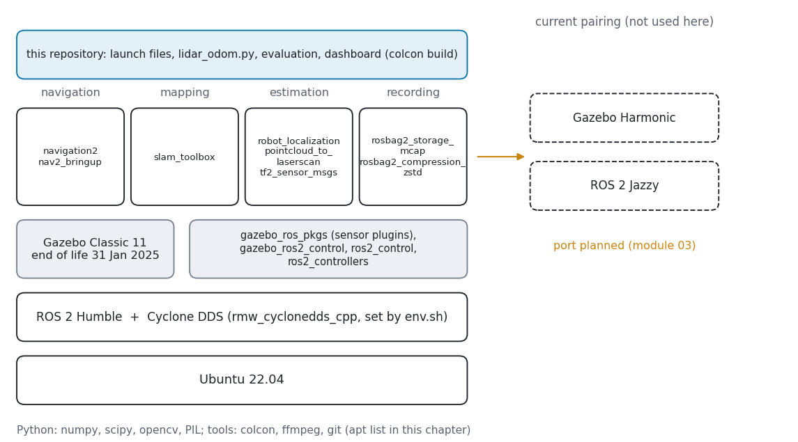
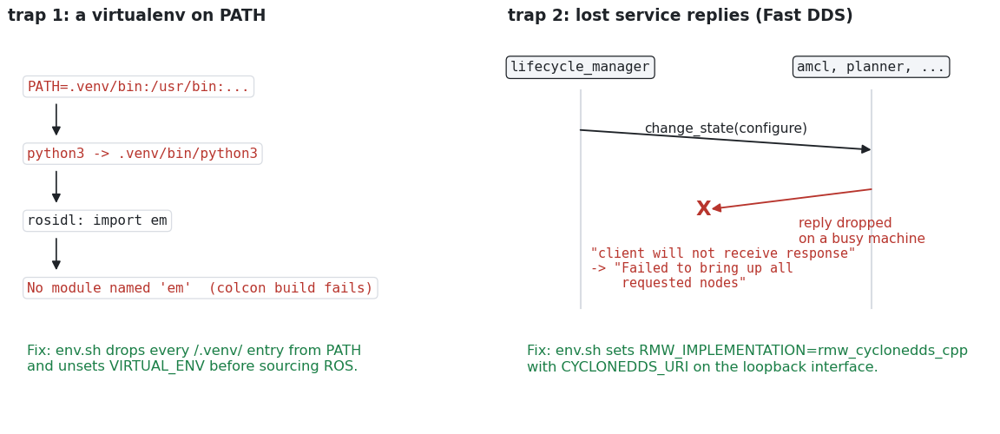

# 2. Prerequisites

| | |
|---|---|
| Goal | A machine with Ubuntu 22.04, ROS 2 Humble, Gazebo Classic 11 and every package the stack loads, each version checked. |
| Time | 0.5 h of work, plus the download time of the packages. Chapters 2 and 3 together: 2 h. |
| Before you start | Ubuntu 22.04 with ROS 2 Humble installed from the ROS apt repository (`ros-humble-desktop`), and sudo for apt. |
| You will learn | which packages the stack needs and why; how to check a version; the two environment settings that `env.sh` makes and what fails without them. |

Tested on Ubuntu 22.04.5 with ROS 2 Humble and Gazebo 11.10.2, on a laptop with an RTX 4090 and 32 threads. The stack ran at
1.0x real time there when nothing else was running. A discrete GPU is not required, but three cameras (RGB-D, chase and
spectator) and a 16-beam GPU lidar are slow on integrated graphics.

Gazebo Classic 11 reached end of life on 31 January 2025 and is not available for ROS 2 Jazzy. It still installs and works on
Humble, which is why this course uses it, but it receives no fixes. The current pairing is ROS 2 Jazzy with Gazebo Harmonic;
porting to it is on the roadmap (module 03). The algorithms, configurations and evaluation here do not depend on the simulator.



*What this chapter installs, bottom to top, with the apt packages grouped by the part of the stack that uses them. Dashed: the current pairing, not used here.*

## Task 1: Check the machine

### 1.1 Read the operating system and the hardware

Objective: confirm the OS and that the machine is large enough before installing anything.

```bash
lsb_release -ds; nproc; free -g | head -2; df -h . | tail -1
nvidia-smi --query-gpu=name,driver_version --format=csv,noheader   # only on NVIDIA machines
```

```
Ubuntu 22.04.5 LTS
32
               total        used        free      shared  buff/cache   available
Mem:              62          17          31           1          14          43
/dev/nvme0n1p2  1.9T  1.5T  287G  84% /
NVIDIA GeForce RTX 4090 Laptop GPU, 580.196.07
```

Check: Ubuntu 22.04; 8 or more threads from `nproc`; about 5 GB free plus 0.5 GB per minute you plan to record.

The cameras and the GPU lidar need an OpenGL context, so the machine needs a display (a desktop session, or a virtual one such
as Xvfb; only a desktop session was tested). Gazebo itself runs without a window.

## Task 2: Install the packages

### 2.1 Install from apt

Objective: get every ROS package the launch files load.

```bash
sudo apt install \
  ros-humble-navigation2 ros-humble-nav2-bringup ros-humble-slam-toolbox ros-humble-robot-localization \
  ros-humble-pointcloud-to-laserscan ros-humble-tf2-sensor-msgs ros-humble-xacro \
  ros-humble-gazebo-ros-pkgs ros-humble-gazebo-ros2-control ros-humble-ros2-control ros-humble-ros2-controllers \
  ros-humble-rmw-cyclonedds-cpp ros-humble-rosbag2-storage-mcap ros-humble-rosbag2-compression-zstd \
  python3-colcon-common-extensions python3-numpy python3-scipy python3-opencv python3-pil ffmpeg git
```

Check: apt ends without an `E:` line.

Without sudo, skip `ros-humble-gazebo-ros-pkgs`; `scripts/setup.sh` downloads the three packages that carry the Gazebo sensor
plugins with `apt-get download` and unpacks them into `overlay/`. Everything else in the list must already be installed.

### 2.2 Check the versions

Objective: see one installed version per package, so a missing one shows up now and not as a launch error later.

```bash
source /opt/ros/humble/setup.bash
gzserver --version | head -1
dpkg-query -W -f='${Package} ${Version}\n' \
  ros-humble-navigation2 ros-humble-nav2-bringup ros-humble-slam-toolbox ros-humble-robot-localization \
  ros-humble-pointcloud-to-laserscan ros-humble-tf2-sensor-msgs ros-humble-xacro ros-humble-gazebo-ros \
  ros-humble-gazebo-ros2-control ros-humble-controller-manager ros-humble-joint-state-broadcaster \
  ros-humble-joint-trajectory-controller ros-humble-rmw-cyclonedds-cpp ros-humble-rosbag2-storage-mcap \
  ros-humble-rosbag2-compression-zstd python3-colcon-common-extensions python3-scipy python3-opencv
python3 -c "import rosbag2_py, scipy, cv2, PIL; print('python ok')"
```

```
Gazebo multi-robot simulator, version 11.10.2
python3-colcon-common-extensions 0.3.0-100
python3-opencv 4.5.4+dfsg-9ubuntu4
python3-scipy 1.8.0-1exp2ubuntu1
ros-humble-controller-manager 2.54.4-1jammy.20261110.114722
ros-humble-gazebo-ros 3.9.0-1jammy.20261110.093533
ros-humble-gazebo-ros2-control 0.4.10-1jammy.20261110.115950
ros-humble-joint-state-broadcaster 2.54.1-1jammy.20261110.120247
ros-humble-joint-trajectory-controller 2.54.1-1jammy.20261110.120319
ros-humble-nav2-bringup 1.1.20-1jammy.20261110.143749
ros-humble-navigation2 1.1.20-1jammy.20261110.141012
ros-humble-pointcloud-to-laserscan 2.0.1-3jammy.20261110.105208
ros-humble-rmw-cyclonedds-cpp 1.3.6-1jammy.20261105.210505
ros-humble-robot-localization 3.5.5-1jammy.20261110.114902
ros-humble-rosbag2-compression-zstd 0.15.17-1jammy.20261110.123753
ros-humble-rosbag2-storage-mcap 0.15.17-1jammy.20261110.121520
ros-humble-slam-toolbox 2.6.10-1jammy.20261110.140327
ros-humble-tf2-sensor-msgs 0.25.24-1jammy.20261110.103310
ros-humble-xacro 2.1.1-1jammy.20261031.125215
python ok
```

Check: Gazebo 11.x, one line per package, `python ok`. Your version strings will be newer or older; the major and minor
numbers (Nav2 1.1, slam_toolbox 2.6, ros2_control 2.x) are what matter.

Common mistakes: `dpkg-query: no packages found matching ros-humble-...` names the missing package; install it and repeat. The
check lists the ros2_control packages one by one (`controller-manager`, `joint-state-broadcaster`,
`joint-trajectory-controller`), because those are what the launch files load; the machine above has them without the
`ros-humble-ros2-control` and `ros-humble-ros2-controllers` metapackages.

### 2.3 Check the sensor plugins

Objective: confirm Gazebo can load the camera, lidar and IMU plugins.

```bash
ls /opt/ros/humble/lib/libgazebo_ros_camera.so 2>/dev/null || echo "not installed: setup.sh will unpack it into overlay/"
```

On the test machine:

```
not installed: setup.sh will unpack it into overlay/
```

Check: either the path or the message. Both work; [chapter 3](03-install-and-first-run.md), task 1, handles the second case.

## Task 3: Avoid the two environment traps

### 3.1 See which middleware ROS uses

Objective: confirm that `env.sh` switches ROS from Fast DDS to Cyclone DDS.

Fast DDS drops service replies on a busy machine. Nav2 starts its nodes with lifecycle service calls, and a lost reply aborts
the bring-up. `env.sh` selects Cyclone DDS on the loopback interface. Run this in a new terminal, inside the repository
(cloned in [chapter 3](03-install-and-first-run.md), task 1):

```bash
source /opt/ros/humble/setup.bash
ros2 doctor --report | grep 'middleware name'
source env.sh
ros2 doctor --report | grep 'middleware name'
```

```
middleware name    : rmw_fastrtps_cpp
middleware name    : rmw_cyclonedds_cpp
```

Check: the second line says `rmw_cyclonedds_cpp`. Source `env.sh` in every terminal you open for this course.

### 3.2 Keep a virtualenv out of the build

Objective: make sure the build uses the system Python.

A Python virtualenv on `PATH` breaks the build: `rosidl` imports `em` (empy) from whichever `python3` comes first. `env.sh`
removes `PATH` entries that contain `/.venv/`, and nothing else.

```bash
source env.sh
which python3
```

```
/usr/bin/python3
```

Check: `/usr/bin/python3`.

Common mistakes: the repository's own module environment, `.venv-modules` (from `modules/setup.sh`), does not match `/.venv/`,
so `env.sh` leaves it on `PATH`. With it active, `colcon build` of `champ_msgs` stopped with
`ModuleNotFoundError: No module named 'em'`. Run `deactivate` before `source env.sh`.



*How each trap fails and the `env.sh` line that prevents it. The error messages are the ones listed in [chapter 12](12-troubleshooting.md).*

## Exercise

`ros2 doctor` showed `rmw_fastrtps_cpp` before `source env.sh`, although no line in your shell set it. Where does that value come
from, and which two variables does `env.sh` set to change it?

Answer: ROS 2 Humble uses Fast DDS when `RMW_IMPLEMENTATION` is unset. `env.sh` sets
`RMW_IMPLEMENTATION=rmw_cyclonedds_cpp` and `CYCLONEDDS_URI=file://<repository>/config/cyclonedds.xml`, which keeps Cyclone on
the loopback interface. Check with `printenv RMW_IMPLEMENTATION CYCLONEDDS_URI`.

## Further reading

- Gazebo, "Installing Gazebo with ROS": https://gazebosim.org/docs/latest/ros_installation/
- ROS 2 documentation (humble), `How-To-Guides/Setup-ROS-2-with-VSCode-and-Docker-Container.rst` in `ros2/ros2_documentation`,
  for a container instead of a native install.

Next: [3. Install and first run](03-install-and-first-run.md)
