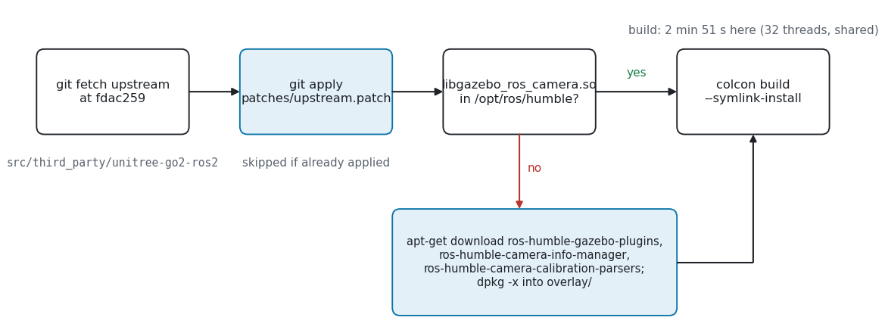
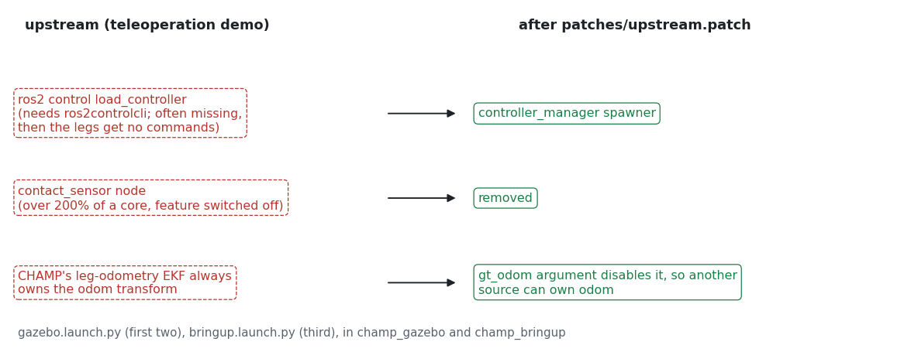
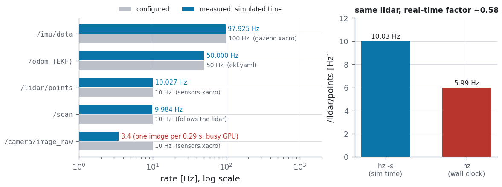
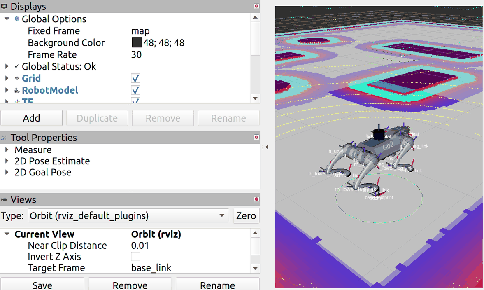
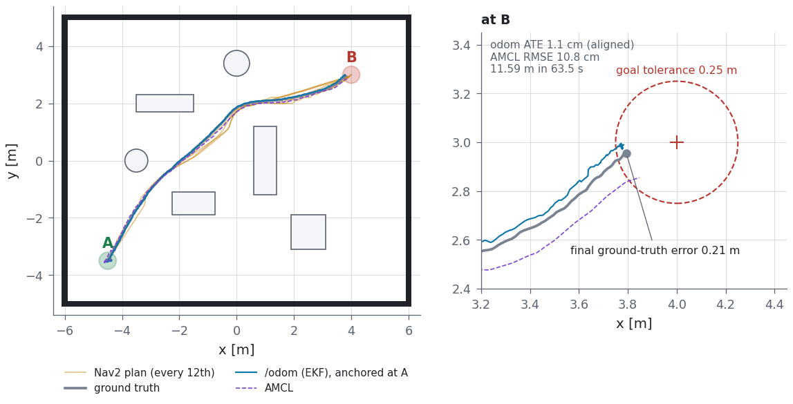
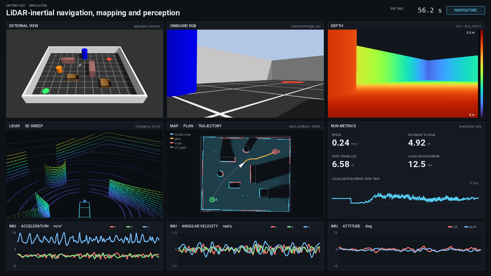

# 3. Install and first run

| | |
|---|---|
| Goal | The workspace built, the full stack running with every check passed, and one mission from A to B read and scored. |
| Time | 1.5 h. Chapters 2 and 3 together: 2 h. |
| Before you start | [Chapter 2](02-prerequisites.md) done: every package in its version check is installed, natively or in the dev container. The clone from [chapter 0](00-overview.md), task 1.1. |
| You will learn | what `setup.sh` changes in the upstream code; how `up.sh` decides the stack is ready; how to check rates in simulated time; how to read the result line of a mission and score the run against ground truth. |

## Task 1: Build the workspace

### 1.1 Run setup.sh

Objective: fetch the pinned upstream code, patch it and build everything.

Work in the clone you made in [chapter 0](00-overview.md), task 1.1. If you skipped that chapter, clone first with
`git clone https://github.com/Armanasq/go2-nav-sim.git` in the directory that should hold the repository.

```bash
cd go2-nav-sim
scripts/setup.sh
```

```
patch applied
plugins unpacked into overlay/
Starting >>> champ
...
Finished <<< champ_base [2min 1s]
Starting >>> champ_bringup
Finished <<< champ_bringup [3.28s]
Starting >>> go2_nav_sim
Finished <<< go2_nav_sim [1.67s]

Summary: 13 packages finished [2min 48s]
done. next:  source env.sh && scripts/up.sh
```

The build took 2 min 51 s of wall time on a 32-thread machine that was running other simulations at the same time; the download
of the upstream repository comes on top. `setup.sh` does three things:

1. Fetches [anujjain-dev/unitree-go2-ros2](https://github.com/anujjain-dev/unitree-go2-ros2) (Go2 description and CHAMP gait
   controller for Humble) at commit `fdac259` into `src/third_party/` and applies `patches/upstream.patch`.
2. Unpacks the Gazebo sensor plugins into `overlay/` if `/opt/ros/humble/lib/libgazebo_ros_camera.so` is missing. On a machine
   that has them, the second line of the output is absent.
3. Runs `colcon build --symlink-install`.

```bash
source env.sh
ros2 pkg prefix go2_nav_sim
```

Check: the last command prints `<repository>/install/go2_nav_sim`.

Common mistakes: running `setup.sh` a second time prints `patch already applied`; that is expected. A build that stops with
`No module named 'em'` has a virtualenv on `PATH` ([chapter 2](02-prerequisites.md), task 3.2).



*`scripts/setup.sh` as a flowchart; the plugin branch runs only when `/opt/ros/humble/lib/libgazebo_ros_camera.so` is missing.*

### 1.2 Read what the patch changes

Objective: know which upstream lines this stack depends on.

```bash
git -C src/third_party/unitree-go2-ros2 diff --stat
```

```
 champ/champ_bringup/launch/bringup.launch.py | 10 +++++++++-
 champ/champ_gazebo/launch/gazebo.launch.py   | 14 +++-----------
 2 files changed, 12 insertions(+), 12 deletions(-)
```

Upstream targets a teleoperation demo. Three things had to change for this stack:

- `champ_gazebo/launch/gazebo.launch.py` loaded controllers with `ros2 control load_controller`. That command comes from
  `ros2controlcli`, which is often not installed, and without it the legs never receive commands. The patch uses the
  `controller_manager` spawner instead.
- The same file started a `contact_sensor` node that used over 200% of a core for a feature that is switched off. Removed.
- `champ_bringup/launch/bringup.launch.py` gets a `gt_odom` argument that disables CHAMP's leg-odometry EKF, so another source can
  own the `odom` transform.

Check: two files changed, both launch files.



*The three changes in `patches/upstream.patch`, upstream behaviour on the left.*

## Task 2: Start the stack and check it

### 2.1 Run up.sh

Objective: start simulator, estimation and navigation in order, each only after the previous one is ready.

```bash
source env.sh
scripts/up.sh
```

```
stack: ROS_DOMAIN_ID=42 GAZEBO_MASTER_URI=http://localhost:11345
stack up
```

It printed `stack up` after 40 s here. `up.sh` starts three launch files and waits for each:

| Step | Launch file | Provides |
|---|---|---|
| 1 | `sim.launch.py` | Gazebo arena, Go2 with CHAMP, lidar, RGB-D camera, IMU, ground-truth pose |
| 2 | `estimation.launch.py` | `/scan`, lidar odometry, EKF, the `odom` to `base_footprint` transform |
| 3 | `nav.launch.py` | Nav2, AMCL on the arena map, a passive `slam_toolbox` |

Check: the last line is `stack up`. The launch output is in `logs/up_sim.log`, `logs/up_est.log` and `logs/up_nav.log`.

The first readiness check runs `gz stats -w arena -d 1`. Without `-w arena`, `gz stats` reads the first world the Gazebo master
lists. An earlier version of `up.sh` left out `-w arena`; on one run the first world listed was `default`, `gz stats` printed
nothing, and `up.sh` stopped with `TIMEOUT waiting for: gazebo` after 288 s while `gzserver` was running. Run the check yourself:

```bash
gz stats -w arena -d 2
```

```
Factor[0.76] SimTime[258.62] RealTime[348.07] Paused[F]
```

`Factor` is the real-time factor; 0.76 means one simulated second took 1.3 s. If `up.sh` still stops with
`TIMEOUT waiting for: gazebo` while this command prints `Factor` lines, the machine is too busy to answer within the 5 s
timeout of the check; the troubleshooting table of [p01](../projects/p01_first-steps/README.md) has the way around it.


*The readiness checks in `scripts/up.sh`. Each check is retried the number of times shown, 2 s apart; only the Nav2 step is restarted on failure.*

### 2.2 Check the sensor rates

Objective: confirm each sensor publishes at its configured rate.

```bash
ros2 topic hz -s /lidar/points
ros2 topic hz -s /imu/data
ros2 topic hz -s /scan
ros2 topic hz -s /odom
```

Stop each with Ctrl-C after a few lines. The last line of each:

```
average rate: 10.027
average rate: 97.925
average rate: 9.984
average rate: 50.000
```

Check: about 10 Hz for the lidar and `/scan`, about 100 Hz for the IMU, 50 Hz for the EKF's `/odom`. The camera,
`/camera/image_raw`, is set to 10 Hz in `sensors.xacro`; it is the first sensor to drop frames on a busy machine. With other
simulations running on the same GPU it delivered one image every 0.29 s of simulated time on average.

Common mistakes: without `-s`, `ros2 topic hz` measures in wall-clock time, so every rate is multiplied by the real-time factor.
At a factor of about 0.58 the lidar showed 5.99 Hz instead of 10.03 Hz. Every rate and time in this course is in simulated time.



*Measured rates from the outputs above against the configured ones in `gazebo.xacro` (IMU), `ekf.yaml` and `sensors.xacro`. The camera is the one topic far below its setting.*

### 2.3 Check that the robot is localised

Objective: see a transform from the map to the robot, which needs Gazebo, the EKF and AMCL all running.

```bash
ros2 run tf2_ros tf2_echo map base_footprint
```

```
[INFO] [...] [tf2_echo]: Waiting for transform map ->  base_footprint: Invalid frame ID "map" passed to canTransform argument target_frame - frame does not exist
At time 57.276000000
- Translation: [-4.504, -3.446, 0.000]
- Rotation: in Quaternion (xyzw) [0.000, 0.000, -0.008, 1.000]
```

Check: the translation is close to A at (-4.5, -3.5). The first `Waiting for transform` line is normal for a second or two; if it
repeats, AMCL has not received an initial pose.

### 2.4 Look at it in RViz

Objective: see the robot, the map, the costmaps and the scan in one window.

```bash
rviz2 -d src/go2_nav_sim/rviz/go2.rviz --ros-args -p use_sim_time:=true
```



*RViz with `src/go2_nav_sim/rviz/go2.rviz`, taken from the stack started in 2.1: the robot at A with its footprint, the scan, and the inflated obstacles of the costmaps.*

Check: `Global Status: Ok` and the robot model standing on the map. [p01](../projects/p01_first-steps/README.md) explains each
display. Gazebo itself runs without a window; to see it, launch `sim.launch.py headless:=False` yourself instead of `up.sh`.

## Task 3: Run the first mission

### 3.1 Run run_mission.sh

Objective: drive from A to B with Nav2 while recording a rosbag.

```bash
scripts/run_mission.sh bags/first; echo "exit code $?"
```

`run_mission.sh` restarts the stack with `up.sh`, starts `record_bag.sh`, runs `go_to_goal.py` and stops the recording. It
stops only its own recorder: `setsid` makes the recorder the leader of a new process group, and the script sends Ctrl-C (SIGINT)
to that group and waits until the bag is closed. A recorder of another stack on the same machine keeps running. The output,
with most progress lines left out:

```
stack: ROS_DOMAIN_ID=42 GAZEBO_MASTER_URI=http://localhost:11345
stack up
[INFO] [...] [basic_navigator]: goal -> (4.00, 3.00, yaw 0.65)
[INFO] [...] [basic_navigator]: Navigating to goal: 4.0 3.0...
[INFO] [...] [basic_navigator]: distance remaining 11.31 m, recoveries 0
...
[INFO] [...] [basic_navigator]: distance remaining 3.97 m, recoveries 1
...
[INFO] [...] [basic_navigator]: distance remaining 0.57 m, recoveries 1
RESULT SUCCEEDED  sim_time 54.2 s  ground-truth final error 0.32 m  final pos (3.68, 2.97)
exit code 0
```

It took 161 s of wall time at a real-time factor of about 0.55. The robot starts on the green disc A and walks to the red disc
B at (4.0, 3.0).

Check: the last two lines are `RESULT SUCCEEDED ...` and `exit code 0`.

### 3.2 Read the result line

Objective: know what each field measures and who measured it.

| Field | Value above | Source |
|---|---|---|
| `SUCCEEDED` | | Nav2's result. It means Nav2's own estimate of the robot was inside `xy_goal_tolerance` (0.25 m), not that the real robot was. Other values: `FAILED`, `CANCELED`. |
| `sim_time` | 54.2 s | simulated time from sending the goal to the result |
| `ground-truth final error` | 0.32 m | distance from B to the true final position on `/odom_gt` |
| `final pos` | (3.68, 2.97) | the true final position, in map coordinates |

The same line is in `logs/mission.log`. Recorded runs on the test machine took 54.4, 54.8 and 83.1 s; yours will vary from run
to run.

Check: you can say whether your run stopped inside the 0.25 m tolerance according to ground truth.



*A recorded run to the same goal (run w2, `site/data/runs/w2/run.json` and `results/run_w2.json`): it stopped 0.21 m from B, inside the 0.25 m tolerance.*

<video controls muted playsinline src="../media/c00-03-goal-reached.mp4"></video>

*The last 15 s of the dashboard video (`media/go2_a2b_dashboard.mp4` from 1:28): the status changes from NAVIGATING to ARRIVED, then the summary card.*

### 3.3 Score the run

Objective: compute the odometry and AMCL errors of your run from its bag.

```bash
python3 src/go2_nav_sim/scripts/bag_metrics.py bags/first
```

```
{
  "duration_s": 62.1,
  "path_m": 11.56,
  "mean_speed_ms": 0.186,
  "odom_ate_aligned_cm": 1.6,
  "odom_ate_anchored_cm": 1.8,
  "odom_final_err_cm": 4.5,
  "odom_drift_pct": 0.39,
  "odom_rpe_1m_pct": 1.94,
  "amcl_rmse_cm": 11.7,
  "amcl_max_cm": 18.1,
  "amcl_updates": 168,
  "goal_error_m": 0.32,
  "goal_tolerance_m": 0.25
}
```

Check: `goal_error_m` agrees with the ground-truth final error of the result line to within 0.01 m. Both come from `/odom_gt`,
but `go_to_goal.py` reads it when Nav2 reports the result and `bag_metrics.py` takes the last pose in the bag, which ends at
least 4 s later. In a second run they were 0.26 m and 0.25 m.

The bag was 639 MiB (`ros2 bag info bags/first`): 5.7 MiB per wall-clock second over 112 s, or 10.3 MiB per simulated second
over the 62.1 s of `duration_s`. [Chapter 11](11-record-and-visualise.md) explains each number and renders the dashboard video
from the same bag.



*One frame of the dashboard that `render_dashboard.py` makes from a bag. The run metrics panel is evaluation only.*

## Task 4: Stop the stack

### 4.1 Run stop.sh

Objective: leave no simulator running in the background.

```bash
scripts/stop.sh
ros2 node list --no-daemon
```

Check: `ros2 node list` prints nothing. `stop.sh` stops only processes in your `ROS_DOMAIN_ID`. CHAMP keeps walking on the last
`/cmd_vel` it received, so stopping the stack is also the way out when a robot walks off with no one commanding it.

## Exercise

The run in 3.1 reported `SUCCEEDED`, yet the robot stopped 0.32 m from B, outside the 0.25 m tolerance. Use the output of 3.3 to
explain how both can be true.

Answer: Nav2 checks the tolerance against its own pose estimate, which comes from AMCL on top of the odometry. The odometry was
good (`odom_ate_aligned_cm` 1.6), but AMCL was off by 11.7 cm RMSE and up to 18.1 cm (`amcl_rmse_cm`, `amcl_max_cm`). An AMCL
error of about 0.1 m in the direction of B is enough to move a stop that Nav2 sees inside 0.25 m to 0.32 m from B in reality.
Localisation, not odometry, limits how close to B the robot stops.


*The same effect in the recorded runs (`site/data/runs/wN/run.json`): in w3 the last `/amcl_pose` was 0.23 m from B and the robot 0.34 m.*

## Further reading

- Gazebo, "Installing Gazebo with ROS": https://gazebosim.org/docs/latest/ros_installation/
- `unitreerobotics/unitree_ros2`, `.devcontainer/`: how the Go2's own ROS 2 package sets up its build environment in a
  container.

Next: [4. ROS 2 from scratch](04-ros2-from-scratch.md)
