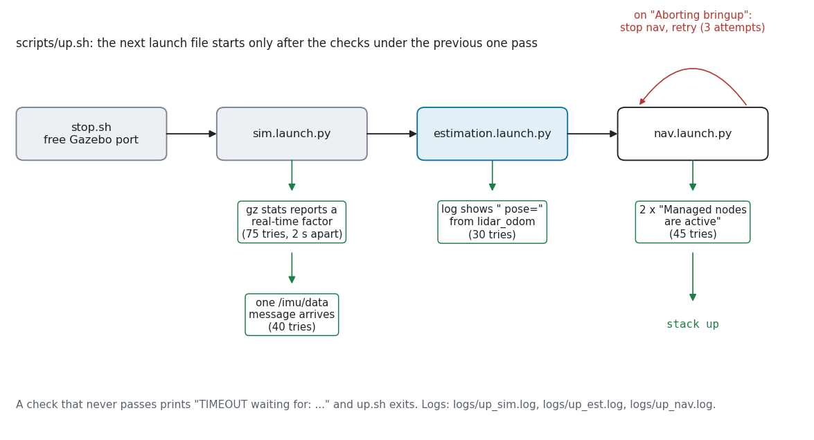

# 3. Install and first run

```bash
git clone https://github.com/Armanasq/go2-nav-sim.git && cd go2-nav-sim
scripts/setup.sh          # fetch upstream at a pinned commit, apply the patch, build (about 5 minutes)
source env.sh
scripts/up.sh             # start everything, with readiness checks
```

`setup.sh` does three things:

1. Fetches [anujjain-dev/unitree-go2-ros2](https://github.com/anujjain-dev/unitree-go2-ros2) (Go2 description and CHAMP gait
   controller for Humble) at commit `fdac259` into `src/third_party/` and applies `patches/upstream.patch`. The patch is small
   ([what it changes](#what-the-patch-changes)).
2. Installs the Gazebo sensor plugins into `overlay/` if the system lacks them.
3. Runs `colcon build --symlink-install`.


*`scripts/setup.sh` as a flowchart; the plugin branch runs only when `/opt/ros/humble/lib/libgazebo_ros_camera.so` is missing.*

`up.sh` starts three launch files in order and waits for each to be ready:

| Step | Launch file | Provides |
|---|---|---|
| 1 | `sim.launch.py` | Gazebo arena, Go2 with CHAMP, lidar, RGB-D camera, IMU, ground-truth pose |
| 2 | `estimation.launch.py` | `/scan`, lidar odometry, EKF, the `odom` to `base_footprint` transform |
| 3 | `nav.launch.py` | Nav2, AMCL on the arena map, a passive `slam_toolbox` |



*The readiness checks in `scripts/up.sh`. Each check is retried the number of times shown, 2 s apart; only the Nav2 step is restarted on failure.*

When it prints `stack up`, check it:

```bash
source env.sh
ros2 topic hz /lidar/points                                 # 10 Hz
ros2 topic hz /camera/image_raw                             # 10 Hz
ros2 topic hz /imu/data                                     # 100 Hz
ros2 run tf2_ros tf2_echo map base_footprint                # a pose, updating
```

Gazebo runs without a window. To see it, launch `sim.launch.py headless:=False` yourself.

## Send the robot to the goal

```bash
python3 src/go2_nav_sim/scripts/go_to_goal.py
# RESULT SUCCEEDED  sim_time 54.8 s  ground-truth final error 0.22 m
```

The robot starts on the green disc A and walks to the red disc B at (4.0, 3.0). Pass `x y yaw` for another goal.


*A recorded run to the same goal (run w2, `site/data/runs/w2/run.json` and `results/run_w2.json`): it stopped 0.21 m from B, inside the 0.25 m tolerance. Your numbers will differ slightly from run to run, as the 0.22 m above shows.*

<video controls muted playsinline src="../media/c00-03-goal-reached.mp4"></video>

*The last 15 s of the dashboard video (`media/go2_a2b_dashboard.mp4` from 1:28): the status changes from NAVIGATING to ARRIVED, then the summary card.*
Stop everything with `scripts/stop.sh`.

## What the patch changes

Upstream targets a teleoperation demo. Three things had to change for this stack:

- `champ_gazebo/launch/gazebo.launch.py` loaded controllers with `ros2 control load_controller`. That command comes from
  `ros2controlcli`, which is often not installed, and without it the legs never receive commands. The patch uses the
  `controller_manager` spawner instead.
- The same file started a `contact_sensor` node that used over 200% of a core for a feature that is switched off. Removed.
- `champ_bringup/launch/bringup.launch.py` gets a `gt_odom` argument that disables CHAMP's leg-odometry EKF, so another source can
  own the `odom` transform.


*The three changes in `patches/upstream.patch`, upstream behaviour on the left.*

Next: [4. ROS 2 from scratch](04-ros2-from-scratch.md)
