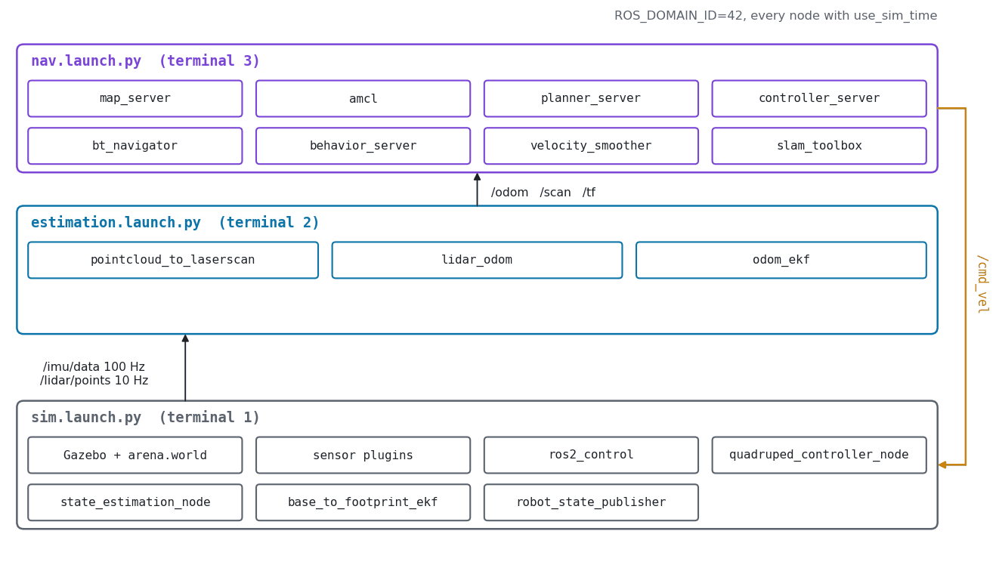
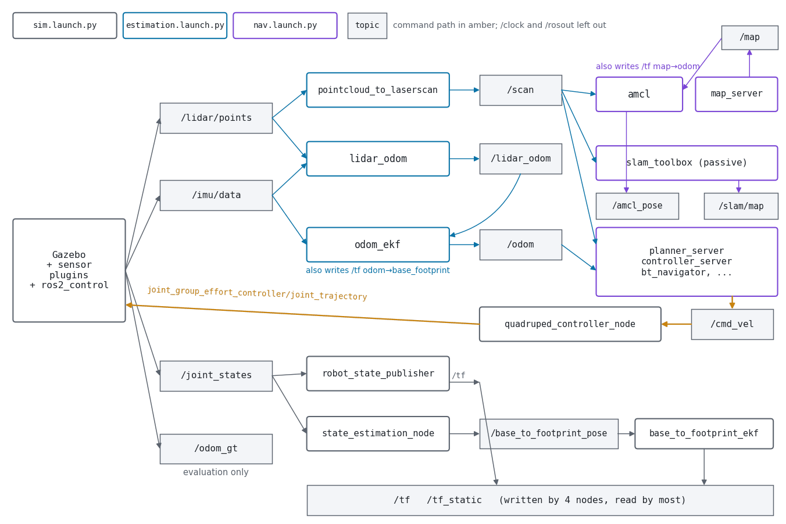
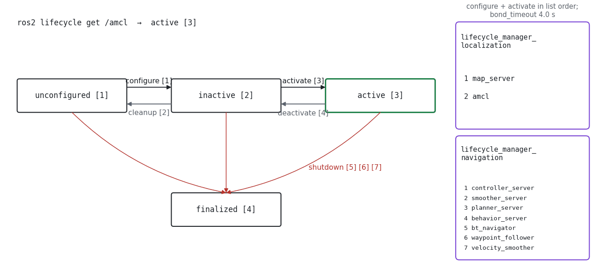
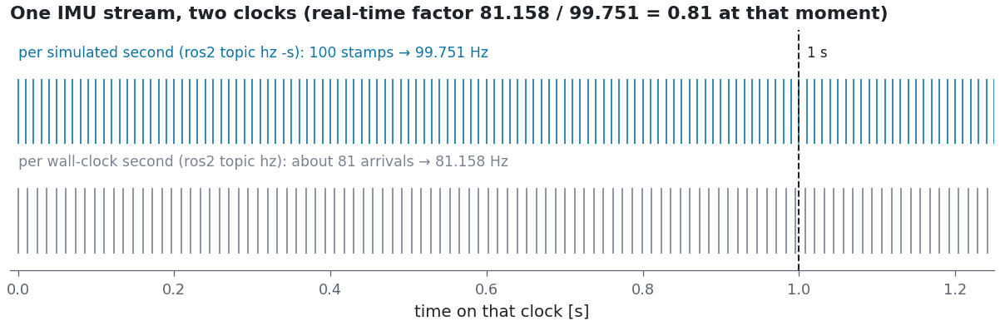
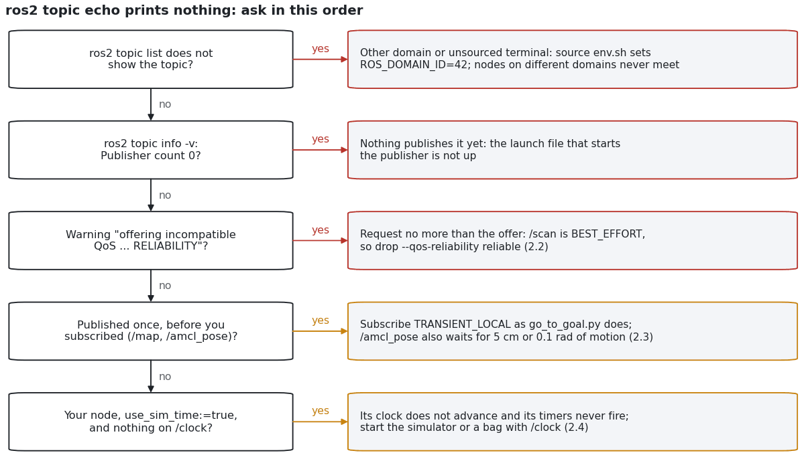
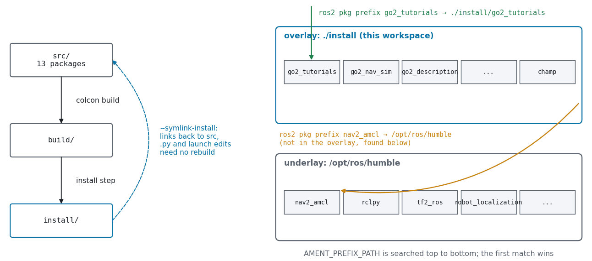
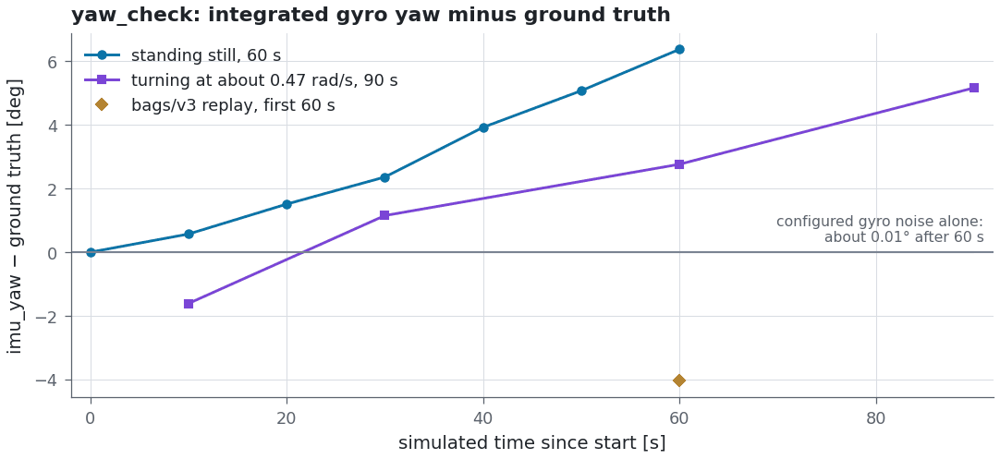

# 4. ROS 2 from scratch

This chapter teaches ROS 2 on the stack you started in chapter 3. You inspect it with the `ros2` command line, find out why
a command can print nothing while the data is there, change a Nav2 parameter through launch arguments, YAML and the command
line, record and replay a bag, and write, build and test a node of your own in `src/go2_tutorials`.

| | |
|---|---|
| Goal | Inspect the running stack, explain a silent echo, change a Nav2 parameter and confirm the change, replay a bag on the right clock, and build and test a node of your own. |
| Time | 4 h |
| Before you start | [Chapter 3](03-install-and-first-run.md): the workspace builds and `scripts/up.sh` prints `stack up`. Every terminal starts with `source env.sh` at the repository root. |
| You will learn | nodes, topics, services, actions and parameters; the QoS and clock rules behind a silent echo; workspaces, packages and entry points; launch arguments (`world`, `params_file`, `use_sim_time`), YAML overrides, `ros2 param get`, `set` and `dump`; bags and which clock to replay them with. |

The outputs come from two sessions on one machine that also ran other simulators: load average 40 to 57 on 32 threads, Gazebo
real-time factor (`gz stats`) between 0.48 and 0.96. Anything measured against the wall clock will be higher on a quiet machine.

## Task 1: Inspect a running system

### 1.1 Start the stack one launch file at a time

See what `scripts/up.sh` starts. Run the three launch files by hand, one per terminal, in this order (Gazebo takes about a
minute before the second one makes sense):

```bash
source env.sh
ros2 launch go2_nav_sim sim.launch.py          # terminal 1: Gazebo, the robot, CHAMP, sensors
ros2 launch go2_nav_sim estimation.launch.py   # terminal 2: /scan, lidar odometry, EKF
ros2 launch go2_nav_sim nav.launch.py          # terminal 3: Nav2, AMCL, passive slam_toolbox
```

`env.sh` sources ROS 2 and this workspace, selects Cyclone DDS, and sets `ROS_DOMAIN_ID=42` if the variable is not already
set (`${ROS_DOMAIN_ID:-42}`); a value you export before sourcing it is kept, which task 5.3 uses. Two ROS 2 programs see each
other only when they share a domain ID, which is how two stacks can run on one machine without crosstalk.



*What each launch file starts, read from `src/go2_nav_sim/launch/*.py` and the files they include. Sensor data flows up through the layers; `/cmd_vel` is the only command that flows back down.*

Check: `ros2 node list | wc -l` prints 44 once all three are up (44 in both sessions).

### 1.2 List the nodes and read one node's interface

List the running nodes and read what one of them subscribes to and publishes.

A running ROS 2 system is a graph of nodes that talk through four mechanisms:

| Mechanism | Pattern | Example in this stack |
|---|---|---|
| Topic | one-to-many stream of messages | `/imu/data`, 100 Hz, from the Gazebo IMU plugin |
| Service | request and reply | `/lidar_odom/get_parameters` |
| Action | long-running goal with feedback and a result, can be cancelled | `/navigate_to_pose`, `/spin` |
| Parameter | named, typed setting stored inside a node | `voxel` on `/lidar_odom` |


*The four mechanisms with the examples from this task; every number is from the outputs below (`/spin`: 41 feedback messages, 3.38 s, 1.62 rad reached).*

```bash
ros2 node list
```

```
/amcl
/base_to_footprint_ekf
/behavior_server
/bt_navigator
...
/lidar_odom
/odom_ekf
/pointcloud_to_laserscan
/quadruped_controller_node
/robot_state_publisher
/slam_toolbox
/state_estimation_node
/transform_listener_impl_57dcc2922720
...
```

The `transform_listener_impl_*` nodes are created internally by TF listeners in other nodes. Ask one node what it connects to:

```bash
ros2 node info /lidar_odom
```

```
/lidar_odom
  Subscribers:
    /clock: rosgraph_msgs/msg/Clock
    /imu/data: sensor_msgs/msg/Imu
    /lidar/points: sensor_msgs/msg/PointCloud2
    /tf: tf2_msgs/msg/TFMessage
    /tf_static: tf2_msgs/msg/TFMessage
  Publishers:
    /lidar_odom: nav_msgs/msg/Odometry
    /parameter_events: rcl_interfaces/msg/ParameterEvent
    /rosout: rcl_interfaces/msg/Log
  Service Servers:
    /lidar_odom/describe_parameters: rcl_interfaces/srv/DescribeParameters
    /lidar_odom/get_parameters: rcl_interfaces/srv/GetParameters
    ...
```

That is the whole interface of the lidar odometry from chapter 9: two sensor inputs, TF, the clock, and one output.

Check: `/lidar_odom` subscribes to `/imu/data` and `/lidar/points` and publishes `/lidar_odom`.

### 1.3 Read a topic

Find a topic's type, its endpoints and its rate, and print one field of a message.

```bash
ros2 topic list -t                 # -t adds the message type
ros2 topic info /imu/data          # Publisher count: 1, Subscription count: 2
ros2 topic hz -s /imu/data         # average rate: 99.751
ros2 topic echo --once /imu/data --field angular_velocity
```

```
x: 0.10193717438697308
y: 0.12372319915623527
z: 0.008941496483492451
---
```

`--field` prints one part of the message. The `-s` on `hz` is explained in [task 2.4](#24-measure-on-the-right-clock).

Check: `ros2 topic hz -s /imu/data` reports about 100 Hz (99.751 and 99.507 in the two sessions).

### 1.4 Read services and parameters

List one node's services, and read and describe its parameters.

Every node offers six parameter services, so the list is long:

```bash
ros2 service list | wc -l                      # 316
ros2 service list -t | grep lidar_odom
```

```
/lidar_odom/describe_parameters [rcl_interfaces/srv/DescribeParameters]
/lidar_odom/get_parameter_types [rcl_interfaces/srv/GetParameterTypes]
/lidar_odom/get_parameters [rcl_interfaces/srv/GetParameters]
/lidar_odom/list_parameters [rcl_interfaces/srv/ListParameters]
/lidar_odom/set_parameters [rcl_interfaces/srv/SetParameters]
/lidar_odom/set_parameters_atomically [rcl_interfaces/srv/SetParametersAtomically]
```

The `ros2 param` commands are clients of these services:

```bash
ros2 param list /lidar_odom                    # base_frame, fix_yaw, voxel, ... use_sim_time
ros2 param get /lidar_odom voxel               # Double value is: 0.15
ros2 param describe /lidar_odom fix_yaw        # Type: boolean
```

A parameter's type is fixed when the node declares it. `lidar_odom.py` declares all of its parameters at the top of `__init__`
with `self.declare_parameter(name, default)`; the default sets the type.

Check: `ros2 param get /lidar_odom voxel` prints `Double value is: 0.15`.

### 1.5 Send an action goal

Find the action servers and send a goal to one of them.

```bash
ros2 action list -t
```

```
/backup [nav2_msgs/action/BackUp]
/compute_path_to_pose [nav2_msgs/action/ComputePathToPose]
/follow_path [nav2_msgs/action/FollowPath]
/navigate_to_pose [nav2_msgs/action/NavigateToPose]
/spin [nav2_msgs/action/Spin]
...
```

```bash
ros2 action info /navigate_to_pose
```

```
Action: /navigate_to_pose
Action clients: 2
    /bt_navigator
    /waypoint_follower
Action servers: 1
    /bt_navigator
```

`go_to_goal.py` from chapter 3 is a third client while it runs. Send a goal to the spin behaviour yourself; the robot turns in
place by 90 degrees:

```bash
ros2 action send_goal /spin nav2_msgs/action/Spin "{target_yaw: 1.57, time_allowance: {sec: 20}}" --feedback
```

```
Goal accepted with ID: c809964844394441a611b4a176c94292
Feedback:
    angular_distance_traveled: 1.5322411060333252
...
Feedback:
    angular_distance_traveled: 1.6241763830184937
Result:
    total_elapsed_time:
  sec: 3
  nanosec: 380000000
Goal finished with status: SUCCEEDED
```

41 feedback messages arrived during the 3.38 s of simulated time. The robot overshot to 1.62 rad.

<video controls muted playsinline src="../media/c04-nav-goal-start.mp4"></video>

*0:04 to 0:18 of `media/go2_a2b_dashboard.mp4`, map and metrics panels: `go_to_goal.py` sends its `/navigate_to_pose` goal, the plan (amber) appears, and the robot starts to walk from A towards B.*

Check: the last line is `Goal finished with status: SUCCEEDED`.

### 1.6 Read an interface

Print the definition of a message and of an action.

Message, service and action definitions are interfaces:

```bash
ros2 interface show sensor_msgs/msg/Imu
```

```
std_msgs/Header header
	builtin_interfaces/Time stamp
		int32 sec
		uint32 nanosec
	string frame_id

geometry_msgs/Quaternion orientation
...
geometry_msgs/Vector3 angular_velocity
	float64 x
	float64 y
	float64 z
...
```

An action interface has three parts separated by `---`: goal, result and feedback.

```bash
ros2 interface show nav2_msgs/action/Spin
```

```
#goal definition
float32 target_yaw
builtin_interfaces/Duration time_allowance
...
---
#result definition
builtin_interfaces/Duration total_elapsed_time
...
---
#feedback definition
float32 angular_distance_traveled
```

`ros2 run rqt_graph rqt_graph` draws nodes and topics in a window. With 44 nodes it is crowded; filter on one node name. The
figure below is the part of the graph that carries data, drawn by hand.



*Nodes (rounded, coloured by launch file) and topics (square), from the launch files, `config/*.yaml` and the subscriptions in the node code. The amber path is the command loop: Nav2 to `/cmd_vel` to CHAMP to the joint controllers in Gazebo.*

Check: the goal fields of `nav2_msgs/action/Spin` are the two you sent in 1.5.

### 1.7 Read Nav2's lifecycle state

Check that Nav2's lifecycle nodes are active.

Nav2's nodes are lifecycle nodes: a manager configures and then activates them, in a fixed order. Two commands tell you where
they are:

```bash
ros2 lifecycle nodes                           # /amcl, /behavior_server, ... /waypoint_follower: 11 nodes
ros2 lifecycle get /amcl                       # active [3]
```

The localization manager brings up `map_server` and then `amcl`, so AMCL activates after the map has been published. Each
transition is a service call. On a loaded machine a call can time out, the manager logs `Aborting bringup`, and the nodes stay
inactive; `scripts/up.sh` watches for that line and retries.



*States and transitions with the IDs `ros2 lifecycle` prints, and the order in which the two managers of this stack bring their nodes up.*

Check: `ros2 lifecycle get /amcl` prints `active [3]`.

### 1.8 Find loose ends with ros2 doctor

Let `ros2 doctor` list the topics that have no publisher or no subscriber.

`ros2 doctor` checks the setup and lists topics with no subscriber or no publisher:

```bash
ros2 doctor
```

```
.../ros2doctor/api/topic.py: 42: UserWarning: Publisher without subscriber detected on /amcl_pose.
.../ros2doctor/api/topic.py: 45: UserWarning: Subscriber without publisher detected on /foot_contacts.
...
All 4 checks passed
```

Most of the warnings are expected (camera topics nobody reads). `/foot_contacts` without a publisher is the reason the trunk
height in TF is wrong, as [chapter 5](05-frames-and-tf2.md) shows. Rate, bandwidth and delay of one topic:

```bash
ros2 topic bw /lidar/points        # 1.42 MB/s from 27 messages, Message size mean: 0.21 MB
ros2 topic delay -s /scan          # average delay: 0.048 (min 0.024 s, max 0.117 s)
```

Check: the output has a warning for `/foot_contacts`.

## Task 2: Explain a silent echo

`ros2 topic echo` can print nothing while a publisher is sending. Two settings cause it here: the QoS profile and the clock.

### 2.1 Read the QoS profile of each endpoint

Compare the QoS profile a publisher offers with what its subscriptions ask for.

Each publisher and subscription carries a QoS profile. Three settings matter here:

| Setting | Values | Meaning |
|---|---|---|
| Reliability | `RELIABLE`, `BEST_EFFORT` | resend lost samples, or drop them |
| Durability | `VOLATILE`, `TRANSIENT_LOCAL` | late subscribers get nothing old, or the publisher keeps the last N samples for them |
| History depth | `KEEP_LAST (N)` | queue length |

```bash
ros2 topic info -v /imu/data
```

```
Node name: imu_plugin
Node namespace: /imu
Endpoint type: PUBLISHER
QoS profile:
  Reliability: RELIABLE
  History (Depth): KEEP_LAST (5)
  Durability: VOLATILE

Node name: lidar_odom
Endpoint type: SUBSCRIPTION
QoS profile:
  Reliability: BEST_EFFORT
  History (Depth): KEEP_LAST (5)
  Durability: VOLATILE

Node name: odom_ekf
Endpoint type: SUBSCRIPTION
QoS profile:
  Reliability: BEST_EFFORT
  History (Depth): KEEP_LAST (30)
  Durability: VOLATILE
```

The Gazebo plugins publish `RELIABLE`; the consumers ask for `BEST_EFFORT` (`qos_profile_sensor_data` in `lidar_odom.py`). A
sensor sample is useful only while it is fresh. With reliable delivery a lost packet is resent and later samples wait behind it;
best effort drops it and delivers the next one. Both the 100 Hz IMU and the 10 Hz lidar lose a sample now and then on this machine
(2000 IMU samples spanned 20.24 s of simulated time, about 1% missing).

Check: the IMU publisher is `RELIABLE` and both subscriptions are `BEST_EFFORT`.

### 2.2 Ask for more than the publisher offers

Make an echo silent by asking for more reliability than the publisher offers.

A subscription may ask for less than the publisher offers, never more. `pointcloud_to_laserscan` publishes `/scan` best effort
(`ros2 topic info -v /scan`). Ask for reliable delivery:

```bash
timeout -s INT 20 ros2 topic echo --once /scan --field header --qos-reliability reliable; echo "exit $?"
```

```
[WARN] [...] [_ros2cli_246815]: New publisher discovered on topic '/scan', offering incompatible QoS. No messages will be received from it. Last incompatible policy: RELIABILITY
exit 124
```

Check: the warning names `RELIABILITY`, no message arrives, and `timeout` ends the command with exit code 124.

Common mistakes: with a plain `timeout 10` (SIGTERM) the warning was lost in my run; the shell printed only `Terminated`. The
`-s INT` lets `ros2` flush its log before it exits.

### 2.3 Miss a message that was published before you subscribed

Make an echo silent by subscribing to a message that was published once, without asking for its history.

`/map` is published once, when `map_server` activates:

```bash
ros2 topic info -v /map
```

```
Node name: map_server
Endpoint type: PUBLISHER
QoS profile:
  Reliability: RELIABLE
  History (Depth): KEEP_LAST (1)
  Durability: TRANSIENT_LOCAL
```

The publisher keeps that one message for late subscribers, but only for those that ask for it:

```bash
ros2 topic echo --once /map --field info                                          # resolution 0.05..., width: 260, height: 220
timeout 10 ros2 topic echo --once /map --field info --qos-durability volatile; echo "exit $?"   # nothing, then exit 124
```

`/amcl_pose` is also `RELIABLE`, `KEEP_LAST (1)`, `TRANSIENT_LOCAL`. AMCL publishes it only after the odometry reports 5 cm or
0.1 rad of motion (`update_min_d` and `update_min_a` in `nav2_params.yaml`), so a volatile subscriber to a standing robot waits.
`go_to_goal.py` subscribes with a matching profile and receives the last pose at once:

```python
nav.create_subscription(PoseWithCovarianceStamped, '/amcl_pose', ...,
                        QoSProfile(depth=1, durability=DurabilityPolicy.TRANSIENT_LOCAL, reliability=ReliabilityPolicy.RELIABLE))
```


*Request against offer for the two policies, with the cases measured in this task in the cells. Red cells print the incompatible-QoS warning; the amber cell connects but has no history to give.*

Check: the first command prints `width: 260`; the second prints nothing and exits with 124.

### 2.4 Measure on the right clock

Measure rate and delay on the simulated clock, and see what the system clock gives instead.

Gazebo publishes simulated time on `/clock`. A node with the parameter `use_sim_time` set to true takes its time from `/clock`:
its timers, `get_clock().now()` and TF lookups all run in simulated seconds. Every node in this stack has it set.

```bash
ros2 topic echo --once /clock                  # clock: sec: 178 ...
ros2 param get /amcl use_sim_time              # Boolean value is: True
```

Message stamps are in simulated time too, so a tool on the system clock misreads them. The IMU rate without and with `-s`
(`--use-sim-time`):

```bash
ros2 topic hz /imu/data                        # average rate: 81.158   (second session: 51.525)
ros2 topic hz -s /imu/data                     # average rate: 99.751   (second session: 99.505)
```



*The same IMU messages counted on the two clocks. The real-time factor 0.81 is the ratio of the two `hz` readings above, not a separate measurement.*

Without `-s` the rate is per wall-clock second and follows the real-time factor; `gz stats` read 0.49 during the second
session. The delay between a message's stamp and its arrival:

```bash
ros2 topic delay /lidar_odom                   # average delay: 1795812606.678
ros2 topic delay -s /lidar_odom                # average delay: 0.071
```

The first number is the current Unix time minus a stamp of a few hundred simulated seconds. The second is the real answer: the
lidar odometry output arrives 71 ms after the scan it was computed from (23 to 118 ms over 48 messages).

The opposite mistake is quieter. A node with `use_sim_time:=true` and no `/clock` publisher has a clock that does not advance,
so its timers never fire. The node you write in task 3, started that way on an empty domain with debug logging, printed its
start-up line and then nothing for 6 s; without `use_sim_time` its timer logged once a second.

Check: `ros2 topic hz -s /imu/data` stays near 100 Hz while the plain `hz` changes with the real-time factor.

The cases of this task and of task 1, in the order to check them when an echo stays silent:



*The section that measured each case is in brackets; the first two rows come from task 1.*

## Task 3: Write, build and test a node

The node integrates the IMU's yaw rate into a heading and publishes it. It is the gyro prediction inside `lidar_odom.py` in its
simplest form, and it shows how fast an integrated gyro drifts.

### 3.1 Find where packages come from

Find out which workspace a package is loaded from.

A workspace is a directory with a `src/` folder of packages. `colcon build`, run at the workspace root (here the repository
root), builds every package into `build/` and installs it into `install/`. Sourcing `install/setup.bash` (which `env.sh` does)
puts this workspace, the overlay, on top of `/opt/ros/humble`, the underlay. A package in the overlay hides one with the same
name in the underlay.

```bash
echo $AMENT_PREFIX_PATH | tr : '\n'
```

```
./install/go2_tutorials
./install/go2_nav_sim
./install/go2_description
...
./install/champ
/opt/ros/humble
```

(Paths shortened.) Lookups go down this list:

```bash
ros2 pkg prefix go2_tutorials                  # ./install/go2_tutorials
ros2 pkg prefix nav2_amcl                      # /opt/ros/humble
```



*`colcon build` turns `src/` into `install/`; the overlay is searched before the underlay, so `go2_tutorials` resolves to this workspace and `nav2_amcl` to `/opt/ros/humble`.*

Check: `ros2 pkg prefix nav2_amcl` prints `/opt/ros/humble`.

### 3.2 See how a package installs its programs

See where `colcon` installs a package's programs and which of them `ros2 run` can find.

A package is a directory with a `package.xml`: name, version, dependencies and build type. `colcon list` shows 13 packages
here; 12 are `ament_cmake`, and `go2_tutorials`, which you write below, is `ament_python`.

| | `ament_cmake` | `ament_python` |
|---|---|---|
| Build description | `CMakeLists.txt` | `setup.py` (+ `setup.cfg`) |
| Typical content | C++ nodes, or anything that is only installed (launch, URDF, config) | a Python package |
| Python nodes | installed as scripts with `install(PROGRAMS ...)` | entry points in `setup.py` |

`go2_nav_sim` is `ament_cmake` because most of it is files to install. Its Python nodes are plain scripts:

```cmake
install(PROGRAMS scripts/lidar_odom.py scripts/gt_odom.py scripts/go_to_goal.py ... DESTINATION lib/${PROJECT_NAME})
install(FILES scripts/registration.py DESTINATION lib/${PROJECT_NAME})
```

`ros2 run <package> <executable>` looks in `install/<package>/lib/<package>/`. `registration.py` is a module that
`lidar_odom.py` imports, not a program. Two `colcon` flags are used throughout: `--packages-select <name>` builds one package
instead of all 13, and `--symlink-install` links the installed files to the sources, so an edit to a Python or launch file takes
effect without a rebuild (changes to `setup.py`, `package.xml` or `CMakeLists.txt` still need one).

```bash
ls -l install/go2_nav_sim/lib/go2_nav_sim/lidar_odom.py
# lrwxrwxrwx ... install/go2_nav_sim/lib/go2_nav_sim/lidar_odom.py -> ./src/go2_nav_sim/scripts/lidar_odom.py
ros2 pkg executables go2_nav_sim               # go_to_goal.py, gt_odom.py, lidar_odom.py, odom_eval.py
ros2 run go2_nav_sim bag_metrics.py --help     # No executable found
```

Check: `ros2 pkg executables go2_nav_sim` lists four scripts.

Common mistakes: with `--symlink-install` the executable bit is the source file's. Three of the seven scripts in the
`install(PROGRAMS)` list are not executable in the source tree, so `ros2 run` does not find them. The other chapters call them
with `python3 path/to/script.py`; `chmod +x` on the source file fixes `ros2 run`.

### 3.3 Write the node

Write a node that integrates the IMU's yaw rate and publishes the heading.

The package:

```
src/go2_tutorials/
  package.xml                 name, dependencies, <build_type>ament_python</build_type>
  setup.py                    the Python package, the launch file, and two entry points
  setup.cfg                   tells setuptools to put the executables in lib/go2_tutorials
  resource/go2_tutorials      empty marker file; ament uses it to find the package
  go2_tutorials/imu_yaw.py    the node
  go2_tutorials/yaw_check.py  compares /imu_yaw with ground truth
  launch/imu_yaw.launch.py
  test/test_imu_yaw.py
```

`ros2 pkg create --build-type ament_python go2_tutorials` generates the skeleton (`package.xml`, `setup.py`, `setup.cfg`,
`resource/`, an empty `go2_tutorials/__init__.py`, and three style tests that this package leaves out). The entry points in
`setup.py` are what `ros2 run` finds:

```python
entry_points={
    'console_scripts': [
        'imu_yaw = go2_tutorials.imu_yaw:main',
        'yaw_check = go2_tutorials.yaw_check:main',
    ],
},
```

`src/go2_tutorials/go2_tutorials/imu_yaw.py`:

```python
class YawIntegrator:
    """Sums rate * dt between message stamps. Plain Python, so the test needs no running ROS graph."""

    def __init__(self, max_gap=0.5):
        self.yaw, self.t_last, self.max_gap = 0.0, None, max_gap

    def add(self, t, rate):
        if self.t_last is not None:
            dt = t - self.t_last
            if dt <= 0.0:                  # repeated or out-of-order stamp: ignore the sample
                return self.yaw
            if dt < self.max_gap:          # a longer gap (paused sim, lost messages) is skipped, not bridged
                self.yaw += rate * dt
        self.t_last = t
        return self.yaw


class ImuYaw(Node):
    def __init__(self):
        super().__init__('imu_yaw')
        rate = self.declare_parameter('publish_rate', 10.0).value
        self.integ = YawIntegrator()
        self.pub = self.create_publisher(Float64, 'imu_yaw', 10)
        self.create_subscription(Imu, 'imu/data', self.on_imu, qos_profile_sensor_data)
        self.create_timer(1.0 / rate, self.on_timer)
        self.get_logger().info(f'integrating imu/data, publishing imu_yaw at {rate} Hz')

    def on_imu(self, m):
        self.integ.add(m.header.stamp.sec + m.header.stamp.nanosec * 1e-9, m.angular_velocity.z)

    def on_timer(self):
        self.pub.publish(Float64(data=self.integ.yaw))
        self.get_logger().debug(f'yaw {self.integ.yaw:.4f} rad', throttle_duration_sec=1.0)
```

What to check against tasks 1 and 2:

- `dt` comes from the message stamps, not from arrival time. Messages arrive in bursts on a loaded machine; the stamps say
  when the sensor measured.
- `qos_profile_sensor_data` makes the subscription best effort, which the reliable IMU publisher accepts.
- The topic names have no leading slash, so they resolve inside the node's namespace (`/imu/data` and `/imu_yaw` here) and
  can be remapped.
- `publish_rate` is declared with a float default, so its type is double. The timer runs on the node's clock, which is the
  simulated clock once `use_sim_time` is true.
- `angular_velocity.z` is the rate about the IMU's own z axis. When the trunk tilts, that axis is not vertical; `lidar_odom.py`
  corrects for this with roll and pitch, this node does not.
- The integration lives in `YawIntegrator`, a class with no ROS in it, so it can be tested without a running system.

An executor runs a node's callbacks; `rclpy.spin(node)` uses one thread, so one callback at a time. In `lidar_odom.py` that let a
registration of several milliseconds hold up the IMU callback, and yaw was under-integrated by about half during turns.
The fix puts the two subscriptions in separate `MutuallyExclusiveCallbackGroup`s
under a `MultiThreadedExecutor(num_threads=3)`; a multi-threaded executor alone does not help, because by default all of a
node's callbacks share one mutually exclusive group. The gyro is also looked up by timestamp, so callback order no longer matters.
The full account of that failure and its fix is in [chapter 9](09-state-estimation.md#failures-worth-knowing-about), third item;
the ROS 2 guide [Using callback groups](https://docs.ros.org/en/humble/How-To-Guides/Using-callback-groups.html) covers the
executor API.


*Schematic of `lidar_odom.py` before and after the fix; the durations are not to scale.*

The launch file `launch/imu_yaw.launch.py` sets the parameters:

```python
Node(package='go2_tutorials', executable='imu_yaw', name='imu_yaw', output='screen',
     parameters=[{'use_sim_time': True, 'publish_rate': 10.0}]),
```

The test, `test/test_imu_yaw.py`, checks that 0.5 rad/s for 2 s at 100 Hz integrates to 1.0 rad, and that an out-of-order
stamp and a 1.9 s gap are skipped.

Check: `python3 -c "import ast,sys; ast.parse(open('src/go2_tutorials/go2_tutorials/imu_yaw.py').read())"` prints nothing.

### 3.4 Build, test and run it

Build the package, run its tests and start the node.

From the repository root:

```bash
colcon build --symlink-install --packages-select go2_tutorials
# Finished <<< go2_tutorials [5.78s]
source install/setup.bash          # a new package needs the setup file sourced again
colcon test --packages-select go2_tutorials && colcon test-result --verbose --test-result-base build/go2_tutorials
# Summary: 2 tests, 0 errors, 0 failures, 0 skipped
ros2 launch go2_tutorials imu_yaw.launch.py
```

From another terminal:

```bash
ros2 node info /imu_yaw            # subscribes /clock and /imu/data, publishes /imu_yaw
ros2 topic hz -s /imu_yaw          # average rate: 10.000
ros2 topic echo --once /imu_yaw    # data: 0.005117615220794343
ros2 param get /imu_yaw publish_rate   # Double value is: 10.0
```

Log levels are set per node at start-up. Naming the logger keeps the other loggers in the process (rcl, the middleware) quiet:

```bash
ros2 run go2_tutorials imu_yaw --ros-args --log-level imu_yaw:=debug
```

```
[INFO] [1795813275.519752083] [imu_yaw]: integrating imu/data, publishing imu_yaw at 10.0 Hz
[DEBUG] [1795813275.578020872] [imu_yaw]: yaw 0.0000 rad
[DEBUG] [1795813276.676688469] [imu_yaw]: yaw 0.0000 rad
```

Check: `colcon test-result` reports 2 tests and 0 failures, and `ros2 topic hz -s /imu_yaw` reports 10 Hz.

Common mistakes: `--log-level debug` without a logger name turns on debug output from every library in the process, hundreds
of lines before the node does anything.

<a id="check-it-against-ground-truth"></a>

### 3.5 Check it against ground truth

Measure how far the integrated yaw drifts from ground truth.

`/odom_gt` is the simulator's true pose of `base_link`. `yaw_check` subscribes to both topics, takes the first sample of each
as zero, unwraps the true yaw across ±180 degrees, and prints how far each has turned every 10 s of simulated time:

```bash
ros2 run go2_tutorials yaw_check --ros-args -p use_sim_time:=true -p duration:=60.0
```

Standing still for 60 s:

```
t   0.0 s  gt turned     0.00 deg  imu_yaw turned     0.00 deg  error   0.00 deg
t  10.0 s  gt turned     0.03 deg  imu_yaw turned     0.60 deg  error   0.57 deg
t  20.0 s  gt turned    -0.04 deg  imu_yaw turned     1.48 deg  error   1.51 deg
t  30.0 s  gt turned    -0.02 deg  imu_yaw turned     2.34 deg  error   2.36 deg
t  40.0 s  gt turned    -0.04 deg  imu_yaw turned     3.88 deg  error   3.92 deg
t  50.0 s  gt turned    -0.08 deg  imu_yaw turned     4.99 deg  error   5.07 deg
t  60.0 s  gt turned    -0.18 deg  imu_yaw turned     6.20 deg  error   6.37 deg
```

Turning in place for 90 s, with `ros2 topic pub -r 10 /cmd_vel geometry_msgs/msg/Twist "{angular: {z: 0.5}}"` running in
another terminal (the robot kept turning at about 0.47 rad/s for the whole window; publish `"{}"` afterwards to stop it):

```
t  10.0 s  gt turned   215.01 deg  imu_yaw turned   213.40 deg  error  -1.61 deg
t  30.0 s  gt turned   773.05 deg  imu_yaw turned   774.20 deg  error   1.15 deg
t  60.0 s  gt turned  1609.94 deg  imu_yaw turned  1612.70 deg  error   2.76 deg
t  90.0 s  gt turned  2444.99 deg  imu_yaw turned  2450.15 deg  error   5.16 deg
```

On the first 60 s of the recorded mission in `bags/v3` (replayed as in [task 5](#task-5-record-and-replay-a-bag)), the error
was -4.02 degrees.



*The three `yaw_check` results above on one plot. The grey band is the drift the configured gyro noise alone would give, about 0.01 degrees after 60 s.*

The integrated gyro drifts by 4 to 6.4 degrees per minute here, whether the robot stands, spins or walks. The configured noise
(σ = 2e-4 rad/s, no bias, in `gazebo.xacro`) accounts for about 0.01 degrees of that. With the robot standing, `/imu/data` had a
mean z rate of 0.0025 rad/s (0.14 degrees per second) and a standard deviation of 0.017 rad/s over 20 s, while the true yaw moved
by less than 0.2 degrees per minute; the standing trunk vibrates in the physics simulation (x-rate standard deviation
0.087 rad/s). That the vibration does not average to zero is my inference; I have not traced it in Gazebo. `lidar_odom.py`
integrates the same gyro: left standing, its logged yaw moved from -165 to -112 degrees between scans #2800 and #6800 (400 s of
simulated time, 0.13 degrees per second). A robot left idle for minutes needs its odometry restarted.

Check: after 60 s standing, `yaw_check` reports an error of a few degrees.

## Task 4: Set parameters with launch arguments and YAML

A launch argument is a value you pass on the `ros2 launch` command line (`name:=value`). The launch file decides what it changes:
a node parameter, a file to load, whether a node starts at all.

### 4.1 Read a launch file that takes an argument

Read how a launch file declares an argument and hands it to its nodes.

`src/go2_nav_sim/launch/estimation.launch.py`:

```python
def generate_launch_description():
    cfg = os.path.join(share('go2_nav_sim'), 'config')
    sim = {'use_sim_time': LaunchConfiguration('use_sim_time')}     # listed after a YAML file, so it overrides the file's value
    return LaunchDescription([
        DeclareLaunchArgument('use_sim_time', default_value='true', description='take time from /clock (Gazebo or a bag)'),
        Node(package='pointcloud_to_laserscan', executable='pointcloud_to_laserscan_node', name='pointcloud_to_laserscan',
             parameters=[os.path.join(cfg, 'scan.yaml'), sim], remappings=[('cloud_in', '/lidar/points'), ('scan', '/scan')]),
        Node(package='go2_nav_sim', executable='lidar_odom.py', name='lidar_odom', parameters=[sim], output='screen'),
        Node(package='robot_localization', executable='ekf_node', name='odom_ekf',
             parameters=[os.path.join(cfg, 'ekf.yaml'), sim], remappings=[('odometry/filtered', '/odom')]),
    ])
```

- `DeclareLaunchArgument` creates the argument and its default; `LaunchConfiguration('use_sim_time')` is its value when the
  file runs. The string `'true'` becomes the boolean `True` when it is handed to the node.
- `parameters` takes YAML files, dictionaries, or both; later entries override earlier ones. `ekf.yaml` sets
  `use_sim_time: true` itself, and the dictionary after it wins.
- `share('go2_nav_sim')` returns `install/go2_nav_sim/share/go2_nav_sim`, where `CMakeLists.txt` installed `config/`.
- `remappings` rename a node's topics without touching its code: `cloud_in` becomes `/lidar/points`, and the EKF's
  `odometry/filtered` becomes `/odom`.
- `name` overrides the node name. Started with `ros2 run robot_localization ekf_node`, the EKF is `/ekf_filter_node`; here it is
  `/odom_ekf`, and the top-level key in `ekf.yaml` (`odom_ekf:`) must match that name or its parameters are not applied.

Check: `ros2 node info /pointcloud_to_laserscan` shows a subscription to `/lidar/points` and a publisher on `/scan`.

### 4.2 List the arguments of each launch file

List the arguments each of the three launch files accepts.

`ros2 launch -s` prints the arguments a launch file accepts:

```bash
ros2 launch -s go2_nav_sim estimation.launch.py
```

```
Arguments (pass arguments as '<name>:=<value>'):

    'use_sim_time':
        take time from /clock (Gazebo or a bag)
        (default: 'true')
```

```bash
ros2 launch -s go2_nav_sim nav.launch.py
```

```
    'map':
        map for AMCL / Nav2
        (default: '.../install/go2_nav_sim/share/go2_nav_sim/maps/arena.yaml')

    'mapper':
        run the passive mapper on /slam/map
        (default: 'true')

    'params_file':
        Nav2 + AMCL parameter file
        (default: '.../install/go2_nav_sim/share/go2_nav_sim/config/nav2_params.yaml')

    'use_sim_time':
        take time from /clock (Gazebo or a bag)
        (default: 'true')

    'namespace':
        Top-level namespace
        (default: '')
...
```

```bash
ros2 launch -s go2_nav_sim sim.launch.py
```

```
    'world':
        Gazebo world file
        (default: '.../install/go2_nav_sim/share/go2_nav_sim/worlds/arena.world')

    'headless':
        True = no gzclient window
        (default: 'True')

    'use_sim_time':
        Use simulation (Gazebo) clock if true
        (default: 'false')
...
    'world_init_heading':
        no description given
        (default: '0.6')

    'odom':
        odom->base_footprint source: 'lidar' (estimation.launch.py) or 'gt' (simulator ground truth)
        (default: 'lidar')
```

The arguments after `use_sim_time` in `nav.launch.py` come from Nav2's `bringup_launch.py`, which it includes, and
`nav.launch.py` passes its own `params_file` and `use_sim_time` on to it. In `sim.launch.py`, `world`, `headless` and the last
one, `odom`, are its own; the ones between come from the CHAMP launch files it includes. The `use_sim_time` listed there,
default `'false'`, belongs to a CHAMP file, and `sim.launch.py` sets it to `true` when it includes that file; the same holds for
the `world_init_*` values, which `sim.launch.py` fixes to marker A. `odom:=gt` starts `gt_odom.py`, which publishes `odom` to
`base_footprint` from the simulator's ground truth instead of the estimation layer ([chapter 5](05-frames-and-tf2.md), task
1.4). The defaults reproduce what `scripts/up.sh` starts, which passes no arguments.

Check: `nav.launch.py` lists `params_file` and `use_sim_time`, `sim.launch.py` lists `world` and, last, `odom` with default
`'lidar'`.

### 4.3 Read a Nav2 value and dump a node's parameters

Read one Nav2 parameter, and dump all parameters of its node.

The path follower's cruise speed is `desired_linear_vel` in the `FollowPath` block of `controller_server`:

```bash
ros2 param get /controller_server FollowPath.desired_linear_vel
```

```
Double value is: 0.25
```

`ros2 param dump` prints every parameter of a node as YAML, in the format a params file uses:

```bash
ros2 param dump /controller_server > controller_server.yaml
head -5 controller_server.yaml; grep desired_linear_vel controller_server.yaml
```

```
/controller_server:
  ros__parameters:
    /bond_disable_heartbeat_timeout: true
    FollowPath:
      allow_reversing: false
      desired_linear_vel: 0.25
```

The dump had 61 lines. Dotted names such as `FollowPath.desired_linear_vel` are nested keys in the YAML.

Check: `get` and the dump agree on 0.25.

### 4.4 Change it from the command line

Change that parameter in the running node and measure the effect.

`ros2 param set` changes a parameter in the running node, if the node accepts the change:

```bash
ros2 param set /controller_server FollowPath.desired_linear_vel 0.15
ros2 param get /controller_server FollowPath.desired_linear_vel
```

```
Set parameter successful
Double value is: 0.15
```

Measure the effect with a short goal 2.5 m straight ahead along the free row at y = -3.5 (the first one from marker A,
the second from where the first ended):

```bash
python3 src/go2_nav_sim/scripts/go_to_goal.py -2.0 -3.5 0.0     # with 0.25
python3 src/go2_nav_sim/scripts/go_to_goal.py 0.5 -3.5 0.0      # after the set to 0.15
```

```
RESULT SUCCEEDED  sim_time 11.9 s  ground-truth final error 0.24 m  final pos (-2.22, -3.42)
RESULT SUCCEEDED  sim_time 23.0 s  ground-truth final error 0.32 m  final pos (0.18, -3.43)
```

The first goal covered 2.3 m in 11.9 s of simulated time, the second 2.4 m in 23.0 s: 0.19 against 0.10 m/s on average,
including the start and the slow approach. A value set this way lives in the running process only. After a restart with the
default file, `ros2 param get` printed 0.25 again.

Check: `ros2 param get` prints 0.15, and the second goal takes about twice as long.

### 4.5 Change it in a YAML file

Make the change survive a restart with your own params file.

A value that should survive a restart goes in a params file. Copy the installed one, change one line, and restart Nav2 with
it:

```bash
cp $(ros2 pkg prefix go2_nav_sim)/share/go2_nav_sim/config/nav2_params.yaml $HOME/my_nav2.yaml
sed -i 's/desired_linear_vel: 0.25/desired_linear_vel: 0.15/' $HOME/my_nav2.yaml
diff $(ros2 pkg prefix go2_nav_sim)/share/go2_nav_sim/config/nav2_params.yaml $HOME/my_nav2.yaml
```

```
134c134
<       desired_linear_vel: 0.25
---
>       desired_linear_vel: 0.15
```

Stop only the navigation layer and start it again with the file (in the terminal that ran `nav.launch.py`, or any terminal if
you used `scripts/up.sh`):

```bash
scripts/stop.sh nav
ros2 launch go2_nav_sim nav.launch.py params_file:=$HOME/my_nav2.yaml
```

When the log has shown `Managed nodes are active` twice (once per lifecycle manager), from another terminal:

```bash
ros2 param get /controller_server FollowPath.desired_linear_vel
ros2 param dump /controller_server | grep desired_linear_vel
```

```
Double value is: 0.15
      desired_linear_vel: 0.15
```

The restarted AMCL starts from `initial_pose` in the file (marker A), wherever the robot stands; `go_to_goal.py` sends the true
pose as its first step, so run it before you judge the localisation.

Check: both commands print 0.15 after the restart.

### 4.6 Pass use_sim_time, and see what one wrong clock does

Start one layer on the wrong clock and read what breaks.

Every node in one graph has to use the same clock. Restart the stack with only the estimation layer on the system clock:

```bash
scripts/stop.sh
ros2 launch go2_nav_sim sim.launch.py                               # terminal 1
ros2 launch go2_nav_sim estimation.launch.py use_sim_time:=false    # terminal 2, once /imu/data publishes
ros2 launch go2_nav_sim nav.launch.py                               # terminal 3
```

The launch files start without an error. The clocks disagree:

```bash
ros2 param get /odom_ekf use_sim_time
ros2 topic echo --once /odom --field header.stamp
ros2 topic echo --once /clock --field clock
```

```
Boolean value is: False
sec: 1795824105
nanosec: 976349418
---
sec: 248
nanosec: 725000000
---
```

The EKF stamps `odom` to `base_footprint` with Unix time, while the scans are stamped near 248 s. In the `nav.launch.py`
terminal:

```
[amcl-2] [INFO] [...] [amcl]: Message Filter dropping message: frame 'base_footprint' at time 239.299 for reason 'the timestamp on the message is earlier than all the data in the transform cache'
[planner_server-6] [INFO] [...] [global_costmap.global_costmap]: Timed out waiting for transform from base_footprint to map to become available, tf error: Invalid frame ID "map" passed to canTransform argument tar...
```

AMCL drops every scan, so it never publishes `map` to `odom`; the global costmap waits for a `map` frame that does not exist,
and `planner_server` never activates. In my run 99 scans were dropped and only one of the two lifecycle managers reported
`Managed nodes are active`. Stop everything and start again with the defaults:

```bash
scripts/stop.sh
scripts/up.sh
ros2 param get /odom_ekf use_sim_time          # Boolean value is: True
```

Check: with `use_sim_time:=false` the `/odom` stamp is a Unix time; with the default it is close to `/clock`.

### 4.7 Start Gazebo on another world

Start Gazebo on a world of your own and see the change in the scan.

The `world` argument of `sim.launch.py` takes any world file. Copy the arena and move the brick wall `box1` (0.8 m deep,
1.0 m high) from the middle of the arena to 1.5 m in front of marker A, where the robot starts facing +x:

```bash
scripts/stop.sh
cp $(ros2 pkg prefix go2_nav_sim)/share/go2_nav_sim/worlds/arena.world $HOME/my_arena.world
sed -i 's|<model name="box1"><static>1</static><pose>1.0 0.0 0.5 |<model name="box1"><static>1</static><pose>-3.0 -3.5 0.5 |' $HOME/my_arena.world
diff $(ros2 pkg prefix go2_nav_sim)/share/go2_nav_sim/worlds/arena.world $HOME/my_arena.world
```

```
77c77
<     <model name="box1"><static>1</static><pose>1.0 0.0 0.5 0 0 0</pose><link name="l">
---
>     <model name="box1"><static>1</static><pose>-3.0 -3.5 0.5 0 0 0</pose><link name="l">
```

Start the simulator on it, and the estimation layer for `/scan`:

```bash
ros2 launch go2_nav_sim sim.launch.py world:=$HOME/my_arena.world      # terminal 1
ros2 launch go2_nav_sim estimation.launch.py                           # terminal 2, once /imu/data publishes
```

Read the range straight ahead from one scan. `/scan` covers -π to π in steps of 0.00698 rad, so 0 rad is index 450:

```bash
python3 - <<'EOF'
import rclpy
from rclpy.node import Node
from rclpy.qos import qos_profile_sensor_data
from sensor_msgs.msg import LaserScan
rclpy.init(); n = Node('ahead'); got = []
n.create_subscription(LaserScan, '/scan', lambda m: got.append(m), qos_profile_sensor_data)
while not got: rclpy.spin_once(n, timeout_sec=1.0)
m = got[0]; i = round((0.0 - m.angle_min) / m.angle_increment)
print(f'frame {m.header.frame_id}  range straight ahead (index {i}): {m.ranges[i]:.3f} m')
EOF
```

```
frame base_footprint  range straight ahead (index 450): 0.876 m
```

A second scan read 0.892 m; in the default arena the same script printed 6.410 m. The wall's near face is at x = -3.4 m,
1.1 m ahead of marker A (x = -4.5 m). The robot does not settle exactly on A: read how far it moved with
`ros2 topic echo --once /odom_gt --field pose.pose.position`. Here `/odom_gt` x was 0.20 m, so 1.1 − 0.20 = 0.90 m was
expected. In a second session x was 0.132 m and two scans read 0.938 and 0.949 m, against 0.968 m expected. AMCL and Nav2 still
load `maps/arena.yaml`, which has no wall there; give `nav.launch.py` a matching `map:=` before you plan through a changed
world.

Check: with your world the range straight ahead is 1.1 m minus the `/odom_gt` x, within a few centimetres (it read 1 to 3 cm
short in both sessions); with the default world it is several metres.

Common mistakes: with a load average above 100 from other simulators, Gazebo took about 5 min to load, and a script with the
same Gazebo wait as `scripts/up.sh` gave up after 4 min 44 s. Start the next launch file only when `gz stats` prints a
`Factor`.

## Task 5: Record and replay a bag

A bag records topics to disk with their timestamps, so a run can be analysed again without the simulator.

### 5.1 Record a bag

Record five topics while the robot turns.

With the stack up, record five topics while the robot turns:

```bash
ros2 bag record -o my_first /clock /tf /tf_static /odom_gt /imu/data          # terminal 1; Ctrl-C to stop
ros2 topic pub -r 10 /cmd_vel geometry_msgs/msg/Twist "{angular: {z: 0.5}}"  # terminal 2, about 25 s; then Ctrl-C
ros2 topic pub -t 3 /cmd_vel geometry_msgs/msg/Twist "{}"                    # stop the robot
ros2 bag info my_first
```

```
Files:             my_first_0.db3
Bag size:          10.4 MiB
Storage id:        sqlite3
Duration:          39.243751371s
Messages:          15108
Topic information: Topic: /tf_static | Type: tf2_msgs/msg/TFMessage | Count: 1 | Serialization Format: cdr
                   Topic: /odom_gt | Type: nav_msgs/msg/Odometry | Count: 1068 | Serialization Format: cdr
                   Topic: /imu/data | Type: sensor_msgs/msg/Imu | Count: 2096 | Serialization Format: cdr
                   Topic: /tf | Type: tf2_msgs/msg/TFMessage | Count: 7672 | Serialization Format: cdr
                   Topic: /clock | Type: rosgraph_msgs/msg/Clock | Count: 4271 | Serialization Format: cdr
```

The default storage in Humble is SQLite (`.db3`). [Chapter 11](11-record-and-visualise.md) records one bag per mission with
`scripts/run_mission.sh bags/<name>` in MCAP; bags are not in the repository (about 0.5 GB per minute with the cloud and camera).

Check: `/odom_gt` is published at 50 Hz of simulated time, so 1068 messages are 21.4 s of simulated time in 39.2 s of recording,
a real-time factor of 0.54, close to the 0.49 that `gz stats` showed.

### 5.2 Read a longer bag

Read the rates and the real-time factor from a bag's summary.

`bags/v3` is one of the author's earlier missions:

```bash
ros2 bag info bags/v3
```

```
Bag size:          782.7 MiB
Storage id:        mcap
Duration:          69.756274176s
Messages:          59800
Topic information: Topic: /lidar/points | Type: sensor_msgs/msg/PointCloud2 | Count: 696 | Serialization Format: cdr
                   ...
                   Topic: /tf | Type: tf2_msgs/msg/TFMessage | Count: 25029 | Serialization Format: cdr
                   Topic: /clock | Type: rosgraph_msgs/msg/Clock | Count: 13900 | Serialization Format: cdr
                   Topic: /tf_static | Type: tf2_msgs/msg/TFMessage | Count: 1 | Serialization Format: cdr
                   ...
                   Topic: /imu/data | Type: sensor_msgs/msg/Imu | Count: 6953 | Serialization Format: cdr
                   Topic: /odom_gt | Type: nav_msgs/msg/Odometry | Count: 3477 | Serialization Format: cdr
```

The duration is wall-clock time: 6953 / 69.756 s = 99.7 Hz for the IMU and 696 / 69.756 s = 9.98 Hz for the lidar. 3477
`/odom_gt` messages at 50 Hz are 69.5 s of simulated time, so that run had a real-time factor of about 1.0.

Check: your own bag from 5.1 gives an IMU rate per wall-clock second (2096 / 39.24 s = 53.4 Hz) well below 100 Hz, because it was
recorded at a real-time factor near 0.5.

### 5.3 Replay it with the right clock

Replay a bag so that `/clock` and the message stamps agree.

Play a bag on a domain where no simulator runs; otherwise two sources publish the same topics. `--topics` limits the playback,
and `--clock` makes the player publish `/clock`:

```bash
scripts/stop.sh                 # or use another domain in both terminals: export ROS_DOMAIN_ID=78
ros2 bag play my_first --clock --topics /odom_gt /imu/data
```

In a second terminal:

```bash
ros2 topic echo --once /clock --field clock
ros2 topic echo --once /odom_gt --field header.stamp
```

```
sec: 1795823584
nanosec: 68344924
---
sec: 276
nanosec: 593000000
---
```

`--clock` publishes the time at which the recorder received each message, which is the Unix time of the recording, while the
stamps are simulated seconds. The bag contains the simulator's own `/clock`; play that instead and leave out `--clock`:

```bash
ros2 bag play my_first --topics /clock /odom_gt /tf /tf_static
```

```
sec: 275
nanosec: 785000000
---
sec: 277
nanosec: 133000000
---
```

Now `use_sim_time` nodes and the stamps agree. `ros2 run tf2_ros tf2_echo odom base_footprint --ros-args -p use_sim_time:=true`
printed `At time 278.371000000` during this replay. `bags/v3` behaves the same way (clock 1795810128 with `--clock`, 50 with the
recorded `/clock`, `/odom_gt` stamps near 52 s); `--start-offset 30` skips its first 30 s.


*The two replays of `bags/v3`. For these bags the recorded `/clock` is the one that matches the message stamps.*

Check: during the second replay, `/clock` and the `/odom_gt` stamps differ by a second or two, not by 1.8e9 s.

## Exercise

Start the node from task 3 with a parameter from the command line, first as
`ros2 run go2_tutorials imu_yaw --ros-args -p publish_rate:=25`, then with `publish_rate:=25.0`. What happens in each case, and
what does `ros2 topic hz /imu_yaw` report for the second? Run it on a domain without a simulator.

Answer: with `25` the node exits with `InvalidParameterTypeException: Trying to set parameter 'publish_rate' to '25' of type
'INTEGER', expecting type 'DOUBLE'`; the declared default `10.0` fixed the type (task 1.4). With `25.0` it runs and `hz` reports
24.96 to 25.003. `ros2 run` does not set `use_sim_time`, so the timer runs on the system clock; with `-p use_sim_time:=true` and
no `/clock` publisher it would never fire (task 2.4).

## Further reading

- ROS 2 documentation, Humble: `Launch/Using-Substitutions.rst` in https://github.com/ros2/ros2_documentation (launch arguments
  and substitutions, the mechanism of task 4).
- F. Rico, *A Concise Introduction to Robot Programming with ROS 2*, 2025; code at https://github.com/fmrico/book_ros2
- E. Renard, *ROS 2 from Scratch*; code at https://github.com/PacktPublishing/ROS-2-from-Scratch

Next: [5. Frames and TF2](05-frames-and-tf2.md)
