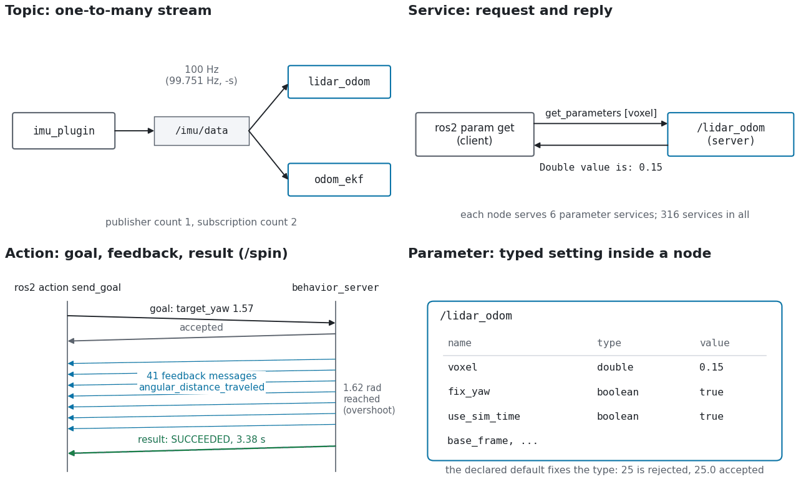
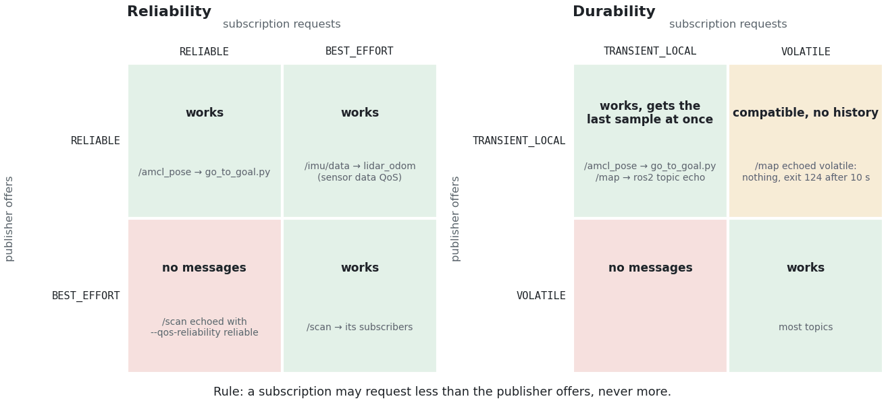
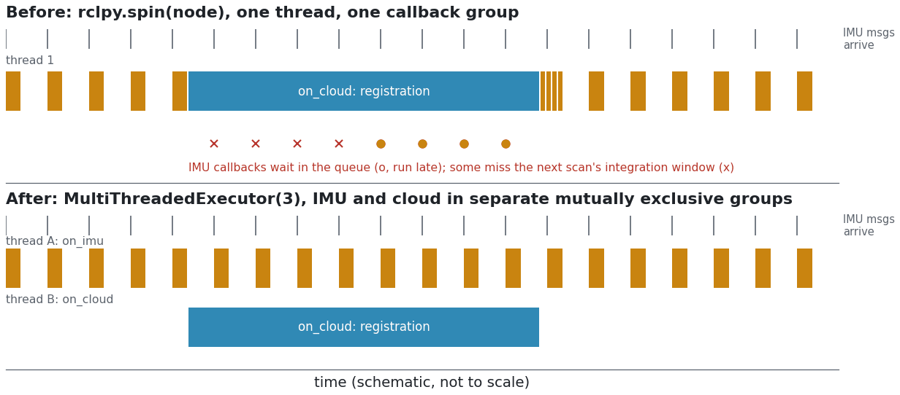
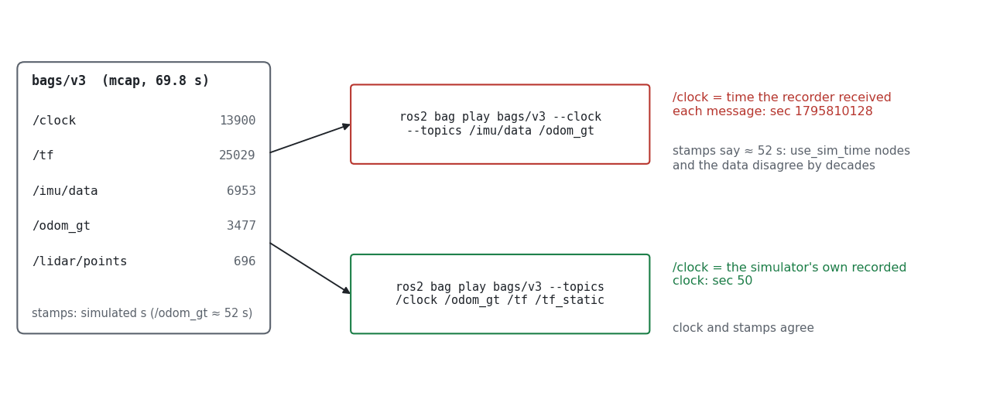

# 4. ROS 2 from scratch

This chapter teaches ROS 2 on the stack you started in chapter 3. You inspect the running system with the `ros2` command
line, learn the parts of ROS 2 that this repository depends on, and finish by writing, building and testing a small node of
your own in `src/go2_tutorials`.

All output below was captured on one machine running this stack while a second copy ran missions on another ROS domain, with a
load average of about 40 on 32 threads. Gazebo's real-time factor (`gz stats`) varied between 0.48 and 0.96 during the session,
so anything measured against the wall clock is lower than you may see.

## Start the stack

`scripts/up.sh` from chapter 3 starts three launch files and checks each one. Here they are by hand, one per terminal, in this
order (Gazebo takes about a minute before the second one makes sense):

```bash
source env.sh
ros2 launch go2_nav_sim sim.launch.py          # terminal 1: Gazebo, the robot, CHAMP, sensors
ros2 launch go2_nav_sim estimation.launch.py   # terminal 2: /scan, lidar odometry, EKF
ros2 launch go2_nav_sim nav.launch.py          # terminal 3: Nav2, AMCL, passive slam_toolbox
```

Every new terminal needs `source env.sh`. It sources ROS 2 and this workspace, selects Cyclone DDS, and sets
`ROS_DOMAIN_ID=42`. Two ROS 2 programs see each other only when they share a domain ID, which is how two stacks can run on one
machine without crosstalk.


*What each launch file starts, read from `src/go2_nav_sim/launch/*.py` and the files they include. Sensor data flows up through the layers; `/cmd_vel` is the only command that flows back down.*

## The graph

A running ROS 2 system is a graph. Nodes are processes (or parts of processes) that talk through four mechanisms:

| Mechanism | Pattern | Example in this stack |
|---|---|---|
| Topic | one-to-many stream of messages | `/imu/data`, 100 Hz, from the Gazebo IMU plugin |
| Service | request and reply | `/lidar_odom/get_parameters` |
| Action | long-running goal with feedback and a result, can be cancelled | `/navigate_to_pose`, `/spin` |
| Parameter | named, typed setting stored inside a node | `voxel` on `/lidar_odom` |



*The four mechanisms with the examples from this section; every number is from the outputs below (`/spin`: 41 feedback messages, 3.38 s, 1.62 rad reached).*

### Nodes

```bash
ros2 node list
```

```
/amcl
/base_to_footprint_ekf
/behavior_server
/bt_navigator
...
/lidar_odom
/odom_ekf
/pointcloud_to_laserscan
/quadruped_controller_node
/robot_state_publisher
/slam_toolbox
/state_estimation_node
/transform_listener_impl_57dcc2922720
...
```

The list had 44 entries. The `transform_listener_impl_*` nodes are created internally by TF listeners in other nodes. Ask one
node what it connects to:

```bash
ros2 node info /lidar_odom
```

```
/lidar_odom
  Subscribers:
    /clock: rosgraph_msgs/msg/Clock
    /imu/data: sensor_msgs/msg/Imu
    /lidar/points: sensor_msgs/msg/PointCloud2
    /tf: tf2_msgs/msg/TFMessage
    /tf_static: tf2_msgs/msg/TFMessage
  Publishers:
    /lidar_odom: nav_msgs/msg/Odometry
    /parameter_events: rcl_interfaces/msg/ParameterEvent
    /rosout: rcl_interfaces/msg/Log
  Service Servers:
    /lidar_odom/describe_parameters: rcl_interfaces/srv/DescribeParameters
    /lidar_odom/get_parameters: rcl_interfaces/srv/GetParameters
    ...
```

That is the whole interface of the lidar odometry from chapter 9: two sensor inputs, TF, the clock, and one output.

### Topics

```bash
ros2 topic list -t                 # -t adds the message type
ros2 topic info /imu/data          # Publisher count: 1, Subscription count: 2
ros2 topic hz -s /imu/data         # average rate: 99.751
ros2 topic echo --once /imu/data --field angular_velocity
```

```
x: 0.10193717438697308
y: 0.12372319915623527
z: 0.008941496483492451
---
```

`--field` prints one part of the message. The `-s` on `hz` matters and is explained under [simulated time](#simulated-time).

### Services

Every node offers six parameter services, so the list is long (316 services on this stack):

```bash
ros2 service list | wc -l                      # 316
ros2 service list -t | grep lidar_odom
```

```
/lidar_odom/describe_parameters [rcl_interfaces/srv/DescribeParameters]
/lidar_odom/get_parameter_types [rcl_interfaces/srv/GetParameterTypes]
/lidar_odom/get_parameters [rcl_interfaces/srv/GetParameters]
/lidar_odom/list_parameters [rcl_interfaces/srv/ListParameters]
/lidar_odom/set_parameters [rcl_interfaces/srv/SetParameters]
/lidar_odom/set_parameters_atomically [rcl_interfaces/srv/SetParametersAtomically]
```

The `ros2 param` commands below are clients of these services. Nav2's lifecycle manager drives its nodes through another set of
services (`/amcl/change_state` and so on), covered under [lifecycle nodes](#lifecycle-nodes).

### Actions

```bash
ros2 action list -t
```

```
/backup [nav2_msgs/action/BackUp]
/compute_path_to_pose [nav2_msgs/action/ComputePathToPose]
/follow_path [nav2_msgs/action/FollowPath]
/navigate_to_pose [nav2_msgs/action/NavigateToPose]
/spin [nav2_msgs/action/Spin]
...
```

```bash
ros2 action info /navigate_to_pose
```

```
Action: /navigate_to_pose
Action clients: 2
    /bt_navigator
    /waypoint_follower
Action servers: 1
    /bt_navigator
```

`go_to_goal.py` from chapter 3 is a third client while it runs. Send a goal to the spin behaviour yourself; the robot turns in
place by 90 degrees:

```bash
ros2 action send_goal /spin nav2_msgs/action/Spin "{target_yaw: 1.57, time_allowance: {sec: 20}}" --feedback
```

```
Goal accepted with ID: c809964844394441a611b4a176c94292
Feedback:
    angular_distance_traveled: 1.5322411060333252
...
Feedback:
    angular_distance_traveled: 1.6241763830184937
Result:
    total_elapsed_time:
  sec: 3
  nanosec: 380000000
Goal finished with status: SUCCEEDED
```

41 feedback messages arrived during the 3.38 s of simulated time. The robot overshot to 1.62 rad.

<video controls muted playsinline src="../media/c04-nav-goal-start.mp4"></video>

*0:04 to 0:18 of `media/go2_a2b_dashboard.mp4`, map and metrics panels: `go_to_goal.py` sends its `/navigate_to_pose` goal, the plan (amber) appears, and the robot starts to walk from A towards B.*

### Parameters

```bash
ros2 param list /lidar_odom                    # base_frame, fix_yaw, voxel, ... use_sim_time
ros2 param get /lidar_odom voxel               # Double value is: 0.15
ros2 param describe /lidar_odom fix_yaw        # Type: boolean
```

Parameters have a type fixed when the node declares them. `lidar_odom.py` declares all of its parameters at the top of
`__init__` with `self.declare_parameter(name, default)`; the default sets the type.

### Interfaces

Message, service and action definitions are interfaces. `ros2 interface show` prints one:

```bash
ros2 interface show sensor_msgs/msg/Imu
```

```
std_msgs/Header header
	builtin_interfaces/Time stamp
		int32 sec
		uint32 nanosec
	string frame_id

geometry_msgs/Quaternion orientation
...
geometry_msgs/Vector3 angular_velocity
	float64 x
	float64 y
	float64 z
...
```

An action interface has three parts separated by `---`: goal, result and feedback.

```bash
ros2 interface show nav2_msgs/action/Spin
```

```
#goal definition
float32 target_yaw
builtin_interfaces/Duration time_allowance
...
---
#result definition
builtin_interfaces/Duration total_elapsed_time
...
---
#feedback definition
float32 angular_distance_traveled
```

For a picture of the graph, `ros2 run rqt_graph rqt_graph` opens a window that draws nodes and topics. With 44 nodes it is
crowded; filter on one node name. The figure below is the part of the graph that carries data, drawn by hand.


*Nodes (rounded, coloured by launch file) and topics (square), from the launch files, `config/*.yaml` and the subscriptions in the node code. The amber path is the command loop: Nav2 to `/cmd_vel` to CHAMP to the joint controllers in Gazebo.*

## Quality of service

Each publisher and subscription carries a QoS profile. Three settings matter here:

| Setting | Values | Meaning |
|---|---|---|
| Reliability | `RELIABLE`, `BEST_EFFORT` | resend lost samples, or drop them |
| Durability | `VOLATILE`, `TRANSIENT_LOCAL` | late subscribers get nothing old, or the publisher keeps the last N samples for them |
| History depth | `KEEP_LAST (N)` | queue length |

`ros2 topic info -v` prints the profile of every endpoint:

```bash
ros2 topic info -v /imu/data
```

```
Node name: imu_plugin
Node namespace: /imu
Endpoint type: PUBLISHER
QoS profile:
  Reliability: RELIABLE
  History (Depth): KEEP_LAST (5)
  Durability: VOLATILE

Node name: lidar_odom
Endpoint type: SUBSCRIPTION
QoS profile:
  Reliability: BEST_EFFORT
  History (Depth): KEEP_LAST (5)
  Durability: VOLATILE

Node name: odom_ekf
Endpoint type: SUBSCRIPTION
QoS profile:
  Reliability: BEST_EFFORT
  History (Depth): KEEP_LAST (30)
  Durability: VOLATILE
```

The Gazebo plugins publish `RELIABLE`; the consumers ask for `BEST_EFFORT`. `lidar_odom.py` subscribes with
`qos_profile_sensor_data` (best effort, depth 5, volatile). A sensor sample is useful only while it is fresh. With reliable
delivery a lost packet is resent, later samples wait behind it, and the queue adds latency on a loaded machine. Best effort
drops the lost sample and delivers the next one. The 100 Hz IMU and the 10 Hz lidar both lose a sample now and then on this
machine (2000 IMU samples spanned 20.24 s of simulated time, about 1% missing), which costs nothing.

The two settings combine by a rule: the subscription may ask for less than the publisher offers, never more. A best-effort
subscription to a reliable publisher works, as above. A reliable subscription to a best-effort publisher gets nothing.
`pointcloud_to_laserscan` publishes `/scan` best effort; ask for reliable delivery and see:

```bash
ros2 topic echo --once /scan --field header --qos-reliability reliable
```

```
[WARN] [...] [_ros2cli_2117936]: New publisher discovered on topic '/scan', offering incompatible QoS. No messages will be received from it. Last incompatible policy: RELIABILITY
```

Durability solves a different problem. `/map` is published once, when `map_server` activates:

```bash
ros2 topic info -v /map
```

```
Node name: map_server
Endpoint type: PUBLISHER
QoS profile:
  Reliability: RELIABLE
  History (Depth): KEEP_LAST (1)
  Durability: TRANSIENT_LOCAL
```

A subscriber that starts an hour later still receives that one message, because the publisher keeps it. With a volatile
subscription it never arrives:

```bash
ros2 topic echo --once /map --field info                               # prints resolution 0.05, width 260, height 220
timeout 10 ros2 topic echo --once /map --field info --qos-durability volatile   # nothing; exit code 124 after 10 s
```

`/amcl_pose` is also `RELIABLE`, `KEEP_LAST (1)`, `TRANSIENT_LOCAL`. AMCL publishes it when it updates its estimate, and it
updates only after the odometry reports 5 cm or 0.1 rad of motion (`update_min_d` and `update_min_a` in `nav2_params.yaml`).
Between updates a volatile subscriber would wait. `go_to_goal.py` therefore subscribes with a matching profile, so it receives
the last pose at once:

```python
nav.create_subscription(PoseWithCovarianceStamped, '/amcl_pose', ...,
                        QoSProfile(depth=1, durability=DurabilityPolicy.TRANSIENT_LOCAL, reliability=ReliabilityPolicy.RELIABLE))
```



*Request against offer for the two policies, with the cases measured in this section in the cells. Red cells print the incompatible-QoS warning; the amber cell connects but has no history to give.*

## Simulated time

Gazebo publishes the simulated time on `/clock`. A node with the parameter `use_sim_time` set to true takes its time from
`/clock` instead of the system clock: its timers, `get_clock().now()` and TF lookups all run in simulated seconds. Every node in
this stack has it set (launch files pass `{'use_sim_time': True}`, the YAML files set `use_sim_time: true`).

```bash
ros2 topic echo --once /clock                  # clock: sec: 178 ...
ros2 param get /amcl use_sim_time              # Boolean value is: True
```

Message stamps are in simulated time too. A tool that runs on the system clock reads them wrongly. Two examples from this
stack. First the IMU rate, without and with `-s` (`--use-sim-time`):

```bash
ros2 topic hz /imu/data                        # average rate: 81.158
ros2 topic hz -s /imu/data                     # average rate: 99.751
```


*The same IMU messages counted on the two clocks. The real-time factor 0.81 is the ratio of the two `hz` readings above, not a separate measurement.*

The IMU publishes 100 times per simulated second. Without `-s` the rate is per wall-clock second, and the simulator was running
slower than real time. Second, the delay between a message's stamp and its arrival:

```bash
ros2 topic delay /lidar_odom                   # average delay: 1795812606.678
ros2 topic delay -s /lidar_odom                # average delay: 0.071
```

The first number is the current Unix time minus a stamp of a few hundred simulated seconds. The second is the real answer: the
lidar odometry output arrives 71 ms after the scan it was computed from (23 to 118 ms over 48 messages).

The opposite mistake is quieter. A node with `use_sim_time:=true` and no `/clock` publisher has a clock that does not advance,
so its timers never fire. The node you write below, started that way on an empty domain with debug logging, printed its start-up
line and then nothing for 6 s; without `use_sim_time` its timer logged once a second.

## Workspaces and packages

A workspace is a directory with a `src/` folder of packages. `colcon build`, run at the workspace root, builds every package
into `build/` and installs it into `install/`. Here the workspace root is the repository root.

Sourcing `install/setup.bash` (which `env.sh` does) adds this workspace on top of `/opt/ros/humble`. The ROS installation is the
underlay; this workspace is an overlay. A package found in the overlay hides the one with the same name in the underlay.

```bash
echo $AMENT_PREFIX_PATH | tr : '\n'
```

```
./install/go2_tutorials
./install/go2_nav_sim
./install/go2_description
...
./install/champ
/opt/ros/humble
```

(Paths shortened.) Lookups go down this list:

```bash
ros2 pkg prefix go2_tutorials                  # ./install/go2_tutorials
ros2 pkg prefix nav2_amcl                      # /opt/ros/humble
```


*`colcon build` turns `src/` into `install/`; the overlay is searched before the underlay, so `go2_tutorials` resolves to this workspace and `nav2_amcl` to `/opt/ros/humble`.*

A package is a directory with a `package.xml`: name, version, dependencies, and the build type. `colcon list` shows the 13
packages here; 12 are `ament_cmake`, and `go2_tutorials`, which you write below, is `ament_python`.

| | `ament_cmake` | `ament_python` |
|---|---|---|
| Build description | `CMakeLists.txt` | `setup.py` (+ `setup.cfg`) |
| Typical content | C++ nodes, or anything that is only installed (launch, URDF, config) | a Python package |
| Python nodes | installed as scripts with `install(PROGRAMS ...)` | entry points in `setup.py` |

`go2_nav_sim` is `ament_cmake` because most of it is files to install (launch files, URDF, worlds, maps, YAML). Its Python nodes
are plain scripts, not a Python package, so `CMakeLists.txt` installs them with

```cmake
install(PROGRAMS scripts/lidar_odom.py scripts/gt_odom.py scripts/go_to_goal.py ... DESTINATION lib/${PROJECT_NAME})
install(FILES scripts/registration.py DESTINATION lib/${PROJECT_NAME})
```

`ros2 run <package> <executable>` looks in `install/<package>/lib/<package>/`, so that is where the scripts must go.
`registration.py` is a module, not a program, and `lidar_odom.py` imports it from the same directory.

Two flags are used throughout:

- `--packages-select <name>` builds only that package. Without it colcon rebuilds all 13.
- `--symlink-install` installs symlinks to the source files instead of copies, so an edit to a Python file or a launch file
  takes effect without a rebuild. Changes to `setup.py`, `package.xml` or `CMakeLists.txt` still need one.

Symlinks carry a trap. With `--symlink-install`, `install(PROGRAMS)` links to the source file, and the executable bit is the
source file's. Three of the seven scripts in that list are not executable in the source tree, and `ros2 run` does not find
them:

```bash
ls -l install/go2_nav_sim/lib/go2_nav_sim/lidar_odom.py
# lrwxrwxrwx ... install/go2_nav_sim/lib/go2_nav_sim/lidar_odom.py -> ./src/go2_nav_sim/scripts/lidar_odom.py
ros2 pkg executables go2_nav_sim               # go_to_goal.py, gt_odom.py, lidar_odom.py, odom_eval.py
ros2 run go2_nav_sim bag_metrics.py --help     # No executable found
```

The other chapters call `bag_metrics.py`, `render_dashboard.py` and `export_run.py` with `python3 path/to/script.py`, which does
not need the bit. `chmod +x` on the source file fixes `ros2 run`.

## Launch files

A launch file starts several nodes with their parameters and remappings. `estimation.launch.py` is short enough to read whole:

```python
def generate_launch_description():
    cfg = os.path.join(share('go2_nav_sim'), 'config')
    sim = {'use_sim_time': True}
    return LaunchDescription([
        Node(package='pointcloud_to_laserscan', executable='pointcloud_to_laserscan_node', name='pointcloud_to_laserscan',
             parameters=[os.path.join(cfg, 'scan.yaml')], remappings=[('cloud_in', '/lidar/points'), ('scan', '/scan')]),
        Node(package='go2_nav_sim', executable='lidar_odom.py', name='lidar_odom', parameters=[sim], output='screen'),
        Node(package='robot_localization', executable='ekf_node', name='odom_ekf',
             parameters=[os.path.join(cfg, 'ekf.yaml')], remappings=[('odometry/filtered', '/odom')]),
    ])
```

- `share('go2_nav_sim')` returns `install/go2_nav_sim/share/go2_nav_sim`, where `CMakeLists.txt` installed `config/`.
- `parameters` takes YAML files, dictionaries, or both. `scan.yaml` and `ekf.yaml` set `use_sim_time: true` themselves;
  `lidar_odom` gets it from the dictionary.
- `remappings` rename a node's topics without touching its code. `pointcloud_to_laserscan` subscribes to `cloud_in` and
  publishes `scan`; the remaps connect it to `/lidar/points` and `/scan`. The EKF's output `odometry/filtered` becomes `/odom`.
  `ros2 node info /pointcloud_to_laserscan` shows the result: it subscribes to `/lidar/points` and publishes `/scan`.
- `name` overrides the node name. Started with `ros2 run robot_localization ekf_node`, the EKF is called `/ekf_filter_node`;
  here it is `/odom_ekf`, and the top-level key in `ekf.yaml` (`odom_ekf:`) must match that name or the parameters are not
  applied.

`ros2 launch -s` lists a launch file's arguments; `-p` prints what it would start.

```bash
ros2 launch -s go2_nav_sim estimation.launch.py            # No arguments.
ros2 launch -s go2_nav_sim nav.launch.py
```

```
    'map':
        map for AMCL / Nav2
        (default: '.../install/go2_nav_sim/share/go2_nav_sim/maps/arena.yaml')

    'mapper':
        run the passive mapper on /slam/map
        (default: 'true')

    'namespace':
        Top-level namespace
        (default: '')
...
```

The arguments after `mapper` come from Nav2's `bringup_launch.py`, which `nav.launch.py` includes. Pass one as
`ros2 launch go2_nav_sim nav.launch.py mapper:=false`.

## Lifecycle nodes

A plain node starts working as soon as its process starts. A lifecycle (managed) node has states, and an outside manager moves
it between them: `unconfigured`, `inactive` (configured, parameters read, not processing), `active`, and `finalized`.

```bash
ros2 lifecycle nodes
```

```
/amcl
/behavior_server
/bt_navigator
/controller_server
/global_costmap/global_costmap
/local_costmap/local_costmap
/map_server
/planner_server
/smoother_server
/velocity_smoother
/waypoint_follower
```

```bash
ros2 lifecycle get /amcl                       # active [3]
ros2 lifecycle list /amcl                      # the transitions allowed from here
```

```
- deactivate [4]
	Start: active
	Goal: deactivating
- shutdown [7]
	Start: active
	Goal: shuttingdown
```

Two lifecycle managers own them:

```bash
ros2 param get /lifecycle_manager_localization node_names
# String values are: ['map_server', 'amcl']
ros2 param get /lifecycle_manager_navigation node_names
# String values are: ['controller_server', 'smoother_server', 'planner_server', 'behavior_server', 'bt_navigator', 'waypoint_follower', 'velocity_smoother']
```

Nav2 uses lifecycle nodes for start-up order and for failure detection. The manager configures and activates the nodes in the
listed order, so AMCL activates after the map server has published `/map`. Once they are active it holds a bond with each one
(`bond_timeout` is 4.0 s here) and treats a node that stops answering within that time as failed.
Each transition is a service call. On a loaded machine these calls can time out, the manager logs `Aborting bringup`, and the
nodes stay inactive; `scripts/up.sh` watches for that line and retries.


*States and transitions with the IDs `ros2 lifecycle` prints, and the order in which the two managers of this stack bring their nodes up.*

## Executors and callback groups

A node does nothing until an executor spins it. The executor waits for events (a message, a timer, a service request) and runs
the matching callbacks. `rclpy.spin(node)` uses a single-threaded executor: one callback at a time, in one thread.

That was the cause of a bug documented in [chapter 9](09-state-estimation.md#failures-worth-knowing-about). The IMU callback
and the point-cloud callback of `lidar_odom.py` shared one thread. A registration takes milliseconds; during it, IMU messages
waited in the queue, and some were dropped from the next scan's integration window. Yaw was under-integrated by about half
during turns. The fix has three parts, visible in `lidar_odom.py`:

```python
self.tf = Buffer(); TransformListener(self.tf, self, spin_thread=True)       # TF in its own thread
self.create_subscription(PointCloud2, 'lidar/points', self.on_cloud, qos_profile_sensor_data, callback_group=MutuallyExclusiveCallbackGroup())
self.create_subscription(Imu, 'imu/data', self.on_imu, qos_profile_sensor_data, callback_group=MutuallyExclusiveCallbackGroup())
...
ex = MultiThreadedExecutor(num_threads=3); ex.add_node(node); ex.spin()
```

A multi-threaded executor alone is not enough. By default every callback of a node belongs to one mutually exclusive callback
group, and callbacks in a mutually exclusive group never run at the same time, however many threads there are. Putting the two
subscriptions in separate groups lets the IMU callback run while a registration is in progress. A reentrant group would allow
two calls of the same callback to overlap, which these callbacks are not written for. The third part is in the data: the gyro
is integrated into a history and looked up by timestamp, so the result no longer depends on callback order.



*Schematic of `lidar_odom.py` before and after the fix; the durations are not to scale. With one thread, IMU messages queue behind the registration and some miss the next scan's integration window.*

## Bags

A bag records topics to disk with their timestamps. [Chapter 11](11-record-and-visualise.md) records one per mission with
`scripts/run_mission.sh bags/<name>`. Bags are not in the repository (about 0.5 GB per minute); record your own and use its path
below. The output shown comes from `bags/v3`, one of the author's earlier runs.

```bash
ros2 bag info bags/v3
```

```
Bag size:          782.7 MiB
Storage id:        mcap
Duration:          69.756274176s
Messages:          59800
Topic information: Topic: /lidar/points | Type: sensor_msgs/msg/PointCloud2 | Count: 696 | Serialization Format: cdr
                   ...
                   Topic: /tf | Type: tf2_msgs/msg/TFMessage | Count: 25029 | Serialization Format: cdr
                   Topic: /clock | Type: rosgraph_msgs/msg/Clock | Count: 13900 | Serialization Format: cdr
                   Topic: /tf_static | Type: tf2_msgs/msg/TFMessage | Count: 1 | Serialization Format: cdr
                   ...
                   Topic: /imu/data | Type: sensor_msgs/msg/Imu | Count: 6953 | Serialization Format: cdr
                   Topic: /odom_gt | Type: nav_msgs/msg/Odometry | Count: 3477 | Serialization Format: cdr
```

Play a bag on a domain where no simulator is running, otherwise two sources publish the same topics. `--topics` limits the
playback; `--clock` makes the player publish `/clock`:

```bash
export ROS_DOMAIN_ID=78
ros2 bag play bags/v3 --clock --topics /imu/data /odom_gt
```

In a second terminal on the same domain:

```bash
ros2 topic echo --once /odom_gt --field pose.pose.position
```

```
x: 2.2556208257086174
y: 3.239745064797538
z: 0.2118000314601835
---
```

Check the clock before you trust a replay:

```bash
ros2 topic echo --once /clock                  # with --clock:            sec: 1795810128
                                               # with --topics /clock ...: sec: 50
```

`--clock` publishes the time at which the recorder received each message, which for this bag is the Unix time of the recording.
The message stamps are in simulated seconds (`/odom_gt` stamps were near 52 s). The bag also contains the simulator's own
`/clock`, so for these bags play that topic and leave out `--clock`:

```bash
ros2 bag play bags/v3 --topics /clock /odom_gt /tf /tf_static --start-offset 30
```

Then `use_sim_time` nodes and the message stamps agree. `--start-offset 30` skips the first 30 s of the bag.



*The two replays above. For these bags the recorded `/clock` is the one that matches the message stamps.*

## Debugging tools

`ros2 doctor` checks the setup and lists topics with no subscriber or no publisher:

```bash
ros2 doctor
```

```
.../ros2doctor/api/topic.py: 42: UserWarning: Publisher without subscriber detected on /amcl_pose.
.../ros2doctor/api/topic.py: 45: UserWarning: Subscriber without publisher detected on /foot_contacts.
...
All 4 checks passed
```

Most of the warnings are expected (camera topics nobody reads). `/foot_contacts` without a publisher is the reason the trunk
height in TF is wrong, as [chapter 5](05-frames-and-tf2.md) shows.

Rate, bandwidth and delay:

```bash
ros2 topic bw /lidar/points        # 1.42 MB/s from 27 messages, Message size mean: 0.21 MB
ros2 topic delay -s /scan          # average delay: 0.048 (min 0.024 s, max 0.117 s)
```

Log levels are set per node at start-up with `--log-level`. Naming the logger keeps other loggers (rcl, the middleware) quiet:

```bash
ros2 run go2_tutorials imu_yaw --ros-args --log-level imu_yaw:=debug
```

```
[INFO] [1795813275.519752083] [imu_yaw]: integrating imu/data, publishing imu_yaw at 10.0 Hz
[DEBUG] [1795813275.578020872] [imu_yaw]: yaw 0.0000 rad
[DEBUG] [1795813276.676688469] [imu_yaw]: yaw 0.0000 rad
```

`--log-level debug` without a logger name turns on debug output from every library in the process, which is hundreds of lines
before the node does anything.

## Write a node

The node integrates the IMU's yaw rate into a heading and publishes it. This is the gyro prediction inside `lidar_odom.py` in
its simplest form, and it shows how fast an integrated gyro drifts.

### The package

```
src/go2_tutorials/
  package.xml                 name, dependencies, <build_type>ament_python</build_type>
  setup.py                    the Python package, the launch file, and two entry points
  setup.cfg                   tells setuptools to put the executables in lib/go2_tutorials
  resource/go2_tutorials      empty marker file; ament uses it to find the package
  go2_tutorials/imu_yaw.py    the node
  go2_tutorials/yaw_check.py  compares /imu_yaw with ground truth
  launch/imu_yaw.launch.py
  test/test_imu_yaw.py
```

`ros2 pkg create --build-type ament_python go2_tutorials` generates the skeleton (`package.xml`, `setup.py`, `setup.cfg`,
`resource/`, an empty `go2_tutorials/__init__.py`, and three style tests that this package leaves out). The entry points in `setup.py` are what
`ros2 run` finds:

```python
entry_points={
    'console_scripts': [
        'imu_yaw = go2_tutorials.imu_yaw:main',
        'yaw_check = go2_tutorials.yaw_check:main',
    ],
},
```

### The node

`src/go2_tutorials/go2_tutorials/imu_yaw.py`:

```python
class YawIntegrator:
    """Sums rate * dt between message stamps. Plain Python, so the test needs no running ROS graph."""

    def __init__(self, max_gap=0.5):
        self.yaw, self.t_last, self.max_gap = 0.0, None, max_gap

    def add(self, t, rate):
        if self.t_last is not None:
            dt = t - self.t_last
            if dt <= 0.0:                  # repeated or out-of-order stamp: ignore the sample
                return self.yaw
            if dt < self.max_gap:          # a longer gap (paused sim, lost messages) is skipped, not bridged
                self.yaw += rate * dt
        self.t_last = t
        return self.yaw


class ImuYaw(Node):
    def __init__(self):
        super().__init__('imu_yaw')
        rate = self.declare_parameter('publish_rate', 10.0).value
        self.integ = YawIntegrator()
        self.pub = self.create_publisher(Float64, 'imu_yaw', 10)
        self.create_subscription(Imu, 'imu/data', self.on_imu, qos_profile_sensor_data)
        self.create_timer(1.0 / rate, self.on_timer)
        self.get_logger().info(f'integrating imu/data, publishing imu_yaw at {rate} Hz')

    def on_imu(self, m):
        self.integ.add(m.header.stamp.sec + m.header.stamp.nanosec * 1e-9, m.angular_velocity.z)

    def on_timer(self):
        self.pub.publish(Float64(data=self.integ.yaw))
        self.get_logger().debug(f'yaw {self.integ.yaw:.4f} rad', throttle_duration_sec=1.0)
```

Points worth checking against what came before:

- `dt` comes from the message stamps, not from arrival time. Messages arrive in bursts on a loaded machine; the stamps say
  when the sensor measured.
- `qos_profile_sensor_data` makes the subscription best effort, which the reliable IMU publisher accepts.
- The topic names have no leading slash, so they resolve inside the node's namespace (`/imu/data` and `/imu_yaw` here) and
  can be remapped.
- `publish_rate` is declared with a float default, so its type is double. The timer runs on the node's clock, which is the
  simulated clock once `use_sim_time` is true.
- `angular_velocity.z` is the rate about the IMU's own z axis. When the trunk tilts, that axis is not vertical and the rate is
  not exactly the yaw rate. `lidar_odom.py` corrects for this with roll and pitch; this node does not.
- The integration lives in `YawIntegrator`, a class with no ROS in it, so it can be tested without a running system.

The launch file `launch/imu_yaw.launch.py` sets the parameters:

```python
Node(package='go2_tutorials', executable='imu_yaw', name='imu_yaw', output='screen',
     parameters=[{'use_sim_time': True, 'publish_rate': 10.0}]),
```

The test, `test/test_imu_yaw.py`, checks that 0.5 rad/s for 2 s at 100 Hz integrates to 1.0 rad, and that an out-of-order
stamp and a 1.9 s gap are skipped.

### Build and run

From the repository root:

```bash
colcon build --symlink-install --packages-select go2_tutorials
# Finished <<< go2_tutorials [5.78s]
source install/setup.bash          # a new package needs the setup file sourced again
colcon test --packages-select go2_tutorials && colcon test-result --verbose --test-result-base build/go2_tutorials
# Summary: 2 tests, 0 errors, 0 failures, 0 skipped
ros2 launch go2_tutorials imu_yaw.launch.py
```

Check it from another terminal:

```bash
ros2 node info /imu_yaw            # subscribes /clock and /imu/data, publishes /imu_yaw
ros2 topic hz -s /imu_yaw          # average rate: 10.000
ros2 topic echo --once /imu_yaw    # data: 0.005117615220794343
ros2 param get /imu_yaw publish_rate   # Double value is: 10.0
```

### Check it against ground truth

`/odom_gt` is the simulator's true pose of `base_link`. `yaw_check` subscribes to both topics, takes the first sample of each
as zero, unwraps the true yaw across ±180 degrees, and prints how far each has turned every 10 s of simulated time:

```bash
ros2 run go2_tutorials yaw_check --ros-args -p use_sim_time:=true -p duration:=60.0
```

Standing still for 60 s:

```
t   0.0 s  gt turned     0.00 deg  imu_yaw turned     0.00 deg  error   0.00 deg
t  10.0 s  gt turned     0.03 deg  imu_yaw turned     0.60 deg  error   0.57 deg
t  20.0 s  gt turned    -0.04 deg  imu_yaw turned     1.48 deg  error   1.51 deg
t  30.0 s  gt turned    -0.02 deg  imu_yaw turned     2.34 deg  error   2.36 deg
t  40.0 s  gt turned    -0.04 deg  imu_yaw turned     3.88 deg  error   3.92 deg
t  50.0 s  gt turned    -0.08 deg  imu_yaw turned     4.99 deg  error   5.07 deg
t  60.0 s  gt turned    -0.18 deg  imu_yaw turned     6.20 deg  error   6.37 deg
```

Turning in place for 90 s, with `ros2 topic pub -r 10 /cmd_vel geometry_msgs/msg/Twist "{angular: {z: 0.5}}"` running in
another terminal (the robot kept turning at about 0.47 rad/s for the whole window):

```
t  10.0 s  gt turned   215.01 deg  imu_yaw turned   213.40 deg  error  -1.61 deg
t  30.0 s  gt turned   773.05 deg  imu_yaw turned   774.20 deg  error   1.15 deg
t  60.0 s  gt turned  1609.94 deg  imu_yaw turned  1612.70 deg  error   2.76 deg
t  90.0 s  gt turned  2444.99 deg  imu_yaw turned  2450.15 deg  error   5.16 deg
```

On the first 60 s of the recorded mission in `bags/v3` (played with `--clock --topics /imu/data /odom_gt` on domain 78, with the
launch file and `yaw_check` on the same domain), the error was -4.02 degrees.


*The three `yaw_check` results above on one plot. The grey band is the drift the configured gyro noise alone would give, about 0.01 degrees after 60 s.*

So the integrated gyro drifts by 4 to 6.4 degrees per minute here, whether the robot stands, spins or walks. The cause is not
the configured sensor noise. `gazebo.xacro` gives the gyro white noise of σ = 2e-4 rad/s and no bias; integrated at 100 Hz for
60 s that is a random walk of about 0.01 degrees. Sampling `/imu/data` while the robot stood still for 20 s gave a mean z rate of
0.0025 rad/s (0.14 degrees per second) and a standard deviation of 0.017 rad/s, while the ground-truth yaw moved by less than
0.2 degrees per minute. The standing trunk vibrates in the physics simulation (x-rate standard deviation 0.087 rad/s), and the
sampled rate does not average to zero; that explanation is my inference, I have not traced it in Gazebo. `lidar_odom.py`
integrates the same gyro with `fix_yaw` true. With the robot left standing during this session, its logged yaw moved from -165
to -112 degrees between scans #2800 and #6800 (400 s of simulated time, 0.13 degrees per second, close to the mean gyro rate
above). The navigation runs in the README last about a minute, where this is a few degrees; a robot left idle for minutes needs
its odometry restarted.

## Checkpoint

- `ros2 node info /lidar_odom` lists `/imu/data` and `/lidar/points` as subscriptions.
- `ros2 topic info -v /map` shows `TRANSIENT_LOCAL`, and you can explain why a volatile echo of `/map` waits forever.
- `ros2 topic hz -s /imu/data` reports about 100 Hz.
- `ros2 lifecycle get /amcl` returns `active [3]`.
- `colcon test --packages-select go2_tutorials` passes 2 tests.
- `ros2 topic hz -s /imu_yaw` reports 10 Hz, and `yaw_check` reports a drift of a few degrees per minute.

## Exercises

1. Which reliability does the `/scan` publisher offer, and what does
   `ros2 topic echo --once /scan --qos-reliability reliable` print?
2. Start the node with `ros2 run go2_tutorials imu_yaw --ros-args -p publish_rate:=25`, then with `publish_rate:=25.0`. What
   happens in each case, and what does `ros2 topic hz /imu_yaw` show for the second?
3. From the `ros2 bag info bags/v3` output alone, compute the average rate of `/imu/data` and `/lidar/points`. Then use
   `/odom_gt` (published at 50 Hz of simulated time) to estimate the real-time factor during that run.

### Answers

1. `BEST_EFFORT` (`ros2 topic info -v /scan`, publisher `pointcloud_to_laserscan`). The echo prints the incompatible-QoS
   warning for policy `RELIABILITY` and receives no message.
2. With `25` the node exits: `InvalidParameterTypeException: Trying to set parameter 'publish_rate' to '25' of type 'INTEGER',
   expecting type 'DOUBLE'`. The declared default `10.0` fixed the type. With `25.0` it runs and `hz` reports 24.96 to 25.003.
   Without a `/clock` publisher on the domain, run it without `use_sim_time` (as `ros2 run` does by default), or its timer never
   fires.
3. 6953 / 69.756 s = 99.7 Hz for the IMU and 696 / 69.756 s = 9.98 Hz for the lidar. The bag duration is wall-clock time.
   3477 `/odom_gt` messages at 50 Hz are 69.5 s of simulated time, so the real-time factor was about 69.5 / 69.8 = 1.0 during
   that run.

Next: [5. Frames and TF2](05-frames-and-tf2.md)
