# 5. Frames and TF2

Every measurement on the robot is taken in some frame: the lidar measures from its own centre, the camera along its optical
axis, the IMU in its own axes. To combine them, and to say where the robot is in the room, ROS 2 keeps a tree of frames and the
transforms between them. The library is TF2.

| | |
|---|---|
| Goal | Read the TF tree of the running stack, look up a transform at the right time and explain an `ExtrapolationException`, and find a wrong and a missing transform in a broken tree. |
| Time | 2.5 h |
| Before you start | [Chapter 4](04-ros2-from-scratch.md): the stack starts with `scripts/up.sh`, and you can use `ros2 topic`, `ros2 param` and `use_sim_time`. Every terminal starts with `source env.sh` at the repository root. |
| You will learn | REP-103 axes and REP-105 frames; static and dynamic transforms; `view_frames`, `tf2_echo` and `tf2_monitor`; `lookup_transform` at the latest time and at a stamp; the three kinds of `ExtrapolationException`; the one transform in this stack that is wrong. |

A transform from frame A to frame B is a rotation $R$ and a translation $t$ that give the pose of B in A. It converts B
coordinates into A coordinates, $p_A = R\,p_B + t$. Chains of transforms multiply as 4×4 matrices
([module m00](../modules/m00_math/README.md#se2-and-se3) has the formula). The tasks below only read transforms that TF has
already composed; task 2.4 checks one composition by hand.

The outputs come from sessions with the stack up (`scripts/up.sh`), except task 3, which runs with the stack stopped.

## Task 1: Read the tree of the running stack

### 1.1 Check the axis conventions

Confirm that the sensor frames follow REP-103.

[REP-103](https://www.ros.org/reps/rep-0103.html) fixes units and axes for all of ROS: metres, radians, seconds, right-handed
frames, and for a body frame x forward, y left, z up. A positive yaw turns the robot left, so the `{angular: {z: 0.5}}`
command of chapter 4 turned it anticlockwise. Camera optical frames are the exception: z forward along the optical axis, x
right, y down.

`tf2_echo A B` prints the pose of B in A:

```bash
ros2 run tf2_ros tf2_echo base_link lidar_link
```

```
At time 0.0
- Translation: [0.000, 0.000, 0.100]
- Rotation: in Quaternion (xyzw) [0.000, 0.000, 0.000, 1.000]
- Rotation: in RPY (radian) [0.000, -0.000, 0.000]
- Rotation: in RPY (degree) [0.000, -0.000, 0.000]
- Matrix:
  1.000  0.000  0.000  0.000
  0.000  1.000  0.000  0.000
  0.000  0.000  1.000  0.100
  0.000  0.000  0.000  1.000
```

The lidar is 0.1 m above `base_link` and not rotated. `At time 0.0` marks a static transform. The other fixed sensors:

```bash
ros2 run tf2_ros tf2_echo base_link camera_link     # Translation: [0.280, 0.000, 0.030], no rotation
ros2 run tf2_ros tf2_echo base_link imu_link        # Translation: [0.000, 0.000, 0.000], no rotation
```

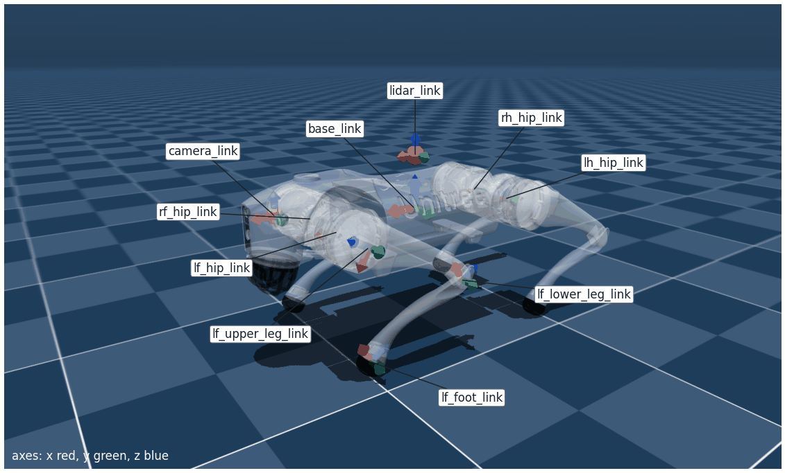

*The MuJoCo Menagerie Go2 posed with the trunk 0.217 m above the floor, with this stack's URDF frame names: `lidar_link` 0.1 m above `base_link`, `camera_link` 0.28 m ahead and 0.03 m up, the four hips and the `lf_` leg chain. Axes x red, y green, z blue: REP-103 body axes, x forward, y left, z up. The sensor frames are placed at their URDF offsets on the Menagerie base, which has no sensors of its own.*

Check: the camera is 0.28 m ahead of `base_link` (+x) and the lidar 0.1 m above it (+z).

### 1.2 Name the world frames

Find out who publishes each of the REP-105 frames.

[REP-105](https://www.ros.org/reps/rep-0105.html) names the frames of a mobile robot and the rules they follow.

| Frame | Fixed to | Rule | Published here by |
|---|---|---|---|
| `map` | the world | the robot's pose in it does not drift, but it may jump | AMCL (`map` to `odom`) |
| `odom` | the world | the robot's pose in it is continuous, but it drifts | `odom_ekf` (`odom` to `base_footprint`) |
| `base_footprint` | the robot, on the ground below the base, yaw only | | CHAMP's `base_to_footprint_ekf` (`base_footprint` to `base_link`) |
| `base_link` | the robot's base | | root of the URDF |

`base_footprint` comes from [REP-120](https://www.ros.org/reps/rep-0120.html), written for humanoids and used by most legged
and wheeled robots since.

Odometry integrates motion: it never jumps, so a controller can follow a path in it, but its error grows. AMCL compares the
scan with a map: its error stays bounded, but each correction can move the estimate by centimetres or more in one step. So AMCL
does not publish the robot's pose; it publishes `map` to `odom`, the correction that makes `map` to `odom` to `base_footprint`
equal its estimate. The controller works in `odom`; the planner and the goal live in `map`.

```bash
ros2 topic info -v /tf | awk '/^Node name:/{n=$3} /Endpoint type: PUBLISHER/{print n}'
```

```
amcl
base_to_footprint_ekf
robot_state_publisher
odom_ekf
state_estimation_node
slam_toolbox
slam_toolbox
```

`slam_toolbox` has a publisher on `/tf` but is configured to send nothing (task 1.4), and CHAMP's `state_estimation_node` adds
no edge to the tree: every edge `view_frames` draws in task 1.4 belongs to one of the other four.

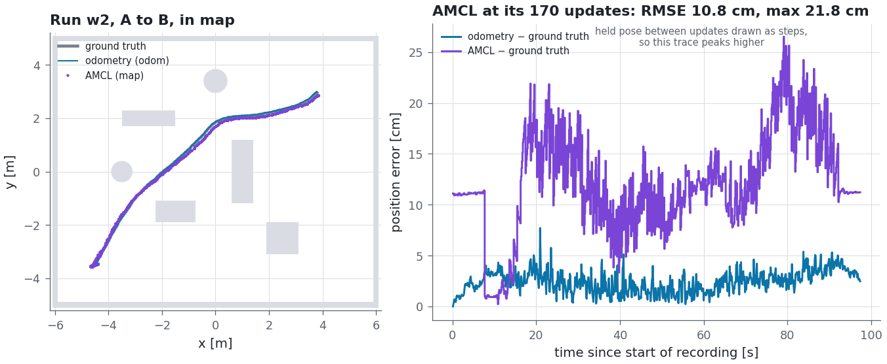

*Run w2 from `site/data/runs/w2/run.json` (odometry aligned to ground truth on its first sample by `export_run.py`). The AMCL pose is held between its 170 updates, so its error saw-tooths while the robot walks; the odometry is continuous. Over one minute the odometry error stays small here; chapter 4 shows how it grows when the robot is left standing.*

Check: `amcl`, `odom_ekf` and `base_to_footprint_ekf` are in the list.

### 1.3 Watch map jump and odom not

See the REP-105 split happen. `docs/exercises/map_odom.py` reads `map` to `odom` and `odom` to `base_footprint` (x, y, yaw)
and composes them into the robot's pose in `map`. Run it, tell AMCL the robot is somewhere else, and run it again.
`/initialpose` is what RViz's "2D Pose Estimate" button publishes:

```bash
ros2 topic echo --once /odom_gt --field pose.pose.position          # x: 0.078, y: 0.011: the robot stands near marker A (-4.5, -3.5)
python3 docs/exercises/map_odom.py --ros-args -p use_sim_time:=true
ros2 topic pub --once /initialpose geometry_msgs/msg/PoseWithCovarianceStamped \
  "{header: {frame_id: map}, pose: {pose: {position: {x: -3.77, y: -3.49}, orientation: {w: 1.0}}}}"
python3 docs/exercises/map_odom.py --ros-args -p use_sim_time:=true
```

The robot stood at (-4.42, -3.49) in `map` (marker A plus the `/odom_gt` offset), so this pose is 0.65 m ahead of the truth.
Then publish the true pose, `x: -4.43, y: -3.49`, and run the script a third time:

```
map->odom (-4.494, -3.481, yaw 0.007 rad)  odom->base_footprint (-0.029, 0.091, yaw -0.036 rad)  robot in map (-4.524, -3.390)
map->odom (-3.735, -3.574, yaw 0.039 rad)  odom->base_footprint (-0.029, 0.098, yaw -0.031 rad)  robot in map (-3.768, -3.477)
map->odom (-4.398, -3.586, yaw 0.031 rad)  odom->base_footprint (-0.023, 0.090, yaw -0.042 rad)  robot in map (-4.424, -3.496)
```

`map` to `odom` moved by 0.76 m and then by 0.66 m, each in one step. `odom` to `base_footprint` moved by 7 mm and 10 mm, its
slow drift while the robot stood, and did not react. The composed pose followed the pose you gave: the second line is 1.3 cm
from the false pose, the third 1.5 cm from the truth (`/odom_gt` x was 0.089 by then). Before the first message it was 0.14 m
off.

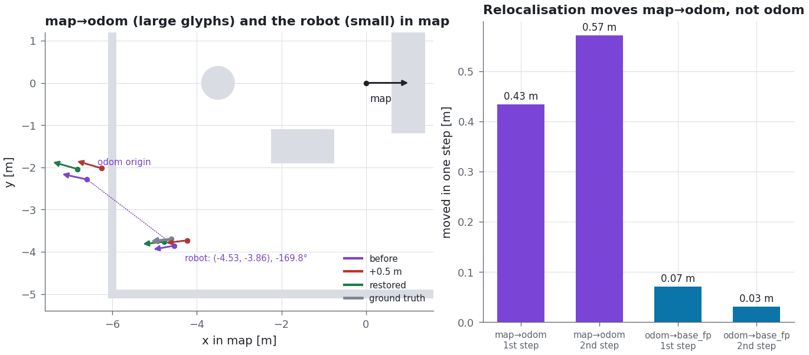

*An earlier run of the same steps with a 0.5 m offset, drawn in `map`. Large arrows: the `odom` origin given by `map` to `odom`; small arrows: the robot, `map` to `odom` composed with `odom` to `base_footprint`; grey: ground truth. Right: the 0.43 m and 0.57 m steps of `map` to `odom` against 0.07 m and 0.03 m of `odom` to `base_footprint` over the same intervals.*

In that earlier run the robot had stood for several minutes and the odometry had drifted by 2.6 m and 22 degrees; `map` to
`odom` had absorbed it, and the composed pose (-4.53, -3.86, -169.8 degrees) was within 0.18 m and 3.6 degrees of ground truth.
The `map` to `odom` stamps also ran about 1 s ahead of the odometry: AMCL stamps its transform `transform_tolerance` (1.0 s in
`nav2_params.yaml`) into the future, so that lookups at the current time succeed between its updates.

Check: after each `/initialpose`, `map` to `odom` moves by about the offset you gave, `odom` to `base_footprint` by a
centimetre or less, and "robot in map" lands within a few centimetres of the pose you published.

### 1.4 Draw the tree with view_frames

Get every edge of the tree with its rate.

```bash
ros2 run tf2_tools view_frames
# [view_frames]: Listening to tf data for 5.0 seconds...
# [view_frames]: Generating graph in frames.pdf file...
ls
# frames_2026-11-28_00.35.51.gv  frames_2026-11-28_00.35.51.pdf
```

The edges, from the `.gv` file:

| Parent to child | Average rate | Kind |
|---|---|---|
| `map` to `odom` | 10.3 Hz | dynamic (AMCL) |
| `odom` to `base_footprint` | 50.3 Hz | dynamic (EKF) |
| `base_footprint` to `base_link` | 49.8 Hz | dynamic (CHAMP) |
| `base_link` to `trunk`, `lidar_link`, `camera_link`, `chase_cam` | "10000" | static |
| `trunk` to `imu_link` and the four `*_hip_link` | static and 250 Hz | `imu_link` static; hips follow `/joint_states` |
| `*_hip_link` to `*_upper_leg_link` to `*_lower_leg_link` | 250 Hz | dynamic (`robot_state_publisher`) |
| `*_lower_leg_link` to `*_foot_link`, `camera_link` to `camera_optical`, `lidar_link` to `lidar_visual` | "10000" | static |

A second session gave 10.29, 50.29 and 50.29 Hz for the first three rows. Static transforms show a rate of 10000 and a most
recent time of 0.0: they have no time. `robot_state_publisher` sends them once on `/tf_static` with `TRANSIENT_LOCAL`
durability, so a listener that starts later still receives them ([chapter 4](04-ros2-from-scratch.md#23-miss-a-message-that-was-published-before-you-subscribed));
every other transform is streamed on `/tf` with a stamp. Every edge says `Broadcaster: default_authority`, so `view_frames`
does not tell you who publishes what; `ros2 topic info -v /tf` (task 1.2) does.

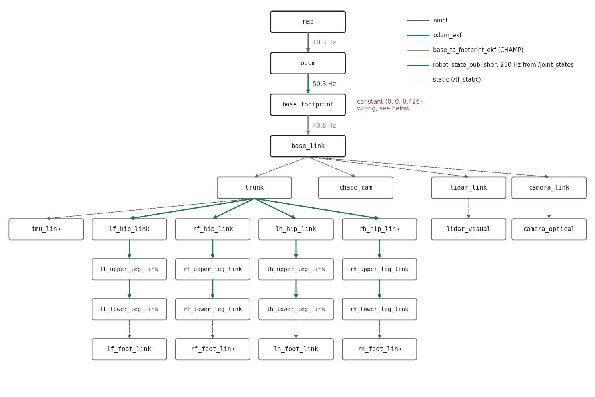

*The table above as a tree. Edge colour is the publisher, from the "Kind" column and `ros2 topic info -v /tf`; dashed edges are static. Leg prefixes `lf`, `rf`, `lh`, `rh` are the URDF names.*

<video controls muted playsinline src="../media/c04-go2-frames.mp4"></video>

*Leg frames move with the joints, which in the ROS stack means `/tf` from `robot_state_publisher` and `/joint_states`; `lidar_link` and `camera_link` (orange spheres) stay fixed to `base_link`, which means `/tf_static`. MuJoCo Go2 with the legs moved kinematically in a trot pattern, not a recording of the Gazebo stack.*

Each frame has exactly one parent. If two nodes publish the same child frame, TF keeps whichever message arrived last, so the
tree changes from message to message. This stack has three places where that could happen, and each is configured away:

- `sim.launch.py` starts `gt_odom.py`, which also publishes `odom` to `base_footprint`, only with `odom:=gt`. Run it that way and
  do not start `estimation.launch.py`.
- `slam_toolbox` would publish its own `map` to `odom`. `config/slam.yaml` sets `map_frame: slam_map` and
  `transform_publish_period: 0.0`, so it publishes no transform and AMCL stays the only parent of `odom`.
- CHAMP's own `footprint_to_odom` EKF is not started, through the `gt_odom` argument that the patch adds
  ([chapter 3](03-install-and-first-run.md#12-read-what-the-patch-changes)).

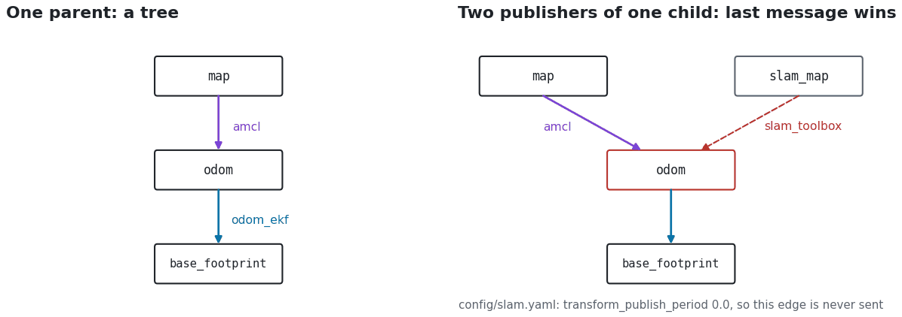

*The second case from the list above, had `slam_toolbox` been left to publish its transform.*

Check: the tree has `map` at the root, and `map` to `odom` runs near 10 Hz while `odom` to `base_footprint` runs near 50 Hz.

### 1.5 Read the transform that is wrong

Find the one transform in this stack that does not match the robot. `odom` to `base_footprint` should carry x, y and yaw;
`base_footprint` to `base_link` should carry the rest: trunk height, roll and pitch.

```bash
ros2 run tf2_ros tf2_echo base_footprint base_link
```

```
At time 707.845000000
- Translation: [0.000, 0.000, 0.426]
- Rotation: in Quaternion (xyzw) [0.000, 0.000, 0.000, 1.000]
...
At time 708.595000000
- Translation: [0.000, 0.000, 0.426]
- Rotation: in Quaternion (xyzw) [0.000, 0.000, 0.000, 1.000]
```

It is stamped and published at 50 Hz, but its value is a constant (0.426 m again in a later session, at time 24.105). Where
it comes from:

```bash
ros2 topic echo --once /base_to_footprint_pose --field pose.pose     # position z: 0.4259999990463257, identity rotation
ros2 topic echo --once /odom_gt --field pose.pose.position          # z: 0.21658939177410852
```

CHAMP's `state_estimation_node` publishes `/base_to_footprint_pose` and `base_to_footprint_ekf` turns it into the transform.
The estimator needs foot contacts, and nothing publishes `/foot_contacts` in this setup (`ros2 doctor` in chapter 4 flagged
it). 0.426 m is the height for all joint angles at zero, legs straight down: 0.213 + 0.213 m, the thigh and calf lengths
([chapter 1](01-legged-robot-foundations.md#42-measure-base_footprint-to-base_link) has the details). The simulator puts `base_link` 0.217 m above the floor,
so `base_footprint` lies 0.426 − 0.217 = 0.209 m below the floor, and everything expressed in `base_footprint` or `odom` is
0.209 m too high. This is a known open issue of the course; it is stated here, not fixed.

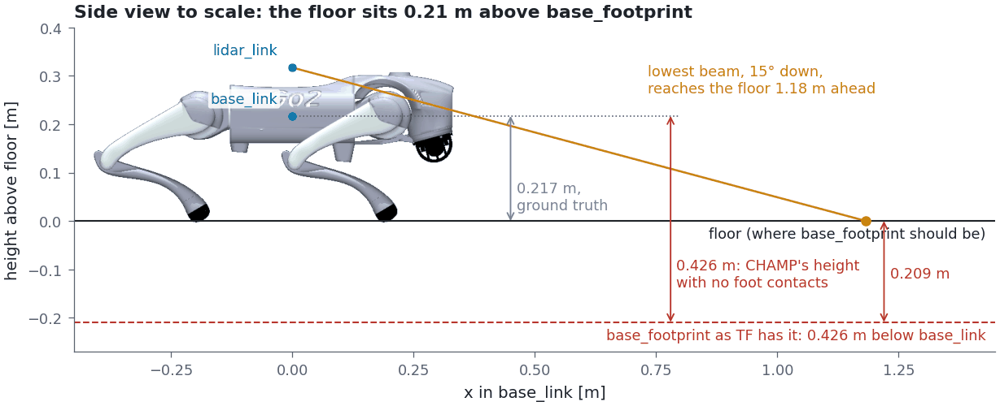

*Side view to scale, MuJoCo Go2 posed at the ground-truth height of 0.217 m. The dashed line is where TF puts `base_footprint`; the lowest beam, drawn from the 0.1 m lidar offset, reaches the floor 1.18 m ahead, close to the 1.2 m ring measured below.*

The floor confirms it. The lidar's lowest beam points 15 degrees down and hits the floor in a ring about 1.2 m around the
robot. `docs/exercises/floor_ring.py` takes one `/lidar/points` message, keeps the points of the lowest elevation angle, and
adds the `base_footprint` to `lidar_link` height from TF (0.1 + 0.426 m):

```bash
python3 docs/exercises/floor_ring.py --ros-args -p use_sim_time:=true
```

```
lowest ring (-15 deg): 900 pts  horizontal distance median 1.174 m  z in base_footprint median 0.211  mean 0.220  (lidar_link z in base_footprint 0.526)
gt z 0.2161
```

The distance is horizontal, $\sqrt{x^2 + y^2}$: the lidar is 0.526 − 0.211 = 0.315 m above that floor, and 0.315 m over
1.174 m is the 15 degree beam. The slant range along the beam is 1.22 m. A second run printed 1.173 m and 0.212.

The floor is at +0.211 m in `base_footprint`, against 0.426 − 0.2161 = 0.210 m predicted. `lidar_odom.py` keeps points
between 0.30 and 1.0 m in `base_footprint`, which is 0.09 to 0.79 m above the real floor
([chapter 9](09-state-estimation.md#lidar-odometry)).

Trunk roll and pitch never reach TF either, so a point at distance $d$ is placed as if the trunk were level, off in height by
$d \sin\theta$: 0.19 m at 3 m for the largest roll of the chapter 7 walk (3.6 degrees), 0.15 m for the −2.95 degree pitch in
`bags/v3`. The derivation is in [module m00](../modules/m00_math/README.md#height-error-from-an-uncorrected-tilt). Code that
needs gravity alignment takes roll and pitch from `/imu/data`.

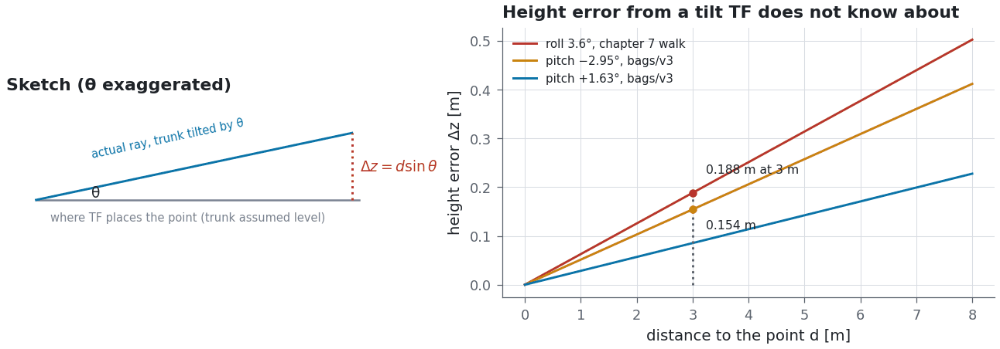

*$\Delta z = d \sin\theta$ for the three tilts quoted above, with the 0.188 m and 0.154 m values at 3 m marked.*

Check: `tf2_echo base_footprint base_link` prints z = 0.426 at every stamp, and `/odom_gt` puts the trunk near 0.217 m.

### 1.6 Read the camera optical frame

Confirm that `camera_optical` follows the optical convention. `sensors.xacro` attaches it to `camera_link` with
`rpy="-1.5707963 0 -1.5707963"`:

```bash
ros2 run tf2_ros tf2_echo camera_link camera_optical
```

```
At time 0.0
- Translation: [0.000, 0.000, 0.000]
- Rotation: in Quaternion (xyzw) [-0.500, 0.500, -0.500, 0.500]
- Rotation: in RPY (radian) [-1.571, 0.000, -1.571]
- Rotation: in RPY (degree) [-90.000, 0.000, -90.000]
- Matrix:
  0.000  0.000  1.000  0.000
 -1.000  0.000  0.000  0.000
 -0.000 -1.000  0.000  0.000
  0.000  0.000  0.000  1.000
```

The columns of the rotation are the optical axes written in `camera_link`: optical x is (0, −1, 0), to the right; optical y
is (0, 0, −1), down; optical z is (1, 0, 0), forward. How the matrix follows from the URDF `rpy` is worked through in
[module m00](../modules/m00_math/README.md#camera-optical-frame). A depth pixel on the optical axis at depth $d$ is
$(0, 0, d)$ in `camera_optical` and $(d, 0, 0)$ in `camera_link`: straight ahead.

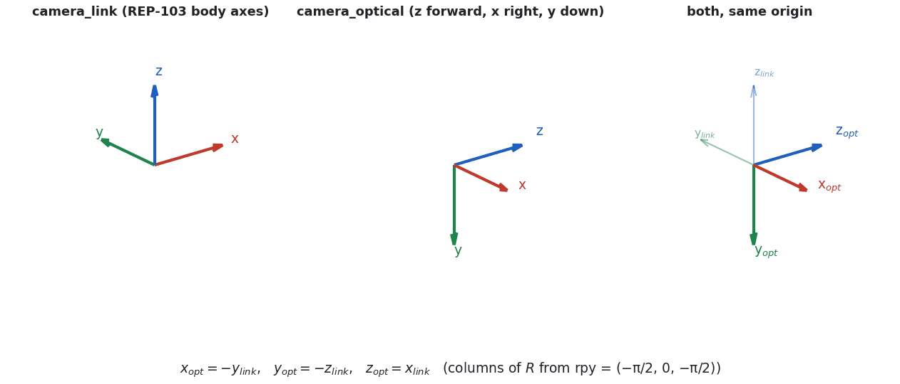

*The columns of $R$ drawn: optical z lies on link x, optical x on link −y, optical y on link −z.*

Check: the third column of the matrix is (1, 0, 0), so the optical axis points along `camera_link` x.

## Task 2: Look up transforms in time

### 2.1 Ask for the latest transform and for one at a stamp

Run a node that asks TF for `odom` to `base_footprint` at four times. Code uses TF through a buffer and a listener;
`docs/exercises/tf_lookup.py` does this:

```python
buf = Buffer()                                         # keeps 10 s of history by default
listener = TransformListener(buf, node, spin_thread=True)
buf.lookup_transform('odom', 'base_footprint', Time())                              # the latest it has
buf.lookup_transform('odom', 'base_footprint', now - Duration(seconds=30.0))        # 30 s ago
buf.lookup_transform('odom', 'base_footprint', now + Duration(seconds=0.5))         # 0.5 s ahead
buf.lookup_transform('odom', 'base_footprint', now + Duration(seconds=0.5), Duration(seconds=3.0))   # same, wait up to 3 s
```

`lookup_transform(target, source, time)` returns the transform that maps source coordinates into target coordinates, like
`tf2_echo target source`. The script asks once at start-up, waits 3 s of wall time, then asks the four questions:

```bash
python3 docs/exercises/tf_lookup.py --ros-args -p use_sim_time:=true
```

```
at once, now           ExtrapolationException: Lookup would require extrapolation at time 56.980000, but only time 56.971000 is in the buffer, when looking up transform from frame [base_footprint] to frame [odom]
now = 58.775 s
latest, Time()         ok, stamp 58.751
now - 30 s             ExtrapolationException: Lookup would require extrapolation into the past.  Requested time 28.775000 but the earliest data is at time 58.039000, when looking up transform from frame [base_footprint] to frame [odom]
now + 0.5 s            ExtrapolationException: Lookup would require extrapolation into the future.  Requested time 59.275000 but the latest data is at time 58.751000, when looking up transform from frame [base_footprint] to frame [odom]
now + 0.5 s, wait 3 s  ok, stamp 59.275
```

- `Time()` (zero) means "the latest you have", whatever its stamp. It does not fail for lack of time coverage, and it may be
  stale.
- A stamp means "interpolated at this instant". For sensor data this is the right choice: the robot moved between the scan and
  now, and the latest transform would place the points where the robot is now, not where it measured.
- The listener holds only what it has heard since it started: here 0.7 s of simulated time, so 30 s ago is not there.
- A time that has not happened yet fails at once; with a timeout the lookup waits, and succeeds once the publisher reaches it.

Check: `Time()` and the lookup with a timeout succeed; the other two print `into the past` and `into the future`.

Common mistakes: the first line varies with how much the listener has heard. In two other runs it was
`LookupException: "odom" passed to lookupTransform argument target_frame does not exist`: no message had arrived yet.

### 2.2 Read an ExtrapolationException

Learn which side and by how much from the message alone. An earlier probe on the loaded machine (load average above 40)
produced the three kinds:

```
tf2.ExtrapolationException: Lookup would require extrapolation into the past.  Requested time 880.096000 but the earliest data is at time 880.100000, when looking up transform from frame [lidar_link] to frame [base_footprint]
ExtrapolationException : Lookup would require extrapolation into the future.  Requested time 935.490000 but the latest data is at time 934.979000, when looking up transform from frame [base_footprint] to frame [odom]
ExtrapolationException : Lookup would require extrapolation into the past.  Requested time 904.990000 but the earliest data is at time 934.400000, when looking up transform from frame [base_footprint] to frame [odom]
```

The first came from a node that had just started: its listener had 4 ms less history than the first scan it received needed.
The lidar lookup can fail at all because the chain from `lidar_link` to `base_footprint` includes the dynamic `base_footprint`
to `base_link`; a chain of static transforms has no time and never raises these errors. The second asked for `now + 0.5 s`, the
third for `now − 30 s`. A stamped lookup that fails into the future by a few tens of milliseconds means the publisher is late,
and a timeout fixes it.

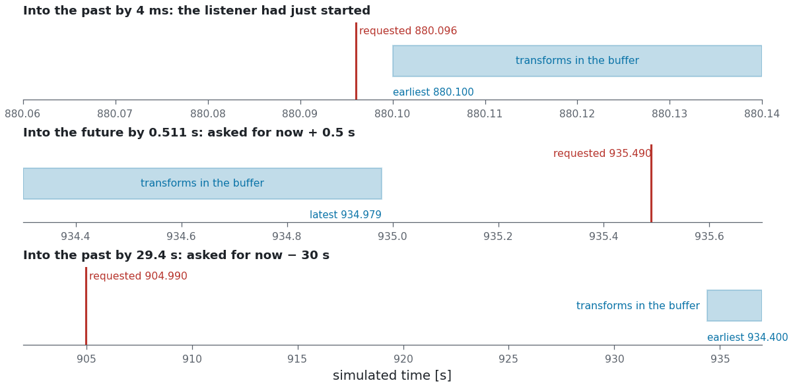

*The three messages above on their own time axes (note the different scales): 4 ms before the earliest data, 0.511 s after the latest, 29.4 s before the earliest.*

`lidar_odom.py` uses both forms: a stamped lookup with a 0.3 s timeout, and the latest transform as a fallback when the
stamped one fails on a loaded machine ([chapter 9](09-state-estimation.md#lidar-odometry)).

Check: for each of the three messages you can say whether the request was before the buffer or after it, and by how much.

### 2.3 Diagnose a lookup on the wrong clock

Run the same script without `use_sim_time` and explain the result:

```bash
python3 docs/exercises/tf_lookup.py
```

```
at once, now           LookupException: "odom" passed to lookupTransform argument target_frame does not exist.
now = 1795846701.248 s
latest, Time()         ok, stamp 61.757
now - 30 s             ExtrapolationException: Lookup would require extrapolation into the future.  Requested time 1795846671.247732 but the latest data is at time 62.740000, when looking up transform from frame [base_footprint] to frame [odom]
now + 0.5 s            ExtrapolationException: Lookup would require extrapolation into the future.  Requested time 1795846701.747732 but the latest data is at time 62.740000, when looking up transform from frame [base_footprint] to frame [odom]
now + 0.5 s, wait 3 s  ExtrapolationException: Lookup would require extrapolation into the future.  Requested time 1795846701.747732 but the latest data is at time 64.839000, when looking up transform from frame [base_footprint] to frame [odom]
```

The node's clock is the system clock, so "now" is a Unix time near 1.8e9 s, while the transforms are stamped in simulated
seconds. Even `now − 30 s` is "in the future", and no timeout helps. Only `Time()` works, because it ignores the clock. This
is the TF form of the silent echo of [chapter 4](04-ros2-from-scratch.md#24-measure-on-the-right-clock).

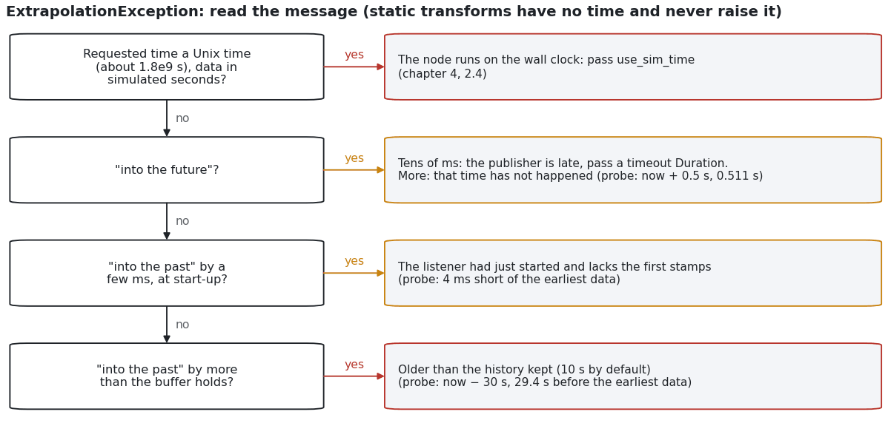

*The three probe messages as a checklist. The first row is not one of them: it is the wall-clock mismatch of [chapter 4](04-ros2-from-scratch.md), task 2.4, as a TF lookup would meet it.*

Check: the requested times are about 1.8e9 s and the data near 60 s; with `-p use_sim_time:=true` both are near 60 s.

### 2.4 Let TF compose a chain

Ask for a transform across several edges; TF multiplies them for you:

```bash
ros2 run tf2_ros tf2_echo odom lidar_link
```

```
At time 53.418000000
- Translation: [0.123, -0.103, 0.526]
- Rotation: in Quaternion (xyzw) [0.000, 0.000, 0.027, 1.000]
```

The height is 0.1 m (`base_link` to `lidar_link`) plus 0.426 m (`base_footprint` to `base_link`); x, y and yaw are the drift
of `odom` to `base_footprint` while the robot stood.

The same chain by hand, from an earlier session: a `/lidar/points` message stamped 934.896 s, and the three transforms that
`lookup_transform` returned at that stamp. The first two only add height. The third is the drift of that session, much larger
than above:

| Transform | Translation (m) | Yaw |
|---|---|---|
| `base_link` to `lidar_link` | (0, 0, 0.1) | 0 |
| `base_footprint` to `base_link` | (0, 0, 0.426) | 0 |
| `odom` to `base_footprint` | (−0.5398, 0.2516, 0) | 7.83 degrees (cos 0.9907, sin 0.1362) |

A point at $p_\text{lidar} = (1.2545, −0.0044, 0.0219)$ is at $(1.2545, −0.0044, 0.5479)$ in `base_footprint`, and in `odom`

$$x = 0.9907 \times 1.2545 - 0.1362 \times (-0.0044) - 0.5398 = 0.7036, \qquad y = 0.1362 \times 1.2545 + 0.9907 \times (-0.0044) + 0.2516 = 0.4181,$$

with $z = 0.5479$. `lookup_transform('odom', 'lidar_link', stamp)` applied to the same point gave (0.7035, 0.4181, 0.5479),
2.2e-16 m from the composition done in full precision; the 0.7036 above differs in the fourth decimal because the table is
rounded. Your own numbers will differ by the drift of your `odom` frame.

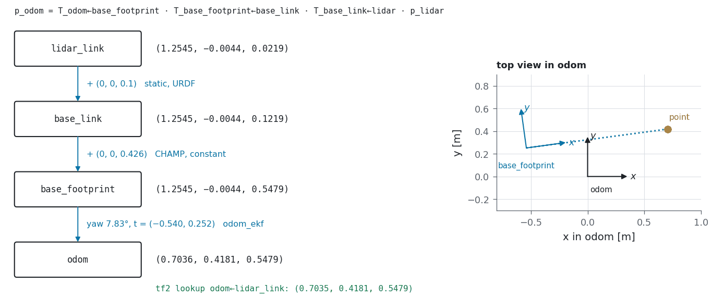

*The worked example as a chain: each arrow is one transform, the coordinates beside each frame are the point in that frame. Right: the same step in top view, `base_footprint` turned 7.83 degrees in `odom`.*

Check: the z of `odom` to `lidar_link` is 0.526 m, the static 0.1 m plus the dynamic 0.426 m.

## Task 3: Find the faults in a broken tree

`docs/exercises/broken_tree.launch.py` publishes a small version of this robot's sensor tree with static transforms only. It
has two faults: one transform is wrong and one frame has no parent. Find both with the three tools before you read 3.5. Do
not read the launch file below its docstring, which lists the expected tree:

```
base_footprint -> base_link -> lidar_link, camera_link -> camera_optical, trunk -> imu_link
```

### 3.1 Start the broken tree

Start the five static publishers of the exercise on their own. The frame names are the robot's, so stop the stack first:

```bash
scripts/stop.sh
ros2 launch docs/exercises/broken_tree.launch.py
```

```
[INFO] [static_transform_publisher-1]: process started with pid [...]
...
[static_transform_publisher-1] [INFO] [...] [footprint_to_base]: Spinning until stopped - publishing transform
```

Check: `ros2 node list` in a second terminal shows five nodes: `/base_to_camera`, `/base_to_lidar`, `/camera_to_optical`,
`/footprint_to_base`, `/trunk_to_imu`.

### 3.2 Ask tf2_echo

Look up each sensor from `base_link` and compare with task 1:

```bash
ros2 run tf2_ros tf2_echo base_link lidar_link       # Translation: [0.000, 0.000, 0.100], as on the robot
ros2 run tf2_ros tf2_echo base_link imu_link
```

```
[INFO] [...] [tf2_echo]: Waiting for transform base_link ->  imu_link: Invalid frame ID "base_link" passed to canTransform argument target_frame - frame does not exist
[INFO] [...] [tf2_echo]: Waiting for transform base_link ->  imu_link: Could not find a connection between 'base_link' and 'imu_link' because they are not part of the same tree.Tf has two or more unconnected trees.
```

```bash
ros2 run tf2_ros tf2_echo camera_link camera_optical
```

```
At time 0.0
- Translation: [0.000, 0.000, 0.000]
- Rotation: in Quaternion (xyzw) [-0.500, -0.500, 0.500, 0.500]
- Rotation: in RPY (radian) [-1.571, 0.000, 1.571]
- Rotation: in RPY (degree) [-90.000, 0.000, 90.000]
- Matrix:
  0.000 -0.000 -1.000  0.000
  1.000  0.000  0.000  0.000
 -0.000 -1.000  0.000  0.000
  0.000  0.000  0.000  1.000
```

Check: `imu_link` cannot be reached from `base_link`, and the optical rotation differs from the one in task 1.6.

Common mistakes: the first line of `tf2_echo` says `frame does not exist` even for a frame that is there; the listener has not
heard anything yet. Read the second line.

### 3.3 Ask tf2_monitor

Find the frame that has no parent. `tf2_monitor` listens for 10 s and lists every frame that has a parent:

```bash
ros2 run tf2_ros tf2_monitor
```

```
Gathering data on all frames for 10 seconds...

RESULTS: for all Frames

Frames:
Frame: base_link, published by <no authority available>, Average Delay: 59.9426, Max Delay: 59.9426
Frame: camera_link, published by <no authority available>, Average Delay: 59.9373, Max Delay: 59.9373
Frame: camera_optical, published by <no authority available>, Average Delay: 59.9426, Max Delay: 59.9426
Frame: imu_link, published by <no authority available>, Average Delay: 59.9452, Max Delay: 59.9452
Frame: lidar_link, published by <no authority available>, Average Delay: 59.9455, Max Delay: 59.9455

All Broadcasters:
Node: <no authority available> 384.467 Hz, Average Delay: 59.9426 Max Delay: 59.9455
```

The expected tree has six child frames; `trunk` is missing from the list, so nothing gives it a parent. The delay of about
60 s is the age of the static transforms, which are stamped once when their publisher starts. With two frames,
`ros2 run tf2_ros tf2_monitor base_link imu_link` repeats the `not part of the same tree` message of 3.2.

Check: the list has five frames and no `trunk`.

### 3.4 Draw it with view_frames

See both faults' effect on the shape of the tree.

```bash
ros2 run tf2_tools view_frames
```

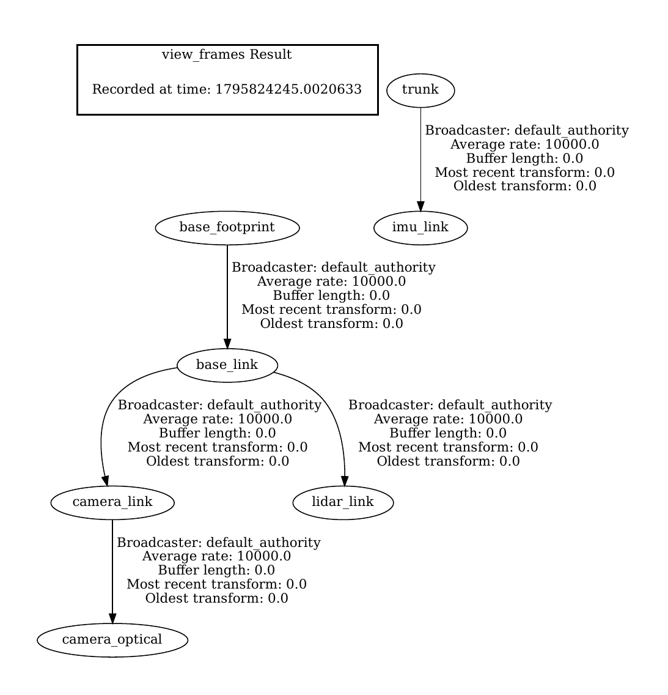

*`view_frames` on the broken tree. Two trees: `trunk` to `imu_link` stands on its own, because nothing publishes `base_link` to `trunk`.*

The edges in the `.gv` file:

```
"base_link" -> "lidar_link"
"base_footprint" -> "base_link"
"base_link" -> "camera_link"
"camera_link" -> "camera_optical"
"trunk" -> "imu_link"
```

Check: the drawing shows two separate trees.

### 3.5 Fix both and check

Correct the launch file and confirm the fix with `tf2_echo` and RViz. The two faults:

- Missing frame: nothing publishes `base_link` to `trunk`. In the robot's URDF that joint is fixed with zero offset.
- Wrong transform: `camera_link` to `camera_optical` has yaw +1.5708 instead of −1.5708. Its rotation's third column is
  (−1, 0, 0): the optical axis points backwards, and optical x points left.

Copy the launch file, flip the yaw sign and add the missing edge:

```bash
cp docs/exercises/broken_tree.launch.py $HOME/fixed_tree.launch.py
# edit: yaw=1.5707963 -> yaw=-1.5707963, and add  static('base_to_trunk', 'base_link', 'trunk'),
diff docs/exercises/broken_tree.launch.py $HOME/fixed_tree.launch.py
```

```
22c22,23
<         static('camera_to_optical', 'camera_link', 'camera_optical', roll=-1.5707963, yaw=1.5707963),   # fault 1: yaw sign
---
>         static('camera_to_optical', 'camera_link', 'camera_optical', roll=-1.5707963, yaw=-1.5707963),   # fault 1: yaw sign
>         static('base_to_trunk', 'base_link', 'trunk'),
```

Stop the broken tree (Ctrl-C) and start yours:

```bash
ros2 launch $HOME/fixed_tree.launch.py
ros2 run tf2_ros tf2_echo camera_link camera_optical    # Quaternion (xyzw) [-0.500, 0.500, -0.500, 0.500], RPY degree [-90.000, -0.000, -90.000]
ros2 run tf2_ros tf2_echo base_link imu_link            # Translation: [0.000, 0.000, 0.000]
```

`view_frames` now draws one tree, with `base_link` to `trunk` to `imu_link`.

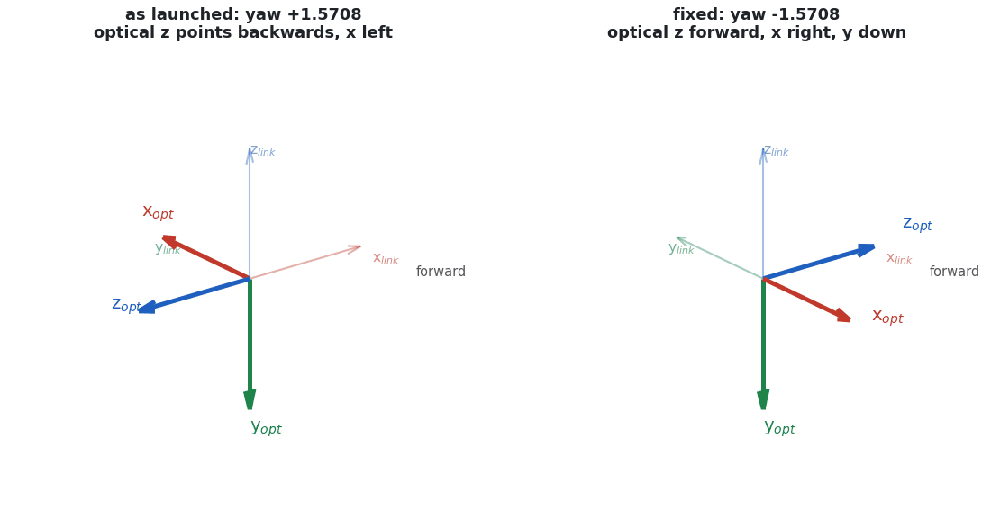

*The rotation of `camera_link` to `camera_optical` from the two `tf2_echo` matrices above; faded axes are `camera_link`. Optical y points down in both, which is why the fault is easy to miss in a camera image that is only mirrored and rotated.*

Look at the same two trees in RViz. Start it on the course config with `base_link` as the fixed frame, once with the broken
tree running and once with yours:

```bash
rviz2 -d src/go2_nav_sim/rviz/go2.rviz -f base_link
```

In the Displays panel, expand TF. With the broken tree its status is `Warn` (orange); with yours it is `Ok`. The figure
below has the RobotModel display unticked, to leave only the frames.


*RViz with `go2.rviz`, fixed frame `base_link`, TF names off and arrows on, seen from in front of the robot and to its left; the triad nearest the viewer is `camera_link` and `camera_optical` at the same origin, and behind it, from the top, `lidar_link`, `base_link` and `base_footprint`. Left, as launched: optical z (blue) points back along the body. Right, fixed: optical z points forward, towards the viewer, and optical x (red) to the robot's right.*

Check: `tf2_echo camera_link camera_optical` matches task 1.6, `tf2_echo base_link imu_link` prints a transform, and the TF
display in RViz reads `Status: Ok`.

Common mistakes: starting a second `static_transform_publisher` for `camera_link` to `camera_optical` next to the broken one
did not fix it. Both publish the same child; the listener in my run kept the wrong one. Fix the publisher that is wrong, do not
add a second. The same happens when the broken tree is still running while you start yours: in my run `tf2_echo` then printed
the broken rotation `[-0.500, -0.500, 0.500, 0.500]`.

Before you go on, stop the fixed tree with Ctrl-C in its terminal, then check with `ros2 node list` that none of the five
publishers is left. `scripts/stop.sh` does not stop it (its patterns do not match `static_transform_publisher` or
`ros2 launch` of a file outside the packages), and a tree left running keeps publishing a static `base_footprint` to
`base_link` at z = 0.217 and its own camera frames next to the robot's publishers. Then start the stack again with
`scripts/up.sh` for the exercise.

## Exercise

A depth pixel on the optical axis of the robot's camera reads 2.0 m. Where is that point in `base_link`? Work it out from
task 1.1 and 1.6, then check it with `lookup_transform('base_link', 'camera_optical', Time())` on the running stack.

Answer: in `camera_link` the point is $R\,(0,0,2)^\top = (2, 0, 0)$; adding the 0.28 m forward and 0.03 m up of `camera_link`
gives (2.28, 0, 0.03) m in `base_link`. TF printed `[2.28000000e+00 5.35897930e-08 3.00000536e-02]`.

## Further reading

- ROS 2 documentation, Humble: `Tf2/Debugging-Tf2-Problems.rst` in https://github.com/ros2/ros2_documentation (the tools of
  task 3 on a different broken tree).
- K. M. Lynch and F. C. Park, *Modern Robotics*, chapter 3 (rigid-body motions): https://hades.mech.northwestern.edu/index.php/Modern_Robotics

Next: [6. Import the Go2](06-import-the-go2.md)
