# 6. Import the Go2

| | |
|---|---|
| Goal | Know which files describe the Go2, look at it in RViz, change a copy of its URDF, and check that every name CHAMP and ros2_control need is spelled the same everywhere. |
| Time | 2 h |
| Before you start | [Chapter 3](03-install-and-first-run.md) built the workspace; [chapter 5](05-frames-and-tf2.md) covered TF and `view_frames`. A desktop session for RViz. |
| You will learn | how the xacro is assembled; how to open the shared RViz config `go2.rviz`; joint limits; visual and collision geometry; how to add a link; which names must match between the URDF, `ros_control.yaml` and the CHAMP maps. |

The Go2 model and its gait controller are not part of this repository. `scripts/setup.sh` fetches
[anujjain-dev/unitree-go2-ros2](https://github.com/anujjain-dev/unitree-go2-ros2) at commit
`fdac259518930c8f03e79189c4d0fdd00fc47483` into `src/third_party/unitree-go2-ros2` and applies `patches/upstream.patch`. The
patch touches only two CHAMP launch files. Every command below runs from the repository root after `source env.sh`.

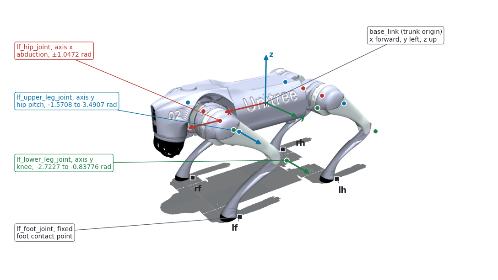

*MuJoCo Menagerie Go2 (`modules/assets/unitree_go2`, home pose) labelled with this stack's URDF names; its leg offsets are the ones in `const.xacro`. Red dots: hip joints (axis x), blue: upper leg (axis y), green: lower leg (axis y), black squares: foot points. Limits from the expanded URDF.*

## Task 1: Find the files and render the URDF

### 1.1 Locate what upstream provides

Objective: know which file holds what before you change anything.

| Path under `src/third_party/unitree-go2-ros2` | Contents |
|---|---|
| `robots/descriptions/go2_description/xacro/` | `robot.xacro` (entry point), `leg.xacro`, `const.xacro`, `gazebo.xacro`, `materials.xacro`, and unused variants (`robot_VLP.xacro`, `velodyne.xacro`, `laser.xacro`, `transmission.xacro`) |
| `robots/descriptions/go2_description/meshes/` | Collada visuals: `trunk.dae`, `hip.dae`, `thigh.dae`, `thigh_mirror.dae`, `calf.dae`; `calf_mirror.dae`, `foot.dae` and `hokuyo.dae` are not referenced by `robot.xacro` |
| `robots/descriptions/go2_description/config/ros_control/ros_control.yaml` | controller manager and controller parameters |
| `robots/configs/go2_config/config/joints/joints.yaml` | CHAMP joint map |
| `robots/configs/go2_config/config/links/links.yaml` | CHAMP link map |
| `robots/configs/go2_config/config/gait/gait.yaml` | CHAMP gait parameters ([chapter 7](07-make-it-walk.md#task-5-edit-the-gait-yaml-restart-and-measure)) |
| `champ/champ_bringup/launch/bringup.launch.py` | `robot_state_publisher`, CHAMP controller and state estimator, two EKFs |
| `champ/champ_gazebo/launch/gazebo.launch.py` | `gzserver`, spawning, controller loading |

`go2_config` also has its own `launch/gazebo.launch.py` and `bringup.launch.py` for upstream's demo. This repository does not
use them. It includes the two CHAMP launch files directly and passes the Go2 paths in.

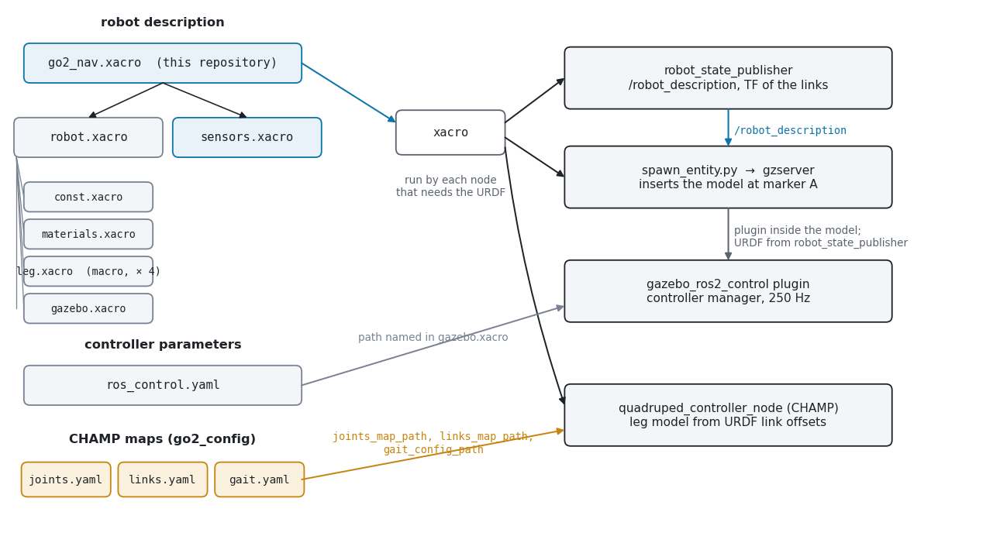

*Which process reads which file. Every node that needs the URDF runs `xacro` on `go2_nav.xacro` itself; the controller YAML is found through the path in `gazebo.xacro`, and the three maps through `sim.launch.py`.*

Check: `ls src/third_party/unitree-go2-ros2/robots/configs/go2_config/config/` lists `gait`, `joints` and `links` among its folders.

### 1.2 Read how the xacro is assembled

Objective: know where each link and joint comes from.

`src/go2_nav_sim/urdf/go2_nav.xacro` includes upstream's `robot.xacro` and this repository's `sensors.xacro`. `robot.xacro`
includes `const.xacro`, `materials.xacro`, `leg.xacro` and `gazebo.xacro`. It defines `base_link`, a fixed joint named
`floating_base` to `trunk` (the trunk mesh, a 0.376 × 0.094 × 0.114 m collision box and 6.921 kg), and `imu_link` at the trunk
origin. It then calls the leg macro four times:

```xml
<xacro:leg name="rf" mirror="-1" mirror_dae= "False" front_hind="1"  front_hind_dae="True"  />
<xacro:leg name="lf" mirror="1"  mirror_dae="True"   front_hind="1"  front_hind_dae="True"  />
```

`mirror` flips y offsets and inertia products for the right side, `front_hind` flips x for the hind legs, and the two `_dae`
flags choose the mesh and its orientation. `leg.xacro` creates `<name>_hip_joint` (axis x, at ±0.1934, ±0.0465 m from the trunk
centre), `<name>_upper_leg_joint` (axis y, 0.0955 m outward), `<name>_lower_leg_joint` (axis y, 0.213 m below) and a fixed
`<name>_foot_joint` another 0.213 m below. All dimensions, joint limits, masses and inertias live in `const.xacro`.

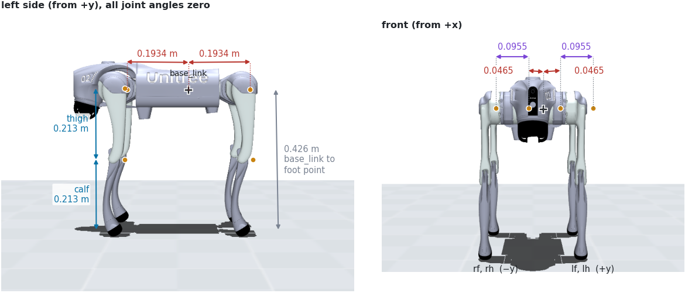

*The offsets above drawn between joint origins, all joint angles zero (outside the knee limit, posed only to show the lengths). With straight legs the foot point is 0.213 + 0.213 = 0.426 m below `base_link`.*

`gazebo.xacro` adds the `libgazebo_ros2_control.so` plugin, pointed at
`$(find go2_description)/config/ros_control/ros_control.yaml`, an IMU on `imu_link` publishing `/imu/data`
([chapter 8](08-robot-and-sensors.md)), and friction 0.6 on the feet and 0.2 on the other links. `go2_nav.xacro` attaches a lidar, an RGB-D camera, a chase camera and the ground-truth plugin to `base_link` with fixed joints
([chapter 8](08-robot-and-sensors.md)), and takes `start_x` and `start_y` so that `/odom_gt` starts at zero.

Check: `grep -c "xacro:leg " src/third_party/unitree-go2-ros2/robots/descriptions/go2_description/xacro/robot.xacro` prints `4`.

### 1.3 Render the model without starting anything

Objective: expand the xacro and confirm it parses.

```bash
xacro src/go2_nav_sim/urdf/go2_nav.xacro | check_urdf /dev/stdin | head -n 4
xacro src/go2_nav_sim/urdf/go2_nav.xacro | grep -c 'type="revolute"'
xacro src/go2_nav_sim/urdf/go2_nav.xacro | grep -o '<ros2_control name="[a-z]*"'
```

```
robot name is: go2
---------- Successfully Parsed XML ---------------
root Link: base_link has 4 child(ren)
    child(1):  camera_link
12
<ros2_control name="rf"
<ros2_control name="lf"
<ros2_control name="rh"
<ros2_control name="lh"
```

Check: 12 revolute joints and four `<ros2_control>` blocks, one per leg.

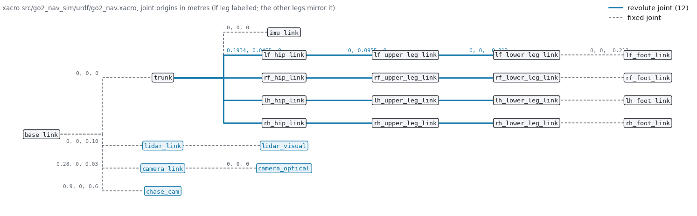

*The expanded URDF as a tree, parsed from the `xacro` output by `docs/img/c06-figures.py`. Solid blue edges are the 12 revolute joints; dashed edges are fixed. Sensor links (blue boxes) come from `sensors.xacro`.*

## Task 2: Inspect the robot in RViz

### 2.1 Open the shared RViz config

Objective: see the URDF with no simulator running, using the config every later chapter uses.

`src/go2_nav_sim/rviz/go2.rviz` holds one set of displays for the whole course:

| Display | Topic | QoS set in the config | Why |
|---|---|---|---|
| RobotModel | `/robot_description` | Reliable, Transient Local | `robot_state_publisher` publishes it once, Transient Local |
| TF | `/tf`, `/tf_static` | | every frame with its name |
| LaserScan | `/scan` | Best Effort | the publisher, `pointcloud_to_laserscan`, is Best Effort; a Reliable display receives nothing |
| LidarPoints (PointCloud2) | `/lidar/points` | Best Effort | drops old clouds instead of queueing them |
| Map | `/map` | Reliable, Transient Local | `map_server` publishes the map once, Transient Local |
| GlobalCostmap, LocalCostmap | `/global_costmap/costmap`, `/local_costmap/costmap` | Reliable, Transient Local | as published by Nav2 |
| Plan | `/plan` | Reliable | global path, amber |
| Footprint | `/local_costmap/published_footprint` | Reliable | the 0.33 m circle Nav2 plans with |

The QoS of each publisher was read with `ros2 topic info <topic> -v` on the running stack (started as in
[chapter 10](10-mapping-and-navigation.md)). The fixed frame is `map`, the camera orbits `base_link`, and the tool bar
has 2D Pose Estimate (`/initialpose`) and 2D Goal Pose (`/goal_pose`). RViz takes `use_sim_time` on its command line, not from
the config. Use one of these three commands:

| When | Command |
|---|---|
| URDF alone, no simulator (this chapter) | `rviz2 -d src/go2_nav_sim/rviz/go2.rviz -f base_link` |
| `sim.launch.py odom:=gt`, no map ([chapter 7](07-make-it-walk.md), [8](08-robot-and-sensors.md)) | `rviz2 -d src/go2_nav_sim/rviz/go2.rviz -f odom --ros-args -p use_sim_time:=true` |
| Localisation or Nav2 running (chapters [9](09-state-estimation.md), [10](10-mapping-and-navigation.md) and the projects) | `rviz2 -d src/go2_nav_sim/rviz/go2.rviz --ros-args -p use_sim_time:=true` |

After a build the same file is also at `$(ros2 pkg prefix go2_nav_sim)/share/go2_nav_sim/rviz/go2.rviz`. Displays whose topic
has no publisher yet show a warning and nothing else; that is expected in this chapter.

Start the robot description, a joint slider window and RViz, each in its own terminal:

```bash
ros2 run robot_state_publisher robot_state_publisher --ros-args -p robot_description:="$(xacro src/go2_nav_sim/urdf/go2_nav.xacro)"
ros2 run joint_state_publisher_gui joint_state_publisher_gui
rviz2 -d src/go2_nav_sim/rviz/go2.rviz -f base_link
```

Expect `got segment trunk` and the other links in the first terminal, `Centering` in the second, and an RViz window with
`Global Status: Ok`:

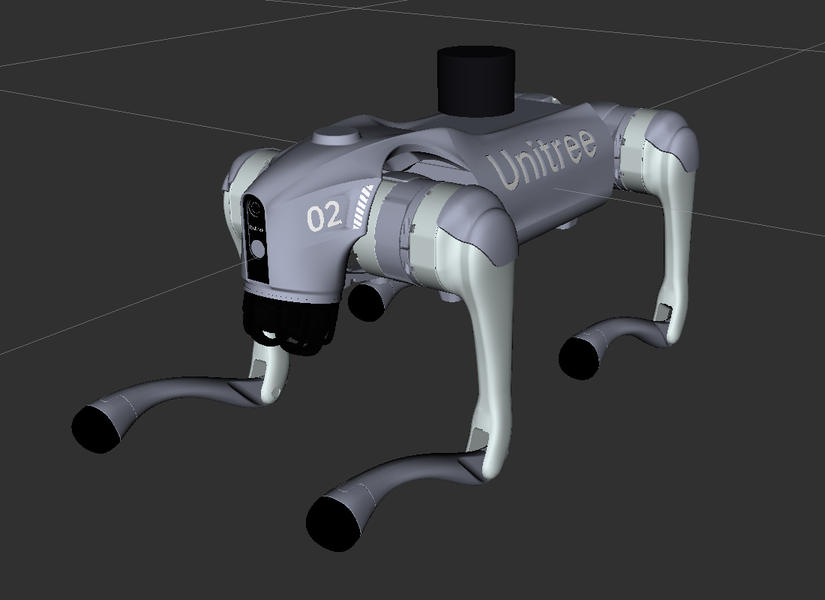

*`go2.rviz` with fixed frame `base_link` and the TF display switched off. The lower legs point backwards because the slider
window starts every knee at the middle of its range (next sub-task).*

Check: RobotModel has a blue tick in the Displays panel and the robot is drawn.

### 2.2 Read the TF tree on the model

Objective: match each frame you saw in [chapter 5](05-frames-and-tf2.md) to a place on the robot.

Tick the TF display (it is on in `go2.rviz`; the screenshot above had it off). Set the RobotModel Alpha to 0.35 to see the
frames through the meshes.

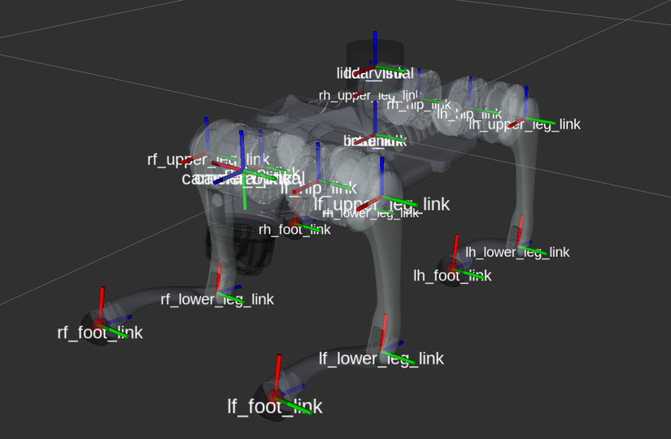

*Every frame of the expanded URDF. Red is x, green y, blue z. At the feet x points up because the lower leg is rotated by
-1.78 rad.*

```bash
ros2 topic echo --once /joint_states --field name
```

```
['rf_hip_joint', 'rf_upper_leg_joint', 'rf_lower_leg_joint', 'lf_hip_joint', 'lf_upper_leg_joint', 'lf_lower_leg_joint', 'rh_hip_joint', 'rh_upper_leg_joint', 'rh_lower_leg_joint', 'lh_hip_joint', 'lh_upper_leg_joint', 'lh_lower_leg_joint']
```

Check: the Frames list under TF shows 24 frames, the 24 links of the URDF.

### 2.3 Move a leg and read its joint limits

Objective: see a joint move and find where its range comes from.

Read the limits of the left front leg from the expanded URDF:

```bash
for j in hip upper_leg lower_leg; do
  xacro src/go2_nav_sim/urdf/go2_nav.xacro | grep -A6 "<joint name=\"lf_${j}_joint\" type" | grep limit
done
```

```
    <limit effort="23.7" lower="-1.0472" upper="1.0472" velocity="30.1"/>
    <limit effort="23.7" lower="-1.5708" upper="3.4907" velocity="30.1"/>
    <limit effort="35.55" lower="-2.7227" upper="-0.83776" velocity="20.06"/>
```

The knee range, -2.7227 to -0.83776 rad, does not contain zero, so `joint_state_publisher_gui` starts it at the middle of the
range:

```bash
ros2 topic echo --once /joint_states --field position
```

```
array('d', [0.0, -0.00021654999999998203, -1.78023, 0.0, -0.00021654999999998203, -1.78023, 0.0, -0.00021654999999998203, -1.78023, 0.0, -0.00021654999999998203, -1.78023])
```

Drag the `lf_hip_joint`, `lf_upper_leg_joint` and `lf_lower_leg_joint` sliders. Each slider runs exactly over the joint's
limit. To reproduce the picture below, close the slider window and start it with set values instead:

```bash
ros2 run joint_state_publisher_gui joint_state_publisher_gui --ros-args \
  -p zeros.lf_hip_joint:=0.6 -p zeros.lf_upper_leg_joint:=0.5 -p zeros.lf_lower_leg_joint:=-0.83776
```

`/joint_states` then carried `0.59983616`, `0.4998596500000001` and `-0.8377599999999998` for the three left front joints (the
slider rounds to its step).

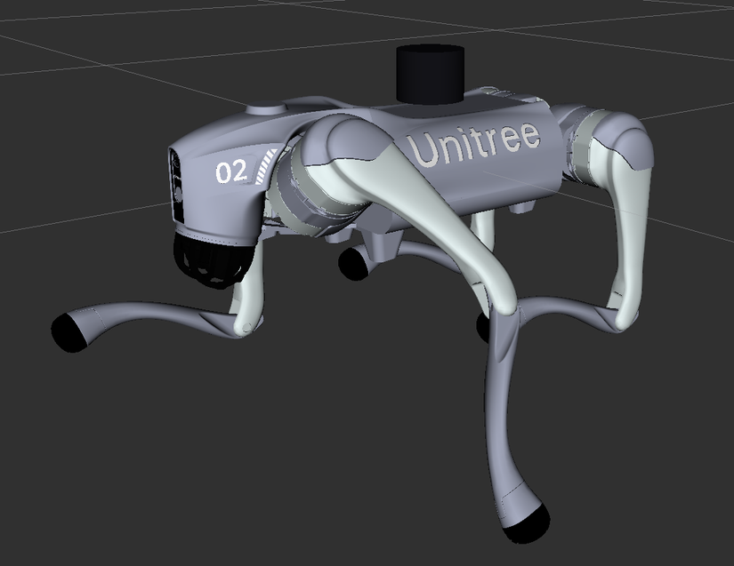

*Left front leg at hip 0.6, upper leg 0.5 and knee -0.838 rad, the knee's upper limit; the other three legs are at the slider
defaults.*

Check: the `lf_lower_leg_joint` slider stops at -0.84 and cannot straighten the knee further.

Common mistakes:

- A slider window left over from an earlier try keeps publishing. Here, after one was stopped with `kill` (SIGTERM) it kept
  running, and `ros2 topic info /joint_states --no-daemon` showed `Publisher count: 2`. Close the window or press Ctrl-C in
  its terminal, then check for `Publisher count: 1`.

## Task 3: Compare visual and collision geometry

### 3.1 Switch RViz to the collision shapes

Objective: see the shapes Gazebo's physics uses.

In the RobotModel display, untick Visual Enabled and tick Collision Enabled.

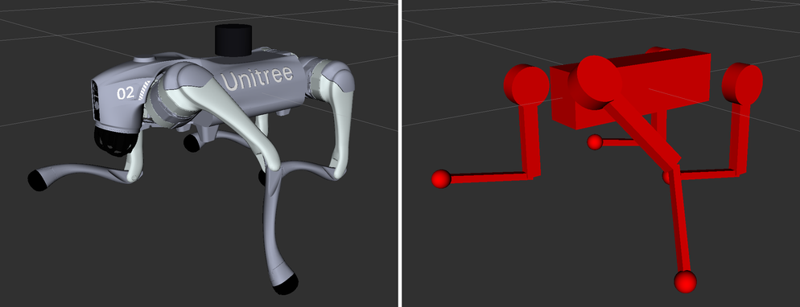

*The same pose, visual meshes (left) and collision shapes (right). The curved calf mesh is a straight 0.213 m box for the
physics; the lidar cylinder on top has no collision shape at all.*

Check: the trunk is one box and each foot a sphere.

### 3.2 Count the shapes in the URDF

Objective: confirm the picture from the file.

```bash
python3 - <<'EOF'
import collections, subprocess, xml.etree.ElementTree as ET
urdf = ET.fromstring(subprocess.run(['xacro', 'src/go2_nav_sim/urdf/go2_nav.xacro'], capture_output=True, text=True).stdout)
for tag in ('visual', 'collision'):
    shapes = collections.Counter(g[0].tag for link in urdf.iter('link') for e in link.findall(tag) for g in e.findall('geometry'))
    print(tag, sum(shapes.values()), dict(shapes))
EOF
```

```
visual 20 {'box': 2, 'mesh': 13, 'sphere': 4, 'cylinder': 1}
collision 18 {'box': 10, 'cylinder': 4, 'sphere': 4}
```

The 18 collision shapes are the trunk box, the `imu_link` box, a 0.046 m radius cylinder per hip, a box per thigh and calf, and
a 0.02 m sphere per foot. `base_link`, the lidar and the cameras have visuals or nothing; Gazebo cannot collide with them. The ground contact is the four 0.02 m spheres with friction 0.6.

Check: `collision 18`.

## Task 4: Add a sensor link

### 4.1 Copy the xacro and add a link

Objective: add a frame without touching the robot that the simulator uses.

```bash
mkdir -p docs/exercises
cp src/go2_nav_sim/urdf/go2_nav.xacro docs/exercises/go2_extra.xacro
```

Paste this into `docs/exercises/go2_extra.xacro`, just above `</robot>`:

```xml
  <link name="rear_cam_link">
    <visual><geometry><box size="0.02 0.06 0.03"/></geometry></visual>
  </link>
  <joint name="rear_cam_joint" type="fixed">
    <parent link="base_link"/>
    <child link="rear_cam_link"/>
    <origin xyz="-0.25 0 0.06" rpy="0 0 3.14159"/>
  </joint>
```

The include paths in the copy use `$(find ...)`, so the copy works from any folder.

```bash
grep -c rear_cam docs/exercises/go2_extra.xacro
tail -n 1 docs/exercises/go2_extra.xacro
```

```
3
</robot>
```

Check: `3` (the link name, the joint name and the joint's child) and `</robot>` still on the last line.

### 4.2 Check that it parses

Objective: catch a typo before a node does.

```bash
xacro docs/exercises/go2_extra.xacro | check_urdf /dev/stdin | grep -E "root Link|rear"
```

```
root Link: base_link has 5 child(ren)
    child(5):  rear_cam_link
```

Check: five children of `base_link` instead of the four in Task 1.3.

### 4.3 Confirm the frame in view_frames

Objective: see the new frame in the TF tree that other nodes will use.

Stop the `robot_state_publisher` from Task 2 and start it on the copy. Keep the slider window and RViz running.

```bash
ros2 run robot_state_publisher robot_state_publisher --ros-args -p robot_description:="$(xacro docs/exercises/go2_extra.xacro)"
```

In another terminal:

```bash
ros2 run tf2_tools view_frames 2>&1 | grep "Generating graph"
grep -o '"base_link" -> "rear_cam_link"' frames_*.gv
ros2 run tf2_ros tf2_echo base_link rear_cam_link
```

```
[INFO] [...] [view_frames]: Generating graph in frames.pdf file...
"base_link" -> "rear_cam_link"
At time 0.0
- Translation: [-0.250, 0.000, 0.060]
- Rotation: in Quaternion (xyzw) [0.000, 0.000, 1.000, 0.000]
- Rotation: in RPY (radian) [0.000, -0.000, 3.142]
- Rotation: in RPY (degree) [0.000, -0.000, 180.000]
```

`frames_<date>.pdf` shows `rear_cam_link` under `base_link`, published by `default_authority` (the static broadcaster) with
"Most recent transform: 0.0": fixed joints go to `/tf_static` once. The moving leg frames update at about 10 Hz (10.187 and
10.203 Hz in two runs), the slider window's rate. `tf2_echo` may print `Invalid frame ID "base_link"` once before the first transform arrives.

Check: the `.gv` line exists and the translation is (-0.25, 0, 0.06). The new link also appears in RViz as a small box at the
rear. The simulator still uses `go2_nav.xacro` and is unchanged.

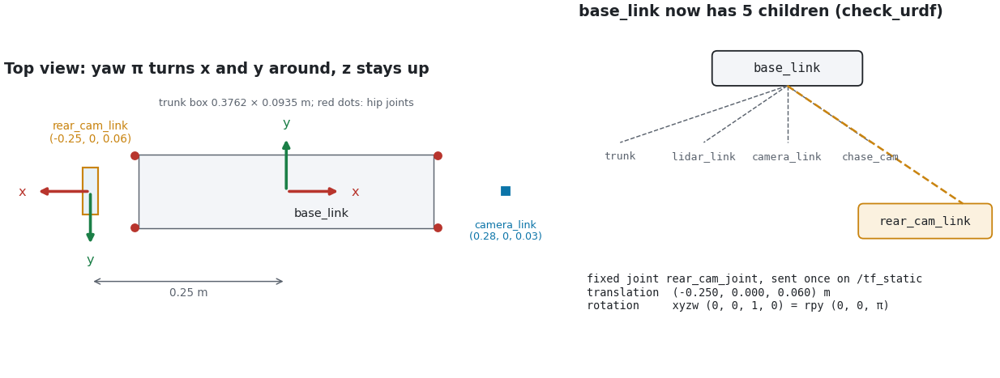

*The link from Task 4.1 drawn at its offset. The yaw of π flips x and y, which is the quaternion (0, 0, 1, 0) that `tf2_echo` printed.*

## Task 5: Check the names that must match

### 5.1 Read the ros2_control configuration

Objective: know which names the controllers expect.

The leg macro emits one `<ros2_control>` block per leg:

```xml
<ros2_control name="${name}" type="system">
    <hardware><plugin>gazebo_ros2_control/GazeboSystem</plugin></hardware>
    <joint name="${name}_hip_joint">
        <command_interface name="effort"/>
        <state_interface name="position"/>
        <state_interface name="velocity"/>
    </joint>
    ...
```

`ros_control.yaml` sets `update_rate: 250` and declares two controllers:

- `joint_states_controller` (`joint_state_broadcaster/JointStateBroadcaster`) publishes `/joint_states` from the position and
  velocity state interfaces.
- `joint_group_effort_controller` (`joint_trajectory_controller/JointTrajectoryController`) claims the 12 effort command
  interfaces. Every joint has the gains `p: 100.0, i: 0.2, d: 1.0, i_clamp: 2.5`. CHAMP sends it position targets and the
  controller turns the position error into torque.

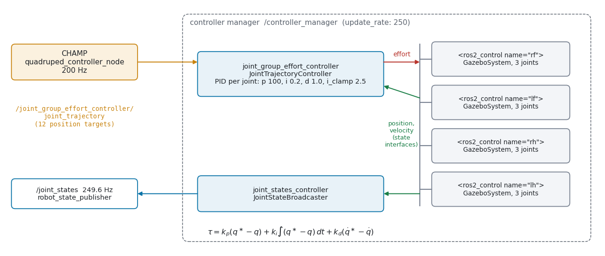

*One controller manager, two controllers, four hardware blocks (one per `<ros2_control>` leg). The PID gains are the per-joint values from `ros_control.yaml`; the 249.6 Hz is the `/joint_states` rate measured in [chapter 7](07-make-it-walk.md).*

An identical copy of the file sits in `go2_config/config/ros_control/`. Only the one named in `gazebo.xacro` is read; the
`ros_control_file` launch argument of `champ_gazebo` is declared but never used.

Check: `grep -c "p: 100.0" src/third_party/unitree-go2-ros2/robots/descriptions/go2_description/config/ros_control/ros_control.yaml` prints `12`.

### 5.2 Read how CHAMP finds the legs

Objective: know which names CHAMP looks up and what it reads from them.

CHAMP does not parse joint names out of the URDF. It reads two maps. `joints.yaml` lists four joints per leg, in the order
`left_front`, `right_front`, `left_hind`, `right_hind`:

```yaml
joints_map:
  left_front:
    - lf_hip_joint
    - lf_upper_leg_joint
    - lf_lower_leg_joint
    - lf_foot_joint
```

Only the first three names per leg are used; they become the joint order of the trajectory CHAMP publishes. `links.yaml` gives
`base: base_link` and four links per leg (`lf_hip_link`, `lf_upper_leg_link`, `lf_lower_leg_link`, `lf_foot_link`).
`urdf_loader.h` computes the translation between consecutive links, starting from the URDF root, and builds its leg model from
those offsets. It does not read joint axes or limits. `gait.yaml` sets `knee_orientation: ">>"`: the first character is for the
front legs, the second for the hind legs, and it selects the inverse kinematics solution.

```bash
grep -A4 left_front src/third_party/unitree-go2-ros2/robots/configs/go2_config/config/joints/joints.yaml
grep -A4 left_front src/third_party/unitree-go2-ros2/robots/configs/go2_config/config/links/links.yaml
```

```
      left_front:
        - lf_hip_joint
        - lf_upper_leg_joint
        - lf_lower_leg_joint
        - lf_foot_joint
      left_front:
        - lf_hip_link
        - lf_upper_leg_link
        - lf_lower_leg_link
        - lf_foot_link
```

Check: `lf_hip_joint` comes first in the joint map, and every name in the link map is a link you saw in RViz in Task 2.2.

| Name list | Must match | Read by |
|---|---|---|
| `links.yaml` (base and 16 leg links) | link names in the URDF | CHAMP, at start |
| `joints.yaml` (first three per leg) | joint names in `ros_control.yaml` | the trajectory controller, on every message from CHAMP |
| `ros_control.yaml` `joints` and `gains` | revolute joint names in the URDF, the `<ros2_control>` blocks | `gazebo_ros2_control` |
| controller names `joint_states_controller`, `joint_group_effort_controller` | `ros_control.yaml` | `champ_gazebo` spawners, `sim.launch.py` |

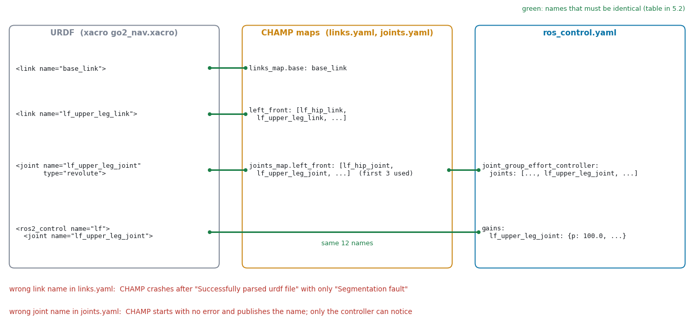

*The table above with one example name per row. A wrong link name crashes CHAMP; a wrong joint name passes CHAMP silently (Task 5.3).*

### 5.3 Check that all names agree

Objective: run one check that compares every list in the table.

```bash
python3 - <<'EOF'
import subprocess, yaml, xml.etree.ElementTree as ET
R = 'src/third_party/unitree-go2-ros2/robots/'
load = lambda f: yaml.safe_load(open(R + f))
urdf = ET.fromstring(subprocess.run(['xacro', 'src/go2_nav_sim/urdf/go2_nav.xacro'], capture_output=True, text=True).stdout)
links = {l.get('name') for l in urdf.iter('link')}
revolute = {j.get('name') for j in urdf.iter('joint') if j.get('type') == 'revolute'}
jmap = load('configs/go2_config/config/joints/joints.yaml')['/**']['ros__parameters']['joints_map']
lmap = load('configs/go2_config/config/links/links.yaml')['/**']['ros__parameters']['links_map']
ctrl = load('descriptions/go2_description/config/ros_control/ros_control.yaml')['joint_group_effort_controller']['ros__parameters']
champ_joints = {n for leg in jmap.values() for n in leg[:3]}
champ_links = {lmap['base']} | {n for k, leg in lmap.items() if k != 'base' for n in leg}
print('CHAMP joints not revolute in URDF:', sorted(champ_joints - revolute))
print('CHAMP links not in URDF:          ', sorted(champ_links - links))
print('controller joints not revolute:   ', sorted(set(ctrl['joints']) - revolute))
print('revolute joints without a gain:   ', sorted(revolute - set(ctrl['gains'])))
EOF
```

```
CHAMP joints not revolute in URDF: []
CHAMP links not in URDF:           []
controller joints not revolute:    []
revolute joints without a gain:    []
```

Check: four empty lists.

Common mistakes, both reproduced by starting `quadruped_controller_node` alone with a copy of one map that had a single name
changed:

- A wrong link name (`lf_thigh_link` for `lf_upper_leg_link`) crashes CHAMP right after `Successfully parsed urdf file`, with
  only `[ros2run]: Segmentation fault`. No message names the link.
- A wrong joint name (`lf_thigh_joint`) starts without any error. CHAMP publishes it unchanged in `joint_names` of every
  trajectory message, so the mismatch only shows up at the controller, which knows no joint of that name. The controller's
  reaction was not tested here.

### 5.4 Adapt this to your own quadruped

Objective: the checklist for replacing the Go2 with another robot. Run 5.3 on your files at the end.

1. Write a xacro whose root is `base_link` and which has three revolute joints per leg with the hip on x and the thigh and knee
   on y, plus a fixed foot link at the contact point. CHAMP's leg model (`quadruped_leg.h`, `kinematics.h`) hard-codes these
   axes. Give every link a collision shape, a mass and an inertia.
2. Add one `<ros2_control>` block per leg with `gazebo_ros2_control/GazeboSystem`, an `effort`
   command interface and `position` and `velocity` state interfaces per joint.
3. Add the `libgazebo_ros2_control.so` plugin, pointing at your controller YAML, and an IMU publishing `/imu/data`.
4. In the controller YAML, list the same 12 joint names under `joint_group_effort_controller.joints` and give each a gain entry.
   Keep the controller names: `champ_gazebo` spawns them by name, and `sim.launch.py` sends CHAMP's output to
   `joint_group_effort_controller/joint_trajectory`.
5. Write `joints.yaml` and `links.yaml` with your joint and link names under `left_front`, `right_front`, `left_hind`,
   `right_hind`, and `links_map.base` equal to your root link. The loader looks the links up by name in the URDF, so
   they must match exactly.
6. Write `gait.yaml`: set `nominal_height` below the standing height your legs can reach, `knee_orientation` to match your
   knees, and the velocity limits to what the robot can follow.
7. Point `description_path`, `joints_map_path`, `links_map_path` and `gait_config_path` in `sim.launch.py` at your files, and
   set `world_init_z` a few centimetres above the standing height so the robot drops onto its feet.

Step 1 is the one CHAMP does not check for you. Run it on the Go2 first to see what a correct answer looks like:

```bash
xacro src/go2_nav_sim/urdf/go2_nav.xacro | grep -A6 'type="revolute"' | grep -o 'axis xyz="[^"]*"' | sort | uniq -c
```

```
      8 axis xyz="0 1 0"
      4 axis xyz="1 0 0"
```

Check: on your own xacro the same command prints 4 joints on `1 0 0` (the hips) and 8 on `0 1 0`, and the Task 5.3 script
prints four empty lists.

## Task 6: Follow the robot into Gazebo

### 6.1 Read how this repository wraps upstream

Objective: know which launch file passes which path.

```bash
grep -n "xacro = \|_path'" src/go2_nav_sim/launch/sim.launch.py
```

```
17:    xacro = f"{os.path.join(me, 'urdf/go2_nav.xacro')} start_x:={START_X} start_y:={START_Y}"
22:            'description_path': xacro,
23:            'joints_map_path': os.path.join(cfg, 'config/joints/joints.yaml'),
24:            'links_map_path': os.path.join(cfg, 'config/links/links.yaml'),
25:            'gait_config_path': os.path.join(cfg, 'config/gait/gait.yaml'),
34:            'use_sim_time': 'true', 'robot_name': 'go2', 'lite': 'false', 'description_path': xacro,
```

`sim.launch.py` passes the xacro path, with `start_x:=-4.5 start_y:=-3.5` appended, as `description_path` to both CHAMP launch
files, together with the three `go2_config` YAML files. Each node that needs the URDF runs `xacro` itself. The upstream
description files are not edited, so updating the pin means changing `SHA` in `setup.sh` and checking that the patch still
applies.

Check: `description_path` appears twice (lines 22 and 34), once per CHAMP launch file, and the three map and gait paths once.

### 6.2 Follow the spawn and the controller start-up

Objective: know what has to happen before the legs take commands.

1. `robot_state_publisher` publishes the URDF on `/robot_description`.
2. `gzserver` starts with the arena world and the `gazebo_ros` init and factory plugins.
3. `spawn_entity.py -entity go2 -topic /robot_description -x -4.5 -y -3.5 -z 0.275 -Y 0.0` inserts the robot 0.275 m above the
   floor at marker A. It drops onto its feet.
4. The `gazebo_ros2_control` plugin inside the model fetches the URDF from `robot_state_publisher`, creates the four leg systems
   and starts a controller manager at `/controller_manager`.
5. Two `controller_manager` spawner nodes load and activate `joint_states_controller` and `joint_group_effort_controller`.

Upstream used `ros2 control load_controller` for step 5. That command comes from `ros2controlcli`, which is not installed here,
and without it the legs never receive a command. The patch replaces both calls with the spawner node. The launch output of one
start, shortened:

```
[spawn_entity]: Spawn status: SpawnEntity: Successfully spawned entity [go2]
[gazebo_ros2_control]: Parameter 'hold_joints' has already been declared, ...
[spawner_joint_group_effort_controller]: Configured and activated joint_group_effort_controller
[spawner_joint_states_controller]: Configured and activated joint_states_controller
```

The `hold_joints` error appears three times, once for each `<ros2_control>` block after the first, and the controllers start
normally after it.

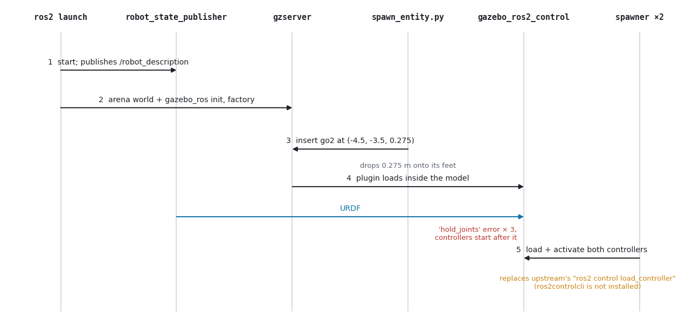

*The five start-up steps above in time order. The URDF reaches the plugin from `robot_state_publisher`; the spawners are this repository's patch.*

Check: both `Configured and activated` lines appear when you start the simulator in [chapter 7](07-make-it-walk.md), Task 1.

## Exercise

In your copy `docs/exercises/go2_extra.xacro`, add a range sensor frame `tof_link` 0.30 m in front of `base_link` and 0.05 m
below it, tilted 0.5 rad nose-down. What does `tf2_echo base_link tof_link` print?

Answer: the joint is

```xml
  <link name="tof_link"/>
  <joint name="tof_joint" type="fixed">
    <parent link="base_link"/>
    <child link="tof_link"/>
    <origin xyz="0.30 0 -0.05" rpy="0 0.5 0"/>
  </joint>
```

A positive pitch about y turns +x downwards (REP-103, right hand). With `robot_state_publisher` on the copy, `tf2_echo` printed:

```
- Translation: [0.300, 0.000, -0.050]
- Rotation: in Quaternion (xyzw) [0.000, 0.247, 0.000, 0.969]
- Rotation: in RPY (radian) [0.000, 0.500, 0.000]
- Rotation: in RPY (degree) [0.000, 28.648, 0.000]
```

## Further reading

- ROS 2 documentation, `URDF/Building-a-Visual-Robot-Model-with-URDF-from-Scratch.rst` (humble branch of `ros2/ros2_documentation`).
- Articulated Robotics tutorials: https://articulatedrobotics.xyz/tutorials/

Next: [7. Make it walk](07-make-it-walk.md)
