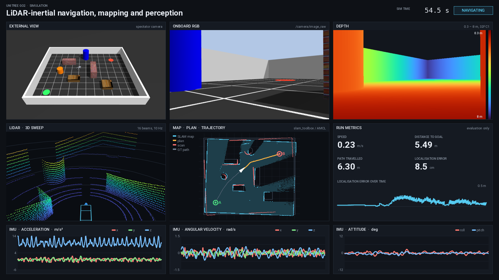

# 6. Record and visualise

The stack records to a rosbag and renders the dashboard from the bag. That keeps the simulator out of the rendering path, so
the same run can be re-rendered or re-analysed later.

```bash
scripts/run_mission.sh bags/run1      # fresh stack, record, drive A to B, stop (about 3 minutes)
```

It writes an MCAP bag with zstd chunk compression, about 8 MB/s. Topics are listed in `scripts/record_bag.sh`; the timestamps that
matter are in the message headers (simulation time).

## Numbers

```bash
python3 src/go2_nav_sim/scripts/bag_metrics.py bags/run1 --json results/run1.json
```

Results of the three runs in the README are in `results/run_r1.json` to `run_r3.json`; the video shows run 3:

| Metric | Run 3 |
|---|---|
| Time to goal (Nav2 result) | 57.5 s |
| Path length | 11.7 m |
| Distance to B at the end of the recording | 0.26 m |
| Lidar-inertial odometry, ATE RMSE | 5.1 cm |
| AMCL position error against ground truth | 9.7 cm RMSE, 23.8 cm maximum |

## Video

```bash
python3 src/go2_nav_sim/scripts/render_dashboard.py bags/run1 videos/run1.mp4 --cards --still videos/run1.png
```



Panels: the external camera, the onboard RGB image, depth in a turbo colour map with its range, a perspective view of the current
lidar sweep coloured by height, the map with the plan, the lidar scan and both trajectories, run metrics, and the IMU over the last
eight seconds. `--cards` adds a title card and a closing card with the run summary. The metrics panel uses ground truth and says
so.

Rendering the 80 s video takes about three minutes. Fonts are Roboto and DejaVu Sans Mono if present, with a fallback.

Next: [7. Troubleshooting](07-troubleshooting.md)
