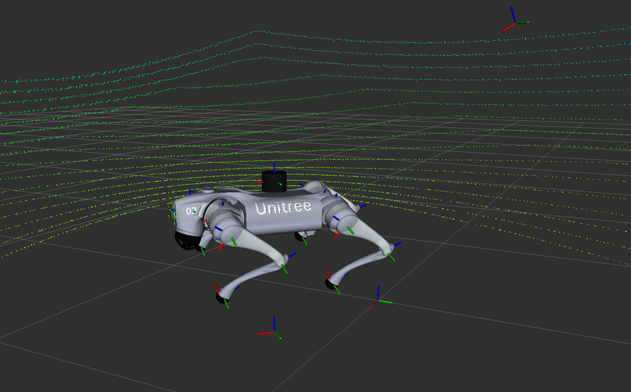
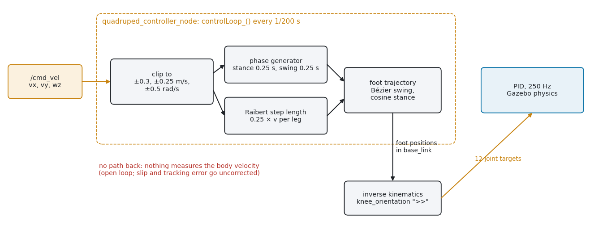

# 7. Make it walk

| | |
|---|---|
| Goal | Start the simulator and the gait controller, drive the robot by hand, tilt and lower its trunk, and change one gait parameter and measure the result. |
| Time | 2 h |
| Before you start | [Chapter 6](06-import-the-go2.md), including the RViz config in its Task 2.1. |
| You will learn | how to check `ros2_control` controllers without `ros2controlcli`; the speeds CHAMP really reaches; how to command CHAMP's body pose and its limits; why gait parameters need a restart. |

This chapter starts only the simulator and the gait controller: no estimation and no Nav2. Outputs in Tasks 1 and 3 are from
one session on the test machine (32 threads) at a real-time factor of 1.00. Tasks 2, 4 and 5 were run later on the same
machine with other simulators running, at a real-time factor of 0.81 to 0.86. Every command runs from the repository root after
`source env.sh`, one terminal per long-running command.

## Task 1: Start the simulator and check the controllers

### 1.1 Launch the simulator with ground-truth odometry

Objective: a standing robot and a clock.

```bash
ros2 launch go2_nav_sim sim.launch.py odom:=gt
```

`odom:=gt` starts `gt_odom.py`, which publishes `odom` to `base_footprint` from simulator ground truth. Without it nothing
publishes that transform until `estimation.launch.py` runs. The robot is spawned at marker A, (-4.5, -3.5) in the world, facing
+x. On the test machine `/imu/data` was publishing within 10 s of the launch.

Check: the launch output contains `Configured and activated joint_group_effort_controller` and
`Configured and activated joint_states_controller` ([chapter 6](06-import-the-go2.md), Task 6.2).

### 1.2 Check the controllers and the rates

Objective: confirm that commands reach the joints and state comes back.

```bash
timeout 5 gz stats -d 1 | head -n 1
# Factor[1.01] SimTime[6.40] RealTime[6.73] Paused[F]
ros2 service call /controller_manager/list_controllers controller_manager_msgs/srv/ListControllers
# ... name='joint_group_effort_controller', state='active', type='joint_trajectory_controller/JointTrajectoryController' ...
# ... name='joint_states_controller', state='active', type='joint_state_broadcaster/JointStateBroadcaster' ...
ros2 topic hz /joint_states                                       # average rate: 249.642
ros2 topic hz /joint_group_effort_controller/joint_trajectory     # average rate: 200.001
ros2 topic info /cmd_vel -v | grep "Node name"                    # Node name: quadruped_controller_node
```

`ros2 control list_controllers` would be shorter, but it needs `ros2controlcli`, which is not installed here. The controller
manager services work without it. `/joint_states` comes from the joint state broadcaster at the controller manager's 250 Hz. The
trajectory topic is CHAMP's output at its 200 Hz loop rate. The `/cmd_vel` subscriber is CHAMP's `cmd_vel/smooth`, remapped by
`bringup.launch.py`.


*What runs after `sim.launch.py odom:=gt`, with the rates measured above. Orange is the command path, blue the joint and IMU data, grey the ground truth and the transforms built from it.*

Check: both controllers `active`, `/joint_states` near 250 Hz and the trajectory near 200 Hz.

## Task 2: Watch the robot in RViz

### 2.1 Open go2.rviz in the odom frame

Objective: see the simulated robot and its lidar with the shared config.

```bash
rviz2 -d src/go2_nav_sim/rviz/go2.rviz -f odom --ros-args -p use_sim_time:=true
ros2 run tf2_ros tf2_echo odom base_link
```

```
- Translation: [0.479, -0.207, 0.426]
- Rotation: in RPY (radian) [0.000, 0.000, -0.709]
```

(That robot had already turned and moved during Task 4.) There is no map yet, so the Map, costmap, Plan and Footprint displays
warn and stay empty. LaserScan stays empty too: `/scan` comes from `estimation.launch.py`.



*`go2.rviz` with `-f odom` while a 0.35 rad body roll was commanded (Task 4). The model stands above the grid, which is the
`odom` plane at `base_footprint` height, and the trunk is drawn level.*

`base_footprint` to `base_link` is a constant 0.426 m with no rotation here (CHAMP gets no foot contacts, so it assumes straight
legs; [chapter 1](01-legged-robot-foundations.md#frames)). The real trunk stands about 0.216 m above the floor (Task 4), so RViz
draws the robot about 0.21 m too high. `gt_odom.py` publishes `odom` to `base_footprint` with yaw only, so TF does not carry the
trunk's roll, pitch or height. Use `/odom_gt` for those.

Check: the RobotModel is drawn and LidarPoints shows the walls.

## Task 3: Drive it and measure the velocity limits

### 3.1 Drive forward from the command line

Objective: walk a known command and measure the result on `/odom_gt`.

```bash
ros2 topic echo --once /odom_gt --field pose.pose.position
# x: 0.05008175569465223
# y: -0.004876937436957718
# z: 0.21572455418117945
timeout 10 ros2 topic pub -r 10 /cmd_vel geometry_msgs/msg/Twist "{linear: {x: 0.2}}" > /dev/null
ros2 topic pub --once /cmd_vel geometry_msgs/msg/Twist "{}"
ros2 topic echo --once /odom_gt --field pose.pose.position
# x: 1.8891303920561189
# y: 0.022557138095836482
# z: 0.21584610900440745
```

`/odom_gt` is relative to the spawn point, so the robot walked 1.84 m forward and drifted 2.7 cm sideways. The x of 0.05 before
the command is the slide on landing after the spawn. The zero twist goes out only once the second `ros2` process has started, so
the robot walked slightly longer than 10 s.

<video controls muted playsinline src="../media/c06-walk-start.mp4"></video>

*Twelve seconds of the recorded A-to-B run (`media/go2_a2b_dashboard.mp4` from 0:11; Nav2 drives it, not teleop). The robot stands while the plan appears, then starts stepping: the IMU traces in the bottom row go from flat to a periodic pattern, and the speed tile climbs to about 0.25 m/s.*

Check: x grows by about 1.8 m and z stays near 0.216 m.

Common mistakes:

- CHAMP keeps the last `/cmd_vel` forever; there is no timeout. After a single 0.2 m/s message and then silence, the robot was
  still walking at 0.183 m/s 3 to 8 s later. Always end with a zero twist.
- A zero command freezes the gait clock and the robot stands. Any non-zero command, however small, makes it step.

### 3.2 Drive with the keyboard

Objective: drive interactively within CHAMP's limits.

```bash
ros2 run teleop_twist_keyboard teleop_twist_keyboard
```

`i` walks forward, `k` publishes a zero twist, and the start-up text lists the other keys. It starts at `speed 0.50 turn 1.00`,
above CHAMP's limits, so the commands are clipped to 0.3 m/s and 0.5 rad/s. Each `z` lowers both by 10 %, and five presses bring
the speed to 0.295 m/s.

Check: the robot in RViz walks on `i` and stops on `k`.

### 3.3 Compare commanded and actual speed

Objective: know how far the body speed is from the command.

Each command below was published at 20 Hz for 10 s of simulated time. The speed is the `/odom_gt` displacement over the
last 7 s, expressed in the robot's heading at the start of the window, so the 3 s start-up transient is excluded.

| Command | Actual | Side effect |
|---|---|---|
| vx 0.1 m/s | 0.063 m/s | yaw drift -2.3° in 7 s |
| vx 0.2 m/s | 0.181 m/s | lateral 0.005 m/s |
| vx 0.3 m/s | 0.300 m/s | lateral -0.014 m/s |
| vx 0.5 m/s | 0.302 m/s | clipped by `max_linear_velocity_x` |
| vx -0.2 m/s | -0.260 m/s | |
| vy 0.2 m/s | 0.214 m/s | forward creep -0.043 m/s |
| wz 0.5 rad/s | 0.484 rad/s | lateral -0.024 m/s |
| wz -0.5 rad/s | -0.477 rad/s | lateral 0.022 m/s |
| wz 0.25 rad/s | 0.234 rad/s | |


*The table above as a plot. Ratios more than 10 % from 1 are red: vx 0.1 (63 %), vx 0.5 (60 %, clipped) and vx -0.2 (130 %).*

The gait is kinematic and nothing measures the body speed, so foot slip and joint tracking error go uncorrected. Small commands
lose the most (0.1 m/s reaches 63 % of the command, a 37 % loss), walking backwards overshoots by 30 %, and sideways walking
creeps backwards. Anything that integrates `/cmd_vel` as if it were odometry inherits these errors. CHAMP's own leg odometry is
no better here: on a 3.2 m walk it reported 0.55 m ([chapter 9](09-state-estimation.md)).



*One 5 ms tick of `controlLoop_()` in `quadruped_controller.cpp`. Limits and durations are the `gait.yaml` values in Task 5. The only feedback is the joint PID; no block reads the body velocity.*

Check: vx 0.5 gives the same speed as vx 0.3 (the clip).

## Task 4: Command the body posture

### 4.1 Find the posture topic and its type

Objective: find where CHAMP takes a body pose, from the running graph.

```bash
ros2 topic info /body_pose -v | grep -E "Type|Node name|count"
ros2 interface show geometry_msgs/msg/Pose | grep -v "^\s*#"
```

```
Type: geometry_msgs/msg/Pose
Publisher count: 0
Subscription count: 1
Node name: quadruped_controller_node
Point position
	float64 x
	float64 y
	float64 z
Quaternion orientation
	float64 x 0
	float64 y 0
	float64 z 0
	float64 w 1
```

`cmdPoseCallback_` in `champ/champ_base/src/quadruped_controller.cpp` converts the quaternion to roll, pitch and yaw and adds
`position.z` to `nominal_height` (0.225 m). `BodyController::poseCommand` in `body_controller.h` then moves every foot target
the opposite way. The pose stays until the next message. Upstream's `champ_teleop.py` maps a gamepad to roll ±0.35, pitch
±0.17 and yaw ±0.44 rad, and only lowers the body (z from 0 down to -0.5 m), never raises it. This stack does not run
`champ_teleop`; you publish the message yourself.

Check: one subscriber, `quadruped_controller_node`.

### 4.2 Publish a pose and measure the trunk

Objective: command a height or attitude and read what the trunk did on `/odom_gt`.

Save this as `posture.py`. It holds the neutral pose for 2 s, the commanded pose for 3 s, prints the mean of the last second of
each, and returns to neutral.

```python
"""Command a CHAMP body pose and measure how the trunk moves on /odom_gt.
usage: python3 posture.py z roll pitch yaw    (z in m added to nominal_height; angles in rad)"""
import math, sys, rclpy
from geometry_msgs.msg import Pose
from nav_msgs.msg import Odometry

def pose_msg(z, roll, pitch, yaw):
    cr, sr = math.cos(roll / 2), math.sin(roll / 2)
    cp, sp = math.cos(pitch / 2), math.sin(pitch / 2)
    cy, sy = math.cos(yaw / 2), math.sin(yaw / 2)
    m = Pose()
    m.position.z = float(z)
    m.orientation.x = sr * cp * cy - cr * sp * sy
    m.orientation.y = cr * sp * cy + sr * cp * sy
    m.orientation.z = cr * cp * sy - sr * sp * cy
    m.orientation.w = cr * cp * cy + sr * sp * sy
    return m

def height_rpy(p):
    o = p.orientation
    return (p.position.z,
            math.atan2(2 * (o.w * o.x + o.y * o.z), 1 - 2 * (o.x * o.x + o.y * o.y)),
            math.asin(2 * (o.w * o.y - o.z * o.x)),
            math.atan2(2 * (o.w * o.z + o.x * o.y), 1 - 2 * (o.y * o.y + o.z * o.z)))

rclpy.init()
node = rclpy.create_node('posture')
pub = node.create_publisher(Pose, 'body_pose', 1)
samples = []
node.create_subscription(Odometry, 'odom_gt', lambda m: samples.append(m.pose.pose), 10)

def hold(msg, seconds):                  # publish at the /odom_gt rate (50 Hz); return the mean of the last second
    samples.clear()
    while len(samples) < 50 * seconds:
        pub.publish(msg)
        rclpy.spin_once(node)
    return [sum(v) / 50 for v in zip(*(height_rpy(p) for p in samples[-50:]))]

before = hold(pose_msg(0, 0, 0, 0), 2)
after = hold(pose_msg(*map(float, sys.argv[1:5])), 3)
hold(pose_msg(0, 0, 0, 0), 2)            # back to the neutral pose
print('command   z %+.3f m  roll %+.2f  pitch %+.2f  yaw %+.2f rad' % tuple(map(float, sys.argv[1:5])))
print('trunk     height %.3f -> %.3f m   change: roll %+.3f  pitch %+.3f  yaw %+.3f rad'
      % (before[0], after[0], after[1] - before[1], after[2] - before[2], after[3] - before[3]))
```

```bash
python3 posture.py 0 0.35 0 0
```

```
command   z +0.000 m  roll +0.35  pitch +0.00  yaw +0.00 rad
trunk     height 0.216 -> 0.216 m   change: roll +0.351  pitch +0.002  yaw +0.006 rad
```

Check: the roll change is within 0.01 rad of the command.

### 4.3 Sweep the champ_teleop ranges and the height

Objective: find which commands the trunk follows and which it does not.

One `posture.py` run per row, in this order, robot standing:

| Command | Trunk height | Roll change | Pitch change | Yaw change |
|---|---|---|---|---|
| roll +0.35 rad | 0.216 → 0.216 m | +0.351 | +0.002 | +0.006 |
| roll -0.35 rad | 0.216 → 0.216 m | -0.356 | +0.001 | -0.012 |
| pitch +0.17 rad | 0.216 → 0.216 m | +0.000 | +0.177 | -0.006 |
| pitch -0.17 rad | 0.216 → 0.216 m | +0.000 | -0.175 | -0.017 |
| yaw +0.44 rad | 0.216 → 0.220 m | -0.013 | +0.011 | +0.124 |
| yaw -0.44 rad | 0.216 → 0.220 m | +0.013 | +0.014 | -0.122 |
| z -0.05 m | 0.215 → 0.165 m | +0.001 | -0.003 | -0.012 |
| z +0.05 m | 0.216 → 0.267 m | -0.001 | +0.003 | -0.067 |
| z -0.10 m | 0.216 → 0.138 m | +0.004 | -0.001 | -0.019 |
| z -0.20 m | 0.216 → 0.138 m | +0.001 | -0.001 | +0.000 |
| z +0.075 m | 0.216 → 0.293 m | -0.001 | +0.004 | -0.126 |

Roll and pitch follow the command within 0.012 rad, and height within 2 mm for ±0.05 m. Yaw does not: the trunk turned 0.12 of
the 0.44 rad, and the robot's heading did not come back afterwards, so the feet slid. In an earlier sweep the same two yaw
commands gave +0.061 and -0.435 rad. Treat yaw as unreliable here.

Below about -0.08 m the height stops changing. `body_controller.h` clamps the foot shift to 0.65 × 0.426 = 0.277 m, so the
lowest commanded height is 0.426 - 0.277 = 0.149 m; the trunk sat at 0.138 m, 1.1 cm lower, which is the same sag as standing
(0.216 m against the 0.225 m `nominal_height`).

Check: your roll and pitch rows match the command to about 0.01 rad, and z -0.10 and -0.20 give the same height.

Common mistakes:

- Raising the body too far. z +0.10 m from neutral reached 0.336 m but pitched the trunk by -0.655 rad. Going straight from
  z -0.10 to +0.10 m flipped the robot onto its back (roll -3.141 rad, height 0.045 m on `/odom_gt`); only a restart of the
  launch recovers it. Stay at or below +0.075 m.
- Forgetting the pose is held. CHAMP keeps the last `/body_pose` (Task 4.1); publish `"{}"` (all zeros, w = 1) to return to
  neutral.
- Looking for the tilt in TF or RViz. TF shows a level trunk (Task 2.1). The Gazebo IMU orientation on `/imu/data` equals
  ground truth, so its roll and pitch would show it, perfectly in simulation and not on hardware.

<a id="how-the-trunk-moves"></a>

### 4.4 Measure how the trunk moves while walking

Objective: see the trunk motion that no body pose command removes.

With the robot walking at 0.2 m/s, this samples `/odom_gt` for 6 s:

```bash
ros2 topic pub -r 10 /cmd_vel geometry_msgs/msg/Twist "{linear: {x: 0.2}}" > /dev/null &
sleep 3
python3 - <<'PY'
import math, rclpy
from nav_msgs.msg import Odometry
rclpy.init(); n = rclpy.create_node('trunk_probe'); s = []
n.create_subscription(Odometry, 'odom_gt', lambda m: s.append(m.pose.pose), 100)
while len(s) < 300:                                   # 6 s at 50 Hz
    rclpy.spin_once(n)
q = [p.orientation for p in s]
z = [p.position.z for p in s]
roll = [math.degrees(math.atan2(2*(o.w*o.x + o.y*o.z), 1 - 2*(o.x*o.x + o.y*o.y))) for o in q]
pitch = [math.degrees(math.asin(2*(o.w*o.y - o.z*o.x))) for o in q]
print(f"height {min(z):.3f} to {max(z):.3f} m   roll {min(roll):.1f} to {max(roll):.1f} deg   pitch {min(pitch):.1f} to {max(pitch):.1f} deg")
PY
kill %1; ros2 topic pub --once /cmd_vel geometry_msgs/msg/Twist "{}"
```

```
height 0.206 to 0.219 m   roll -2.1 to 3.6 deg   pitch -2.0 to 1.9 deg
```

Standing, the trunk is at 0.216 m with roll and pitch within about 0.5 degrees of level. Walking, the height oscillates at
4.0 Hz at every speed tested, twice per 0.5 s stride. The trunk sits about 1.6 cm lower over its feet than `nominal_height`
(foot at -0.209 m in `base_link` while standing, against 0.225 m commanded); the likely cause is the PID tracking error under the
robot's weight. Why the trunk moves this way, and the stroke and Bézier foot-path derivations, are in
[m09 locomotion](../modules/m09_locomotion/README.md).

Check: the walking roll and pitch ranges are a few degrees, larger than the 0.5 degrees standing.

## Task 5: Edit the gait YAML, restart and measure

### 5.1 Read the gait parameters

Objective: know what each key in `gait.yaml` does before changing one.

`robots/configs/go2_config/config/gait/gait.yaml`, with what each key does in the CHAMP source:

| Key | Value | Effect |
|---|---|---|
| `max_linear_velocity_x` | 0.3 | forward/backward command clipped to ±0.3 m/s (`leg_controller.h`) |
| `max_linear_velocity_y` | 0.25 | sideways clip, m/s |
| `max_angular_velocity_z` | 0.5 | yaw clip, rad/s |
| `stance_duration` | 0.25 | stance time per step, s; also sets the stroke, 0.25 × velocity (derivation in [m09](../modules/m09_locomotion/README.md)). Swing time is fixed at 0.25 s in `phase_generator.h` |
| `swing_height` | 0.04 | foot lift in swing, m |
| `stance_depth` | 0.01 | how far the stance foot is pressed below nominal, m |
| `nominal_height` | 0.225 | target height of `base_link` above the feet, m |
| `com_x_translation` | 0.0 | shifts all feet along x relative to the trunk, m |
| `knee_orientation` | `">>"` | knee direction, front then hind; selects the IK solution |
| `pantograph_leg` | false | for pantograph leg mechanisms |
| `odom_scaler` | 0.9 | scale on CHAMP's leg odometry; the controller does not read it |


*Stance and swing per leg, computed by re-running the logic of `phase_generator.h` with `stance_duration` 0.25 s and its fixed 0.25 s swing. For the first 0.125 s after a command the `has_swung_` rule holds every foot; the trot then starts half-way through a stance.*


*The commanded foot path relative to its nominal point, from the control points in `trajectory_planner.h` scaled by `swing_height` and the stroke of 0.25 × velocity. The swing loop reaches past the stroke at both ends. The measured 3.2 cm of foot travel is less than the commanded 4.1 + 1 cm.*

<video controls muted playsinline src="../media/c06-trot-kinematic.mp4"></video>

*The same gait on the MuJoCo Go2 at half speed, 0.2 m/s, with the timing strip above and a cursor. Foot paths from the two headers, joint angles from the closed-form IK in `modules/m04_kinematics`, trunk moved at the commanded speed at a fixed height. Kinematics only: no physics and no CHAMP code runs, so there is no slip and no trunk bounce. Made by `docs/img/c06-videos.py`.*

The keys are read once, when the node starts. `ros2 param set /quadruped_controller_node gait.swing_height 0.10` reports
`Set parameter successful`, but the foot lift stayed at 3.2 cm.

Check: `grep swing_height src/third_party/unitree-go2-ros2/robots/configs/go2_config/config/gait/gait.yaml` shows `0.04`.

### 5.2 Measure the foot lift before the change

Objective: a baseline from the same script you will use after the change.

Save this as `foot_lift.py`. It walks at 0.2 m/s for 8 s, then stops, and reports the left front foot's vertical travel in
`base_link` (from TF, so from the measured joint angles) and the body speed over the last 5 s:

```python
"""Walk forward at 0.2 m/s and measure the left front foot's vertical travel in base_link and the body speed."""
import math, rclpy
from rclpy.time import Time
from geometry_msgs.msg import Twist
from nav_msgs.msg import Odometry
from tf2_ros import Buffer, TransformListener

rclpy.init()
node = rclpy.create_node('foot_lift', parameter_overrides=[rclpy.parameter.Parameter('use_sim_time', value=True)])
tf = Buffer(); TransformListener(tf, node)
cmd = node.create_publisher(Twist, 'cmd_vel', 1)
odom = []
node.create_subscription(Odometry, 'odom_gt', lambda m: odom.append(m.pose.pose.position), 10)
walk = Twist(); walk.linear.x = 0.2
foot = []
while len(odom) < 400:                    # 8 s at 50 Hz; measure over the last 5 s
    cmd.publish(walk)
    rclpy.spin_once(node)
    if len(odom) > 150:
        try:
            foot.append(tf.lookup_transform('base_link', 'lf_foot_link', Time()).transform.translation.z)
        except Exception:
            pass
cmd.publish(Twist())                      # always stop
a, b = odom[150], odom[-1]
print(f"foot z in base_link {min(foot):.3f} to {max(foot):.3f} m (travel {100 * (max(foot) - min(foot)):.1f} cm), "
      f"speed {math.hypot(b.x - a.x, b.y - a.y) / 5:.3f} m/s")
```

```bash
python3 foot_lift.py; ros2 topic pub --once /cmd_vel geometry_msgs/msg/Twist "{}"
```

```
foot z in base_link -0.214 to -0.185 m (travel 2.9 cm), speed 0.168 m/s
```

A second run gave 2.9 cm and 0.162 m/s. These are lower than the 3.2 cm and 0.181 m/s above, which came from the run at a
real-time factor of 1.00.

Check: a travel near 3 cm, well under the 5 cm that `swing_height` plus `stance_depth` ask for.

### 5.3 Copy the YAML, edit it and restart

Objective: change `swing_height` without editing upstream files.

Stop the simulator (Ctrl-C in its terminal, or `scripts/stop.sh`). Then copy the gait file and the launch file, and point the
copy of the launch file at the copy of the YAML:

```bash
mkdir -p docs/exercises
cp src/third_party/unitree-go2-ros2/robots/configs/go2_config/config/gait/gait.yaml docs/exercises/gait.yaml
sed -i 's/swing_height : 0.04/swing_height : 0.08/' docs/exercises/gait.yaml
cp src/go2_nav_sim/launch/sim.launch.py docs/exercises/sim_gait.launch.py
sed -i "s|os.path.join(cfg, 'config/gait/gait.yaml')|os.path.abspath('docs/exercises/gait.yaml')|" docs/exercises/sim_gait.launch.py
grep -n "swing_height" docs/exercises/gait.yaml
grep -n "gait_config_path" docs/exercises/sim_gait.launch.py
ros2 launch docs/exercises/sim_gait.launch.py odom:=gt
```

```
11:      swing_height : 0.08
25:            'gait_config_path': os.path.abspath('docs/exercises/gait.yaml'),
```

`ros2 launch` accepts a file path, so the copy needs no build. `os.path.abspath` resolves against the folder you launch from;
run it from the repository root.

Check: `ros2 param get /quadruped_controller_node gait.swing_height` prints `Double value is: 0.08`.

### 5.4 Measure again

Objective: see whether the foot follows the new value.

```bash
python3 foot_lift.py; ros2 topic pub --once /cmd_vel geometry_msgs/msg/Twist "{}"
```

```
foot z in base_link -0.216 to -0.143 m (travel 7.3 cm), speed 0.186 m/s
```

| `swing_height` | Foot travel (two runs) | Asked for (`swing_height` + `stance_depth`) | Speed at 0.2 m/s command |
|---|---|---|---|
| 0.04 m | 2.9, 2.9 cm | 5 cm | 0.168, 0.162 m/s |
| 0.08 m | 7.3, 7.2 cm | 9 cm | 0.186, 0.190 m/s |

Doubling `swing_height` raised the measured travel by 4.4 cm, about the 4 cm added, and the robot came closer to the commanded
0.2 m/s. Two runs per setting on a loaded machine are not enough to say why the speed changed.

Check: the travel grows by about 4 cm. Stop the launch and use `sim.launch.py` again for the next chapters.

## Exercise

Predict the trunk height for `python3 posture.py -0.20 0 0 0` from the clamp in
`champ/champ/include/champ/body_controller/body_controller.h`, then measure it.

Answer: `poseCommand` limits the foot shift to `0.65 × -zero_stance().Z()`. With straight legs the foot is 0.426 m below
`base_link`, so the shift is at most 0.277 m and the lowest commanded height is 0.426 - 0.277 = 0.149 m, whatever z you send
below -0.076 m. The measurement gave 0.138 m for both z -0.10 and z -0.20 (Task 4.3), 1.1 cm below the prediction, the same
offset as the standing trunk (0.216 m against 0.225 m).

## Further reading

- `chvmp/champ`: the controller source used in this chapter (`quadruped_controller.cpp`, `body_controller.h`, `phase_generator.h`).
- CS 123 (Stanford) labs 1 and 3: https://cs123-stanford.readthedocs.io/en/latest/
- `legubiao/quadruped_ros2_control`: controllers beyond CHAMP's kinematic gait.

Next: [8. Robot and sensors](08-robot-and-sensors.md)
