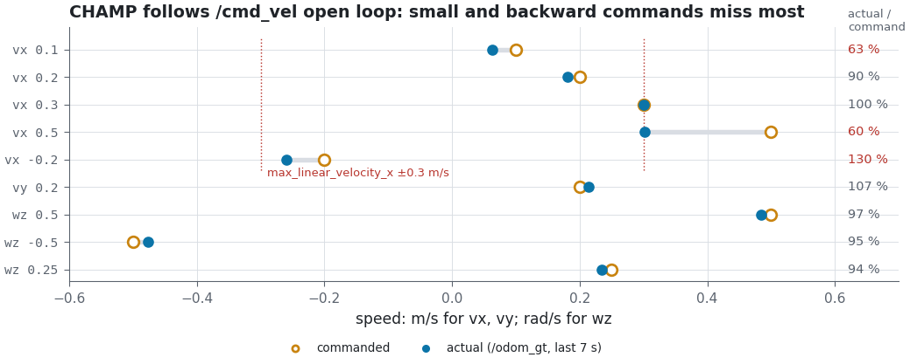
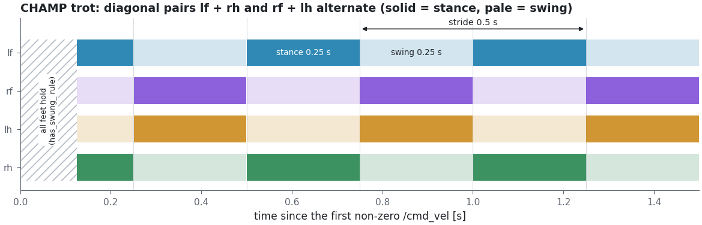
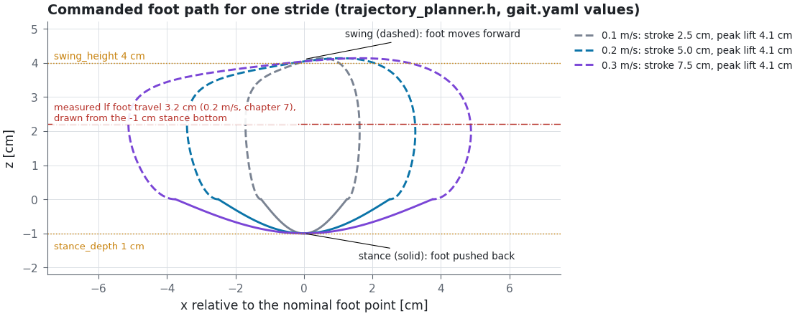

# 7. Make it walk

This chapter starts only the simulator and the gait controller, checks that the controllers are running, and drives the robot by
hand. No estimation and no Nav2 yet. All outputs below are from one session on the test machine (32 threads). Gazebo ran at a
real-time factor of 1.00.

## Start the simulator

```bash
source env.sh
ros2 launch go2_nav_sim sim.launch.py odom:=gt
```

`odom:=gt` starts `gt_odom.py`, which publishes `odom` to `base_footprint` from simulator ground truth. Without it nothing
publishes that transform until `estimation.launch.py` runs. The robot is spawned at marker A, (-4.5, -3.5) in the world, facing
+x. On the test machine `/imu/data` was publishing within 10 s of the launch.

In a second terminal (`source env.sh` first):

```bash
timeout 5 gz stats -d 1 | head -n 1
# Factor[1.01] SimTime[6.40] RealTime[6.73] Paused[F]
ros2 service call /controller_manager/list_controllers controller_manager_msgs/srv/ListControllers
# ... name='joint_group_effort_controller', state='active', type='joint_trajectory_controller/JointTrajectoryController' ...
# ... name='joint_states_controller', state='active', type='joint_state_broadcaster/JointStateBroadcaster' ...
ros2 topic hz /joint_states                                       # average rate: 249.642
ros2 topic hz /joint_group_effort_controller/joint_trajectory     # average rate: 200.001
ros2 topic info /cmd_vel -v | grep "Node name"                    # Node name: quadruped_controller_node
```

`ros2 control list_controllers` would be shorter, but it needs `ros2controlcli`, which is not installed here. The controller
manager services work without it. `/joint_states` comes from the joint state broadcaster at the controller manager's 250 Hz. The
trajectory topic is CHAMP's output at its 200 Hz loop rate. The `/cmd_vel` subscriber is CHAMP's `cmd_vel/smooth`, remapped by
`bringup.launch.py`.


*What runs after `sim.launch.py odom:=gt`, with the rates measured above. Orange is the command path, blue the joint and IMU data, grey the ground truth and the transforms built from it.*

## Drive it

```bash
ros2 topic echo --once /odom_gt --field pose.pose.position
# x: 0.05008175569465223
# y: -0.004876937436957718
# z: 0.21572455418117945
timeout 10 ros2 topic pub -r 10 /cmd_vel geometry_msgs/msg/Twist "{linear: {x: 0.2}}" > /dev/null
ros2 topic pub --once /cmd_vel geometry_msgs/msg/Twist "{}"
ros2 topic echo --once /odom_gt --field pose.pose.position
# x: 1.8891303920561189
# y: 0.022557138095836482
# z: 0.21584610900440745
```

`/odom_gt` is relative to the spawn point, so the robot walked 1.84 m forward and drifted 2.7 cm sideways. The x of 0.05 before
the command is the slide on landing after the spawn. The zero twist goes out only once the second `ros2` process has started, so
the robot walked slightly longer than 10 s.

For the keyboard:

```bash
ros2 run teleop_twist_keyboard teleop_twist_keyboard
```

`i` walks forward, `k` publishes a zero twist, and the start-up text lists the other keys. It starts at `speed 0.50 turn 1.00`,
above CHAMP's limits, so the commands are clipped to 0.3 m/s and 0.5 rad/s. Each `z` lowers both by 10 %, and five presses bring
the speed to 0.295 m/s.

## Commanded and actual speed

Each command below was published at 20 Hz for 10 s of simulated time. The speed is the `/odom_gt` displacement over the
last 7 s, expressed in the robot's heading at the start of the window, so the 3 s start-up transient is excluded.

| Command | Actual | Side effect |
|---|---|---|
| vx 0.1 m/s | 0.063 m/s | yaw drift -2.3° in 7 s |
| vx 0.2 m/s | 0.181 m/s | lateral 0.005 m/s |
| vx 0.3 m/s | 0.300 m/s | lateral -0.014 m/s |
| vx 0.5 m/s | 0.302 m/s | clipped by `max_linear_velocity_x` |
| vx -0.2 m/s | -0.260 m/s | |
| vy 0.2 m/s | 0.214 m/s | forward creep -0.043 m/s |
| wz 0.5 rad/s | 0.484 rad/s | lateral -0.024 m/s |
| wz -0.5 rad/s | -0.477 rad/s | lateral 0.022 m/s |
| wz 0.25 rad/s | 0.234 rad/s | |



*The table above as a plot. Ratios more than 10 % from 1 are red: vx 0.1 (63 %), vx 0.5 (60 %, clipped) and vx -0.2 (130 %).*

The gait is kinematic and nothing measures the body speed, so foot slip and joint tracking error go uncorrected. Small commands
lose the most (0.1 m/s reaches 63 % of the command, a 37 % loss), walking backwards overshoots by 30 %, and sideways walking creeps backwards. Anything that
integrates `/cmd_vel` as if it were odometry inherits these errors.


*One 5 ms tick of `controlLoop_()` in `quadruped_controller.cpp`. Limits and durations are the `gait.yaml` values in the next section. The only feedback is the joint PID; no block reads the body velocity.*

## Gait parameters

`robots/configs/go2_config/config/gait/gait.yaml`, with what each key does in the CHAMP source:

| Key | Value | Effect |
|---|---|---|
| `max_linear_velocity_x` | 0.3 | forward/backward command clipped to ±0.3 m/s (`leg_controller.h`) |
| `max_linear_velocity_y` | 0.25 | sideways clip, m/s |
| `max_angular_velocity_z` | 0.5 | yaw clip, rad/s |
| `stance_duration` | 0.25 | stance time per step, s; also sets the stroke: the Raibert offset is 0.25 / 2 × velocity and `leg_controller.h` doubles it, so the stroke is 0.25 × velocity. Swing time is fixed at 0.25 s in `phase_generator.h` |
| `swing_height` | 0.04 | foot lift in swing, m |
| `stance_depth` | 0.01 | how far the stance foot is pressed below nominal, m |
| `nominal_height` | 0.225 | target height of `base_link` above the feet, m |
| `com_x_translation` | 0.0 | shifts all feet along x relative to the trunk, m |
| `knee_orientation` | `">>"` | knee direction, front then hind; selects the IK solution |
| `pantograph_leg` | false | for pantograph leg mechanisms |
| `odom_scaler` | 0.9 | scale on CHAMP's leg odometry; the controller does not read it |



*Stance and swing per leg, computed by re-running the logic of `phase_generator.h` with `stance_duration` 0.25 s and its fixed 0.25 s swing. For the first 0.125 s after a command the `has_swung_` rule holds every foot; the trot then starts half-way through a stance.*



*The commanded foot path relative to its nominal point, from the control points in `trajectory_planner.h` scaled by `swing_height` and the stroke of 0.25 × velocity. The swing loop reaches past the stroke at both ends. The measured 3.2 cm of foot travel is less than the commanded 4.1 + 1 cm.*

<video controls muted playsinline src="../media/c06-trot-kinematic.mp4"></video>

*The same gait on the MuJoCo Go2 at half speed, 0.2 m/s, with the timing strip above and a cursor. Foot paths from the two headers, joint angles from the closed-form IK in `modules/m04_kinematics`, trunk moved at the commanded speed at a fixed height. Kinematics only: no physics and no CHAMP code runs, so there is no slip and no trunk bounce. Made by `docs/img/c06-videos.py`.*

The keys are read once, when the node starts. `ros2 param set /quadruped_controller_node gait.swing_height 0.10` reports
`Set parameter successful`, but the foot lift stayed at 3.2 cm. Change the YAML and restart the launch instead. With
`--symlink-install` the installed file is a link to the upstream copy, so no rebuild is needed; to keep upstream untouched, copy
the file and point `gait_config_path` in `sim.launch.py` at the copy.

## How the trunk moves

With the robot walking at 0.2 m/s, this samples `/odom_gt` for 6 s:

```bash
ros2 topic pub -r 10 /cmd_vel geometry_msgs/msg/Twist "{linear: {x: 0.2}}" > /dev/null &
sleep 3
python3 - <<'EOF'
import math, rclpy
from nav_msgs.msg import Odometry
rclpy.init(); n = rclpy.create_node('trunk_probe'); s = []
n.create_subscription(Odometry, 'odom_gt', lambda m: s.append(m.pose.pose), 100)
while len(s) < 300:                                   # 6 s at 50 Hz
    rclpy.spin_once(n)
q = [p.orientation for p in s]
z = [p.position.z for p in s]
roll = [math.degrees(math.atan2(2*(o.w*o.x + o.y*o.z), 1 - 2*(o.x*o.x + o.y*o.y))) for o in q]
pitch = [math.degrees(math.asin(2*(o.w*o.y - o.z*o.x))) for o in q]
print(f"height {min(z):.3f} to {max(z):.3f} m   roll {min(roll):.1f} to {max(roll):.1f} deg   pitch {min(pitch):.1f} to {max(pitch):.1f} deg")
EOF
kill %1; ros2 topic pub --once /cmd_vel geometry_msgs/msg/Twist "{}"
```

```
height 0.206 to 0.219 m   roll -2.1 to 3.6 deg   pitch -2.0 to 1.9 deg
```

Standing, the trunk is at 0.216 m with roll and pitch within about 0.5 degrees of level. Walking, the height oscillates at
4.0 Hz at every speed tested, twice per 0.5 s stride. The left front foot, looked up in `base_link` through TF, moved through 3.2 cm
walking forward and 4.0 cm walking backwards, against the 5 cm that `swing_height` plus `stance_depth` ask for. The trunk sits
about 1.6 cm lower over its feet than `nominal_height` (foot at -0.209 m in `base_link` while standing, against 0.225 m
commanded). The likely cause of both gaps is the PID tracking error under the robot's weight.

<video controls muted playsinline src="../media/c06-walk-start.mp4"></video>

*Twelve seconds of the recorded A-to-B run (`media/go2_a2b_dashboard.mp4` from 0:11; Nav2 drives it, not teleop). The robot stands while the plan appears, then starts stepping: the IMU traces in the bottom row go from flat to a periodic pattern, and the speed tile climbs to about 0.25 m/s.*

## Pitfalls

- CHAMP keeps the last `/cmd_vel` forever; there is no timeout. After a single 0.2 m/s message and then silence, the robot was
  still walking at 0.183 m/s 3 to 8 s later. Always end with a zero twist, as `teleop_twist_keyboard` does on `k`.
- A zero command freezes the gait clock and the robot stands. Any non-zero command, however small, makes it step.
- CHAMP's leg odometry is unusable in this simulator. On a 3.2 m walk it reported 0.55 m ([chapter 9](09-state-estimation.md)).
  Use `odom:=gt` for experiments like the ones above, and the lidar odometry when the estimate itself is under test.
- `base_footprint` to `base_link` is a constant 0.426 m with no rotation here, so TF does not show the trunk motion above
  ([chapter 1](01-legged-robot-foundations.md#frames)).
- The Gazebo IMU orientation equals ground truth. Roll and pitch from `/imu/data` are perfect in simulation and will not be on
  hardware.

Stop the launch with Ctrl-C, or run `scripts/stop.sh`, which also stops anything [chapter 3](03-install-and-first-run.md)
started.

Next: [8. Robot and sensors](08-robot-and-sensors.md)
