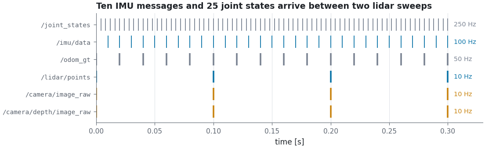
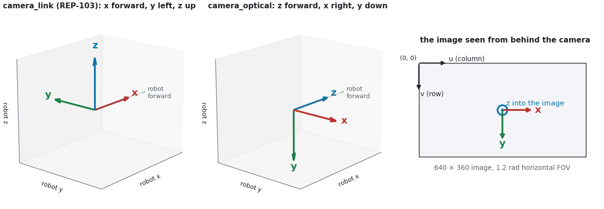

# 8. Robot and sensors

`src/go2_nav_sim/urdf/go2_nav.xacro` includes the upstream Go2 and adds the sensors from `sensors.xacro`. The upstream
description files are not edited. All sensors hang off `base_link` through fixed joints. In this setup `base_footprint` to
`base_link` is a constant (0, 0, 0.426 m) with no rotation, so the trunk's roll and pitch do not reach TF
([chapter 9](09-state-estimation.md)).

| Sensor | Topic | Frame | Rate | Notes |
|---|---|---|---|---|
| 3D lidar | `/lidar/points` | `lidar_link` | 10 Hz | 16 beams, ±15°, 900 samples per revolution, 0.3 to 20 m, 1 cm range noise. Mounted 0.10 m above `base_link`. Fields `x y z intensity`. |
| RGB | `/camera/image_raw` | `camera_optical` | 10 Hz | 640×360, 1.2 rad horizontal field of view |
| Depth | `/camera/depth/image_raw` | `camera_optical` | 10 Hz | 32FC1, metres, 0.3 to 8 m, 7 mm noise, `NaN` beyond range |
| IMU | `/imu/data` | `base_link` | 100 Hz | from upstream, gyro noise σ = 2e-4 rad/s |
| Ground truth | `/odom_gt` | `world` | 50 Hz | noise-free; read once by `go_to_goal.py` to initialise AMCL, otherwise used only for evaluation |
| External cameras | `/spectator/cam/*`, `/chase/cam/*` | | 10 Hz | for video only, no algorithm reads them |


*Mount offsets from `go2_nav.xacro`, drawn on the MuJoCo Go2 posed by IK with `base_link` at the 0.216 m standing height of [chapter 7](07-make-it-walk.md#how-the-trunk-moves). Beams every 2° over ±15°. The 42.1° vertical field of view follows from 1.2 rad horizontal at 640 × 360.*


*Where each topic in the table hangs in TF. Dashed edges are fixed joints with their offsets from `go2_nav.xacro`; to use a lidar point in `base_link`, TF applies the (0, 0, 0.10) edge.*



*Nominal rates from the table (joint states from [chapter 7](07-make-it-walk.md)); the phases between sensors are arbitrary here. Anything that fuses the lidar with the IMU has ten IMU samples per sweep.*

`camera_optical` follows the optical convention (z forward, x right, y down) through a fixed joint with
`rpy = (-π/2, 0, -π/2)` from `camera_link`. Images are stamped in that frame, so `camera_info` and any depth-to-cloud code work
without extra rotations.

URDF applies roll, then pitch, then yaw about fixed axes, so the rotation from `camera_optical` to `camera_link` is

$$
R = R_z(-\tfrac{\pi}{2})\,R_y(0)\,R_x(-\tfrac{\pi}{2})
  = \begin{bmatrix} 0 & 1 & 0 \\ -1 & 0 & 0 \\ 0 & 0 & 1 \end{bmatrix}
    \begin{bmatrix} 1 & 0 & 0 \\ 0 & 0 & 1 \\ 0 & -1 & 0 \end{bmatrix}
  = \begin{bmatrix} 0 & 0 & 1 \\ -1 & 0 & 0 \\ 0 & -1 & 0 \end{bmatrix}.
$$

Its columns are the optical axes in `camera_link`: optical x is (0, -1, 0), to the right; optical y is (0, 0, -1), down; optical
z is (1, 0, 0), forward. `docs/img/c06-figures.py` asserts this product.



*The two frames and the image they describe. Pixel column u grows along optical x, row v along optical y, and depth is measured along optical z.*

## Look at the data

```bash
ros2 topic echo --once /camera/camera_info
ros2 run rqt_image_view rqt_image_view          # pick /camera/depth/image_raw; set the colour range to 0.3 to 8
ros2 run rviz2 rviz2                            # add PointCloud2 /lidar/points, fixed frame lidar_link
```


<video controls muted playsinline src="../media/c06-sensors.mp4"></video>

*Twelve seconds of the recorded A-to-B run (`media/go2_a2b_dashboard.mp4` from 0:40): spectator camera, `/camera/image_raw`, `/camera/depth/image_raw` and `/lidar/points` while the robot passes the obstacles. The RGB view shows the 1 m floor grid described below.*

The world has a 1 m floor grid made of visual-only lines. It gives the camera perspective and motion cues and gives you a scale
reference in every image. The arena, its obstacles and the matching occupancy map are generated from one list in
`src/go2_nav_sim/scripts/make_arena.py`, so the world and the map cannot disagree.

## Pitfall: the lidar must not see the floor as an obstacle

The lowest beams hit the floor 1.2 m ahead. Heights in `base_footprint` read 0.209 m too high, so a height threshold chosen as
if that frame were on the floor keeps floor returns, and they turn into phantom walls. [Chapter 10](10-mapping-and-navigation.md#the-height-band) shows the fix.


*Where the downward beams meet a flat floor, from the beam angles in `sensors.xacro` and the lidar at 0.216 + 0.10 m. The -3° and -1° beams would reach the floor at 6.0 and 18.1 m. Every one of these rings is a floor return that the height filter must reject.*

Next: [9. State estimation](09-state-estimation.md)
