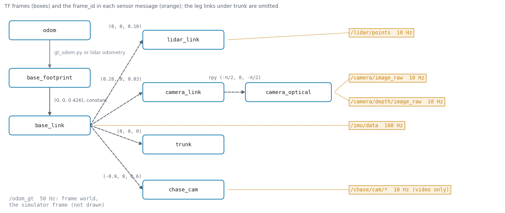
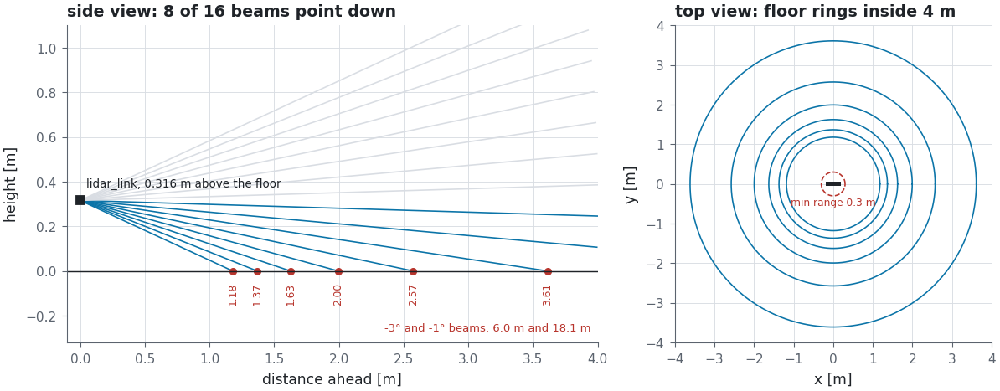
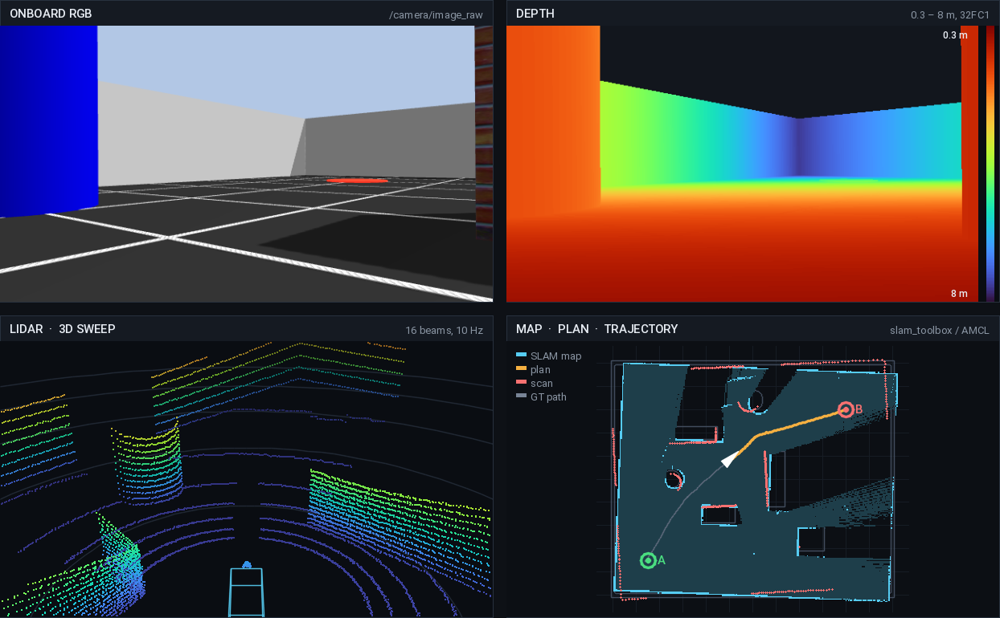

# 8. Robot and sensors

| | |
|---|---|
| Goal | Find every simulated sensor in TF, see each one in RViz, measure its rate, and know which of them the real Go2 provides and how. |
| Time | 2 h |
| Before you start | [Chapter 7](07-make-it-walk.md), and `go2.rviz` from [chapter 6](06-import-the-go2.md), Task 2.1. Start the stack with `bash scripts/up.sh` (sim, estimation and Nav2; about a minute). |
| You will learn | which frame each topic is stamped in; how to check a lidar, a scan, a camera, a depth image and an IMU by eye; how rates drop when the simulator runs slow; what changes on the real robot. |

`src/go2_nav_sim/urdf/go2_nav.xacro` includes the upstream Go2 and adds the sensors from `sensors.xacro`. The upstream
description files are not edited. All sensors hang off `base_link` through fixed joints.

| Sensor | Topic | Frame | Rate | Notes |
|---|---|---|---|---|
| 3D lidar | `/lidar/points` | `lidar_link` | 10 Hz | 16 beams, ±15°, 900 samples per revolution, 0.3 to 20 m, 1 cm range noise. Mounted 0.10 m above `base_link`. Fields `x y z intensity`. |
| RGB | `/camera/image_raw` | `camera_optical` | 10 Hz | 640×360, 1.2 rad horizontal field of view |
| Depth | `/camera/depth/image_raw` | `camera_optical` | 10 Hz | 32FC1, metres, 0.3 to 8 m, 7 mm noise, `NaN` beyond range |
| IMU | `/imu/data` | `base_link` | 100 Hz | from upstream, gyro noise σ = 2e-4 rad/s |
| Ground truth | `/odom_gt` | `world` | 50 Hz | noise-free; read once by `go_to_goal.py` to initialise AMCL, otherwise used only for evaluation |
| External cameras | `/spectator/cam/*`, `/chase/cam/*` | | 10 Hz | for video only, no algorithm reads them |

`/scan` is not a sensor: `estimation.launch.py` makes it from `/lidar/points` ([chapter 9](09-state-estimation.md)).

## Task 1: Find each sensor in TF

### 1.1 Read the frame each topic is stamped in

Objective: match every row of the table to a TF frame.

```bash
for t in /lidar/points /scan /camera/image_raw /camera/depth/image_raw /imu/data /odom_gt; do
  echo "$t $(ros2 topic echo --once $t --field header.frame_id | head -n 1)"; done
```

```
/lidar/points lidar_link
/scan base_footprint
/camera/image_raw camera_optical
/camera/depth/image_raw camera_optical
/imu/data base_link
/odom_gt world
```



*Where each topic hangs in TF. Dashed edges are fixed joints with their offsets from `go2_nav.xacro`; to use a lidar point in `base_link`, TF applies the (0, 0, 0.10) edge.*

`world` is not in the TF tree. `/odom_gt` is a separate answer key from the simulator, so RViz cannot draw it; read it with
`ros2 topic echo`.

Check: five frames you can find in the figure, and `world` that you cannot.

### 1.2 Measure the base_footprint to base_link offset

Objective: see the constant that every sensor height inherits.

```bash
ros2 run tf2_ros tf2_echo base_footprint base_link
```

```
At time 328.720000000
- Translation: [0.000, 0.000, 0.426]
- Rotation: in Quaternion (xyzw) [0.000, 0.000, 0.000, 1.000]
```

The real trunk stands 0.216 m above the floor (`/odom_gt` z in [chapter 7](07-make-it-walk.md), Task 4), so every sensor sits
0.426 − 0.216 = 0.21 m too high in TF. CHAMP's `base_to_footprint` estimator gets no foot contacts in this setup and assumes straight legs. It also
publishes no roll or pitch, so the trunk's tilt never reaches TF. This is a known open issue; [chapter 9](09-state-estimation.md)
works around it.


*Mount offsets from `go2_nav.xacro`, drawn on the MuJoCo Go2 posed by IK with `base_link` at the 0.216 m standing height of [chapter 7](07-make-it-walk.md#44-measure-how-the-trunk-moves-while-walking). Beams every 2° over ±15°. The 42.1° vertical field of view follows from 1.2 rad horizontal at 640 × 360.*

Check: translation (0, 0, 0.426) and the identity rotation.

### 1.3 Read the camera's optical frame

Objective: know which way the image axes point before you use a depth pixel.

`camera_optical` follows the optical convention (z forward, x right, y down) through a fixed joint with
`rpy = (-π/2, 0, -π/2)` from `camera_link`. URDF applies roll, then pitch, then yaw about fixed axes, so the rotation from
`camera_optical` to `camera_link` is

$$
R = R_z(-\tfrac{\pi}{2})\,R_y(0)\,R_x(-\tfrac{\pi}{2})
  = \begin{bmatrix} 0 & 0 & 1 \\ -1 & 0 & 0 \\ 0 & -1 & 0 \end{bmatrix}.
$$

Its columns are the optical axes in `camera_link`: optical x is (0, -1, 0), to the right; optical y is (0, 0, -1), down;
optical z is (1, 0, 0), forward. `docs/img/c06-figures.py` asserts this product.


*Pixel column u grows along optical x, row v along optical y, and depth is measured along optical z.*

```bash
ros2 run tf2_ros tf2_echo camera_link camera_optical
```

```
- Translation: [0.000, 0.000, 0.000]
- Rotation: in Quaternion (xyzw) [-0.500, 0.500, -0.500, 0.500]
- Rotation: in RPY (radian) [-1.571, 0.000, -1.571]
```

Check: the RPY line matches the `rpy` of the joint.

## Task 2: Check each sensor in RViz

### 2.1 Open go2.rviz and add the two image displays

Objective: one RViz window with every sensor.

```bash
rviz2 -d src/go2_nav_sim/rviz/go2.rviz --ros-args -p use_sim_time:=true
```

`go2.rviz` already shows the model, TF, `/scan` (LaserScan) and `/lidar/points` (PointCloud2, Best Effort). Add the cameras:
Add, then By topic, then `/camera/image_raw` Image, and again for `/camera/depth/image_raw` Image. Save your copy with File,
Save Config As (for example `~/go2_sensors.rviz`) so you do not edit the shared file.


*`go2.rviz` with the two Image displays added, robot standing. Lidar rings on the floor, the red `/scan` on walls and
boxes only, depth dark near and white far, the RGB view with the 1 m floor grid.*

Check: the RobotModel is drawn, and both image panels update.

### 2.2 Lidar: rings on the floor, columns on obstacles

Objective: confirm `/lidar/points` is in the right place and the right way up.

Look at LidarPoints. The downward beams draw circles on the floor around the robot, and every box and cylinder shows as a
vertical column of short arcs.



*Where the downward beams meet a flat floor, from the beam angles in `sensors.xacro` and the lidar at 0.216 + 0.10 m. The -3°
and -1° beams would reach the floor at 6.0 and 18.1 m.*

Check: concentric rings, the innermost about 1.2 m from the robot.

Common mistakes: a PointCloud2 display added by hand starts with Reliability Policy Reliable. `go2.rviz` sets Best Effort for
LidarPoints and LaserScan; keep that when you build your own config.

### 2.3 Scan: walls only, no floor

Objective: confirm the floor rings never reach `/scan`.

Look at LaserScan (red). It outlines the walls and the sides of boxes and cylinders that face the robot. There must be no red
circle on open floor.

The lowest beams hit the floor 1.2 m ahead. Heights in `base_footprint` read 0.21 m too high (Task 1.2), so a height band
chosen as if that frame were on the floor keeps floor returns, and they turn into phantom walls.
[Chapter 10](10-mapping-and-navigation.md#52-the-scan-plane) shows the band that works.

Check: red only on walls and obstacles.

### 2.4 Camera and depth: grid and distance

Objective: confirm both images come from the same, forward-looking camera.

The world has a 1 m floor grid made of visual-only lines. It gives the camera perspective and a scale reference. The arena, its
obstacles and the matching occupancy map are generated from one list in `src/go2_nav_sim/scripts/make_arena.py`, so the world
and the map cannot disagree.

For a closer look at depth values:

```bash
ros2 topic echo --once /camera/camera_info
ros2 run rqt_image_view rqt_image_view          # pick /camera/depth/image_raw, untick Dynamic depth range, set max range to 8
```

Then walk the robot towards the boxes for 8 s and stop it (CHAMP keeps walking on the last command, so always end with zero):

```bash
timeout 8 ros2 topic pub -r 10 /cmd_vel geometry_msgs/msg/Twist "{linear: {x: 0.2}}"
ros2 topic pub -t 5 -r 10 /cmd_vel geometry_msgs/msg/Twist "{}"
```

From A this walked the robot 1.38 m (`/odom_gt`), and the nearest depth on the horizon rows in the box just left of the image
centre fell from 6.1 m to 4.8 m.



<video controls muted playsinline src="../media/c06-sensors.mp4"></video>

*Twelve seconds of the recorded A-to-B run (`media/go2_a2b_dashboard.mp4` from 0:40): spectator camera, `/camera/image_raw`, `/camera/depth/image_raw` and `/lidar/points` while the robot passes the obstacles.*

Check: the same box appears in both images at the same pixel position, and it gets darker in the depth view while the robot walks
towards it.

### 2.5 IMU: gravity points up

Objective: check the IMU axes against REP-103 (x forward, y left, z up). RViz has no IMU display in this install, so read the
numbers.

One sample is not enough. Standing, z is noisy: over 8 s (694 samples) it ranged from 6.7 to 13.0 m/s², with a standard
deviation of 1.0, and only half of the samples fell between 9 and 10.5. Average five seconds instead:

```bash
PYTHONUNBUFFERED=1 timeout --foreground 5 ros2 topic echo /imu/data --field linear_acceleration 2>/dev/null | awk \
  '/^x:/ {x += $2; n++} /^z:/ {z += $2; zz += $2 * $2} END {printf "samples %d  mean x %.3f  mean z %.2f  sd z %.2f\n", n, x / n, z / n, sqrt(zz / n - (z / n) ^ 2)}'
```

```
samples 291  mean x 0.074  mean z 9.80  sd z 0.71
```

`PYTHONUNBUFFERED=1` makes `ros2 topic echo` write each sample at once, so none is lost when `timeout` stops it, and
`--foreground` stops only `ros2 topic echo`, not `awk`. `ros2 topic echo` drops samples it cannot print in time, so the count
is lower than 100 per second.

An accelerometer at rest measures the reaction to gravity, so a correct z axis averages about +9.8 m/s². The small positive x is
the trunk standing slightly nose-up: x = −g sin(pitch) gives a pitch of −asin(0.074 / 9.80) = −0.4°, and `/odom_gt` read a mean
pitch of −0.36° (−0.55 to −0.08°) over 8 s of standing in the same session. TF does not carry this tilt (Task 1.2).

Check: mean z between 9.6 and 10.0 while standing. A mean near -9.8 means the IMU frame is upside down.

## Task 3: Measure the rates

### 3.1 Rates in simulation time

Objective: compare each sensor's rate with the table.

```bash
timeout 5 gz stats -d 2 | tail -n 1
for t in /lidar/points /scan /camera/image_raw /imu/data /odom_gt /joint_states; do
  echo "$t $(timeout 12 ros2 topic hz -s $t --window 20 2>/dev/null | grep -m1 average)"; done
```

```
Factor[0.96] SimTime[145.93] RealTime[162.40] Paused[F]
/lidar/points average rate: 10.042
/scan average rate: 9.959
/camera/image_raw average rate: 5.018
/imu/data average rate: 100.000
/odom_gt average rate: 50.000
/joint_states average rate: 250.000
```

`grep -m1` exits after the first match, and `ros2 topic hz` then prints a `BrokenPipeError` traceback as it writes its next
line; `2>/dev/null` hides that noise. `-s` measures in simulation time. The lidar, IMU and ground truth keep their nominal
rates. The camera did not: this run shared the machine and its GPU with six other simulators (load average 62 on 32 threads),
and the camera, which is rendered, fell to 5.0 Hz; an earlier run beside seven simulators read 1.6 Hz (my reading of the cause;
on an idle machine it publishes at 10 Hz). On that earlier run, a wall-clock measurement at a real-time factor of 0.87 read
6.8 Hz for the lidar, 0.9 Hz for the camera and 67.5 Hz for the IMU: without `-s`, rates scale with the real-time factor.


*Nominal rates from the table. Anything that fuses the lidar with the IMU has ten IMU samples per sweep.*

Check: lidar and scan near 10 Hz, IMU 100 Hz, `/odom_gt` 50 Hz in simulation time.

Common mistakes: running `ros2 topic hz` without `-s` and reading a slow simulator as a broken sensor. Check the `Factor` from
`gz stats` first.

## Task 4: Compare with the real Go2

### 4.1 Read the sim-vs-real table

Objective: know what to change before data from the real robot reaches this stack.

| | This simulation | Real Go2 (`unitree_ros2`) |
|---|---|---|
| Lidar topic and frame | `/lidar/points` in `lidar_link`, upright, 0.10 m above `base_link` | `utlidar/cloud` in `utlidar_lidar`, mounted inverted and tilted; CMU's `autonomy_stack_go2` rotates it into the body by a pitch of 2.878 rad |
| Lidar | 16 beams, ±15°, 10 Hz, 0.3 m minimum range | L1: 360° × 90°, 21,600 points/s, 11 Hz, 0.05 m blind zone. Newer units list the L2 (360° × 96°); check which one yours has |
| IMU | `/imu/data` in `base_link` | `utlidar/imu` inside the lidar (needs a one-time calibration), and the body IMU inside `sportmodestate` |
| Camera | `sensor_msgs/Image` on `/camera/image_raw`, plus depth | an H.264 video stream; republish it as `sensor_msgs/Image` first. The product page lists one HD wide-angle camera |
| TF and URDF | full tree from `robot_state_publisher` | none published; you publish `odom` to `base_link` and the lidar's static transform yourself |
| Robot's own odometry | none used (chapter 9) | `sportmodestate` `position` and `velocity`, with no TF |
| Foot contacts | not published | `foot_force` in `sportmodestate` and `lowstate`; force sensors on EDU only |
| Velocity command | `/cmd_vel` (Twist) | no `/cmd_vel`; `unitree_api/msg/Request` on `/api/sport/request` (Move) |
| Time | simulation time on `/clock` | robot stamps, not host time; CMU computes a one-off offset |

Sources: `research/go2-real-robot.md`, sections 1.2 (`unitree_ros2`), 1.8 (`autonomy_stack_go2`), 1.9 (product and L1 pages)
and 1.10 (`unilidar_sdk`).

Check: name the two transforms you would have to publish yourself before `go2.rviz` could show `utlidar/cloud` (answer in the
table: `odom` to `base_link` and `base_link` to `utlidar_lidar`).

## Exercise

The centre pixel of `/camera/depth/image_raw` reads 3.00 m. Where is that point in `base_link`?

Answer: the centre pixel lies on the optical axis, so the point is (0, 0, 3.00) in `camera_optical`. With R from Task 1.3 it is
(3.00, 0, 0) in `camera_link`, and the `camera_joint` offset (0.28, 0, 0.03) from `sensors.xacro` puts it at (3.28, 0, 0.03) in
`base_link`. `ros2 run tf2_ros tf2_echo base_link camera_optical` prints the offset you added, `[0.280, 0.000, 0.030]`, and the
same rotation as in Task 1.3.

## Further reading

- Nav2, "First-time robot setup guide", sensors page: https://docs.nav2.org/rolling/configuration_and_development/first_time_robot_setup_guide/
- `jizhang-cmu/autonomy_stack_go2`: the real L1 cloud and IMU, their transforms and calibration on a Go2.

Next: [9. State estimation](09-state-estimation.md)
