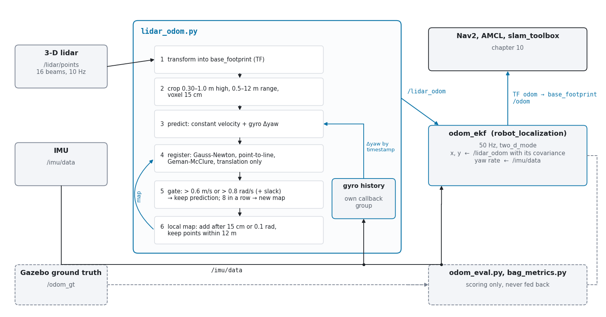
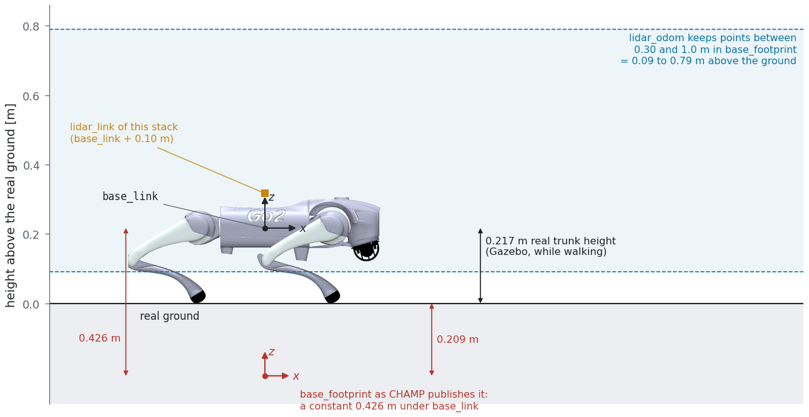
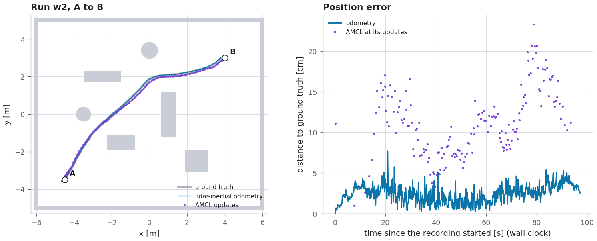
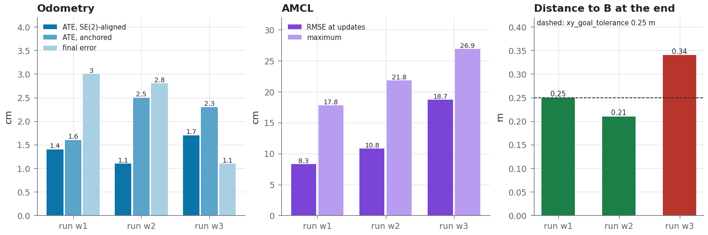
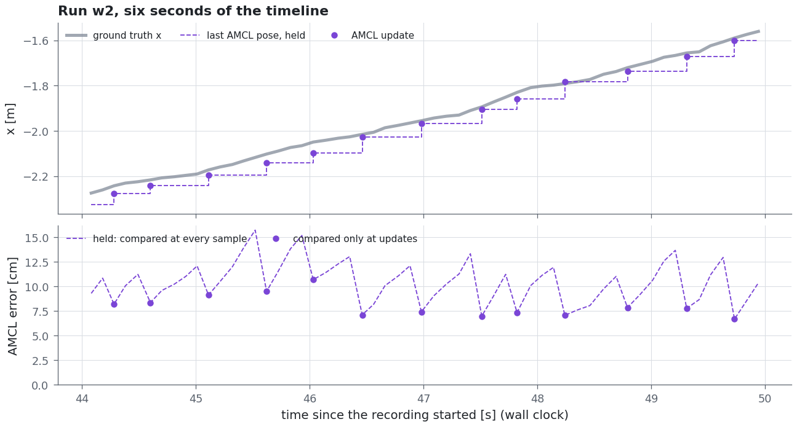
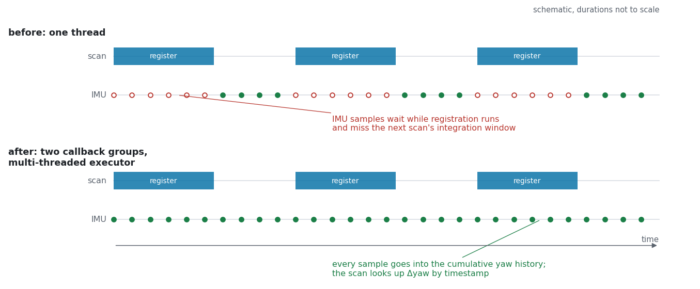
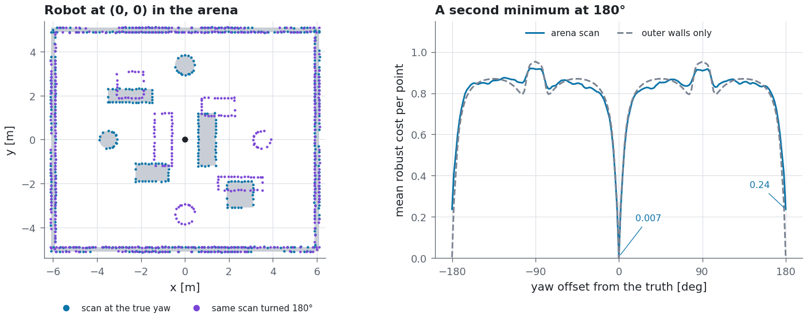

# 9. State estimation

| | |
|---|---|
| Goal | Estimate where the robot is without the simulator's help, check that the estimate has the right signs, and score it against ground truth. |
| Time | 3 h |
| Before you start | [Chapter 5](05-frames-and-tf2.md) (REP-103, `tf2_echo`) and [chapter 8](08-robot-and-sensors.md). Start the stack with `bash scripts/up.sh`; Tasks 1.2, 1.4, 2.1, 3.2, 3.3 and 4.1 need it running; the others work offline. |
| You will learn | the leg-odometry model and why CHAMP's version fails here; how the lidar odometry and the EKF build `odom` → `base_footprint`; a sign test you can rerun after any change; how to read ATE, RPE and AMCL error. |

Nav2 needs an `odom` to `base_footprint` transform that is smooth and does not jump. Simulation tutorials usually take it from
the simulator. This stack estimates it from the lidar and the IMU. The odometry never reads simulator ground truth; the stack
uses it once, to initialise AMCL ([chapter 10](10-mapping-and-navigation.md#33-the-ground-truth-shortcut-optional)), and otherwise only
to score the result.

## Task 1: Model leg odometry from the joints

### 1.1 Write down the stance-foot model

Objective: one equation for the base velocity from a foot on the ground.

A foot in stance does not move in the world. Its position in `base_link`, $\mathbf p_f(\mathbf q)$, comes from the joint angles
by forward kinematics, and it changes only because the base moves. Setting the foot's world velocity to zero gives the base
velocity in `base_link`:

$$
\mathbf v_b = -\boldsymbol\omega \times \mathbf p_f(\mathbf q) - J(\mathbf q)\,\dot{\mathbf q}
$$

where $\boldsymbol\omega$ is the gyro reading and $J = \partial\mathbf p_f/\partial\mathbf q$ is the 3 × 3 foot Jacobian of that
leg (column $i$ is $\mathbf z_i \times (\mathbf p_f - \mathbf o_i)$ for joint axis $\mathbf z_i$ at origin $\mathbf o_i$; module
[04](../modules/m04_kinematics/README.md) derives and tests it). With two or more feet down, average their estimates. The model
needs one more input: which feet are in stance. Real robots read it from foot force sensors or estimate it; nothing measures it
in this simulation.

`docs/img/c09-leg-odometry.py` guesses stance from geometry: CHAMP trots, so one diagonal pair (left-front with right-hind, or
right-front with left-hind) is on the ground at a time, and it is the pair whose feet are lower in `base_link`.

Check: in the equation, a foot that sweeps backwards under the body ($\dot{\mathbf p}_f$ along -x) gives a forward base
velocity.

### 1.2 Record joints, IMU and ground truth during a mission

Objective: one bag for the leg model and one for the scoring in Task 4.

```bash
scripts/record_bag.sh bags/mission                         # terminal 1: the full bag (Task 4.2, chapter 11)
ros2 bag record -o bags/legs /joint_states /imu/data /odom_gt /odom/raw /robot_description   # terminal 2
python3 src/go2_nav_sim/scripts/go_to_goal.py              # terminal 3: drive A to B with Nav2
```

```
[INFO] [1795849472.409316134] [basic_navigator]: distance remaining 1.12 m, recoveries 0
RESULT SUCCEEDED  sim_time 77.7 s  ground-truth final error 0.28 m  final pos (3.80, 2.80)
```

Stop both recorders with Ctrl-C after the result line.

```bash
ros2 bag info bags/legs | grep Topic:
```

```
Topic information: Topic: /robot_description | Type: std_msgs/msg/String | Count: 1 | Serialization Format: cdr
                   Topic: /odom_gt | Type: nav_msgs/msg/Odometry | Count: 4647 | Serialization Format: cdr
                   Topic: /odom/raw | Type: nav_msgs/msg/Odometry | Count: 5006 | Serialization Format: cdr
                   Topic: /joint_states | Type: sensor_msgs/msg/JointState | Count: 23230 | Serialization Format: cdr
                   Topic: /imu/data | Type: sensor_msgs/msg/Imu | Count: 9268 | Serialization Format: cdr
```

`/robot_description` is published once with Transient Local durability, so a recorder started after the robot still receives
it. This mission took 77.7 s, longer than the 54.8 s of run w2: for about the first 40 s Nav2 turned the robot and started and
stopped it before it walked steadily (left plot in Task 1.3).

Check: `/robot_description` count 1 and `/joint_states` about 250 per simulated second.

### 1.3 Compute leg odometry offline and compare

Objective: run the model of Task 1.1 on the bag and plot it against ground truth.

```bash
python3 docs/img/c09-leg-odometry.py bags/legs legs.png
```

```
standing, first 5 s: mean J(q)dq from the velocity field 0.279 m/s, from differentiated positions 0.020 m/s
samples 23228  duration 92.9 s  ground-truth path 13.50 m
leg forward velocity: mean 0.206 m/s vs ground truth 0.233 m/s while walking; RMSE 0.035 m/s (0.1 s bins)
leg + gyro path: final error 1.60 m (11.9 % of path), max 1.60 m
CHAMP /odom/raw: 5006 messages, path 0.00 m
```


*The A-to-B mission of Task 1.2. Leg velocity is averaged over 0.1 s bins; the path integrates it with the integrated gyro yaw,
anchored on the true start. CHAMP's `/odom/raw` never leaves the origin.*

The legs read 12 % slow while walking (0.206 against 0.233 m/s). The guessed contact timing and foot slip during stance both
shorten the measured stride; this bag cannot separate the two. Integrated, the path ends 1.60 m from the truth after 13.50 m.
Most of that error comes from the first 40 s, while Nav2 turned the robot: by then the leg path is about 0.7 m behind the start,
and the true path is not.

Check: on the `standing, first 5 s` line, the value from differentiated positions is under 0.05 m/s.

A constant scale error like this is what VILENS (Further reading) models as a velocity bias on the leg-odometry factor and
estimates online.

Common mistakes: using the `velocity` field of `/joint_states` for $\dot{\mathbf q}$. The effort controller makes the joints
chatter, and with the robot standing still $J\dot{\mathbf q}$ from that field averaged 0.279 m/s, against 0.020 m/s from
differentiating the foot positions. The script differentiates positions. The leg-odometry chapter of the SLAM Handbook (2025) notes
that joint velocities are usually differentiated from encoders and are a noise source.

### 1.4 See why CHAMP's leg odometry fails here

Objective: find the missing input.

```bash
ros2 topic info /foot_contacts
```

```
Type: champ_msgs/msg/ContactsStamped
Publisher count: 0
Subscription count: 1
```

CHAMP's `state_estimation_node` subscribes to `/foot_contacts` and integrates the stance legs it is told about. Nothing publishes
contacts here: `sim.launch.py` sets `publish_foot_contacts:=false`, and the Gazebo contact node that would provide them used over
200 % of a core, so the patch removes it ([chapter 3](03-install-and-first-run.md#12-read-what-the-patch-changes)). With no
stance leg, `/odom/raw` stays at the origin (path 0.00 m in Task 1.3). An earlier configuration reported 0.55 m after the
robot had really moved 3.2 m at 0.3 m/s, and 0.6 m of sideways drift on a straight path. The same missing contacts leave
`base_footprint` to `base_link` at a constant 0.426 m ([chapter 8](08-robot-and-sensors.md), Task 1.2). Task 1.3 shows that the
joints carry the motion; what is missing is contact. Fixing that is a project of its own, so this stack uses the lidar.

Check: `Publisher count: 0`.

<a id="lidar-odometry"></a>

## Task 2: Run the lidar odometry

### 2.1 Find the estimator in the running graph

Objective: see the two nodes that produce `odom` → `base_footprint`.

```bash
ros2 topic hz -s /lidar_odom          # average rate: 9.796
ros2 topic hz -s /odom                # average rate: 50.000
ros2 param get /odom_ekf publish_tf   # Boolean value is: True
```


*Data flow from the sensors to the `odom` to `base_footprint` transform; ground truth only reaches the scoring scripts. EKF inputs as in `config/ekf.yaml`.*

`src/go2_nav_sim/scripts/lidar_odom.py` registers each scan against a local map at the 10 Hz lidar rate. The EKF
(`robot_localization`, `config/ekf.yaml`) fuses its pose and velocity with the gyro yaw rate at 50 Hz and publishes the
transform.

Check: `/lidar_odom` near 10 Hz and `/odom` at 50 Hz in simulation time.

### 2.2 Read the six steps

Objective: know what each step does and where its numbers come from.

1. The cloud is transformed into `base_footprint` through TF. Because of the constant 0.426 m (Task 1.4), points come out 0.21 m
   too high (0.426 m minus the 0.216 m standing height of [chapter 7](07-make-it-walk.md), Task 4) and are not levelled, while the real trunk rocks by −2 to +3.6 degrees while walking. The thresholds below are in
   this shifted frame.
2. Points between 0.30 and 1.0 m in `base_footprint` (about 0.09 to 0.79 m above the real ground) and 0.5 to 12 m away are kept,
   then voxel-downsampled to 15 cm.
3. Translation is predicted at constant velocity; the yaw increment is the integrated gyro. In the recorded runs the integrated
   gyro matched ground-truth yaw to within 1 to 2 degrees over six seconds, including fast turns.
4. Gauss-Newton on point-to-line residuals against the local map, with Geman-McClure weights, solves for translation only and
   keeps yaw at the gyro prediction (`fix_yaw:=false` gives a full SE(2) solve). A prior toward the prediction is added only
   along directions the scan barely constrains (Task 2.3).
5. An update that implies more than 0.6 m/s or 0.8 rad/s (plus 5 cm or 0.05 rad of slack per scan) is rejected and the
   prediction is kept. After eight rejections in a row the local map is rebuilt from the next scan.
6. Points are added to the map only after 15 cm or 0.1 rad of motion, and only points within 12 m are kept.


*Steps 1 and 2 in metres: the Menagerie Go2 posed by the closed-form IK of module 04 at a 0.217 m trunk height, 1 mm above the 0.216 m used in the text (hence 0.209 m in the drawing); the lidar mount is from `urdf/go2_nav.xacro`.*

Two threading details matter on a busy machine. The TF listener runs in its own thread, because a blocking lookup inside a
subscriber callback would starve the thread that delivers the transform. If a transform is slightly late, the node falls back to
the latest one instead of dropping the scan.

Check: you can say which step removes the floor rings of [chapter 8](08-robot-and-sensors.md), Task 2.2 (step 2, the 0.30 m lower bound).

### 2.3 Run the registration on a corridor

Objective: see the one case where step 4 needs its prior.

Each scan point is matched to a map point, and its residual is the distance along that map point's normal (point-to-line).
Geman-McClure weights with σ = 0.12 m limit the pull of outliers, and points on walls count more than points on blobs. With yaw
held at the gyro prediction, Gauss-Newton solves only for the translation. A prior toward the predicted translation is added
only along a direction that carries less than 0.02 of information per matched point. In the arena both directions carry about
0.13 per point, so the prior is off. Between two parallel walls the along-wall direction carries 0, and without the prior the
pose could slide along the corridor. The equations, the line of `registration.py` that computes each term, and the figures are
in [module 11](../modules/m11_state_estimation/README.md).

```bash
python3 -m pytest -q src/go2_nav_sim/test/test_registration.py -k corridor
```

```
.                                                                        [100%]
1 passed, 9 deselected in 0.28s
```

The test starts 0.3 m off along the corridor and 0.2 m across it. Registration corrects the across offset to under 2 cm and
keeps the along offset at the prediction to within 2 cm.

Check: `1 passed`. Then name the direction in which the scan alone cannot correct the pose (along the walls).

### 2.4 Run the unit tests

Objective: test the registration without ROS.

```bash
python3 -m pytest -q src/go2_nav_sim/test
```

```
.............sss                                                         [100%]
13 passed, 3 skipped in 0.55s
```

The tests check that a 25 cm offset is recovered to under 2 cm from three poses, that a full SE(2) solve recovers 0.05 rad, that
20 % clutter moves the result by at most 3 cm, that a scan with no overlap is reported as a failure, that the corridor prior holds
the along-wall estimate while correcting across, and that the gyro integration is independent of callback timing. The three
skipped tests are the sign test of Task 3, which drives the robot or reads a bag and runs only when asked.

Check: 13 passed, 3 skipped.

## Task 3: Test the REP-103 signs

### 3.1 Read what the test checks

Objective: know the three conventions a wrong sign would break.

`src/go2_nav_sim/test/test_rep103_signs.py` reads `/cmd_vel`, `/odom`, `/odom_gt`, `/imu/data`, `/tf` and `/tf_static` from one
of two sources. Live, it drives the robot itself: 4 s forward at 0.25 m/s and 4 s counter-clockwise at 0.5 rad/s, with pauses,
and ends with zero velocity. From a bag, it reads the same topics, and each message takes the phase of the last `/cmd_vel`
before it: forward when only x is commanded, turn when only z is. The same three tests then run on either source:

| Test | REP-103 / REP-105 rule | Asserted |
|---|---|---|
| `test_forward_walk_raises_x` | x points forward | on `/odom` and `/odom_gt`: displacement along the heading > 0.3 m and mean forward velocity in the body > 0.1 m/s |
| `test_ccw_turn_raises_yaw` | z up, so a turn to the left is positive | unwrapped yaw change > 0.5 rad and mean `twist.angular.z` > 0.2 rad/s on both; mean gyro z > 0.2 rad/s |
| `test_only_the_ekf_publishes_odom_to_base_footprint` | each frame has one parent and one publisher | `odom` is the only parent of `base_footprint`; live, `odom_ekf` is the only `/odom` publisher; every `odom` → `base_footprint` transform equals the `/odom` pose with the same stamp in x, y (1 mm) and yaw (1 mrad) |

`/odom` carries its twist in the child frame `base_footprint` (REP-105), so its `twist.linear.x` is the forward speed. `/odom_gt`
does not: `gazebo_ros_p3d` publishes its twist in `world` (`<frame_name>world</frame_name>` in `sensors.xacro`). The test
rotates it into the body by the yaw before it averages. Without that, a robot walking forward while facing +y reads a world
x velocity near zero.

The last test compares transforms, not node names on `/tf`, because several nodes publish on `/tf` here (`ros2 topic info /tf -v`
lists them) and only one of them may publish this edge. It checks only transforms stamped at or before the last `/odom` message:
the EKF can put a transform on `/tf` before the `/odom` message with the same stamp arrives, and the run may end between the two.

Check: you can say which assertion a gyro mounted upside down would break (the gyro z in `test_ccw_turn_raises_yaw`).

### 3.2 Run it against the running stack

Objective: a pass in under a minute, with the robot standing in the open.

```bash
time python3 src/go2_nav_sim/test/test_rep103_signs.py
```

```
odom  forward: moved +0.87 m along its heading, mean body forward velocity +0.20 m/s

gt    forward: moved +0.89 m along its heading, mean body forward velocity +0.23 m/s
.
odom  ccw turn: yaw changed +1.84 rad, mean twist.angular.z +0.47 rad/s

gt    ccw turn: yaw changed +1.84 rad, mean twist.angular.z +0.46 rad/s
imu   ccw turn: mean angular_velocity.z +0.46 rad/s
.
parents of base_footprint: ['odom']; /odom publishers: ['odom_ekf']; odom->base_footprint transforms 599, not matching an /odom pose 0
.
3 passed in 13.72s

real	0m16.612s
```

The robot needs about 1 m of free space ahead. From A after `scripts/up.sh` there is room for this task, Task 3.3 and the
exercise in a row: I ran four from A (left, right, left, left turns) without reaching an obstacle, and each matched every
transform (599 to 601).

Check: `3 passed`.

Common mistakes: running it through plain `pytest`. That collects it, finds neither a bag nor `GO2_LIVE_TEST=1`, and skips it
(the 3 skipped in Task 2.4), so a "pass" there tests nothing. Run the file directly.

### 3.3 Run it on a bag

Objective: the same test without a running robot, for example on a bag from another machine or from the real Go2.

Record while the live test drives (two terminals), stop the recorder with Ctrl-C, then point the test at the bag:

```bash
ros2 bag record -s mcap -o bags/signs /cmd_vel /odom /odom_gt /imu/data /tf /tf_static   # terminal 1
python3 src/go2_nav_sim/test/test_rep103_signs.py                                         # terminal 2
python3 src/go2_nav_sim/test/test_rep103_signs.py bags/signs                              # after Ctrl-C in terminal 1
```

```
odom  forward: moved +0.93 m along its heading, mean body forward velocity +0.20 m/s

gt    forward: moved +0.90 m along its heading, mean body forward velocity +0.23 m/s
.
odom  ccw turn: yaw changed +1.90 rad, mean twist.angular.z +0.48 rad/s

gt    ccw turn: yaw changed +1.90 rad, mean twist.angular.z +0.48 rad/s
imu   ccw turn: mean angular_velocity.z +0.47 rad/s
.
parents of base_footprint: ['odom']; /odom publishers: not in a bag; odom->base_footprint transforms 1631, not matching an /odom pose 0
.
3 passed in 7.63s
```

The live run during that recording printed +0.93, +0.90, +1.88 and +1.90 for the same four quantities. The bag holds 1631
transforms against 601 live because the recorder ran for 36 s, before and after the test.

Check: `3 passed` and the same signs as the live run.

Common mistakes: using a Nav2 mission bag. `bags/mission` from Task 1.2 has every topic, but Nav2's turns in place go both ways,
so the turn phase averages +0.08 rad/s and `test_ccw_turn_raises_yaw` fails although the signs are right. The bag needs one
forward walk and one left turn, commanded separately.

## Task 4: Score against ground truth

### 4.1 Live, while you drive

Objective: one line with ATE, yaw error and drift.

Start from A on a fresh stack. Each `timeout` stops one `ros2 topic pub` after that many wall-clock seconds, and the last line
publishes zero, because CHAMP keeps walking on the last command:

```bash
python3 src/go2_nav_sim/scripts/odom_eval.py 45 &        # scores for 45 s
timeout 4 ros2 topic pub -r 10 /cmd_vel geometry_msgs/msg/Twist "{angular: {z: 0.5}}"    # turn left
timeout 10 ros2 topic pub -r 10 /cmd_vel geometry_msgs/msg/Twist "{linear: {x: 0.25}}"   # walk forward
timeout 4 ros2 topic pub -r 10 /cmd_vel geometry_msgs/msg/Twist "{angular: {z: -0.5}}"   # turn back
ros2 topic pub -t 5 -r 10 /cmd_vel geometry_msgs/msg/Twist "{}"                         # stop
wait
```

```
samples 216  path 2.66 m  ATE RMSE 0.036 m  max 0.079 m  final 0.079 m  yaw err RMSE 4.90 deg  drift 2.95 % of path
```

0.5 rad/s is also the most the robot can turn: CHAMP clips yaw commands to 0.5 rad/s ([chapter 7](07-make-it-walk.md), Task 3).
The run had a real-time factor of 0.84 with five other simulators on the machine (load average 80 on 32 threads). A first run with
6 s turns, at a factor of 0.83, read ATE RMSE 0.111 m and yaw error 5.72°.

`odom_eval.py` pairs the latest `/odom` and `/odom_gt` messages every 0.2 s of wall-clock time. During a 0.5 rad/s turn, a 0.1 s
delay between the two topics alone shows as 2.9° of yaw error, so part of the 4.9° is likely pairing, not estimation (my
reading; I did not separate the two).

Check: ATE RMSE of a few centimetres to about 0.1 m, and yaw error of a few degrees.

Common mistakes: scoring on an overloaded machine. The same sequence on a machine running eight simulators (real-time factor
0.56, load average 113 on 32 threads) gave

```
samples 211  path 1.96 m  ATE RMSE 0.637 m  max 0.834 m  final 0.708 m  yaw err RMSE 11.54 deg  drift 36.12 % of path
```

The estimator was starved, the failure described under "Other processes starved the estimator" below. Check `gz stats` and
`top` before trusting a bad number.

### 4.2 From a bag, for a whole mission

Objective: the standard numbers for the mission you recorded in Task 1.2.

```bash
python3 src/go2_nav_sim/scripts/bag_metrics.py bags/mission --json results/mission.json
```

```
{
  "duration_s": 92.3,
  "path_m": 13.48,
  "mean_speed_ms": 0.146,
  "odom_ate_aligned_cm": 2.4,
  "odom_ate_anchored_cm": 6.8,
  "odom_final_err_cm": 16.1,
  "odom_drift_pct": 1.19,
  "odom_rpe_1m_pct": 2.2,
  "amcl_rmse_cm": 8.6,
  "amcl_max_cm": 18.2,
  "amcl_updates": 194,
  "goal_error_m": 0.27,
  "goal_tolerance_m": 0.25
}
```

`bag_metrics.py` pairs every estimate with ground truth interpolated at the estimate's own timestamp. ATE aligned is the RMSE
after the best rigid SE(2) fit; ATE anchored aligns only the first pose and so keeps the drift; RPE is the error over 1 m
segments of travel (Sturm et al., IROS 2012, in their planar form). Run w2 is the run the README and the videos show; its
numbers are in `results/run_w2.json`, and the Nav2 output in `site/evidence/missions.txt`:

| Metric | Run w2 | Your mission above |
|---|---|---|
| Time to goal (Nav2 result) | 54.8 s | 77.7 s |
| Path length | 11.6 m | 13.48 m |
| Distance to B at the end of the recording | 0.21 m | 0.27 m |
| Odometry ATE, SE(2)-aligned / anchored on the first pose | 1.1 cm / 2.5 cm | 2.4 cm / 6.8 cm |
| Odometry relative error over 1 m of travel | 1.6 % | 2.2 % |
| AMCL error at its updates | 10.8 cm RMSE, 21.8 cm maximum | 8.6 cm RMSE, 18.2 cm maximum |


*Run w2 from `site/data/runs/w2/run.json` (10 Hz, odometry anchored on the first pose): odometry 2.6 cm RMSE and 7.7 cm maximum, AMCL 12.0 cm RMSE at its 171 updates. `bag_metrics.py`, which interpolates ground truth at each estimate's stamp, reports 2.5 cm and 10.8 cm.*


*All three runs from `results/run_w1.json` to `run_w3.json`; run w3 ends 0.34 m from B, outside the 0.25 m tolerance drawn dashed.*

Over the three recorded runs the odometry ATE after alignment is 1.1 to 1.7 cm over 11.6 to 13.8 m of path, and the relative
error over 1 m of travel is 1.6 to 2.4 %. Read those numbers with care: the arena is small, so the 12 m local map covers the
whole room and the estimator behaves partly like localisation against a fixed map. Expect more drift in larger or featureless
spaces. The method has no loop closure, and its degeneracy threshold was chosen from two synthetic cases rather than calibrated
on real data. With odometry at 1 to 2 cm and AMCL at 10 to 18 cm, localisation is the weakest link in this stack. The end
distance to B mostly reflects Nav2's `xy_goal_tolerance` of 0.25 m. In run w3 it is 0.34 m: Nav2 stopped when AMCL, then about
10 cm off, put the robot inside the tolerance.

An earlier version of `bag_metrics.py` held the last AMCL pose between updates and compared it with a moving ground truth, which
overstated AMCL's error by about 2 to 3 cm; an independent review caught it.


*Why the pairing matters. On the 10 Hz export of run w2 (time axis: wall-clock seconds since the bag started), the held pose gives 13.1 cm RMSE over the run against 12.0 cm at the updates; `bag_metrics.py`, which interpolates ground truth at each AMCL stamp, reports 10.8 cm.*

<video controls muted playsinline src="../media/c09-ch09-lidar-odometry.mp4"></video>

*Run w2, lidar sweep and map panels of the dashboard (14 s): the robot turns in place toward the first plan, then starts walking while the SLAM map fills in.*

Check: your `odom_ate_aligned_cm` is a few centimetres, and `goal_error_m` is close to `goal_tolerance_m` (0.25). Above it means
AMCL was off when Nav2 stopped, as in run w3 above.

## Failures worth knowing about

- Gyro bias is not estimated. Yaw comes from the integrated gyro and the scan matching does not correct it, so any bias turns into
  heading drift. Measurements disagree on how large it is: integrating `/imu/data` alone drifted 6.4° over 60 s standing and
  4.0° over the first 60 s of a recorded run (chapter 4's `imu_yaw` node), and one long standing test on a machine running two
  stacks saw the odometry drift 2.6 m and 22° in a few minutes; a 130 s standing test on a single stack drifted 0.27° (yaw RMSE)
  and 1.9 cm. The three missions are about 60 s long, which keeps this hidden. The fix is to estimate the bias online, for
  example from the difference between the scan-matched and the integrated yaw while the robot stands still.
- The trunk tilt never reaches TF. `tf2_echo base_footprint base_link` on a running stack prints a constant (0, 0, 0.426), against
  a ground-truth base height of 0.216 m (chapter 7, Task 4). The IMU orientation is correct but unused there. The fix, still open, is to publish
  `base_footprint` to `base_link` from the IMU roll and pitch and a base height from leg kinematics (module 04). Until then, a
  tilt of 3.6 degrees moves a point 3 m away by about 0.19 m in height.
- IMU samples arrived late. The IMU and point-cloud callbacks shared one thread. While a registration ran, IMU samples queued up and
  were then dropped from the next scan's integration window, so yaw was under-integrated by about half during turns and the
  odometry diverged. The fix: integrate the gyro continuously into a cumulative yaw history, look it up by timestamp, and run the
  two callbacks in separate groups of a multi-threaded executor (ROS 2 guide: [Using callback groups](https://docs.ros.org/en/humble/How-To-Guides/Using-callback-groups.html)). After this, three missions in a row succeeded.
- Other processes starved the estimator. Earlier, two repeated missions diverged (ATE 100 cm and 199 cm). At the time, three orphaned
  `lifecycle_manager` processes from earlier runs were spinning at 100 % CPU each, because they ignore SIGTERM. Scans arrived late,
  the TF lookups fell back to stale data and registration was rejected. `scripts/stop.sh` now escalates to SIGKILL. If the
  odometry log shows `registration rejected`, check `top` first. Task 4.1 shows the same effect from a fully loaded machine.
- A yaw prior made it worse. I tried tying ICP's yaw to the gyro with a stiff prior. In an earlier controlled test, whose
  output is not in the repository, the error went from under 1 cm to 2.3 m, so it is not in the code. That experiment ran
  before the late-IMU fix above, when the integrated gyro yaw was itself wrong during turns, and I have not re-tested it since.
- The rotation flipped. With a full SE(2) solve, the registration jumped to the 180-degree-flipped solution of the rectangular room
  when Nav2's spin recovery turned the robot (odometry yaw off by 175 degrees). The recovery asks for up to 1.0 rad/s
  (`max_rotational_vel` in `nav2_params.yaml`); CHAMP clips that to 0.5 rad/s. The gyro was right all along, hence the
  translation-only solve. The cost: gyro bias is not corrected, which is harmless in simulation and would need handling on
  hardware.
- A uniform prior biased every solution. The first version added the translation prior in all directions. A unit test showed
  the cost: with the prediction 25 cm off, the result landed 2.5 cm short of the truth, against 1 to 2 mm without the prior. The
  degeneracy-aware version removes that bias where the scan is informative.
- Planar ICP can slide along parallel walls. The first degeneracy test used an absolute eigenvalue threshold of 10, so the same
  geometry passed or failed depending on how many points the scan had; an expert review pointed this out and the threshold is now
  per matched point (0.02). The threshold is still a hand-picked number; a real deployment would add a second source such as the
  leg odometry of Task 1.


*The late-IMU failure. Before, IMU callbacks waited behind registration in one thread; after, each sample goes into the yaw history at once. Schematic, durations not to scale.*


*The flipped rotation. Mean robust cost of the synthetic scan at (0, 0) over yaw offsets: 0.007 at the truth, 0.24 at 180°, and 0.004 at 180° for the outer walls alone, so a full SE(2) solve can settle in the flipped minimum.*

## Exercise

Copy the sign test, change its turn to clockwise (`FORWARD, TURN = 0.25, -0.5`), and run the copy. Which test fails, and with
what numbers?

Answer: `test_ccw_turn_raises_yaw` fails at its first assertion; the other two pass.

```
odom  ccw turn: yaw changed -1.81 rad, mean twist.angular.z -0.45 rad/s
E           assert -1.808391551068846 > 0.5
1 failed, 2 passed in 15.43s
```

A clockwise turn lowers yaw under REP-103, so the failure shows that the test can tell the two directions apart. A test that
also passed with the sign flipped would check nothing.

## Further reading

- Bloesch et al., "State estimation for legged robots: consistent fusion of leg kinematics and IMU", RSS 2012: https://www.roboticsproceedings.org/rss08/p03.html
- Camurri et al., "Pronto: a multi-sensor state estimator for legged robots in real-world scenarios", Frontiers in Robotics and AI 2020: https://doi.org/10.3389/frobt.2020.00068, code in `ori-drs/pronto`
- Wisth et al., "VILENS: visual, inertial, lidar, and leg odometry for all-terrain legged robots": https://arxiv.org/abs/2107.07243

Next: [10. Mapping and navigation](10-mapping-and-navigation.md)
