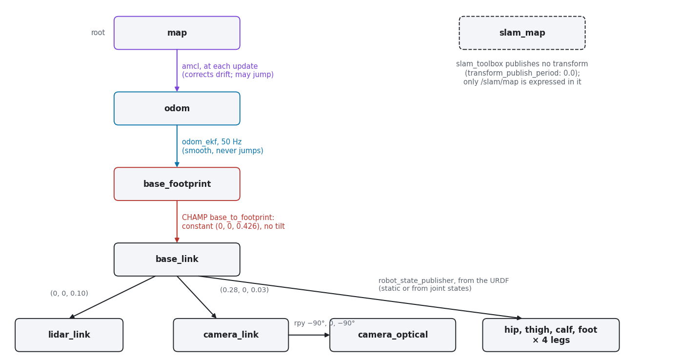
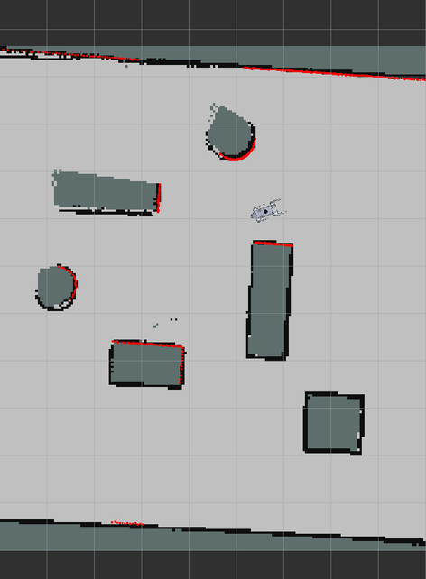
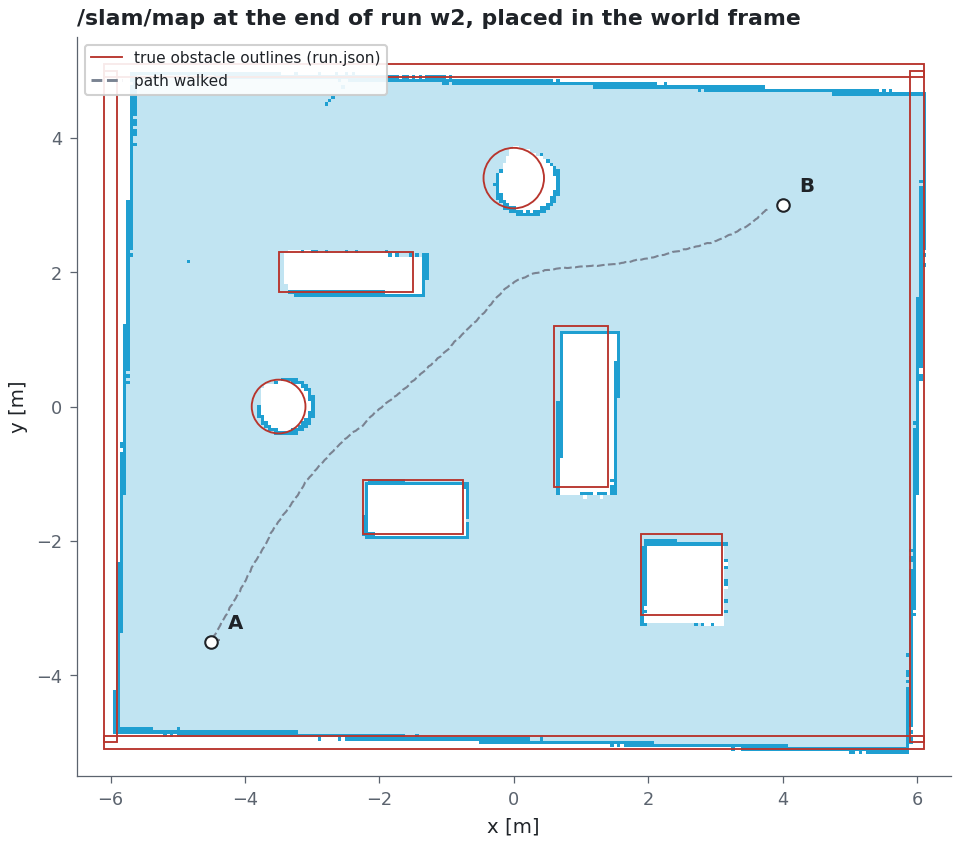
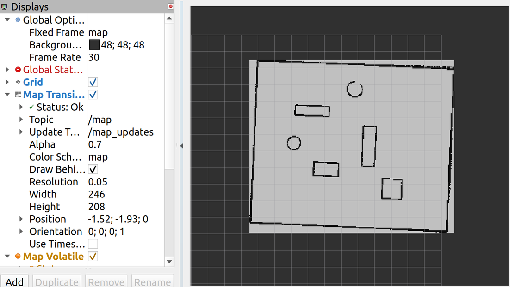
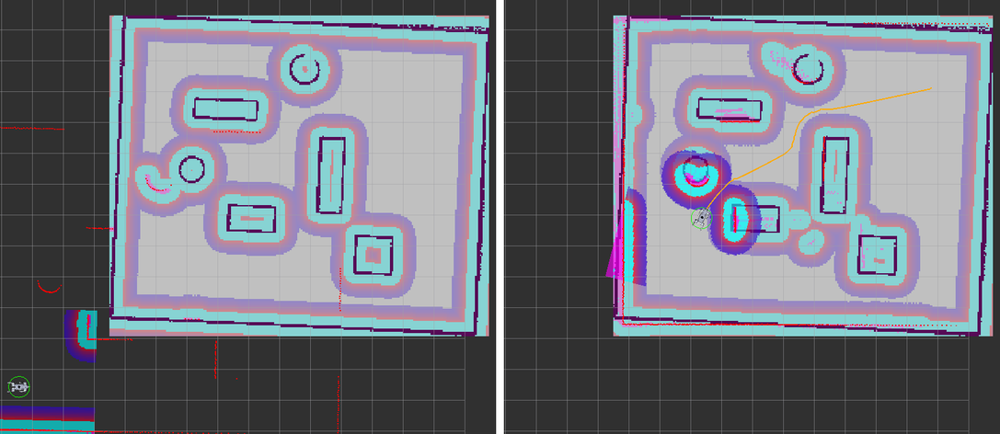
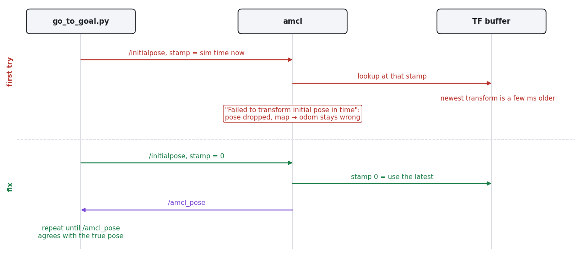
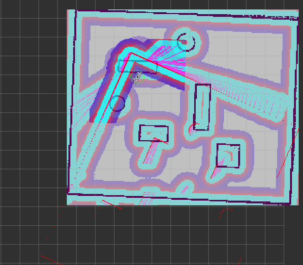

# 10. Mapping and navigation

| | |
|---|---|
| Goal | A map of the arena that you made, saved and reloaded; Nav2 and AMCL running on it with no ground truth in the loop; a list of what Nav2 assumes that a walking robot breaks. |
| Time | 4.5 h: A mapping 2 h, B localise and navigate 2 h, C assumptions 0.5 h. |
| Before you start | [Chapter 9](09-state-estimation.md) done: `estimation.launch.py` publishes `odom` → `base_footprint`. RViz opens `src/go2_nav_sim/rviz/go2.rviz` ([chapter 6](06-import-the-go2.md)). |
| You will learn | how slam_toolbox owns the `map` frame while mapping; Save vs Serialise; why a map display needs Transient Local QoS; how AMCL gets its initial pose; goals from RViz and from a Simple Commander script; how to score a run you did not localise with ground truth; where 2D Nav2 is wrong for a quadruped. |

The stack you started in [chapter 3](03-install-and-first-run.md) navigates on `maps/arena.yaml`, a map drawn by a generator. This chapter
replaces it with one you build. Part A makes the map, part B navigates on it, part C lists the assumptions under both.


*Nodes and the topics, transforms and actions between them, from `launch/nav.launch.py`, `launch/estimation.launch.py` and Humble's Nav2 bringup.*


*The TF tree of the full stack and who publishes each edge. In that stack slam_toolbox runs as a passive observer: `config/slam.yaml` puts it in its own `slam_map` frame with `transform_publish_period: 0.0`, so it cannot fight AMCL over `map`. In part A you run it alone and let it own `map`.*

## Part A: Make a map

## Task 1: Map the arena with slam_toolbox

### 1.1 Start the simulator and the estimator, without Nav2

Objective: a walking robot with `odom` → `base_footprint` and `/scan`, and nothing that publishes `map`.

```bash
source env.sh
ros2 launch go2_nav_sim sim.launch.py > logs/sim.log 2>&1 &
ros2 launch go2_nav_sim estimation.launch.py > logs/est.log 2>&1 &
sleep 20; grep -m1 " pose=" logs/est.log
```

```
[lidar_odom.py-2] [INFO] [...] [lidar_odom]: #50 pose=(0.00,-0.00,0deg) matches=281 rms=0.013 map=278 fails=0
```

Check: `ros2 run tf2_ros tf2_echo odom base_footprint` prints a transform, and `ros2 run tf2_ros tf2_echo map odom` waits with
`frame does not exist`. Do not use `scripts/up.sh` here: it also starts AMCL, which would publish `map`.

### 1.2 Start slam_toolbox so it owns the map frame

Objective: slam_toolbox in mapping mode, publishing `/map` and `map` → `odom`.

The repository's `config/slam.yaml` is written for the passive mapper. Two overrides on the command line turn it into the mapper
that owns `map`:

```bash
ros2 run slam_toolbox async_slam_toolbox_node --ros-args \
  --params-file $(ros2 pkg prefix go2_nav_sim)/share/go2_nav_sim/config/slam.yaml \
  -p map_frame:=map -p transform_publish_period:=0.05 -p use_sim_time:=true
```

```
[INFO] [...] [slam_toolbox]: Node using stack size 40000000
[INFO] [...] [slam_toolbox]: Using solver plugin solver_plugins::CeresSolver
[INFO] [...] [slam_toolbox]: CeresSolver: Using SCHUR_JACOBI preconditioner.
[WARN] [...] [slam_toolbox]: minimum laser range setting (0.0 m) exceeds the capabilities of the used Lidar (0.4 m)
Registering sensor: [Custom Described Lidar]
```

The warning is harmless: slam_toolbox clamps the range to the scan's own minimum.

Check, in a second terminal:

```bash
ros2 run tf2_ros tf2_echo map base_footprint
```

```
At time 76.459000000
- Translation: [0.151, -0.124, 0.000]
- Rotation: in Quaternion (xyzw) [0.000, 0.000, 0.043, 0.999]
```

The `map` frame starts where `odom` started, which is where the robot stood when the estimator came up. Remember this for part B.

### 1.3 Drive the robot through the arena

Objective: cover every wall and obstacle once, and return to the start so slam_toolbox can close the loop.

```bash
rviz2 -d src/go2_nav_sim/rviz/go2.rviz --ros-args -p use_sim_time:=true &
ros2 run teleop_twist_keyboard teleop_twist_keyboard --ros-args -p speed:=0.25 -p turn:=0.5
```

```
Moving around:
   u    i    o
   j    k    l
   m    ,    .
...
currently:	speed 0.25	turn 0.50 
```

The default speeds (0.5 m/s, 1.0 rad/s) are above CHAMP's limits (0.3 m/s, 0.5 rad/s), so CHAMP would clip them;
[chapter 7](07-make-it-walk.md) measures this. The two parameters start teleop at 0.25 m/s and 0.5 rad/s, which keeps the scans
sharp. Pressing `x` does not get there quickly: each press multiplies the linear speed by 0.9, so it takes seven presses from 0.5
to reach 0.24 m/s. A route that covers this arena: east
along the south wall, north along the east wall, west between the tall box and the blue pillar, west past the orange pillar, a loop
through the north-west corner, then south along the west wall back to the start.

For this page I drove that route with a short waypoint script on `/odom_gt` instead of the keyboard, so the run can be repeated:
11 waypoints, 43.6 m of path, about 6 min of wall-clock time at a real-time factor of 0.65 to 0.71 (`gz stats`). In RViz, set
**Views → Type** to TopDownOrtho to see the whole map.


*After about a third of the route (RViz, `go2.rviz` switched to a top-down view, cropped to the east part of the arena): walls and obstacles seen so far, with the scan in red on their edges. Obstacle interiors stay unknown (dark grey).*

Check: the walls in RViz are single thin lines. A wall drawn twice, a few degrees apart, means the scan matching failed somewhere;
drive back over that area or restart.

Common mistakes: stopping the teleop terminal does not stop the robot. CHAMP keeps walking on the last `/cmd_vel`, so press `k`
(stop) before you close it.

### 1.4 Save the map with map_saver_cli

Objective: a `.pgm` image and a `.yaml` file that map_server and AMCL can load.

```bash
mkdir -p ~/go2_maps
ros2 run nav2_map_server map_saver_cli -f ~/go2_maps/my_arena --ros-args -p use_sim_time:=true
cat ~/go2_maps/my_arena.yaml
```

```
[INFO] [...] [map_saver]: Saving map from 'map' topic to '/home/you/go2_maps/my_arena' file
[WARN] [...] [map_saver]: Free threshold unspecified. Setting it to default value: 0.250000
[WARN] [...] [map_saver]: Occupied threshold unspecified. Setting it to default value: 0.650000
[WARN] [...] [map_io]: Image format unspecified. Setting it to: pgm
[INFO] [...] [map_io]: Received a 246 X 208 map @ 0.05 m/pix
[INFO] [...] [map_io]: Map saved
[INFO] [...] [map_saver]: Map saved successfully
image: my_arena.pgm
mode: trinary
resolution: 0.05
origin: [-1.52, -1.93, 0]
negate: 0
occupied_thresh: 0.65
free_thresh: 0.25
```

Check: `origin` is near (−1.5, −1.9). The robot started 1.5 m from the west wall and 1.5 m from the south wall, and the image
starts a little outside the walls.

### 1.5 Serialise the pose graph and compare it with Save

Objective: keep what slam_toolbox needs to continue this map later, and know which file is for what.

```bash
ros2 service call /slam_toolbox/serialize_map slam_toolbox/srv/SerializePoseGraph "{filename: '$HOME/go2_maps/my_arena'}"
ls -la ~/go2_maps
```

```
response:
slam_toolbox.srv.SerializePoseGraph_Response(result=0)

-rw-rw-r-- 1 you you  6426714 Nov 28 09:53 my_arena.data
-rw-rw-r-- 1 you you    51183 Nov 28 09:53 my_arena.pgm
-rw-rw-r-- 1 you you 17938888 Nov 28 09:53 my_arena.posegraph
-rw-rw-r-- 1 you you      126 Nov 28 09:53 my_arena.yaml
```

| | Save (`map_saver_cli`, or **Save Map** in the slam_toolbox RViz panel) | Serialise (`serialize_map`, or **Serialize Map**) |
|---|---|---|
| Files | `.pgm` + `.yaml`, 51 KB here | `.posegraph` + `.data`, 24 MB here |
| Contains | the occupancy grid only | every scan and the pose graph |
| Read by | map_server, AMCL, Nav2 | slam_toolbox (`deserialize_map`, or `map_file_name` at start-up) |
| Use it to | navigate on the map (part B) | continue mapping, or localise with slam_toolbox instead of AMCL |

Check: `result=0` and both pairs of files exist. A grid cannot be turned back into a pose graph, so serialise before you stop
slam_toolbox if you might extend the map.

To score the map, I compared its occupied cells with the generator's `maps/arena.pgm` using the rigid point-to-line fit from
`registration.py`. The fit moves the map by 0.246 m and 2.54°; after the fit the median distance from an occupied cell to the true
outline is 2.9 cm and the 95th percentile 7.6 cm. The 0.246 m and 2.54° are where the robot stood when mapping began, not mapping
error. The passive mapper of the full stack gives a similar result:


*The final `/slam/map` of run w2 against the true outlines: a rigid point-to-line fit of its occupied cells (`registration.py`, full SE(2)) moves it by 0.135 m and 1.5°.*

## Task 2: Reload the map in RViz

### 2.1 Serve the map with map_server

Objective: the saved map back on `/map`, with slam_toolbox stopped.

Stop slam_toolbox with Ctrl+C in its terminal, then:

```bash
ros2 run nav2_map_server map_server --ros-args -p yaml_filename:=$HOME/go2_maps/my_arena.yaml -p use_sim_time:=true &
ros2 run nav2_util lifecycle_bringup map_server
ros2 topic info -v /map | grep -E "Reliability|Durability"
```

```
  Reliability: RELIABLE
  Durability: TRANSIENT_LOCAL
```

map_server is a lifecycle node: until `lifecycle_bringup` configures and activates it, it publishes nothing.

### 2.2 See why the Map display needs Transient Local

Objective: understand why a map that is published once can be invisible.

map_server publishes the map once, when it activates. A Transient Local publisher keeps that message and hands it to subscribers
that join later, but only if they also ask for Transient Local. A Volatile subscriber gets only messages published after it joined,
so it gets nothing.

```bash
timeout 8 ros2 topic echo --once --qos-durability volatile /map --field info
timeout 8 ros2 topic echo --once --qos-durability transient_local --qos-reliability reliable /map --field info
```

The first command prints nothing for 8 s. The second prints at once:

```
map_load_time:
  sec: 273
  nanosec: 900000000
resolution: 0.05000000074505806
width: 246
height: 208
origin:
  position:
    x: -1.52
    y: -1.93
```


*The reloaded map in RViz. Same topic, two displays: Transient Local draws it, Volatile warns and draws nothing. Global Status is red because nothing publishes TF in this step, so the fixed frame `map` has no transform to the robot. The map is turned by about 2.5°: its frame is the robot's heading when mapping began.*

Check: in RViz, the Map display's **Topic → Durability Policy** is Transient Local and the map appears. Every Map display in
`go2.rviz` is already set this way.

## Part B: Localise and navigate without ground truth

Part B navigates on the finished map from part A, not on a map still being built. I tried planning while mapping: Nav2 rejects a
goal outside the current global costmap ("goal is off the global costmap"), and from the start corner the obstacles hide most of
the arena, so B is not in the map yet. A rolling-window global costmap accepted the goal but did not give a usable plan. Mapping
while navigating needs either goals inside the known area or an exploration strategy that picks frontier goals, which this
repository does not include.

## Task 3: Localise on your own map

### 3.1 Start Nav2 and AMCL on your map

Objective: AMCL, the costmaps and the planners running on `my_arena.yaml`.

Stop map_server (`kill %1` or Ctrl+C). Restart the simulator and estimator as in 1.1 so the robot stands at the start again, then:

```bash
ros2 launch go2_nav_sim nav.launch.py map:=$HOME/go2_maps/my_arena.yaml mapper:=false > logs/nav.log 2>&1 &
sleep 15; grep -c "Managed nodes are active" logs/nav.log
```

```
2
```

`mapper:=false` leaves out the passive slam_toolbox; it has nothing to add on a map you already have.

Check: 2 means both lifecycle managers (localisation and navigation) are active. It took 7 s here.

### 3.2 Give AMCL its initial pose with 2D Pose Estimate

Objective: AMCL's `map` → `odom` agrees with where the robot really is.

AMCL starts from the pose in `config/nav2_params.yaml`, (−4.5, −3.5). That is marker A in the arena's frame, but your map's origin is
where mapping began, so AMCL puts the robot 5.7 m from the start and outside your map. The planner log says so:

```
[planner_server-6] [WARN] [...] [nav2_costmap_2d]: Robot is out of bounds of the costmap!
[planner_server-6] [WARN] [...] [global_costmap.global_costmap]: Sensor origin at (-4.41, -3.58) is out of map bounds (-1.52, -1.93) to (10.76, 8.45). The costmap cannot raytrace for it.
```

In RViz (`go2.rviz`, Fixed Frame `map`), pick **2D Pose Estimate**, click where the robot is and drag in the direction it faces.
Match the red scan to the walls by eye. The tool publishes a `geometry_msgs/PoseWithCovarianceStamped` on `/initialpose`. The same
message from the command line, for a robot at the map origin facing +x:

```bash
ros2 topic pub -t 3 -w 0 /initialpose geometry_msgs/msg/PoseWithCovarianceStamped "{header: {frame_id: map}, pose: {pose: {orientation: {w: 1.0}}, covariance: [0.25,0,0,0,0,0, 0,0.25,0,0,0,0, 0,0,0,0,0,0, 0,0,0,0,0,0, 0,0,0,0,0,0, 0,0,0,0,0,0.0685]}}"
grep "Setting pose" logs/nav.log | tail -1
```

```
[amcl-2] [INFO] [...] [amcl]: Setting pose (16.795000): 0.000 0.000 0.000
```

AMCL also logs `Failed to transform initial pose in time (Lookup would require extrapolation into the future...)`. It does so even
for a zero stamp, and it still applies the pose: `/amcl_pose` came back at (0.02, 0.05). The warning means AMCL could not move the
pose forward by the odometry between the stamp and now, which does not matter while the robot stands.

Then clear both costmaps. Before the initial pose, every scan was marked at the wrong pose, and those marks stay until a later scan
clears them:

```bash
ros2 service call /global_costmap/clear_entirely_global_costmap nav2_msgs/srv/ClearEntireCostmap "{}"
ros2 service call /local_costmap/clear_entirely_local_costmap nav2_msgs/srv/ClearEntireCostmap "{}"
```

In runs 1 and 2 below, which skipped this step, the global costmap ended with lethal cells near the start where your map is free.
Their shape matches the tall box shifted by (−4.5, −3.5), which is what the scan shows from the wrong pose (my reading; I did not
watch them appear).


*Left: AMCL at the pose from `nav2_params.yaml`, outside the map; the scan (red) lands outside the walls and the costmaps mark it. Right: after the initial pose, on the way to the goal, in a run without clearing; the magenta band at the left wall is still there from before.*

Check: the red scan lies on the map's walls, and `ros2 topic echo --once /amcl_pose --field pose.pose.position` prints x and y
within about 0.1 m of where you clicked.

### 3.3 The ground-truth shortcut (optional)

Objective: know what `go_to_goal.py` does in the full stack, and why you did not use it here.

`go_to_goal.py` reads the simulator pose and publishes it to `/initialpose`. The robot settles up to 0.6 m from the marker after
spawning, and an AMCL started at the nominal position produces a scan that does not match the map. The costmap then fills with long
streaks, because every scan is projected with a wrong `map` to `odom` transform, and the planner finds no path. The script repeats
the message until `/amcl_pose` agrees with the true pose. The params still set a nominal initial pose, because without one AMCL
publishes no `map` frame and Nav2's costmaps never finish starting.


*The TF timing race behind "Failed to transform initial pose in time", and the zero-stamp repeat in `go_to_goal.py`.*

The shortcut only works on `maps/arena.yaml`, whose frame is the simulator's world frame. On your map the true pose would first have
to be moved into the map frame, and on a real robot there is no true pose at all.

## Task 4: Navigate to goals

### 4.1 Send a goal from RViz

Objective: one goal across the arena, planned and walked on your map.

In RViz pick **2D Goal Pose**, click the far corner where marker B stands in the simulator, about (8.8, 6.1) on this map, and drag
north-east. The tool publishes a `geometry_msgs/PoseStamped` on `/goal_pose`, which `bt_navigator` turns into a NavigateToPose
action. The same from the command line:

```bash
ros2 topic pub -t 1 -w 1 /goal_pose geometry_msgs/msg/PoseStamped "{header: {frame_id: map}, pose: {position: {x: 8.8, y: 6.1}, orientation: {z: 0.383, w: 0.924}}}"
grep -E "Begin navigating|Goal succeeded|Goal failed" logs/nav.log
```

```
[bt_navigator-8] [INFO] [...] [bt_navigator]: Begin navigating from current location (0.02, 0.05) to (8.80, 6.10)
[bt_navigator-8] [INFO] [...] [bt_navigator]: Goal succeeded
```

Check: `Goal succeeded`, and in RViz the robot stands at the goal with the scan on the walls.

I ran 3.1 to 4.2 three times from a fresh start. AMCL error is AMCL's pose against ground truth, both in the learner map's frame; I
moved ground truth into that frame with the 0.246 m / 2.54° fit from 1.5, which is good to about 3 cm. Ground truth was read only to
score the run.

| Run | Goal B result | Wall time | AMCL error RMSE / max | True distance to B at the end |
|---|---|---|---|---|
| 1 | succeeded | 93 s | 0.282 / 0.616 m | 0.25 m |
| 2 | succeeded | 95 s | 0.081 / 0.156 m | 0.22 m |
| 3 | succeeded | 57 s | 0.154 / 0.270 m | 0.17 m |

Runs 1 and 2 did not clear the costmaps; run 3 did. On `maps/arena.yaml` the full stack gave 8.3 to 18.7 cm AMCL RMSE (README), so runs 2 and 3 on
your own map are in the same range.

### 4.2 Send goals from a Simple Commander script

Objective: a script that sends goals one after another and reports each result.

Save as `~/go2_goals.py`:

```python
"""Send goals one after another with Nav2's Simple Commander and print each result."""
import math, time
import rclpy
from geometry_msgs.msg import PoseStamped
from nav2_simple_commander.robot_navigator import BasicNavigator


def pose(nav, x, y, yaw):
    p = PoseStamped()
    p.header.frame_id, p.header.stamp = 'map', nav.get_clock().now().to_msg()
    p.pose.position.x, p.pose.position.y = x, y
    p.pose.orientation.z, p.pose.orientation.w = math.sin(yaw / 2), math.cos(yaw / 2)
    return p


rclpy.init()
nav = BasicNavigator()
nav.waitUntilNav2Active(localizer='map_server')   # not 'amcl': that would publish its own (0, 0, 0) initial pose
for x, y, yaw in [(3.7, 4.4, math.pi), (0.0, 0.0, 0.0)]:
    t0 = time.time()
    nav.goToPose(pose(nav, x, y, yaw))
    while not nav.isTaskComplete():
        rclpy.spin_once(nav, timeout_sec=0.5)
    print(f'goal ({x}, {y}): {nav.getResult().name} in {time.time() - t0:.0f} s', flush=True)
nav.destroy_node()
rclpy.shutdown()
```

`waitUntilNav2Active()` with its default `localizer='amcl'` publishes the navigator's own initial pose, (0, 0, 0) unless you
called `setInitialPose()`, until AMCL answers. After 3.2 that would throw away the pose you set; with the robot at B it would
teleport AMCL about 11 m. Naming another lifecycle node skips that step.

```bash
python3 ~/go2_goals.py
```

Output of run 2, with the robot at B:

```
[INFO] [...] [basic_navigator]: Nav2 is ready for use!
[INFO] [...] [basic_navigator]: Navigating to goal: 3.7 4.4...
goal (3.7, 4.4): SUCCEEDED in 74 s
[INFO] [...] [basic_navigator]: Navigating to goal: 0.0 0.0...
goal (0.0, 0.0): FAILED in 178 s
```

Check: one line per goal. The first goal succeeded in all three runs (52, 74 and 72 s).

The second goal, back to the start, failed in all three runs (232, 178 and 124 s). The pattern was the same each time: the robot
came within 0.11 to 0.22 m of the start (true distance) with AMCL error under 0.45 m, then failed to make progress (`controller_server: Failed to make
progress`), and during the spin and back-up recoveries AMCL jumped 5 m to about (2.3, 4.5) on the map. From there the costmap marks
the corner the robot is really looking at in the middle of the map, and no plan exists.


*After the second goal failed (run 3): AMCL places the robot at (2.3, 4.5); the two red walls are the start corner seen from the wrong pose, and the costmap has inflated them into the open space.*

I did not find the cause. Things I checked: the map at the start is free (cost 0 at (0, 0)), and clearing the costmaps after the
initial pose (run 3) did not change the result. In run 1 the robot also stood at B for 2.5 min before the script started;
AMCL error grew to 1.9 m while it stood and recovered once it walked. The gyro is the likely contributor there: standing, `/imu/data`
reads a mean yaw rate of 0.0047 rad/s (0.27°/s) while the true heading does not change, and the lidar odometry's
heading rose from 43° to 49° in 29 s; AMCL has to remove that drift. A real robot can lose localisation the same way, so keep the
check from 3.2 running: watch the scan against the map, and when it no longer lies on the walls, stop the robot. I did not test
whether a new 2D Pose Estimate recovers this case.

The full stack on `maps/arena.yaml` ends its mission like this:

<video controls muted playsinline src="../media/c09-ch10-arrival.mp4"></video>

*The last 14 s of run w2 (map and metrics panels): the plan shortens to B and the robot stops 0.21 m from it, inside the 0.25 m goal tolerance.*

Common mistakes: CHAMP keeps walking on the last `cmd_vel` it received. Nav2 publishes a zero command at the goal; if you test with
`ros2 topic pub`, finish with a zero message.

## Part C: What Nav2 assumes on legs

## Task 5: Check each assumption against this robot

### 5.1 Read the table

Objective: know which of Nav2's 2D assumptions this stack breaks, by how much, and where that shows.

| Nav2 assumes | On this Go2 | Consequence | Source |
|---|---|---|---|
| The base moves in a plane and `base_footprint` is on the floor | the trunk rolls and pitches with the gait; `base_footprint` → `base_link` is a constant 0.426 m because CHAMP gets no foot contacts, so `base_footprint` sits 0.209 m below the floor | every height in `base_footprint` reads 0.209 m too high; the scan band has to absorb it (5.2) | chapter 9; open issue |
| Obstacles cross the scan plane | `/scan` keeps points 0.30 to 0.90 m above `base_footprint`, about 0.09 to 0.69 m above the real floor | anything lower or only higher, such as a kerb or a table top, is invisible | `config/scan.yaml` |
| No steps, the floor is flat | a 2D grid has no height; a step is either a wall or nothing | the robot cannot plan over or onto a step it could climb, and does not see a drop | go2-tutorial table (`research/repos.md`) |
| The footprint is a circle | the body is 0.65 × 0.30 m; `robot_radius` 0.33 m is smaller than its 0.358 m circumscribed radius | corners can touch obstacles in a turn (5.3); the Nav2 guide allows `robot_radius` only with holonomic planners such as NavFn | Nav2 footprint and tuning pages (`research/ros2-teaching.md`) |
| Odometry and IMU are smooth | walking, the IMU's vertical acceleration has a standard deviation of 2.905 m/s² against 0.960 standing in place; roll and pitch rates 0.717 and 0.557 rad/s against 0.083 and 0.058 | gait noise enters every filter that uses the IMU; standing, a 0.0047 rad/s mean yaw rate became heading drift in 4.2 | `/imu/data`, 10 s each, this chapter |
| The lidar sees what is near the ground | the real Go2's L1 does not resolve obstacles under about 0.3 m (CMU field notes); the simulated lidar has no such limit | a course that passes here can hit low obstacles on the real robot | `autonomy_stack_go2` notes (`research/repos.md`) |

Check: for each row, open the file or rerun the measurement named in the Source column. The IMU row was measured for this
chapter: standard deviations of `linear_acceleration.z` and `angular_velocity` over 10 s of sim time, 988 samples standing and 980
walking at 0.25 m/s.

### 5.2 The scan plane

Objective: see where the 0.30 m in the table comes from.

```bash
grep -nE "min_height|max_height" src/go2_nav_sim/config/scan.yaml
```

```
10:    min_height: 0.30
11:    max_height: 0.90
```

Points between 0.30 and 0.90 m in `base_footprint` become scan hits. That frame sits 0.209 m below the real floor
([chapter 9](09-state-estimation.md#task-2-run-the-lidar-odometry), step 1 of 2.2), so the band is about 0.09 to 0.69 m above the real ground. The first version
used 0.12 m, which is −0.09 m in real height, below the floor. Every floor return became an obstacle and the global costmap filled
with a smeared wall before the robot had moved. I first blamed gait tilt; the constant TF offset is the real cause, found later. At
0.30 m the floor is excluded with 9 cm to spare, which uncompensated tilt eats at a few metres' range, so occasional floor hits still
appear and are cleared by ray tracing. Every obstacle in this arena is at least 0.45 m tall. A correct `base_footprint` to
`base_link` transform ([chapter 9](09-state-estimation.md#failures-worth-knowing-about)) is the proper fix.


*The 16 beams (±15°, `urdf/sensors.xacro`) from 0.317 m: the lowest reaches the floor 1.18 m out, and with the old 0.12 m threshold every red floor return counted as an obstacle.*

Check: in RViz, with LidarPoints and LaserScan both on, the floor rings of the cloud have no red scan points on them near the robot.

### 5.3 The footprint and tight gaps

Objective: see what the circular footprint and the inflation do to a narrow gap.

```bash
grep -nE "robot_radius|inflation_radius|cost_scaling_factor" src/go2_nav_sim/config/nav2_params.yaml
```

```
165:      robot_radius: 0.33
171:        cost_scaling_factor: 4.0
172:        inflation_radius: 0.75
199:      robot_radius: 0.33
225:        cost_scaling_factor: 4.0
226:        inflation_radius: 0.75
```

`config/nav2_params.yaml` is generated by `src/go2_nav_sim/scripts/make_nav2_params.py` from Humble's stock `nav2_params.yaml`
plus the changes listed in that script. The main ones:

| Parameter | Value | Reason |
|---|---|---|
| Controller | Regulated Pure Pursuit, 0.25 m/s, rotate to heading | smooth, forward-only, and it rotates in place at the start and at the goal |
| Footprint | circle, radius 0.33 m | a compromise: slightly smaller than the 0.358 m circumscribed radius of a 0.65 × 0.30 m body |
| Inflation | radius 0.75 m, cost scaling 4.0 | pushes plans away from tight gaps |
| Planner | NavFn with A* | |
| Velocity smoother | 0.3 m/s, 0.5 rad/s, acceleration 0.5 m/s², deceleration 0.8 m/s² | CHAMP's gait limits are 0.3 and 0.5 |


*The footprint compromise drawn over a top view of the MuJoCo Go2: the 0.33 m circle cuts the body's corners, which lie on the 0.358 m circle.*

The first world had a 0.85 m gap between two obstacles, wider than the robot (0.3 m) and than the footprint circle (0.66 m). The
planner routed through it, the robot ended inside the inflated zone, and the planner then reported no path. Every cell of the gap
carries inflation cost: Nav2's formula 252 · exp(−4.0 · (0.425 − 0.33)) gives about 172 at its centre, high but not lethal.
`test_arena.py` now requires every gap between two obstacles to be wider than 0.66 m; the narrowest in the current arena is 0.86 m,
between the corners of the two boxes at (1.0, 0.0) and (2.5, −2.5). For a real environment, use a polygon footprint and tune
inflation instead. Project P12 (`projects/p12_tune-nav2`, not yet published: scripts and raw results, no instructions) measures
those settings, three runs per setting.


*Nav2's inflation cost with `robot_radius` 0.33 m, `inflation_radius` 0.75 m and `cost_scaling_factor` 4.0: across a 0.85 m gap nothing drops below 172, while a 2 m gap has a zero-cost lane.*


*The global costmap recomputed from `maps/arena.pgm` with the same formula; red is the 253 contour the robot centre may not cross. The first plan of run w2 stays clear of the 0.86 m gap.*

Check: the two `robot_radius` lines (global and local costmap) agree. If they differ, the planner and the controller disagree
about where the robot fits.

## Exercise

Your reloaded map in RViz (2.2) is turned by a few degrees against the grid, although the arena's walls are aligned with x and y.
Explain why, and say what this means for the initial pose in 3.2.

Answer: slam_toolbox's `map` frame is the `odom` frame at the moment mapping began, and `odom` starts at the pose where the estimator
came up: wherever the robot had settled after spawning, facing wherever it faced. Here that was 2.54° and 0.246 m away from the
arena's own frame at A (the rigid fit in 1.5). Nothing is wrong with the map. It means the map's (0, 0, 0) is that start pose, so
when the robot is restarted at A, the right initial pose is close to (0, 0, 0) on your map, not the (−4.5, −3.5) in
`nav2_params.yaml`.

## Further reading

- Nav2 tuning guide: https://docs.nav2.org/rolling/configuration_and_development/tuning_guide/
- Nav2, navigating while mapping: https://docs.nav2.org/rolling/tutorials/general_tutorials/navigation2_with_slam/navigation2_with_slam/
- Macenski et al., "The Marathon 2: A Navigation System", IROS 2020: https://arxiv.org/abs/2003.00368

Next: [11. Record and visualise](11-record-and-visualise.md)
