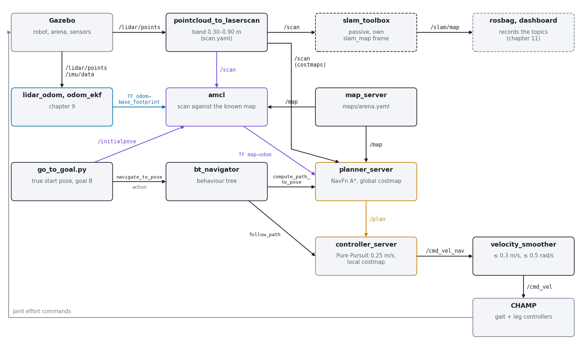
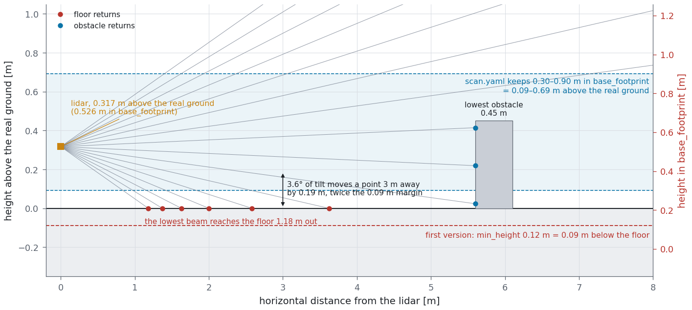
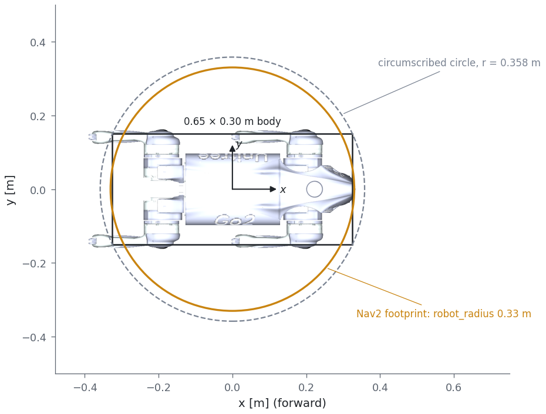
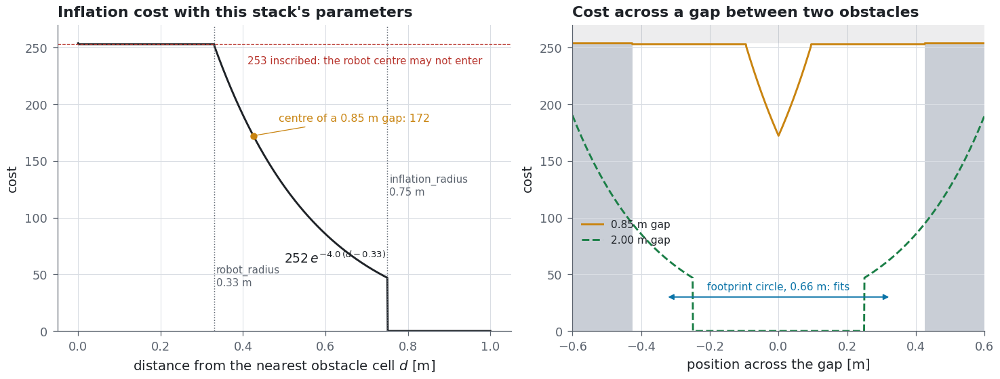
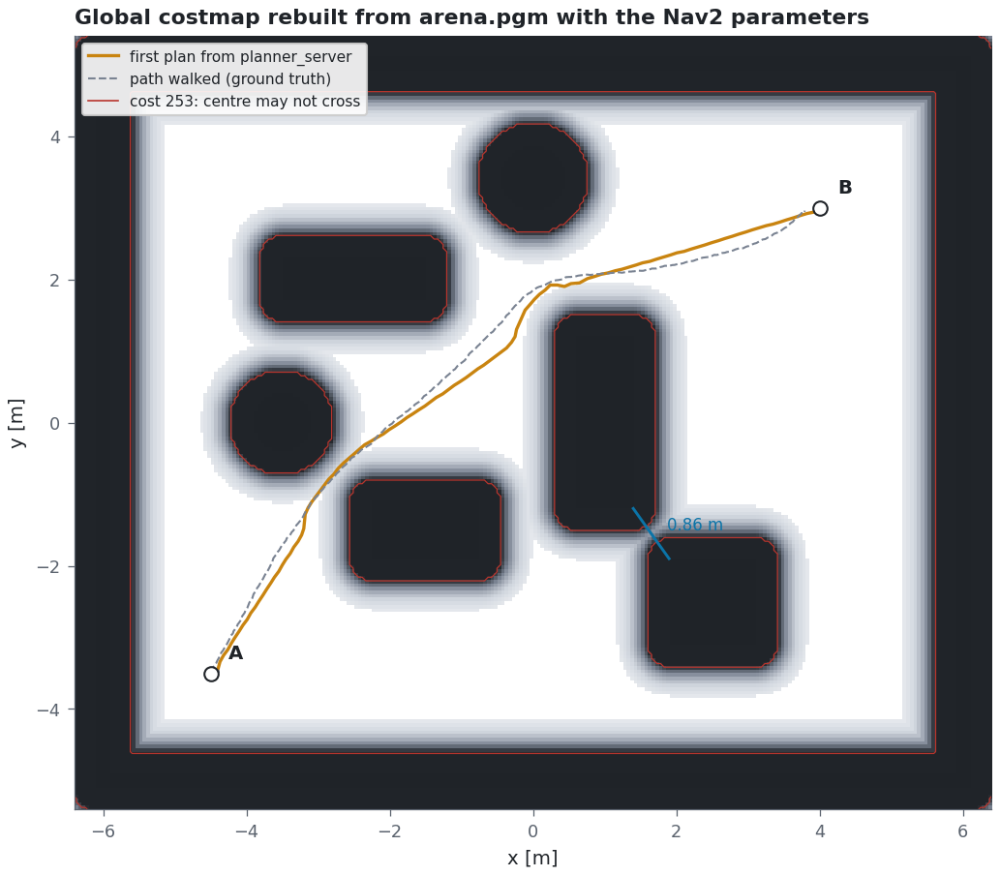

# 10. Mapping and navigation

## Two stages, on purpose

- Navigation uses Nav2 with AMCL on a known map (`maps/arena.yaml`). You can replace it with your own: `nav.launch.py map:=...`.
- Mapping runs `slam_toolbox` at the same time, as a passive observer. It publishes `/slam/map` in its own `slam_map` frame
  and does not publish `map` to `odom`, so it cannot fight AMCL.

*Nodes and the topics, transforms and actions between them, from `launch/nav.launch.py`, `launch/estimation.launch.py` and Humble's Nav2 bringup.*

*The TF tree and who publishes each edge; `slam_map` has no transform because `config/slam.yaml` sets `transform_publish_period: 0.0`.*

I tried navigating on the map that SLAM is still building. Nav2 rejects a goal that lies outside the current global
costmap ("goal is off the global costmap"), and from the start corner the obstacles hide most of the arena, so B is not in the map
yet. A rolling-window global costmap accepted the goal but did not give a usable plan. Doing this properly needs an exploration
strategy that picks frontier goals, which this repo does not include.

*The final `/slam/map` of run w2 against the true outlines: a rigid point-to-line fit of its occupied cells (`registration.py`, full SE(2)) moves it by 0.135 m and 1.5°. Navigation does not use this map.*

## The scan

`pointcloud_to_laserscan` turns `/lidar/points` into `/scan` for the costmaps (`config/scan.yaml`).

### The height band

Points between 0.30 and 0.90 m in `base_footprint` become scan hits. That frame sits 0.209 m below the real floor
([chapter 9](09-state-estimation.md#lidar-odometry)), so heights in it read 0.209 m too high and the band is about 0.09 to
0.69 m above the real ground. The first version used 0.12 m, which is −0.09 m in real height, below
the floor. Every floor return became an obstacle and the global costmap filled with a smeared wall before the robot had moved.
I first blamed gait tilt; the constant TF offset is the real cause, found later. At 0.30 m the floor is excluded with 9 cm to
spare, which uncompensated tilt eats at a few metres' range, so occasional floor hits still appear and are cleared by ray
tracing. Every obstacle in this arena is at least 0.45 m tall. A correct `base_footprint` to `base_link` transform
([chapter 9](09-state-estimation.md#failures-worth-knowing-about)) is the proper fix.

*The 16 beams (±15°, `urdf/sensors.xacro`) from 0.317 m: the lowest reaches the floor 1.18 m out, and with the old 0.12 m threshold every red floor return counted as an obstacle.*

## Nav2 parameters

`config/nav2_params.yaml` is generated by `src/go2_nav_sim/scripts/make_nav2_params.py` from Humble's stock `nav2_params.yaml` plus the changes
listed in that script, so you can see exactly what differs from the defaults. The main ones:

| Parameter | Value | Reason |
|---|---|---|
| Controller | Regulated Pure Pursuit, 0.25 m/s, rotate to heading | smooth, forward-only, and it rotates in place at the start and at the goal |
| Footprint | circle, radius 0.33 m | a compromise: slightly smaller than the 0.358 m circumscribed radius of a 0.65 × 0.30 m body |
| Inflation | radius 0.75 m, cost scaling 4.0 | pushes plans away from tight gaps |
| Planner | NavFn with A* | |
| Velocity smoother | 0.3 m/s, 0.5 rad/s, acceleration 0.5 m/s², deceleration 0.8 m/s² | CHAMP's gait limits are 0.3 and 0.5 |

*The footprint compromise drawn over a top view of the MuJoCo Go2: the 0.33 m circle cuts the body's corners, which lie on the 0.358 m circle.*

### Tight gaps

The first world had a 0.85 m gap between two obstacles. That is wider than the robot (0.3 m) and than the footprint circle
(0.66 m), so the footprint was not the problem. The planner routed through the gap, the robot ended inside the inflated zone,
and the planner then reported no path. Every cell of the gap carries inflation cost: with the current inflation (radius 0.75 m, scaling 4.0),
Nav2's formula 252 · exp(−4.0 · (0.425 − 0.33)) gives about 172 at its centre, high but not lethal. `test_arena.py` now
requires every gap between two obstacles to be wider than 0.66 m; the narrowest in the current arena is 0.86 m, between the corners of the two boxes at
(1.0, 0.0) and (2.5, −2.5). For a real environment, use a polygon footprint and tune inflation instead.

*Nav2's inflation cost with `robot_radius` 0.33 m, `inflation_radius` 0.75 m and `cost_scaling_factor` 4.0: across a 0.85 m gap nothing drops below 172, while a 2 m gap has a zero-cost lane.*

*The global costmap recomputed from `maps/arena.pgm` with the same formula; red is the 253 contour the robot centre may not cross. The first plan of run w2 stays clear of the 0.86 m gap.*

## Start AMCL from the true pose

`go_to_goal.py` reads the simulator pose and publishes it to `/initialpose`. The robot settles up to 0.6 m from the marker after
spawning, and an AMCL started at the nominal position produces a scan that does not match the map. The costmap then fills with
long streaks, because every scan is projected with a wrong `map` to `odom` transform, and the planner finds no path.

One message is not enough. AMCL looks up the transform at the message's timestamp, and if that is a few milliseconds ahead of the
latest TF it drops the pose ("Failed to transform initial pose in time"). The script leaves the stamp at zero, which makes AMCL
use the latest transform, and repeats the message until `/amcl_pose` agrees with the true pose. The params still set a nominal initial pose, because without one AMCL
publishes no `map` frame and Nav2's costmaps never finish starting. On a real robot you supply the initial pose yourself, for example with RViz's 2D Pose Estimate.

*The TF timing race behind "Failed to transform initial pose in time", and the zero-stamp fix in `go_to_goal.py`.*

CHAMP also keeps walking on the last `cmd_vel` it received. Nav2 publishes a zero command at the goal; if you test with
`ros2 topic pub`, finish with a zero message.

<video controls muted playsinline src="../media/c09-ch10-arrival.mp4"></video>

*The last 14 s of run w2 (map and metrics panels): the plan shortens to B and the robot stops 0.21 m from it, inside the 0.25 m goal tolerance.*

Next: [11. Record and visualise](11-record-and-visualise.md)
