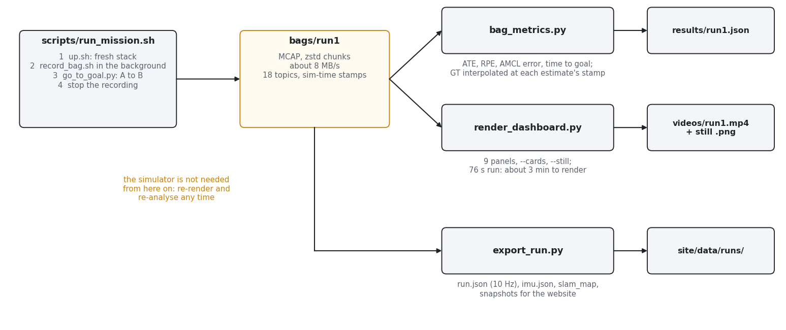

# 11. Record and visualise (optional video appendix)

| | |
|---|---|
| Goal | Record one mission to a bag with one command and render the dashboard video from the bag alone. Optional: no later chapter needs it. Scoring a bag is core and is taught in [chapter 9](09-state-estimation.md), Task 4.2. |
| Time | 1 h, optional (most of it waiting for the mission and the render) |
| Before you start | [Chapter 9](09-state-estimation.md), Task 4.2, which explains the numbers. |
| You will learn | why the video is rendered from a bag and not from the live simulator; which topics the recording holds; what each dashboard panel is drawn from. |

The stack records to a rosbag and renders the dashboard from the bag. That keeps the simulator out of the rendering path, so the
same run can be re-rendered or re-analysed later.


*One recording feeds three offline tools; the topic count is from `scripts/record_bag.sh`.*

## Task 1: Record and score a mission

### 1.1 Run the mission script

Objective: a fresh stack, a bag and a drive from A to B in one command.

```bash
scripts/run_mission.sh bags/run1      # fresh stack, record, drive A to B, stop (about 3 minutes)
```

```
RESULT SUCCEEDED  sim_time 54.8 s  ground-truth final error 0.21 m  final pos (3.79, 2.99)
```

(That output is from the same three steps run by hand: `scripts/up.sh`, `scripts/record_bag.sh`, `go_to_goal.py`.) The script
starts its recorder with `setsid`, so the recorder leads its own process group, and at the end it stops only that group
(`kill -INT -- -"$REC"`). A recording you run beside it in another terminal keeps running.

The bag is MCAP with zstd chunk compression. Topics are listed in `scripts/record_bag.sh`; the timestamps that matter are in the
message headers (simulation time). The 124 s recording above (75 s of mission, then standing) took 785.5 MiB (`Bag size` in `ros2 bag info`).

```bash
ros2 bag info bags/run1 | grep -E "Duration|Messages"
```

```
Duration:          123.555770692s
Messages:          64093
```

Check: `RESULT SUCCEEDED`, and `ros2 bag info` lists the 18 topics of `record_bag.sh`.

### 1.2 Score it

Objective: the ATE, RPE and AMCL numbers for this run.

```bash
python3 src/go2_nav_sim/scripts/bag_metrics.py bags/run1 --json results/run1.json
```

The output, its definitions and a comparison with the three reference runs are in
[chapter 9, Task 4.2](09-state-estimation.md#42-from-a-bag-for-a-whole-mission).

Check: `goal_error_m` close to the 0.25 m `goal_tolerance_m`. Above it means AMCL was off when Nav2 stopped, as in run w3
(0.34 m, [chapter 9](09-state-estimation.md#42-from-a-bag-for-a-whole-mission)).

## Task 2: Render the video

### 2.1 Render the dashboard from the bag

Objective: a 1080p video and a still, with no simulator running.

```bash
python3 src/go2_nav_sim/scripts/render_dashboard.py bags/run1 videos/run1.mp4 --cards --still videos/run1.png
```

```
wrote videos/run1.mp4: 1848 frames
```

Rendering run w2 (a 97.4 s bag, `ros2 bag info bags/w2`) into `media/go2_a2b_dashboard.mp4` (103.5 s at 15 fps and
1920 × 1080, from `ffprobe`) took about three minutes on an idle machine. The 124 s bag above took about 7 minutes on a
machine running seven other simulators. Fonts are Roboto and DejaVu Sans Mono if present, with a fallback.


*The dashboard still of run w2 (`docs/img/dashboard.png`), each panel labelled with the topics `render_dashboard.py` draws it from.*

Panels: the external camera, the onboard RGB image, depth in a turbo colour map with its range, a perspective view of the current
lidar sweep coloured by height, the map with the plan, the lidar scan and both trajectories, run metrics, and the IMU over the last
eight seconds. `--cards` adds a title card and a closing card with the run summary. The metrics panel uses ground truth and says
so.

<video controls muted playsinline src="../media/c09-ch11-dashboard.mp4"></video>

*Twelve seconds of the run w2 video (`media/go2_a2b_dashboard.mp4`, scaled to 1280 × 720) in the middle of the mission.*

Check: `ffprobe -v error -show_entries stream=width,height -of csv=p=0 videos/run1.mp4` prints `1920,1080`, and the still shows
the robot between A and B.

## Exercise

You only want the numbers of chapter 9, Task 4.2, not the video. Record the smallest bag that `bag_metrics.py` can score.

Answer: `bag_metrics.py` reads only `/odom`, `/odom_gt` and `/amcl_pose` (the topic filter in its `main()`), and it opens the bag
as MCAP. So

```bash
ros2 bag record -s mcap -o bags/small /odom /odom_gt /amcl_pose
```

is enough. Without `-s mcap` the recorder writes SQLite on Humble and `bag_metrics.py` cannot open it.

## Further reading

- Frey et al., "GrandTour": 49 ANYmal-D missions with lidar, cameras and proprioception against RTK-GNSS and total-station reference trajectories, used to benchmark 63 open-source estimators under one protocol: https://arxiv.org/abs/2602.18164
- Yang et al., "Cerberus": visual-inertial-leg odometry with bags from a Unitree A1 (260 m) and a Go1 (350 m) that include joint encoders and contact sensors: https://arxiv.org/abs/2209.07654

Next: [12. Troubleshooting](12-troubleshooting.md)
