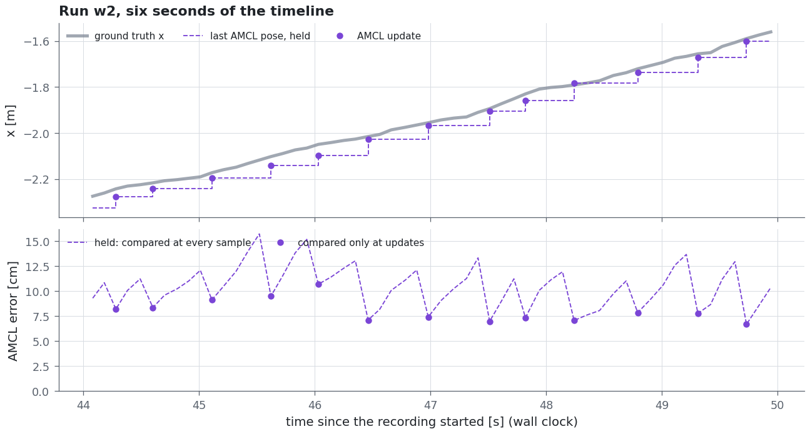
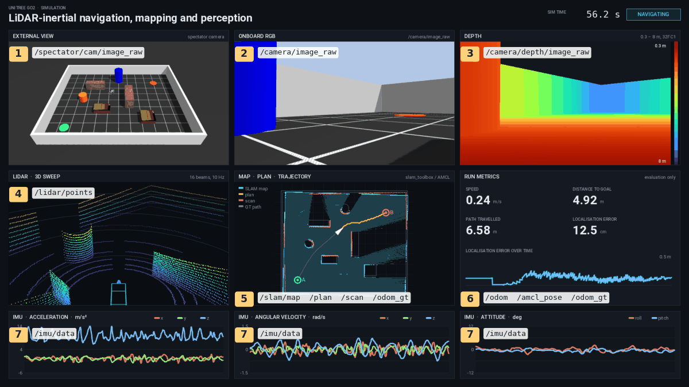

# 11. Record and visualise

The stack records to a rosbag and renders the dashboard from the bag. That keeps the simulator out of the rendering path, so
the same run can be re-rendered or re-analysed later.

```bash
scripts/run_mission.sh bags/run1      # fresh stack, record, drive A to B, stop (about 3 minutes)
```

It writes an MCAP bag with zstd chunk compression, about 8 MB/s. Topics are listed in `scripts/record_bag.sh`; the timestamps that
matter are in the message headers (simulation time).


*One recording feeds three offline tools; the topic count is from `scripts/record_bag.sh`.*

## Numbers

```bash
python3 src/go2_nav_sim/scripts/bag_metrics.py bags/run1 --json results/run1.json
```

Results of the three runs in the README are in `results/run_w1.json` to `run_w3.json`, and the Nav2 output in
`site/evidence/missions.txt`. The video shows run w2:

| Metric | Run w2 |
|---|---|
| Time to goal (Nav2 result) | 54.8 s |
| Path length | 11.6 m |
| Distance to B at the end of the recording | 0.21 m |
| Odometry ATE, SE(2)-aligned / anchored on the first pose | 1.1 cm / 2.5 cm |
| Odometry relative error over 1 m of travel | 1.6 % |
| AMCL error at its updates | 10.8 cm RMSE, 21.8 cm maximum |


*All three runs from `results/run_w1.json` to `run_w3.json`; run w3 ends 0.34 m from B, outside the 0.25 m tolerance drawn dashed.*

`bag_metrics.py` pairs every estimate with ground truth interpolated at the estimate's own timestamp. An earlier version held the
last AMCL pose between updates and compared it with a moving ground truth, which overstated AMCL's error by about 2 to 3 cm; an
independent review caught it. The end distance to B mostly reflects Nav2's `xy_goal_tolerance` of 0.25 m. In run w3 it is
0.34 m: Nav2 stopped when AMCL, then about 10 cm off, put the robot inside the tolerance. With odometry at 1–2 cm and AMCL at
8–19 cm, localisation is now the weakest link in this stack.


*Why the pairing matters. On the 10 Hz export of run w2 (time axis: wall-clock seconds since the bag started), the held pose gives 13.1 cm RMSE over the run against 12.0 cm at the updates; `bag_metrics.py`, which interpolates ground truth at each AMCL stamp, reports 10.8 cm.*

## Video

```bash
python3 src/go2_nav_sim/scripts/render_dashboard.py bags/run1 videos/run1.mp4 --cards --still videos/run1.png
```


*The dashboard still of run w2 (`docs/img/dashboard.png`), each panel labelled with the topics `render_dashboard.py` draws it from.*

Panels: the external camera, the onboard RGB image, depth in a turbo colour map with its range, a perspective view of the current
lidar sweep coloured by height, the map with the plan, the lidar scan and both trajectories, run metrics, and the IMU over the last
eight seconds. `--cards` adds a title card and a closing card with the run summary. The metrics panel uses ground truth and says
so.

<video controls muted playsinline src="../media/c09-ch11-dashboard.mp4"></video>

*Twelve seconds of the run w2 video (`media/go2_a2b_dashboard.mp4`, scaled to 1280 × 720) in the middle of the mission.*

Rendering the 76 s video takes about three minutes. Fonts are Roboto and DejaVu Sans Mono if present, with a fallback.

Next: [12. Troubleshooting](12-troubleshooting.md)
