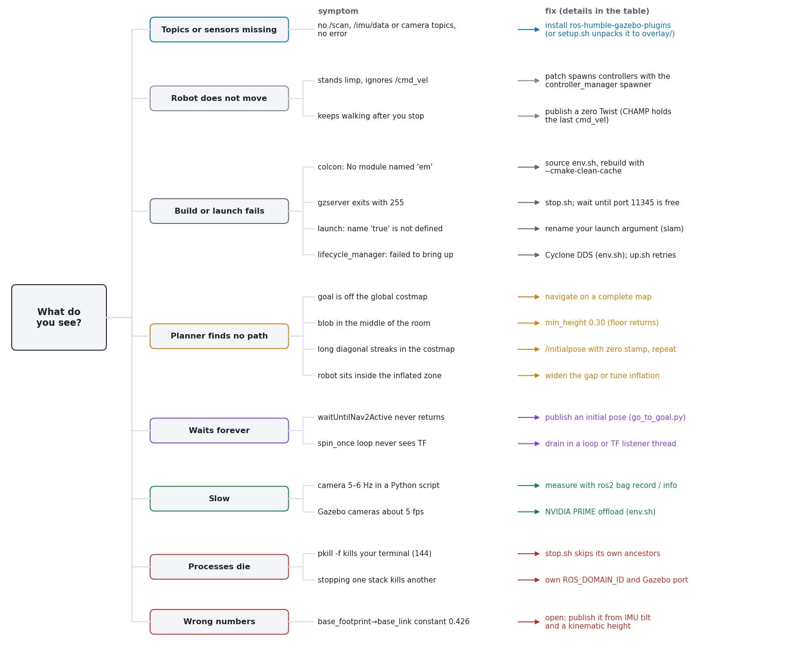
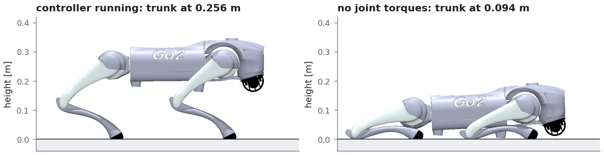

# 12. Troubleshooting

| | |
|---|---|
| Goal | Find the row for a failure you see, and reproduce two failures where data never arrives although nothing crashes, so you recognise them. |
| Time | 0.5 h for the two tasks; after that, a reference to come back to. |
| Before you start | The stack from [chapter 3](03-install-and-first-run.md) runs; RViz opens `go2.rviz`. |
| You will learn | how to read a symptom down to its cause; a QoS mismatch, which prints only a warning, and a message-type mismatch, which prints nothing. |

Each entry is a failure that happened while building this.


*The build, runtime and planner rows of the table as a decision tree: start from what you see, follow the group, read the fix. The last five rows (RViz on wall-clock time, Best Effort displays, Fixed Frame `map`, `TwistStamped`, Save vs Serialize) are only in the table.*

| Symptom | Cause | Fix |
|---|---|---|
| Gazebo shows sensors, but no `/scan`, `/imu/data` or camera topics, and there is no error | `libgazebo_ros_*` plugins not installed | install `ros-humble-gazebo-plugins`, or let `setup.sh` unpack it into `overlay/` |
| Robot stands limp, nothing moves on `/cmd_vel` | upstream launch calls `ros2 control`, which needs `ros2controlcli` | the patch switches to the `controller_manager` spawner |
| `colcon build` fails with `No module named 'em'` | a virtualenv is first on `PATH` | `source env.sh`, which strips it; rebuild with `--cmake-clean-cache` |
| `lifecycle_manager ... Failed to bring up all requested nodes`, `change_state ... client will not receive response` | Fast DDS lost a service reply on a busy machine | use Cyclone DDS (`env.sh` does); `scripts/up.sh` also retries the Nav2 step |
| `gzserver` exits with code 255 right after a restart | the previous `gzserver` still holds port 11345 | `scripts/stop.sh`, wait until `ss -ltn \| grep 11345` is empty |
| Camera topics at 5 to 6 Hz in a Python script | the script, not the sim: Python deserialises a 0.9 MB message slowly | measure with `ros2 bag record` and `ros2 bag info`, which counts messages in C++ |
| Planner: "goal is off the global costmap" | the map covers only what has been seen | navigate on a complete map, or add exploration |
| Planner fails at once; costmap shows a blob in the middle of the room | `base_footprint` sits 0.209 m below the real ground (constant TF), so a 0.12 m threshold is below the floor and every floor return is an obstacle | `min_height: 0.30` in `config/scan.yaml` and `lidar_odom.py` (about 0.09 m real) |
| `tf2_echo base_footprint base_link` shows a constant (0, 0, 0.426) while the robot walks | CHAMP's `base_to_footprint` estimator gets no foot contacts: nothing publishes `/foot_contacts` in Gazebo | open: publish the transform from IMU roll and pitch plus a kinematic base height ([chapter 9](09-state-estimation.md#failures-worth-knowing-about)) |
| Planner fails; robot sits inside the inflated zone | the plan went through a gap that the footprint fits but that is high inflation cost all the way across | widen the gap, or tune inflation and use a polygon footprint |
| Planner fails; costmap has long diagonal streaks; AMCL log says `Failed to transform initial pose in time` | the initial pose was dropped in a TF timing race, so `map` to `odom` is wrong | publish `/initialpose` with a zero stamp and repeat until `/amcl_pose` converges, as `go_to_goal.py` does |
| `waitUntilNav2Active` never returns | AMCL has no initial pose in Humble's commander | `go_to_goal.py` publishes one |
| `rclpy.spin_once` loop never sees TF or odometry | it runs one callback per call, and TF arrives hundreds of times per second | drain with a loop, or give the TF listener its own thread |
| `launch`: `name 'true' is not defined` | a launch argument named `slam` leaks into Nav2's own `slam` argument | name your argument differently |
| Robot keeps walking after you stop publishing | CHAMP holds the last `cmd_vel` | publish a zero Twist |
| `pkill -f` kills your own terminal (exit code 144) | the pattern appears in your shell's command line, and `pkill -f` matches it too | `scripts/stop.sh` now skips its own ancestors; with plain `pkill -f`, never type the pattern in the same command |
| Stopping one stack kills another one on the same machine | `pkill` by name ignores ROS domains | `scripts/stop.sh` only stops processes whose environment has the caller's `ROS_DOMAIN_ID`; give each stack its own domain and `GAZEBO_MASTER_URI` port |
| Gazebo cameras about 5 fps | rendering on an integrated GPU | `env.sh` enables NVIDIA PRIME offload when `nvidia-smi` exists |
| RViz draws the scan and the map, but the robot model and TF frames are missing or sit at the fixed-frame origin | RViz runs on wall-clock time (about 1.8·10⁹ s) and asks TF for transforms at that time; the sim stamps them with `/clock` (a few hundred seconds) | `rviz2 -d src/go2_nav_sim/rviz/go2.rviz --ros-args -p use_sim_time:=true`; same for any node that reads sensor data or TF |
| A LaserScan or PointCloud2 display stays empty; `ros2 topic echo --qos-reliability reliable /scan` prints one `incompatible QoS` warning and no messages | `pointcloud_to_laserscan` publishes `/scan` Best Effort; a Reliable subscriber does not match it and receives no data; the subscriber logs one warning and nothing fails | set the display's **Topic → Reliability Policy** to Best Effort (`go2.rviz` does); compare both ends with `ros2 topic info -v /scan` (Task 1) |
| Global Status red, robot not drawn, Fixed Frame `map` | nothing publishes `map` yet: no AMCL initial pose, slam_toolbox not started, or only map_server running | use `odom` as the fixed frame (`rviz2 ... -f odom`) until a localiser runs, then switch to `map` |
| Robot stands still although something publishes on `/cmd_vel`; no error anywhere | the publisher sends `geometry_msgs/msg/TwistStamped`; CHAMP and Humble's Nav2 use `Twist`, and publishers and subscribers of different types never connect | `ros2 topic list -t` shows two types on one topic (Task 2); publish `Twist`, or set the publisher's option (for `teleop_twist_keyboard`, `stamped` is false by default) |
| slam_toolbox cannot continue yesterday's map; or map_server cannot load the map file you have | **Save Map** / `map_saver_cli` writes `.pgm` + `.yaml` (for map_server and AMCL); **Serialize Map** writes `.posegraph` + `.data` (for slam_toolbox only); neither converts to the other | do both before you stop mapping ([chapter 10](10-mapping-and-navigation.md), 1.5) |

What "stands limp" looks like, reproduced in MuJoCo by setting every joint torque to zero. In Gazebo the cause was different (no
controller was spawned), but the robot ends up the same way.


*MuJoCo Go2 after 1.5 s: with a PD controller holding the home pose the trunk is at 0.256 m; with zero torques it settles at 0.094 m.*

<video controls muted playsinline src="../media/c09-ch12-limp.mp4"></video>

*MuJoCo, 5 s: the PD controller holds the Go2 up for 2 s, then all twelve torques drop to zero.*

## Task 1: Find a QoS mismatch

### 1.1 Subscribe to /scan with the wrong reliability

Objective: see a subscription that matches nothing, receives no data, and reports it with one warning.

```bash
ros2 topic info -v /scan | grep -E "Endpoint type|Reliability"
timeout 8 ros2 topic echo --qos-reliability reliable /scan --field header.stamp
timeout 8 ros2 topic echo --qos-reliability best_effort /scan --field header.stamp
```

The first command shows the publisher (`pointcloud_to_laserscan`) offering `BEST_EFFORT`. The Reliable echo receives no message.
It prints one warning and nothing else until `timeout` ends it after 8 s (exit code 124):

```
[WARN] [1795851052.736919779] [_ros2cli_882839]: New publisher discovered on topic '/scan', offering incompatible QoS. No messages will be received from it. Last incompatible policy: RELIABILITY
```

The Best Effort one prints at once:

```
sec: 25
nanosec: 344000000
---
```

Check: the Reliable echo printed the `incompatible QoS` warning and no stamp. You can say which end decides. A Reliable subscriber needs a Reliable publisher; a Best Effort subscriber takes both. RViz
displays are subscribers with a Reliability Policy setting, so the same rule applies to them.

## Task 2: Find a message-type mismatch

### 2.1 Publish TwistStamped on /cmd_vel

Objective: see a robot ignore a command with no error and no warning.

The publisher runs in the background, so `ros2 topic list` sees it while it is still publishing:

```bash
ros2 topic echo --once /odom_gt --field pose.pose.position
timeout 8 ros2 topic pub -r 10 /cmd_vel geometry_msgs/msg/TwistStamped "{twist: {linear: {x: 0.2}}}" > /dev/null &
sleep 3; ros2 topic list -t | grep cmd_vel; wait
ros2 topic echo --once /odom_gt --field pose.pose.position
```

```
/cmd_vel [geometry_msgs/msg/Twist, geometry_msgs/msg/TwistStamped]
/cmd_vel_nav [geometry_msgs/msg/Twist]
/cmd_vel_teleop [geometry_msgs/msg/Twist]
```

The robot moved 0.005 m in the 8 s: x went from 0.045 to 0.050 m, which is the stepping in place, not 1.6 m of walking. Neither
end prints a warning: unlike the QoS case, a type mismatch is silent.

Check: `ros2 topic list -t` shows two types for `/cmd_vel`, and x changed by millimetres. Publish a zero `Twist` afterwards; CHAMP holds the last command it
received.

## Exercise

A learner reports: "RViz shows the map and the costmap, the planner draws a path, but the LaserScan display is empty and the robot
walks fine." Which row applies, and which two commands confirm it?

Answer: the Best Effort row. The scan reaches Nav2 (the costmap updates, the robot avoids obstacles), so the publisher works and
only RViz's subscription fails to match. `ros2 topic info -v /scan` shows the publisher's Reliability (`BEST_EFFORT`) and RViz's
subscription (`RELIABLE`) side by side; `ros2 topic echo --qos-reliability best_effort /scan` prints messages, which proves the
data is there.

## Further reading

- Southampton robot guides, Go2 troubleshooting (QoS, `CYCLONEDDS_URI`, daemon restarts on the real robot): https://robots.ecs.soton.ac.uk/go2/troubleshooting
- Articulated Robotics tutorials, including the common gotchas: https://articulatedrobotics.xyz/tutorials/

Next: [13. Toward the real Go2](13-toward-the-real-go2.md)
