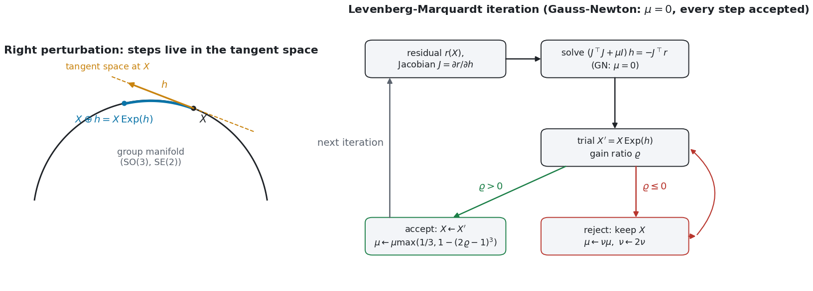
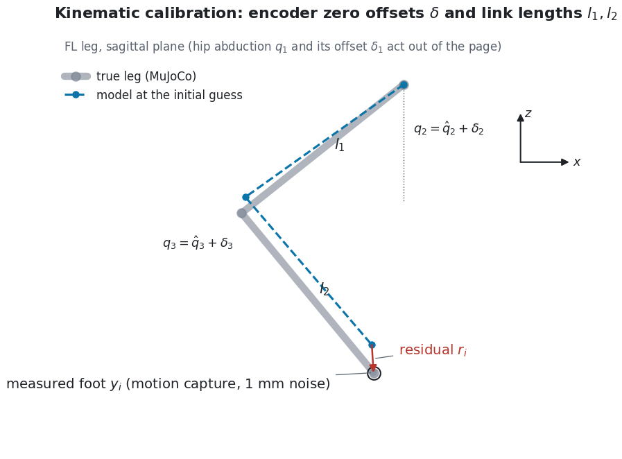
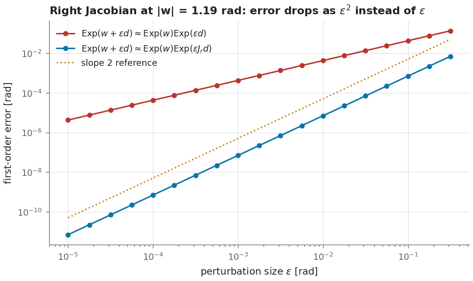
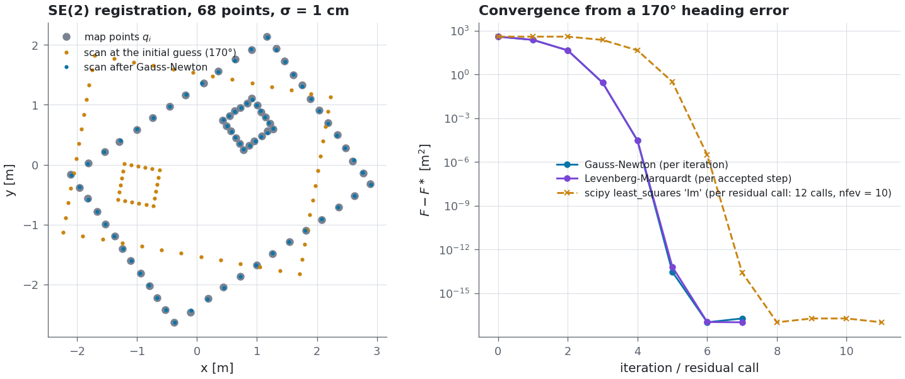
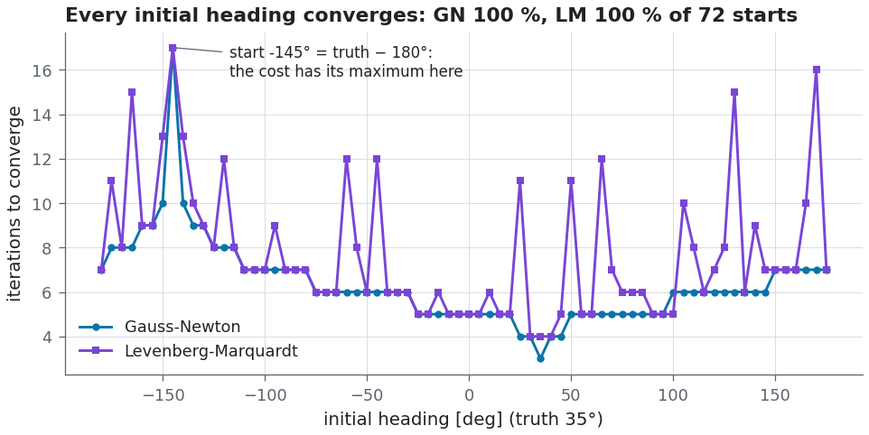
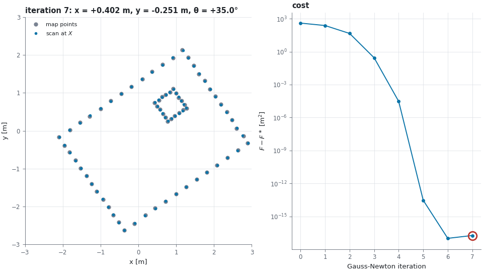
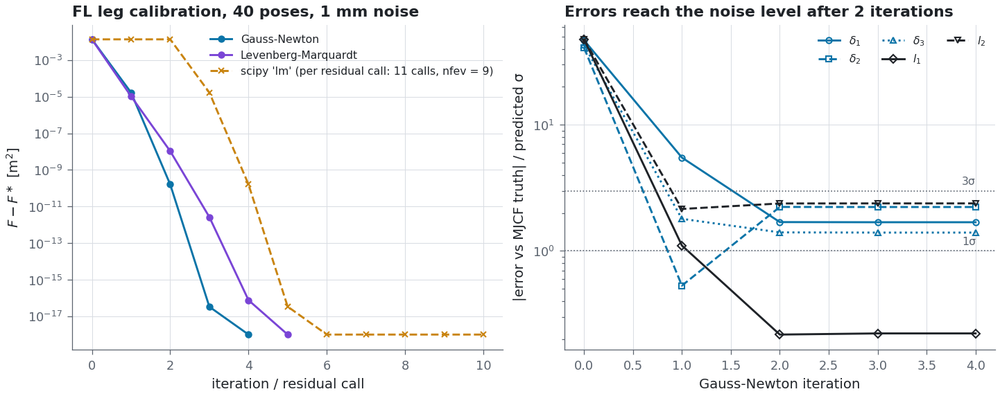
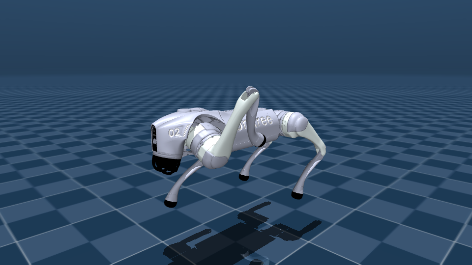
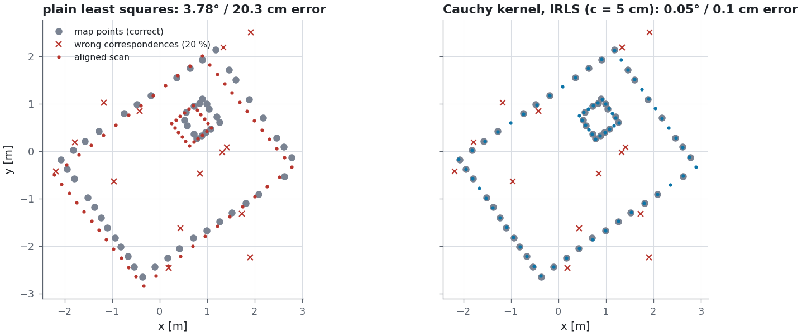
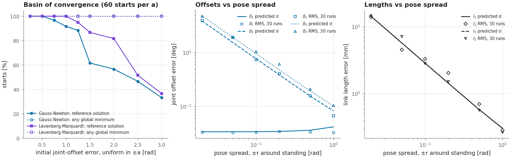

# Module 00 · Mathematical foundations: rotations, Lie-group perturbations and nonlinear least squares

## Objective

Derive and implement the rotation, transform and optimisation tools the rest of the stack uses, then check each one against an
established library. The module has three levels:

| Level | Content | Applied on the Go2 |
|---|---|---|
| Fundamental | Rodrigues' formula, quaternions, roll-pitch-yaw angles, SE(2) and SE(3) composition and inverse | camera optical frame |
| Intermediate | SO(3) exponential and logarithm, Euler-angle rates from the body gyro | yaw lost per turn when only the gyro z axis is integrated; height error from an uncorrected tilt |
| Advanced | right and left Jacobians of SO(3); Gauss-Newton and Levenberg-Marquardt written from scratch, on a manifold | gyro bias during a turn; SE(2) scan registration; kinematic calibration of the FL leg (encoder zero offsets and link lengths) |

After this module a reader can write the update $X \leftarrow X\,\mathrm{Exp}(h)$ for a state on SO(3) or SE(2), derive the Jacobian of
a residual with respect to $h$, solve the problem with Gauss-Newton or Levenberg-Marquardt, and tell from the covariance whether the
data determine the parameters at all.



## Prerequisites

Linear algebra: matrix products, orthogonal matrices, the cross product, solving a symmetric positive definite system. Calculus:
Taylor series, the chain rule. Python with NumPy; scipy, Pinocchio and MuJoCo are used only for checking. Module
[04 · Kinematics](../m04_kinematics/README.md) covers the leg chain in detail; the calibration here re-derives only the part it needs.

## Theory

Notation: $[a]$ is the skew matrix with $[a]v = a \times v$; $c_\alpha = \cos\alpha$, $s_\alpha = \sin\alpha$. Frames are
right-handed. Roll-pitch-yaw $(\phi, \theta, \psi)$ means $R = R_z(\psi) R_y(\theta) R_x(\phi)$, the URDF and Pinocchio convention.
$\mathrm{Exp}$ maps a rotation vector to a matrix and $\mathrm{Log}$ maps back.

### Fundamental level

#### Rodrigues' formula

Rotate $v$ by $\theta$ about the unit axis $a$. Split $v$ into the part along the axis, which does not move, and the part
perpendicular to it, which turns by $\theta$ in the plane spanned by $v_\perp$ and $a \times v$:

$$v = v_\parallel + v_\perp,\qquad v_\parallel = (a \cdot v)\,a,\qquad v' = v_\parallel + \cos\theta\, v_\perp + \sin\theta\,(a \times v).$$

With $[a]v = a \times v$ and $[a]^2 v = a (a\cdot v) - v = -v_\perp$, substitute $v_\perp = -[a]^2 v$ and $v_\parallel = v + [a]^2 v$:

$$v' = v + [a]^2 v - \cos\theta\,[a]^2 v + \sin\theta\,[a] v \quad\Rightarrow\quad R = I + \sin\theta\,[a] + (1-\cos\theta)\,[a]^2 .$$

#### Quaternion to matrix and back

A unit quaternion $q = (w, \mathbf v)$ with $w = \cos\frac\theta2$, $\mathbf v = \sin\frac\theta2\, a$ encodes the same rotation.
Use $\sin\theta = 2\sin\frac\theta2\cos\frac\theta2$ and $1-\cos\theta = 2\sin^2\frac\theta2$ in Rodrigues' formula:

$$\sin\theta\,[a] = 2w[\mathbf v],\qquad (1-\cos\theta)[a]^2 = 2[\mathbf v]^2 \quad\Rightarrow\quad R = I + 2w[\mathbf v] + 2[\mathbf v]^2 .$$

Expanding with $[\mathbf v]^2 = \mathbf v\mathbf v^\top - \lVert\mathbf v\rVert^2 I$ gives the familiar entries, for example
$R_{00} = 1 - 2(y^2+z^2)$ and $R_{01} = 2(xy - wz)$. For the inverse, read off the trace, the skew part and the symmetric part:

$$\operatorname{tr} R = 3 - 4\lVert\mathbf v\rVert^2 = 4w^2 - 1,\qquad R - R^\top = 4w[\mathbf v],\qquad R_{ii} = 2v_i^2 + 2w^2 - 1,\qquad R_{ij} + R_{ji} = 4 v_i v_j .$$

So $4w^2 = 1 + \operatorname{tr}R$ and $4v_i^2 = 1 + 2R_{ii} - \operatorname{tr}R$. Shepperd's method takes the largest of these four,
which is at least 1 since they sum to 4, and gets the other three components by dividing a skew or symmetric entry by it.
Dividing only by $w$ fails at $\theta = \pi$, where $w = 0$.

#### Roll, pitch, yaw from the matrix

Multiplying out $R_z(\psi)R_y(\theta)R_x(\phi)$:

$$R = \begin{bmatrix} c_\psi c_\theta & c_\psi s_\theta s_\phi - s_\psi c_\phi & c_\psi s_\theta c_\phi + s_\psi s_\phi \\
s_\psi c_\theta & s_\psi s_\theta s_\phi + c_\psi c_\phi & s_\psi s_\theta c_\phi - c_\psi s_\phi \\
-s_\theta & c_\theta s_\phi & c_\theta c_\phi \end{bmatrix}.$$

The bottom row and first column give the angles when $c_\theta \neq 0$:

$$\theta = \operatorname{atan2}\!\big(-R_{20},\ \sqrt{R_{00}^2 + R_{10}^2}\big),\qquad \phi = \operatorname{atan2}(R_{21}, R_{22}),\qquad \psi = \operatorname{atan2}(R_{10}, R_{00}).$$

At $\theta = \pm\pi/2$ (gimbal lock) the first column and bottom row reduce to $(0, 0, \mp 1)$ and the remaining entries depend on one
angle combination only. For $\theta = +\pi/2$: $R_{01} = \sin(\phi-\psi)$, $R_{11} = \cos(\phi-\psi)$. For $\theta = -\pi/2$:
$R_{01} = -\sin(\phi+\psi)$, $R_{11} = \cos(\phi+\psi)$. Only $\phi \mp \psi$ is observable; the code sets $\psi = 0$ and
returns $\phi = \operatorname{atan2}(-R_{20}R_{01},\ R_{11})$, which covers both signs.

#### SE(2) and SE(3)

A rigid transform $T = \begin{bmatrix} R & t \\ 0 & 1\end{bmatrix}$ maps $p \mapsto Rp + t$. Composition and inverse follow from
applying the maps in turn and solving $p' = Rp + t$ for $p$:

$$T_a T_b = \begin{bmatrix} R_a R_b & R_a t_b + t_a \\ 0 & 1 \end{bmatrix},\qquad T^{-1} = \begin{bmatrix} R^\top & -R^\top t \\ 0 & 1\end{bmatrix}.$$

In SE(2), with poses $(x, y, \theta)$ and $R(\theta)$ the planar rotation, this is
$(x_a + c_a x_b - s_a y_b,\ y_a + s_a x_b + c_a y_b,\ \theta_a + \theta_b)$ and
$(x,y,\theta)^{-1} = (-c\,x - s\,y,\ s\,x - c\,y,\ -\theta)$.

#### Camera optical frame

The camera link frame is x forward, y left, z up; the optical frame used by image projection is z forward, x right, y down.
A URDF joint with `rpy="-pi/2 0 -pi/2"` gives $R = R_z(-\pi/2)\,R_y(0)\,R_x(-\pi/2)$:

$$R_x(-\tfrac\pi2) = \begin{bmatrix} 1&0&0\\0&0&1\\0&-1&0\end{bmatrix},\quad
R_z(-\tfrac\pi2) = \begin{bmatrix} 0&1&0\\-1&0&0\\0&0&1\end{bmatrix},\quad
R = R_z R_x = \begin{bmatrix} 0&0&1\\-1&0&0\\0&-1&0\end{bmatrix}.$$

The columns of $R$ are the optical axes written in the link frame: $x_\text{optical} = -y_\text{link}$,
$y_\text{optical} = -z_\text{link}$, $z_\text{optical} = x_\text{link}$.

### Intermediate level

#### Exponential and logarithm of SO(3)

For a rotation vector $\omega = \theta a$, $\exp[\omega] = \sum_k [\omega]^k / k!$. Because $[a]^3 = -[a]$, the odd powers collapse
onto $[a]$ and the even ones onto $[a]^2$:

$$\exp[\omega] = I + \Big(\theta - \tfrac{\theta^3}{3!} + \dots\Big)[a] + \Big(\tfrac{\theta^2}{2!} - \tfrac{\theta^4}{4!} + \dots\Big)[a]^2 = I + \sin\theta\,[a] + (1-\cos\theta)[a]^2,$$

which is Rodrigues' formula again. For the logarithm take the trace and the skew part of that expression,
$\operatorname{tr}R = 1 + 2\cos\theta$ and $\operatorname{vee}(R - R^\top) = 2\sin\theta\, a$, so

$$\theta = \operatorname{atan2}\big(\lVert \operatorname{vee}(R-R^\top)\rVert,\ \operatorname{tr}R - 1\big),\qquad \omega = \frac{\theta}{2\sin\theta}\operatorname{vee}(R - R^\top).$$

Near $\theta = \pi$ the skew part vanishes and the division loses digits. The symmetric part still holds the axis,
$\tfrac12(R + R^\top) = \cos\theta\, I + (1-\cos\theta)\, a a^\top$, so for $\theta > \pi/2$ the code takes the largest column of
$a a^\top = (\operatorname{sym}R - \cos\theta I)/(1-\cos\theta)$ and the sign from the skew part.

#### Yaw rate from the body gyro

The IMU measures $\omega$ in the body frame, $[\omega] = R^\top \dot R$. Differentiate $R = R_zR_yR_x$ and use
$R_z^\top\dot R_z = \dot\psi[e_z]$ (likewise for $y$, $x$) and $Q^\top[u]Q = [Q^\top u]$:

$$\omega = \dot\psi\, R_x^\top R_y^\top e_z + \dot\theta\, R_x^\top e_y + \dot\phi\, e_x
\quad\Rightarrow\quad \omega_x = \dot\phi - s_\theta\dot\psi,\quad \omega_y = c_\phi\dot\theta + s_\phi c_\theta\dot\psi,\quad \omega_z = -s_\phi\dot\theta + c_\phi c_\theta\dot\psi .$$

Multiply the second by $s_\phi$, the third by $c_\phi$ and add: the $\dot\theta$ terms cancel, so

$$\dot\psi = \frac{s_\phi\,\omega_y + c_\phi\,\omega_z}{c_\theta},\qquad \dot\theta = c_\phi\omega_y - s_\phi\omega_z,\qquad \dot\phi = \omega_x + s_\theta\dot\psi .$$

Integrating the gyro z axis alone as yaw makes the error rate $\dot\psi - \omega_z = (1 - c_\phi c_\theta)\dot\psi + s_\phi\dot\theta$.
During a turn at constant tilt the second term is zero and the yaw estimate is short by the fraction $1 - c_\phi c_\theta$.
Walking at 0.2 m/s in simulation the trunk rolled between −2.1° and 3.6° and pitched between −2.0° and 1.9° (tutorial, walking
chapter, "How the trunk moves"). At 3.6° roll, $1 - \cos 3.6° = 1.97\times10^{-3}$: 0.710° of yaw lost per full turn; with 2.0°
pitch added, 0.929° per turn.

#### Height error from an uncorrected tilt

A point at range $r$ along the sensor's forward axis, with the trunk pitched by $\theta$ but the transform assuming it level,
lands at height $r\sin\theta$ off its true value: $\Delta z = 3\ \text{m} \times \sin 3.6° = 0.1884\ \text{m}$.

### Advanced level

#### Perturbations on a Lie group

An estimator never adds a correction to a rotation matrix; the sum leaves SO(3). It composes a small rotation instead. With the
correction $h \in \mathbb R^3$ expressed in the body frame (the right perturbation):

$$R \oplus h = R\,\mathrm{Exp}(h),\qquad h = \mathrm{Log}(R_0^\top R) \text{ is the difference } R \ominus R_0 .$$

A residual $r(R)$ then has the Jacobian $J = \partial r(R\,\mathrm{Exp}(h))/\partial h$ at $h = 0$, a plain $m\times 3$ matrix, and
every solver below works on $h$. SE(2) uses the same construction with $h = (\rho_x, \rho_y, \varphi)$ and
$\mathrm{Exp}(h) = (V(\varphi)\rho,\ \varphi)$, where $V(\varphi) = \frac1\varphi\begin{bmatrix} s_\varphi & -(1-c_\varphi) \\ 1-c_\varphi & s_\varphi\end{bmatrix}$
comes from integrating the translation while the frame turns at constant rate.

#### Right and left Jacobians of SO(3)

Adding $\delta$ to a rotation vector $w$ is not the same as composing $\mathrm{Exp}(\delta)$. To first order the two differ by a
linear map, the right Jacobian $J_r$, or the left Jacobian $J_l$ if the correction is applied on the left:

$$\mathrm{Exp}(w + \delta) \approx \mathrm{Exp}(w)\,\mathrm{Exp}(J_r(w)\,\delta) \approx \mathrm{Exp}(J_l(w)\,\delta)\,\mathrm{Exp}(w).$$

Derivation of $J_r$. For matrices $A$, $B$ the derivative of the exponential is
$\frac{d}{d\epsilon}e^{A+\epsilon B}\big|_0 = \int_0^1 e^{sA} B e^{(1-s)A} ds$. Multiply on the left by $e^{-A}$ and substitute $u = 1-s$:

$$e^{-A}\tfrac{d}{d\epsilon}e^{A+\epsilon B} = \int_0^1 e^{-uA} B\, e^{uA}\, du .$$

With $A = [w]$, $B = [\delta]$ and $Q^\top[\delta]Q = [Q^\top\delta]$, the integrand is $[\mathrm{Exp}(-uw)\,\delta]$, so

$$J_r(w) = \int_0^1 \mathrm{Exp}(-u w)\, du = \int_0^1 \big(I - \sin(u\theta)[a] + (1-\cos(u\theta))[a]^2\big)du
= I - \frac{1-\cos\theta}{\theta}[a] + \Big(1 - \frac{\sin\theta}{\theta}\Big)[a]^2 ,$$

with $\theta = \lVert w\rVert$, $a = w/\theta$. In terms of $[w] = \theta[a]$:

$$J_r(w) = I - \frac{1-\cos\theta}{\theta^2}[w] + \frac{\theta - \sin\theta}{\theta^3}[w]^2,\qquad J_l(w) = J_r(-w) = J_r(w)^\top .$$

The two are related through the rotation itself. From $\mathrm{Exp}(J_l\delta)\,R = R\,\mathrm{Exp}(J_r\delta)$ and
$R\,\mathrm{Exp}(v)R^\top = \mathrm{Exp}(Rv)$ follows $J_l(w) = R\,J_r(w)$ with $R = \mathrm{Exp}(w)$. Both leave the axis unchanged,
$J_r(w)\,w = w$, because $[w]w = 0$.

The logarithm needs the inverse: $\mathrm{Log}(\mathrm{Exp}(w)\,\mathrm{Exp}(\delta)) \approx w + J_r^{-1}(w)\,\delta$. Write
$J_r = I + \alpha[a] + \beta[a]^2$ and look for $J_r^{-1} = I + \gamma[a] + \eta[a]^2$. Multiplying out with $[a]^3 = -[a]$,
$[a]^4 = -[a]^2$ and setting the $[a]$ and $[a]^2$ coefficients to zero gives two scalar equations whose solution is
$\gamma = \theta/2$, $\eta = 1 - \frac\theta2\frac{1+\cos\theta}{\sin\theta}$. Since $\frac{1+\cos\theta}{\sin\theta} = \cot\frac\theta2$:

$$J_r^{-1}(w) = I + \tfrac12[w] + \Big(\frac{1}{\theta^2} - \frac{\cot(\theta/2)}{2\theta}\Big)[w]^2,\qquad J_l^{-1}(w) = J_r^{-1}(-w).$$

The $\cot(\theta/2)$ form stays finite at $\theta = \pi$, where $(1+\cos\theta)/\sin\theta$ is 0/0. Below $\theta = 10^{-5}$ rad the
code switches to the series $J_r \approx I - \frac12[w] + \frac16[w]^2$ and $J_r^{-1} \approx I + \frac12[w] + \frac1{12}[w]^2$ (the full
series are $\sum_k (-[w])^k/(k+1)!$ and $\sum_k B_k(-[w])^k/k!$ with the Bernoulli numbers $B_k$), and writes $1 - \cos\theta$ as
$2\sin^2(\theta/2)$ so that the closed form does not cancel just above the switch.

Worked example on the Go2. The trunk yaws 90° at 1 rad/s ($T = \pi/2$ s) and the gyro x axis has a bias $b = 0.01$ rad/s. The
integrated orientation is $\mathrm{Exp}((\omega + b)T)$ instead of $\mathrm{Exp}(\omega T)$, so the error in the final body frame is
$J_r(\omega T)\,bT$. For $w = \theta e_z$: $J_r e_x = (\frac{\sin\theta}{\theta},\ -\frac{1-\cos\theta}{\theta},\ 0)$, which at
$\theta = \pi/2$ is $(2/\pi, -2/\pi, 0)$. The error is $(0.0100, -0.0100, 0)$ rad, 0.810° split equally between roll and pitch,
instead of the 0.900° about x alone that $\mathrm{Exp}(\omega T)\mathrm{Exp}(bT)$ predicts: the bias axis turns with the body during
the yaw. The exact value from `validate.py` (`bias_turn_example`) is (0.0100000, -0.0100000, 0.0000285) rad.

#### Gauss-Newton

Nonlinear least squares minimises $F(x) = \frac12\lVert r(x)\rVert^2$ over $m$ residuals and $n$ parameters. Linearise the
residual around the current estimate, $r(x \oplus h) \approx r + Jh$, and minimise the model
$L(h) = \frac12\lVert r + Jh\rVert^2$. Setting $\partial L/\partial h = J^\top(r + Jh) = 0$ gives the normal equations

$$J^\top J\, h = -J^\top r = -g,\qquad x \leftarrow x \oplus h .$$

$g = J^\top r$ is the gradient of $F$. The Hessian of $F$ is $J^\top J + \sum_i r_i \nabla^2 r_i$; Gauss-Newton keeps only the first
term. When the residuals at the optimum are zero (or small and nearly linear), the dropped term vanishes and convergence is
quadratic, the number of correct digits roughly doubling per iteration. There is no step control: a step can overshoot, and
$J^\top J$ must be invertible.

#### Levenberg-Marquardt

LM adds a damping term, $(J^\top J + \mu I)\,h = -g$. For $\mu \to 0$ this is the Gauss-Newton step; for large $\mu$ it is
$h \approx -g/\mu$, a short gradient-descent step. The damping is adapted by comparing the actual decrease with the decrease the
linear model predicts. Using $J^\top J h = -g - \mu h$:

$$L(0) - L(h) = -h^\top g - \tfrac12 h^\top J^\top J h = -h^\top g + \tfrac12 h^\top (g + \mu h) = \tfrac12 h^\top(\mu h - g),\qquad
\varrho = \frac{F(x) - F(x\oplus h)}{L(0) - L(h)} .$$

If $\varrho > 0$ the step is accepted and $\mu \leftarrow \mu\max(\frac13,\ 1-(2\varrho-1)^3)$, $\nu \leftarrow 2$; otherwise it is
rejected and $\mu \leftarrow \nu\mu$, $\nu \leftarrow 2\nu$. The start value is $\mu_0 = 10^{-3}\max_i (J^\top J)_{ii}$. This is the
update of Madsen, Nielsen and Tingleff (2004, ch. 3). Iterations stop when $\lVert g\rVert_\infty \le 10^{-10}$ or the step is
below $10^{-12}$ relative to $\lVert x\rVert$.

#### SE(2) point-set registration

A scan gives points $p_i$ in the sensor frame, matched to map points $q_i$. Find the pose $T = (R, t)$ minimising
$\sum_i\lVert R p_i + t - q_i\rVert^2$. For the right perturbation $T\,\mathrm{Exp}(h)$, to first order
$R\,\mathrm{Exp}(\varphi) \approx R(I + \varphi J_2)$ with $J_2 = \begin{bmatrix}0&-1\\1&0\end{bmatrix}$ and $V(\varphi)\rho \approx \rho$, so

$$r_i(T\,\mathrm{Exp}(h)) \approx R p_i + t - q_i + R\rho + \varphi R J_2 p_i \quad\Rightarrow\quad J_i = \begin{bmatrix} R & R J_2 p_i \end{bmatrix} \in \mathbb R^{2\times 3}.$$

This problem also has a closed form (Arun et al. 1987; Umeyama 1991, here in the plane). With centred points
$a_i = p_i - \bar p$, $b_i = q_i - \bar q$, the optimal translation is $t = \bar q - R\bar p$ and the rotation maximises
$\sum_i b_i^\top R a_i = \cos\theta \sum_i a_i\cdot b_i + \sin\theta\sum_i a_i \times b_i$, so

$$\theta^\ast = \operatorname{atan2}\Big(\sum_i a_i\times b_i,\ \sum_i a_i\cdot b_i\Big),\qquad F(\theta) = \text{const} - A\cos(\theta - \theta^\ast).$$

The second expression explains the slowest start (Failure analysis). At $\theta = \theta^\ast + \pi$ the gradient is zero and $F$ has its
maximum. With $B = \sum_i \lVert a_i\rVert^2 \approx A$ for low noise, the Gauss-Newton step in $\theta$ at $\theta = \theta^\ast + \pi + \epsilon$
is $h = -F'(\theta)/B = A\sin\epsilon/B \approx \epsilon$, so the distance from the maximum doubles each iteration until the
quadratic phase takes over (my derivation; the iterates below confirm the doubling).

Wrong correspondences break the Gaussian assumption. The Cauchy kernel $\rho(s) = \frac{c^2}{2}\log(1 + s^2/c^2)$ replaces
$\frac12 s^2$; iteratively reweighted least squares solves it with Gauss-Newton on residuals scaled by $\sqrt{w_i}$,
$w_i = \rho'(s_i)/s_i = 1/(1 + s_i^2/c^2)$, the weights recomputed at every iterate.

#### Kinematic calibration of the FL leg

The encoders report $\hat q$; the true joint angles are $q = \hat q + \delta$ with unknown zero offsets $\delta$. The thigh and calf
lengths $l_1$, $l_2$ are also unknown. A motion-capture marker measures the foot centre $y_i$ in the base frame at $N$ poses. The
model, with the hip origin $o_1$, the lateral offset $d_y = 0.0955$ m and the foot's forward offset $f_x = -0.002$ m read from the MJCF:

$$f(\hat q; \delta, l_1, l_2) = o_1 + R_x(\hat q_1 + \delta_1)\Big[(0, d_y, 0)^\top + R_y(\hat q_2+\delta_2)\big((0, 0, -l_1)^\top + R_y(\hat q_3 + \delta_3)(f_x, 0, -l_2)^\top\big)\Big],
\qquad r_i = f(\hat q_i) - y_i .$$



The Jacobian needs no differentiation by hand. A zero offset acts exactly like a joint angle, so its column is the geometric
Jacobian column $z_k \times (f - o_k)$, with $z_k$ the joint axis and $o_k$ the joint origin in the base frame. A length enters
linearly along its link, so its column is the link's unit vector: $-R_xR_y(\hat q_2+\delta_2)\,e_z$ for $l_1$ and
$-R_xR_y(\hat q_2+\delta_2)R_y(\hat q_3+\delta_3)\,e_z$ for $l_2$.

How well the data determine the parameters follows from the same Jacobian. With independent noise of standard deviation $\sigma$
on every coordinate, the linearised estimate has covariance

$$\Sigma = \sigma^2 (J^\top J)^{-1},\qquad \text{NEES} = e^\top \Sigma^{-1} e \sim \chi^2_5,\quad \mathbb E[\text{NEES}] = 5 ,$$

for the estimation error $e$. If the poses barely move a joint, the columns of $J$ for that joint's offset and the neighbouring
length become nearly parallel, $J^\top J$ becomes ill-conditioned and $\Sigma$ grows; damping in LM makes the step finite but does not
add information.

The parameterisation has a second global minimum. Turning the thigh offset by $\pi$ and negating $l_1$ gives the same knee position,
$R_y(a+\pi)(0,0,l_1)^\top = R_y(a)(0,0,-l_1)^\top$. The calf frame has then also turned by $\pi$, and with $l_2$ negated the calf
vector becomes $R_y(\beta')\,R_y(\pi)(f_x, 0, l_2)^\top = R_y(\beta')(-f_x, 0, -l_2)^\top$, where $\beta' = \hat q_3 + \delta_3'$.
It equals the original $R_y(\beta)(f_x, 0, -l_2)^\top$ when $R_y(\beta' - \beta)$ maps $(-f_x, -l_2)$ onto $(f_x, -l_2)$ in the
x-z plane, a small angle:

$$\delta_3' - \delta_3 = -2\arctan(f_x / l_2) = +1.08° \quad (f_x = -0.002\ \text{m},\ l_2 = 0.213\ \text{m}).$$

The worked end state in Failure analysis shows this shift, $\delta_3$ = 3.87° to 4.94°. Every pose fits identically, so the
solvers cannot prefer one branch; only the constraint $l_1, l_2 > 0$ can.

## Implementation

| File | Function | Equation |
|---|---|---|
| `rotations.py` | `skew`, `Rx/Ry/Rz`, `exp_so3`, `log_so3`, `R_to_quat` (Shepperd), `rpy_to_R`, `R_to_rpy` (gimbal-lock branch), `rpy_rates`, `se2_compose`, `se2_inverse`, `se3`, `se3_inverse`, `R_LINK_OPTICAL` | fundamental and intermediate sections. Rodrigues and quaternion to matrix are `axis_angle_R` and `quat_to_R` in `../common.py` |
| `lie.py` | `jr_so3`, `jl_so3`, `jr_inv_so3`, `jl_inv_so3` | right/left Jacobians and inverses, series below $10^{-5}$ rad |
| `lie.py` | `se2_exp`, `se2_log`, `se2_plus` | SE(2) Exp/Log with $V(\varphi)$, the right retraction $T\,\mathrm{Exp}(h)$ |
| `optim.py` | `gauss_newton`, `levenberg_marquardt` | normal equations; damped step, gain ratio and Nielsen's update. Both take `fun(x) -> (r, J)` and `plus(x, h)`, so one implementation serves vectors and SE(2) |
| `optim.py` | `registration_problem`, `registration_closed_form`, `cauchy_weights` | $J_i = [R,\ RJ_2p_i]$; 2-D Procrustes; IRLS weights |
| `optim.py` | `leg_fk`, `calibration_problem` | calibration model and its analytic Jacobian, vectorised over poses |
| `validate.py` | experiment, figures, videos, `ACCEPT` thresholds | |
| `test_rotations.py`, `test_lie.py`, `test_optim.py` | 31 regression tests | assert the `ACCEPT` thresholds through `thr(...)` / `ACCEPT[...]`, with three exceptions: the two missed Pinocchio rows are asserted only above 0.01 rad, where they hold (Failure analysis); the missed iteration row is asserted as "−145° is the only start over 10 iterations" on the same 5° grid; the MP4 size is checked by `validate.py` only. The five calibration Monte Carlo and basin rows rerun `validate.calibration()` itself, same seeds and sample sizes (about 5 s) |

Design choices:

- Gauss-Newton solves the normal equations with `np.linalg.solve` and has no line search, so its failure modes stay visible.
  LM uses identity damping, not Marquardt's $\mu\,\mathrm{diag}(J^\top J)$; the calibration mixes radians and metres, and the
  measured iteration counts below show identity damping was enough here.
- Nothing in `lie.py` or `optim.py` calls scipy, Pinocchio or MuJoCo. MuJoCo appears only in `validate.py`, as the "motion capture"
  (`mj_kinematics`, then the foot geom position) and as the source of the true link lengths.
- The solvers record every accepted iterate (`xs`, `cost`), which the convergence plots and the registration video use.

## Experiment

```bash
DISPLAY=:1 .venv-modules/bin/python modules/m00_math/validate.py    # 161 s on this machine (load average ~60 on 32 cores)
.venv-modules/bin/python -m pytest -q modules/m00_math
```

| Part | Inputs | Seed |
|---|---|---|
| rotations vs scipy and Pinocchio | 100 000 rotations uniform on SO(3), scipy `Rotation.random` | 0 |
| SO(3) Jacobians vs finite differences and Pinocchio | 20 000 rotation vectors, direction uniform, $\lVert w\rVert$ uniform in $[0, \pi - 10^{-3}]$; central differences, step $10^{-6}$ | 1 |
| small-angle diagnostic | 2 000 rotation vectors, $\lVert w\rVert$ log-spaced in $[10^{-4}, 10^{-2}]$, against the 11-term Taylor series | 1 |
| SE(2) registration | 68 points on the walls of a 4 m × 3 m room and a 0.6 m box; true pose $(0.4\ \text{m}, -0.25\ \text{m}, 35°)$; noise σ = 1 cm per coordinate; initial guess at the origin with heading 170° and, for the basin, every heading on a 5° grid | 2 |
| registration with outliers | same scene, 20 % of the map points replaced by uniform points in $[-2.5, 2.5]^2$ m; Cauchy $c = 5$ cm | 3 |
| leg calibration | 40 poses uniform over the FL joint limits; true offsets $\delta = (2°, -3°, 4°)$; true lengths 0.213 m (MJCF); motion-capture noise σ = 1 mm per coordinate; initial guess $\delta = 0$, $l_1 = l_2 = 0.20$ m | 4 |
| calibration Monte Carlo | the same 40 poses, 200 new noise draws, Gauss-Newton from the initial guess | 4 |
| calibration basin | 60 starts per offset magnitude $a$: offsets uniform in $\pm a$ around the truth, lengths ±3 cm | 4 |
| calibration excitation | 40 poses within $\pm r$ of the standing pose $(0, 0.9, -1.8)$ rad, clipped to the limits, 30 noise draws each | 5 |

scipy `least_squares(method='lm')` (MINPACK) gets the same residuals and analytic Jacobians with `xtol = ftol = gtol = 1e-15`. For
registration it works on the plain vector $(x, y, \theta)$, so it gets the Jacobian with respect to that vector.

## Validation

### Fundamental and intermediate levels

| Check | Measured max error | Acceptance | `results.json` key |
|---|---|---|---|
| `quat_to_R` vs scipy | 6.7e-16 | < 1e-14 | `max_error.quat_to_R_vs_scipy` |
| `R_to_quat` vs scipy (sign fixed to w ≥ 0) | 1.7e-16 | < 1e-14 | `max_error.R_to_quat_vs_scipy` |
| `rpy_to_R` vs Pinocchio `rpy.rpyToMatrix` | 1.2e-15 | < 1e-14 | `max_error.rpy_to_R_vs_pinocchio` |
| `R_to_rpy` vs Pinocchio `rpy.matrixToRpy` | 7.7e-15 | < 1e-10 | `max_error.R_to_rpy_vs_pinocchio` |
| `exp_so3` vs Pinocchio `exp3` | 8.9e-16 | < 1e-14 | `max_error.exp_vs_pinocchio` |
| `log_so3` vs scipy `as_rotvec` | 1.3e-15 | < 1e-9 | `max_error.log_vs_scipy` |
| `log_so3` vs Pinocchio `log3` | 5.7e-11 | < 1e-9 | `max_error.log_vs_pinocchio` |
| `se3_inverse` vs Pinocchio `SE3.inverse` | 0 | < 1e-14 | `max_error.se3_inverse_vs_pinocchio` |
| `rpy_rates` vs Pinocchio `rpy.computeRpyJacobian` (LOCAL), \|pitch\| < 1.5 rad | 2.7e-15 | < 1e-12 | `max_error.rpy_rates_vs_pinocchio` |
| Gimbal lock, pitch ±π/2: $\psi$ returned as 0 and `rpy_to_R(R_to_rpy(R))` vs R, 1000 matrices per sign, seed 6 | 3.3e-16 | < 1e-12 | `max_error.gimbal_lock_rpy_roundtrip` |
| `R_LINK_OPTICAL` vs Pinocchio `rpy.rpyToMatrix(-π/2, 0, -π/2)` | 1.6e-16 | < 1e-15 | `max_error.R_link_optical_vs_pinocchio` |

| Yaw lost per turn integrating $\omega_z$ only | Predicted $1 - c_\phi c_\theta$ | Integrated (1 ms steps) |
|---|---|---|
| roll 1.0° | 0.055° | 0.055° |
| roll 2.1° | 0.242° | 0.242° |
| roll 3.6° | 0.710° | 0.710° |
| roll 3.6°, pitch 2.0° | 0.929° | 0.929° |
| roll 10° | 5.469° | 5.469° |

### Advanced level

Thresholds are in `validate.ACCEPT` and were fixed before the first full run; `results.json` → `checks` holds each row with its
measured value and verdict. Missed rows stay in the table. 29 of the 32 rows pass; the misses are `jr_vs_pinocchio_Jexp3`,
`jr_inv_vs_pinocchio_Jlog3` and `registration_gn_max_iters`, so the module status is `partial`.

| Check | Measured | Acceptance | Reference | Verdict | `results.json` key |
|---|---|---|---|---|---|
| $J_r$ vs central differences of $\mathrm{Log}(\mathrm{Exp}(w)^\top\mathrm{Exp}(w+\delta))$, max abs | 5e-10 | < 1e-08 | finite differences | pass | `checks.jr_vs_fd` |
| $J_l$ vs central differences of $\mathrm{Log}(\mathrm{Exp}(w+\delta)\mathrm{Exp}(w)^\top)$, max abs | 5e-10 | < 1e-08 | finite differences | pass | `checks.jl_vs_fd` |
| $J_r^{-1}$ vs central differences of $\mathrm{Log}(\mathrm{Exp}(w)\mathrm{Exp}(\delta))$, max abs | 6.5e-10 | < 1e-07 | finite differences | pass | `checks.jr_inv_vs_fd` |
| $J_r^{-1}J_r - I$, max abs | 6.1e-16 | < 1e-12 | identity | pass | `checks.jr_inv_times_jr_minus_I` |
| $J_l - RJ_r$, max abs | 9.6e-16 | < 1e-14 | identity | pass | `checks.jl_equals_R_jr` |
| $J_r$ vs Pinocchio `Jexp3`, max abs | 5.2e-14 | < 1e-14 | Pinocchio | **missed** | `checks.jr_vs_pinocchio_Jexp3` |
| $J_r^{-1}$ vs Pinocchio `Jlog3`, max abs | 3.8e-10 | < 1e-10 | Pinocchio | **missed** | `checks.jr_inv_vs_pinocchio_Jlog3` |
| jump of $J_r$, $J_r^{-1}$ across the series switch at $10^{-5}$ rad | 8.7e-15 | < 1e-14 | continuity | pass | `checks.jacobian_jump_at_series_switch` |
| log-log slope of the first-order error with $J_r$, $\epsilon \le 10^{-2}$ | 2 | 1.9 to 2.1 | theory: 2 | pass | `checks.first_order_slope_with_jr` |
| same slope with $J_r$ replaced by $I$ | 1 | 0.9 to 1.1 | theory: 1 | pass | `checks.first_order_slope_without_jr` |
| SE(2) $\mathrm{Exp}(\mathrm{Log}(T)) - T$, 1000 poses, max abs | 8.9e-16 | < 1e-14 | identity | pass | `checks.se2_exp_log_roundtrip` |
| registration Jacobian vs central differences through `se2_plus`, max abs | 1.5e-10 | < 1e-08 | finite differences | pass | `checks.registration_jacobian_vs_fd` |
| Gauss-Newton pose vs closed form, from 170° [m or rad] | 9.3e-15 | < 1e-09 | closed form | pass | `checks.registration_gn_vs_closed_form` |
| LM pose vs closed form, from 170° | 5.9e-12 | < 1e-09 | closed form | pass | `checks.registration_lm_vs_closed_form` |
| scipy `least_squares('lm')` pose vs closed form | 1.2e-11 | < 1e-09 | closed form | pass | `checks.registration_scipy_vs_closed_form` |
| Gauss-Newton starts reaching the closed form (72 headings, 5° grid), fraction | 1 | >= 1 | closed form | pass | `checks.registration_gn_success_all_angles` |
| LM starts reaching the closed form, fraction | 1 | >= 1 | closed form | pass | `checks.registration_lm_success_all_angles` |
| Gauss-Newton iterations, worst of the 72 headings | 17 | <= 10 | count | **missed** | `checks.registration_gn_max_iters` |
| Cauchy IRLS heading error with 20 % outliers [deg] | 0.0458 | < 0.5 | truth | pass | `checks.registration_cauchy_20pct_outliers_rot_err_deg` |
| Cauchy IRLS translation error with 20 % outliers [m] | 0.0011 | < 0.02 | truth | pass | `checks.registration_cauchy_20pct_outliers_trans_err_m` |
| `leg_fk` at the MJCF lengths vs MuJoCo foot geom, 2000 poses, max [m] | 2.2e-16 | < 1e-12 | MuJoCo | pass | `checks.calib_fk_vs_mujoco_m` |
| calibration Jacobian vs central differences, max abs | 5e-11 | < 1e-08 | finite differences | pass | `checks.calib_jacobian_vs_fd` |
| Gauss-Newton parameters vs scipy, max abs | 4e-12 | < 1e-08 | scipy | pass | `checks.calib_gn_vs_scipy` |
| LM parameters vs scipy, max abs | 3.4e-11 | < 1e-08 | scipy | pass | `checks.calib_lm_vs_scipy` |
| final cost vs scipy, relative | 3.6e-15 | < 1e-10 | scipy | pass | `checks.calib_cost_rel_diff_vs_scipy` |
| largest parameter error vs MJCF truth, in predicted σ | 2.38 | < 3 | MuJoCo truth | pass | `checks.calib_max_err_in_sd` |
| mean NEES over 200 noise draws ($\chi^2_5$: 5) | 4.64 | 4.5 to 5.5 | statistics | pass | `checks.calib_mean_nees` |
| LM starts reaching scipy's solution, offsets ±0.5 rad, fraction | 1 | >= 1 | scipy | pass | `checks.calib_lm_success_at_0p5rad` |
| Gauss-Newton starts reaching scipy's solution, offsets ±0.5 rad, fraction | 1 | >= 1 | scipy | pass | `checks.calib_gn_success_at_0p5rad` |
| LM success ≥ Gauss-Newton success at every magnitude (1 = yes) | 1 | >= 1 | count | pass | `checks.calib_lm_not_worse_than_gn` |
| RMS error / predicted σ, worst parameter and pose spread (30 draws) | 1.43 | < 1.5 | statistics | pass | `checks.calib_rms_over_predicted_sd_max` |
| both MP4 files under 6 MB (1 = yes) | 1 | >= 1 | `ls` | pass | `checks.media_mp4_under_6MB` |

Extra measurements, no acceptance threshold:

| Quantity | Value | `results.json` key |
|---|---|---|
| our $J_r$ vs 11-term series, $\lVert w\rVert \in [10^{-4}, 10^{-2}]$ | 2.2e-16 | `advanced.so3_jacobians.small_angle_diagnostic` |
| Pinocchio `Jexp3` vs the same series | 4e-13 | same |
| our $J_r^{-1}$ vs series | 3.3e-16 | same |
| Pinocchio `Jlog3` vs series | 3e-09 | same |
| Pinocchio `Jexp3` vs $J_r$, $\lVert w\rVert > 10^{-2}$ | 4.2e-15 | same |
| Pinocchio `Jlog3` vs $J_r^{-1}$, $\lVert w\rVert > 10^{-2}$ | 2.2e-11 | same |
| angle of the worst `Jexp3` / `Jlog3` disagreement [rad] | 0.00078 / 0.0004 | `advanced.so3_jacobians` |
| bias-during-turn example: first-order error vs exact, with $J_r$ / without [rad] | 2.9e-05 / 0.0115 | `bias_turn_example` |
| plain least squares, 20 % outliers: heading / translation error | 3.78° / 0.203 m | `registration_plain_20pct_*` |
| Cauchy IRLS iterations | 9 | `registration_cauchy_iters` |
| LM iterations, worst heading | 17 | `registration_lm_max_iters` |
| calibration: GN / LM iterations, scipy evaluations (nfev) / residual calls | 4 / 5 / 9 / 11 | `calib_*_iters`, `calib_scipy_nfev`, `calib_scipy_residual_calls` |
| registration from 170°: scipy evaluations (nfev) / residual calls | 10 / 12 | `registration_scipy_nfev_170deg`, `registration_scipy_residual_calls_170deg` |
| calibration basin, GN reaching scipy's solution at a = 1 / 1.5 / 2 / 3 rad | 92 % / 62 % / 57 % / 33 % | `calib_basin.gn` |
| same for LM | 100 % / 87 % / 82 % / 37 % | `calib_basin.lm` |
| GN / LM reaching either global minimum at a = 3 rad | 100 % / 100 % | `calib_basin.*_min_cost` |
| end states over all 540 starts, GN | reference 405, mirrored 135 | `calib_basin.gn_kinds` |
| end states, LM | reference 451, mirrored 89 | `calib_basin.lm_kinds` |
| predicted σ of $\delta_2$ at pose spread ±0.02 / ±1 rad | 3.84° / 0.083° | `calib_excitation.pred_sd` |
| condition number of $J^\top J$ at ±0.02 / ±1 rad | 5.07e+05 / 231 | `calib_excitation.cond` |



Without $J_r$ the error falls as $\epsilon$ (fitted slope 1.000); with it, as $\epsilon^2$ (slope 2.000), down to
$\epsilon = 10^{-5}$ rad.



Gauss-Newton takes 7 iterations from 170° (`registration_gn_iters_170deg`); LM accepts 7 steps out of 16 trials
(`registration_lm_accepted_steps_170deg`, `registration_lm_iters_170deg`; Failure analysis). scipy reports 10 function
evaluations (`registration_scipy_nfev_170deg`, MINPACK's count); the figure plots every residual call, 12 in all
(`registration_scipy_residual_calls_170deg`), of which the first 3 are at the start point. The closed form is off the true pose by
0.0016 m and 0.043°, which is the noise, not the solver.



[Video: Gauss-Newton iterates from 170°, each step drawn along the geodesic $T_k\,\mathrm{Exp}(s\,h_k)$, $s \in [0, 1]$](media/se2_gauss_newton.mp4)
(149 kB, 9.7 s, 960×540, 20 fps, 194 frames; `ffprobe`)





From the nominal guess Gauss-Newton takes 4 iterations, LM 5, scipy 9 evaluations (`calib_scipy_nfev`; the figure plots all 11
residual calls, `calib_scipy_residual_calls`). The RMS residual at the
optimum is 1.030 mm against 1 mm noise per coordinate. The estimate is $\delta = $ (2.072°, -2.836°, 3.869°), $l_1$ = 213.06 mm, $l_2$ = 213.65 mm; errors against the truth 1.69σ, 2.23σ, 1.40σ, 0.22σ, 2.38σ.

The basin of convergence and the pose-spread study are in Failure analysis.

[Video: the FL leg moving through 10 of the 40 calibration poses, base held 0.45 m above the floor](media/calibration_poses.mp4)
(639 kB, 9.9 s, 960×540, 30 fps, 297 frames; `ffprobe`)



## Failure analysis

Three rows of the advanced table are missed. Each is kept, with its cause below.

### Gauss-Newton needs 17 iterations from the start opposite the truth (row `registration_gn_max_iters`, missed)

Every one of the 72 headings converges to the closed form, but the start at −145° (truth 35° − 180°) takes 17 iterations against
the threshold of 10. It is the peak in the basin figure above. The cost in heading is $\text{const} - A\cos(\theta - \theta^\ast)$, which
has its maximum there, so the gradient and the step start near zero. The closed-form optimum is 35.04°, so the start sits 0.04° from
the maximum. The Gauss-Newton headings from that start were −145.00°, −145.04°, −145.13°, −145.30°, −145.65°, −146.34°, −147.73°,
−150.51°, −156.06°, −167.10°, then 171.29°, 131.63°, 74.67°, 38.10° and 35.04° (`registration_gn_headings_from_slowest_start_deg`,
seed 2): the distance from the maximum roughly doubles each iteration, as the step
$h \approx \epsilon$ in the Theory section predicts. It takes about $\log_2(\pi / 7\times10^{-4}) \approx 12$ doublings to get away,
then about 5 quadratic iterations. LM behaves the same (17). A start from the closed form, or any other heading, avoids it.

### LM spends trial steps after it has converged

From 170°, LM made 16 trial steps and accepted 7 (`registration_lm_iters_170deg`, `registration_lm_accepted_steps_170deg`);
Gauss-Newton needed 7. Trials 1 to 6 were accepted, and after the 6th the cost was at its minimum to 11 significant digits
($F = 6.057\times10^{-3}$ m², `registration_lm_final_cost_170deg`) while the gradient was still above the absolute $10^{-10}$
tolerance. Trials 7 to 12 changed $F$ by rounding noise only, so $\varrho \le 0$ and each was rejected; trial 13 was accepted with a
2e-12 step that lowered $F$ by about 2e-18, which is rounding too. Trials 14 and 15 were rejected and the step of trial 16 fell
below the step tolerance. Over these trials the damping grew from $3.1\times10^{-4}$ to $1.7\times10^{3}$
(`registration_lm_mu_per_trial_170deg`). The spikes of the LM curve in the basin figure have this cause. The
answer is unaffected (5.9e-12 from the closed form). A gradient tolerance relative to $F$ or a test on the relative cost change
would remove the wasted evaluations; this module keeps the textbook stopping rules.

### Pinocchio's `Jexp3` and `Jlog3` lose digits below 0.01 rad (rows `jr_vs_pinocchio_Jexp3`, `jr_inv_vs_pinocchio_Jlog3`, missed)

The worst disagreements, 5.2e-14 for $J_r$ and 3.8e-10 for $J_r^{-1}$, are at $\lVert w\rVert$ = 7.8e-4 rad and 4.0e-4 rad. To decide
which side is wrong, the diagnostic compares both against the Taylor series summed to 11 terms, which is exact to rounding in this
range: `lie.py` agrees with it to 2.2e-16 ($J_r$) and 3.3e-16 ($J_r^{-1}$), Pinocchio to 4.0e-13 and 3.0e-9. Above 0.01 rad the two
agree to 4.2e-15 and 2.2e-11. The threshold assumed Pinocchio was accurate everywhere; it is not, so the row is missed as written,
and the series check (`test_small_angles_match_taylor_series`) is the reference this module now relies on. Which formula Pinocchio
uses below its own switch was not checked in its source.

The same kind of cancellation hit `lie.py` during development. The first `jr_so3` used $(1-\cos\theta)/\theta^2$; just above the
series switch at $10^{-5}$ rad, $J_r^{-1}J_r - I$ was 1.4e-12, because $1 - \cos\theta \approx 5\times10^{-11}$ keeps only about 6
significant digits. Writing it as $2\sin^2(\theta/2)/\theta^2$ brought the error to 2.2e-16 at the same angles.

### Least squares with wrong correspondences



With 14 of the 68 map points replaced by random points, plain least squares ends 3.78° and 0.203 m from the true pose; the outliers
pull the solution because their residuals enter squared. The Cauchy kernel (IRLS, $c$ = 5 cm, started from the least-squares
answer) brings this to 0.046° and 1.1 mm, the same level as the outlier-free closed form (0.043°, 1.6 mm). The Cauchy cost is not
convex; this run started 3.8° from the truth. Higher outlier fractions and worse starts were not measured.

### Calibration: a second global minimum, and poses that do not excite the joints



Left: from starts with joint offsets up to ±0.5 rad off, both solvers always reach scipy's solution. From ±3 rad only 33 % (GN) and
37 % (LM) do. None of the other runs failed in the usual sense. All 540 GN runs and all 540 LM runs reached the minimum cost to
1e-9 relative (dotted lines at 100 %). The ones counted as misses (135 GN, 89 LM) ended in the mirrored branch with negative link
lengths, which fits every pose exactly as well (Theory). An example GN end state was
$\delta = (2.07°, 177.16°, 4.94°)$, $l_1 = -0.213$ m, $l_2 = -0.214$ m. The data cannot reject this branch; the code would need
$l_1, l_2 > 0$ as a constraint (for example $l = e^s$), or a check that flips the solution back. Neither is implemented here.
LM's damping keeps more starts in the reference branch than GN at every magnitude above 0.5 rad.

Middle and right: when the 40 poses stay within ±0.02 rad of standing, the predicted standard deviation of $\delta_2$ is 3.84°, of
$\delta_3$ 4.77°, of $l_1$ 14.3 mm, and the condition number of $J^\top J$ is 5.07e5. At ±1 rad they are 0.083°, 0.103°, 0.31 mm and
231. The measured RMS errors over 30 noise draws follow the prediction (ratio 0.79 to 1.43 over all parameters and spreads), so the
covariance $\sigma^2(J^\top J)^{-1}$ is a usable design tool: choose poses before collecting data. LM was used for this sweep; its
damping changes nothing here, because the problem is a lack of information, not a bad step. The hip offset $\delta_1$ stays at
about 0.034° at every spread; the hip abduction joint is observed through the lateral foot offset, which every pose contains.

The single calibration run in the table ended 2.38σ off in $l_2$ (0.65 mm against σ = 0.27 mm). The 200-draw Monte Carlo gives a
mean NEES of 4.64 against 5; the standard error of that mean is about $\sqrt{10/200} = 0.22$, so 4.64 is 1.6 standard errors low,
not evidence of an inconsistent covariance. The calibration data are MuJoCo kinematics plus Gaussian noise. Marker placement on a
real foot, backlash and link flexibility are not modelled.

### Fundamental and intermediate levels

The first `log_so3` computed $\theta = \arccos((\operatorname{tr}R - 1)/2)$. It failed the 1e-9 test with an error of 2.0e-9 at
$\theta = 3.10$ rad: the derivative of arccos grows as $1/\sqrt{1-x^2}$ near $x = \pm1$, so rounding in the trace is amplified,
and the axis was then divided by a small $\sin\theta$. Switching to $\operatorname{atan2}$ and to the symmetric-part axis above
$\pi/2$ brought the error against scipy to 1.3e-15. Pinocchio's `log3` shows the same effect: its largest deviation from scipy,
5.7e-11, is at $\theta = \pi - 3.7$ mrad, while below 3 rad it agrees to 4.6e-14.

`R_to_rpy` loses accuracy as $c_\theta \to 0$ before the gimbal-lock branch takes over at $c_\theta < 10^{-9}$: $\phi$ and $\psi$ come
from entries of size $c_\theta$ with absolute rounding of about 1e-16, so their error grows like $10^{-16}/c_\theta$. `rpy_rates`
divides by $c_\theta$ and is undefined at $\pm\pi/2$; an estimator that can pitch that far must integrate the rotation (quaternion
or SO(3)) and extract angles only for display.

## References

- K. M. Lynch and F. C. Park, *Modern Robotics: Mechanics, Planning, and Control*, Cambridge University Press, 2017, ch. 3
  (rotations, exponential coordinates, SE(3)).
- J. Solà, J. Deray, D. Atchuthan, "A micro Lie theory for state estimation in robotics", arXiv:1812.01537, 2018: the $\oplus$
  notation, right and left Jacobians, the SO(3) and SE(2) appendices.
- T. D. Barfoot, *State Estimation for Robotics*, Cambridge University Press, 2017, ch. 7 (matrix Lie groups, the SO(3) Jacobians
  and their series).
- K. Madsen, H. B. Nielsen, O. Tingleff, *Methods for Non-Linear Least Squares Problems*, 2nd ed., IMM, Technical University of
  Denmark, 2004, ch. 3 (Gauss-Newton, Levenberg-Marquardt, the gain ratio and the damping update used here).
- J. Nocedal and S. J. Wright, *Numerical Optimization*, 2nd ed., Springer, 2006, ch. 10 (nonlinear least squares).
- K. S. Arun, T. S. Huang, S. D. Blostein, "Least-squares fitting of two 3-D point sets", *IEEE TPAMI* 9(5), pp. 698-700, 1987:
  the translation decoupled through the centroids ($t = \bar q - R\bar p$) and the rotation from the SVD of
  $H = \sum_i a_i b_i^\top$, $R = VU^\top$, with the reflection case $\det R = -1$. Used for the centring step of the closed form;
  the section numbers of the paper were not checked, only a secondary summary of its algorithm.
- S. Umeyama, "Least-squares estimation of transformation parameters between two point patterns", *IEEE TPAMI* 13(4), pp. 376-380,
  1991, eqs. (38)-(41): covariance $\Sigma_{xy}$, the sign matrix $S$, $R = USV^\top$ and $t = \mu_y - R\mu_x$ (eq. numbers as
  cited in Eigen's `Umeyama.h`, not checked against the paper). In the plane, $R = USV^\top$ reduces to the $\operatorname{atan2}$
  form derived in Theory, which never returns a reflection.
- S. W. Shepperd, "Quaternion from rotation matrix", *Journal of Guidance and Control* 1(3), pp. 223-224, 1978, the whole
  note (its internal numbering was not checked): pick the largest of $4w^2, 4v_x^2, 4v_y^2, 4v_z^2$ and divide the other entries by it, as in Theory.
- REP 103 (standard units and coordinate conventions) and REP 105 (coordinate frames), ROS Enhancement Proposals.
- SciPy `scipy.spatial.transform.Rotation` and `scipy.optimize.least_squares`; J. Carpentier et al., "The Pinocchio C++ library",
  IEEE/SICE SII, 2019; MuJoCo Menagerie Unitree Go2 model.
