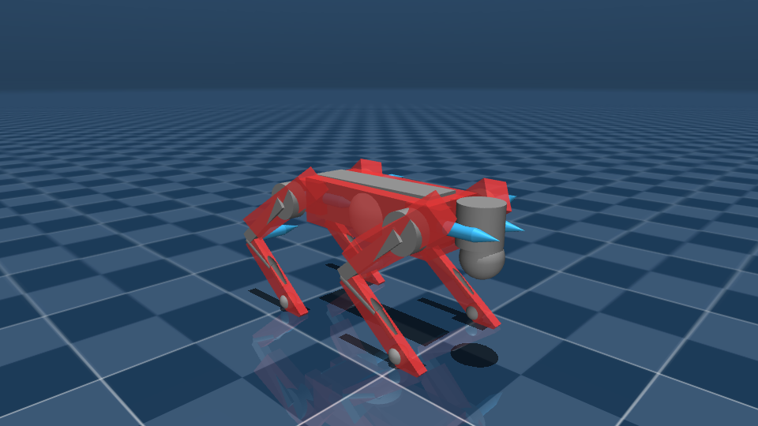
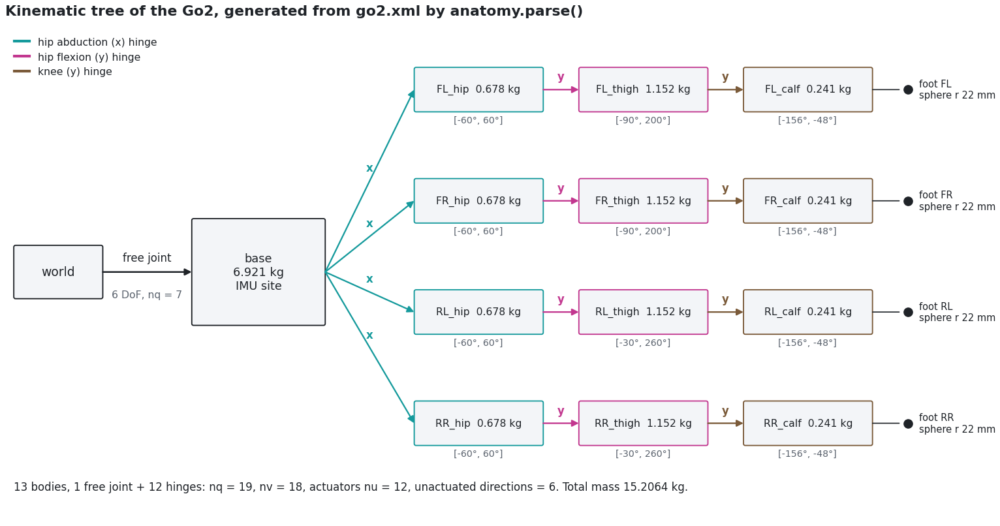
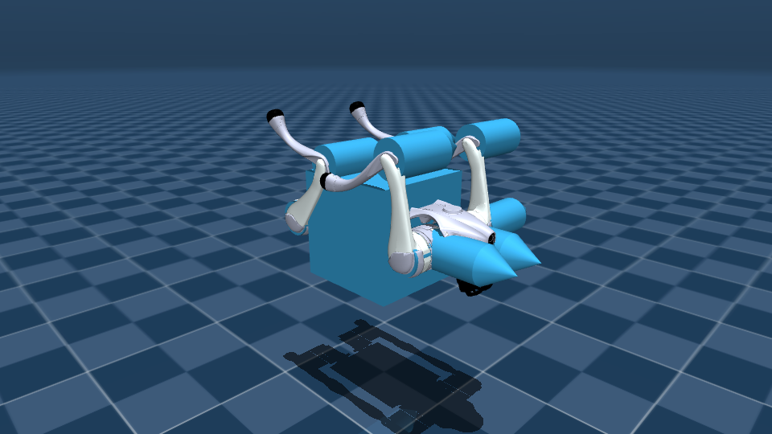
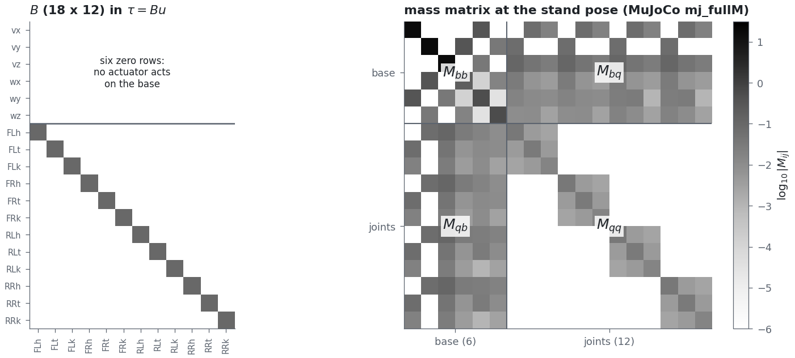
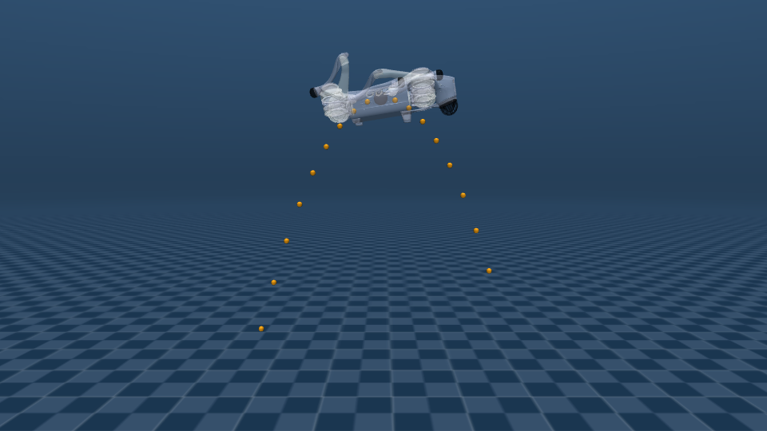
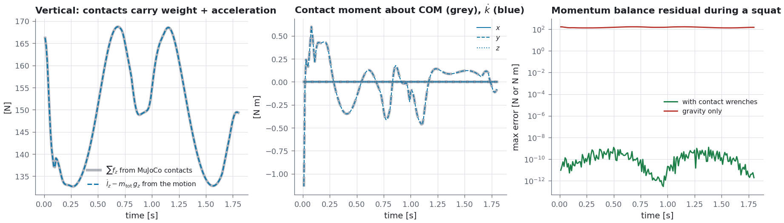
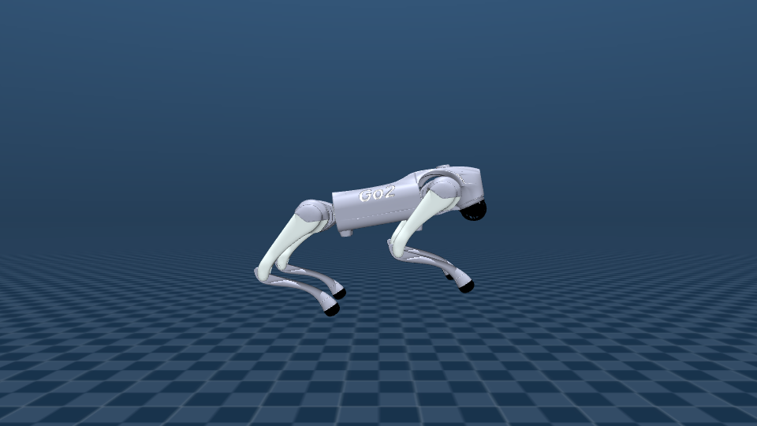

# Module 01 · Robot anatomy: bodies, joints, actuators and why the base is underactuated

## Objective

Read the Unitree Go2 model (`modules/assets/unitree_go2/go2.xml`, MuJoCo Menagerie) with our own parser and turn it into the
quantities every later module uses: the kinematic tree, the joint and actuator tables, the generalised coordinates, and the
actuation matrix. Then show with numbers why a legged robot is underactuated: twelve motors act on eighteen velocity directions,
and the six directions of the floating base can only be pushed by contact forces. The module has three levels:

| Level | Content | Applied on the Go2 |
|---|---|---|
| Fundamental | MJCF parsing with default classes; degrees of freedom; body, joint and actuator tables; kinematic tree | annotated front, side and top renders with every joint axis; turntable video |
| Intermediate | forward kinematics and velocity propagation down the tree; centre of mass and centroidal momentum; transmission and armature | torque needed to stand vs the motor limits; joint-space inertia with and without armature; joint-sweep video |
| Advanced | underactuation: the zero rows of $B$, momentum balance in flight and in stance, integrator drift, zero-momentum reorientation | flight with flailing legs; momentum balance during a squat; the body pitching 12.4° in zero gravity with zero angular momentum |

After this module a reader can count the degrees of freedom of any MJCF robot, write $\tau = Bu$ for it, compute its centre of
mass and centroidal momentum from the tree, and predict which motions the motors can produce without contact.


[Turntable video](media/turntable.mp4) (12 s): one turn with the visual meshes and MuJoCo's joint-axis arrows, one with the
collision geometry (red), the equivalent inertia boxes and the body centres of mass.




## Prerequisites

[Module 00](../m00_math/README.md): rotation matrices, quaternions (MuJoCo order w x y z), Rodrigues' formula, the cross product
as a skew matrix. [Module 04](../m04_kinematics/README.md) works out one leg in detail; this module covers the whole tree and
reuses module 04's leg Jacobian only for the torque budget. Mechanics: Newton's second law for a particle and Euler's equation for a
rigid body. Python with NumPy; MuJoCo and Pinocchio are used only to check this code.

## Theory

Notation: world frame $W$ with $z$ up; base frame $\mathcal B$ with $x$ forward, $y$ left (subscript $\mathcal B$ marks base
quantities). $R_i, p_i$ are the orientation and origin of body $i$ in $W$; $m_i$, $c_i$ and $I_i$ its mass, centre of mass (world)
and rotational inertia about $c_i$ (body frame). Body 0 is the base and body $i \ge 1$ carries hinge $i$. $m_{\text{tot}} = \sum_i m_i$ is the
total mass and $c = \sum_i m_i c_i / m_{\text{tot}}$ the centre of mass of the robot. $M(q)$ is the joint-space mass matrix and $B$ the
actuation matrix; neither is a frame. Indices: $i$ runs over bodies and hinges, $a$ over actuators, $j$ over foot contacts, and a
superscript $(n)$ marks time step $n$. $\mathrm{Id}_{12}$ is the $12 \times 12$ identity; every $I$ with a subscript is an inertia.

### Fundamental level

#### Reading an MJCF file

An MJCF body lists its offset in the parent (`pos`, `quat`), an `<inertial>` (mass, centre of mass, principal moments and their
orientation), its joints and geoms. Values that are not written on an element come from a default class. The resolution rule,
from the MuJoCo XML reference ("default" and "childclass"), is:

$$\text{attr}(e) = \text{element}(e) \;\triangleright\; \text{class}(e) \;\triangleright\; \text{parent classes of class}(e) \;\triangleright\; \text{main} \;\triangleright\; \text{built-in},$$

where $\triangleright$ means "overrides" and $\text{class}(e)$ is the element's `class` attribute, or else the `childclass` of the
nearest enclosing body. In go2.xml the base has `childclass="go2"`; the knee joint has `class="knee"`, which inherits `axis="0 1 0"`,
`damping="2"`, `armature="0.01"` and `frictionloss="0.2"` from `go2` and sets its own `range="-2.7227 -0.83776"`. The knee motor
gets `ctrlrange="-45.43 45.43"` from the same class; the hip and thigh motors get $\pm 23.7$ N m from `go2`. A `<freejoint>`
takes no defaults. With `autolimits="true"` a joint is limited if and only if it has a `range`.

The inertia tensor about the body's centre of mass, in the body frame, is rebuilt from the principal moments $d$ and the
inertial quaternion $q_I$:

$$I_i = R(q_I)\,\mathrm{diag}(d)\,R(q_I)^T .$$

MuJoCo normalises every quaternion on compile. The inertial quaternions in go2.xml are written to six digits; their norms differ
from 1 by up to $4 \times 10^{-7}$ (FL calf). Over the same 1000 random states, the centroidal momentum differs from Pinocchio's by
$6.5 \times 10^{-8}$ without the normalisation (`centroidal_momentum_vs_pinocchio_unnormalised_quat`, from
`validate.parse_unnormalised()`) and by $4.3 \times 10^{-14}$ with it (`centroidal_momentum_vs_pinocchio`).

#### Degrees of freedom

The configuration of a floating-base robot is the base pose plus the joint angles:

$$q = (p_{\mathcal B},\; \mathbf{q}_{\mathcal B},\; \mathbf q) \in \mathbb{R}^3 \times S^3 \times \mathbb{R}^{12}, \qquad \mathbf q = (q_1, \dots, q_{12}), \qquad n_q = 3 + 4 + 12 = 19,$$

$$v = (v_{\mathcal B},\; \omega_{\mathcal B},\; \dot{\mathbf q}) \in \mathbb{R}^{18}, \qquad n_v = 3 + 3 + 12 = 18 .$$

The base orientation is stored as a unit quaternion (4 numbers, 1 constraint) but moves with 3 angular velocities, so
$n_q - n_v = 1$. Each MJCF joint type contributes $(n_q, n_v)$: free $(7, 6)$, ball $(4, 3)$, hinge and slide $(1, 1)$. MuJoCo's
velocity convention for the free joint is $v_{\mathcal B}$ in the world frame and $\omega_{\mathcal B}$ in the base frame (`sim.py` docstring).

For the Go2: 13 bodies, 1 free joint, 12 hinges and 12 motors.

| Body | Parent | Mass [kg] | Joint | Axis | Range [rad] | Range [deg] |
|---|---|---|---|---|---|---|
| base | world | 6.921 | free | (6 DoF) | none | none |
| FL/FR/RL/RR_hip | base | 0.678 | hip abduction | $x$ | $[-1.0472, 1.0472]$ | $[-60, 60]$ |
| FL/FR_thigh | hip | 1.152 | hip flexion | $y$ | $[-1.5708, 3.4907]$ | $[-90, 200]$ |
| RL/RR_thigh | hip | 1.152 | hip flexion | $y$ | $[-0.5236, 4.5379]$ | $[-30, 260]$ |
| FL/FR/RL/RR_calf | thigh | 0.241352 | knee | $y$ | $[-2.7227, -0.83776]$ | $[-156, -48]$ |

Total mass $m_{\text{tot}} = 6.921 + 4\,(0.678 + 1.152 + 0.241352) = 15.2064$ kg (`total_mass_kg`); the legs carry 54.5% of it. Every hinge
has damping 2 N m s/rad, armature 0.01 kg m² and friction loss 0.2 N m (`tables.joints` in results.json).

| Actuator | Type | Transmission | Gear | Torque range [N m] |
|---|---|---|---|---|
| `<leg>_hip`, `<leg>_thigh` (8) | motor | joint `<leg>_hip_joint`, `<leg>_thigh_joint` | 1 | $\pm 23.7$ |
| `<leg>_calf` (4) | motor | joint `<leg>_calf_joint` | 1 | $\pm 45.43$ |

The figure below is drawn from `anatomy.parse()` output, not by hand.



Offsets read from the file (body `pos`): hip abduction axes at $(\pm 0.1934, \pm 0.0465, 0)$ m in the base frame, so the front and
rear hips are 0.3868 m apart and the left and right abduction axes 0.093 m apart; the thigh joint is 0.0955 m further out along
$y$; thigh and calf are each 0.213 m long (calf: knee to foot-sphere centre, `pos="-0.002 0 -0.213"`); the foot is a sphere of
radius 0.022 m. All joints sit at their body origin ($\text{pos} = 0$).

#### Camera model for the annotated views

To draw joint axes onto a render, a world point $P$ has to be mapped to a pixel. MuJoCo's camera has origin $o$, unit vectors
$e_f$ (forward) and $e_u$ (up); image right is $e_r = e_f \times e_u$. With camera coordinates $X = e_r \cdot (P - o)$,
$Y = e_u \cdot (P - o)$, $Z = e_f \cdot (P - o)$, the pixel in an image of $L_x \times L_y$ pixels is

$$(x_{px}, y_{px}) = \left(\frac{X' - (x_0 - x_w)}{2x_w}\,L_x,\;\; \frac{y_t - Y'}{y_t - y_b}\,L_y\right),\qquad (X', Y') = \begin{cases}(X, Y) & \text{orthographic}\\ (X, Y)\,z_n/Z & \text{perspective}\end{cases}$$

with frustum centre $x_0$, half-width $x_w$ (from the aspect ratio when MuJoCo stores 0), top $y_t$, bottom $y_b$ and near-plane
distance $z_n$.
MuJoCo renders a mono image from the average of its two eye cameras, which sit $\pm \text{ipd}/2 = \pm 0.034$ m apart. Taking
only `scene.camera[0]` instead of the average shifts every projected point by 31.4 px in each of the three views, against a
0.45 px bounding-box error with the average (`camera_eye0_only_shift_px`, `camera_projection_bbox_px`). The views here are
orthographic, so the shift is the same for every point and one scale bar holds for the whole image.

### Intermediate level

#### Forward kinematics of the tree

Bodies are stored parents first. For body $i$ with parent $\pi(i)$, fixed offset $(\bar p_i, \bar R_i)$ and hinge axis $s_i$
(body frame) through the anchor $\rho_i$ (body frame):

$$R_i = R_{\pi(i)} \bar R_i\, \mathrm{Rot}(s_i, q_i), \qquad p_i = p_{\pi(i)} + R_{\pi(i)} \bar p_i + R'_i \rho_i - R_i \rho_i,\quad R'_i = R_{\pi(i)}\bar R_i .$$

The joint's world anchor is $\hat\rho_i = p_{\pi(i)} + R_{\pi(i)}\bar p_i + R'_i \rho_i$ and its world axis $\hat s_i = R'_i s_i$. For the base,
$p_{\mathcal B}$ and $R(\mathbf q_{\mathcal B})$ come straight from $q$. This is the product of exponentials (Lynch and Park, sec. 4.1), written body by body.

#### Velocities down the tree

Differentiate $p_i$ and $R_i$. A hinge adds angular velocity $\hat s_i \dot q_i$, and a point $x$ on body $i$ gains velocity
$\hat s_i \dot q_i \times (x - \hat\rho_i)$ from it:

$$\omega_i = \omega_{\pi(i)} + \hat s_i \dot q_i, \qquad v_i = v_{\pi(i)} + \omega_{\pi(i)} \times (p_i - p_{\pi(i)}) + \hat s_i \dot q_i \times (p_i - \hat\rho_i),$$

starting from $v_{\mathcal B}$ and $\omega_{\mathcal B}^W = R_{\mathcal B}\,\omega_{\mathcal B}$. This is the forward iteration of Newton-Euler inverse
dynamics (Lynch and Park, sec. 8.3), written with 3-vectors instead of twists.

#### Centre of mass and centroidal momentum

With $c_i = p_i + R_i\,\bar c_i$ and $\dot c_i = v_i + \omega_i \times (c_i - p_i)$:

$$l = \sum_i m_i \dot c_i = m_{\text{tot}} \dot c, \qquad k = \sum_i \left[ m_i (c_i - c) \times \dot c_i + R_i I_i R_i^T \omega_i \right].$$

$h_G = (l, k)$ is the centroidal momentum. It is linear in $v$: $h_G = A_G(q)\,v$, with $A_G$ the centroidal momentum matrix
(Lee and Goswami 2012, eq. 31, who order the blocks $(k, l)$).

#### Transmission and armature

A joint-transmission motor $a$ with gear $\gamma_a$, on the joint whose velocity has index $\text{dof}(a)$ in $v$, produces the
generalised force (MuJoCo Computation, "Actuation model", "Transmission")

$$\tau = B u, \qquad B_{\text{dof}(a),\,a} = \gamma_a, \text{ all other entries of } B \text{ zero},\qquad u_a \leftarrow \mathrm{clip}(u_a, u_a^{\min}, u_a^{\max}) .$$

For the Go2, $\gamma_a = 1$ and actuator $a$ drives hinge $a$, so $B = \begin{bmatrix} 0_{6 \times 12} \\ \mathrm{Id}_{12} \end{bmatrix}$: the
model's torques are joint-side torques and the gearbox is not modelled. Its only trace is the armature. A rotor of inertia
$I_{\text{rot}}$ turning at $N \dot q_i$ behind an $N{:}1$ reduction stores $\tfrac12 I_{\text{rot}} (N \dot q_i)^2 = \tfrac12 (N^2 I_{\text{rot}})\,\dot q_i^2$,
so it adds $N^2 I_{\text{rot}}$ to the joint's diagonal of the mass matrix (Lynch and Park, sec. 8.9):

$$M(q) = M_{\text{links}}(q) + \mathrm{diag}(0_6,\; I_{\text{arm}} \mathbf 1_{12}), \qquad I_{\text{arm}} = N^2 I_{\text{rot}} = 0.01 \text{ kg m}^2 .$$

go2.xml gives $I_{\text{arm}}$ but neither $N$ nor $I_{\text{rot}}$. The knee limit is $45.43 / 23.7 = 1.92$ times the hip limit (my inference: an
extra reduction on the knee, not checked against a Unitree document).

Worked example at the stand pose ($q = (0, 0.9, -1.8)$ per leg, `stand_M_diag_*`): the link-only diagonal is 0.0236, 0.0204
and 0.00633 kg m² for hip, thigh and knee; armature raises it to 0.0336, 0.0304 and 0.0163. At the knee the rotor is 61% of the
inertia the motor sees.

#### Torque budget at the stand pose

Standing still under joint PD (`sim.stand`, 1.5 s settle, base height 0.256 m), the feet carry 33.4 N (front) and 41.2 N (rear),
which sum to $m_{\text{tot}} g = 149.2$ N. The motors hold this with (results.json `stand_torque_Nm`):

| Joint | Front legs [N m] | Rear legs [N m] | Limit [N m] | Largest share |
|---|---|---|---|---|
| hip abduction | 0.25 | 0.28 | 23.7 | 1.2% |
| hip flexion | 1.33 | 0.82 | 23.7 | 5.6% |
| knee | 5.94 | 7.06 | 45.43 | 15.5% |

From $u_{\text{leg}} = J_{\text{leg}}^T f_j$ with $f_j = (0, 0, f_z)$ the force on foot $j$ (module 04's foot Jacobian $J_{\text{leg}}$, base
frame), the largest vertical force one foot can hold at this pose before one of its three actuators saturates is

$$f_{z,\max} = \min_{a \in \text{leg}} \frac{u_a^{\max}}{|(J_{\text{leg}})_{z a}|} = 245.5 \text{ N (front)},\; 245.3 \text{ N (rear)} .$$

That is a static upper bound of 100 kg on all four feet, or 84.9 kg beyond the robot's own mass (`static_payload_kg`). It
ignores acceleration, motor heating, velocity limits (the model has none) and every other pose; it is a property of this model
at this pose, not a payload rating.


[Joint-sweep video](media/joint_sweep.mp4) (10.8 s, kinematic playback, base held 0.45 m up): all four legs sweep hip abduction
over its full range (left and right legs mirrored), then hip flexion over 80% of its range (the full range, -90° to 200° on the front legs, would swing the
thigh through the body), then the knee over its full range.



### Advanced level: underactuation

#### Equations of motion, split into base and joint rows

Foot contact $j$ ($j = 1, \dots, n_f$) acts at the point $r_j$ with force $f_j$ and, for MuJoCo's condim-6 feet, a torsional and
rolling moment $\mu_j$. Stack the contact wrenches into $\lambda = (f_1, \mu_1, \dots, f_{n_f}, \mu_{n_f})$ with Jacobian $J_\lambda$
($6n_f \times 18$). With the bias force $C(q, v)$ (gravity, Coriolis and centrifugal terms, joint damping), the equations of
motion are (MuJoCo Computation, "General framework", eq. 1, whose $c$ is $C$ here)

$$M(q)\,\dot v + C(q, v) = B u + J_\lambda^T \lambda .$$

Split $v = (v_b, \dot{\mathbf q})$ with $v_b = (v_{\mathcal B}, \omega_{\mathcal B}) \in \mathbb R^6$; subscript $b$ marks base rows and $q$ joint rows:

$$\begin{bmatrix} M_{bb} & M_{bq} \\ M_{qb} & M_{qq} \end{bmatrix}\begin{bmatrix}\dot v_b \\ \ddot{\mathbf q}\end{bmatrix} + \begin{bmatrix} C_b \\ C_q\end{bmatrix} = \begin{bmatrix} 0 \\ u \end{bmatrix} + \begin{bmatrix} J_{\lambda,b}^T \\ J_{\lambda,q}^T\end{bmatrix} \lambda .$$

$B$ has rank 12 and 18 rows, so six directions of $\dot v$ receive no actuator force. Those six rows are the base rows, and $u$
does not appear in them.



#### What the base rows say

Write Newton's law for every body and add them up. Joint torques, joint damping, friction loss and joint-limit forces each act
on a parent and a child with equal and opposite force and moment (Newton's third law), so they cancel in the sum. Gravity acts at
each $c_i$, and the feet push on the world with $f_j$ and $\mu_j$ at $r_j$ (Lee and Goswami 2012, eqs. 1 and 2, for one contact):

$$\dot l = m_{\text{tot}}\, g + \sum_j f_j, \qquad \dot k = \sum_j \left[(r_j - c) \times f_j + \mu_j\right] .$$

Gravity contributes no moment about $c$ because $\sum_i m_i (c_i - c) \times g = 0$ by the definition of $c$. The base rows of the
equations of motion carry exactly this information, expressed at the base instead of at $c$ (checked numerically below:
`stance_momentum_rate_vs_wrench`).
Two consequences:

1. In flight ($\lambda = 0$), $\ddot c = g$ and $k$ is constant whatever the motors do. The motors can still rotate and shift the
   base, because $M_{bq} \ddot{\mathbf q} \neq 0$: the base moves so that the total momentum does not.
2. To accelerate the centre of mass or change $k$, the robot must push on the ground. Locomotion is the problem of choosing joint
   torques so that the resulting contact forces produce the wanted $\dot h_G$, inside the friction cones.


#### Discrete time does not conserve momentum exactly

Semi-implicit Euler updates $v^{(n+1)} = v^{(n)} + \Delta t\,\dot v^{(n)}$, then $q^{(n+1)} = q^{(n)} \oplus \Delta t\, v^{(n+1)}$. MuJoCo's
`mjINT_EULER` treats joint damping implicitly (MuJoCo Computation, "Numerical integration"): it solves
$(M + \Delta t\,D)\,\dot v^{(n)} = F^{(n)} - D\,v^{(n)}$, with $F^{(n)}$ every generalised force except damping, so that
$M\dot v^{(n)} = F^{(n)} - D\,v^{(n+1)}$, with $D$ = diag(0, ..., 0, 2, ..., 2) N m s/rad (zero on the six base rows, 2 on every
hinge). The base rows of the equations of motion, which alone fix $\dot h_G$, are therefore the same as without the implicit
term, and the argument below is unchanged. Differentiating
$h_G = A_G(q)\,v$ gives the continuous balance $A_G(q)\,\dot v + \dot A_G(q, v)\,v = w$, with $w$ the external wrench
($(m_{\text{tot}} g, 0)$ in flight). Suppose the integrator's $\dot v^{(n)}$ satisfies it exactly at step $n$:
$A_G(q^{(n)})\dot v^{(n)} + \dot A_G(q^{(n)}, v^{(n)})\,v^{(n)} = w^{(n)}$. With $h_G^{(n)} = A_G(q^{(n)})\,v^{(n)}$ the momentum changes per step by

$$h_G^{(n+1)} - h_G^{(n)} = \Delta t\, A_G(q^{(n)})\dot v^{(n)} + \big(A_G(q^{(n+1)}) - A_G(q^{(n)})\big)\, v^{(n+1)} = \Delta t\, w^{(n)} + \underbrace{\big(A_G(q^{(n+1)}) - A_G(q^{(n)})\big)\, v^{(n+1)} - \Delta t\,\dot A_G(q^{(n)}, v^{(n)})\, v^{(n)}}_{\text{residual}} .$$

$\dot A_G(q, v)$, the rate of change of $A_G$ along a motion that passes $q$ with velocity $v$, is linear in $v$, and a Taylor
expansion of $A_G$ about $q^{(n)}$ gives $A_G(q^{(n+1)}) - A_G(q^{(n)}) = \Delta t\,\dot A_G(q^{(n)}, v^{(n+1)}) + O(\Delta t^2)$. The residual is therefore

$$\Delta t\,\big[\dot A_G(q^{(n)}, v^{(n+1)})\,v^{(n+1)} - \dot A_G(q^{(n)}, v^{(n)})\,v^{(n)}\big] + O(\Delta t^2) = O(\Delta t^2),$$

because $v^{(n+1)} - v^{(n)} = \Delta t\,\dot v^{(n)}$. Over a fixed time $T$ the $T/\Delta t$ residuals add up to $O(\Delta t)$, so halving
$\Delta t$ should halve Euler's drift.

#### Reorientation with zero angular momentum

With $k = 0$ the base angular velocity is fixed by the joint velocities. The base's linear velocity does not enter $k$, so
$k = I_G(q)\,\omega_{\mathcal B} + A_{kq}(q)\,\dot{\mathbf q} = 0$, with $I_G$ the inertia of the whole robot about $c$ and $A_{kq}$ the
block of $A_G$ that maps $\dot{\mathbf q}$ to $k$, gives $\omega_{\mathcal B} = -I_G^{-1} A_{kq}\,\dot{\mathbf q}$. For a motion confined to the
sagittal plane (all legs alike), only pitch $\theta$ changes and this reduces to $\dot\theta = \alpha(\phi)^T \dot\phi$ with
$\phi = (q_{\text{thigh}}, q_{\text{knee}})$, the same on every leg. Over a closed loop $\Gamma$ in this plane, Stokes' theorem gives

$$\Delta\theta = \oint_\Gamma \alpha(\phi)\cdot d\phi = \iint_{\text{inside }\Gamma} \left(\frac{\partial \alpha_2}{\partial \phi_1} - \frac{\partial \alpha_1}{\partial \phi_2}\right) d\phi_1\,d\phi_2 \neq 0 \text{ in general.}$$

Three predictions follow: the net rotation does not depend on how fast the loop is run; running the loop backwards reverses it;
a loop around a different region gives a different rotation. A falling cat turns over the same way; the classic model of it,
Kane and Scher (1969), was not read for this module and is not used in the derivation.

## Implementation

| Equation | Function | Notes |
|---|---|---|
| default-class resolution, inertia tensor, quaternion normalisation | `anatomy.parse()` | ElementTree only; asserts joint transmissions and hinge gears with zero tail |
| $n_q$, $n_v$, rank of $B$ | `anatomy.dof()` | |
| $\tau = Bu$ with clipping | `anatomy.selection()`, `anatomy.actuator_force()` | |
| forward kinematics, anchors, axes | `anatomy.fk()` | general anchor $\rho_i$, not assumed zero |
| velocity propagation | `anatomy.velocities()` | |
| $M$, $c$, $l$, $k$ | `anatomy.centroidal()` | |
| $\dot h_G$ along the motion | `anatomy.momentum_rate()` | central difference in time, $\epsilon = 10^{-6}$ s: moves $q$ with `anatomy.integrate()` and $v$ by $\epsilon\dot v$ |
| external wrench | `anatomy.external_rate()` | gravity plus contact forces and moments |
| camera projection | `validate.project()`, `validate.mono_camera()` | orthographic and perspective |

Design choices:

- `anatomy.py` imports neither MuJoCo nor Pinocchio. The tests compare it with `mj_forward` (`xpos`, `xmat`, `xanchor`, `xaxis`),
  `mj_objectVelocity`, `qfrc_actuator`, `mj_fullM` and with Pinocchio's `computeCentroidalMomentum`,
  `computeCentroidalMomentumTimeVariation` and model limits.
- $\dot h_G$ is a finite difference of $h_G$ rather than an analytic derivative. The analytic one needs the bias accelerations of
  every body; the difference reuses `centroidal()` and is accurate to about $10^{-8}$, enough to separate "equals $m_{\text{tot}} g$" from
  "differs by newtons". Pinocchio's analytic $\dot h_G$ is the tighter check ($2.8 \times 10^{-11}$).
- The momentum checks set MuJoCo's constraint solver to tolerance 0 and 1000 iterations. At the default tolerance
  ($10^{-8}$, 100 iterations) the solver stops before the equations of motion hold to machine precision (Failure analysis).
- Flight and reorientation use RK4. The flight experiment launches the robot with $v = (1.2, 0, 4.5)$ m/s from 0.6 m and stops
  after 0.9 s, before it lands: no floor contact in any run (`*_floor_contacts = 0`).
- `validate.Rec` extends `sim.Recorder` with slow motion and marker spheres, using the same encoder settings and limits.

## Experiment

```bash
DISPLAY=:0 .venv-modules/bin/python modules/m01_anatomy/validate.py      # any X display works; wall time depends on load: 118 s at load 67 (wall_time_s)
.venv-modules/bin/python -m pytest -q modules/m01_anatomy
```

Without a live X display `validate.can_render()` fails, and the run warns and skips the two checks that need rendering
(`camera_projection_bbox_px`, `media_mp4_under_6MB`), `views_annotated.png` and the videos. The other 28 checks still run and
results.json lists the skipped keys under `skipped_checks`; `--no-media` skips only the videos and `media_mp4_under_6MB`.

| Experiment | Inputs | Measured |
|---|---|---|
| parse vs compiled models | go2.xml | counts; every body, joint and actuator field |
| camera model | 3 orthographic views (960x720), robot lifted 0.4 m so the floor hides nothing | bounding box of 419,023 projected mesh vertices vs the segmentation silhouette |
| kinematics, momentum, transmission | 1000 random states, seed 0: base pose $\mathcal N(0,1)$, joints $U(-\pi, \pi)$, $v \sim \mathcal N(0, 1)$, $u \sim U(-1.5, 1.5)\,u_{\max}$ | max abs error vs MuJoCo and Pinocchio |
| armature | 50 random configurations, model with armature set to 0 | $M - M_0 - \mathrm{diag}(0_6, 0.01\cdot\mathbf 1_{12})$ |
| stand | `sim.stand`, 1.5 s | actuator torques, foot forces |
| flight identity | 1000 random states (seed 1) and torques $u \sim U(-1, 1)\,u_{\max}$, no floor | $\dot h_G - (m_{\text{tot}} g, 0)$ |
| stance identity | squat: min-jerk PD (kp 80, kd 2) from (0, 0.9, -1.8) to (0, 1.25, -2.5) and back, 1.8 s, sampled every 10 ms (180 samples) | $\dot h_G -$ (gravity + contact wrenches) |
| drift | flight 0.9 s, torque $15 \sin(2\pi \nu_a t + a - 1)$ N m on actuator $a$, $\nu_a \in [0.5, 1.7]$ Hz; Euler and RK4 at 2 and 1 ms | $\max_t |k(t) - k(0)|$, $\max_t |l - l_0 - m_{\text{tot}} g t|$ |
| reorientation | zero gravity, RK4, PD kp 400, kd 6 on the loop below, 5 cycles at 1 Hz, reversed, at 0.5 Hz, and over a second region of the same area | base pitch, $|k|$, $|l|$ |

The reorientation loop for every leg is $q_{\text{thigh}} = 0.9 + \sigma\,0.45 \sin \omega t$, $q_{\text{knee}} = -1.8 + 0.45(\cos\omega t - 1)$:
a circle of radius 0.45 rad through the stand pose, with $\sigma = -1$ for the reversed run.

## Validation

Thresholds were fixed in `validate.ACCEPT` before the first full run; `test_anatomy.py` asserts the same ones.

| Check | Measured | Acceptance | Source (`results.json`) |
|---|---|---|---|
| counts $n_q, n_v, n_u$, bodies, joints: parsed vs MuJoCo vs Pinocchio | 0 mismatches (19, 18, 12, 13, 13; Pinocchio has no actuators, so $n_u$ is compared with MuJoCo only) | 0 | `count_mismatches_vs_mujoco_pinocchio` |
| body offsets, masses, COM, inertia tensors vs MuJoCo, max abs | 0 | < 1e-12 | `parse_bodies_vs_mujoco` |
| joint type, axis, range, damping, armature, friction loss, addresses vs MuJoCo | 0 | < 1e-12 | `parse_joints_vs_mujoco` |
| actuator joint, gear, ctrlrange vs MuJoCo | 0 | < 1e-12 | `parse_actuators_vs_mujoco` |
| total mass vs MuJoCo `body_subtreemass` | 0 kg (15.2064 kg) | < 1e-12 | `total_mass_vs_mujoco_kg` |
| joint ranges vs Pinocchio | 0 rad | < 1e-12 | `joint_limits_vs_pinocchio` |
| armature and damping vs Pinocchio | 0 | < 1e-12 | `armature_damping_vs_pinocchio` |
| projected bounding box vs rendered silhouette, max over 3 views | 0.45 px | ≤ 1.5 px | `camera_projection_bbox_px` |
| body poses vs MuJoCo, 1000 states | 8.9e-16 | < 1e-12 | `fk_body_pose_vs_mujoco` |
| joint anchors and axes vs MuJoCo | 1.2e-15 | < 1e-12 | `fk_joint_anchor_axis_vs_mujoco` |
| body angular and linear velocity vs `mj_objectVelocity` | 2.7e-15 | < 1e-12 | `body_velocity_vs_mujoco` |
| centre of mass vs Pinocchio | 8.9e-16 m | < 1e-12 | `com_vs_pinocchio_m` |
| centroidal momentum vs Pinocchio | 4.3e-14 | < 1e-12 | `centroidal_momentum_vs_pinocchio` |
| $B\,\mathrm{clip}(u)$ vs `qfrc_actuator`, a third of the commands beyond the range | 0 N m | < 1e-12 | `actuator_force_vs_mujoco` |
| $M - M_0$ equals diag(armature), 50 configurations | 1.7e-18 | < 1e-12 | `armature_in_mass_matrix` |
| largest standing torque / limit | 0.155 (rear knee) | < 0.5 | `stand_torque_utilisation_max` |
| base rows of $B$ | 0 | ≤ 0 | `B_base_rows_max_abs` |
| base rows of MuJoCo's actuator force, 1000 random commands | 0 | ≤ 0 | `qfrc_actuator_base_rows_max_abs` |
| rank of $B$ | 12 | = 12 | `rank_B` |
| flight: $\dot h_G - (m_{\text{tot}} g, 0)$, finite difference, max | 1.8e-8 | < 1e-6 | `flight_momentum_rate_vs_Mg_fd` |
| flight: same, Pinocchio's $\dot h_G$ | 2.8e-11 | < 1e-8 | `flight_momentum_rate_vs_Mg_pinocchio` |
| stance: $\dot h_G -$ (gravity + contact wrenches), 180 samples | 1.3e-9 | < 1e-5 | `stance_momentum_rate_vs_wrench` |
| Euler angular-momentum drift, 2 ms / 1 ms | 2.00 | 1.6 to 2.4 | `flight_drift_order_euler` |
| RK4 angular-momentum drift at 2 ms | 1.9e-6 kg m²/s | < 1e-4 | `flight_drift_rk4_ang_kgm2s` |
| pitch change after 5 loops | 12.4° | > 5° | `reorient_pitch_5_cycles_deg` |
| largest $|k|$ in the four reorientation runs | 1.5e-7 kg m²/s | < 1e-4 | `reorient_max_ang_momentum` |
| reversed loop / forward loop rotation | -1.002 | -1.1 to -0.9 | `reorient_reverse_ratio` |
| 0.5 Hz / 1 Hz rotation | 1.030 | 0.9 to 1.1 | `reorient_half_speed_ratio` |
| other region / forward loop rotation, $|$ratio $- 1|$ | 0.194 | > 0.1 | `reorient_other_region_rel_diff` |
| all MP4 files < 6 MB | 4 files, largest 2.3 MB | all | `media_mp4_under_6MB` |

All 30 checks pass in the run that wrote results.json. The last row was added after an independent review pointed out that
the third Stokes prediction had no test; its threshold, three times the 3% speed effect, was set before the run that measured it.

### Flight: the motors turn the base but cannot move the centre of mass

Over 1000 random states the joint torques change the base's angular acceleration by a median of 112 rad/s² (difference between
$u$ and $u = 0$, `flight_torque_effect_on_base_ang_acc_median`), while the centre-of-mass acceleration differs from $g$ by at most
$1.1 \times 10^{-9}$ m/s² (`flight_com_acc_minus_g_max`). In the 0.9 s flight with flailing legs the base pitches over a range of
8.9° and its origin leaves the ballistic parabola by up to 3.4 cm; the centre of mass stays on the parabola to $3.9 \times 10^{-7}$ m
(`flight_*` keys).


[Flight video](media/flight.mp4) (3.6 s, quarter speed): the robot is drawn semi-transparent so that the centre of mass, the
near-black sphere inside the base (the colour of the simulated COM in the figure above), can be seen through it; the amber dots are
the parabola it has to follow.



### Stance: the contacts carry the weight and the accelerations

During the squat the summed vertical contact force ranges from 132.7 to 168.7 N around $m_{\text{tot}} g = 149.2$ N. The momentum rate equals
gravity plus the contact wrenches to $1.3 \times 10^{-9}$; leaving the contacts out gives an error of at least 132.7 N at every
sample (`stance_error_without_contacts_min_N`).



### Reorientation without angular momentum


All three predictions of the Stokes argument hold. The reversed loop gives +12.45° against -12.43° (ratio -1.002), and running it
at half speed gives -12.80° (ratio 1.03, the 3% being the tracking error, see below). The point reflection of the circle
through the stand pose, $q_{\text{thigh}} = 0.9 - 0.45 \sin \omega t$, $q_{\text{knee}} = -1.8 - 0.45(\cos\omega t - 1)$, has the
same area and direction but covers the region where the knee is bent less (measured knee range -1.80 to -0.90 rad,
`reorient_other_region_knee_range_rad`, inside the limit of -0.83776 rad). It turns the base by -14.84°, ratio 1.194 to the
first loop (`reorient_other_region_ratio`), with a tracking error of 0.057 rad, the same as the first loop's. Area alone does
not set the rotation; the integrand $\partial \alpha_2/\partial \phi_1 - \partial \alpha_1/\partial \phi_2$ varies over joint space. $|k|$ stays below $1.5 \times 10^{-7}$ kg m²/s.
Within each 1 Hz cycle the pitch swings over a peak-to-peak range of 4.94° and ends 2.05° to 2.85° below where the cycle
started (`reorient_pitch_swing_per_cycle_deg`, `reorient_pitch_net_per_cycle_deg`).

[Reorientation video](media/reorientation.mp4) (5 s, real time, zero gravity, camera follows the base position).



## Failure analysis

### Euler drifts, and RK4 is not fourth order here


The continuous model conserves $k$ in flight; MuJoCo's default integrator does not. Over 0.9 s, semi-implicit Euler at 2 ms
drifts by 0.0107 kg m²/s in angular and 0.050 kg m/s in linear momentum; at 1 ms by 0.0054 and 0.025 (`euler_*`). The ratio 2.00
matches the first-order prediction. For scale (my estimate, not measured): the whole robot pitching at 1 rad/s has $|k|$ of
roughly 0.5 kg m²/s, so Euler's drift over 0.9 s is about 2% of that. RK4 drifts by $1.9 \times 10^{-6}$ (2 ms) and
$8.0 \times 10^{-7}$ (1 ms), a ratio of 2.4 rather than the 16 of a fourth-order method (`flight_drift_order_rk4`). Both RK4 curves grow in steps rather
than smoothly (left panel): at 2 ms one step near 0.16 s, at 1 ms steps near 0.22, 0.25, 0.28 and 0.32 s, and a small step near
0.77 s in both. The step instants differ between the two step sizes, and the Euler curves show bumps near 0.18 and 0.78 s. A possible cause, not tested: events in the non-smooth constraints (the 0.2 N m joint friction loss,
joint limits, self-contacts) that fall inside a step at different places for different step sizes; a non-smooth right-hand
side would limit RK4's order. Logging the active constraint set per step would test this. Any estimator
or controller module that reads momentum from simulation should use RK4 or a 1 ms step, or expect errors of this size.

### The momentum identity holds only to the solver tolerance

At MuJoCo's default solver settings (tolerance $10^{-8}$, 100 iterations) the flight identity $\dot h_G = m_{\text{tot}} g$ is off by
$7.2 \times 10^{-5}$ (`flight_momentum_rate_default_solver_tol`); with tolerance 0 and 1000 iterations by $1.8 \times 10^{-8}$. The
cause: MuJoCo computes $\dot v$ inside its constraint solver (friction loss, joint limits and self-contacts are all constraints,
even in flight), and stops when the cost improvement falls below the tolerance, so the equations of motion are only approximately
met (MuJoCo Computation, "Constraint solver"). The residual of the equations of motion, with the forces of all active constraints included,
over the same 1000 states is at most $7.2 \times 10^{-5}$ in the base
rows, which is the momentum error above, and 0.134 N m in the joint rows; with tolerance 0 it drops to $2.7 \times 10^{-11}$ and
$1.8 \times 10^{-10}$ (`flight_eom_residual_*`). The joint-row residual does not enter $\dot h_G$, which is fixed by the base
rows of the equations of motion alone.

### Reorientation depends on the loop the joints actually trace


An earlier full run, with PD gains kp 60, kd 2 and loop amplitude 0.5 rad, missed `reorient_half_speed_ratio` with 1.175
(threshold 0.9 to 1.1). That run's results were not kept, so 1.175 cannot be checked against results.json. To show the cause, validate.py reruns the low
gains on the current loop (amplitude 0.45 rad). With those gains the joints lag the command by up to 0.18 rad at 1 Hz and
0.10 rad at 0.5 Hz (`reorient_lowgain_track_err_rad`, `reorient_lowgain_half_speed_track_err_rad`); the traced loop is smaller
at 1 Hz, so it encloses less area and rotates the body less: -9.87° vs -11.75° over 5 cycles, ratio 1.19
(`reorient_lowgain_half_speed_ratio`). The rotation follows the loop the joints execute, as the Stokes argument predicts, and
the commanded loop does not enter it. With kp 400, kd 6 the tracking error is 0.057 rad at 1 Hz and 0.029 rad at 0.5 Hz, and
the ratio is 1.03. The threshold was not changed. results.json keeps the kp 400 runs and the low-gain rerun, not the earlier
run.

The same earlier run (not kept either) also reported a reversal ratio of -1.44. The "reversed" loop then flipped the sign of the knee term, which
traces a different circle (knee bent less instead of more), not the same circle backwards; the region differed, so the rotation
differed. Its amplitude of 0.5 rad also drove the knee to -2.8 rad, past the -2.7227 rad limit. The loop now reverses the thigh
term and uses 0.45 rad.

### Pinocchio's MJCF import drops the torque limits

Pinocchio 4.1 reads go2.xml's joint ranges, armature and damping exactly (0 difference), but all 18 entries of
`model.effortLimit` are infinite (`pinocchio_effort_limits_finite = 0`): the actuator `ctrlrange` is not imported. A controller
that takes its torque limits from a Pinocchio model built from this file gets no limits.

### What the model leaves out

The MJCF has no motor velocity limit, no torque-speed curve, no gear ratio and no motor electrical model; it applies the commanded
torque at the joint instantly. The static payload bound above (84.9 kg) is a consequence: only the torque limits constrain it.
The foot contact is a soft sphere that sinks about 13 mm into the floor at rest (MODULE_SPEC.md); the collision geometry is boxes,
cylinders and spheres (turntable, second turn), so self-collision during the joint sweep is approximate.

## References

- MuJoCo documentation, mujoco.readthedocs.io (stable, read for MuJoCo 3.x). XML reference: `default` and `childclass`, `joint`
  (`armature`, `damping`, `frictionloss`, `range`), `freejoint`, `motor`. Computation chapter: "General framework" eq. (1)
  (equations of motion); "Actuation model", "Transmission"; "Numerical integration", "Integrators" (Euler's $D$ holds only
  the joint-damping derivatives); "Constraint model", "Friction loss", "Limit", "Contact" (`condim`); "Constraint solver".
- K. Zakka et al., MuJoCo Menagerie, github.com/google-deepmind/mujoco_menagerie, `unitree_go2/go2.xml` and `scene.xml`.
- Pinocchio 4.1 Python API, the functions compared against: `buildModelFromMJCF`, `computeCentroidalMomentum`,
  `computeCentroidalMomentumTimeVariation`, `model.effortLimit`.
- K. M. Lynch, F. C. Park, *Modern Robotics*, Cambridge University Press 2017: sec. 4.1 (product of exponentials formula),
  sec. 8.3 (Newton-Euler inverse dynamics, whose forward iteration is the velocity recursion here), sec. 8.9 (actuation,
  gearing and friction).
- S.-H. Lee, A. Goswami, "A momentum-based balance controller for humanoid robots on non-level and non-stationary ground",
  Autonomous Robots, 2012, doi:10.1007/s10514-012-9294-z: sec. 1, eqs. (1) and (2) (rate of angular momentum about the CoM and of
  linear momentum equal the external moment and force); sec. 3.5, eqs. (31) and (32) (in their notation $h = A\dot q$ with the
  centroidal momentum matrix $A$, and $\dot h = A\ddot q + \dot A\dot q$).

Section titles of Lynch and Park were checked against the book's companion video list (hades.mech.northwestern.edu,
"Modern Robotics Videos"), whose titles carry the book's section numbers; the book text itself was not opened. The MuJoCo
section names were checked on the Computation page. Lee and Goswami was read from a full-text copy at the sections and
equations cited. Featherstone (2008), Orin, Goswami and Lee (2013) and Kane and Scher (1969) were cited by an earlier
version of this README; none could be opened (publisher login), so they are no longer listed; the equations they were cited
for now cite the sources above.
