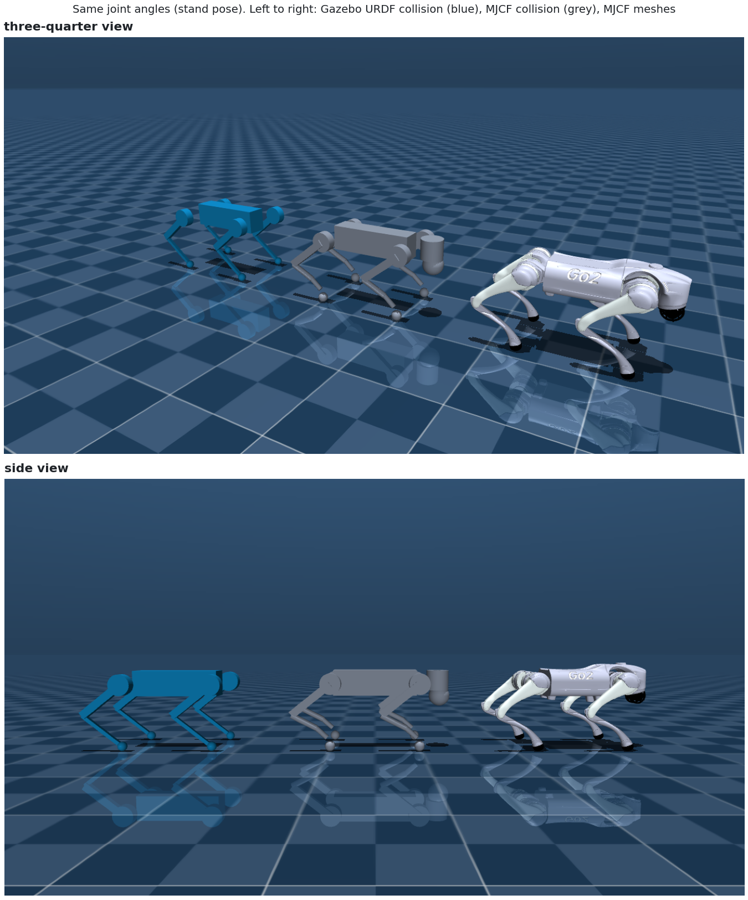
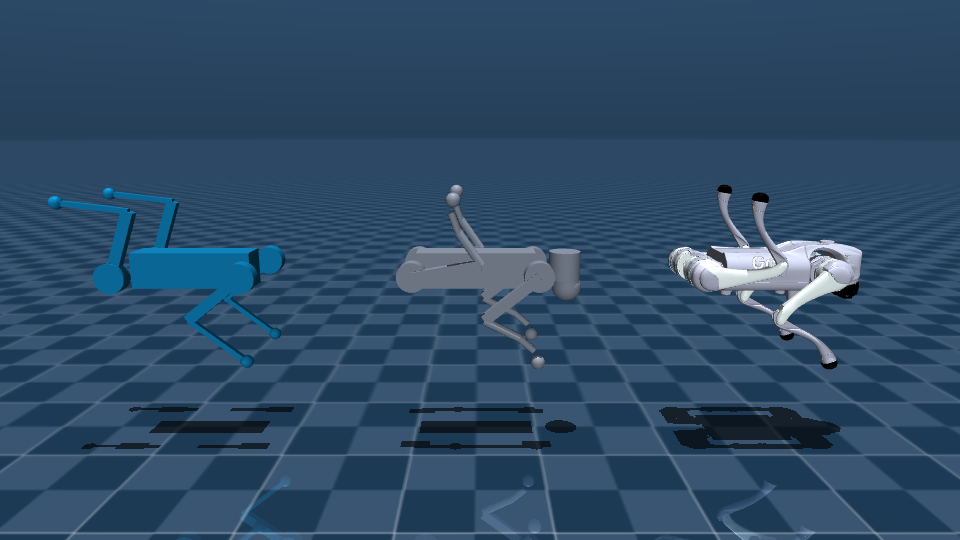
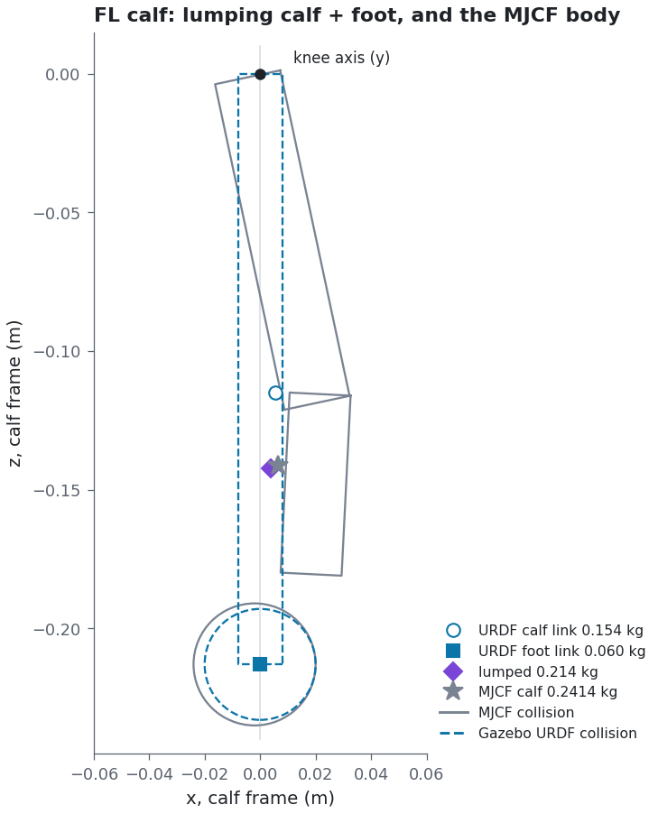
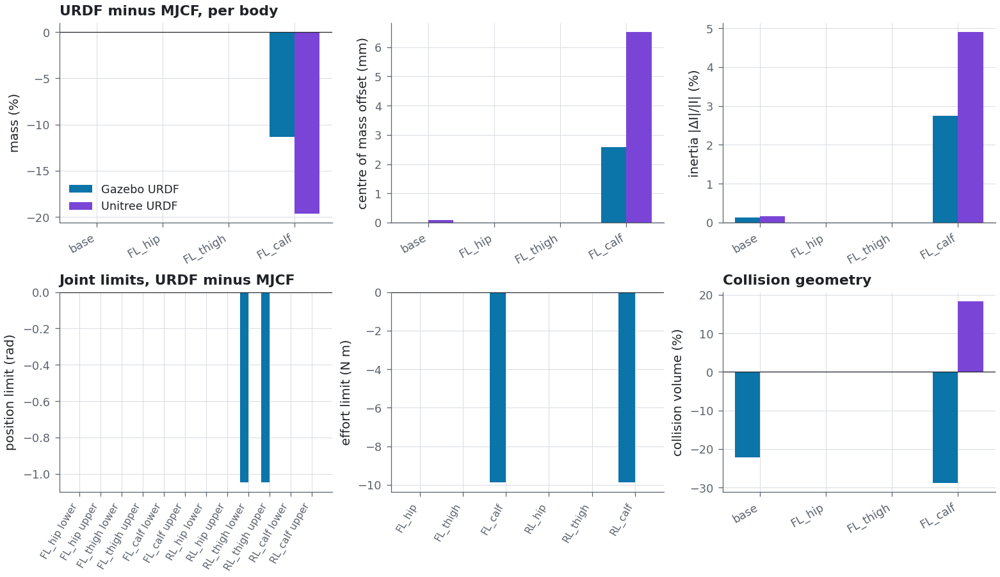
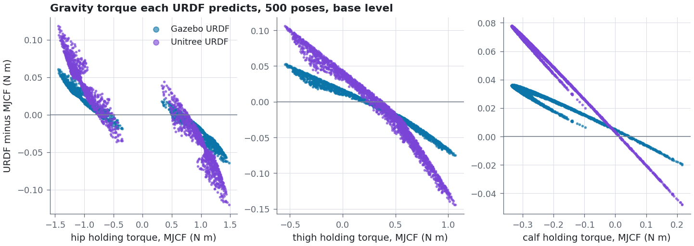
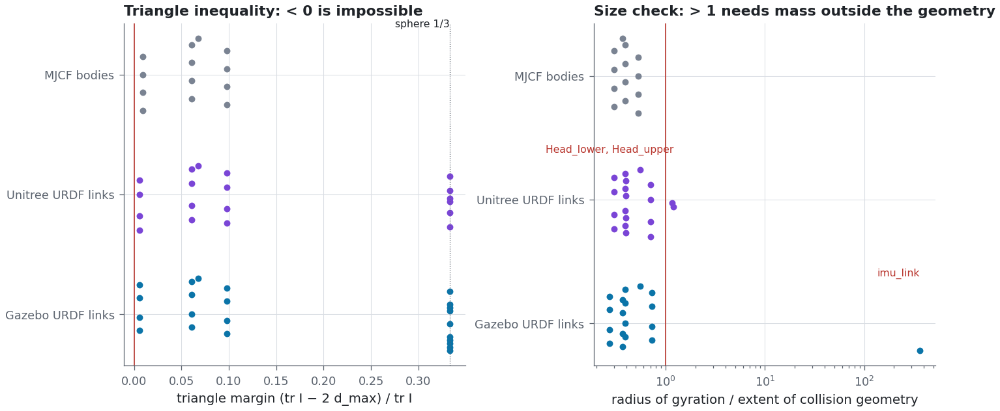
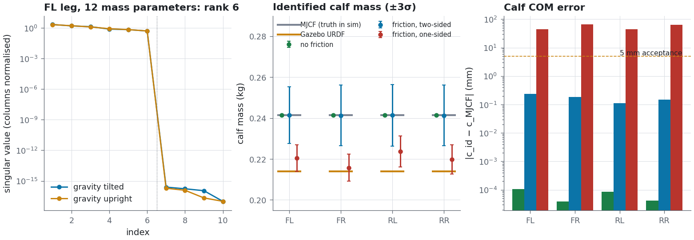
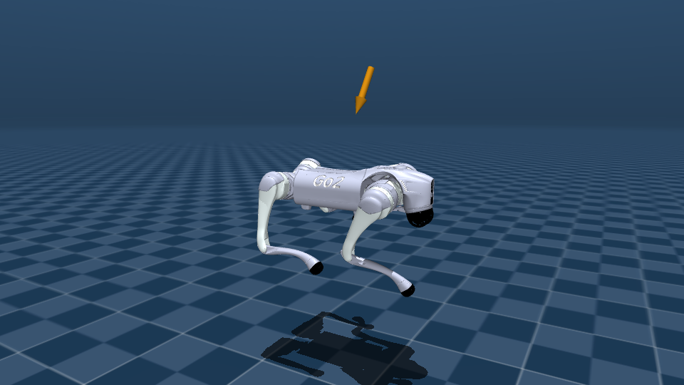
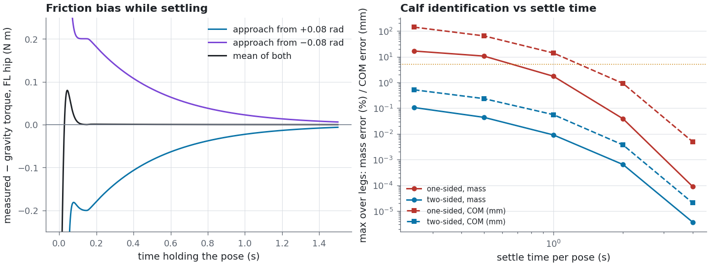

# Module 02 · Robot description: the Gazebo URDF against the MuJoCo MJCF, inertia validity and mass identification

## Objective

This repository simulates the Go2 twice: Gazebo spawns `src/go2_nav_sim/urdf/go2_nav.xacro` (`src/go2_nav_sim/launch/sim.launch.py`,
line 17), and the modules run the MuJoCo Menagerie `go2.xml`. `go2_nav.xacro` includes the upstream `robot.xacro` from the
`go2_description` package of `unitree-go2-ros2` and this repository's `sensors.xacro`, which hangs 5 sensor links (`lidar_link`,
`lidar_visual`, `camera_link`, `camera_optical`, `chase_cam`) off `base_link` by fixed joints, each 1e-5 kg with inertia
$10^{-6}\,\mathbb 1$ kg m². The "Gazebo URDF" below is the xacro output of `go2_nav.xacro`, sensor links included. This module puts the two descriptions side by side, number by number, checks that
every inertia in them could belong to a real body, and then measures a link's mass and centre of mass from simulated joint torques,
which is how one would settle a disagreement between two files on the real robot. The Unitree URDF that ships in the same package
(`urdf/go2_description.urdf`, not used by the Gazebo launch) is compared as a third description.

| Level | Content | Applied on the Go2 |
|---|---|---|
| Fundamental | URDF parsing; lumping fixed joints with the parallel-axis theorem; frames, masses, centres of mass, inertias, link lengths, joint limits and collision geometry compared | side-by-side renders and video; difference bar charts; calf lumping diagram |
| Intermediate | validity of an inertia: positive definite, triangle inequality, pseudo-inertia; a size check; mirror symmetry; the gravity regressor | every `<inertial>` in three files (57 tensors); gravity torques each URDF predicts against the MJCF |
| Advanced | identifiability of mass parameters from static torques (base parameters, rank); least-squares identification; friction bias | each calf's mass and centre of mass recovered from MuJoCo torques at 60 static poses |

After this module a reader can turn a URDF into the bodies a simulator actually integrates, decide whether an inertia block is
physically possible, predict which mass parameters a static experiment can and cannot measure, and run that experiment.



[Side-by-side video](media/side_by_side.mp4) (16 s): a camera orbit around the three copies standing, then the same rear-thigh
command sent to all three, each clamped to its own joint limits. The Gazebo URDF's rear thighs stop 1.047 rad earlier going
back and travel 1.047 rad further going forward.



## Prerequisites

[Module 01](../m01_anatomy/README.md): the MJCF parser (`anatomy.parse`), default classes, body inertia $I = R\,\mathrm{diag}(d)\,R^T$
from `diaginertia` and `quat`, and tree forward kinematics (`anatomy.fk`), all reused here. Maths: rigid-body inertia as a
second moment of mass, eigenvalues of a symmetric matrix, linear least squares and the singular value decomposition.

## Theory

Notation: for body $i$, $m_i$ is its mass, $c_i$ its centre of mass in the body frame, $I_i$ its rotational inertia about $c_i$ in
the body frame, $h_i = m_i c_i$ its first moment of mass. $R_i, p_i$ are the orientation and origin of the body frame in the world.
Hinge $k$ has world axis $s_k$ (unit) through world anchor $a_k$, angle $q_k$. $g$ is the gravity vector in the world frame
($|g| = 9.81$ m/s²). $\mathbb 1$ is the $3\times3$ identity. $e_x, e_y, e_z$ are the unit axes.

### Fundamental level

#### From URDF links to simulated bodies

A URDF lists links and joints. Each `<inertial>` gives $m$, an origin $(c, \mathrm{rpy})$ and six inertia entries $\bar I$ in the
frame of that origin, so in the link frame

$$I = R_{\mathrm{rpy}}\,\bar I\,R_{\mathrm{rpy}}^T, \qquad R_{\mathrm{rpy}} = R_z(\text{yaw})\,R_y(\text{pitch})\,R_x(\text{roll}) .$$

A `fixed` joint welds a child link to its parent. A simulator does not integrate it: Pinocchio adds the child's inertia to the
parent joint's body, MuJoCo's URDF importer fuses static bodies (`fusestatic`), and Gazebo merges fixed-joint links into their parent.
To compare with the MJCF, the same merge is done here. A child at $(p, R)$ in the parent frame contributes the part
$(m_k, c_k, I_k) = (m, p + Rc, R I R^T)$ expressed in the parent frame. For parts $k$ in one frame

$$m = \sum_k m_k, \qquad c = \frac{1}{m}\sum_k m_k c_k, \qquad I_c = \sum_k \Big[ I_k + m_k\big(|d_k|^2\,\mathbb 1 - d_k d_k^T\big) \Big], \quad d_k = c_k - c ,$$

the last being the parallel-axis (Steiner) theorem: $I$ about a point $d$ away from the centre of mass adds the inertia of a point
mass $m$ at $d$.

Worked example, FL calf of the Gazebo URDF (`const.xacro`): `lf_lower_leg_link` has $m = 0.154$ kg at
$c = (5.48, -0.975, -115)$ mm, and `lf_foot_link` ($m = 0.06$ kg, centre at its origin) hangs from it by a fixed joint at
$(0, 0, -213)$ mm. The lumped calf has $m = 0.214$ kg and

$$c_x = \frac{0.154 \cdot 5.48}{0.214} = 3.94\ \text{mm}, \qquad c_z = \frac{0.154\,(-115) + 0.06\,(-213)}{0.214} = -142.5\ \text{mm},$$

against the Menagerie calf body's $m = 0.241352$ kg and $c = (6.30, -0.622, -141.4)$ mm. The calf is the only leg body where the
masses and centres differ. `figures/calf_lumping.png` shows the three centres and both collision outlines.



#### Same frames before comparing

A centre of mass or an inertia can only be compared in a common frame. Lumping puts each body's frame at its moving joint's
origin. In all three files every joint origin has zero rotation, and the offsets are equal: hip at $(\pm 193.4, \pm 46.5, 0)$ mm
from the base, thigh at $(0, \pm 95.5, 0)$ mm from the hip, knee at $(0, 0, -213)$ mm from the thigh, axes $x, y, y$. The largest
difference over all 12 lumped body frames and both URDFs is 0 (`body_frames_urdf_vs_mjcf_m`), so the body-frame numbers below
compare like with like.

### Intermediate level

#### When is an inertia physically possible

With $r$ the position of a mass element relative to the centre of mass,

$$I_c = \int \big(|r|^2\,\mathbb 1 - r r^T\big)\,dm, \qquad I_{xx} + I_{yy} - I_{zz} = 2 \int r_z^2\,dm \;\ge\; 0 ,$$

and the same holds in the principal frame for every ordering of the principal moments $d_1, d_2, d_3$: the triangle inequality
$d_i + d_j \ge d_k$. Equality needs all mass on a plane (a thin plate) or, for two equalities, a line (a thin rod). A matrix can be
symmetric and positive definite and still fail it, for example $\mathrm{diag}(1, 1, 2.5)$. The margin reported here is

$$\mu = \frac{d_1 + d_2 + d_3 - 2\,d_{\max}}{d_1 + d_2 + d_3} \in \Big[{-1}, \tfrac13\Big], \qquad \mu = 0 \text{ rod}, \quad \mu = \tfrac13 \text{ sphere}.$$

The pseudo-inertia matrix collects mass, first and second moments about the body origin:

$$J = \int \begin{bmatrix} x \\ 1 \end{bmatrix}\begin{bmatrix} x \\ 1 \end{bmatrix}^T dm = \begin{bmatrix} \Sigma & h \\ h^T & m \end{bmatrix},
\qquad \Sigma = \tfrac12 \mathrm{tr}(I_o)\,\mathbb 1 - I_o, \qquad I_o = I_c + m\big(|c|^2 \mathbb 1 - c c^T\big),$$

with $x$ the element position in the body frame. $J$ is an integral of outer products, so it is positive semidefinite for any
real body; Wensing, Kim and Slotine show that $J \succ 0$ is also sufficient for a mass distribution to exist. By the Schur
complement, $J \succ 0$ if and only if $m > 0$ and $\Sigma - h h^T / m = \Sigma_c = \tfrac12 \mathrm{tr}(I_c)\,\mathbb 1 - I_c \succ 0$,
whose eigenvalues are $\tfrac12(d_i + d_j - d_k)$: the strict triangle inequality. That equivalence is checked numerically below on
20000 random tensors. Both tests pass $I_{\mathrm{imu}} = 10^{-4}\,\mathbb 1$ kg m² on a 1 g link, which needs a radius of gyration
$\sqrt{d_{\max}/m} = 0.316$ m about every axis through the centre (an RMS distance of the mass from its centre of
$\sqrt{\mathrm{tr}\,I/(2m)} = 0.387$ m). A third, plausibility test therefore compares
the radius of gyration with the farthest corner of the link's own collision geometry from $c$; a ratio above 1 needs mass outside
the geometry. Collision primitives are smaller than the real parts, so this test flags candidates, it does not prove an error.

#### Mirror symmetry

A right leg is the mirror image of the left leg under $S = \mathrm{diag}(1, -1, 1)$: $c_R = S c_L$ and $I_R = S I_L S$, which
flips the sign of $c_y$, $I_{xy}$ and $I_{yz}$.

#### The gravity regressor

Holding still, the motors supply the gradient of the potential energy, $\tau = \partial V / \partial q$, with

$$V = -\sum_i g \cdot \big(m_i\,p_i + R_i\,h_i\big),$$

which is linear in the mass parameters $\pi_i = (m_i, h_i) \in \mathbb R^4$. A hinge $k$ moves every body $i$ below it, with
$\partial p_i / \partial q_k = s_k \times (p_i - a_k)$ and $\partial (R_i h) / \partial q_k = s_k \times R_i h$, so

$$\tau = Y(q, g)\,\pi, \qquad Y_{k,\,m_i} = -g \cdot \big(s_k \times (p_i - a_k)\big), \qquad Y_{k,\,h_{i,e}} = -g \cdot \big(s_k \times R_i e_e\big),$$

for $i$ at or below hinge $k$ and zero otherwise. This $Y$ (12 rows, $4 \times 13 = 52$ columns) gives the holding torques of any
parameter set at any pose. It is checked against Pinocchio's `computeGeneralizedGravity` and MuJoCo's `qfrc_bias` at zero
velocity.

### Advanced level: what static torques can measure

#### Base parameters of one leg

Fix the base and take one leg: hip hinge about $e_x$ through the hip origin, thigh hinge about $e_y$ at $d\,e_y$ from it
($d = 0.0955$ m), knee hinge about $e_y$ at $\ell\,e_z$ from the thigh origin ($\ell = -0.213$ m). With $R_h = R_x(q_1)$,
$R_t = R_h R_y(q_2)$, $R_c = R_t R_y(q_3)$, $p_t = p_h + R_h d e_y$ and $p_c = p_t + R_t \ell e_z$, and using $R_h e_x = e_x$ and
$R_c e_y = R_t e_y = R_h e_y$, the potential becomes

$$V = \text{const} - g \cdot \Big[ R_h\big(\beta_1 e_y + \beta_2 e_z\big) + R_t\big(\beta_3 e_x + \beta_4 e_z\big) + R_c\big(\beta_5 e_x + \beta_6 e_z\big) \Big],$$

$$\beta_1 = h_{h,y} + d\,(m_t + m_c) + h_{t,y} + h_{c,y}, \quad \beta_2 = h_{h,z}, \quad \beta_3 = h_{t,x}, \quad \beta_4 = h_{t,z} + \ell\,m_c, \quad \beta_5 = h_{c,x}, \quad \beta_6 = h_{c,z}.$$

Of the 12 parameters of the leg, only these 6 combinations change any torque, whatever the poses and the gravity direction:
the regressor has rank 6. Two columns are exactly zero ($m_h$, because the hip origin lies on the hip axis, and $h_{h,x}$, which
lies along it), and 4 more are linear combinations of others. In particular no static experiment on a fixed base can tell a link's
mass apart from its parent's first moment: the thigh sees the calf only as a point mass $m_c$ at the knee ($\beta_4$).

#### Identifying one link given the others

If the hip and thigh parameters are known, $\beta_4$ gives $m_c = (\beta_4 - h_{t,z})/\ell$, $\beta_1$ then gives $h_{c,y}$, and
$\beta_5, \beta_6$ give $h_{c,x}, h_{c,z}$. So the four calf parameters are identifiable. Stack $N$ measurements $n$ (one per pose and approach side: $N$ is the
number of poses for one-sided holds, twice that for two-sided ones) and move the known columns to the right-hand side:

$$\underbrace{\begin{bmatrix} Y_u(q^{(1)}, g^{(1)}) \\ \vdots \\ Y_u(q^{(N)}, g^{(N)}) \end{bmatrix}}_{A} \pi_u = \underbrace{\begin{bmatrix} \tau^{(1)} - Y_k(q^{(1)}, g^{(1)})\,\pi_k \\ \vdots \end{bmatrix}}_{b},
\qquad \hat\pi_u = \arg\min |A \pi_u - b|^2 = R^{-1} Q^T b, \quad A = QR,$$

$$\mathrm{cov}(\hat\pi_u) = s^2 (R^T R)^{-1}, \qquad s^2 = \frac{|b - A\hat\pi_u|^2}{3N - 4}, \qquad \hat c = \hat h / \hat m .$$

$Y_u$ and $Y_k$ are the unknown and known columns, using the measured joint angles $q^{(n)}$, not the commanded ones. Each measurement gives 3 rows (the leg's joints), so $A$ has
$3N$ rows and 4 columns, and $3N - 4$ is the `n - p` of `lstsq_qr`. The
covariance assumes independent residuals of equal variance; the friction residuals below are not independent, and the section on
failures shows the consequence.

The hip and thigh parameters of the two descriptions are identical (largest difference 0, `urdf_vs_mjcf_hip_thigh_params_max`),
so "known" here is not an assumption one of the files would dispute. The experiment asks: the URDF says 0.214 kg for the calf, the
MJCF says 0.241352 kg; which does a torque measurement support? In simulation the answer must be the MJCF, since MuJoCo integrates
it, which makes the experiment a test of the method.

#### Friction biases a static measurement

Each MJCF joint has `frictionloss` $f_s = 0.2$ N m. At rest the measured torque is $\tau = Y\pi + f$, where the friction torque
$|f| \le f_s$ opposes the last motion. Approaching a pose from above gives $f \approx -f_s$, from below $f \approx +f_s$. The calf's
own holding torque has RMS 0.24 N m over the sampled poses (`gravity_torque_urdf_vs_mjcf.gazebo.calf.rms_mjcf_Nm`), the same
size as $f_s$, so one-sided measurements are biased by about the signal. Approaching every pose from both sides and stacking both
measurements cancels $f$ to first order.

## Implementation

| Function (`description.py`) | Equation / role |
|---|---|
| `xacro()` | runs `xacro` on `go2_nav.xacro` with `start_x:=-4.5 start_y:=-3.5` (the values in `sim.launch.py`; they only set the ground-truth plugin's offset), ROS 2 Humble and this repository's install space; the result is stored as `go2_gazebo.urdf` so the module runs without ROS |
| `parse_urdf()` | ElementTree reader: `<inertial>` with $I = R_{\mathrm{rpy}} \bar I R_{\mathrm{rpy}}^T$, collision primitives in MJCF size convention (half sizes, cylinder radius and half-length), joints, `<gazebo reference>` names |
| `rpy_R()` | $R_z R_y R_x$ |
| `lump()`, `combine()` | fixed-joint merge, parallel-axis theorem; canonical body names (`lf_upper_leg_link` to `FL_thigh`) |
| `mjcf_collisions()`, `volume()`, `aabb()` | collision primitives of the compiled MJCF (read only), volumes, bounding boxes |
| `triangle_margin()`, `pseudo_inertia()`, `inertia_report()` | $\mu$, $J$, positive definiteness by Cholesky, radius-of-gyration size check |
| `mirror_error()` | $|c_R - S c_L|$, $|I_R - S I_L S|_F / |I_L|_F$ |
| `params()`, `gravity_regressor()` | $\pi$, $Y(q, g)$ with module 01's `fk` for $R_i, p_i, s_k, a_k$ |
| `svd_rank()`, `lstsq_qr()`, `identify_body()` | rank with column scaling (so units do not set the rank, relative tolerance 1e-9), QR least squares and covariance, known-column elimination |

Design choices and their reason:

- The URDF parser is written here rather than taken from Pinocchio, because the lumping is the step that decides which numbers
  a simulator uses, and the imu example shows it can hide a bad inertia. Pinocchio and MuJoCo's URDF importer check it.
- Identification uses a fixed base (the free joint removed with `MjSpec`), contacts disabled and gravity tilted up to 45° in a
  random horizontal axis per pose. A fixed base removes contact forces from the torque balance; tilting gravity is the same as
  mounting the base on a tilting fixture. Contacts are disabled so that no pose can touch the floor or another leg.
- Each pose is held with joint PD ($k_p = 150$ N m/rad, $k_d = 3$ N m s/rad) from a start 0.08 rad away on every joint, for 0.5 s.
  The torques read are `actuator_force` at the end, the joint angles `qpos`: what torque sensing and encoders would report.
- MuJoCo and Pinocchio are not called in `description.py` except to read collision geom sizes from a compiled model.

## Experiment

```bash
.venv-modules/bin/python modules/m02_description/validate.py          # 106 s at load average 58 (shared machine), writes everything
.venv-modules/bin/python -m pytest -q modules/m02_description          # 7 tests, 13 s
```

Inputs: `go2_gazebo.urdf` (xacro output, regenerated and compared when ROS is present), `src/third_party/.../urdf/go2_description.urdf`,
`modules/assets/unitree_go2/go2.xml`. Random generator `numpy.random.default_rng(2)`, drawn in this order: 20000 synthetic
tensors, 200 regressor-check poses (gravity in any direction), 500 poses for the gravity-torque comparison (base level), 60
identification poses and 30 held-out poses (gravity tilted ≤ 45°). Poses are uniform in hip $[-0.6, 0.6]$, thigh $[-0.3, 1.8]$,
knee $[-2.5, -0.95]$ rad, inside both models' limits. Identification runs three cases on the same 60 poses: no friction loss
(one side), friction loss with one approach side, friction loss with both sides; 0.5 s per hold, 2 ms step. A sweep repeats
one- and two-sided identification for holds of 0.25, 0.5, 1, 2 and 4 s.

## Validation

Thresholds were fixed in `validate.ACCEPT` before the first full run; `test_description.py` asserts the same ones (the missed
row is pinned to its measured state instead, see Failure analysis).

| Check | Measured | Acceptance | Source (`results.json`) |
|---|---|---|---|
| stored URDF equals fresh xacro output (comments ignored, absolute paths up to `install/` normalised) | 1 | 1 | `stored_urdf_equals_xacro` |
| lumped mass, COM, inertia vs Pinocchio `buildModelFromUrdf`, Gazebo URDF, max abs | 8.9e-16 | < 1e-12 | `lump_vs_pinocchio_gazebo` |
| same, Unitree URDF | 2.8e-17 | < 1e-12 | `lump_vs_pinocchio_unitree` |
| lumped bodies vs MuJoCo's URDF importer (`fusestatic`), Gazebo URDF | 8.3e-15 | < 1e-10 | `lump_vs_mujoco_urdf_import` |
| module 01's MJCF parse vs compiled MuJoCo masses, COM, inertia | 0 | < 1e-12 | `mjcf_parse_vs_mujoco` |
| URDF body frames vs MJCF body frames, both URDFs | 0 m | < 1e-9 | `body_frames_urdf_vs_mjcf_m` |
| known cases: rod $\mu = 0$, sphere $\mu = 1/3$, $\mathrm{diag}(1, 1, 2.5)$ rejected by both tests | 1 | 1 | `synthetic_known_cases` |
| pseudo-inertia $J \succ 0$ agrees with strict triangle inequality, 20000 random tensors (50.2% valid) | 1.0 | 1.0 | `synthetic_pseudo_vs_triangle_agreement` |
| inertias failing positive definite, triangle or pseudo-inertia, all 57 in three files | **2 (missed)** | 0 | `invalid_inertias_all_files` |
| $Y\pi$ vs Pinocchio `computeGeneralizedGravity`, 200 poses, any gravity direction | 6.7e-16 N m | < 1e-10 | `regressor_vs_pinocchio_Nm` |
| $Y\pi$ vs MuJoCo `qfrc_bias` at zero velocity | 1.4e-15 N m | < 1e-10 | `regressor_vs_mujoco_bias_Nm` |
| rank of the FL-leg regressor, 12 parameters, 60 poses | 6 (2 zero columns) | 6 | `full_leg_rank` |
| calf mass, no friction loss, max relative error over 4 legs | 5.3e-7 | < 1e-3 | `id_nofric_mass_rel_err_max` |
| calf COM, no friction loss, max error | 1.1e-7 m | < 5e-4 m | `id_nofric_com_err_max_m` |
| calf mass, friction loss, two-sided, max relative error | 4.4e-4 | < 0.05 | `id_twosided_mass_rel_err_max` |
| calf COM, friction loss, two-sided, max error | 2.4e-4 m | < 5e-3 m | `id_twosided_com_err_max_m` |
| two-sided mass error / URDF-MJCF calf gap (0.0274 kg) | 0.0039 | < 0.25 | `id_twosided_mass_err_over_urdf_gap` |
| held-out gravity-torque RMS error, identified / Gazebo URDF calf parameters, 30 poses | 0.0079 | < 0.5 | `holdout_rms_ratio_id_over_urdf` |
| both MP4 files under 6 MB | 1 (1.98 MB, 0.32 MB) | 1 | `media_mp4_under_6MB` |

18 of 19 checks pass.

### What differs between the files

Body numbers from `fundamental.bodies`; MJCF values first. All four legs give the same numbers except where mirror symmetry is noted.

| Quantity | MJCF (Menagerie) | Gazebo URDF (xacro) | Unitree URDF |
|---|---|---|---|
| total mass (`fundamental.totals`) | 15.2064 kg | 15.09805 kg (−0.108) | 15.019 kg (−0.187) |
| whole-robot COM at the stand pose, offset from MJCF | | 1.31 mm | 2.59 mm |
| base mass; inertia difference $\lvert\Delta I\rvert / \lvert I \rvert$ | 6.921 kg | 6.92205 kg (imu link and the 5 sensor links lumped in); 0.13% | 6.923 kg; 0.16% |
| hip, thigh: mass, COM, inertia | 0.678, 1.152 kg | identical (0 difference) | identical |
| calf (lumped): mass | 0.241352 kg | 0.214 kg (−11.3%) | 0.194 kg (−19.6%) |
| calf COM offset from MJCF; inertia difference | | 2.58 mm (FR 2.90 mm); 2.8% (FR 3.2%) | 6.51 mm; 4.9% |
| calf left-right mirror error $\lvert c_R - S c_L \rvert$ (`intermediate.mirror`) | 0 | 1.40 mm, inertia 1.6% | 0 |
| rear thigh range | $[-0.5236, 4.5379]$ rad | $[-1.5708, 3.4907]$ rad (front range) | as MJCF |
| knee effort limit | 45.43 N m | 35.55 N m | 45.43 N m |
| velocity limit hip, thigh / knee | none | 30.1 / 20.06 rad/s | 30.1 / 15.7 rad/s |
| joint damping; friction; armature | 2 N m s/rad; 0.2 N m; 0.01 kg m² | 0.01; 0.2; none | none (no `<dynamics>`); none |
| base collision | box 376.2 × 93.5 × 114 mm, head cylinder and sphere | box only (−22% volume) | as MJCF |
| hip collision cylinder centre, $y$ in hip frame | ±80 mm | ±95.5 mm (at the thigh joint) | ±80 mm |
| calf collision | 2 tilted cylinders | one 213 × 16 × 16 mm box (−29% volume) | MJCF's 2 cylinders + 1 more (+18%) |
| foot sphere: radius, centre in calf frame | 22 mm at $(-2, 0, -213)$ mm | 20 mm at $(0, 0, -213)$ mm | as MJCF |
| sole depth below the knee, $\lvert z \rvert + r$ | 235 mm | 233 mm | 235 mm |



The gravity torque the Gazebo URDF's parameters predict differs from the MJCF's by an RMS of 0.028 / 0.030 / 0.026 N m at
hip / thigh / knee over 500 level-base poses (max 0.064 / 0.075 / 0.036 N m), against MJCF holding torques of RMS 1.03 / 0.50 /
0.24 N m (`intermediate.gravity_torque_urdf_vs_mjcf`). At the knee that is 11% of the signal. The Unitree URDF's lighter calf
doubles the differences (0.053 / 0.058 / 0.056 N m RMS).



Three `<gazebo reference>` blocks in `gazebo.xacro` name links that do not exist (`intermediate.gazebo_gazebo_refs_unknown`:
`lh_hip`, `rf_hip`, `rh_hip`; the links are `*_hip_link`). The friction coefficients set in those blocks do not reach three
of the four hip links. Whether Gazebo warns about it was not checked.

### Inertia validity

All 57 tensors (23 Gazebo URDF links with an `<inertial>`, of which 5 are the sensor links of `sensors.xacro`; 21 Unitree URDF
links; 13 MJCF bodies) are symmetric. Every one with
nonzero mass is positive definite, satisfies the triangle inequality and has $J \succ 0$. The smallest margin in each file is the
calf: $\mu = 0.0058$ for the URDF calf link alone (`intermediate.min_triangle_margin`), 0.0073 once the foot is lumped in, 0.0088
for the MJCF calf. A calf is close to a rod, so a small positive margin is expected. The size test flags the Gazebo `imu_link`
(radius of gyration 316 mm, while the farthest corner of its 1 mm collision cube is 0.87 mm from its centre: ratio 365) and the Unitree `Head_upper` and `Head_lower` (ratios 1.17 and
1.20, plausible for a head shell modelled by a smaller cylinder and sphere). The 5 sensor links have the same pattern as `imu_link`:
1e-5 kg with $10^{-6}\,\mathbb 1$ kg m², a radius of gyration of $\sqrt{10^{-6}/10^{-5}} = 0.316$ m. They have no collision
geometry, so the size test, which needs a collision outline, cannot score them; they are listed in
`intermediate.inertia_reports.gazebo_links` without a `gyration_over_extent`. Lumped into the base they add 5e-5 kg, move its centre of mass by
1.4e-3 mm and change its inertia by at most 1.9e-5 kg m² per entry (0.018% in Frobenius norm), mostly from `chase_cam`, 1.08 m
from `base_link` (measured by lumping the stored URDF with and without the 5 links).



### Identification



The singular values of the column-normalised FL-leg regressor drop from 0.50 (6th) to 2e-16 (7th), with gravity tilted or upright
(`advanced.full_leg_tilted`, `full_leg_upright`), as the base-parameter count predicts. Tilting gravity did not help the calf
problem either: the condition number of its 4 columns is 2.90 tilted and 2.83 upright (`calf_cond_tilted`, `calf_cond_upright`),
so a level fixture would have done.

| Case (60 poses, 0.5 s holds) | calf mass, 4 legs [kg] | max COM error | torque residual RMS |
|---|---|---|---|
| no friction loss | 0.241352 on every leg | 1.1e-4 mm | 1.3e-7 N m |
| friction loss, two-sided | 0.24125 to 0.24145 | 0.24 mm | 0.059 N m |
| friction loss, one-sided | 0.2158 to 0.2237 | 64.7 mm | 0.059 N m |
| (truth: MJCF / Gazebo URDF) | 0.241352 / 0.214 | | |

On 30 held-out poses, the identified calves predict the gravity torque to 2.2e-4 N m RMS; the Gazebo URDF's calf parameters to
0.028 N m (`holdout_rms_id_Nm`, `holdout_rms_urdf_Nm`).

[Identification video](media/identification.mp4) (10 s): the first 10 poses, each reached from +0.08 rad and then from
−0.08 rad and held 0.5 s. The amber arrow is the gravity direction for that pose.



## Failure analysis

### One-sided static measurements identify the wrong calf



Approaching every pose from the same side, the identified calf masses are 0.216 to 0.224 kg, 7 to 11% below the MJCF's 0.241 kg
and within 0.010 kg of the Gazebo URDF's 0.214 kg (`advanced.id_single.estimates`). The COM is off by 36 to 58 mm in $y$
and 25 to 28 mm in $z$. A one-sided experiment would have "confirmed" the wrong file. The cause is the friction residual: the
left panel shows the FL hip torque minus the gravity torque for one pose, approached from both sides. It sits at the friction
loss of ±0.2 N m while the joint slides (`advanced.friction_trace.plateau_Nm`), then decays slowly. The two sides are mirror
images: from 0.15 s on, their mean stays within 0.001 N m of zero (`mean_of_sides_max_after_0p15s_Nm`). The $y$ component of the calf COM is worst because $h_{c,y}$ enters only through $\beta_1$, that is only through
the hip torque, where the calf's own contribution is $m_c\,|c_y|\,|g| \approx 1.5$ mN m against a 0.2 N m friction bias.

The formal standard deviations do not describe this. For the two-sided case they are 4.6 to 5.0 g on the mass
(`id_twosided.estimates.*.mass_std`), while the actual errors are at most 0.11 g; for the one-sided case 2.1 to 2.5 g, while the
actual errors are 18 to 26 g. The covariance formula assumes independent residuals, and friction residuals are neither independent
(both sides of a pose are equal and opposite) nor zero-mean (one side only).

### MuJoCo's friction loss creeps, so waiting longer also removes the bias

The friction residual of a one-sided hold falls from 0.134 N m RMS after 0.25 s to 0.059 N m after 0.5 s, 0.0010 N m after 2 s and
6e-6 N m after 4 s (`advanced.settle_sweep`), and the one-sided calf mass error with it, from 17% to 9e-5%. MuJoCo implements
friction loss as a soft constraint, so a joint held against it slides slowly until the PD torque balances gravity alone. A real
gearbox with stiction does not do this. On hardware the two-sided approach (or a slow sinusoidal sweep through each pose) is
needed whatever the wait, and this simulation cannot show how well it works there: the real friction may differ between the two
directions, and nothing here models that.

### Two zero-mass inertias in the Unitree URDF miss the validity criterion

`invalid_inertias_all_files` is 2, not 0. Both are in the Unitree URDF: `imu` and `radar` are sensor frames with an `<inertial>`
of mass 0 and inertia 0 (`intermediate.invalid_inertias_list`). A zero tensor is not positive definite, so the test counts them.
Both hang from the base by fixed joints, so they add nothing after lumping, and the Unitree file's lumped bodies pass every test.
The criterion was written as "every `<inertial>` block", and it stays missed.

### What the comparison does not cover

- Visual meshes are not compared. MuJoCo cannot load the Collada files of either URDF, so the side-by-side render shows the
  Gazebo URDF's collision geometry only.
- Contact parameters (Gazebo `mu1`, `kp`, `kd` vs MJCF `friction`, `solimp`, `condim`) are listed in the files but not compared
  numerically: their meaning differs between ODE and MuJoCo's soft contact.
- The identification uses noise-free torque and angle readings and a fixed base. No torque-sensor noise or encoder quantisation
  is modelled, because this repository has no measured value for either on the Go2.
- Where the MJCF's calf mass comes from (0.241352 kg is neither URDF's calf plus foot) is not documented in any file here; this
  module shows which value a measurement in MuJoCo supports, not which is right for the hardware.

## References

- ROS URDF XML specification, wiki.ros.org/urdf/XML: `link` (`inertial` with `origin`, `mass`, `inertia`; `collision` geometry
  `box` size as full lengths, `cylinder` along $z$), `joint` (`origin` rpy as fixed-axis roll, pitch, yaw; `limit`, `dynamics`).
- MuJoCo documentation, mujoco.readthedocs.io (stable, MuJoCo 3.x): Computation chapter, section "Constraint model",
  subsection "Friction loss" (dry friction modelled as a constraint, an upper limit on the absolute value of the friction
  force; the creep in Failure analysis comes from this constraint being soft); XML reference, `joint` element, attribute `frictionloss`; `compiler` attributes `fusestatic`, `discardvisual`; `geom`
  size conventions.
- K. Zakka et al., MuJoCo Menagerie, github.com/google-deepmind/mujoco_menagerie, `unitree_go2/go2.xml`.
- Pinocchio 4.1 Python API, the functions compared against: `buildModelFromUrdf`, `buildModelFromMJCF`, `model.inertias`,
  `computeGeneralizedGravity`.
- P. M. Wensing, S. Kim, J.-J. E. Slotine, "Linear matrix inequalities for physically consistent inertial parameter
  identification: a statistical perspective on the mass distribution", IEEE Robotics and Automation Letters 3(1), 2018,
  doi:10.1109/LRA.2017.2729659 (author version arXiv:1701.04395). Section IV-A, eq. (13): the triangle inequalities as
  $\tfrac12\mathrm{tr}(\bar I_C)\mathbb 1 - \bar I_C \succeq 0$; Section IV-B, eq. (17) and Proposition 1: that matrix is the
  density-weighted covariance $\Sigma_C$; Section IV-C, Definition 7 (pseudo-inertia matrix) and Theorem 3: the physically
  consistent parameters are exactly those with $J(\pi) \succ 0$, proved by the Schur complement used above.
- M. Gautier, W. Khalil, "Direct calculation of minimum set of inertial parameters of serial robots", IEEE Transactions on
  Robotics and Automation 6(3), pp. 368–373, 1990, doi:10.1109/70.56655: base parameters by eliminating parameters with no
  effect and regrouping the others with the parent link, the idea used for $\beta_1 \ldots \beta_6$. The full text was not
  accessible for this module, so no section number is given; the same regrouping rules are in Khalil and Dombre, Section 9.4.
- W. Khalil, E. Dombre, *Modeling, Identification and Control of Robots*, Hermes Penton 2002 (2004 printing listed
  by Elsevier): Section 9.4, "Determination of the base inertial parameters"; Chapter 12, "Identification of the dynamic parameters",
  Sections 12.3 (principle of the identification procedure) and 12.4 (dynamic identification model, linear in the parameters,
  solved by least squares). Section numbers taken from the publisher's table of contents; the chapters were not reread.

The derivations above are self-contained, and every result in them is checked numerically against Pinocchio or MuJoCo.
