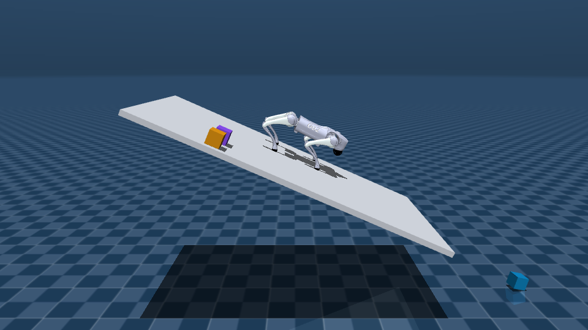
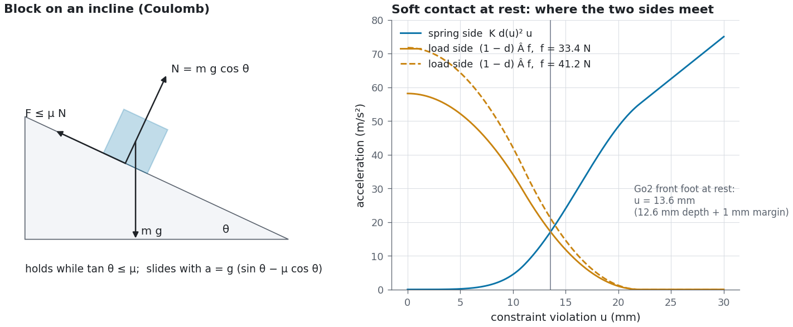
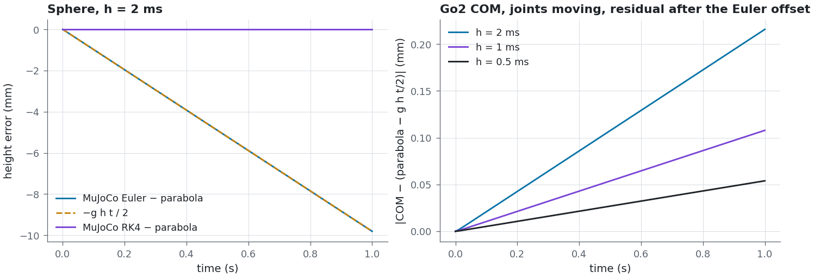
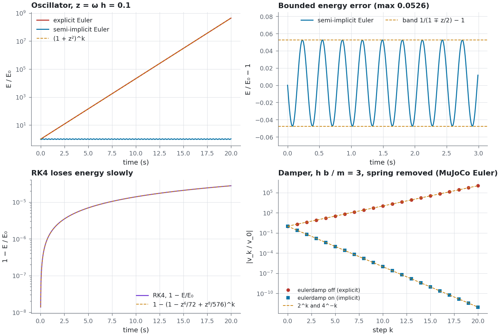
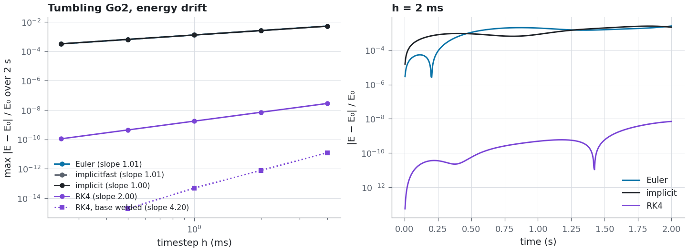
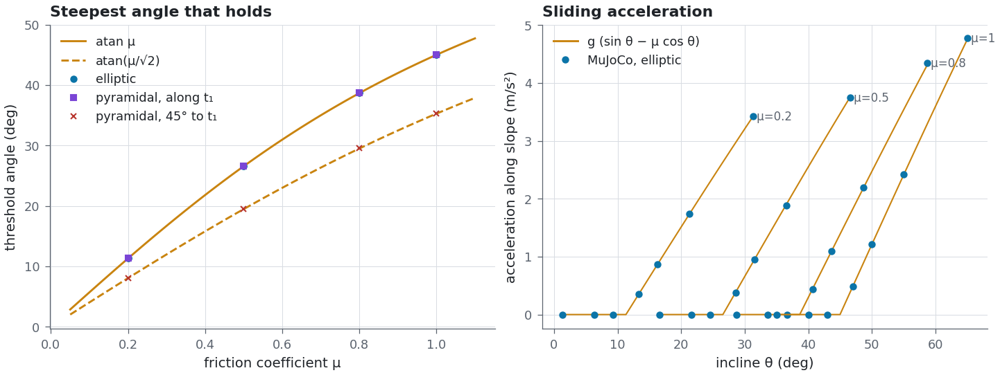
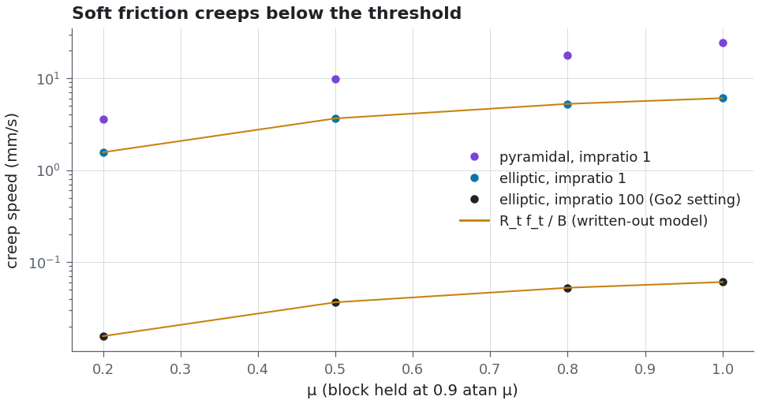
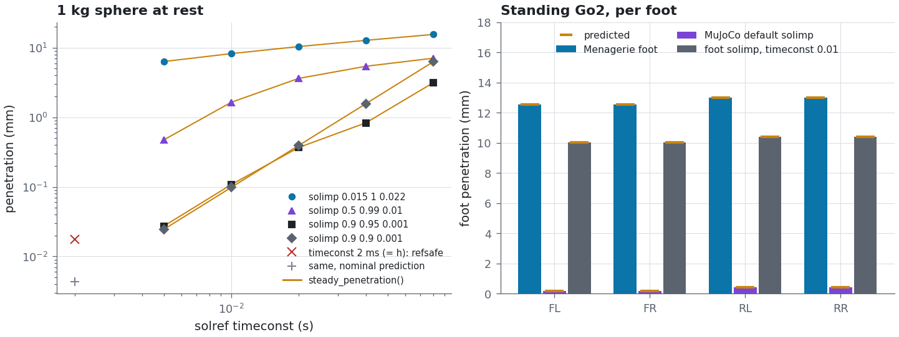
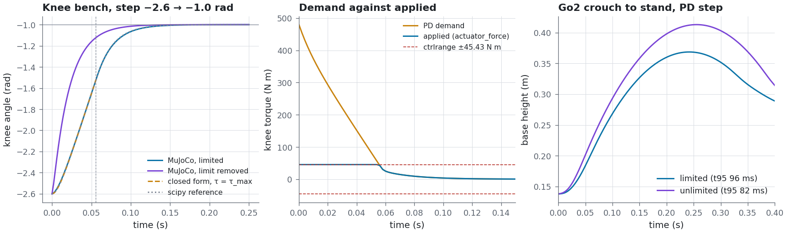
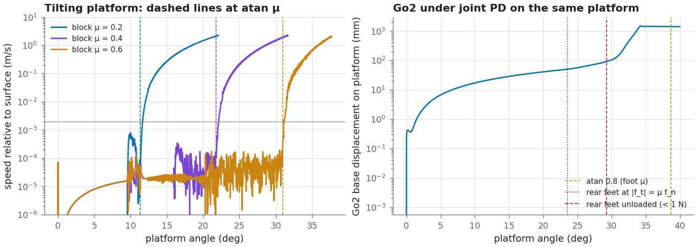

# Module 03 · Simulation: controlled physics experiments with analytic answers

## Objective

Every later module trusts MuJoCo's answer for how the Go2 moves. This module checks that answer on experiments small enough
to solve by hand: a falling body, an oscillator, a block on an incline, a body resting on soft ground and a torque-limited
joint. Each experiment has a closed-form or exactly computable prediction, written out in `physics.py`, and the measured
MuJoCo result is compared with it. Where the two differ, the difference is traced to a stated property of the integrator
or the contact model, and that property is then predicted exactly as well.

| Level | Content | Applied on the Go2 |
|---|---|---|
| Fundamental | free fall and the exact error of semi-implicit Euler; explicit Euler, semi-implicit Euler, implicit-damping Euler and RK4 written out and compared with the analytic energy factor per step and with MuJoCo's integrators | the Go2's centre of mass in free fall with the joints moving |
| Intermediate | energy drift against timestep for Euler, implicitfast, implicit and RK4; Coulomb friction on an incline: threshold angle $\arctan\mu$, sliding acceleration, creep below the threshold, pyramidal against elliptic cones | the tumbling Go2 (energy); a block with the Go2's cone settings (`cone="elliptic"`, `impratio="100"`) |
| Advanced | MuJoCo's soft contact written out (solref, solimp, impedance, regulariser, reference acceleration) and checked row by row; steady penetration and creep predicted; actuator saturation against the closed-form torque-limited response | the Go2's 13 mm foot penetration explained to 0.15%; the Go2 knee on a bench; the Go2 rising from a crouch; the Go2 on a tilting platform |

After this module a reader can say what error a given integrator and timestep will put into a trajectory, predict how
far a MuJoCo contact sinks and how fast it creeps from its `solref`, `solimp` and `impratio`, and recognise a saturated
actuator from its response.



[Incline video](media/incline.mp4) (18.5 s, 960×540, 652 KB): a 2.4 m platform hinged at 1 m height tilts from 0° to 40° along a
minimum-jerk profile over 16 s. Three 10 cm blocks with μ = 0.2, 0.4 and 0.6 start sliding at 11.7°, 22.1° and 31.1°
(predicted $\arctan\mu$: 11.3°, 21.8°, 31.0°). The Go2 stands on the same platform under joint PD; its first foot passes the
platform's lower edge at 33.8° (`platform_go2_foot_past_edge_deg`).

## Prerequisites

[Module 02](../m02_description/README.md): the Menagerie `go2.xml` that is simulated here, its joint parameters (damping
2 N m s/rad, armature 0.01 kg m², friction loss 0.2 N m on every joint) and its masses. No code of module 02 is reused;
nothing there steps the dynamics. [Module 01](../m01_anatomy/README.md) derives the mass matrix $M(q)$ used below.
Maths: ordinary differential equations, the explicit Runge-Kutta family, eigenvalues of a 2×2 matrix, Coulomb friction,
and constrained optimisation at the level of a first-order optimality condition.

## Theory

Notation: $h$ is the timestep, $t = nh$, $g = 9.81$ m/s², $m$ a mass, $q, v$ position and velocity, $M$ the mass matrix.
MuJoCo's integrators are named as in its XML (`Euler`, `implicitfast`, `implicit`, `RK4`).

### Fundamental level

#### Free fall and the error of semi-implicit Euler

MuJoCo's `Euler` updates the velocity first and then the position with the new velocity (semi-implicit, or symplectic,
Euler). Under constant gravity, starting from $z_0, v_0$:

$$
v_{k+1} = v_k - g h,\qquad z_{k+1} = z_k + h\,v_{k+1}
\;\Rightarrow\;
z_n = z_0 + h\sum_{k=1}^{n}(v_0 - k g h) = z_0 + v_0 t - \tfrac12 g t^2 - \tfrac12 g h t .
$$

The velocity is exact and the position carries a first-order offset $-\tfrac12 g h t$, which is $-9.81$ mm after 1 s at
$h = 2$ ms. The energy error follows exactly:

$$
E_n - E_0 = \tfrac12 m (v_0 - g t)^2 + m g z_n - \tfrac12 m v_0^2 - m g z_0 = -\tfrac12 m g^2 h\, t ,
$$

so the scheme loses energy linearly in time. RK4 integrates polynomials of degree ≤ 4 in $t$ exactly, so free fall has no
RK4 error at all.

For the Go2 in the air, internal joint torques cancel in the total momentum, $m\ddot c = m g$ for the centre of mass $c$.
The step is linear in $v$, so the momentum update is exact, but $c(q)$ is a nonlinear function of the configuration. The
COM therefore follows the parabola plus the same $-\tfrac12 g h t$ offset, up to a residual that is itself $O(h)$ when the
body rotates and the joints move.

#### Energy per step on the harmonic oscillator

For $\ddot x = -\omega^2 x$ write $u = \omega x$, $z = \omega h$ and $E = \tfrac12(u^2 + v^2)$. One step of each scheme is a
linear map of $(u, v)$:

$$
A_{\rm explicit} = \begin{pmatrix}1 & z\\ -z & 1\end{pmatrix},\qquad
A_{\rm semi} = \begin{pmatrix}1 - z^2 & z\\ -z & 1\end{pmatrix}.
$$

$A_{\rm explicit}^T A_{\rm explicit} = (1 + z^2)\,\mathbb 1$, so explicit Euler multiplies the energy by exactly $1 + z^2$
every step, from any state. $\det A_{\rm semi} = 1$; semi-implicit Euler conserves the modified energy

$$
\tilde E = \tfrac12\left(u^2 + v^2 - z\,u v\right) = \tfrac12\left(v^2 + \omega^2 x^2 - h\omega^2 x v\right).
$$

In polar form $u = \rho\cos\varphi$, $v = \rho\sin\varphi$, $\tilde E = \tfrac12\rho^2(1 - \tfrac z2\sin 2\varphi)$, so
$E = \tilde E / (1 - \tfrac z2 \sin 2\varphi)$ stays in $[\tilde E/(1 + z/2),\ \tilde E/(1 - z/2)]$. Started from rest
($\tilde E = E_0$), the largest relative energy error is

$$
\max_k \left|\frac{E_k}{E_0} - 1\right| = \frac{z/2}{1 - z/2}.
$$

It is bounded and does not grow with time. For RK4 write $w = u + i v$. Then $\dot u = \omega v$ and $\dot v = -\omega u$
give $\dot w = -i\omega\, w$, so one step multiplies $w$ by the stability function $R(\xi) = \sum_{j=0}^{4}\xi^j / j!$ at
$\xi = \lambda h$ with $\lambda = -i\omega$, that is by $R(-iz)$. $R$ has real coefficients, so $|R(-iz)| = |R(iz)|$ and

$$
\frac{E_{k+1}}{E_k} = |R(-iz)|^2 = \left(1 - \tfrac{z^2}{2} + \tfrac{z^4}{24}\right)^2 + \left(z - \tfrac{z^3}{6}\right)^2
= 1 - \frac{z^6}{72} + \frac{z^8}{576},
$$

a slow loss, sixth order in $z$ per step.

#### Damping: why MuJoCo's Euler takes it implicitly

With joint damping $b$, MuJoCo's `Euler` evaluates the damping force at the new velocity. For one degree of freedom with
force $f(x)$:

$$
(m + h b)\,v_{k+1} = m v_k + h\,f(x_k)
\quad\Leftrightarrow\quad
v_{k+1} = v_k + h\,\frac{f(x_k) - b v_k}{m + h b},\qquad x_{k+1} = x_k + h v_{k+1}.
$$

For a pure damper ($f = 0$) this gives $v_{k+1} = v_k / (1 + h b/m)$, stable for every $h$. The explicit update
$v_{k+1} = v_k (1 - h b / m)$ diverges once $h b/m > 2$. `implicitfast` applies the same treatment to all velocity
derivatives of passive and actuator forces; on a single slide joint with a damper it is the same update.

### Intermediate level

#### Energy drift on the Go2

With gravity, damping, friction loss, joint limits and contacts disabled, the only energy of the floating Go2 is
$T = \tfrac12 v^T M(q)\, v$, and it is conserved. A method of order $p$ has a global error $O(h^p)$, so the maximum drift
over a fixed time should scale as $h^1$ for the Euler variants and $h^4$ for RK4. Semi-implicit Euler is symplectic only
for separable Hamiltonians; the configuration-dependent $M(q)$ of a multibody system is not separable, so no bounded-error
guarantee applies here and first order is the prediction.

#### Block on an incline

On a plane tilted by $\theta$ with Coulomb coefficient $\mu$, the normal force is $N = m g\cos\theta$ and the block holds
while the required friction $m g \sin\theta$ fits in the cone $\mu N$:

$$
\tan\theta \le \mu \;\Leftrightarrow\; \theta \le \theta^* = \arctan\mu,\qquad
a = g\,(\sin\theta - \mu\cos\theta)\ \text{ when sliding.}
$$

The experiment detects sliding as an acceleration above $a_{\min} = 0.01$ m/s², which places the measured threshold above
$\theta^*$ by $\delta\theta \approx a_{\min} / (g\sqrt{1+\mu^2})$, from 0.057° at μ = 0.2 to 0.041° at μ = 1.

MuJoCo's pyramidal cone for `condim="3"` has the four edges $n \pm \mu t_1$ and $n \pm \mu t_2$. A force
$f = \sum_j \lambda_j e_j$ with $\lambda_j \ge 0$ has tangential components $\mu(\lambda_1 - \lambda_2)$,
$\mu(\lambda_3 - \lambda_4)$ and normal component $\sum_j\lambda_j$, so the pyramid is $|f_1| + |f_2| \le \mu f_n$. Its
friction limit in a direction at angle $\varphi$ from $t_1$ is

$$
\mu_{\rm eff}(\varphi) = \frac{\mu}{|\cos\varphi| + |\sin\varphi|},\qquad \mu_{\rm eff}(45°) = \mu/\sqrt2 .
$$

The elliptic cone $\sqrt{f_1^2 + f_2^2} \le \mu f_n$ has no such direction dependence.

### Advanced level: the soft contact

#### Reference acceleration, impedance and regulariser

MuJoCo does not enforce $J\dot v = 0$ at a contact. For each constraint row with violation $r$ (signed distance minus
margin, negative in penetration) and velocity $v_r = J v$ it defines a reference acceleration and a regulariser:

$$
a_{\rm ref} = -B\, v_r - K\, d(r)\, r,\qquad R = \frac{1 - d(r)}{d(r)}\,\hat A,
$$

where $\hat A$ is a diagonal approximation of $J M^{-1} J^T$. For a contact normal on body $b$ it is the body's
translational inverse weight at the reference configuration $q_0$,

$$
\hat A_b = \tfrac13\,\mathrm{tr}\!\left(J_{c,b}\, M(q_0)^{-1} J_{c,b}^T\right),
$$

with $J_{c,b}$ the Jacobian of the body's centre of mass. `solref = (τ, ζ)` sets

$$
K = \frac{1}{d_{\max}^2\,\tau^2\,\zeta^2},\qquad B = \frac{2}{d_{\max}\,\tau},\qquad
\tau \leftarrow \max(\tau, 2h)\ \text{(refsafe, on by default)} ,
$$

and `solimp = (d_0, d_{\rm width}, w, m_p, p)` sets the impedance $d(r) = d_0 + y(x)(d_{\rm width} - d_0)$ with
$x = |r|/w$ and

$$
y(x) = \begin{cases} x^p / m_p^{\,p-1} & x \le m_p\\ 1 - (1-x)^p/(1-m_p)^{p-1} & m_p < x < 1\\ 1 & x \ge 1\end{cases}
$$

($d_{\max} = d_{\rm width}$; MuJoCo clamps $d$ to $[10^{-4}, 0.9999]$). These are the quantities MuJoCo stores per row in
`efc_KBIP`, `efc_R` and `efc_aref`; the experiment compares them one by one.

#### Steady penetration

For a row whose force lies inside its cone, the solver's optimality condition gives $J\dot v = a_{\rm ref} - R f$. At rest
$J\dot v = 0$ and $v_r = 0$, so with the violation $u = -r > 0$:

$$
K\, d(u)\, u = \frac{1 - d(u)}{d(u)}\,\hat A f
\quad\Longleftrightarrow\quad
K\, d(u)^2\, u = (1 - d(u))\,\hat A\, f ,
$$

and the geometric penetration is $u$ minus the contact margin. The left side grows with $u$ and the right side falls, so
there is one root. With a constant impedance ($d_0 = d_{\rm width} = d$) and a free body ($\hat A = 1/m$, $f = m g$) it
reduces to $u = (1 - d)\,\tau^2\zeta^2\, g$, independent of the mass: 0.392 mm for $d = 0.9$, $\tau = 0.02$ s.

Worked example, the Go2's front foot at rest. The Menagerie foot class sets `solimp="0.015 1 0.022"` (mid 0.5, power 2),
default `solref = (0.02, 1)`, margin 1 mm, and the foot geom has `priority="1"`, so these values are used unmixed. Then
$d_{\max} = 0.9999$, $K = 2500.5$ s⁻², the calf's $\hat A = 1.767$ kg⁻¹ (`go2_invweight_calf`) and the measured normal force
is $f = 33.38$ N. The root is $u = 13.56$ mm with $d = 0.710$: $K d^2 u = 17.1$ m/s² $= (1-d)\hat A f$. Removing the 1 mm
margin leaves a penetration of 12.56 mm, the "13 mm soft foot" noted in `MODULE_SPEC.md`. The impedance starts at 0.015,
so the contact is nearly limp for the first millimetres and only stiffens as the foot sphere sinks into its 22 mm width
(diagram below, right).

#### Creep below the friction threshold

A friction row has zero violation, so $a_{\rm ref} = -B v_t$. If the block slides steadily at $v_t$ ($J\dot v = 0$) with
its friction force $f_t$ inside the cone, then $0 = -B v_t - R_t f_t$:

$$
|v_t| = \frac{R_t\, f_t}{B},\qquad R_t = \frac{R_n}{\texttt{impratio}}\ \text{(elliptic cone, equal tangential } \mu).
$$

A block that Coulomb friction would hold therefore creeps at a constant speed, inversely proportional to `impratio`.

#### Actuator saturation

A Go2 motor applies $\tau = \mathrm{clip}(u, -\tau_{\max}, \tau_{\max})$ with $\tau_{\max} = 23.7$ N m (hip, thigh) or
45.43 N m (knee). On a bench (thigh clamped, no gravity) the knee obeys

$$
I\ddot q = \tau - b\,\dot q - \tau_{\rm fl}\,\mathrm{sign}(\dot q),\qquad
I = a^T I_c\, a + m\left(|c|^2 - (a\cdot c)^2\right) + I_{\rm arm},
$$

with the calf's mass $m$, centre of mass $c$ and inertia $I_c$ about it, the joint axis $a$, armature $I_{\rm arm}$, damping
$b$ and friction loss $\tau_{\rm fl}$. While saturated ($\tau = \tau_{\max}$, $\dot q > 0$, start from rest), with
$\tau_s = \tau_{\max} - \tau_{\rm fl}$ and $T = I/b$:

$$
\dot q(t) = \frac{\tau_s}{b}\left(1 - e^{-t/T}\right),\qquad
q(t) = q_0 + \frac{\tau_s}{b}\left(t - T\left(1 - e^{-t/T}\right)\right).
$$

The speed tends to $\tau_s / b$, here 22.6 rad/s. The same joint stepped by MuJoCo's Euler (damping implicit) follows the
discrete version exactly, with $\rho = 1/(1 + h b/I)$:

$$
\dot q_n = \frac{\tau_s}{b}(1 - \rho^n),\qquad q_n = q_0 + h\,\frac{\tau_s}{b}\left(n - \frac{\rho(1 - \rho^n)}{1 - \rho}\right).
$$

A PD law $u = k_p(q_1 - q) - k_d\dot q$ leaves saturation when $u$ falls to $\tau_{\max}$; inserting the closed form gives
the exit time.



## Implementation

`physics.py` holds every prediction and the test rigs; `validate.py` runs the experiments and compares.

| Equation | Function | Note |
|---|---|---|
| free fall, Euler offset and energy error | `free_fall`, `free_fall_semi_implicit_offset`, `free_fall_semi_implicit_energy_error` | |
| integrators | `step_explicit_euler`, `step_semi_implicit_euler`, `step_euler_implicit_damping`, `step_rk4`, `integrate` | scalar second-order ODE |
| oscillator energy factors | `oscillator_energy_factor`, `symplectic_modified_energy`, `symplectic_energy_band` | |
| incline | `incline_threshold`, `incline_acceleration`, `pyramid_friction_ratio` | |
| soft contact | `impedance`, `stiffness_damping`, `reference_acceleration`, `regulariser`, `inverse_weight`, `steady_penetration`, `creep_speed` | `steady_penetration` brackets the root with `scipy.optimize.brentq` |
| saturation | `saturated_response`, `saturated_response_discrete`, `inertia_about_axis`, `pd_saturated_reference` | the reference integrates the clipped PD law with SciPy's DOP853 at `rtol = 1e-11` |
| rigs | `sphere_xml`, `oscillator_xml`, `slider_xml`, `knee_bench_xml` | MJCF strings |

Design choices and their reasons:

- The sphere and slider rigs put the same `solref`/`solimp` on both geoms. MuJoCo mixes the two geoms' parameters
  (`solmix`), and a plane left at its defaults would silently change the values under test.
- The incline block is a sphere on three slide joints. A box on four corner contacts rocks while it slides; in a first
  trial its acceleration over 0.25 s windows varied between 0.30 and 0.49 m/s² around the predicted 0.44 m/s². The slider
  has one contact and no rotation, so the prediction applies without a tipping term.
- The incline is made by tilting gravity, not the plane. The contact frame then stays aligned with the world axes, and the
  45° test can put the slope exactly between the pyramid's edges.
- The knee bench copies mass, centre of mass, inertia, damping, armature, friction loss, range and torque limit from the
  compiled Menagerie model, so the bench is the Go2's knee and not a stand-in.
- The tilting platform's hinge position and velocity are prescribed before and after every step. A mocap body would move
  the surface without a velocity, and friction would then oppose the platform's own motion.
- `inverse_weight` takes $J_c$ and $M$ from MuJoCo as inputs. Only the formula is written here; the Jacobian and mass
  matrix are module 01's and module 04's subject.

## Experiment

```bash
.venv-modules/bin/python modules/m03_simulation/validate.py      # 65 s wall time, 1-min load average 69 on 32 cores
.venv-modules/bin/python -m pytest -q modules/m03_simulation       # 8 tests, 20 s
```

| Experiment | Inputs | Measured |
|---|---|---|
| sphere free fall | 1 kg, no floor, $h$ = 2 ms, 1 s, `Euler` and `RK4` | height against the parabola and the discrete formula; energy |
| Go2 free fall | no floor, joints at the standing pose, joint velocities uniform in ±2 rad/s and base angular velocity in ±1 rad/s (seed 1), base velocity (0.3, −0.2, 1.0) m/s, $h$ = 2, 1, 0.5 ms, 1 s | COM (`subtree_com`) against parabola plus $-\tfrac12 g h t$ |
| oscillator | $\omega$ = 10 rad/s, $h$ = 0.01 s ($z$ = 0.1), 20 s, from $x$ = 1, $v$ = 0; damped case $b$ = 0.5 N s/m; damper case $b h/m$ = 3, 20 steps | energy ratio per step; own trajectories against MuJoCo |
| tumbling Go2 | gravity off, damping and friction loss zeroed, constraints disabled; base angular velocity in ±1 rad/s and joint velocities in ±2 rad/s (seed 0); $h$ = 0.25 to 4 ms; 2 s; four integrators | max $\lvert E - E_0\rvert / E_0$, sampled every 4 ms ($E_0$ = 0.661 J) |
| incline | slider, 1 kg, μ ∈ {0.2, 0.5, 0.8, 1.0}; pyramidal (impratio 1), elliptic (impratio 1 and 100); bisection on θ to 6e-4°; acceleration fitted over 0.5 to 2.0 s | threshold, acceleration at θ* + {2, 5, 10, 20}°, creep speed at 0.9 θ* |
| sphere penetration | 1 kg, `condim="1"`; τ ∈ {5, 10, 20, 40, 80} ms × 4 `solimp` sets; settled 2 s | depth against `steady_penetration`; every efc row against the written-out model |
| Go2 feet | standing under joint PD (kp 60, kd 2), settled 2 s; Menagerie foot, MuJoCo default `solimp`, foot `solimp` with τ = 0.01 s | per-foot depth against the prediction from the measured normal force |
| knee bench | FL calf, $q$: −2.6 → −1.0 rad, kp 300 N m/rad, kd 5 N m s/rad, $h$ = 2 ms, 0.25 s; then with the torque limit removed | angle, demanded and applied torque |
| Go2 rise | crouch (0, 1.25, −2.6) to stand (0, 0.9, −1.8) rad per leg as a PD step, kp 150, kd 4, 1 s, with and without the torque limits; the PD output goes to `ctrl` unclipped (own loop, not `sim.run`, which clips to `ctrlrange`) | base height, demand and applied torque relative to the limit |
| tilting platform | hinge at 1 m, 0 → 40° minimum-jerk over 16 s after a 1.5 s hold; blocks μ = 0.2, 0.4, 0.6 (platform μ 0.05); Go2 under joint PD (kp 60, kd 2) facing downhill | block speed relative to the surface (onset: > 2 mm/s); Go2 foot force ratios |

## Validation

Thresholds were fixed in `validate.ACCEPT` before the first full run. `bench_saturated_vs_discrete_rad` was added after the
first run showed the 7.6 mrad continuous-time gap, and before it was measured. `test_physics.py` asserts the same
thresholds; the missed row is pinned to its measured state there (see Failure analysis).

| Check | Measured | Acceptance | Source (`results.json`) |
|---|---|---|---|
| sphere, `Euler` against parabola $-\tfrac12 g h t$, max over 1 s | 1.1e-14 m | < 1e-9 m | `ff_sphere_euler_vs_discrete_m` |
| sphere, `RK4` against the parabola, max | 1.3e-14 m | < 1e-9 m | `ff_sphere_rk4_vs_parabola_m` |
| sphere, error at 1 s / $(-\tfrac12 g h t)$ − 1 (error −9.81 mm) | 5.6e-13 | < 1e-6 | `ff_sphere_euler_offset_ratio_err` |
| sphere, energy error / $(-\tfrac12 m g^2 h t)$ − 1 | 5.2e-12 | < 1e-6 | `ff_sphere_euler_energy_ratio_err` |
| Go2 COM against parabola plus Euler offset, max, $h$ = 2 ms | 0.22 mm | < 1 mm (10% of the 9.8 mm offset) | `ff_go2_com_residual_m` |
| own explicit Euler energy against $(1+z^2)^k$, max relative, 2000 steps | 2.4e-14 | < 1e-9 | `osc_explicit_euler_energy_rel_err` |
| own RK4 energy against $(1 - z^6/72 + z^8/576)^k$ | 7.2e-14 | < 1e-9 | `osc_rk4_energy_rel_err` |
| semi-implicit Euler modified energy $\tilde E$, max relative change | 2.2e-15 | < 1e-12 | `osc_symplectic_modified_energy_rel_drift` |
| semi-implicit Euler max $\lvert E/E_0 - 1\rvert$ (0.052632) against $(z/2)/(1-z/2)$ | 5.9e-8 relative | < 0.01 | `osc_symplectic_band_rel_err` |
| own semi-implicit Euler against MuJoCo `Euler` | 0 m | < 1e-12 m | `osc_own_vs_mujoco_euler_m` |
| own RK4 against MuJoCo `RK4` | 1.9e-14 m | < 1e-12 m | `osc_own_vs_mujoco_rk4_m` |
| own implicit-damping Euler against MuJoCo `Euler`, $b$ = 0.5 | 6.7e-16 m | < 1e-12 m | `osc_own_vs_mujoco_damped_euler_m` |
| same against MuJoCo `implicitfast` | 6.7e-16 m | < 1e-12 m | `osc_own_vs_mujoco_damped_implicitfast_m` |
| damper $hb/m = 3$: MuJoCo with `eulerdamp` off against $(1 - hb/m)^k$, on against $(1+hb/m)^{-k}$ | 0 | < 1e-9 | `osc_explicit_damping_growth_rel_err` |
| energy drift order, `Euler` | 1.01 | 0.8 to 1.2 | `energy_order_euler` |
| energy drift order, `implicitfast` | 1.01 | 0.8 to 1.2 | `energy_order_implicitfast` |
| energy drift order, `implicit` | 1.00 | 0.8 to 1.2 | `energy_order_implicit` |
| energy drift order, `RK4` | **2.00 (missed)** | 3.5 to 4.5 | `energy_order_rk4` |
| `implicitfast` drift against `Euler` drift, max relative difference | 0 | < 1e-10 | `energy_implicitfast_equals_euler` |
| `RK4` drift / `Euler` drift at 2 ms | 2.7e-6 | < 1e-2 | `energy_rk4_over_euler_at_2ms` |
| incline threshold against $\arctan\mu$, max over 4 μ × 3 cone settings | 0.057° | < 0.5° | `incline_threshold_err_deg_max` |
| sliding acceleration against $g(\sin\theta - \mu\cos\theta)$, max / g | 0.0049 | < 0.02 | `incline_accel_err_over_g_max` |
| creep speed at 0.9 θ* against $R_t f_t / B$, elliptic, max relative | 6.5e-9 | < 0.10 | `incline_creep_rel_err_max` |
| pyramidal cone, slope at 45° to $t_1$: threshold against $\arctan(\mu/\sqrt2)$ | 0.058° | < 0.5° | `incline_pyramid_45deg_threshold_err_deg_max` |
| own $K$, $B$, $d$, $R$, $a_{\rm ref}$ against `efc_KBIP`, `efc_R`, `efc_aref`, all contact rows (sphere and Go2) | 2.0e-16 relative | < 1e-9 | `contact_model_vs_efc_rel_max` |
| own $\hat A$ of the four calves against `body_invweight0` | 2.2e-16 relative | < 1e-9 | `contact_invweight_vs_mujoco_rel` |
| sphere penetration against `steady_penetration`, 20 cases (0.025 to 15.5 mm) | 2.1e-9 relative | < 1e-3 | `penetration_sphere_rel_err_max` |
| Go2 foot penetration against prediction, 4 feet × 3 settings | 1.5e-3 relative | < 0.02 | `penetration_go2_rel_err_max` |
| sphere, τ = 2 ms requested at $h$ = 2 ms: depth against refsafe prediction (τ = 4 ms) | 1.3e-9 relative | < 1e-3 | `penetration_refsafe_rel_err` |
| knee bench inertia (0.01633 kg m²) against MuJoCo `mj_fullM` | 2.2e-16 relative | < 1e-9 | `bench_inertia_vs_mujoco_rel` |
| MuJoCo `actuator_force` for `ctrl` = 300 N m, minus 45.43 N m | 0 N m | < 1e-12 N m | `bench_mujoco_force_clamped_Nm` |
| saturated phase, MuJoCo against continuous closed form, max | 7.6e-3 rad | < 1e-2 rad | `bench_saturated_vs_closed_form_rad` |
| saturated phase, MuJoCo against discrete closed form, max | 6.7e-16 rad | < 1e-9 rad | `bench_saturated_vs_discrete_rad` |
| whole step until first stop, MuJoCo against SciPy reference, max | 7.6e-3 rad | < 1e-2 rad | `bench_vs_reference_rad` |
| exit from saturation, predicted 55.6 ms against measured 56 ms | 0.44 ms | < 4 ms (2 steps) | `bench_sat_exit_time_err_s` |
| Go2 rise, applied torque (`actuator_force`) / limit, max over 12 joints; `ctrl` written unclipped, so this tests MuJoCo's `ctrllimited` clamp | 1.000 | ≤ 1 | `rise_applied_over_limit_max` |
| Go2 rise, demanded torque / limit, max | 2.64 | > 1 | `rise_demand_over_limit_max` |
| tilting platform, onset angle against $\arctan\mu$, max over 3 blocks | 0.35° | < 1° | `platform_onset_err_deg_max` |
| MP4 under 6 MB | 1 (652 KB) | 1 | `media_mp4_under_6MB` |

38 of 39 checks pass.

### Integrators



The Go2 COM's offset at 1 s is −9.94 mm against −9.81 mm for a point mass (`ff_go2_com_offset_at_1s_m`), and the residual
is 0.216, 0.108 and 0.054 mm at $h$ = 2, 1 and 0.5 ms (`ff_go2_com_residual_by_h`): first order, as derived.



RK4 loses 1 − E/E₀ = 2.8e-5 over the 2000 steps (`osc_rk4_energy_loss`), on the curve
$1 - (1 - z^6/72 + z^8/576)^k$. MuJoCo's `Euler` and the written-out semi-implicit Euler agree to the last bit (0 m). With damping, MuJoCo's `Euler` and
`implicitfast` both equal the implicit-damping update to 6.7e-16 m. With the damper set to $hb/m = 3$ and MuJoCo's
`eulerdamp` disabled, the velocity after 20 steps is $(-2)^{20} = 1.05\times10^{6}$ times its start value; with implicit
damping it is $4^{-20} = 9.1\times10^{-13}$ (`osc_explicit_damping_v_after_20_steps`, `osc_implicit_damping_v_after_20_steps`).



| Integrator | 0.25 ms | 0.5 ms | 1 ms | 2 ms | 4 ms | fitted order |
|---|---|---|---|---|---|---|
| Euler | 3.2e-4 | 6.4e-4 | 1.3e-3 | 2.6e-3 | 5.3e-3 | 1.01 |
| implicitfast | 3.2e-4 | 6.4e-4 | 1.3e-3 | 2.6e-3 | 5.3e-3 | 1.01 |
| implicit | 3.2e-4 | 6.5e-4 | 1.3e-3 | 2.6e-3 | 5.1e-3 | 1.00 |
| RK4 | 1.1e-10 | 4.4e-10 | 1.8e-9 | 7.0e-9 | 2.8e-8 | 2.00 |

Max $\lvert E - E_0\rvert / E_0$ over 2 s, from `energy_drift`. With no damping and no actuators, `implicitfast` has nothing
to treat implicitly and reproduces `Euler` exactly. `implicit` also linearises the Coriolis and centrifugal terms and
differs from `Euler` by at most 2.6% here. At the default 2 ms step the Euler variants drift 0.26% of the kinetic energy in
2 s; RK4 drifts 7.0e-9, at four model evaluations per step.

### Friction



The measured thresholds sit above $\arctan\mu$ by the detection bias derived above: elliptic, impratio 100, μ = 0.8 gives
38.7047° against 38.6598° + 0.0456° = 38.7054° (`threshold_deg`). Pyramidal and elliptic cones give the same threshold when
the slope runs along the contact frame's $t_1$. At 45° the pyramidal threshold follows $\arctan(\mu/\sqrt2)$: 29.55° for
μ = 0.8 instead of 38.66°.



Below the threshold every block creeps. At μ = 0.5 and 23.9° the elliptic cone creeps at 3.65 mm/s with `impratio` 1 and
0.0365 mm/s with `impratio` 100; the pyramidal cone creeps at 9.82 mm/s (`creep`). The elliptic values match $R_t f_t/B$ to
6.5e-9. No prediction was derived for the pyramidal cone, whose four edge rows share the load differently.

### Contact penetration



| Go2 foot setting | FL, FR measured | RL, RR measured | prediction, max relative error | base height |
|---|---|---|---|---|
| Menagerie foot (`solimp` 0.015 1 0.022, τ = 0.02 s) | 12.56 mm | 12.99 mm | 2.3e-6 | 0.256 m |
| MuJoCo default `solimp` (0.9 0.95 0.001) | 0.19 mm | 0.45 mm | 1.5e-3 | 0.269 m |
| foot `solimp`, τ = 0.01 s | 10.04 mm | 10.39 mm | 1.7e-6 | 0.258 m |

From `variants`. The Menagerie feet sink 29 (rear) to 65 (front) times deeper than with MuJoCo's default `solimp`, and the
base stands 13 mm lower. The largest prediction error, 1.5e-3, is with the default `solimp`, where the 0.2 to 0.45 mm
depths are comparable to the PD stance's residual motion; it was not investigated further. Halving the time constant takes 2.5 mm off, because the impedance, not the stiffness, sets most of this depth.

### Actuator saturation



The knee's inertia is 0.0163 kg m², of which the armature is 0.010 kg m² (61%). The PD law asks for 480 N m at the start;
the motor gives 45.43 N m for the first 56 ms and the knee reaches 22.57 rad/s against the predicted terminal speed of
22.62 rad/s. 90% of the 1.6 rad step takes 82 ms with the limit and 52 ms without it (`bench_t90_limited_s`,
`bench_t90_unlimited_s`). On the whole Go2 the same PD step from a crouch demands up to 2.64 times the limit, the knees are
saturated in 25% of the samples during the first 0.2 s (`rise_knee_saturated_fraction_first_0p2s`), and the base reaches
95% of its rise at 96 ms instead of 82 ms. The limited run overshoots to 0.369 m base height and the unlimited one to 0.413 m
(`rise_peak_height_limited_m`, `rise_peak_height_unlimited_m`; figure, right): a PD step is not a standing controller.

### Tilting platform



The onsets measured in the video run are 11.66°, 22.13° and 31.09° against 11.31°, 21.80° and 30.96°
(`platform_onset_deg`). The bias is the 2 mm/s detection threshold reached while the platform keeps tilting. Over
1° < θ < 0.9 arctan μ the blocks move relative to the surface at a median of 6.4e-6, 1.2e-5 and 1.5e-5 m/s for μ = 0.2, 0.4
and 0.6, the creep level of `impratio` 100, with maxima of 8.0e-4, 3.4e-4 and 1.7e-4 m/s
(`platform_block_speed_before_onset`). The μ = 0.2 maximum is a short rise at 10.0° that was not traced to a cause. Taken
over the whole interval from the end of the hold to the measured onset, the medians are 2.2e-6, 7.0e-6 and 1.2e-5 m/s.

## Failure analysis

### RK4 is second order on the floating base

The fitted energy-drift order of `RK4` on the floating Go2 is 2.00 against the 4 expected, so `energy_order_rk4` misses its
criterion. Two further runs locate the cause (`rk4_diagnostics`, not acceptance rows):

| Run | Fitted order |
|---|---|
| same Go2, same joint velocities, base welded to the world (`energy_order_rk4_fixed_base`) | 4.20 |
| single box tumbling freely, orientation error against a 10 µs RK4 reference, $h$ = 1, 2, 4 ms (`rk4_box_orientation_order`) | 1.98 |

With only hinge joints RK4 is fourth order; the free joint's orientation is integrated to second order. A torque-free box
alone does not show it in its energy, because its kinetic energy depends on the body-frame angular velocity only. The Go2's
does, because the free joint's linear velocity is in the world frame. The measurement is consistent with RK4 stages that
are combined in the tangent space and applied to the quaternion through one exponential map, without the commutator
correction a Lie-group Runge-Kutta method needs (Munthe-Kaas, 1998); MuJoCo's source was not read to confirm it. In
practice RK4 still drifts 3.7e5 times less than `Euler` at 2 ms, but halving the step only gains a factor 4.

### Explicit damping diverges

Shown in the oscillator figure (bottom right) and the validation table: with `eulerdamp` disabled, a damper with $hb/m = 3$ multiplies
the velocity by −2 every step. On the Go2 the joint damping alone is far from this limit (calf: $2I/b = 16$ ms at
$I$ = 0.0163 kg m²), but a PD derivative gain computed by the controller reaches MuJoCo as an explicit actuator force. With
the joint damping $b$ still implicit, the velocity factor per step is $1 - h(k_d + b)/(I + hb)$, stable while
$k_d < 2I/h + b$: 18 N m s/rad for the calf at $h$ = 2 ms. This was derived, not run on the Go2.

### Pyramidal cones are anisotropic

At 45° to the contact frame the pyramidal cone holds only $\mu/\sqrt2$: the μ = 0.8 slider slides at 29.55° instead of
38.66° (incline figure, red crosses). Which way the contact frame's $t_1$ points depends on the geometry pair, so the
effective friction of a pyramidal foot contact changes with the walking direction. The Go2 model uses the elliptic cone and
is not affected; any model left at MuJoCo's default (pyramidal) is.

### Soft friction creeps

A block that Coulomb friction holds moves at $R_t f_t / B$: 3.65 mm/s, or 13 m per hour, at μ = 0.5 and 90% of its threshold
with `impratio` 1. The Go2 model's `impratio="100"` reduces this to 0.0365 mm/s. A standing-still test over minutes on a
slope would show the drift; an estimator that assumes zero foot velocity in stance would read it as odometry error.

### `timeconst` below 2h is silently replaced, and unstable without the replacement

Asking for τ = 2 ms at $h$ = 2 ms gives a penetration of 0.0175 mm, four times the 0.0044 mm the nominal τ predicts, and
equal to the τ = 4 ms prediction to 1.3e-9 (`refsafe`). With `refsafe` disabled the sphere does not settle: after 2 s its centre is
0.77 m above the floor, moving at 1.05 m/s (`measured_refsafe_off_m`, `refsafe_off_vertical_speed`).

### The Go2 under joint PD does not reach the friction or tipping limit

On the platform the rigid-stance tipping angle is 40.7° (front-foot line against COM height, `platform_go2_tip_pred_deg`)
and the friction limit of its feet is $\arctan 0.8 = 38.7°$. The Go2 fails earlier. Its rear feet reach $|f_t| = \mu f_n$ at
23.5° (`platform_go2_rear_feet_at_friction_limit_deg`) and carry less than 1 N at 29.3° (`platform_go2_rear_feet_off_deg`);
its base has moved 0.5 m down the platform at 32.7° (`platform_go2_displacement_0p5m_at_deg`) and its first foot passes the
lower edge at 33.8° (`platform_go2_foot_past_edge_deg`). As the platform tilts, load moves to the front feet (34.1/40.4 N
per front/rear foot at 1°, 53.3/16.8 N at 20°, means over the two feet) while the joint PD keeps asking the rear feet for a
share of the downhill force: at 20° the rear friction ratio $|f_t|/f_n$ is 0.507 against 0.386 at the front
(`platform_go2_foot_loads`). The legs also yield, 40 mm of base travel by 20° (`platform_go2_displacement_at_20deg_m`),
which moves the COM toward the front-foot line.
Both are controller properties, not simulator errors; a stance controller that distributes contact forces would be
measured against the same 38.7° and 40.7°.

### Setup errors met while building the rigs

The first knee-bench run copied the joint range in radians into an MJCF string without `<compiler angle="radian"/>`.
MuJoCo read −2.72 to −0.84 as degrees, the joint limit engaged at once, and the knee reached 31 rad/s, above its own
terminal speed. The first tilting platform hinged at 0.3 m hit the floor at about 14°, and the solver pushed the platform
through the blocks and the Go2. A first box-shaped incline block rocked (see Implementation). Each was found because a
measured number disagreed with its prediction.

### What the experiments do not cover

Multi-contact steady states other than the Go2's four feet, rolling and torsional friction, `implicit` with velocity-
dependent actuators, and MuJoCo's `mjINT_DISCRETE` integrator (present in 3.17) were not tested. The creep and penetration
formulas hold for constraint forces inside their cones; sliding contacts were only checked through the block acceleration.

## References

- MuJoCo documentation, mujoco.readthedocs.io (MuJoCo 3.x). The pages use named headings, not numbers; the parts used:
  Computation › General framework › Numerical integration › Integrators (Euler with implicit damping, implicit,
  implicitfast, RK4); Computation › Constraint model › Contact › Friction cones (pyramidal and elliptic); Computation ›
  Constraint solver › Primal problem, Dual problem and Parameters (impedance $d$, reference acceleration, diagonal
  approximation $\hat A$); Modeling › MJCF Mechanisms › Solver parameters › Reference (`solref`, `refsafe`) and › Impedance
  (`solimp`); Modeling › MJCF Mechanisms › Contact parameters (`solmix`, `priority`, `margin`, `condim`); XML Reference ›
  `option` (`impratio`, `cone`) and `option/flag` (`refsafe`, `eulerdamp`), `motor` (`ctrlrange`). The formulas above were
  taken from there and then checked against `efc_KBIP`, `efc_R` and `efc_aref` to round-off.
- E. Todorov, "Convex and analytically-invertible dynamics with contacts and constraints: Theory and implementation in
  MuJoCo", IEEE ICRA 2014: Section II.C, problem (5), the soft Gauss principle with regulariser $R$; Section V, eq. (23),
  $f = R^{-1}(v^* - Jv')$ for non-sliding contacts. The paper states it at the velocity (impulse) level; the acceleration
  form $J\dot v = a_{\rm ref} - Rf$ used here is the documentation's (Constraint solver › Primal problem).
- E. Hairer, C. Lubich, G. Wanner, *Geometric Numerical Integration*, 2nd ed., Springer 2006: Section I.1.2 (symplectic
  Euler), Section VI.3 (symplectic Euler is symplectic), Sections IX.1 and IX.3 (modified equation and modified Hamiltonian
  of symplectic methods, the source of $\tilde E$) and IX.8 (long-time energy conservation, the bounded band). Section
  titles checked against the book's table of contents.
- E. Hairer, G. Wanner, *Solving Ordinary Differential Equations II*, 2nd ed., Springer 1996: Section IV.2, "Stability
  analysis for explicit RK methods", the stability function $R(z) = \sum_{j=0}^{4} z^j/j!$ of the classical RK4 used for
  the energy factor.
- H. Munthe-Kaas, "Runge-Kutta methods on Lie groups", BIT Numerical Mathematics 38(1), 1998: cited only as the context for
  the RK4 order loss on the free joint (order conditions for Runge-Kutta methods on Lie groups); no section of it was
  checked against the measurement.
- K. Zakka et al., MuJoCo Menagerie, github.com/google-deepmind/mujoco_menagerie, `unitree_go2/go2.xml` (foot `solimp`,
  `priority`, `cone`, `impratio`, motor ranges).
