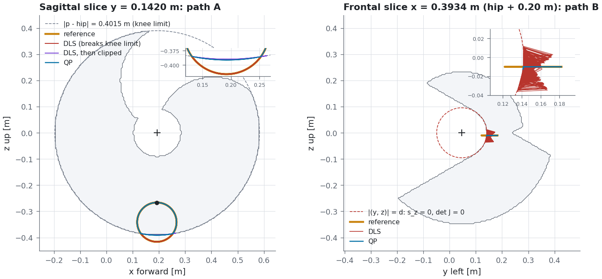
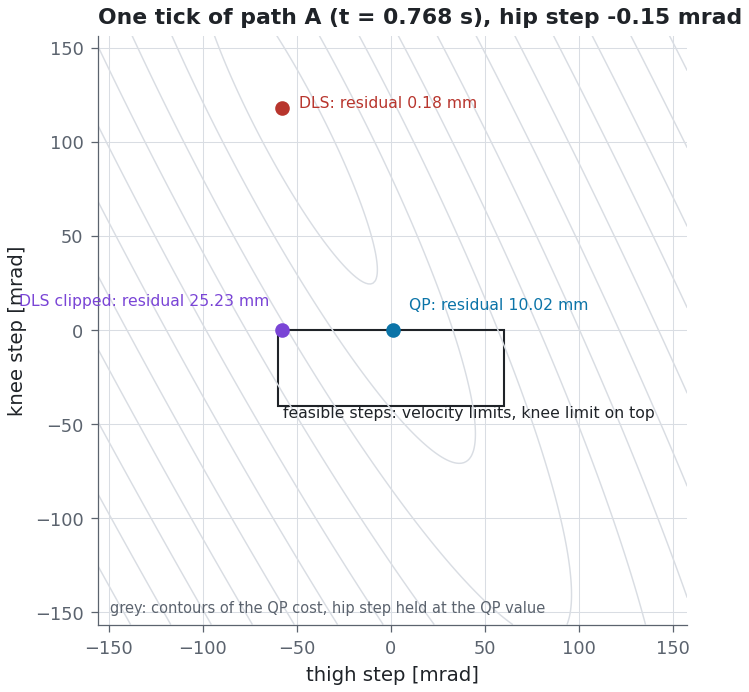
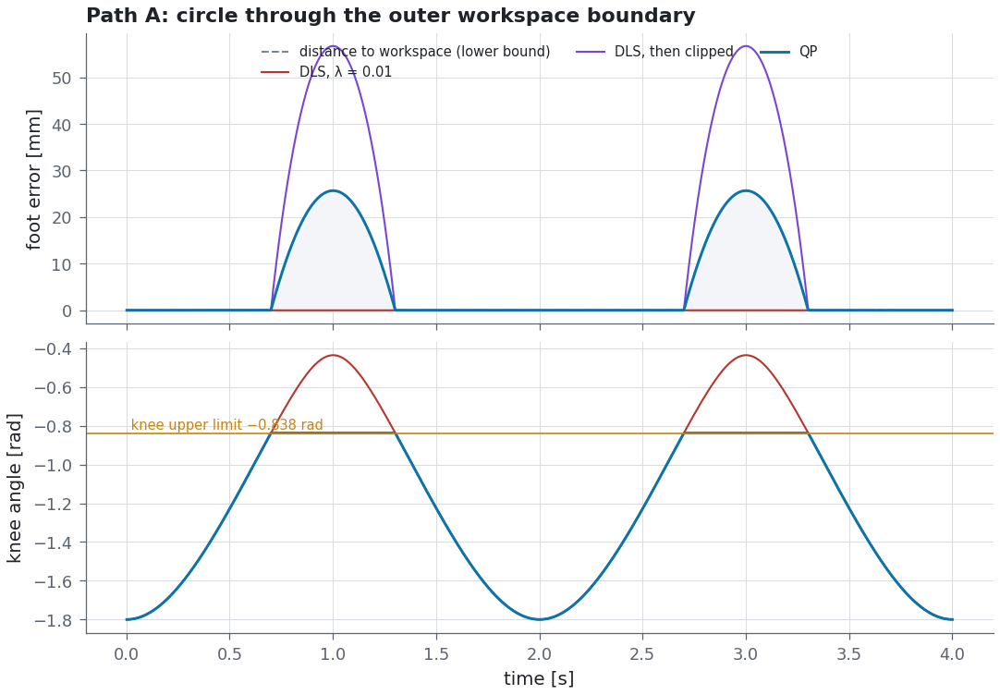
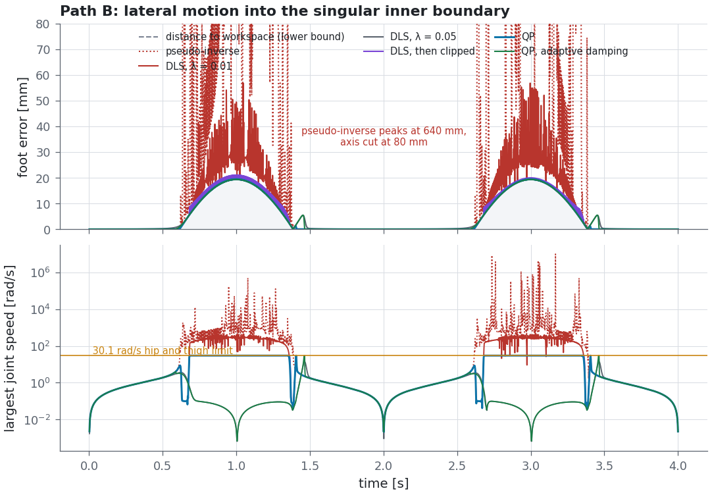
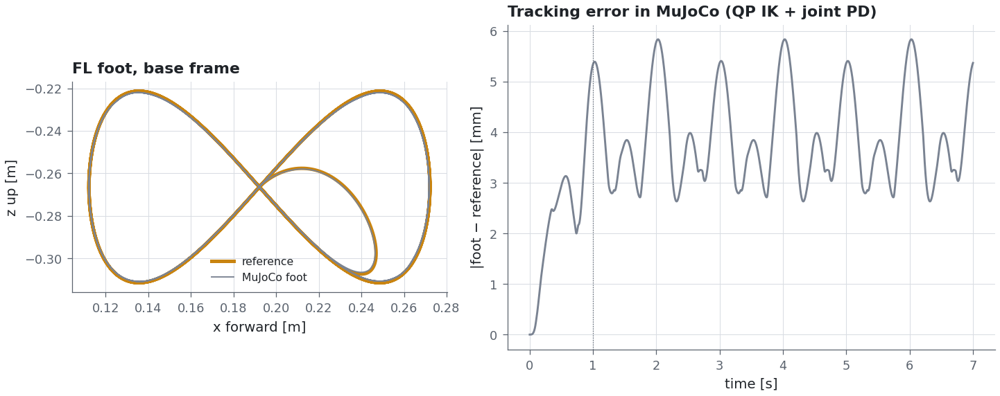
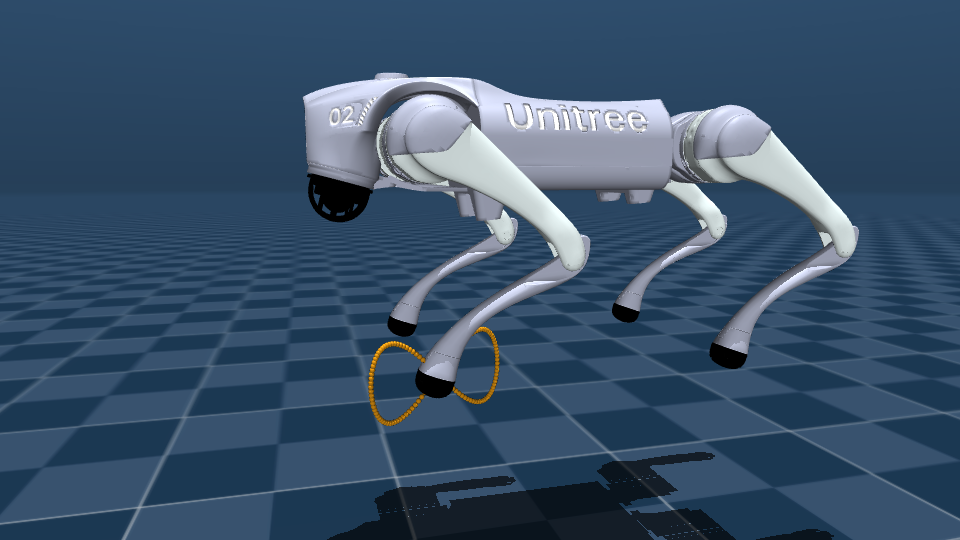

# Module 04 · Kinematics (single leg)

## Objective

Compute the foot position of each Go2 leg from its three joint angles, its Jacobian, and joint angles for a desired foot
position, written from first principles and checked against two independent libraries (fundamental level). Solve the leg's
inverse kinematics in closed form, find where its Jacobian is singular, and compute the joint torques that hold the robot up
($\tau = J^\top f$), checked against a MuJoCo standing equilibrium (intermediate level). Then move the foot along a path with
differential inverse kinematics posed as a small quadratic program that respects the joint position and speed limits. A
hand-written active-set solver solves it. The QP is compared with unconstrained damped least squares on a path that leaves the
workspace through its outer boundary and on one that runs into the singular inner boundary, and a figure-eight is tracked by one
leg in MuJoCo (advanced level). Afterwards the reader can derive the leg's workspace boundaries and choose a differential IK
scheme for a foot controller, knowing what each one does at those boundaries.

## Prerequisites

[Module 00](../m00_math/README.md) (rotations, homogeneous transforms, Rodrigues' formula) and [module 02](../m02_description/README.md)
(the robot description; the joint speed limits come from its URDF). Linear least squares and the KKT conditions of a convex
quadratic program at the level of Nocedal and Wright, ch. 12 and 16. Python with NumPy; MuJoCo, Pinocchio and SciPy only for checking.

## Theory

Each leg is a serial chain base → hip → thigh → calf → foot with one hinge per body. With $p_i$, $R_i$ the fixed offset of body
$i$ in its parent and $a_i$ its hinge axis,

$$\begin{bmatrix} p_{\text{base},\text{foot}}(q) \\ 1 \end{bmatrix} = \prod_{i=1}^{3} \begin{bmatrix} R_i & p_i \\ 0 & 1 \end{bmatrix}
\begin{bmatrix} \text{Rot}(a_i, q_i) & 0 \\ 0 & 1 \end{bmatrix} \begin{bmatrix} p_\text{foot} \\ 1 \end{bmatrix}$$

The geometric Jacobian of the foot position has columns $J_i = z_i \times (p_\text{foot} - o_i)$, where $z_i$ and $o_i$
are the axis and origin of joint $i$ in the base frame. Inverse kinematics uses damped least squares,
$\Delta q = J^\top (J J^\top + \lambda^2 I)^{-1} e$ (derived in the advanced section below), with the result clamped to the joint limits.

### Leg geometry from the MJCF

All four legs have the same structure (values for the front-left leg, from `assets/unitree_go2/go2.xml`; the right legs flip the
sign of the lateral offsets, the rear legs the sign of the hip x position):

| Quantity | Symbol | Value |
|---|---|---|
| Hip (abduction) joint in the base frame, axis $x$ | $p_\text{hip}$ | (0.1934, 0.0465, 0) m |
| Thigh joint in the hip body, axis $y$ (lateral offset) | $d$ | 0.0955 m (−0.0955 right legs) |
| Knee joint in the thigh body, axis $y$ (thigh length) | $l_1$ | 0.213 m |
| Foot sphere centre in the calf body | $f = (f_x, 0, f_z)$ | (−0.002, 0, −0.213) m, radius 0.022 m |
| Knee to foot centre | $l_2 = \lVert f\rVert$ | 0.2130094 m |
| Angle of that segment from the calf's $-z$ axis | $\gamma = \operatorname{atan2}(-f_x, -f_z)$ | 0.0093894 rad (0.538°) |
| Limits: hip / front thigh / rear thigh / knee | | ±1.0472 / [−1.5708, 3.4907] / [−0.5236, 4.5379] / [−2.7227, −0.83776] rad |

No body in the leg is rotated, so with $p = p_\text{foot} - p_\text{hip}$:

$$p = R_x(q_1)\left[\begin{pmatrix}0\\ d\\ 0\end{pmatrix} + R_y(q_2)\Big(\begin{pmatrix}0\\0\\-l_1\end{pmatrix} + R_y(q_3)\, f\Big)\right].$$

`Leg.__init__` asserts this structure (axes, identity body rotations, offsets along single axes, foot in the sagittal plane)
before the closed form is used.

### Closed-form inverse kinematics

Call the sagittal vector $s = R_y(q_2)\big((0,0,-l_1) + R_y(q_3) f\big)$. Rotations about $y$ keep $y = 0$, so $s = (s_x, 0, s_z)$ and
$p = R_x(q_1)\,(s_x, d, s_z)$.

*Hip.* $R_x$ leaves the $x$ coordinate alone and preserves length in the $y$-$z$ plane:

$$s_x = p_x,\qquad p_y^2 + p_z^2 = d^2 + s_z^2 \ \Rightarrow\ s_z = \pm\sqrt{p_y^2 + p_z^2 - d^2}.$$

$R_x(q_1)$ turns the $y$-$z$ vector $(d, s_z)$ onto $(p_y, p_z)$, so $q_1 = \operatorname{atan2}(p_z, p_y) - \operatorname{atan2}(s_z, d)$.
No solution exists when $p_y^2 + p_z^2 < d^2$. The sign $s_z < 0$ is the foot below the hip in the leg plane; $s_z > 0$ is the
leg folded over the top, which the wide thigh range allows.

*Knee (law of cosines).* With $t = (0, 0, -l_1)$, $\lVert s\rVert^2 = l_1^2 + l_2^2 + 2\, t\cdot R_y(q_3) f$. Writing $f_x = -l_2\sin\gamma$,
$f_z = -l_2\cos\gamma$:

$$t\cdot R_y(q_3)f = -l_1\big(-f_x\sin q_3 + f_z\cos q_3\big) = l_1 l_2\cos(q_3 + \gamma)
\ \Rightarrow\ \cos(q_3+\gamma) = \frac{s_x^2 + s_z^2 - l_1^2 - l_2^2}{2\,l_1 l_2},\qquad q_3 = -\gamma \pm \arccos(\cdot).$$

The $+$ branch gives $q_3 \ge -\gamma = -0.0094$ rad, above the knee's upper limit of −0.838 rad, so on this robot it never
survives the limit check: the knee only bends backwards.

*Thigh.* $R_y(q_2)$ adds $q_2$ to the angle $\operatorname{atan2}(x, z)$ of any vector in the $x$-$z$ plane (write the vector as
$z + ix$; $R_y$ multiplies it by $e^{iq_2}$). With $v = t + R_y(q_3) f = \big(f_x c_3 + f_z s_3,\ -l_1 - f_x s_3 + f_z c_3\big)$:

$$q_2 = \operatorname{atan2}(s_x, s_z) - \operatorname{atan2}(v_x, v_z).$$

Each angle is then shifted by a multiple of $2\pi$ to the smallest value at or above its lower limit (the rear thigh range
reaches 4.54 rad, past $\pi$) and solutions outside the limits are dropped. Up to two remain, one per sign of $s_z$.

### Worked example: the standing pose

The MJCF `home` keyframe is $q = (0, 0.9, -1.8)$ rad. Forward kinematics puts the front-left foot centre at
(0.192157, 0.142000, −0.266373) m in the base frame, so $p = (-0.001243, 0.0955, -0.266373)$ m.

| Step | Value |
|---|---|
| $s_z = -\sqrt{p_y^2 + p_z^2 - d^2}$ | −0.266373 m ($p_y = d$ exactly, so $s_z = p_z$) |
| $q_1 = \operatorname{atan2}(p_z, p_y) - \operatorname{atan2}(s_z, d)$ | 0 |
| $\cos(q_3+\gamma) = (0.001243^2 + 0.266373^2 - 0.213^2 - 0.2130094^2)/(2 \cdot 0.213 \cdot 0.2130094)$ | −0.218048 |
| $q_3 = -0.0093894 - \arccos(-0.218048) = -0.0093894 - 1.790611$ | −1.800000 rad |
| $v = (v_x, v_z)$ | (0.207884, −0.166554) m |
| $q_2 = \operatorname{atan2}(-0.001243, -0.266373) - \operatorname{atan2}(0.207884, -0.166554) = -3.136925 - 2.246260$ | −5.383185 → +2π = 0.900000 rad |
| FK of the result minus the target | 1.1e-16 m |

The $s_z > 0$ branch is outside the limits here, so the standing target has one solution.

A reviewer's numbers for "a foot 0.225 m below the hip" were $\cos q_3 \approx -0.442$ and $q \approx (0, 1.014, -2.028)$ rad. Those
follow from the idealised law of cosines with equal links and no foot offset: $(0.225^2 - 2\cdot0.213^2)/(2\cdot0.213^2) = -0.442075$,
$\arccos = 2.028707$, $q_2 = q_3/2$. On the model:

| Target | $\cos(q_3+\gamma)$ | $q$ [rad] |
|---|---|---|
| foot 0.225 m straight below the thigh joint, $p = (0, d, -0.225)$ | −0.442100 | (0, 1.014403, −2.038124) |
| foot 0.225 m straight below the hip joint, $p = (0, 0, -0.225)$ | −0.542607 | (−0.438348, 1.072207, −2.153723) |

With the first reading the reviewer's $\cos$ and $q_2$ agree to 4 digits, but $q_3$ is −2.038, not −2.028: the 2 mm backward offset
of the foot sphere adds $\gamma = 0.0094$ rad to the knee angle. With the second reading (the target directly under the
abduction joint) the reviewer's answer is wrong by 0.44 rad at the hip, because the 0.0955 m lateral offset has to be swung under
the hip.

### Jacobian determinant and singularities

Undo the hip rotation first ($\det R_x = 1$ leaves the determinant unchanged). In the leg frame the three columns are
$e_x \times u$ with $u = (s_x, d, s_z)$, $e_y \times s$, and $e_y \times k$ with $k = R_y(q_2+q_3) f$ the knee-to-foot vector:

$$\det J = \det\begin{bmatrix} 0 & s_z & k_z \\ -s_z & 0 & 0 \\ d & -s_x & -k_x\end{bmatrix} = s_z\,(s_x k_z - s_z k_x).$$

The bracket is the planar cross product $s \times k$ in the $x$-$z$ plane. Since $s = R_y(q_2)t + k$ it equals
$R_y(q_2)t \times k$, which does not change under the common rotation $q_2$, so it equals
$t \times R_y(q_3) f = l_1 (f_x c_3 + f_z s_3) = -l_1 l_2 \sin(q_3 + \gamma)$:

$$\boxed{\det J = -\,l_1\, l_2\, \sin(q_3 + \gamma)\; s_z(q)},\qquad s_z = -l_1\cos q_2 + f_z\cos(q_2+q_3) - f_x\sin(q_2+q_3).$$

Two singularities follow. $\sin(q_3+\gamma) = 0$ is the straight or fully folded knee; over the knee range $[-2.7227, -0.83776]$ rad,
$|\sin(q_3+\gamma)|$ is smallest at the folded limit, 0.4153 ($|\sin q_3|$ alone would give 0.4067), so the limits keep the knee
away from it. $s_z = 0$ is the foot level with the abduction axis in the leg plane (thigh near horizontal): there the hip
abduction and the thigh both move the foot along the same direction and lateral motion is lost. This one lies inside the joint
limits. At the standing pose $\det J = -0.045371 \times (-0.975938) \times (-0.266373) = -0.011795$ m³ and the condition number
of $J$ is 2.38.

### Statics

By virtual work, joint power equals the power the foot delivers: $\tau^\top\dot q = f^\top \dot p = f^\top J\dot q$ for every
$\dot q$, so $\tau = J^\top f$ for a force $f$ that the foot applies to the ground. With the ground reaction $F = -f$ on the foot
and the leg's own weight, which contributes the gravity torque $g(q)$,

$$\tau = g(q) - J^\top F .$$

Total mass from the MJCF: 6.921 (base) + 4 × (0.678 + 1.152 + 0.241352) = 15.2064 kg, so with $g = 9.81$ m/s² the weight is
149.175 N, 37.294 N per foot on four feet and 74.587 N per foot on the two feet of a trot. For massless legs and a vertical
$F = (0, 0, F_z)$, $\tau = -F_z\,(J_{20}, J_{21}, J_{22})$, the bottom row of $J$. At the standing pose that row is
(0.0955, 0.001243, −0.165605) m:

| Load case (front-left, standing pose) | hip [N m] | thigh [N m] | knee [N m] |
|---|---|---|---|
| four feet, 37.294 N each | −3.562 | −0.046 | 6.176 |
| trot, two feet, 74.587 N each | −7.123 | −0.093 | 12.352 |
| actuator limit (`ctrlrange`) | ±23.7 | ±23.7 | ±45.43 |
| trot as a fraction of the limit | 30% | 0.4% | 27% |

The hip torque is the lateral offset times the load ($0.0955 \times 37.294$); the thigh torque is nearly zero because the foot
is 1.2 mm behind the thigh joint; the knee torque is the load times the 0.1656 m horizontal distance from knee to foot. These are
static numbers; a trot's stance phase adds the force needed to accelerate the trunk, which this module does not compute.

Assumptions: rigid links, joints located at body origins (asserted when the model is read), the foot is the centre of the
contact sphere. A point foot has no orientation, so the task is 3-D and the leg is not redundant.

### Workspace boundaries

$R_x(q_1)$ preserves length, so the hip-to-foot distance does not depend on the hip angle:

$$\lVert p\rVert^2 = s_x^2 + d^2 + s_z^2 = \lVert s\rVert^2 + d^2,\qquad \lVert s\rVert^2 = l_1^2 + l_2^2 + 2\,l_1 l_2\cos(q_3+\gamma).$$

$\lVert s\rVert$ grows as the knee straightens. The knee's upper limit $q_3 \le -0.83776$ rad stops it at
$\cos(q_{3,\max}+\gamma) = \cos(-0.82837) = 0.67614$, so the outer boundary (while the hip and thigh limits do not bind) is a
sphere about the hip origin of radius

$$\rho_\max = \sqrt{l_1^2 + l_2^2 + 2\,l_1 l_2\cos(q_{3,\max}+\gamma) + d^2} = \sqrt{0.15209 + 0.00912} = 0.40151\ \text{m}.$$

A straight knee would give $\sqrt{(l_1+l_2)^2 + d^2} = 0.4366$ m. The knee limit removes 3.5 cm of reach and keeps the
straight-knee singularity out of the reachable set. The outer boundary is therefore a joint-limit boundary, not a singular one.

The inner boundary comes from $s_z^2 = p_y^2 + p_z^2 - d^2 \ge 0$: no foot position lies inside the cylinder of radius $d$ around the
abduction axis. On that cylinder $s_z = 0$, so $\det J = 0$ (previous section). The inner boundary is singular.

The distance from a target to the reachable set follows from the two boundaries:

$$\delta(p) = \max\Big(0,\ \lVert p\rVert - \rho_\max,\ |d| - \sqrt{p_y^2 + p_z^2}\Big).$$

It assumes that the hip and thigh limits do not bind at the nearest reachable point. `validate.py` checks it against a direct
minimisation of $\lVert\text{fk}(q) - p\rVert$ over the joint box (scipy L-BFGS-B, 12 random starts) on the 56 unreachable sample points of
the two test paths below. $\delta$ is the smallest error any feasible method can reach, and the experiments report each method's
error minus $\delta$ ("excess error").

### Differential inverse kinematics

Near $q$, $p(q + \Delta q) = p(q) + J(q)\,\Delta q + O(\lVert\Delta q\rVert^2)$. At control tick $k$ (period $\Delta t$ = 2 ms) the task
displacement is $e_k = p_\text{ref}(t_{k+1}) - p(q_k)$. This is the reference minus the foot position the controller actually reached, so
linearisation error does not accumulate. Damped least squares solves

$$\min_{\Delta q}\ \lVert J\Delta q - e\rVert^2 + \lambda^2\lVert\Delta q\rVert^2 .$$

Setting the gradient to zero gives $(J^\top J + \lambda^2 I)\Delta q = J^\top e$. Since $(J^\top J + \lambda^2 I)J^\top = J^\top(JJ^\top + \lambda^2 I)$,
$\Delta q = J^\top(JJ^\top + \lambda^2 I)^{-1}e$. With the singular value decomposition $J = \sum_i \sigma_i u_i v_i^\top$,

$$\Delta q = \sum_i \frac{\sigma_i}{\sigma_i^2 + \lambda^2}\; v_i\,(u_i^\top e).$$

The pseudo-inverse ($\lambda = 0$) has gain $1/\sigma_i$, which is unbounded as $\sigma_i \to 0$. The damped gain is largest at
$\sigma_i = \lambda$, where it equals $1/(2\lambda)$. With $\lambda = 0.01$ m/rad that is 50 rad per metre of error. A 19 mm error
along the singular direction therefore asks for about 1 rad in one 2 ms tick, about 500 rad/s. Path B below measures 454 rad/s.

### Joint limits as a quadratic program

For one tick, the position limits and the speed limits $\dot q_\max$ = (30.1, 30.1, 20.06) rad/s (hip, thigh, knee; the `velocity`
attribute of the Go2 URDF in [module 02](../m02_description/go2_gazebo.urdf), since the MJCF has none) both bound the step:

$$\ell = \max\big(q_\text{lo} - q,\ -\dot q_\max\Delta t\big)\ \le\ \Delta q\ \le\ \min\big(q_\text{hi} - q,\ \dot q_\max\Delta t\big) = u .$$

Expanding the cost gives the QP

$$\min_{\Delta q}\ \tfrac12\,\Delta q^\top H\,\Delta q + g^\top\Delta q\quad \text{s.t.}\quad \ell \le \Delta q \le u,\qquad H = 2\,(J^\top J + \lambda^2 I),\quad g = -2\,J^\top e .$$

For $\lambda > 0$, $H$ is positive definite, so the minimiser is unique. Write the box as $A\,\Delta q \le b$ with $A = [I; -I]$ and
$b = [u; -\ell]$. The optimum satisfies the KKT conditions

$$H\Delta q + g + A^\top\mu = 0,\qquad \mu \ge 0,\qquad A\Delta q \le b,\qquad \mu_i\,(a_i^\top\Delta q - b_i) = 0 .$$

Clipping the DLS step to the box does not give this optimum. Split the joints into those held at a bound ($B$) and the free ones
($F$). With $\Delta q_B$ fixed, stationarity in the free joints requires

$$H_{FF}\,\Delta q_F = -\big(g_F + H_{FB}\,\Delta q_B\big).$$

The clipped step keeps the free joints at their unconstrained values. These solve the equation above only if $H_{FB} = 0$, that is,
only if the Jacobian columns of the clamped and the free joints are orthogonal. The thigh and knee columns are $e_y\times s$
and $e_y\times k$. Both lie in the sagittal plane, so they are not orthogonal.

### Active-set solver

The primal active-set method (Nocedal and Wright, ch. 16) keeps a working set $W$ of constraints that are treated as equalities. It
starts from the feasible point $x = \text{clip}(0, \ell, u)$. The bounds always contain 0 (`step_bounds`), so the start is $x = 0$. Each
iteration then does the following:

1. Solve the equality-constrained step:
   $$\begin{bmatrix} H & A_W^\top\\ A_W & 0\end{bmatrix}\begin{bmatrix} p\\ \mu_W\end{bmatrix} = \begin{bmatrix} -(Hx+g)\\ 0\end{bmatrix}.$$
2. If $p = 0$ and every $\mu_W \ge 0$, then $x$ satisfies the KKT conditions and the solver stops. If $p = 0$ and some $\mu_i < 0$,
   remove from $W$ the constraint with the most negative $\mu_i$, because that constraint holds $x$ back.
3. If $p \ne 0$, take the longest feasible step $\alpha = \min\big(1,\ \min_{i\notin W,\ a_i^\top p > 0}\,(b_i - a_i^\top x)/(a_i^\top p)\big)$.
   If a constraint blocked the step, add it to $W$.

With 3 joints the KKT system has at most 6 unknowns. On the test paths the solver stopped after at most 3 iterations, and on 2000
random problems after at most 9. The problem is also a bounded least-squares problem,
$\min\lVert[J;\ \lambda I]\,\Delta q - [e;\ 0]\rVert^2$ with $\ell\le\Delta q\le u$, so scipy's `lsq_linear` (bounded-variable least squares)
gives an independent reference.

### Adaptive damping

A constant $\lambda$ trades accuracy everywhere for gain near singularities. Variable damping raises $\lambda$ only where the
smallest singular value $\sigma_\min$ is small (Chiaverini, Siciliano and Egeland). This module uses that rule with a constant floor:

$$\lambda^2 = \lambda_0^2 + \lambda_\max^2\Big(1 - \big(\sigma_\min/\varepsilon\big)^2\Big)\ \ \text{if}\ \sigma_\min < \varepsilon,\qquad \lambda^2 = \lambda_0^2\ \ \text{otherwise},$$

with $\lambda_0 = 0.01$, $\varepsilon = 0.02$ and $\lambda_\max = 0.05$ m/rad (Failure analysis explains the choice).

### Worked example: one tick at the knee limit

At $t$ = 0.768 s on path A (defined under Experiment; `advanced.qp_step_figure` in `results.json`) the knee is at its upper limit and the foot is 10.02 mm
from the target, which lies outside $\rho_\max$. The step bounds are ±60.2 mrad for the thigh (30.1 rad/s × 2 ms) and
[−40.1, 0] mrad for the knee.

| Step | hip, thigh, knee [mrad] | $\lVert J\Delta q - e\rVert$ |
|---|---|---|
| DLS, unconstrained | (5.89, −57.90, 118.17) | 0.18 mm |
| DLS, clipped to the box | (5.89, −57.90, 0) | 25.23 mm |
| QP | (−0.15, 0.96, 0) | 10.02 mm |

DLS reaches the target by straightening the knee 118 mrad past its limit while turning the thigh back by 58 mrad. Clipping
removes the knee motion and keeps the thigh motion. With the knee held, that thigh motion swings the foot about
0.390 m × 0.0579 rad = 22.6 mm along the reach sphere, at right angles to $e$. The linear estimate of the residual is
$\sqrt{10.0^2 + 22.6^2} = 24.7$ mm, and the measured residual is 25.2 mm. The clipped step leaves the foot further from the target than no
step at all. The QP knows that the knee is held, finds that no hip or thigh motion brings the foot closer, and nearly stays where
it is (10.023 mm before the step, 10.016 mm after).

## Implementation

| File | What it implements |
|---|---|
| `kinematics.py` | `Leg`: reads offsets, quaternions, axes, limits and the foot offset from the MJCF; `fk`, `jacobian` (column formula), `ik` (DLS with clamping), `ik_multistart`, `ik_closed_form`, `det_jacobian`. No MuJoCo or Pinocchio kinematics is called. |
| `diffik.py` | `qp_active_set` (the active-set method above, for general $Ax \le b$), `box`, `step_bounds` ($\ell$, $u$), `dls_step`, `qp_step` ($H$, $g$), `adaptive_damping`, `track` (the closed-loop tick loop for every method), `reach_radius` ($\rho_\max$), `distance_to_workspace` ($\delta$). |
| `analytic.py` | closed-form vs numerical IK, the worked standing example, the determinant check, and the statics experiment in MuJoCo. |
| `validate.py` | runs all three levels, writes `results.json`, `figures/` and `media/`; builds the fixed-base MuJoCo model for the figure-eight. |
| `../common.py` | quaternion to rotation matrix and Rodrigues' formula, written out. |

Design choices:

- The QP variable is the joint step $\Delta q$, not a velocity, so position and speed limits become one box. Without the speed limit
  the box would allow a full jump to a joint limit in one tick.
- DLS and QP use the same $\lambda = 0.01$ m/rad, so the only difference between them is the constraint handling.
- The QP is checked against `scipy.optimize.lsq_linear(method='bvls')` on random problems and on every tick of the test paths.
  The KKT conditions are checked separately.
- For the figure-eight in MuJoCo, the QP integrates a reference $q_\text{ref}$ every 2 ms. It reads the robot only through that
  reference, not through the measured joint angles. A joint PD controller tracks $q_\text{ref}$:
  $\tau = k_p(q_\text{ref} - q) + k_d(\dot q_\text{ref} - \dot q) + b(q, \dot q)$, where the feed-forward $b$ is MuJoCo's `qfrc_bias` (gravity and
  Coriolis). Here $b$ is a control input; this module does not teach or check it. Joint damping (2 N m s/rad) and frictionloss
  (0.2 N m) stay as in the MJCF. The free joint is deleted with `mujoco.MjSpec`, so the base is welded 0.55 m above the floor and the legs
  swing clear of it.

## Experiment

```bash
modules/fetch_go2.sh                                       # once: Go2 MJCF from MuJoCo Menagerie at a pinned commit
.venv-modules/bin/python modules/m04_kinematics/validate.py          # --n 1000 per leg; --no-media skips the video
.venv-modules/bin/python -m pytest -q modules/m04_kinematics
```

The full run took 226 s of wall time with a load average between 48 and 93 on the shared machine.

*Fundamental.* For each leg, 1000 joint configurations are drawn uniformly within the limits (seed 0), with the base at the origin.
FK is compared with MuJoCo `mj_kinematics` and Pinocchio `framesForwardKinematics`, and the Jacobian with central differences
($h = 10^{-6}$) and Pinocchio `computeFrameJacobian`. The IK targets are the FK of 1000 more random configurations, solved
from the standing pose.

*Intermediate.* IK: 1000 targets per leg, each the FK of a uniformly drawn in-limit configuration. Before the angles are
compared, the numerical IK (`ik_multistart` from the standing pose) is polished with `ik(tol=1e-13)`. Statics: `scene.xml` (Go2 on a plane), `home`
keyframe, joint PD on the torque motors ($\tau = 80\,(q_\text{home} - q) - 4\,\dot q$) for 6 s of simulated time, joint
frictionloss set to 0 so that it cannot absorb torque at rest. The prediction for each joint is
$g(q) - \tau_\text{damping} - \sum_\text{contacts} z_i\cdot\big((p_c - o_i)\times F + M\big)$, with the contact force $F$ and
moment $M$ from `mj_contactForce`, the contact point $p_c$, and the joint axes $z_i$ and origins $o_i$ from this module's
kinematics; $g(q)$ and the damping term are MuJoCo's `qfrc_bias` and `qfrc_passive`.

*Advanced.* All runs use the front-left leg, $\Delta t$ = 2 ms, 2 cycles of 2 s each (2000 ticks), purely kinematic (the joint angles are the
integrated steps).

| Path | Reference (base frame) | Leaves the workspace |
|---|---|---|
| A, outer boundary | circle of radius 0.075 m in the sagittal plane $y$ = 0.142 m, top point at the standing foot, starts at the standing pose | 30.2% of ticks, by up to 25.7 mm beyond $\rho_\max$ |
| B, singular inner boundary | $x$ = hip + 0.20 m, $z$ = −0.01 m, $y$ = hip + $d$ + 0.01 + 0.03 cos(πt) m; starts at the closed-form solution (0.7177, −0.0983, −2.0540) rad (foot below the hip) | 38.5% of ticks, by up to 19.3 mm inside the cylinder |

Methods: pseudo-inverse, DLS with $\lambda$ = 0.01 and 0.05, DLS clipped to the step box, QP, and QP with adaptive damping. Each method reports:

- the RMS foot error over the reachable ticks;
- the excess error $\lVert p - p_\text{ref}\rVert - \delta(p_\text{ref})$: 0 is the best any feasible method can do, and a negative value means a limit was broken;
- the joint-limit violation and the largest joint speed relative to $\dot q_\max$;
- the mean of the largest joint speed over the unreachable ticks, which measures motion that does not move the foot.

QP checks: 2000 random problems (seed 10) with $J_{ij} \sim \mathcal N(0, 0.2^2)$, $e_i \sim \mathcal N(0, 0.01^2)$,
$-\ell_i, u_i \sim U(0, 0.03)$, compared with `lsq_linear`. Every QP tick of paths A and B is also re-solved with `lsq_linear`.

*Figure-eight in MuJoCo.* The FL foot follows $p_0 + a(t)\,(0.08\sin\omega t,\ 0.03\sin\omega t,\ 0.045\sin 2\omega t)$ m about the standing foot
$p_0$, with $\omega = \pi$ rad/s, for 7 s. The amplitude $a(t)$ rises along a minimum-jerk profile over the first second. The other legs hold the
standing pose. PD gains are $k_p$ = 150 N m/rad and $k_d$ = 4 N m s/rad, and a second run without video doubles both. The error is the
MuJoCo foot-sphere centre (`geom_xpos`) minus the reference, sampled every physics step.

## Validation

### Fundamental: forward kinematics, Jacobian, numerical IK

| Check | FL / FR / RL / RR | Acceptance |
|---|---|---|
| Foot position vs MuJoCo `mj_kinematics`, max error | 2.3e-16 / 2.4e-16 / 2.2e-16 / 1.9e-16 m | < 1e-12 m |
| Foot position vs Pinocchio, max error | 1.2e-16 / 1.2e-16 / 1.3e-16 / 1.4e-16 m | < 1e-12 m |
| Jacobian vs central finite differences, max abs. error | 1.0e-10 / 8.9e-11 / 9.3e-11 / 1.0e-10 | < 1e-7 |
| Jacobian vs Pinocchio `computeFrameJacobian`, max abs. error | 1.7e-16 / 1.1e-16 / 1.1e-16 / 1.1e-16 | < 1e-12 |
| IK converged to 1 µm, single seed (standing pose) | 82.9% / 85.2% / 84.6% / 85.0% | |
| IK converged to 1 µm, multi-start | 99.8% / 99.7% / 99.8% / 99.3% | ≥ 99% |

### Intermediate: closed form, singularities, statics

| Closed-form IK (`results.json`, `intermediate.ik`) | FL / FR / RL / RR | Acceptance |
|---|---|---|
| Generating angles recovered to 1e-9 rad | 100% / 100% / 100% / 100% | 100% |
| Max angle error vs generating angles | 3.6e-14 / 3.4e-14 / 1.9e-14 / 6.9e-14 rad | < 1e-9 rad |
| Max FK residual over all returned solutions | 3.7e-16 / 3.4e-16 / 4.0e-16 / 4.0e-16 m | < 1e-12 m |
| Targets with two in-limit solutions ($s_z$ of either sign) | 24.2% / 24.3% / 13.0% / 13.8% | |
| Numerical multi-start IK converged | 99.7% / 99.6% / 99.3% / 99.9% | |
| Converged numerical answers within 1e-9 rad of a closed-form solution | 100% / 100% / 100% / 99.8% | 100% away from $s_z = 0$ |
| Mean time per target, closed form / numerical | 0.15 / 10.4, 0.24 / 11.0, 0.16 / 12.1, 0.22 / 12.7 ms | |

The timings come from the final run on a shared machine with a load average between 48 and 93. An earlier, quieter run measured
the numerical IK at 3.8–4.8 ms per target. The ratio, 48–72× in favour of the closed form in this run, is the number to keep.
The closed form costs about one FK evaluation.

| Jacobian determinant (FL, 5000 random in-limit $q$) | Measured | Acceptance |
|---|---|---|
| $\lvert \det J_\text{formula} - \det J_\text{numpy}\rvert$, max | 1.9e-17 | < 1e-15 |
| min $\lvert\sin(q_3+\gamma)\rvert$ over the knee range | 0.4153 (at $q_3 = -2.7227$) | > 0 |

| Statics, MuJoCo standing equilibrium | FL (FR mirrored) | RL (RR mirrored) | Acceptance |
|---|---|---|---|
| Contact force on the foot, world (x, y, z) | (0.670, −5.293, 34.458) N | (−0.670, −6.982, 40.129) N | sum of z = 149.175 N |
| MuJoCo actuator torque (hip, thigh, knee) | (−0.889, 1.044, 5.922) N m | (−1.022, 0.774, 6.787) N m | |
| $-J^\top F$ from this module's kinematics | (−1.964, 0.631, 6.211) N m | (−2.099, 0.362, 7.077) N m | |
| $g(q) - \tau_\text{damping}$ (leg weight) | (1.075, 0.412, −0.288) N m | (1.077, 0.412, −0.290) N m | |
| max \|MuJoCo − prediction\| | 2.4e-6 N m | 1.7e-6 N m | < 1e-4 N m |
| Hand estimate, massless legs, 37.294 N vertical | (−3.562, −0.046, 6.176) N m | (−3.562, −0.046, 6.176) N m | |

The robot came to rest at a base height of 0.2607 m and −0.35° pitch, with joint speeds below 1.7e-3 rad/s.

The hand estimate differs from MuJoCo for three reasons, each visible in the table. (1) The load is not shared equally: the
front feet carry 34.458 N and the rear 40.129 N because the whole-body centre of mass sits 14.7 mm behind the midpoint of the
front and rear feet; the lever rule, $mg\,(x_\text{com} - x_\text{rear})/(x_\text{front} - x_\text{rear})/2 = 34.455$ N, predicts the
front value to 3 mN. (2) The feet push outward and friction pushes back, 5.3 N inward on the front feet and 7.0 N on the rear;
acting about 0.27 m below the hip axis, this lateral force cancels about 1.4 N m of the abduction torque at the front
and 1.9 N m at the rear. (3) The leg's own
2.07 kg adds about +1.08 N m at the hip and +0.41 N m at the thigh and −0.29 N m at the knee. The knee estimate is closest
(6.18 vs 5.92 N m) because neither the lateral force nor the leg weight acts much about the knee axis.

### Advanced: constrained differential IK

Every row is backed by `checks.<key>` in `results.json`. These thresholds were written after a prototype run of paths A and B had
been inspected, so unlike those of the first two levels they were not set blind. They follow from what a foot controller needs:
sub-millimetre tracking where the target is reachable, no broken limit, and no more than a few millimetres of loss at the boundary.

| Check | Measured | Acceptance | Key |
|---|---|---|---|
| Active-set QP vs `lsq_linear` (BVLS), 2000 random problems, max abs. difference | 1.2e-14 | < 1e-9 | `qp_vs_lsq_linear_max` |
| KKT residual (stationarity, $\mu \ge 0$, complementarity, feasibility), max | 4.3e-18 | < 1e-9 | `qp_kkt_residual_max` |
| Active-set iterations, max over random problems and both paths | 9 | ≤ 10 | `qp_max_iterations` |
| Every QP tick of paths A and B vs `lsq_linear`, max abs. difference | 8.3e-16 rad | < 1e-9 rad | `qp_ticks_vs_lsq_linear_max` |
| $\delta(p)$ vs multi-start L-BFGS-B, 56 unreachable points, max abs. difference | 8.6e-17 m | < 1e-6 m | `workspace_distance_vs_scipy_max_m` |
| Path A, QP joint-limit violation | 0 rad | < 1e-12 rad | `boundary_qp_limit_violation_rad` |
| Path A, QP foot error over reachable ticks, RMS | 3.4 µm | < 0.1 mm | `boundary_qp_rms_error_reachable_m` |
| Path A, QP excess error, max | 6.2 µm | < 1 mm | `boundary_qp_excess_error_max_m` |
| Path B, QP largest joint speed / limit | 1.000 | ≤ 1 | `singular_qp_speed_over_limit_max` |
| Path B, QP foot error over reachable ticks, RMS | 0.118 mm | < 1 mm | `singular_qp_rms_error_reachable_m` |
| Path B, QP excess error, max | 1.33 mm | < 5 mm | `singular_qp_excess_error_max_m` |
| Figure-eight, QP joint reference: FK vs path, max | 4.0 µm | < 0.1 mm | `fig8_ik_max_error_m` |
| Figure-eight in MuJoCo, foot vs path, RMS | 3.86 mm | < 5 mm | `fig8_mujoco_rms_error_m` |
| Figure-eight in MuJoCo, foot vs path, max | 5.84 mm | < 10 mm | `fig8_mujoco_max_error_m` |
| Video under 6 MB | 249 kB | < 6 MB | `media_mp4_under_6MB` |

All 25 checks of the three levels pass (`results.json`, `checks`).

Method comparison, path A (`advanced.boundary.methods`). Speeds are the largest over the run, in rad/s (hip, thigh, knee):

| Method | RMS error, reachable | Excess error max / mean | Limit violation | Largest speed | Time per tick |
|---|---|---|---|---|---|
| pseudo-inverse | 0.001 mm | 0.00 / −5.11 mm | 0.402 rad | (0, 1.41, 1.98) | 808 µs |
| DLS, $\lambda$ = 0.01 | 0.003 mm | 0.01 / −5.11 mm | 0.402 rad | (0, 1.41, 1.98) | 749 µs |
| DLS, $\lambda$ = 0.05 | 0.084 mm | 0.16 / −5.02 mm | 0.403 rad | (0.01, 1.42, 1.99) | 702 µs |
| DLS, clipped | 0.003 mm | 31.03 / 6.45 mm | 0 | (0, 1.40, 1.98) | 740 µs |
| QP | 0.003 mm | 0.006 / 0.002 mm | 0 | (0.10, 1.40, 1.98) | 1085 µs |
| QP, adaptive damping | identical to QP ($\sigma_\min \ge 0.074$ m/rad on this path) | | | | 978 µs |

Method comparison, path B (`advanced.singular.methods`):

| Method | RMS error, reachable | Excess error max | Largest speed (hip, thigh, knee) | Speed / limit | Mean largest speed, unreachable ticks | Time per tick |
|---|---|---|---|---|---|---|
| pseudo-inverse | 0.211 mm | 620 mm | (2.2e6, 9.9e6, 1.4e5) | 3.3e5 | 5.1e4 rad/s | 840 µs |
| DLS, $\lambda$ = 0.01 | 0.118 mm | 37.8 mm | (454, 256, 38.4) | 15.1 | 208 rad/s | 801 µs |
| DLS, $\lambda$ = 0.05 | 0.985 mm | 5.46 mm | (14.0, 7.46, 1.01) | 0.46 | 0.271 rad/s | 696 µs |
| DLS, clipped | 0.118 mm | 3.38 mm | (30.1, 30.1, 8.85) | 1.00 | 27.0 rad/s | 843 µs |
| QP | 0.118 mm | 1.33 mm | (30.1, 17.1, 0.94) | 1.00 | 26.8 rad/s | 1099 µs |
| QP, adaptive damping | 0.891 mm | 5.47 mm | (30.1, 16.4, 2.71) | 1.00 | 0.236 rad/s | 1093 µs |

The per-tick time covers the whole tick in Python: two FK evaluations, one Jacobian and the step. In the same process the QP
costs 1.37 to 1.45 times as much as DLS. The absolute times depend on the machine load (48 to 93 during the run).



The left panel is the sagittal slice $y$ = 0.142 m (the leg plane at $q_1 = 0$). Shading marks the points where `ik_closed_form` finds an
in-limit solution, on a 181 × 181 grid. The dashed circle is $\rho_\max$; the inset shows the bottom of path A. The right panel is the frontal
slice 0.20 m ahead of the hip, with the singular cylinder $|(y, z)| = d$ dashed. Unconstrained DLS (red) jumps back and forth across the
cylinder edge, while the QP (blue) stays on it.









[](media/figure_eight.mp4)

[Video: figure-eight, 7 s](media/figure_eight.mp4). The amber beads are the reference path, and the translucent sphere is the current target.

Regression tests: `.venv-modules/bin/python -m pytest -q modules/m04_kinematics` (20 tests in `test_kinematics.py`, 6 in
`test_diffik.py`, same thresholds as the tables).

## Failure analysis

### Clipping is worse than not moving

On path A the clipped DLS step leaves the foot up to 31.0 mm further from the target than
the workspace allows (mean 6.45 mm over the run). Its total error peaks at 56.7 mm where the QP has 25.7 mm, the distance to the workspace (`tracking_boundary`,
upper panel). The worked example above traces the cause: the clipped knee motion is removed, but the thigh motion that
compensated for it is kept, and that thigh motion now moves the foot sideways along the reach sphere. The QP re-solves the free joints
with the knee held and reaches $\delta$ to within 6 µm.

### Unconstrained DLS looks better than possible

On path A the pseudo-inverse and DLS track the circle with a mean excess error of
−5.1 mm. They come closer to the target than any feasible configuration can, because they straighten the knee to −0.436 rad,
0.402 rad past its limit (`tracking_boundary`, lower panel). On the robot the knee would hit its stop. A tracking error alone hides this,
which is why the tables report the limit violation next to it.

### The QP chatters at the singular boundary

On path B the QP keeps every joint within its speed limit. While the target is
inside the cylinder, however, the hip runs at its 30.1 rad/s limit almost every tick (mean largest joint speed 26.8 rad/s over the
unreachable ticks; blue line pinned to the limit in `tracking_singular`, lower panel). Meanwhile the foot stays on the boundary
(mean excess error 0.04 mm). The cause is the damped gain of up to $1/(2\lambda)$ = 50 rad/m along the singular direction: the step
asks for about 1 rad, the box cuts it to 60 mrad, the linearisation is poor that close to $s_z = 0$, and the next tick reverses the
step. The speed bound keeps the command legal, but the hip is still told to oscillate at full speed. DLS clipped to the same box does the
same thing (27.0 rad/s), and unconstrained DLS does it at 208 rad/s.

Adaptive damping removes the chatter (0.236 rad/s mean) but costs accuracy where the target is reachable: RMS 0.891 mm instead
of 0.118 mm. It also leaves a 5.5 mm error bump at $t$ = 1.45 s and 3.45 s, just after the target comes back out of the cylinder
(green line, upper panel). The extra damping slows the foot exactly when it has to leave the boundary. Once $\sigma_\min$ passes
$\varepsilon$ the damping drops, and the catch-up step hits the hip speed limit for 3 ticks (1.460 to 1.464 s, $\sigma_\min$ 0.017 to 0.028 m/rad).
Three settings were tried (`advanced.adaptive_sweep`):

| $\varepsilon$, $\lambda_\max$ [m/rad] | RMS error, reachable | Excess error max | Mean largest speed, unreachable |
|---|---|---|---|
| 0.02, 0.05 (used) | 0.891 mm | 5.47 mm | 0.236 rad/s |
| 0.03, 0.05 | 0.937 mm | 5.51 mm | 0.255 rad/s |
| 0.04, 0.08 | 1.734 mm | 8.28 mm | 0.301 rad/s |

None of the three keeps reachable-target accuracy under 0.2 mm without chatter. Constant DLS with $\lambda$ = 0.05 gives a similar
trade-off (0.985 mm, 0.271 rad/s) without any QP. A cleaner fix is to stop asking for unreachable targets: project the reference onto
the workspace first, using $\delta$ and its nearest point. That was not tried here.

### The QP is local

It finds the best step for one tick, not the best path. On path B it stays on the branch it started on
($s_z < 0$) and cannot plan a branch change.

### Tracking in MuJoCo lags

The joint reference tracks the figure-eight to 4.0 µm, but the simulated foot is off by 3.86 mm RMS
and 5.84 mm at most. The error peaks once per lobe (`figure_eight`, right panel). Doubling both PD gains halves it, to 1.94 mm RMS and 2.93 mm max
(`advanced.figure_eight_gain_x2`), which identifies it as PD lag. The feed-forward covers gravity and Coriolis forces but not the
inertial term $M(q)\,\ddot q_\text{ref}$, which belongs to the dynamics module.

### Earlier levels

Single-seed IK failed on 15–17% of reachable targets. Grouping the failures by the thigh angle that generated the target
showed the pattern: targets near the standing pose (thigh 0 to 1.6 rad) converged 99.7% of the time, targets needing the leg
swung forward (thigh below 0) 75%, and targets with the leg folded over the top (thigh above 2.6 rad) 61%. Every failure ended
with a joint clamped at its limit: clamping turns the least-squares problem into one with local minima at the limits. Restarting
from three more seeds spread over the thigh range raised convergence to 99.3–99.8%. The remaining cases are targets close to
the workspace boundary where the reachable configuration is a narrow sliver between limits. The closed form solves those
exactly; the QP of the advanced level enforces the limits during tracking but was not used as a global IK solver.

The closed form and the polished numerical IK disagreed by more than 1e-9 rad on 2 of 1000 rear-right targets (by 4.6e-6
rad at most). Both targets lie next to the $s_z = 0$ singularity: the smallest singular value of $J$ there is 3e-4 m/rad, the two
closed-form branches nearly coincide, and damped least squares with $\lambda = 10^{-3}$ shrinks each step by
$\sigma^2/(\sigma^2+\lambda^2) \approx 0.08$, so after 100 polishing iterations the numerical answer was still 1.7e-9 m off the target.
The closed-form answer reaches the target to 4e-16 m in the same cases. Near $s_z = 0$ the joint angles are poorly determined
by the foot position itself, so any IK, closed form included, will return angles that jump between branches when the target
moves by a fraction of a millimetre; a controller crossing this region needs a branch rule (keep the previous $s_z$ sign).

The statics check first left a residual of 2.8e-3 N m on the front legs and 3.4e-3 N m on the rear. The robot was not quite at
rest: MuJoCo's soft foot contact lets the feet creep outward, the hip joints still moved at about 1e-3 rad/s after 6 s, and
the joint damping of 2 N m s/rad turns that into 2e-3 N m. Adding MuJoCo's passive (damping) force to the prediction brought
the residual to 2e-6 N m. Joint frictionloss (0.2 N m in the MJCF) was set to 0 for the check; with it left on, any value of
the residual below 0.2 N m per joint would be consistent with equilibrium and the check would be weaker by five orders.
The foot sphere centres settled 9.1–9.4 mm above the floor, about 12.7 mm lower than a rigid contact would allow (the foot
`solimp` width is 0.022 m), and MuJoCo places the contact point midway into the penetration, 6.3–6.5 mm below the floor. The lever
arms therefore use MuJoCo's contact point, not the sphere centre minus the radius.

If FK disagrees with MuJoCo, check in this order: quaternion convention (MuJoCo stores w, x, y, z), whether the joint sits at
the body origin, and whether the foot is taken as the geom centre or the body origin.

## References

- K. M. Lynch and F. C. Park, *Modern Robotics: Mechanics, Planning, and Control*, Cambridge University Press, 2017, ch. 4–6
  (ch. 5.4 for statics, $\tau = J^\top F$).
- B. Siciliano, L. Sciavicco, L. Villani, G. Oriolo, *Robotics: Modelling, Planning and Control*, Springer, 2009, ch. 2.12
  (closed-form inverse kinematics) and 3.3 (kinematic singularities).
- J. Nocedal and S. J. Wright, *Numerical Optimization*, 2nd ed., Springer, 2006, ch. 16 (primal active-set method for convex
  quadratic programs).
- C. W. Wampler, "Manipulator inverse kinematic solutions based on vector formulations and damped least-squares methods",
  IEEE Transactions on Systems, Man, and Cybernetics 16(1), 1986.
- Y. Nakamura and H. Hanafusa, "Inverse kinematic solutions with singularity robustness for robot manipulator control", ASME
  Journal of Dynamic Systems, Measurement, and Control 108(3), 1986.
- S. Chiaverini, B. Siciliano and O. Egeland, "Review of the damped least-squares inverse kinematics with experiments on an
  industrial robot manipulator", IEEE Transactions on Control Systems Technology 2(2), 1994 (variable damping near singularities).
- O. Kanoun, F. Lamiraux and P.-B. Wieber, "Kinematic control of redundant manipulators: generalizing the task-priority
  framework to inequality tasks", IEEE Transactions on Robotics 27(4), 2011 (inverse kinematics as QPs with inequality constraints).
- P. B. Stark and R. L. Parker, "Bounded-variable least-squares: an algorithm and applications", Computational Statistics 10,
  1995 (the method behind the `lsq_linear` check).
- J. Carpentier et al., "The Pinocchio C++ library", IEEE/SICE SII, 2019.
- E. Todorov, T. Erez, Y. Tassa, "MuJoCo: a physics engine for model-based control", IROS, 2012.
- MuJoCo Menagerie, `unitree_go2` model; Unitree Go2 URDF (joint speed limits), as copied in module 02.
