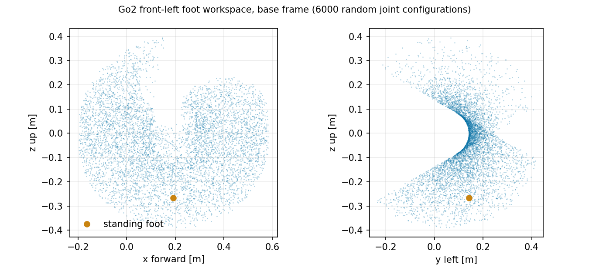

# Module 04 · Kinematics (single leg)

## Objective

Compute the foot position of each Go2 leg from its three joint angles, its Jacobian, and joint angles for a desired foot
position, written from first principles and checked against two independent libraries. Then solve the leg's inverse
kinematics in closed form, find where its Jacobian is singular, and compute the joint torques that hold the robot up
($\tau = J^\top f$), checked against a MuJoCo standing equilibrium.

## Prerequisites

[Module 00](../m00_math/README.md) (rotations, homogeneous transforms, Rodrigues' formula) and roadmap module 02 (the robot
description, no code in `modules/` yet). Python with NumPy; MuJoCo and Pinocchio only for checking.

## Theory

Each leg is a serial chain base → hip → thigh → calf → foot with one hinge per body. With $p_i$, $R_i$ the fixed offset of body
$i$ in its parent and $a_i$ its hinge axis,

$$\begin{bmatrix} p_{\text{base},\text{foot}}(q) \\ 1 \end{bmatrix} = \prod_{i=1}^{3} \begin{bmatrix} R_i & p_i \\ 0 & 1 \end{bmatrix}
\begin{bmatrix} \text{Rot}(a_i, q_i) & 0 \\ 0 & 1 \end{bmatrix} \begin{bmatrix} p_\text{foot} \\ 1 \end{bmatrix}$$

The geometric Jacobian of the foot position has columns $J_i = z_i \times (p_\text{foot} - o_i)$, where $z_i$ and $o_i$
are the axis and origin of joint $i$ in the base frame. Inverse kinematics uses damped least squares,
$\Delta q = J^\top (J J^\top + \lambda^2 I)^{-1} e$, with the result clamped to the joint limits.

### Leg geometry from the MJCF

All four legs have the same structure (values for the front-left leg, from `assets/unitree_go2/go2.xml`; the right legs flip the
sign of the lateral offsets, the rear legs the sign of the hip x position):

| Quantity | Symbol | Value |
|---|---|---|
| Hip (abduction) joint in the base frame, axis $x$ | $p_\text{hip}$ | (0.1934, 0.0465, 0) m |
| Thigh joint in the hip body, axis $y$ (lateral offset) | $d$ | 0.0955 m (−0.0955 right legs) |
| Knee joint in the thigh body, axis $y$ (thigh length) | $l_1$ | 0.213 m |
| Foot sphere centre in the calf body | $f = (f_x, 0, f_z)$ | (−0.002, 0, −0.213) m, radius 0.022 m |
| Knee to foot centre | $l_2 = \lVert f\rVert$ | 0.2130094 m |
| Angle of that segment from the calf's $-z$ axis | $\gamma = \operatorname{atan2}(-f_x, -f_z)$ | 0.0093894 rad (0.538°) |
| Limits: hip / front thigh / rear thigh / knee | | ±1.0472 / [−1.5708, 3.4907] / [−0.5236, 4.5379] / [−2.7227, −0.83776] rad |

No body in the leg is rotated, so with $p = p_\text{foot} - p_\text{hip}$:

$$p = R_x(q_1)\left[\begin{pmatrix}0\\ d\\ 0\end{pmatrix} + R_y(q_2)\Big(\begin{pmatrix}0\\0\\-l_1\end{pmatrix} + R_y(q_3)\, f\Big)\right].$$

`Leg.__init__` asserts this structure (axes, identity body rotations, offsets along single axes, foot in the sagittal plane)
before the closed form is used.

### Closed-form inverse kinematics

Call the sagittal vector $s = R_y(q_2)\big((0,0,-l_1) + R_y(q_3) f\big)$. Rotations about $y$ keep $y = 0$, so $s = (s_x, 0, s_z)$ and
$p = R_x(q_1)\,(s_x, d, s_z)$.

*Hip.* $R_x$ leaves the $x$ coordinate alone and preserves length in the $y$-$z$ plane:

$$s_x = p_x,\qquad p_y^2 + p_z^2 = d^2 + s_z^2 \ \Rightarrow\ s_z = \pm\sqrt{p_y^2 + p_z^2 - d^2}.$$

$R_x(q_1)$ turns the $y$-$z$ vector $(d, s_z)$ onto $(p_y, p_z)$, so $q_1 = \operatorname{atan2}(p_z, p_y) - \operatorname{atan2}(s_z, d)$.
No solution exists when $p_y^2 + p_z^2 < d^2$. The sign $s_z < 0$ is the foot below the hip in the leg plane; $s_z > 0$ is the
leg folded over the top, which the wide thigh range allows.

*Knee (law of cosines).* With $t = (0, 0, -l_1)$, $\lVert s\rVert^2 = l_1^2 + l_2^2 + 2\, t\cdot R_y(q_3) f$. Writing $f_x = -l_2\sin\gamma$,
$f_z = -l_2\cos\gamma$:

$$t\cdot R_y(q_3)f = -l_1\big(-f_x\sin q_3 + f_z\cos q_3\big) = l_1 l_2\cos(q_3 + \gamma)
\ \Rightarrow\ \cos(q_3+\gamma) = \frac{s_x^2 + s_z^2 - l_1^2 - l_2^2}{2\,l_1 l_2},\qquad q_3 = -\gamma \pm \arccos(\cdot).$$

The $+$ branch gives $q_3 \ge -\gamma = -0.0094$ rad, above the knee's upper limit of −0.838 rad, so on this robot it never
survives the limit check: the knee only bends backwards.

*Thigh.* $R_y(q_2)$ adds $q_2$ to the angle $\operatorname{atan2}(x, z)$ of any vector in the $x$-$z$ plane (write the vector as
$z + ix$; $R_y$ multiplies it by $e^{iq_2}$). With $v = t + R_y(q_3) f = \big(f_x c_3 + f_z s_3,\ -l_1 - f_x s_3 + f_z c_3\big)$:

$$q_2 = \operatorname{atan2}(s_x, s_z) - \operatorname{atan2}(v_x, v_z).$$

Each angle is then shifted by a multiple of $2\pi$ to the smallest value at or above its lower limit (the rear thigh range
reaches 4.54 rad, past $\pi$) and solutions outside the limits are dropped. Up to two remain, one per sign of $s_z$.

### Worked example: the standing pose

The MJCF `home` keyframe is $q = (0, 0.9, -1.8)$ rad. Forward kinematics puts the front-left foot centre at
(0.192157, 0.142000, −0.266373) m in the base frame, so $p = (-0.001243, 0.0955, -0.266373)$ m.

| Step | Value |
|---|---|
| $s_z = -\sqrt{p_y^2 + p_z^2 - d^2}$ | −0.266373 m ($p_y = d$ exactly, so $s_z = p_z$) |
| $q_1 = \operatorname{atan2}(p_z, p_y) - \operatorname{atan2}(s_z, d)$ | 0 |
| $\cos(q_3+\gamma) = (0.001243^2 + 0.266373^2 - 0.213^2 - 0.2130094^2)/(2 \cdot 0.213 \cdot 0.2130094)$ | −0.218048 |
| $q_3 = -0.0093894 - \arccos(-0.218048) = -0.0093894 - 1.790611$ | −1.800000 rad |
| $v = (v_x, v_z)$ | (0.207884, −0.166554) m |
| $q_2 = \operatorname{atan2}(-0.001243, -0.266373) - \operatorname{atan2}(0.207884, -0.166554) = -3.136925 - 2.246260$ | −5.383185 → +2π = 0.900000 rad |
| FK of the result minus the target | 1.1e-16 m |

The $s_z > 0$ branch is outside the limits here, so the standing target has one solution.

A reviewer's numbers for "a foot 0.225 m below the hip" were $\cos q_3 \approx -0.442$ and $q \approx (0, 1.014, -2.028)$ rad. Those
follow from the idealised law of cosines with equal links and no foot offset: $(0.225^2 - 2\cdot0.213^2)/(2\cdot0.213^2) = -0.442075$,
$\arccos = 2.028707$, $q_2 = q_3/2$. On the model:

| Target | $\cos(q_3+\gamma)$ | $q$ [rad] |
|---|---|---|
| foot 0.225 m straight below the thigh joint, $p = (0, d, -0.225)$ | −0.442100 | (0, 1.014403, −2.038124) |
| foot 0.225 m straight below the hip joint, $p = (0, 0, -0.225)$ | −0.542607 | (−0.438348, 1.072207, −2.153723) |

With the first reading the reviewer's $\cos$ and $q_2$ agree to 4 digits, but $q_3$ is −2.038, not −2.028: the 2 mm backward offset
of the foot sphere adds $\gamma = 0.0094$ rad to the knee angle. With the second reading (the target directly under the
abduction joint) the reviewer's answer is wrong by 0.44 rad at the hip, because the 0.0955 m lateral offset has to be swung under
the hip.

### Jacobian determinant and singularities

Undo the hip rotation first ($\det R_x = 1$ leaves the determinant unchanged). In the leg frame the three columns are
$e_x \times u$ with $u = (s_x, d, s_z)$, $e_y \times s$, and $e_y \times k$ with $k = R_y(q_2+q_3) f$ the knee-to-foot vector:

$$\det J = \det\begin{bmatrix} 0 & s_z & k_z \\ -s_z & 0 & 0 \\ d & -s_x & -k_x\end{bmatrix} = s_z\,(s_x k_z - s_z k_x).$$

The bracket is the planar cross product $s \times k$ in the $x$-$z$ plane. Since $s = R_y(q_2)t + k$ it equals
$R_y(q_2)t \times k$, which does not change under the common rotation $q_2$, so it equals
$t \times R_y(q_3) f = l_1 (f_x c_3 + f_z s_3) = -l_1 l_2 \sin(q_3 + \gamma)$:

$$\boxed{\det J = -\,l_1\, l_2\, \sin(q_3 + \gamma)\; s_z(q)},\qquad s_z = -l_1\cos q_2 + f_z\cos(q_2+q_3) - f_x\sin(q_2+q_3).$$

Two singularities follow. $\sin(q_3+\gamma) = 0$ is the straight or fully folded knee; over the knee range $[-2.7227, -0.83776]$ rad,
$|\sin(q_3+\gamma)|$ is smallest at the folded limit, 0.4153 ($|\sin q_3|$ alone would give 0.4067), so the limits keep the knee
away from it. $s_z = 0$ is the foot level with the abduction axis in the leg plane (thigh near horizontal): there the hip
abduction and the thigh both move the foot along the same direction and lateral motion is lost. This one lies inside the joint
limits. At the standing pose $\det J = -0.045371 \times (-0.975938) \times (-0.266373) = -0.011795$ m³ and the condition number
of $J$ is 2.38.

### Statics

By virtual work, joint power equals the power the foot delivers: $\tau^\top\dot q = f^\top \dot p = f^\top J\dot q$ for every
$\dot q$, so $\tau = J^\top f$ for a force $f$ that the foot applies to the ground. With the ground reaction $F = -f$ on the foot
and the leg's own weight, which contributes the gravity torque $g(q)$,

$$\tau = g(q) - J^\top F .$$

Total mass from the MJCF: 6.921 (base) + 4 × (0.678 + 1.152 + 0.241352) = 15.2064 kg, so with $g = 9.81$ m/s² the weight is
149.175 N, 37.294 N per foot on four feet and 74.587 N per foot on the two feet of a trot. For massless legs and a vertical
$F = (0, 0, F_z)$, $\tau = -F_z\,(J_{20}, J_{21}, J_{22})$, the bottom row of $J$. At the standing pose that row is
(0.0955, 0.001243, −0.165605) m:

| Load case (front-left, standing pose) | hip [N m] | thigh [N m] | knee [N m] |
|---|---|---|---|
| four feet, 37.294 N each | −3.562 | −0.046 | 6.176 |
| trot, two feet, 74.587 N each | −7.123 | −0.093 | 12.352 |
| actuator limit (`ctrlrange`) | ±23.7 | ±23.7 | ±45.43 |
| trot as a fraction of the limit | 30% | 0.4% | 27% |

The hip torque is the lateral offset times the load ($0.0955 \times 37.294$); the thigh torque is nearly zero because the foot
is 1.2 mm behind the thigh joint; the knee torque is the load times the 0.1656 m horizontal distance from knee to foot. These are
static numbers; a trot's stance phase adds the force needed to accelerate the trunk, which this module does not compute.

Assumptions: rigid links, joints located at body origins (asserted when the model is read), the foot is the centre of the
contact sphere. Limits: the numerical IK has no singularity handling beyond damping, and a point foot has no orientation.

## Implementation

- `kinematics.py`: `Leg` reads offsets, quaternions, axes, limits and the foot offset from the MJCF and implements `fk`,
  `jacobian`, `ik` and `ik_multistart`. No MuJoCo or Pinocchio kinematics is called.
- `kinematics.py` (added): `Leg.ik_closed_form` returns every in-limit solution, `Leg.det_jacobian` the formula above.
- `analytic.py`: closed-form vs numerical IK, the worked example, the determinant check, and the statics experiment in MuJoCo.
- `../common.py`: quaternion to rotation matrix and Rodrigues' formula, written out.

## Experiment

```bash
modules/fetch_go2.sh                                   # once: Go2 MJCF from MuJoCo Menagerie at a pinned commit
.venv-modules/bin/python modules/m04_kinematics/validate.py --n 1000 --json modules/m04_kinematics/results.json \
    --plot modules/m04_kinematics/workspace.png
```

For each leg, 1000 joint configurations drawn uniformly within the limits; the base is held at the origin.

```bash
.venv-modules/bin/python modules/m04_kinematics/analytic.py --n 1000 --json modules/m04_kinematics/analytic.json
```

IK: 1000 targets per leg, each the FK of a uniformly drawn in-limit configuration. The numerical IK (`ik_multistart` from the
standing pose) is polished with `ik(tol=1e-13)` before comparing angles. Statics: `scene.xml` (Go2 on a plane), `home`
keyframe, joint PD on the torque motors ($\tau = 80\,(q_\text{home} - q) - 4\,\dot q$) for 6 s of simulated time, joint
frictionloss set to 0 so that it cannot absorb torque at rest. The prediction for each joint is
$g(q) - \tau_\text{damping} - \sum_\text{contacts} z_i\cdot\big((p_c - o_i)\times F + M\big)$, with the contact force $F$ and
moment $M$ from `mj_contactForce`, the contact point $p_c$, and the joint axes $z_i$ and origins $o_i$ from this module's
kinematics; $g(q)$ and the damping term are MuJoCo's `qfrc_bias` and `qfrc_passive`.

## Validation

| Check | FL / FR / RL / RR | Acceptance |
|---|---|---|
| Foot position vs MuJoCo `mj_kinematics`, max error | 2.3e-16 / 2.4e-16 / 2.2e-16 / 1.9e-16 m | < 1e-12 m |
| Foot position vs Pinocchio, max error | 1.2e-16 / 1.2e-16 / 1.3e-16 / 1.4e-16 m | < 1e-12 m |
| Jacobian vs central finite differences, max abs. error | 1.0e-10 / 8.9e-11 / 9.3e-11 / 1.0e-10 | < 1e-7 |
| Jacobian vs Pinocchio `computeFrameJacobian`, max abs. error | 1.7e-16 / 1.1e-16 / 1.1e-16 / 1.1e-16 | < 1e-12 |
| IK converged to 1 µm, single seed (standing pose) | 82.9% / 85.2% / 84.6% / 85.0% | |
| IK converged to 1 µm, multi-start | 99.8% / 99.7% / 99.8% / 99.3% | ≥ 99% |



| Closed-form IK (`analytic.json`) | FL / FR / RL / RR | Acceptance |
|---|---|---|
| Generating angles recovered to 1e-9 rad | 100% / 100% / 100% / 100% | 100% |
| Max angle error vs generating angles | 3.6e-14 / 3.4e-14 / 1.9e-14 / 6.9e-14 rad | < 1e-9 rad |
| Max FK residual over all returned solutions | 3.7e-16 / 3.4e-16 / 4.0e-16 / 4.0e-16 m | < 1e-12 m |
| Targets with two in-limit solutions ($s_z$ of either sign) | 24.2% / 24.3% / 13.0% / 13.8% | |
| Numerical multi-start IK converged | 99.7% / 99.6% / 99.3% / 99.9% | |
| Converged numerical answers within 1e-9 rad of a closed-form solution | 100% / 100% / 100% / 99.8% | 100% away from $s_z = 0$ |
| Mean time per target, closed form / numerical | 0.24 / 10.5, 0.13 / 11.7, 0.26 / 12.5, 0.16 / 13.0 ms | |

The timings come from one run on a shared machine with a load average of 55; the same numerical IK measured 3.8–4.8 ms per
target on a quieter run (`results.json`). The ratio, 40–80× in favour of the closed form, is the number to keep. The closed form
costs about one FK evaluation.

| Jacobian determinant (FL, 5000 random in-limit $q$) | Measured | Acceptance |
|---|---|---|
| $\lvert \det J_\text{formula} - \det J_\text{numpy}\rvert$, max | 1.9e-17 | < 1e-15 |
| min $\lvert\sin(q_3+\gamma)\rvert$ over the knee range | 0.4153 (at $q_3 = -2.7227$) | > 0 |

| Statics, MuJoCo standing equilibrium | FL (FR mirrored) | RL (RR mirrored) | Acceptance |
|---|---|---|---|
| Contact force on the foot, world (x, y, z) | (0.670, −5.293, 34.458) N | (−0.670, −6.982, 40.129) N | sum of z = 149.175 N |
| MuJoCo actuator torque (hip, thigh, knee) | (−0.889, 1.044, 5.922) N m | (−1.022, 0.774, 6.787) N m | |
| $-J^\top F$ from this module's kinematics | (−1.964, 0.631, 6.211) N m | (−2.099, 0.362, 7.077) N m | |
| $g(q) - \tau_\text{damping}$ (leg weight) | (1.075, 0.412, −0.288) N m | (1.077, 0.412, −0.290) N m | |
| max \|MuJoCo − prediction\| | 2.4e-6 N m | 1.7e-6 N m | < 1e-4 N m |
| Hand estimate, massless legs, 37.294 N vertical | (−3.562, −0.046, 6.176) N m | (−3.562, −0.046, 6.176) N m | |

The robot came to rest at a base height of 0.2607 m and −0.35° pitch, with joint speeds below 1.7e-3 rad/s.

The hand estimate differs from MuJoCo for three reasons, each visible in the table. (1) The load is not shared equally: the
front feet carry 34.458 N and the rear 40.129 N because the whole-body centre of mass sits 14.7 mm behind the midpoint of the
front and rear feet; the lever rule, $mg\,(x_\text{com} - x_\text{rear})/(x_\text{front} - x_\text{rear})/2 = 34.455$ N, predicts the
front value to 3 mN. (2) The feet push outward and friction pushes back, 5.3 N inward on the front feet and 7.0 N on the rear;
acting about 0.27 m below the hip axis, this lateral force cancels about 1.4 N m of the abduction torque at the front
and 1.9 N m at the rear. (3) The leg's own
2.07 kg adds about +1.08 N m at the hip and +0.41 N m at the thigh and −0.29 N m at the knee. The knee estimate is closest
(6.18 vs 5.92 N m) because neither the lateral force nor the leg weight acts much about the knee axis.

Regression tests: `.venv-modules/bin/python -m pytest -q modules/m04_kinematics` (20 tests).

## Failure analysis

Single-seed IK failed on 15–17% of reachable targets. Grouping the failures by the thigh angle that generated the target
showed the pattern: targets near the standing pose (thigh 0 to 1.6 rad) converged 99.7% of the time, targets needing the leg
swung forward (thigh below 0) 75%, and targets with the leg folded over the top (thigh above 2.6 rad) 61%. Every failure ended
with a joint clamped at its limit: clamping turns the least-squares problem into one with local minima at the limits. Restarting
from three more seeds spread over the thigh range raised convergence to 99.3–99.8%. The remaining cases are targets close to
the workspace boundary where the reachable configuration is a narrow sliver between limits; a constrained solver (a QP with
the limits as inequalities) is the next step if a controller needs them.

The closed form and the polished numerical IK disagreed by more than 1e-9 rad on 2 of 1000 rear-right targets (by 4.6e-6
rad at most). Both targets lie next to the $s_z = 0$ singularity: the smallest singular value of $J$ there is 3e-4 m/rad, the two
closed-form branches nearly coincide, and damped least squares with $\lambda = 10^{-3}$ shrinks each step by
$\sigma^2/(\sigma^2+\lambda^2) \approx 0.08$, so after 100 polishing iterations the numerical answer was still 1.7e-9 m off the target.
The closed-form answer reaches the target to 4e-16 m in the same cases. Near $s_z = 0$ the joint angles are poorly determined
by the foot position itself, so any IK, closed form included, will return angles that jump between branches when the target
moves by a fraction of a millimetre; a controller crossing this region needs a branch rule (keep the previous $s_z$ sign).

The statics check first left a residual of 2.8e-3 N m on the front legs and 3.4e-3 N m on the rear. The robot was not quite at
rest: MuJoCo's soft foot contact lets the feet creep outward, the hip joints still moved at about 1e-3 rad/s after 6 s, and
the joint damping of 2 N m s/rad turns that into 2e-3 N m. Adding MuJoCo's passive (damping) force to the prediction brought
the residual to 2e-6 N m. Joint frictionloss (0.2 N m in the MJCF) was set to 0 for the check; with it left on, any value of
the residual below 0.2 N m per joint would be consistent with equilibrium and the check would be weaker by five orders.
The foot sphere centres settled 9.1–9.4 mm above the floor, about 12.7 mm lower than a rigid contact would allow (the foot
`solimp` width is 0.022 m), and MuJoCo places the contact point midway into the penetration, 6.3–6.5 mm below the floor. The lever
arms therefore use MuJoCo's contact point, not the sphere centre minus the radius.

If FK disagrees with MuJoCo, check in this order: quaternion convention (MuJoCo stores w, x, y, z), whether the joint sits at
the body origin, and whether the foot is taken as the geom centre or the body origin.

## References

- K. M. Lynch and F. C. Park, *Modern Robotics: Mechanics, Planning, and Control*, Cambridge University Press, 2017, ch. 4–6
  (ch. 5.4 for statics, $\tau = J^\top F$).
- B. Siciliano, L. Sciavicco, L. Villani, G. Oriolo, *Robotics: Modelling, Planning and Control*, Springer, 2009, ch. 2.12
  (closed-form inverse kinematics) and 3.3 (kinematic singularities).
- J. Carpentier et al., "The Pinocchio C++ library", IEEE/SICE SII, 2019.
- E. Todorov, T. Erez, Y. Tassa, "MuJoCo: a physics engine for model-based control", IROS, 2012.
- MuJoCo Menagerie, `unitree_go2` model.
