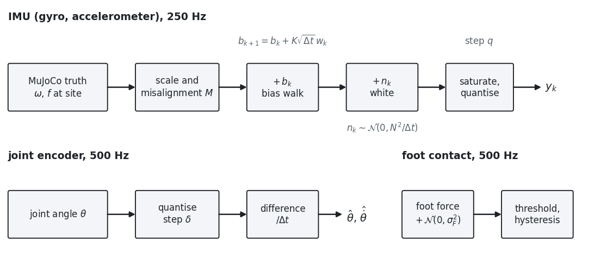
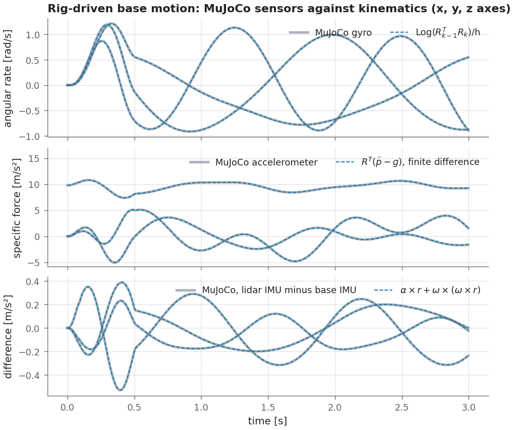
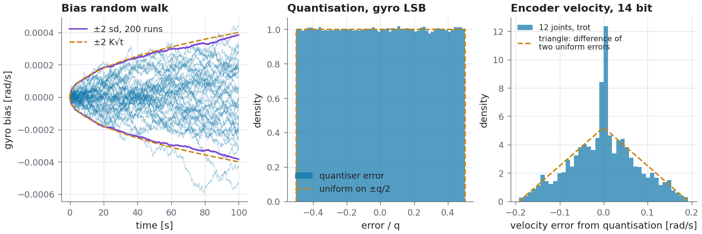
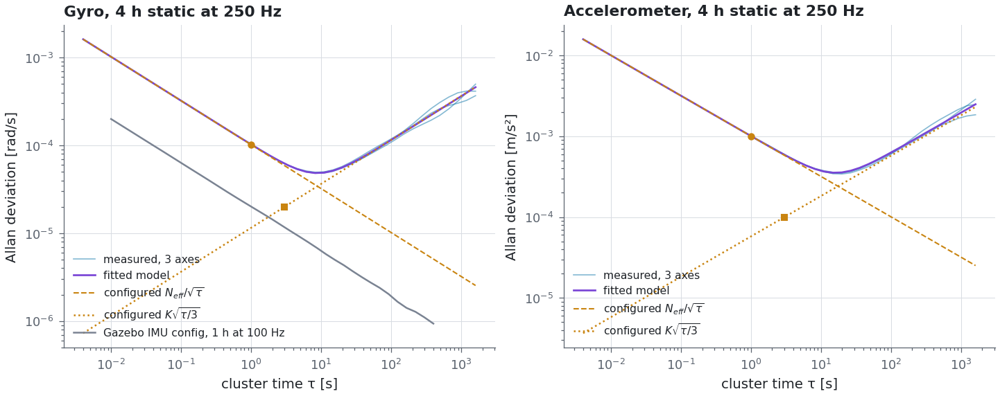
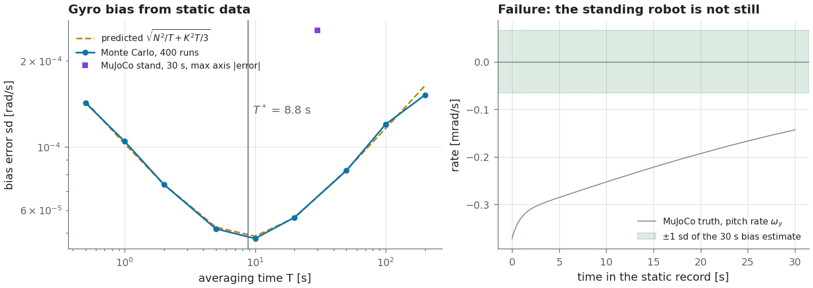
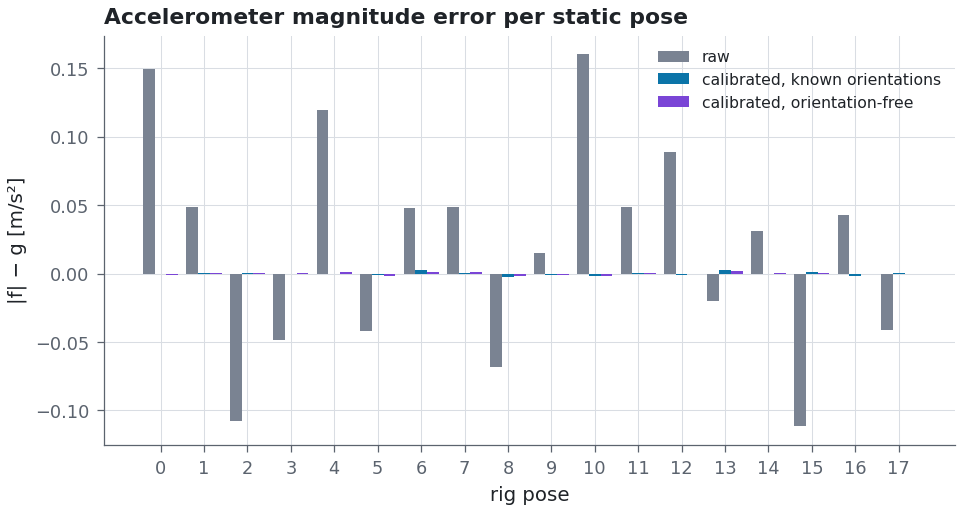
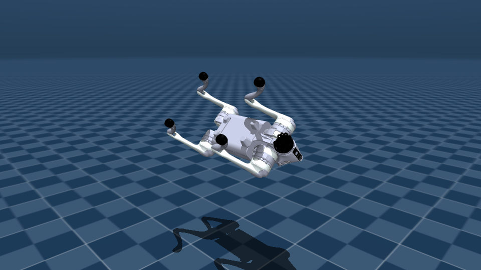
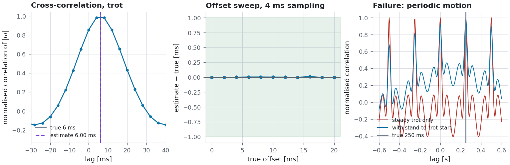
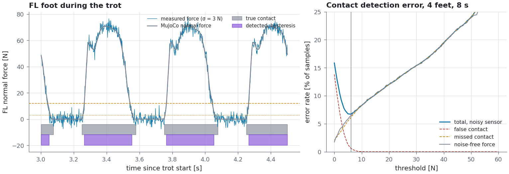
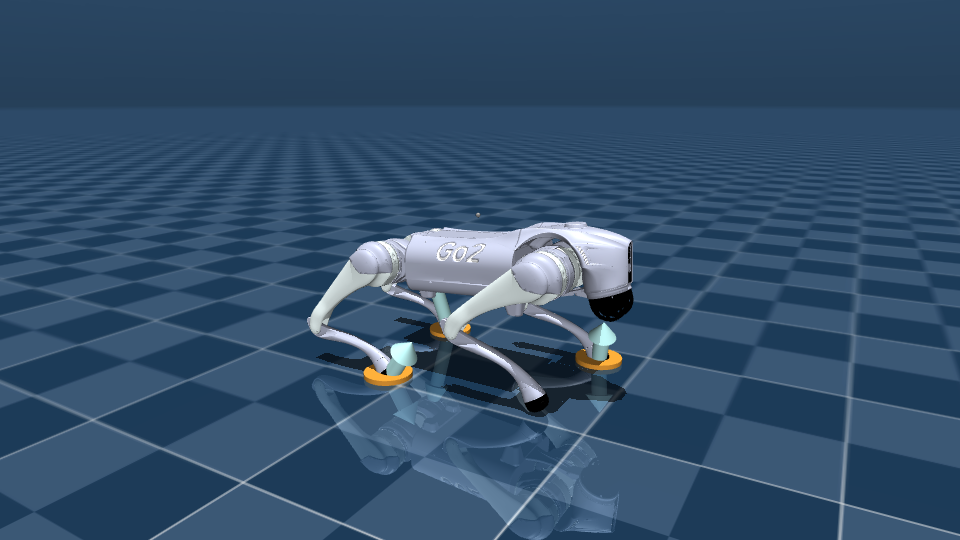

# Module 06 · Sensors: IMU, joint encoder and foot contact models, Allan variance, calibration and time offset

## Objective

A state estimator for the Go2 reads a gyro, an accelerometer, twelve joint encoders and some measure of foot contact. This module
builds models of those sensors on top of MuJoCo's noise-free sensors, then measures what the models predict: how the Allan
variance of a static record recovers the noise parameters, how well a static gyro bias and an accelerometer calibration can be
estimated, how a time offset between two IMUs is found by cross-correlation, and how often a thresholded contact force is wrong
during a gait.

| Level | Content | Applied on the Go2 |
|---|---|---|
| Fundamental | gyro, accelerometer, encoder and touch sensors in a derived MJCF; white noise, bias random walk, quantisation, saturation, scale and misalignment; encoder quantisation and finite-difference velocity | MuJoCo's sensors checked against the kinematics of a rig-driven base motion; encoders during an open-loop trot |
| Intermediate | Allan variance from first principles, fitted to $N$, $K$, $Q$; static gyro bias and its optimal averaging time; six-parameter-per-axis accelerometer calibration from known orientations | 4 h static records; a 30 s MuJoCo stand; 18 poses of a welded calibration rig |
| Advanced | orientation-free accelerometer calibration; time offset between two IMUs by cross-correlation with sub-sample interpolation; contact detection with threshold and hysteresis | base IMU against a second IMU on the lidar mount of the Gazebo URDF; 8 s open-loop trot |

After this module a reader can write a discrete IMU noise model from datasheet densities, read $N$ and $K$ off an Allan plot,
choose how long to average a static bias, calibrate an accelerometer with or without a rig, and say when a cross-correlation
time offset or a contact threshold can be trusted.



## Prerequisites

- [00 · Mathematical foundations](../m00_math/README.md): the SO(3) logarithm (`rotations.log_so3`) and the Levenberg-Marquardt
  solver (`optim.levenberg_marquardt`), both reused here.
- [02 · Robot description](../m02_description/README.md): the Gazebo URDF and its parser. The second IMU is placed at
  `lidar_link` as parsed from that URDF, and the Gazebo IMU noise settings are read from it.
- Probability: mean, variance, independent Gaussian and uniform variables, Brownian motion as the integral of white noise.
  Rigid-body kinematics: angular velocity, the derivative of a rotating vector.

## Theory

Notation: $R$ rotates base-frame vectors into the world frame, $\omega$ is the base angular velocity in the base frame,
$\alpha = \dot\omega$, $g = (0, 0, -9.81)$ m/s² is gravity in the world frame, $\Delta t$ is a sample period, and $h = 2$ ms the
physics step. A continuous white noise of density $N$ has $E[n(t)n(s)] = N^2\delta(t-s)$.

### Fundamental level

#### What an IMU measures

A gyro at a point of a rigid body measures $\omega$ in its own frame; every point of the body has the same $\omega$. An
accelerometer measures specific force, the acceleration minus gravity, in its own frame:

$$f = R^\top(\ddot p - g).$$

At rest $\ddot p = 0$ and $f = R^\top(0, 0, 9.81)$: a level accelerometer reads $+g$ upward. Two IMUs on the same body at
$p_A$ and $p_B = p_A + R r$, $r$ constant in the base frame, see different specific forces. Differentiating twice with
$\dot R = R[\omega]$:

$$\dot p_B = \dot p_A + R(\omega\times r),\qquad \ddot p_B = \ddot p_A + R\big(\alpha\times r + \omega\times(\omega\times r)\big)
\quad\Rightarrow\quad f_B = f_A + \alpha\times r + \omega\times(\omega\times r).$$

On the Go2 the Menagerie MJCF puts its `imu` site at $(-0.02557, 0, 0.04232)$ m in the base frame (`go2.xml`), while the Gazebo URDF
puts `imu_link` at the trunk origin (`go2_gazebo.urdf`, `imu_joint`): 4.94 cm apart. At 1 rad/s the centripetal term alone is
$\omega^2\lvert r\rvert = 0.049$ m/s², three times the per-sample accelerometer noise configured below.

#### MuJoCo's sensors and its integrator

MuJoCo's `gyro`, `accelerometer`, `framequat`, `jointpos`, `jointvel` and `touch` sensors return noise-free values at the current
state. The checks below rely on how the default (Euler) integrator steps the state $(p_k, v_k)$ with the acceleration $a_k$
computed at that state:

$$v_{k+1} = v_k + h\,a_k,\qquad p_{k+1} = p_k + h\,v_{k+1}\quad\Rightarrow\quad p_{k+1} - 2p_k + p_{k-1} = h(v_{k+1} - v_k) = h^2 a_k ,$$

$$R_{k} = R_{k-1}\,\mathrm{Exp}(h\,\omega_{k})\quad\Rightarrow\quad \omega_k = \mathrm{Log}(R_{k-1}^\top R_k)/h .$$

The rotation identity is exact, so the gyro must agree with it to rounding. The position identity is exact for the base origin;
for the IMU site, which also moves by rotation, it holds to first order in $h$.

#### Discrete noise from continuous densities

A sensor sampled every $\Delta t$ averages the continuous white noise over the sample. The average of $n(t)$ over $\Delta t$ has
variance $\frac{1}{\Delta t^2}\int_0^{\Delta t}\!\!\int_0^{\Delta t} N^2\delta(t-s)\,ds\,dt = N^2/\Delta t$, so the discrete model is

$$y_k = Q\big(\mathrm{sat}(M x_k + b_k + n_k)\big),\qquad n_k \sim \mathcal N(0, N^2/\Delta t),\qquad
b_{k+1} = b_k + K\sqrt{\Delta t}\,w_k,\quad w_k \sim \mathcal N(0, 1),$$

with $x_k$ the truth, $M$ scale factor and misalignment, $b$ a bias that random-walks with density $K$ ($\mathrm{Var}\,b(t) = K^2 t$),
$\mathrm{sat}$ the range limit and $Q$ a uniform quantiser of step $q$. When the noise spans several steps the quantisation error
is close to uniform on $[-q/2, q/2]$, with variance

$$\frac1q\int_{-q/2}^{q/2} e^2\,de = \frac{q^2}{12}.$$

Per sample it adds to the white noise, so the effective density is $N_{\mathrm{eff}}^2 = N^2 + q^2\Delta t/12$.

Configured values (chosen for this module, of the order of a consumer MEMS IMU; not a Go2 datasheet), at 250 Hz:

| | white $N$ | bias walk $K$ | step $q$ | per-sample sd $N/\sqrt{\Delta t}$ | $N_{\mathrm{eff}}$ |
|---|---|---|---|---|---|
| gyro | $1.0\cdot10^{-4}$ rad/s/√Hz | $2.0\cdot10^{-5}$ rad/s²/√Hz | 2000 °/s / 32768 = $1.07\cdot10^{-3}$ rad/s | $1.58\cdot10^{-3}$ rad/s | $1.019\cdot10^{-4}$ |
| accelerometer | $1.0\cdot10^{-3}$ m/s²/√Hz | $1.0\cdot10^{-4}$ m/s³/√Hz | 16 g / 32768 = $4.79\cdot10^{-3}$ m/s² | $1.58\cdot10^{-2}$ m/s² | $1.004\cdot10^{-3}$ |

The accelerometer also has $M = \mathrm{diag}(1.010, 0.992, 1.004)(I + E)$ with off-diagonal misalignments $E$ up to $4\cdot10^{-3}$
and a bias $b_0 = (0.05, -0.03, 0.08)$ m/s². For comparison, the Gazebo IMU of this repository (`go2_gazebo.urdf`,
`imu_sensor`) has 100 Hz, a per-sample gyro sd of $2\cdot10^{-4}$ rad/s and no bias model: $N = 2\cdot10^{-4}\sqrt{0.01} = 2\cdot10^{-5}$
rad/s/√Hz, five times lower than the gyro above, and $K = 0$.

#### Joint encoder

An encoder of step $\delta$ reports $\hat\theta_k = \delta\,\mathrm{round}(\theta_k/\delta)$ with error $e_k$ of variance $\delta^2/12$. The
backward-difference velocity $(\hat\theta_k - \hat\theta_{k-1})/\Delta t$ carries the error $(e_k - e_{k-1})/\Delta t$. If successive errors
are independent, its distribution is the triangle on $\pm\delta/\Delta t$ and

$$\mathrm{Var} = \frac{2\,\delta^2/12}{\Delta t^2}\quad\Rightarrow\quad \mathrm{rms} = \frac{\delta}{\sqrt6\,\Delta t}.$$

With 14 bits per joint revolution, $\delta = 2\pi/2^{14} = 3.83\cdot10^{-4}$ rad, and at 500 Hz the velocity noise is 0.0783 rad/s rms,
while the angle error is only $1.11\cdot10^{-4}$ rad rms. Independence fails when a joint moves less than $\delta$ per sample.

### Intermediate level

#### Allan variance

Integrate the rate, $\theta(t) = \int_0^t y$, and form averages over clusters of length $\tau = m\Delta t$:
$\bar y_j = (\theta_{(j+1)m} - \theta_{jm})/\tau$. The Allan variance is half the mean squared difference of successive averages,

$$\sigma^2(\tau) = \tfrac12 E\big[(\bar y_{j+1} - \bar y_j)^2\big] = \frac{1}{2\tau^2} E\big[(\theta_{k+2m} - 2\theta_{k+m} + \theta_k)^2\big].$$

The overlapping estimator averages the right-hand side over every start $k$, not only multiples of $m$. A constant added to $y$
adds a linear term to $\theta$, which the second difference removes, so the code subtracts the mean before integrating.

White noise: each average has variance $N^2/\tau$ and two averages are independent, so $\sigma^2 = N^2/\tau$, a line of slope $-1/2$ in
Allan deviation; it reads $N$ at $\tau = 1$ s.

Bias random walk: $\bar y_{j+1} - \bar y_j = \frac1\tau\int_0^\tau \big(b(s+\tau) - b(s)\big)ds$. Two increments of $b$ over windows of
length $\tau$ starting at $s$ and $s'$ have covariance $K^2(\tau - \lvert s - s'\rvert)$, and

$$\mathrm{Var}(\bar y_{j+1} - \bar y_j) = \frac{K^2}{\tau^2}\int_0^\tau\!\!\int_0^\tau (\tau - \lvert s - s'\rvert)\,ds\,ds' = \frac{K^2}{\tau^2}\cdot\frac{2\tau^3}{3}
\quad\Rightarrow\quad \sigma^2 = \frac{K^2\tau}{3},$$

slope $+1/2$, reading $K$ at $\tau = 3$ s. Angle quantisation (an integrated signal quantised, as an encoder differentiated to a rate)
gives $\bar y_{j+1} - \bar y_j = (e_{k+2m} - 2e_{k+m} + e_k)/\tau$ with $\mathrm{Var}\,e = Q^2 = \delta^2/12$, so $\sigma^2 = 6Q^2/(2\tau^2) = 3Q^2/\tau^2$.
Per-sample rate quantisation, as in the IMU model, is white and goes into $N_{\mathrm{eff}}$, not $Q$. The fitted model is

$$\sigma^2(\tau) = \frac{3Q^2}{\tau^2} + \frac{N^2}{\tau} + \frac{K^2\tau}{3},$$

linear in $(3Q^2, N^2, K^2/3)$. Each row is divided by the measured $\sigma^2(\tau)$ so every octave of $\tau$ weighs the same.

The minimum of the white plus random-walk curve is at $\tau = \sqrt3 N/K$: 8.8 s for the gyro and 17.4 s for the accelerometer.

#### Static gyro bias

Averaging the gyro over $[0, T]$ while still estimates the bias. Relative to the bias at the end of the window, where it will be
used, the error is $\bar n + \frac1T\int_0^T (b(t) - b(T))\,dt$. With $b(T) - b(t) = \int_t^T K\,dW$, the integral equals
$\int_0^T s\,K\,dW(s)$, of variance $K^2T^3/3$. Hence

$$\mathrm{sd}(\hat b - b(T)) = \sqrt{\frac{N_{\mathrm{eff}}^2}{T} + \frac{K^2 T}{3}},\qquad T^\star = \frac{\sqrt3\,N_{\mathrm{eff}}}{K}.$$

Worked on the gyro: $T^\star = \sqrt3\cdot1.019\cdot10^{-4}/2\cdot10^{-5} = 8.8$ s, with an error sd of $4.9\cdot10^{-5}$ rad/s at $T = 10$ s.
Averaging longer makes it worse: at 200 s the sd is $1.6\cdot10^{-4}$ rad/s.

#### Accelerometer calibration with known orientations

At static pose $i$ the true specific force is $f_i = R_i^\top(0, 0, g)$ and the averaged reading is $y_i = M f_i + b$. Transposed and
stacked, this is linear in the 12 unknowns:

$$\begin{bmatrix} f_i^\top & 1\end{bmatrix}\begin{bmatrix} M^\top \\ b^\top\end{bmatrix} = y_i^\top,\qquad i = 1\dots n,$$

solved by least squares. It needs at least four poses whose $f_i$ are not coplanar. The rig here holds 18 poses: gravity along
$\pm x, \pm y, \pm z$ of the base and along the 12 edge diagonals.

### Advanced level

#### Orientation-free accelerometer calibration

Without a rig, only $\lvert f_i\rvert = g$ is known. Any rotation $Q$ leaves the norm unchanged, so from magnitudes only the
upper-triangular factor $U$ of $M^{-1} = QU$ (QR decomposition) is observable: 6 entries plus 3 biases. The residual and its
Jacobian, with $z_i = y_i - b$ and $w_i = U z_i$:

$$r_i = \lvert w_i\rvert - g,\qquad \frac{\partial r_i}{\partial U_{jk}} = \frac{w_{ij}\,z_{ik}}{\lvert w_i\rvert}\ (j \le k),\qquad
\frac{\partial r_i}{\partial b} = -\frac{w_i^\top U}{\lvert w_i\rvert}.$$

Nine unknowns need at least nine poses in general position; module 00's Levenberg-Marquardt solves it from $U = I$, $b = 0$.

#### Time offset by cross-correlation

If sensor B reports at time $t$ what A sees at $t - d$, $b(t) = a(t - d)$, then $c(k) = \sum_n a_n b_{n+k}$ peaks at $k = d/\Delta t$. A
parabola $c(k_0 + x) \approx c_0 + \beta x + \gamma x^2$ through the peak and its two neighbours gives $\beta = (c_+ - c_-)/2$,
$\gamma = (c_+ - 2c_0 + c_-)/2$ and the sub-sample peak

$$x^\star = -\frac{\beta}{2\gamma} = \frac{c_- - c_+}{2(c_- - 2c_0 + c_+)},\qquad \hat d = (k_0 + x^\star)\,\Delta t .$$

Two gyros on one rigid body see the same $\omega$, each in its own frame; the norm $\lvert\omega\rvert$ does not depend on the mounting
rotation, so it is the signal correlated here. If the motion is periodic with period $P$, then $c(k) = c(k + P/\Delta t)$, and an
offset larger than $P/2$ cannot be told from one shifted by $P$.

#### Contact from force

A foot force sensor reads $\tilde F = F + \epsilon$, $\epsilon \sim \mathcal N(0, \sigma_F^2)$. The detector reports contact when
$\tilde F > F_{\mathrm{th}}$; with hysteresis it switches on above $F_{\mathrm{on}}$ and off below $F_{\mathrm{off}} < F_{\mathrm{on}}$. In swing, $F = 0$
and a false contact occurs with probability $1 - \Phi(F_{\mathrm{th}}/\sigma_F)$. Worked: at $F_{\mathrm{th}} = 6$ N, $\sigma_F = 3$ N this is
2.3% of swing samples; the trot below spends 27.6% of foot-samples in swing (`contact_truth_duty`), so 0.63% of all samples. The
measured false-contact rate is 0.64%. Missed contacts come from the force ramp at touch-down and lift-off, where $F < F_{\mathrm{th}}$
while the foot already touches. The truth is geometric: the foot sphere overlaps the floor (MuJoCo contact distance < 0).

## Implementation

| Equation | Function | Notes |
|---|---|---|
| derived model | `sensors.build_model()` | `MjSpec` from `scene.xml`; adds `imu_lidar` at `lidar_link` of the Gazebo URDF (`lidar_mount()`, via module 02's `parse_urdf`), gyro/accelerometer/framequat at both sites, `jointpos`/`jointvel` for 12 joints, a touch site of radius 1.2 × foot radius per foot, and a mocap body `rig` with an inactive weld to the base (time constant 4 ms) |
| discrete noise model | `Inertial.corrupt()` | order: $M$, bias walk, white noise, saturation, quantisation; vectorised over time |
| encoder | `encoder()` | mid-tread quantiser, backward difference |
| Allan variance | `allan()`, `allan_nonoverlap()`, `log_taus()` | cumulative sum after removing the mean; non-overlapping version kept as an independent check |
| $\sigma^2(\tau)$ fit | `allan_fit()` | weighted least squares with an active set that drops a negative coefficient |
| $\mathrm{sd}(\hat b)$ | `bias_sd()` | |
| known-orientation calibration | `calib_known()` | `lstsq` on the $n \times 4$ system |
| orientation-free calibration | `calib_unknown()`, `triangular_factor()` | analytic Jacobian, module 00's `levenberg_marquardt` |
| cross-correlation, parabola | `xcorr()`, `xcorr_offset()` | normalised over the overlap at each lag |
| contact detector | `detect_contact()`, `toggles()` | |

`sensors.py` calls MuJoCo only to build and compile the model. `validate.py` runs the simulations: after every physics step it
calls `mj_forward` so that sensor data, site poses and `qpos` refer to the same time, which the finite-difference checks need.

Design choices:
- Noise is added in Python to MuJoCo's noise-free sensors, so one simulation can be corrupted many times with different seeds and
  the truth stays available.
- The IMU runs at 250 Hz (every second physics step), encoders and force sensors at 500 Hz.
- The calibration rig is a weld to a mocap body. With the default weld time constant (20 ms) the base sagged 0.09° under gravity in a
  prototype run (not in `results.json`); at 4 ms the sag is 0.0075° (`rig_sag_deg_max`), which puts at most $1.3\cdot10^{-3}$ m/s² of error into the rig's
  reference specific force (`rig_truth_vs_ref_max`).
- The trot is open loop: joint PD ($k_p = 60$, $k_d = 2$) to the standing pose plus $\sin^2$ swing bumps of 0.3 rad (thigh) and
  −0.6 rad (calf), diagonal pairs alternating, period 0.5 s. After 8 s the base is at 0.232 m height and tilted 4.6°
  (`trot_final_base_z`, `trot_final_tilt_deg`).

## Experiment

```bash
.venv-modules/bin/python modules/m06_sensors/validate.py            # results.json, figures/, media/; 96 s wall on this shared machine
.venv-modules/bin/python modules/m06_sensors/validate.py --no-media # same numbers, no rendering
.venv-modules/bin/python -m pytest -q modules/m06_sensors           # 15 tests, 10 s
```

Seeds are fixed in `validate.py` (`default_rng(1)` to `default_rng(8)`, 100 to 149 for the scatter check). The runs, in order:

1. Rig motion: the base welded to the rig, which follows sinusoids in position (3 to 5 cm) and rotation (0.2 to 0.4 rad) that ramp
   in over 0.5 s, logged for 3 s.
2. Static stand: `sim.stand` with 3 s settling, then 30 s logged; then 60 s more and 10 s logged to see whether the base has stopped.
3. Noise statistics: $10^6$ white samples, 2000 bias walks of 100 s, $10^6$ quantised uniform values.
4. Allan variance: 4 h at 250 Hz per sensor, the noise model applied to the mean static truth of run 2. Simulating 4 h step by
   step would take 7.2 M physics steps, which this shared machine was not used for; the 30 s of simulated stand show that the truth
   is constant except for the creep discussed in Failure analysis. Also 1 h of white noise alone, and 1 h of the Gazebo IMU setting.
5. Gyro bias: 400 synthetic records of 200 s (one axis each) for $T$ from 0.5 to 200 s; then the 30 s MuJoCo stand corrupted once.
6. Calibration rig: 18 poses, each 0.4 s of min-jerk slerp and 0.8 s of hold; the accelerometer is averaged over the last 0.6 s of
   each hold. The bias walk runs through the whole 21.6 s session.
7. Trot: 1 s standing, then 8 s of trot, logged at 500 Hz. Used for the encoders, the time offset and contact detection. The
   lidar IMU's gyro is delayed by 3 physics steps (6 ms, 1.5 IMU samples); both gyros get independent noise.

## Validation

Thresholds were fixed in `validate.ACCEPT` before the first full run; `test_sensors.py` asserts the same ones and pins the three
missed rows to their measured state (see Failure analysis).

| Check | Measured | Acceptance | Source (`results.json`) |
|---|---|---|---|
| MuJoCo gyro vs free-joint $\omega$, max abs, rig motion | 4.2e-15 rad/s | < 1e-12 | `gyro_vs_base_omega_max` |
| `framequat` vs normalised base quaternion, max abs | 1.0e-15 | < 1e-12 | `quat_vs_base_quat_max` |
| `jointpos` vs `qpos`, max abs | 0 | < 1e-12 | `jointpos_vs_qpos_max` |
| `jointvel` vs `qvel`, max abs | 0 | < 1e-12 | `jointvel_vs_qvel_max` |
| `touch` vs `sim.foot_forces` normal force, trot, max abs | 0 N | < 1e-6 N | `touch_vs_foot_forces_max_N` |
| gyro vs $\mathrm{Log}(R_{k-1}^\top R_k)/h$, relative rms | 2.4e-14 | < 1e-2 | `gyro_vs_rotation_fd_rel_rms` |
| accelerometer vs $R^\top(\ddot p - g)$ by second difference, relative rms | 8.3e-5 | < 1e-2 | `acc_vs_position_fd_rel_rms` |
| lidar IMU vs base IMU + $\alpha\times r + \omega\times(\omega\times r)$, relative rms | 1.1e-4 | < 1e-2 | `lever_arm_rel_rms` |
| static stand: $\lvert\bar f\rvert - g$ | 1.4e-5 m/s² | < 1e-3 | `static_acc_norm_minus_g` |
| white noise sample sd vs $N/\sqrt{\Delta t}$, max relative error, 3 axes | 1.7e-3 | < 0.01 | `white_sd_rel_err` |
| bias walk variance at 100 s vs $K^2 T$, 2000 runs | 0.026 | < 0.10 | `bias_rw_var_rel_err` |
| quantisation error rms vs $q/\sqrt{12}$ | 2.1e-4 | < 0.02 | `quant_err_rms_rel_err` |
| encoder angle error rms vs $\delta/\sqrt{12}$, trot | 0.017 | < 0.05 | `encoder_angle_err_rms_rel_err` |
| encoder velocity quantisation error rms vs $\delta/(\sqrt6\Delta t)$ | 0.054 (0.0741 vs 0.0783 rad/s) | < 0.10 | `encoder_vel_quant_rms_rel_err` |
| overlapping Allan sum at $k = jm$ vs cluster-mean estimator, max relative | 2.2e-13 | < 1e-12 | `allan_overlap_subset_identity` |
| white noise $\sigma^2$ vs $N^2/\tau$, every $\tau$ with ≥ 100 clusters, max relative | **0.054 (missed)** | < 0.05 | `allan_white_rel_err_max` |
| fitted gyro $N$ vs $N_{\mathrm{eff}}$ | 1.0e-3 | < 0.03 | `allan_gyro_N_rel_err` |
| fitted gyro $K$ vs configured | 5.2e-3 | < 0.25 | `allan_gyro_K_rel_err` |
| fitted accelerometer $N$ vs $N_{\mathrm{eff}}$ | 1.1e-3 | < 0.03 | `allan_acc_N_rel_err` |
| fitted accelerometer $K$ vs configured | 0.078 | < 0.25 | `allan_acc_K_rel_err` |
| fitted $N$ of the Gazebo IMU setting vs $\sigma\sqrt{\Delta t}$ | 0.014 | < 0.03 | `allan_gazebo_N_rel_err` |
| static bias error sd, Monte Carlo / predicted, max deviation over 9 values of $T$ | 0.072 | < 0.15 | `gyro_bias_mc_sd_ratio_max_dev` |
| 30 s MuJoCo stand: bias error / predicted sd, max over axes | **3.87 (missed)** | < 3 | `gyro_bias_mujoco_err_in_sd` |
| known-orientation calibration: $M$ error, max entry | 1.1e-4 | < 1e-3 | `calib_known_M_err_max` |
| known-orientation calibration: $b$ error, max | 8.9e-4 m/s² | < 3e-3 | `calib_known_b_err_max` |
| orientation-free: $U$ error vs triangular factor of $M^{-1}$, max entry | 2.1e-4 | < 2e-3 | `calib_unknown_U_err_max` |
| orientation-free: $b$ error, max | 6.8e-4 m/s² | < 5e-3 | `calib_unknown_b_err_max` |
| orientation-free: LM converged (gradient test, 5 iterations) | 1 | 1 | `calib_unknown_converged` |
| own unnormalised correlation vs `scipy.signal.correlate`, max relative | 0 | < 1e-10 | `xcorr_vs_scipy_rel` |
| time offset 6 ms during the trot, abs error | 7.8e-4 ms | < 1 ms | `time_offset_err_ms` |
| time offset sweep 0 to 20 ms in 2 ms steps, max abs error | 0.011 ms | < 1 ms | `time_offset_sweep_max_err_ms` |
| 250 ms offset, record with the stand-to-trot start, abs error | 6.3e-3 ms | < 1 ms | `time_offset_with_transient_err_ms` |
| contact: lowest error rate over thresholds 0 to 60 N, 4 feet × 8 s | **6.7% at 6 N (missed)** | < 5% | `contact_best_error_rate` |
| contact with hysteresis (on 12 N, off 3 N): detected / true transitions | 1.00 (127 / 127) | ≤ 1.1 | `contact_hysteresis_toggle_ratio` |
| both MP4 files under 6 MB | 1 (1.33 MB, 1.06 MB) | 1 | `media_mp4_under_6MB` |

32 of 35 checks pass.

### MuJoCo's sensors against the kinematics



The gyro equals $\mathrm{Log}(R_{k-1}^\top R_k)/h$ to $2.4\cdot10^{-14}$, as the Euler step predicts. The accelerometer equals the
second difference of the site position to $8.3\cdot10^{-5}$ relative; the residual is the first-order term of the site's rotation
about the base origin. Between the base IMU and the lidar IMU, $r = (0.0256, 0, 0.0577)$ m, the specific forces differ by 0.30 m/s²
rms during the rig motion (`lever_arm_acc_diff_rms`), and the lever-arm formula reproduces that difference to $1.1\cdot10^{-4}$.
On the standing robot the accelerometer mean is $(0.139, 0.000, 9.809)$ m/s² (`static_acc_truth_mean`): its norm is $g$ to
$1.4\cdot10^{-5}$ m/s² and the base is tilted 0.81° about $y$.

### Noise models and encoders



The ±2 sd envelope of 200 bias walks follows $\pm 2K\sqrt t$. The quantiser error is flat on $\pm q/2$. The encoder velocity error
during the trot follows the triangle except for a peak at zero, discussed in Failure analysis.

### Allan variance



The fit returns $N = 1.020\cdot10^{-4}$ rad/s/√Hz and $K = 1.99\cdot10^{-5}$ rad/s²/√Hz for the gyro, against $N_{\mathrm{eff}} = 1.019\cdot10^{-4}$
and $K = 2.0\cdot10^{-5}$; for the accelerometer $N = 1.003\cdot10^{-3}$ and $K = 1.08\cdot10^{-4}$, against $1.004\cdot10^{-3}$ and
$1.0\cdot10^{-4}$. Compared with the unquantised $N$, the gyro fit is 2.0% high (`allan_gyro_N_rel_err_vs_unquantised`): the
quantisation term $q^2\Delta t/12$ has to be included before an Allan fit is compared with a datasheet density. The gyro fit puts
$Q = 0$, as expected for per-sample quantisation. The Gazebo setting has no bias walk: its Allan deviation falls with slope $-1/2$ at every
$\tau$, and the fit finds $K = 0$, $N = 1.97\cdot10^{-5}$ rad/s/√Hz.

### Static gyro bias



The Monte Carlo sd follows $\sqrt{N_{\mathrm{eff}}^2/T + K^2T/3}$ within 7.2% over $T$ = 0.5 to 200 s, with the minimum near $T^\star = 8.8$ s.
On the MuJoCo stand the estimate misses by 3.9 predicted sd; the right panel shows why.

### Accelerometer calibration



Raw readings miss $g$ by up to 0.160 m/s² (`calib_norm_err_raw_max`). After the known-orientation calibration the largest
magnitude error is $2.7\cdot10^{-3}$ m/s² and the largest direction error 0.021°; after the orientation-free calibration the
magnitude error is $2.0\cdot10^{-3}$ m/s². The known-orientation $M$ is within $1.1\cdot10^{-4}$ of the configured one per entry. The
calibration rig video shows the 18 poses: [calibration_rig.mp4](media/calibration_rig.mp4).



### Time offset



On the trot the 6 ms offset (1.5 samples) is recovered as 5.9992 ms, and every offset from 0 to 20 ms within 0.011 ms. The
parabola is accurate here because the correlation peak of $\lvert\omega\rvert$ spans several 4 ms samples (left panel).

### Contact detection



The plain threshold is best at 6 N with 6.7% wrong samples: 0.64% false contacts and 6.1% missed contacts. Without noise the same
threshold rule still gets 1.7% wrong (`contact_ideal_best`). A plain threshold at 6 N switches 4.35 times as often as the truth
(`contact_plain_toggle_ratio`), because the noise crosses it repeatedly near touch-down and lift-off. Hysteresis with on 12 N, off
3 N (the best threshold ± 2σ_F, rule fixed before the run) removes the chatter, 127 detected for 127 true transitions, and gives
6.6% wrong samples. The trot video shows MuJoCo's contact points and forces:
[trot_contacts.mp4](media/trot_contacts.mp4).



## Failure analysis

### The standing robot is not still

Shown in the right panel of the static gyro bias figure. After `sim.stand` with 3 s of settling, the base pitches at
$-2.9\cdot10^{-4}$ rad/s over the first 10 s of the record and $-1.7\cdot10^{-4}$ rad/s over the last 10 s
(`static_pitch_rate_first_10s`, `_last_10s`). Over the 30 s the base sinks 3.5 mm and pitches −0.39° (`static_base_z_change_mm`,
`static_pitch_change_deg`), and the feet slide up to 3.0 mm in the next 60 s (`static_foot_xy_drift_60s_mm`). The mean true rate
over the window is 3.4 predicted sd of the bias estimate (`gyro_bias_mujoco_truth_mean_in_sd`), so the "bias" estimated from that
window contains real rotation, and the error reaches 3.9 sd (criterion `gyro_bias_mujoco_err_in_sd` missed). From 93 to 103 s the
rate is down to $-1.6\cdot10^{-5}$ rad/s, 0.24 sd (`static_pitch_rate_t93_103s`). Check the truth, or the accelerometer, for
stillness before using a window for bias estimation; on this model that means waiting about 90 s after standing up. The cause of the
creep (soft contact, foot sliding, joint friction loss) was not separated.

### Periodic motion hides a large time offset

Shown in the right panel of the time offset figure. With a 250 ms offset and a ±0.6 s search window on
the steady trot, the correlation has peaks every 0.25 s (half the trot period, since the two diagonal pairs produce the same
$\lvert\omega\rvert$) and the second-highest is 0.999996 of the highest (`time_offset_periodic_peak_ratio`). The estimate is 500 ms,
wrong by one half-period. Including the stand-to-trot start breaks the periodicity: the estimate is 249.994 ms, but the margin is
small, with the next peak at 0.94 of the true one. The search window must be shorter than half the period of the motion, or the
record must contain aperiodic motion.

### Contact error rate above 5%

Shown in the contact figure. The missed contacts sit on the force ramps: the median true force of a missed
contact sample is 1.35 N and 90% are below 4.9 N (`contact_fn_force_quantiles_N`); with hysteresis 61% of the wrong samples lie
within 10 ms of a true transition. A threshold below the ramp lets the noise through (14.3% wrong at 0.5 N), so with σ_F = 3 N no
single threshold reaches 5%. Even a noise-free force sensor disagrees with geometric contact on 1.7% of samples, since MuJoCo's soft
contact can push at small positive distance and carries near-zero force just after the overlap starts. A 5% criterion
needs a quieter sensor or a contact model that also uses foot kinematics.

### Allan white-noise criterion set tighter than the estimator's own scatter

On 1 h of white noise the largest relative error over
all $\tau$ with at least 100 clusters is 5.4%, at $\tau$ = 36 s. Repeating that $\tau$ with 50 more seeds gives a relative sd of 7.5%
(`allan_white_rel_err_sd_at_tau_max_50_seeds`), so the measured value is within one sd and the 5% threshold was too tight for 100
clusters. The test in `test_sensors.py` that uses $\tau$ with at least 1000 clusters stays under 5%.

### Rounding in the cumulative sum

The first full run integrated the gyro with its 4 mrad/s bias: $\theta$ grows to about 3 rad
over 800 s while the second differences are about $10^{-4}$ rad, and the identity check gave $3.7\cdot10^{-12}$ relative, above its
$10^{-12}$ threshold. Subtracting the mean before the sum (which leaves $\sigma^2$ unchanged) brought it to $2.2\cdot10^{-13}$.

### Too few poses for the orientation-free calibration

With only the 6 axis-aligned poses there are 6 equations for 9 unknowns. LM
still stops on its gradient test (`calib_unknown_6pose_status`: `grad`), at a $U$ that is off by $7.5\cdot10^{-3}$
(`calib_unknown_6pose_U_err_max`), 36 times the 18-pose error. The solver's status alone does not say that the problem is underdetermined;
counting poses against unknowns does.

### Encoder velocity below the independence prediction

The velocity quantisation error is 0.0741 rad/s rms against 0.0783 predicted
(5.4% low). The histogram has a peak at zero: when a joint moves less than one step between samples, successive errors are
correlated and their difference is small. Hips move at 0.27 rad/s rms in this trot, against 1.21 rad/s rms over all joints
(`encoder_hip_speed_rms`, `encoder_vel_signal_rms`), and have the lowest error (0.0720 rad/s against 0.0751 for thighs and calves).

### Limits of the time-offset result

Both IMUs read the same simulated $\omega$, with no difference in filtering, bandwidth or
mounting compliance between them, and the offset is a whole number of physics steps. The 0.011 ms accuracy is therefore a best case;
it shows the interpolation works, not what two real sensors would give.

## References

- D. W. Allan, "Statistics of atomic frequency standards", *Proceedings of the IEEE* 54(2), pp. 221-230, 1966: the two-sample
  variance used in Theory.
- IEEE Std 952-1997, *IEEE Standard Specification Format Guide and Test Procedure for Single-Axis Interferometric Fiber Optic Gyros*,
  Annex C: Allan variance noise terms (quantisation $3Q^2/\tau^2$, angle random walk $N^2/\tau$, rate random walk $K^2\tau/3$) and
  reading $N$ at $\tau$ = 1 s and $K$ at $\tau$ = 3 s.
- N. El-Sheimy, H. Hou, X. Niu, "Analysis and modeling of inertial sensors using Allan variance", *IEEE Transactions on
  Instrumentation and Measurement* 57(1), 2008: the same terms applied to MEMS IMUs; section numbers not checked.
- B. Widrow, I. Kollár, *Quantization Noise*, Cambridge University Press, 2008: the uniform model of quantisation error and its
  variance $q^2/12$.
- D. Tedaldi, A. Pretto, E. Menegatti, "A robust and easy to implement method for IMU calibration without external equipments",
  IEEE ICRA, 2014: accelerometer calibration from the constraint $\lvert f\rvert = g$ over static poses, with a triangular
  misalignment model; section numbers not checked.
- MuJoCo documentation: XML reference, `sensor` elements (`gyro`, `accelerometer`, `framequat`, `jointpos`, `jointvel`, `touch`);
  Computation chapter, numerical integration (Euler).
- Modules [00](../m00_math/README.md) (SO(3) logarithm, Levenberg-Marquardt) and [02](../m02_description/README.md) (Gazebo URDF,
  sensor links).
