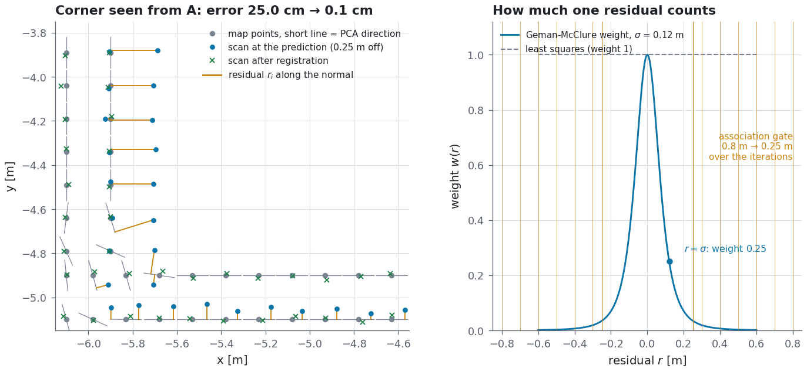
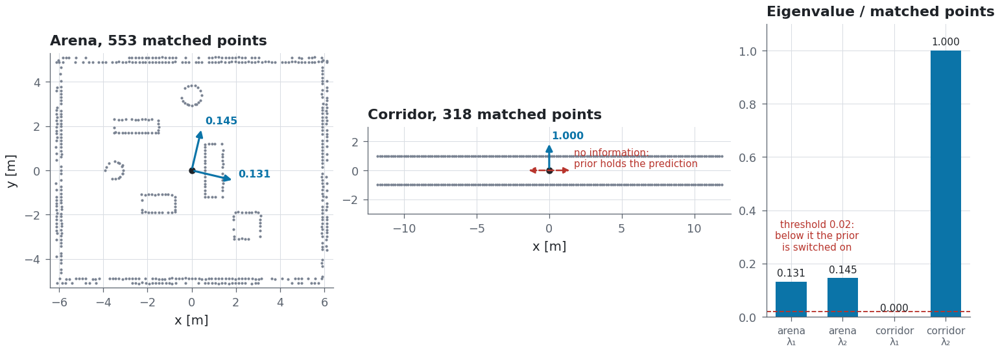
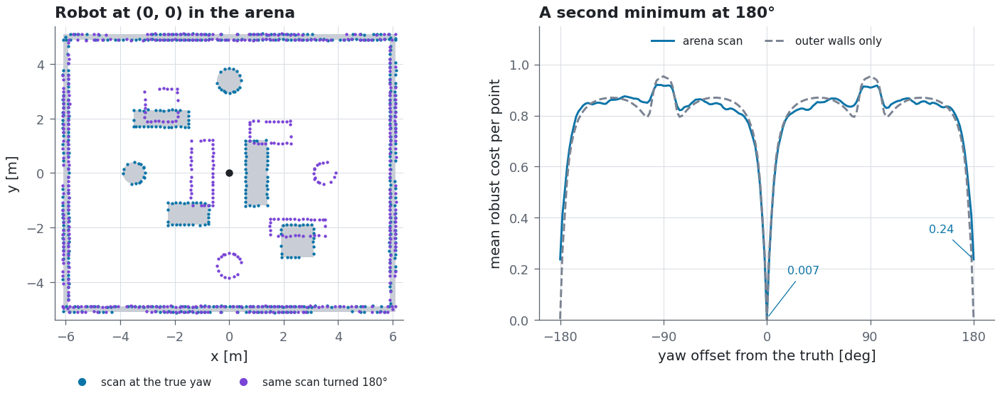

# Module 11 · State estimation: the scan registration step

## Objective

Write down the registration that `lidar_odom.py` runs on every scan (step 4 of
[chapter 9, Task 2.2](../../docs/09-state-estimation.md#22-read-the-six-steps)): point-to-line Gauss-Newton with
Geman-McClure weights, the yaw held at the gyro prediction, and a prior that acts only along directions the scan does not
constrain. After this module you can say which term stops the pose sliding in a corridor and why it is zero in the arena.

## Prerequisites

[Module 00](../m00_math/README.md) (SE(2), Gauss-Newton, robust weights) and chapter 9, Tasks 2.1 and 2.2. Python with NumPy
and SciPy; no ROS needed for the tests.

## Theory

Scan point $\mathbf s_i$ is matched to map point $\mathbf p_j$ with PCA normal $\mathbf n_j$ (eight neighbours) and line weight
$c_j$ (walls count more than blobs). With yaw $\psi$ fixed, each iteration solves for the translation $\mathbf t$:

$$
r_i = \mathbf n_j^\top\left(R(\psi)\,\mathbf s_i + \mathbf t - \mathbf p_j\right), \qquad
w_i = c_j\left(\frac{\sigma^2}{\sigma^2 + r_i^2}\right)^2, \quad \sigma = 0.12\ \text{m}
$$

$$
H = \sum_i w_i\,\mathbf n_j\mathbf n_j^\top + P, \qquad
\mathbf g = \sum_i w_i\,r_i\,\mathbf n_j + P\,(\mathbf t - \hat{\mathbf t}), \qquad
\Delta\mathbf t = -H^{-1}\mathbf g, \qquad
P = \sum_{k\,:\,\lambda_k / N < 0.02} 10\;\mathbf v_k\mathbf v_k^\top
$$

$\hat{\mathbf t}$ is the predicted translation, $N$ the number of matches, and $\lambda_k, \mathbf v_k$ the eigenpairs of
$\sum_i w_i\,\mathbf n_j\mathbf n_j^\top$. Dividing by $N$ makes the degeneracy test independent of the point count (Zhang et
al., ICRA 2016). In the arena both eigenvalues are about 90 to 100 over roughly 740 points (0.13 per point), so the prior is
inactive; in a corridor the along-wall eigenvalue is 0 and the prior stops the pose from sliding. The reported covariance is
$\mathrm{rms}(r)^2 H^{-1}$.



*Point-to-line residuals on the synthetic arena scan of `test_registration.py` from A with the unit test's 25 cm prediction
error; registration ends 0.1 cm from the truth.*



*Degeneracy test on the unit-test geometry: in the arena (robot at the origin, 553 matched points) both directions carry 0.131
and 0.145 per point; in the corridor (318 points) the along-wall direction carries 0, so only there the prior acts.*

## Implementation

This module has no code of its own: the method is the stack's `src/go2_nav_sim/scripts/registration.py`, and the tests are
`src/go2_nav_sim/test/test_registration.py`.

| Equation | Where in `registration.py` |
|---|---|
| normals $\mathbf n_j$ and line weight $c_j$ | `LineMap.__init__` (PCA over `k=8` neighbours) |
| $r_i$, $w_i$ | `register`, the `res` and `w` lines (Geman-McClure, `sigma=0.12`) |
| eigenpairs and $P$ | `register`, `np.linalg.eigh(H[:2, :2])` and the `Pr` line (`trans_prior=10.0`, `deg_eig=0.02`) |
| $\Delta\mathbf t$ with $\psi$ fixed | `register`, the `fix_yaw` branch; `fix_yaw=False` solves the full SE(2) step |
| covariance | `register`, the last two lines |

Association uses a gate that shrinks from 0.8 m to 0.25 m over the 12 iterations, so a 25 cm prediction error is still
matched in the first iterations.

## Experiment

```bash
python3 -m pytest -q src/go2_nav_sim/test/test_registration.py
```

```
..........                                                               [100%]
10 passed in 0.56s
```

The scans are synthetic: the arena walls and obstacles from `make_arena.py`, seen from a pose, with 1 cm range noise
(`scan_from` in the test file, fixed seed 0).

## Validation

| Test | Asserted |
|---|---|
| `test_translation_recovered_with_yaw_fixed` (3 poses) | a 25 cm offset recovered to under 2 cm |
| `test_full_se2_recovers_rotation_and_translation` | `fix_yaw=False` recovers 0.05 rad |
| `test_robust_to_twenty_percent_outliers` | 20 % clutter moves the result by at most 3 cm |
| `test_reports_failure_when_scan_does_not_overlap_map` | no overlap is reported as a failure |
| `test_corridor_prior_stops_sliding_but_corrects_across` | the corridor prior holds the along-wall estimate and corrects across |
| `test_gyro_yaw_is_independent_of_arrival_order` | gyro integration does not depend on callback timing |
| `test_returns_a_covariance_that_shrinks_with_information` | the covariance is positive definite and its root trace is under 1 cm |
| `test_tilt_compensated_yaw_rate` | at 3.6° roll the tilt-compensated yaw rate is exact; z alone reads 0.2 % low |

## Failure analysis

The full SE(2) solve can settle in the 180° flipped solution of the rectangular room. This is why the stack fixes yaw at the
gyro prediction; [chapter 9](../../docs/09-state-estimation.md#failures-worth-knowing-about) has the run in which it happened.



*Mean robust cost of the synthetic scan at (0, 0) over yaw offsets: 0.007 at the truth, 0.24 at 180°, and 0.004 at 180° for
the outer walls alone.*

The degeneracy threshold of 0.02 per point was chosen from two synthetic cases (arena and corridor), not calibrated on real
data. A first version that applied the prior in every direction biased the result: with the prediction 25 cm off it landed
2.5 cm short, against 1 to 2 mm without the prior.

## References

- J. Zhang, M. Kaess, S. Singh, "On degeneracy of optimization-based state estimation problems", ICRA 2016, section III
  (eigenvalues of the information matrix as the degeneracy test).
- Module 00, `optim.py`: IRLS with the Cauchy kernel; Geman-McClure differs only in the weight function above.
