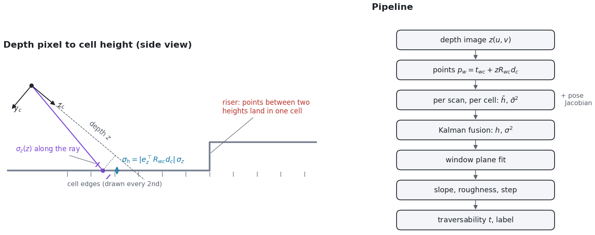
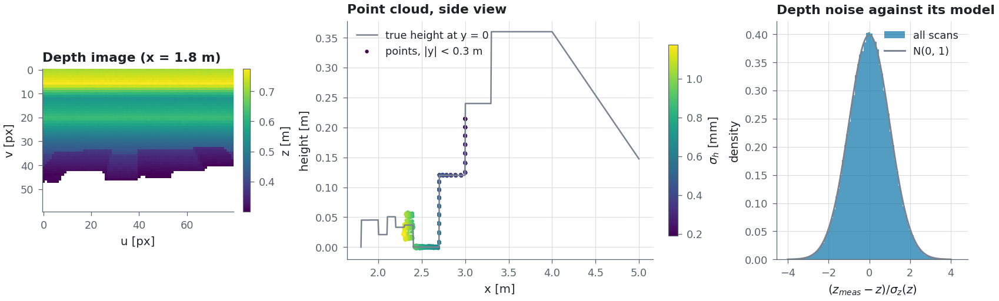
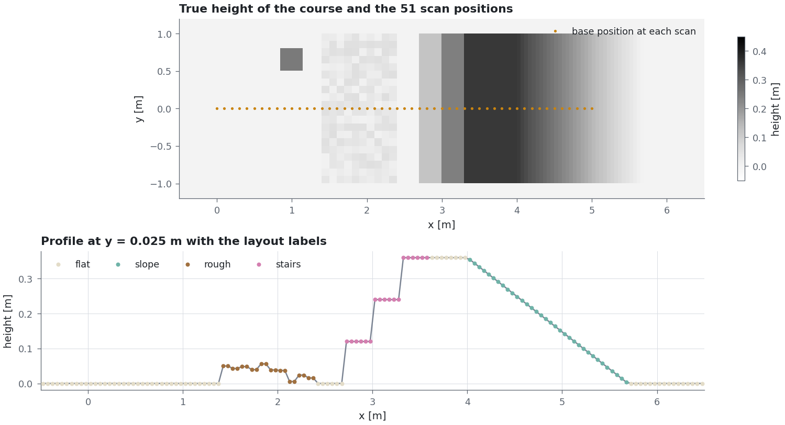
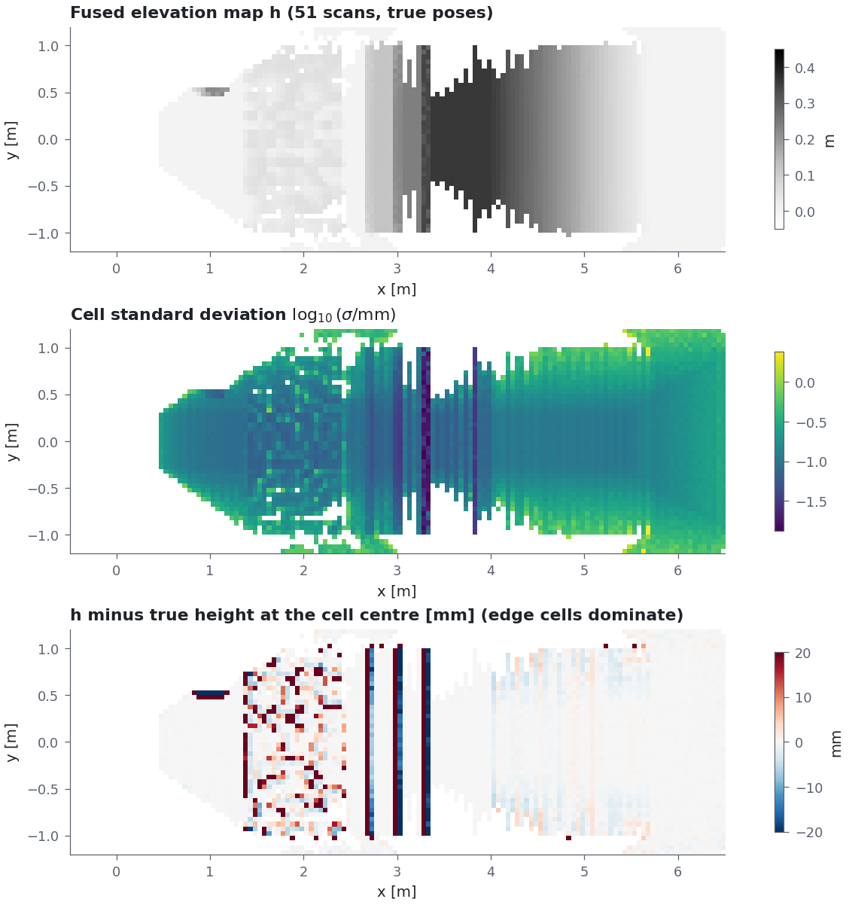
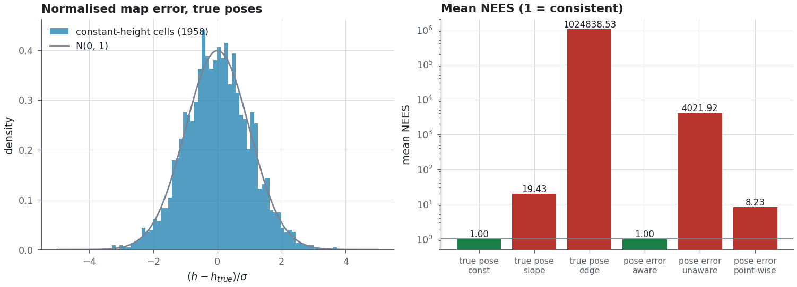
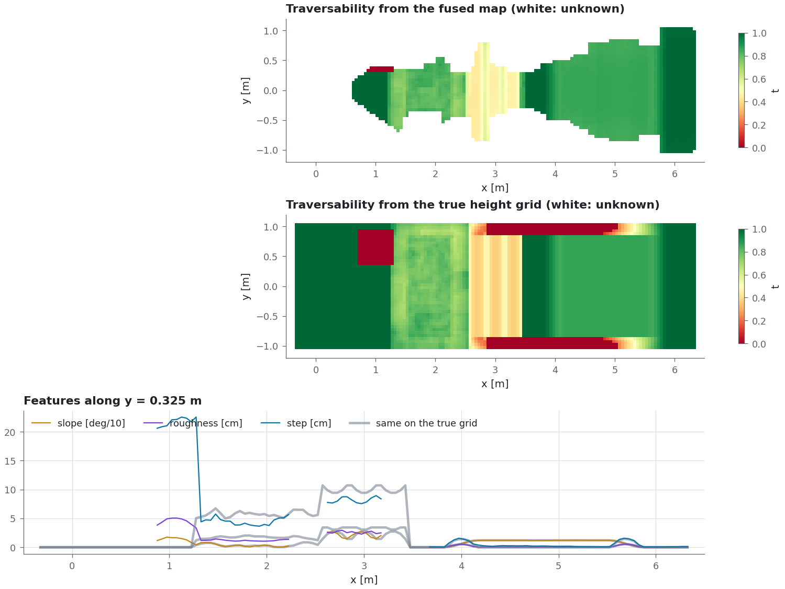
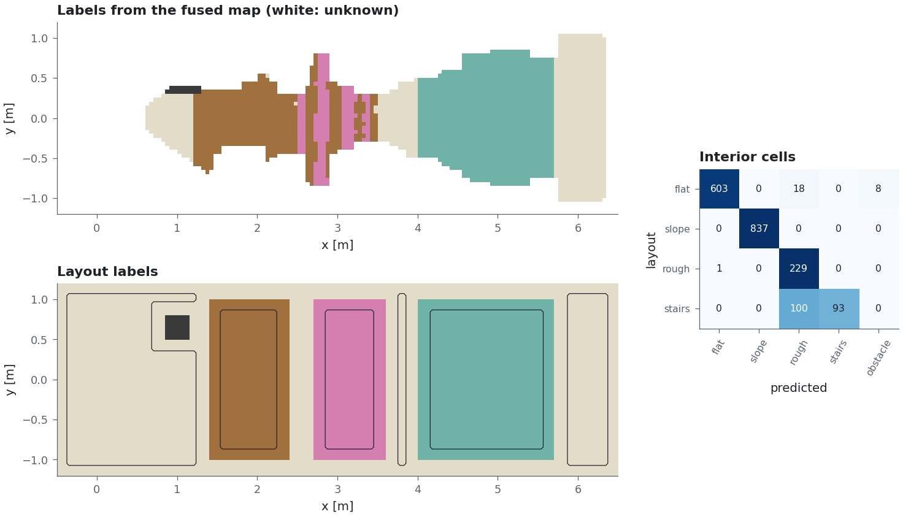
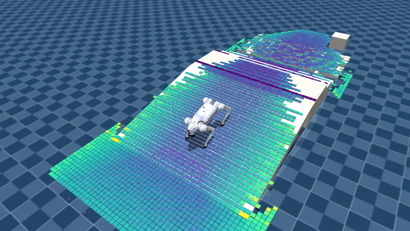
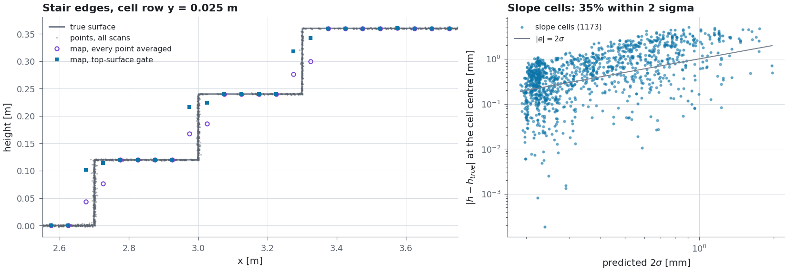

# Module 12 · Perception: depth camera, elevation map with variance, traversability and terrain labels

## Objective

A legged robot needs to know the height of the ground in front of it before it puts a foot there. This module puts a simulated
depth camera on the Go2's head, walks the robot (posed kinematically) over a test course with a block field, three stairs, a
platform and a 12° slope, and turns 51 depth images into a 2.5-D elevation map that stores a height and a variance per 5 cm cell.
From that map it computes slope, roughness and step height, a traversability score and a semantic label (flat, slope, rough,
stairs, obstacle), and compares every one of them with the same quantity computed on the true terrain.

| Level | Content | Applied on the Go2 |
|---|---|---|
| Fundamental | terrain as oriented boxes, ray casting by the slab method, pinhole depth camera, depth to world points, axial depth noise; a 16-beam LiDAR ray pattern | own ray caster against `mj_ray` / `mj_multiRay` on 244 800 camera rays and 63 360 LiDAR rays; camera frame chain against MuJoCo's site pose. The map is built from the depth camera only; LiDAR points are cast and checked, not mapped |
| Intermediate | height variance of a point, one measurement per cell per scan, scalar Kalman fusion, NEES | 51 scans along the course; error and consistency on cells of constant true height |
| Advanced | base pose errors in the variance (Jacobian), point-wise against per-scan fusion; window plane fit, traversability, labels | per-scan pose errors of 1 cm and 0.5°; features against the true height grid; labels against the course layout |

After this module a reader can write the measurement model of a depth camera down to a cell height and its variance, say when a
fused elevation map is consistent and when it is not, and compute traversability features whose error against the truth is known.



## Prerequisites

- [03 · Simulation](../m03_simulation/README.md): MuJoCo models built from `MjSpec`, geom groups, `mj_forward`.
- [06 · Sensors](../m06_sensors/README.md): sensors added as sites to a derived MJCF, and noise models applied in Python to MuJoCo's
  noise-free readings. The depth camera here follows the same pattern.
- [04 · Kinematics](../m04_kinematics/README.md): `Leg.ik_closed_form` places the four feet on the terrain for every scan pose.
- [00 · Mathematical foundations](../m00_math/README.md): small rotations $R \leftarrow \mathrm{Exp}(\delta\theta)R \approx (I + [\delta\theta]_\times)R$.
- Probability: variance of a sum, Gaussian conditioning for a scalar, the $\chi^2$ distribution with one degree of freedom.

## Theory

Notation: $W$ world frame (z up), $B$ base, $C$ camera optical frame (x right, y down, z forward). $R_{ab}$ rotates frame-$b$
vectors into frame $a$; $t_{ab}$ is the origin of $b$ in $a$. $e_z = (0, 0, 1)$. Map cells are squares of side $c = 0.05$ m.

### Fundamental level

#### The course and its true height

The course (`perception.terrain`) is 206 boxes on the floor plane $z = 0$: a 0.3 × 0.3 × 0.25 m obstacle beside the path at
$(1.0, 0.65)$; 200 blocks of 0.1 × 0.1 m between $x$ = 1.4 and 2.4 m with heights uniform in [0.5, 6] cm (seed 0); three stairs of
0.30 m tread and 0.12 m rise from $x$ = 2.7 m; a platform at 0.36 m to $x$ = 4.0 m; and a slope descending at 12° to
$x = 4.0 + 0.36/\tan 12° = 5.694$ m. The course is 2 m wide ($|y| < 1$). Box edges lie on multiples of the cell size, so a cell is either
entirely on one surface or has an edge on its boundary.

The true height at $(x, y)$ is the first hit of a ray cast straight down from $z_0 = 2$ m: $h(x, y) = z_0 - t$. The same ray
caster serves as ground truth for the map and as the check on MuJoCo's ray casting.

#### Ray casting with the slab method

A ray $o + t u$ ($t > 0$) and a box with centre $c$, half sizes $a$ and orientation $R$. In the box frame,
$o' = R^\top(o - c)$, $u' = R^\top u$, and the box is the intersection of three slabs $|x'_i| \le a_i$. The ray is inside slab $i$
for $t$ between

$$t_{1,i} = \frac{-a_i - o'_i}{u'_i},\qquad t_{2,i} = \frac{a_i - o'_i}{u'_i}.$$

It is inside the box while it is inside all three slabs, so it enters and leaves at

$$t_\mathrm{in} = \max_i \min(t_{1,i}, t_{2,i}),\qquad t_\mathrm{out} = \min_i \max(t_{1,i}, t_{2,i}),$$

and it hits the box if $t_\mathrm{in} \le t_\mathrm{out}$ and $t_\mathrm{in} > 0$. The face hit is the slab $i^\ast$ that attains the
maximum, with outward normal $-\mathrm{sign}(u'_{i^\ast})\,R\,e_{i^\ast}$. A ray parallel to a slab ($u'_i = 0$) gives
$t_{1,i}, t_{2,i} = \pm\infty$, which the max and min handle. The floor adds $t = -o_z/u_z$ for $u_z < 0$. The first hit is the
smallest $t$ over all boxes and the floor.

#### Pinhole depth camera

The camera has $80 \times 60$ pixels, a horizontal field of view of 86° and square pixels:

$$f = \frac{W/2}{\tan(\mathrm{hfov}/2)} = \frac{40}{\tan 43°} = 42.89\ \mathrm{px},\qquad K = \begin{pmatrix} f & 0 & W/2\\ 0 & f & H/2 \\ 0 & 0 & 1\end{pmatrix},
\qquad \mathrm{vfov} = 2\arctan\frac{H/2}{f} = 69.9°.$$

Pixel $(u, v)$, at its centre, looks along $d_C = K^{-1}(u, v, 1)^\top$, whose $z$ component is 1. A depth camera reports the depth
$z$, the coordinate along the optical axis, so the point is $p_C = z\,d_C$ and its range is $r = z\,\lVert d_C\rVert$. MuJoCo's
`mj_multiRay` returns the range along the unit vector $d_C/\lVert d_C\rVert$, so the simulated sensor computes $z = r/\lVert d_C\rVert$.

The camera is a site on the base at $t_{BC} = (0.34, 0, 0.02)$ m, in front of the head, with its optical axis pitched 40° down:
$R_{BC} = [x_C\ y_C\ z_C]$ with $z_C = (\cos 40°, 0, -\sin 40°)$, $x_C = (0, -1, 0)$, $y_C = z_C \times x_C$. A point in the world is

$$p_W = t_{WC} + R_{WC}\,z\,d_C,\qquad R_{WC} = R_{WB}R_{BC},\quad t_{WC} = t_{WB} + R_{WB}t_{BC}.$$

Depths outside [0.3, 3.0] m are invalid.

#### Depth noise

The measured depth is $\tilde z = z + \sigma_z(z)\,n$, $n \sim \mathcal N(0, 1)$, with the axial noise model that Nguyen, Izadi and
Lovell (2012) fitted to a Kinect:

$$\sigma_z(z) = 0.0012 + 0.0019\,(z - 0.4)^2\ \mathrm{m}.$$

Lateral pixel noise is not modelled.

#### LiDAR scan model

A spinning multi-beam LiDAR fires beams at elevations $\varepsilon_j$ and azimuths $\alpha_k$ in its own frame $L$:

$$d_L = (\cos\varepsilon_j\cos\alpha_k,\ \cos\varepsilon_j\sin\alpha_k,\ \sin\varepsilon_j),\qquad p_W = t_{WL} + r\,R_{WL}\,d_L .$$

$d_L$ is a unit vector, so the sensor reports the range $r$ itself (a depth camera reports $z = r/\lVert d_C\rVert$). The model here
(`perception.Lidar`, values chosen for this module, not from a data sheet) has 16 beams from −15° to +15° in steps of 2°, 360
azimuths 1° apart, valid ranges [0.1, 30] m, and sits on the base at $t_{BL} = (0, 0, 0.12)$ m with $R_{BL} = I$. The same slab ray
caster computes its first hits. Range noise is not modelled and the LiDAR does not feed the map; it is here so that the ray model
for both sensor types is written out and checked.

### Intermediate level

#### Height variance of one point

The height of a point is $h = e_z^\top p_W = e_z^\top t_{WC} + \tilde z\, e_z^\top R_{WC} d_C$. It is linear in $\tilde z$, so

$$\sigma_{s}^2 = \big(e_z^\top R_{WC}\,d_C\big)^2\,\sigma_z(\tilde z)^2 .$$

$\sigma_z$ is evaluated at the measured depth, because the mapper does not know the true one. A grazing ray has a small
$|e_z^\top R_{WC} d_C|$: most of its depth error moves the point horizontally.

#### Pose uncertainty

The mapper transforms points with an estimated base pose $\hat t_{WB} = t_{WB} + \delta t$, $\hat R_{WB} = \mathrm{Exp}(\delta\theta)R_{WB}$
(rotation error in the world frame). To first order,

$$\hat p_W = p_W + \delta t + \delta\theta \times (p_W - t_{WB}),$$

and with the lever arm $v = p_W - t_{WB}$ the height error is $\delta h = \delta t_z + \delta\theta_x v_y - \delta\theta_y v_x$. For the pose
error $\delta = (\delta t_z, \delta\theta_x, \delta\theta_y)$ with covariance $\Sigma$:

$$J = \begin{pmatrix} 1 & v_y & -v_x\end{pmatrix},\qquad \sigma_p^2 = J\Sigma J^\top .$$

Errors in $x$, $y$ and yaw move points horizontally and are left out; they matter only where the height changes inside a cell.

#### One measurement per cell per scan

A scan puts $n$ points into a cell. If the true height $H$ is constant over the cell, $h_i = H + J_i\delta + \varepsilon_i$ with the same
$\delta$ for every point of the scan and independent $\varepsilon_i$ of variance $\sigma_{s,i}^2$. Their mean $\bar h$ has

$$\bar h - H = \bar J\delta + \frac1n\sum_i \varepsilon_i,\qquad \bar\sigma^2 = \bar J\,\Sigma\,\bar J^\top + \frac{1}{n^2}\sum_i \sigma_{s,i}^2,\qquad \bar J = \frac1n\sum_i J_i .$$

The pose part does not shrink with $n$. Fusing every point as an independent measurement of variance
$\sigma_{s,i}^2 + J_i\Sigma J_i^\top$ would divide it by about $n$ and make the map overconfident. That variant is run as a failure case.

A cell next to a riser also receives points from the vertical face, at heights between the two treads. Before averaging, each
scan keeps only the points of a cell that are within $b + k\sigma_{s,i}$ of the highest point of that cell in that scan
($b$ = 2 cm, $k$ = 6, `perception.GATE`): the map stores the top surface. $b$ is larger than the 1.06 cm height change across a cell
on the 12° slope, and $6\sigma$ is larger than the excess of the maximum of up to a few hundred Gaussian samples, so on a cell of
constant height almost no point is dropped. This gate was added after the first full run; that run is kept as the "every point
averaged" variant (see Failure analysis).

#### Kalman fusion of a cell

The height of a cell is a constant state. With prior $\hat h$, variance $P$, and a scan measurement $\bar h$ of variance $R$:

$$K = \frac{P}{P + R},\qquad \hat h^+ = \hat h + K(\bar h - \hat h),\qquad P^+ = (1 - K)P = \frac{PR}{P + R}.$$

An unobserved cell has $P = \infty$ and takes the first measurement. In information form the update is $1/P^+ = 1/P + 1/R$,
$\hat h^+/P^+ = \hat h/P + \bar h/R$, so after $N$ scans

$$P_N = \Big(\sum_k R_k^{-1}\Big)^{-1},\qquad \hat h_N = P_N \sum_k \frac{\bar h_k}{R_k},$$

the inverse-variance weighted mean, whatever the order. The sequential filter is checked against this batch form.

#### Consistency

If the map error $e = \hat h - H$ is Gaussian with the variance $P$ the map reports, the normalised estimation error squared
$\epsilon = e^2/P$ is $\chi^2_1$: its mean is 1 and $|e| < 2\sqrt P$ holds with probability 0.9545. Both are measured on the cells
whose true height is constant over the cell and a half-cell border (1958 cells). The border keeps out cells that a point from the
other side of an edge can reach through depth noise.

### Advanced level

#### Window features

For each cell, a plane $h = a\,dx + b\,dy + c_0$ is fitted by least squares to the $k \times k$ window around it ($k$ = 7, 0.35 m,
longer than one 6-cell tread so that every stair window contains exactly one edge). With rows $A = [dx\ dy\ 1]$ and window heights $h_w$:

$$(a, b, c_0)^\top = (A^\top A)^{-1}A^\top h_w,\qquad \theta = \arctan\sqrt{a^2 + b^2},\qquad e = h_w - A(a, b, c_0)^\top,$$

$$\rho = \sqrt{\frac{\sum e^2}{k^2 - 3}},\qquad s = \max e - \min e .$$

$\theta$ is the slope, $\rho$ the roughness and $s$ the step height. On a plane $e = 0$, so $\theta$ is exact and $\rho = s = 0$.

A single step of height $\Delta$ reads less than $\Delta$, because the fitted plane tilts towards the step. Take a step along $x$ only.
Every column of the window has the same profile, so $b = 0$ and the fit reduces to a line through one row: samples $i = -3, \dots, 3$
at $dx = i\,c$, heights $h_i = 0$ for $i \le 0$ and $h_i = \Delta$ for $i \ge 1$ (the edge between the 4th and 5th sample). With
$\sum_i i = 0$ the least-squares line is

$$c_0 = \bar h = \frac{3}{7}\Delta,\qquad a\,c = \frac{\sum_i i\,h_i}{\sum_i i^2} = \frac{(1 + 2 + 3)\,\Delta}{28} = \frac{6}{28}\Delta,$$

and the residuals $e_i = h_i - c_0 - a\,c\,i$ are

$$e = \frac{\Delta}{14}\,(3,\ 0,\ -3,\ -6,\ 5,\ 2,\ -1).$$

The extremes sit next to the edge, $-0.43\Delta$ before it and $+0.36\Delta$ after it, so

$$s = \frac{5 + 6}{14}\Delta = \frac{11}{14}\Delta = 0.79\,\Delta .$$

The same calculation with the edge after the 2nd or 5th sample gives $s = \tfrac{23}{28}\Delta = 0.82\Delta$, and after the 1st or 6th
$s = \tfrac{25}{28}\Delta = 0.89\Delta$. For the course's 12 cm riser, $s$ is 9.4, 9.9 or 10.7 cm depending on where the edge falls in
the window, never 12 cm. Defining the step on the residual rather than on $\max h - \min h$ keeps a slope from reading as a step;
the price is this factor of about 0.8. A window with any unobserved cell gives no features.

#### Traversability

Following the form of Wermelinger et al. (2016), the three features are scaled by critical values and combined:

$$t = 1 - \sum_{i} w_i \min\!\Big(1, \frac{x_i}{x_{i,\mathrm{crit}}}\Big),\qquad t = 0 \text{ if any } x_i \ge x_{i,\mathrm{crit}},$$

with $w_i = 1/3$ and $\theta_\mathrm{crit} = 30°$, $\rho_\mathrm{crit} = 6$ cm, $s_\mathrm{crit} = 20$ cm. These values are chosen here for a
robot of the Go2's size; they are not from a Unitree specification.

#### Semantic labels

Rules on the same features, later rules overriding earlier ones: flat; slope if $\theta \ge 6°$; rough if $\rho \ge 1$ cm or
$s \ge 3$ cm; stairs if $s \ge 8$ cm; obstacle if $s \ge 18$ cm. The thresholds separate the course's classes on the true grid: block
residual ranges stay below the 5.5 cm spread of the block heights, and the obstacle is 25 cm tall. A stair window holds one 12 cm
riser, but by the derivation above it reads $s = 0.79\Delta$ to $0.89\Delta$, 9.4 to 10.7 cm, so the 8 cm stairs threshold has 1.4 cm
of margin at the weakest edge position and 1.9 cm at the median of 9.86 cm (`stairs_inner_step_median_true_m`), not the 4 cm that
a full 12 cm step would leave. A map that flattens the riser by 2 cm loses half of the stair windows; that is what happens
(Failure analysis).

#### Worked example on the Go2

Standing on the flat start, the base is at 0.288 m and the camera at 0.308 m. The centre pixel ($d_C = (0, 0, 1)$) looks 40° down and
hits the floor at depth $z = 0.308/\sin 40° = 0.480$ m. Then $\sigma_z = 0.0012 + 0.0019 \cdot 0.080^2 = 1.21$ mm and
$\sigma_s = \sin 40° \cdot 1.21 = 0.78$ mm. The top image row ($d_C = (0.012, -0.688, 1)$) looks 5.5° below horizontal and hits the floor
3.21 m ahead of the camera at depth 2.66 m: $\sigma_z = 10.9$ mm but $|e_z^\top R_{WC}d_C| = 0.116$, so $\sigma_s = 1.26$ mm. With the
advanced level's pose errors ($\sigma$ = 1 cm in height, 0.5° in roll and pitch) the centre-pixel point has lever arm
$v = (0.708, 0, -0.288)$ m, $J = (1, 0, -0.708)$ and $\sigma_p = \sqrt{0.01^2 + (0.708 \cdot 0.00873)^2} = 11.8$ mm, fifteen times
the sensor term.

## Implementation

| Equation | Function | Notes |
|---|---|---|
| course, true height, layout labels | `perception.terrain()`, `true_height()`, `region_label()` | boxes with $R$; the slope is a box rotated 12° about $y$ |
| slab method | `perception.raycast()` | vectorised over rays × boxes in chunks of 512 rays |
| pinhole model | `DepthCamera.pixel_dirs()`, `.project()`, `.R_bc`, `.sigma_z()` | |
| LiDAR beams $d_L$, sweep | `Lidar.dirs()`, `perception.lidar_scan()` | site `lidar` on the base; rays cast by `mj_multiRay`, checked against `raycast()` |
| simulated sensor | `perception.build_model()`, `scan()`, `add_noise()` | course boxes in geom group 0; rays see group 0 only, so the robot's own geoms (groups 2, 3) are never hit |
| $p_W$, $\sigma_s^2$, $J$ | `perception.measure()`, `cam_pose()` | |
| gate, $\bar h$, $\bar\sigma^2$ | `ElevationMap.aggregate()` | `np.maximum.at` for the cell maximum, `np.bincount` for the sums |
| Kalman, information form | `ElevationMap.fuse()`, `fuse_information()` | |
| plane fit, $\theta$, $\rho$, $s$ | `perception.features()`, `plane_design()` | one pseudo-inverse for all windows |
| $t$, labels | `perception.traversability()`, `semantic()` | |

`perception.py` uses MuJoCo to compile the scene and, in `scan()`, to cast the sensor's rays; that is the simulated sensor, the
same role MuJoCo's sensors have in module 06. The slab ray caster, the map, the features and the labels never call MuJoCo.

Design choices:
- The robot is posed, not walked (`validate.pose_on_terrain`): base at $(x, 0)$, feet at their stand-pose $x, y$ on the true surface,
  pitch from the front and rear foot heights, joints from module 04's closed-form IK. Locomotion is not this module's subject, and a
  posed robot gives the true camera pose for every scan.
- One aggregated measurement per cell per scan (above) instead of one per point, because the pose error is shared by a scan.
- The map is world-fixed. Fankhauser et al. (2014) keep the map in the robot frame and grow cell variances as the robot moves;
  with a world-fixed map and per-scan pose errors the same information enters through $J\Sigma J^\top$.
- Box edges on cell boundaries make the edge cells easy to identify; real terrain is not aligned, and then every cell that contains an
  edge is mixed.

## Experiment

```bash
.venv-modules/bin/python modules/m12_perception/validate.py            # results.json, figures/, media/; 185 s wall, load average about 110
.venv-modules/bin/python modules/m12_perception/validate.py --no-media # same numbers, no figures or video
.venv-modules/bin/python -m pytest -q modules/m12_perception           # 8 tests, 6 s
```

Rendering needs `MUJOCO_GL=glfw` (set by `sim.py`) and an X display. On this machine the display that works is `DISPLAY=:0`;
with `DISPLAY=:1` the Recorder disables itself, the video is skipped and `media_mp4_under_6MB` is not evaluated.

1. Course seed 0; 51 scan poses at base $x$ = 0.0, 0.1, …, 5.0 m, $y$ = 0, yaw 0. At each pose, one 80 × 60 depth image from
   `mj_multiRay`; the same rays are cast with `perception.raycast`. Depth noise seed 1, drawn once per pixel. At every 5th pose
   (11 poses) one LiDAR sweep of 5760 beams is cast by `mj_multiRay` and by `perception.raycast`.
2. Intermediate: map from all 51 noisy images with the true base pose ($\Sigma = 0$). Truth: true height at each cell centre; cell
   classes from an 8 × 8 grid of true heights over each cell plus a half-cell border: constant (range < 1e-9 m), planar (one plane to
   1e-9 m: the slope) and edge (the rest).
3. Advanced, pose: per-scan errors $(\delta t_z, \delta\theta_x, \delta\theta_y) \sim \mathcal N(0, \mathrm{diag}(0.01\,\mathrm m, 0.5°, 0.5°)^2)$,
   seed 2, independent between scans, applied to the pose the mapper uses. Three maps: $\Sigma$ in the per-scan variance (aware),
   $\Sigma = 0$ (unaware), and $\Sigma$ with every point fused on its own (point-wise).
4. Advanced, features: slope, roughness, step and $t$ on the true-pose map and on the true height grid, compared on the 2665 cells
   where both have a full window. Labels compared with the layout on interior cells: cells whose 7 × 7 window lies inside one layout
   region (the obstacle footprint is too small to have any).
5. Video: the 51 poses at 0.3 s each, interpolated, 20 frames/s; map cells drawn as tiles at the fused height, coloured by
   $\log_{10}\sigma$ (dark 0.03 mm, yellow 3 mm), and the current scan's points as violet dots.

## Validation

Thresholds were fixed in `validate.ACCEPT` before the first full run and not moved; `test_perception.py` asserts the same ones and
pins the three missed rows (see Failure analysis). The two LiDAR rows were added with the LiDAR model, their thresholds written
before that code first ran.

| Check | Measured | Acceptance | Source (`results.json`) |
|---|---|---|---|
| own vertical ray vs `mj_ray`, true height at 6720 cell centres, max abs | 2.2e-16 m | < 1e-9 m | `true_height_vs_mj_ray_max_m` |
| own slab caster vs `mj_multiRay`: rays with a hit in one and not the other, 244 800 rays | 0 | 0 | `slab_vs_multiray_hit_mismatch` |
| same rays, range, max abs | 1.6e-15 m | < 1e-9 m | `slab_vs_multiray_dist_max_m` |
| same rays, normal equal to 1e-9 | 1.000 | ≥ 0.999 | `slab_vs_multiray_normal_agree` |
| $T_{WB}T_{BC}$ vs MuJoCo site pose, 51 poses, max abs | 3.3e-16 | < 1e-12 | `camera_pose_vs_site_max` |
| back-project at depth then project, max pixel error | 1.4e-14 px | < 1e-9 px | `projection_roundtrip_max_px` |
| noise-free points on tops and slope within 1e-9 m of the true height | 1.000 | ≥ 0.999 | `noisefree_on_surface_frac` |
| normalised depth noise sd minus 1 | 1.5e-3 | < 0.02 | `depth_noise_norm_sd_err` |
| LiDAR, own slab caster vs `mj_multiRay`: beams valid in one and not the other, 63 360 beams | 0 | 0 | `lidar_vs_multiray_valid_mismatch` |
| same beams, range, max abs | 4.4e-16 m | < 1e-9 m | `lidar_vs_multiray_range_max_m` |
| sequential Kalman vs batch information form, height, max abs | 1.7e-16 m | < 1e-12 m | `kalman_vs_batch_h_max_m` |
| same, variance, max relative | 7.6e-15 | < 1e-10 | `kalman_vs_batch_var_rel_max` |
| map error, constant-height cells, rms | 0.28 mm | < 5 mm | `rmse_const_m` |
| mean NEES, constant-height cells | 0.995 | 0.8 to 1.25 | `nees_const_mean` |
| fraction within $2\sigma$ minus 0.9545 | 4.5e-5 | < 0.02 | `cover2s_const_dev` |
| observed cells on the course, $0 \le x \le 6$ m, $\lvert y\rvert < 1$ m | **0.776 (missed)** | ≥ 0.90 | `coverage_course` |
| pose errors, aware: mean NEES, constant-height cells | 1.001 | 0.7 to 1.4 | `nees_pose_aware_const_mean` |
| pose errors: unaware NEES / aware NEES | 4019 | ≥ 2 | `nees_unaware_over_aware` |
| plane fit on the true grid, slope interior, max abs error vs 12° | 8.3e-14° | < 1e-6° | `slope_true_grid_err_max_deg` |
| slope, map vs true grid, rms, 2665 cells | 1.88° | < 2° | `trav_slope_rmse_deg` |
| roughness, rms | 4.8 mm | < 5 mm | `trav_rough_rmse_m` |
| step height, rms | 1.65 cm | < 2 cm | `trav_step_rmse_m` |
| traversability $t$, rms | **0.074 (missed)** | < 0.05 | `trav_t_rmse` |
| $t > 0$ on the map vs on the true grid, agreement | 0.997 | ≥ 0.98 | `trav_binary_agree` |
| labels vs layout, interior cells with known features | 0.933 | ≥ 0.90 | `label_acc_interior` |
| lowest per-class recall (flat, slope, rough, stairs) | **0.48, stairs (missed)** | ≥ 0.80 | `label_recall_min_interior` |
| MP4 under 6 MB | 1 (4.1 MB) | 1 | `media_mp4_under_6MB` |

24 of 27 checks pass.

### Fundamental: the sensor chain



The own slab caster and MuJoCo's ray caster return the same first hit on every one of the 244 800 rays, to 1.6e-15 m in range, and
the same normal. The course itself is what MuJoCo sees: the vertical ray of `true_height` agrees with `mj_ray` to 2.2e-16 m at all
6720 cell centres. Every noise-free point on a top face or on the slope lies on the true surface to 1e-9 m
(152 155 points, `noisefree_top_points`). The points that are not on top faces are on risers and block sides; the side view above shows
them as vertical columns, which is where the edge cells' errors come from. On average a scan has 3541 valid
pixels out of 4800 (`valid_pixels_per_scan_mean`). The LiDAR sweeps agree with `mj_multiRay` on which of the 63 360 beams return a
valid range (47%, `lidar_valid_frac`; the upward beams hit nothing) and on the range to 4.4e-16 m.



### Intermediate: the fused map



On the 1958 constant-height cells the map error is 0.28 mm rms with a median $\sigma$ of 0.16 mm (`sigma_const_median_m`); the normalised error
follows $\mathcal N(0, 1)$ (mean NEES 0.995, 95.45% within $2\sigma$). A cell gets a median of 7 scan
measurements (`measurements_per_cell_median`). The error panel is dominated by edge cells (rms 35 mm over 1256 edge cells, `rmse_edge_m`), discussed below.



### Advanced: pose errors, traversability and labels

With per-scan pose errors the aware map stays consistent (mean NEES 1.001, 95.8% within $2\sigma$, `cover2s_pose_aware_const`) at
8.7 mm rms error (`rmse_pose_aware_const_m`), 31 times the true-pose error. The unaware map has the same errors but a mean NEES of 4022
(`nees_pose_unaware_const_mean`): its variances are about 4000 times too small. Point-wise fusion with the correct per-point variance has NEES 8.23: it divides the shared pose variance
by the number of points in a cell.



Slope, roughness and step height pass their criteria; $t$ does not (Failure analysis). The obstacle and the 0.36 m side drops of
the platform give $t = 0$ on the true grid; the map agrees on $t > 0$ for 99.7% of the 2665 compared cells.



Flat, slope and rough interior cells are recalled at 0.96, 1.00 and 1.00 (`label_recall_interior`). Stair cells are recalled at 0.48; the
rest are labelled rough. 47% of the interior cells (`label_unknown_frac_interior`) have no label because part of their window was never
observed; they are left out of the accuracy and counted here. On the true grid the same rules label every interior cell correctly
(`label_acc_true_grid_interior` = 1.00), so the stair misses come from the map, not from the rules.

[Video: map building over the 51 scans](media/map_building.mp4)



## Failure analysis

### Mixed cells at stair edges



The camera sees the risers face on, and the points on a riser have every height between the two treads. With depth noise they fall
on both sides of the cell boundary. The first full run averaged every point of a cell (`nogate_*` keys): the cells on both sides of
each edge took intermediate heights (left panel, violet circles), the residual range of a stair window dropped below the 8 cm stairs
threshold everywhere, and stairs recall was 0 (`nogate_label_recall_interior`). The top-surface gate keeps the higher points. In
the cell row at $y$ = 0.025 m (`stairs_row_*` keys, left panel, blue squares), the cells just above the three edges read 0.1136,
0.2241 and 0.3427 m against treads of 0.12, 0.24 and 0.36 m: 6.4, 15.9 and 17.3 mm low (`stairs_row_upper_cell_h_m`). The cells
just below the edges read 0.1017, 0.2162 and 0.3176 m (`stairs_row_lower_cell_h_m`), 18, 24 and 42 mm short of the upper tread and
102, 96 and 78 mm above their own. Without the gate the same cells read 0.077, 0.186 and 0.300 m above and 0.044, 0.167 and
0.276 m below the edges (`nogate_stairs_row_*`). With the gate the step therefore sits mostly one cell early, towards the camera,
and the treads further up the stairs come out lower. Stairs recall rose to 0.48, accuracy from 0.893 to 0.933, step error
from 2.07 to 1.65 cm rms and roughness error from 6.4 to 4.8 mm rms (`nogate_label_acc_interior`, `nogate_trav_step_rmse_m`,
`nogate_trav_rough_rmse_m`). Both of those criteria would have been missed without the gate. The stair windows still read a median step of 7.98 cm
against 9.86 cm on the true grid (`stairs_inner_step_median_est_m`, `stairs_inner_step_median_true_m`), on both sides of the 8 cm threshold.
The true-grid value is already $0.82\Delta$, not $\Delta$ (Theory, window features), so the 2 cm the map loses at the edges is enough
to put half of the stair windows below the threshold.

The gate has a cost that the feature numbers hide. Measured on the cell heights themselves, edge cells get worse: over the 1256 edge
cells the rms error against the true height at the cell centre is 35.2 mm with the gate (`rmse_edge_m`) and 28.7 mm without it
(`nogate_rmse_edge_m`). A lower-side cell that took an intermediate height is now close to the upper tread, up to 102 mm from its
true height in the row above. The gate trades cell accuracy at edges for sharper steps in the windows; the constant-height cells are
unaffected (mean NEES 0.995 with and without it, `nogate_nees_const_mean`).

### Traversability error from edges that moved

The same one-cell shift makes every rising edge seen from the front one cell wider: the obstacle and the first block of the rough
patch grow towards the robot. In a window next to them the map sees a 21 cm step where the true grid sees none, and $t$ jumps from
1 to 0. 9 of the 2665 cells have $|t_\mathrm{map} - t_\mathrm{true}| > 0.5$ (`trav_t_err_gt_0p5_cells`); without them the rms is
0.048 (`trav_t_rmse_without_gt_0p5`) against 0.074 with them. Without the gate $t$ rms was 0.075 (`nogate_trav_t_rmse`). For a robot that inflates obstacles anyway the shift is on the safe side; as a
comparison with the truth it is a miss. Not tried here: storing the points' horizontal extent per cell, or a finer grid near edges.

### Slope cells are overconfident

On the slope the map reports a few tenths of a millimetre, but the errors at the cell centre are up to 5 mm: 35% of the 1173 slope
cells are within $2\sigma$ and the mean NEES is 19.4 (`nees_planar`), right panel above. The mean height of a cell's points is the
true height at the mean position of the points, not at the cell centre. One point at a uniformly random position in the cell has a
position standard deviation of $c/\sqrt{12} = 14$ mm along the slope, and $\tan 12° \cdot 14$ mm = 3.1 mm of height, ten times the
sensor term on most cells. The variance model has no term for it. Adding $(\nabla h)^2 c^2/(12 n)$ or fitting a plane per cell would
address it; neither is implemented.

### Coverage below 90%

22% of the course is never observed (`coverage_course`); by layout region, `coverage_by_label` gives flat 0.60,
slope 0.94, rough 0.91, stairs 0.80, obstacle 0.17. The criterion counts the whole
course from $x = 0$, but the first camera position is at $x = 0.34$ m and its nearest valid point is at $x$ = 0.473 m, 0.13 m
ahead of it (`first_scan_camera_x_m`, `first_scan_nearest_point_x_m`), so the first 0.47 m are never in view. The geometry agrees:
a pixel whose ray meets the floor (0.308 m below the camera) at the 0.3 m minimum depth needs $e_z^\top R_{WC}d_C = -0.308/0.3 = -1.027$;
in the centre column that is $d_C = (0, 0.50, 1)$, whose forward component $e_x^\top R_{WC}d_C = 0.444$ puts the point
$0.3 \times 0.444 = 0.133$ m ahead. The image rows below it see the floor closer than 0.3 m and are invalid. Cells at $|y| \approx 1$ m enter the 86° field of view only about 1 m ahead of the camera. From
$x = 1.2$ m on, coverage is 0.888 (`coverage_course_x_ge_1p2`), still below 0.9: the upper treads and the platform at $|y| > 0.5$ m are seen
only from the stairs, where the camera is too close to the next riser (at base $x$ = 2.4 m no depth is within
[0.3, 3] m: 0 valid pixels, `valid_pixels_min_scan`). The threshold was set without working out this geometry. A wider path, LiDAR points in the map or a second camera are the
candidate fixes; none was tried (the LiDAR model above is cast and checked, not mapped).

### Pose-unaware and point-wise maps

Shown in the consistency figure: ignoring a 1 cm / 0.5° pose error gives a mean NEES of 4022, and fusing points
individually leaves it 8.2 times overconfident although each point's variance is correct. Both are the expected failures of the
models in Theory; they are kept as the evidence that the per-scan term is needed.

### What this experiment does not test

- Pose errors are independent between scans. A real estimator drifts, so its errors are correlated over consecutive scans and the
  aware map would be overconfident as well.
- Horizontal pose errors ($x$, $y$, yaw) and lateral pixel noise are not simulated; both would add error at edges and on the slope.
- The robot is posed, so there is no motion blur, no body vibration and no time offset between the camera and the pose.
- Only boxes: no heightfield, no thin or overhanging structures, no reflective or missing returns.
- The LiDAR is a ray pattern checked against MuJoCo: no range noise, no motion during a sweep, and its points are not fused into the
  map. Whether it would close the coverage gap is not measured.

## References

- P. Fankhauser, M. Bloesch, C. Gehring, M. Hutter, R. Siegwart, "Robot-centric elevation mapping with uncertainty estimates",
  International Conference on Climbing and Walking Robots (CLAWAR), 2014. Two results are used: the measurement model, in which
  the variance of a point's height is the range-sensor covariance and the sensor-orientation covariance each propagated through
  their Jacobian of the height ($\sigma_p^2 = J_S\Sigma_S J_S^\top + J_\Phi\Sigma_\Phi J_\Phi^\top$; here $\sigma_s^2$ and
  $J\Sigma J^\top$), and the per-cell one-dimensional Kalman update of height and variance (here `ElevationMap.fuse`). The
  robot-centric map update that grows cell variances with robot motion is not used. The open-access PDF (ETH Research Collection
  20.500.11850/154610) could not be read from this machine, so section and equation numbers are not given.
- P. Fankhauser, M. Bloesch, M. Hutter, "Probabilistic terrain mapping for mobile robots with uncertain localization", IEEE Robotics
  and Automation Letters 3(4), 2018, pp. 3019 to 3026: the journal version of the 2014 paper with the same measurement model and
  update. Used here only for the idea that the pose uncertainty of a scan enters the height variance through a Jacobian; its
  map-fusion step (horizontal cell uncertainty turned into upper and lower height bounds) is not implemented. Section numbers not
  given, for the same reason as above.
- C. V. Nguyen, S. Izadi, D. Lovell, "Modeling Kinect sensor noise for improved 3D reconstruction and tracking", 3DIMPVT, 2012: the
  axial noise model $\sigma_z(z)$ used here.
- M. Wermelinger, P. Fankhauser, R. Diethelm, P. Krüsi, R. Siegwart, M. Hutter, "Navigation planning for legged robots in challenging
  terrain", IEEE/RSJ IROS, 2016: traversability from slope, roughness and step height, each against a critical value, combined by
  weights. The definitions of roughness and step height and all values here are this module's.
- T. L. Kay, J. T. Kajiya, "Ray tracing complex scenes", SIGGRAPH, 1986: the slab method.
- R. Hartley, A. Zisserman, *Multiple View Geometry in Computer Vision*, 2nd ed., Cambridge University Press, 2003, chapter 6: the
  pinhole camera and $K$.
- Y. Bar-Shalom, X. R. Li, T. Kirubarajan, *Estimation with Applications to Tracking and Navigation*, Wiley, 2001, section 5.4
  (consistency of state estimators): the NEES $e^\top P^{-1} e$, $\chi^2$ with $n_x$ degrees of freedom for a consistent filter;
  here $n_x = 1$ per cell, and the test is the sample mean of the NEES over cells against 1 with the 2σ coverage beside it.
- MuJoCo documentation, API reference: `mj_ray`, `mj_multiRay`.
- Modules [04](../m04_kinematics/README.md) (closed-form IK), [06](../m06_sensors/README.md) (sensor sites and noise in Python).
