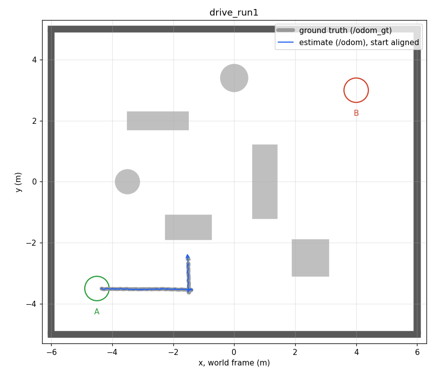
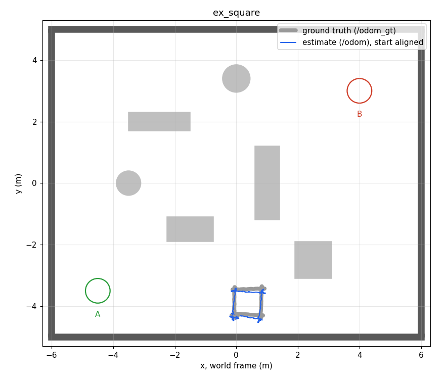

# Project 1. First steps: launch, inspect, walk, stop

## Goal

Start the simulated Go2, find out what is running, make the robot walk forward, turn and stop from the command line, and
measure what it actually did from the simulator's ground truth. You finish with a script that drives a fixed sequence, a
plot of where the robot went, and a first video of your robot.

## What you will learn

- Starting the stack and checking that it is up.
- Reading the ROS 2 graph: nodes, topics, message types, publishers and subscribers, rates.
- Commanding the robot on `/cmd_vel` with `ros2 topic pub`, and why you must always send a zero twist to stop it.
- Reading a pose from `nav_msgs/Odometry`, including the heading from a quaternion.
- Writing two small rclpy scripts that run on simulated time: one that drives, one that measures.
- Comparing commanded motion, true motion (`/odom_gt`) and estimated motion (`/odom`).

## Before you start

You need the repository built ([chapter 3](../../docs/03-install-and-first-run.md)) and the `ros2` command line basics from
[chapter 4](../../docs/04-ros2-from-scratch.md). [Chapter 7](../../docs/07-make-it-walk.md) explains the gait controller in
depth; this project only uses its interface.

Every terminal starts with:

```bash
cd go2-nav-sim
source env.sh
```

The scripts in this project are plain Python files. They need no build: `python3 projects/p01_first-steps/<script>.py`.

## Steps

### 1. Start the stack

```bash
scripts/up.sh
```

Expected, after 30 s to a few minutes:

```
stack: ROS_DOMAIN_ID=42 GAZEBO_MASTER_URI=http://localhost:11345
stack up
```

`up.sh` starts three launch files in order and waits for each: `sim.launch.py` (Gazebo, the robot, the CHAMP gait controller,
the sensors), `estimation.launch.py` (2D scan, lidar odometry, EKF) and `nav.launch.py` (Nav2, AMCL, a passive mapper). The
robot is spawned on the green disc A at (-4.5, -3.5), facing +x. Gazebo runs without a window.

Check: `ros2 topic echo --once /clock` prints a `sec` value that grows each time you run it.

### 2. List what is running

```bash
ros2 node list | wc -l
ros2 node list | grep -v transform_listener
```

```
44
/amcl
/base_to_footprint_ekf
...
/lidar_odom
...
/p3d_gt
...
/quadruped_controller_node
/robot_state_publisher
/slam_toolbox
...
```

`/quadruped_controller_node` is CHAMP, the gait controller that turns a body velocity into leg joint trajectories.
`/p3d_gt` is a Gazebo plugin that publishes the true pose of the trunk. `/lidar_odom` and `/odom_ekf` produce the estimated
pose.

Check: the count is around 44, and `/quadruped_controller_node` is in the list.

### 3. Find the topic that moves the robot

```bash
ros2 node info /quadruped_controller_node
```

```
/quadruped_controller_node
  Subscribers:
    /body_pose: geometry_msgs/msg/Pose
    /clock: rosgraph_msgs/msg/Clock
    /cmd_vel: geometry_msgs/msg/Twist
    /parameter_events: rcl_interfaces/msg/ParameterEvent
  Publishers:
    /joint_group_effort_controller/joint_trajectory: trajectory_msgs/msg/JointTrajectory
    ...
```

The controller listens to `/cmd_vel`, a `geometry_msgs/msg/Twist`. Look at the message:

```bash
ros2 interface show geometry_msgs/msg/Twist
```

```
# This expresses velocity in free space broken into its linear and angular parts.

Vector3  linear
	float64 x
	float64 y
	float64 z
Vector3  angular
	float64 x
	float64 y
	float64 z
```

For a walking robot on flat ground only three fields matter: `linear.x` (forward, m/s), `linear.y` (left, m/s) and
`angular.z` (turn left, rad/s). CHAMP clips them to 0.3 m/s, 0.25 m/s and 0.5 rad/s (`gait.yaml`, chapter 7).

Who else publishes there:

```bash
ros2 topic info -v /cmd_vel | grep -E "Node name:|count"
```

```
Publisher count: 6
Node name: velocity_smoother
Node name: behavior_server
Node name: behavior_server
Node name: behavior_server
Node name: behavior_server
Node name: behavior_server
Subscription count: 1
Node name: quadruped_controller_node
```

`behavior_server` appears five times because it holds one publisher per recovery behaviour. Nav2's `velocity_smoother` and
`behavior_server` are idle until Nav2 is given a goal. While you drive by hand they stay quiet;
if you send a Nav2 goal at the same time, both of you command the same robot. (With `ros2 topic echo /cmd_vel` running for
25 s while I sent one command, the echo printed that one message and nothing else.)

Check: `Subscription count: 1`, and the subscriber is `quadruped_controller_node`.

### 4. Measure the sensor rates

```bash
ros2 topic hz -s /imu/data
```

`-s` measures in simulated time, which is what the sensors are configured in. Stop each with Ctrl-C after a few seconds.
What I measured, 20 s per topic, all at once:

| Topic | Type | Rate (sim time) | Published by |
|---|---|---|---|
| `/joint_states` | `sensor_msgs/JointState` | 249.2 Hz | ros2_control |
| `/imu/data` | `sensor_msgs/Imu` | 98.6 Hz | Gazebo IMU plugin |
| `/odom_gt` | `nav_msgs/Odometry` | 50.0 Hz | `/p3d_gt`, ground truth |
| `/odom` | `nav_msgs/Odometry` | 50.0 Hz | `/odom_ekf`, the estimate |
| `/lidar/points` | `sensor_msgs/PointCloud2` | 10.04 Hz | Gazebo 3D lidar |
| `/scan` | `sensor_msgs/LaserScan` | 10.03 Hz | `pointcloud_to_laserscan` |
| `/camera/image_raw` | `sensor_msgs/Image` | 2.39 Hz | Gazebo RGB-D camera, configured for 10 Hz |

The camera came in at a quarter of its configured rate because the machine was loaded (load average 38 on 32 threads) and
rendering is the most expensive sensor. Expect a different camera rate on your machine; the other rates should match.

Check: `/imu/data` near 100 Hz and `/odom_gt` at 50 Hz.

### 5. Read the true pose

```bash
ros2 topic echo --once /odom_gt --field pose.pose
```

```
position:
  x: 0.09921225913936116
  y: 0.012619213036241028
  z: 0.21497210013485696
orientation:
  x: ...
  y: ...
  z: ...
  w: ...
```

`/odom_gt` is relative to the spawn point A, although its `frame_id` says `world`: the plugin subtracts A
(`urdf/sensors.xacro`, `xyz_offset`). Add (-4.5, -3.5) to get arena coordinates. The 0.10 m in x before the robot has
moved is the slide on landing after the spawn. `z` is the trunk height, about 0.215 m. The heading is hidden in the
quaternion; the measuring script below converts it.

Check: `x` and `y` within about 0.15 m of zero.

### 6. Start the measuring script

In a second terminal:

```bash
python3 projects/p01_first-steps/measure.py --csv manual.csv
```

It prints the true pose in arena coordinates once per simulated second. Leave it running.

```
t    0.0 s  x  -4.40  y  -3.49  heading     2.1 deg  speed 0.00 m/s
t    1.0 s  x  -4.40  y  -3.49  heading     2.1 deg  speed 0.00 m/s
```

Check: one line per simulated second, speed 0.00.

### 7. Walk forward, then stop

In a third terminal:

```bash
timeout 10 ros2 topic pub -r 10 /cmd_vel geometry_msgs/msg/Twist "{linear: {x: 0.3}}" > /dev/null
```

This publishes 0.3 m/s forward ten times a second until `timeout` ends it after 10 s of wall time. Watch the measuring
terminal: the speed climbs to 0.30 m/s within about a second. Now wait a few seconds after the command has returned. The robot
does not stop. CHAMP keeps executing the last command it received; there is no timeout. Stop it with a zero twist:

```bash
ros2 topic pub --once /cmd_vel geometry_msgs/msg/Twist "{}"
```

What the measuring script printed in my run:

```
t    5.0 s  x  -4.40  y  -3.49  heading     1.3 deg  speed 0.00 m/s
t    6.0 s  x  -4.09  y  -3.49  heading     1.4 deg  speed 0.31 m/s
t    7.0 s  x  -3.80  y  -3.47  heading     2.1 deg  speed 0.29 m/s
...
t   13.0 s  x  -1.99  y  -3.46  heading    -1.0 deg  speed 0.30 m/s
t   14.0 s  x  -1.69  y  -3.46  heading    -1.4 deg  speed 0.30 m/s
t   15.0 s  x  -1.59  y  -3.46  heading     0.4 deg  speed 0.10 m/s
t   16.0 s  x  -1.59  y  -3.46  heading     0.3 deg  speed 0.00 m/s
```

The robot covered 2.81 m (x from -4.40 to -1.59) and drifted 3 cm to the left. Your distance will differ: `timeout` counts
wall time, and how much simulated time fits into 10 s of wall time depends on how loaded your machine is. A second run of
this step on the same machine covered 3.20 m. What should match is the speed of 0.30 m/s, the robot still walking after
`timeout` returns, and the speed falling to 0.00 after the zero twist. In a separate test I published one 0.2 m/s
message with `--once` and nothing else: 21 s later the robot was still walking at 0.19 m/s and had covered 3.99 m, and its trunk
was 0.24 m from the inner face of the west wall when I sent the zero.

Check: speed 0.00 within a second of the zero twist.

### 8. Turn, then stop

```bash
timeout 10 ros2 topic pub -r 10 /cmd_vel geometry_msgs/msg/Twist "{angular: {z: 0.5}}" > /dev/null
ros2 topic pub --once /cmd_vel geometry_msgs/msg/Twist "{}"
```

```
t   17.0 s  x  -1.59  y  -3.46  heading     0.3 deg  speed 0.00 m/s
t   18.0 s  x  -1.62  y  -3.46  heading    25.6 deg  speed 0.03 m/s
t   19.0 s  x  -1.66  y  -3.49  heading    53.4 deg  speed 0.05 m/s
...
t   23.0 s  x  -1.60  y  -3.62  heading   162.4 deg  speed 0.04 m/s
t   24.0 s  x  -1.58  y  -3.63  heading   177.0 deg  speed 0.00 m/s
```

The heading grows by about 27 degrees per second, 0.47 rad/s against the 0.5 commanded. The total angle depends on the
machine for the same reason as the distance in step 7: my run turned 175 degrees, a second run 199 degrees. The rate of about
27 degrees per second is what to compare. The trunk also moves a few
centimetres while turning in place: the turn is made of steps, and the centre of rotation is not exactly the trunk origin.

Check: heading increases while the command runs, and stays put after the zero twist.

### 9. Read the summary

Press Ctrl-C in the measuring terminal:

```
ground truth: 26.5 s  path 3.39 m  net 2.82 m  mean speed 0.128 m/s  turned 174.8 deg  end (-1.58, -3.63) heading 176.9 deg
estimate    : 26.5 s  path 5.57 m  net 2.85 m  mean speed 0.210 m/s  turned 184.3 deg  end (-1.44, -3.70) heading -170.7 deg
wrote manual.csv
```

The first line is the truth. The second is what the robot itself believes, from lidar and IMU (`/odom`). The net
displacement agrees to 3 cm, the turn is overestimated by 9.5 degrees, and the path length of the estimate is 64 % too
long; [How the code works](#how-the-code-works) explains why the path length is the wrong thing to compare.

Check: `net` within a few centimetres between the two lines. The other numbers depend on how far your robot walked and
turned in steps 7 and 8, so they will not match mine.

### 10. Drive a sequence from a script, and record it

Typing commands gives uneven timing: each `ros2` process takes a few seconds to start, and `timeout` counts wall time
while the robot lives in simulated time. `drive.py` publishes a list of `vx,vy,wz,seconds` segments on the simulated clock and
always ends with a zero twist. Restart the stack first so the robot is back on A (`scripts/up.sh` stops the old one). Then,
in three terminals:

```bash
python3 projects/p01_first-steps/record.py first_walk.mp4 --topic /spectator/cam/image_raw   # terminal 1, the video
python3 projects/p01_first-steps/measure.py --csv drive.csv                                  # terminal 2, the measurement
python3 projects/p01_first-steps/drive.py                                                    # terminal 3, the commands
```

`record.py` is the shared recorder `projects/common/record_cam.py` with one change: it asks for reliable delivery of the
images instead of best effort. See the `record_cam.py` row in [If it goes wrong](#if-it-goes-wrong) for why.

The default sequence is 0.3 m/s forward for 10 s, a left turn at 0.5 rad/s for 3.2 s, and 0.3 m/s forward for 3 s.
`drive.py` prints each change of command:

```
  0.1 s  vx 0.30  vy 0.00  wz 0.00
 10.0 s  vx 0.00  vy 0.00  wz 0.50
 13.2 s  vx 0.30  vy 0.00  wz 0.00
stop: zero twist sent
```

When it has stopped, press Ctrl-C in terminals 1 and 2. `record.py` prints the number of frames it wrote, at 10 frames per
simulated second: `first_walk.mp4: 307 frames` in my latest run, with a load average of about 58. My first measurement:

```
ground truth: 21.6 s  path 4.28 m  net 2.96 m  mean speed 0.198 m/s  turned 91.0 deg  end (-1.51, -2.68) heading 90.8 deg
estimate    : 21.6 s  path 6.19 m  net 2.96 m  mean speed 0.287 m/s  turned 94.5 deg  end (-1.66, -2.64) heading 94.5 deg
```

A later run on the same machine (`results/drive_run3.csv`) ended at (-1.59, -2.62) and turned 91.1 degrees.

The video is the second run of the same sequence, recorded from the spectator camera with a reliable subscription, as
`record.py` does (22 s, simulated time):

<video controls muted playsinline src="media/first_walk_spectator.mp4"></video>

Check: `turned` near 90 degrees and the robot ends about 0.9 m north of where it turned.

### 11. Plot the run

```bash
python3 projects/p01_first-steps/plot_run.py drive.csv drive.png
```

My first scripted run:



Ground truth is drawn as a wide grey band and the estimate as a thin blue line on top of it. The two are a few centimetres
apart, so where the estimate is good you see blue running down the middle of the grey band.

The arena outline, boxes and pillars are drawn from `src/go2_nav_sim/scripts/make_arena.py`, the file that also generated
the Gazebo world and the navigation map, so the plot and the simulator cannot disagree about where the obstacles are.

Check: the grey band starts on A, runs 3 m east, turns north and stops below the box at (-1.5, -1.5).

### 12. Stop everything

```bash
scripts/stop.sh
```

Check: `ros2 node list` prints nothing (it may take a few seconds for the daemon to forget the nodes).

## How the code works

Three scripts, all plain rclpy, all on simulated time.

### `measure.py`

The node subscribes to both odometry topics with one callback factory, and stores `(t, x, y, yaw)` per message. Times come
from the message stamps, not from the arrival time, because on a loaded machine messages arrive in bursts:

```python
def on_odom(key):
    def cb(m):
        t = m.header.stamp.sec + m.header.stamp.nanosec * 1e-9
        p = m.pose.pose
        data[key].append((t, p.position.x + A[0], p.position.y + A[1], yaw_of(p.orientation)))
    return cb
```

The heading is the rotation about the vertical axis, taken from the unit quaternion (x, y, z, w):

yaw = atan2(2(wz + xy), 1 - 2(y² + z²))

```python
def yaw_of(q):
    return math.atan2(2 * (q.w * q.z + q.x * q.y), 1 - 2 * (q.y * q.y + q.z * q.z))
```

The summary adds up small steps:

```python
for (_, x0, y0, a0), (_, x1, y1, a1) in zip(samples, samples[1:]):
    path += math.hypot(x1 - x0, y1 - y0)
    turn += wrap(a1 - a0)                  # sum of small steps, so a 400 degree spin counts as 400, not 40
```

`wrap` maps an angle into [-180, 180) degrees. Subtracting the first heading from the last would be wrong as soon as the robot
crosses ±180 degrees (step 9 ends at 176.9 degrees true and -170.7 degrees estimated, which are 12.4 degrees apart, not 347).
Each step between two 50 Hz samples is far smaller than 180 degrees, so wrapping each step is safe.

Path length is the sum of the step lengths. On ground truth that is the distance walked plus a little trunk sway. On the
estimate it is inflated: `/odom` is published at 50 Hz but corrected by the lidar at 10 Hz, so it moves in small jumps. In
the straight part of the scripted run the largest step between two `/odom` samples was 3.4 cm, against 0.8 cm for ground
truth, and the estimated path came out 1.9 m longer than the true one. Compare positions and headings, not path lengths.

### `drive.py`

The sequence logic is a pure function, so it is unit-tested without ROS:

```python
def command_at(segs, t):
    for vx, vy, wz, dur in segs:
        if t < dur:
            return vx, vy, wz
        t -= dur
    return None
```

A 20 Hz timer on the node's clock (simulated time, because `use_sim_time` is true) looks up the command for the elapsed time
and publishes it. If the simulation runs at half speed, the sequence takes twice as long in wall time and the robot still
walks for 10 s of its own time.

Stopping safely takes two details:

```python
rclpy.init(signal_handler_options=SignalHandlerOptions.NO)
...
finally:
    for _ in range(3):
        pub.publish(Twist())
        time.sleep(0.05)
```

rclpy's default Ctrl-C handler shuts the ROS context down before your `finally` block runs, and a publisher on a shut-down
context cannot send. With the handler disabled, Ctrl-C is an ordinary `KeyboardInterrupt`, the context is still valid, and the
zero twist goes out. It is sent three times because one lost message would leave the robot walking.

### Predicting where the robot should end

Integrating the commands from the true start pose (x₀, y₀, θ₀) gives where a perfect robot would stop:

x₁ = x₀ + 3.0 cos θ₀, θ₁ = θ₀ + 0.5 × 3.2, x₂ = x₁ + 0.9 cos θ₁ (and the same with sin for y)

From (-4.35, -3.51, -0.2°) that is (-1.37, -2.62). Ground truth ended at (-1.51, -2.68), 0.15 m away. The forward leg
covered 2.94 m when the heading passed 5 degrees (3.0 m commanded), and the turn was 91.0 degrees (91.7 commanded). The
steady forward speed between 6 s and 12 s was 0.300 m/s, so the loss is in the gait starting and stopping, plus the trunk
shifting during the turn.

### `plot_run.py`

Draws the CSV over the arena. `/odom_gt` is zero at the spawn point; the robot then slides 0.10 to 0.15 m on landing, and
`/odom` is zero wherever the robot stood when the estimator started. The plot translates the estimate so both start at the
same point (no rotation), so what is left is the estimator's error during the run plus any heading error it already had.

## Results

All from my runs on one machine (32 threads, load average 38 to 135 from other simulations). Ground truth from `/odom_gt`,
estimate from `/odom`.

| Run | Command | Ground truth | Estimate |
|---|---|---|---|
| Manual forward (step 7) | `ros2 topic pub -r 10`, vx 0.3 | 2.81 m at 0.30 m/s, 3 cm lateral drift | |
| Manual turn (step 8) | `ros2 topic pub -r 10`, wz 0.5 | about 0.47 rad/s; whole session turned 174.8° | turned 184.3°, 9.5° too much |
| One message, no stop | `ros2 topic pub --once`, vx 0.2 | still 0.19 m/s after 21 s, 3.99 m | |
| `drive.py` default, run 1 | 3.0 m, 91.7°, 0.9 m | 2.94 m, 91.0°, end 0.15 m from prediction | end 0.03 m from truth (start aligned), heading 3.6° off |
| `drive.py` default, run 2 (video) | 3.0 m, 91.7°, 0.9 m | 2.97 m, 91.3°, end 0.11 m from prediction | end 0.07 m from truth (start aligned), heading 8.2° off |
| Exercise 1, square | 4 × (1.02 m, 91.7°) | turned 363.0°, ended 0.10 m from its start | turned 370.0°, net 0.16 m |
| Exercise 2, vx 0.5 | clipped to 0.3 | 0.30 m/s steady | |
| Exercise 3, vy -0.25 | 1.5 m to the right | 0.26 to 0.29 m/s, 1.61 m, heading -6.9° | turned -12.7° |

Steady forward speed between 6 s and 12 s of each scripted run: 0.300 and 0.302 m/s. In the two identical runs the estimate
ended 3.6° and 8.2° off the true heading, in opposite directions: it measured the turn as 94.5° and 84.5° against 91.0° and
91.3° true. The estimator is the subject of [chapter 9](../../docs/09-state-estimation.md); here it is enough to know that its heading can be several degrees
off after one turn.

Commands: steps 6 to 10 above and the exercises below. The forward-leg length and steady speed come from the CSVs:

```python
import csv, math
gt = [(float(r['t']), float(r['x']), float(r['y']), float(r['yaw']))
      for r in csv.DictReader(open('projects/p01_first-steps/results/drive_run1.csv')) if r['source'] == 'gt']
t0, x0, y0, a0 = gt[0]
leg = next(s for s in gt if abs(math.degrees(s[3] - a0)) > 5)          # first sample 5 deg off the start heading
p, q = (min(gt, key=lambda s: abs(s[0] - t0 - T)) for T in (6, 12))
print(f'forward leg {math.hypot(leg[1] - x0, leg[2] - y0):.2f} m, speed {math.hypot(q[1] - p[1], q[2] - p[2]) / (q[0] - p[0]):.3f} m/s')
# forward leg 2.94 m, speed 0.300 m/s
```

The CSVs of all my runs are in `results/` (`manual`, `drive_run1`, `drive_run2`, `ex_square`, `ex_clip`, `ex_side`), so you
can re-plot them without the simulator.

Unit tests for the pure logic (quaternion to heading, angle wrapping, summary, sequence parsing):

```bash
python3 -m pytest -q projects/p01_first-steps
# 7 passed
```

## Try this

Each exercise continues from where the robot stopped. Check the space around it on the plot first, or restart with
`scripts/up.sh` to return to A. Run `measure.py` in another terminal during each one.

1. Walk a square with 1 m sides: four times forward 0.3 m/s for 3.4 s, then left 0.5 rad/s for 3.2 s. How far from its start
   does the robot end, and how much has it turned?

   ```bash
   python3 projects/p01_first-steps/drive.py 0.3,0,0,3.4 0,0,0.5,3.2 0.3,0,0,3.4 0,0,0.5,3.2 0.3,0,0,3.4 0,0,0.5,3.2 0.3,0,0,3.4 0,0,0.5,3.2
   ```

   Answer from my run: `turned 363.0 deg`, `net 0.10 m`. The commands ask for 4 × 0.5 × 3.2 rad = 366.7 degrees; each side
   came out at about 0.9 m because the gait needs about a second to reach full speed. The estimate turned 370.0 degrees.
   Ground truth grey, estimate blue (shifted to the same start, not rotated, so the heading error it already had shows):

   

2. Ask for more than the robot can do: 0.5 m/s forward. What speed does `measure.py` report?

   ```bash
   python3 projects/p01_first-steps/drive.py 0,0,0.5,3.2 0.5,0,0,6     # in my run this first turned the robot from north to east
   ```

   Answer: 0.30 m/s on every full second of the straight part after the first, which is the gait speeding up. CHAMP clips `linear.x` to `max_linear_velocity_x` = 0.3 and
   says nothing about it; the publisher gets no error.

3. Walk sideways to the right: `linear.y` = -0.25 m/s for 6 s. Is it as clean as walking forward?

   ```bash
   python3 projects/p01_first-steps/drive.py 0,-0.25,0,6
   ```

   Answer: no. The robot moved 1.61 m (6 s at 0.25 m/s would be 1.5 m) at 0.26 to 0.29 m/s, faster than the 0.25 m/s
   clip, crept backwards by 0.29 m (x from 0.20 to -0.09 while facing about +x) and turned -6.9 degrees. Sideways
   walking is the least accurate of the three motions, so prefer turning and walking forward when you need precision.

## If it goes wrong

| Symptom | Cause | Fix |
|---|---|---|
| `TIMEOUT waiting for: gazebo` from `up.sh`, but `logs/up_sim.log` shows the controllers loaded | On a loaded machine (load average above 100 in my case) `gz stats` did not answer within its 5 s timeout, so `up.sh` gave up although Gazebo was running | Check `ros2 topic echo --once /clock`. If the clock runs, start the other two launch files by hand: `ros2 launch go2_nav_sim estimation.launch.py`, wait for a `pose=` line, then `ros2 launch go2_nav_sim nav.launch.py`. Or run `scripts/up.sh` again when the machine is quieter |
| The robot keeps walking after `ros2 topic pub` ended | CHAMP holds the last command | `ros2 topic pub --once /cmd_vel geometry_msgs/msg/Twist "{}"` |
| `timeout 10 ros2 topic pub` moves the robot for less (or more) than 10 s | `timeout` counts wall time, including the 2 to 3 s the `ros2` process needs to start; the robot moves in simulated time | Use `drive.py`, which times segments on `/clock` |
| `record_cam.py` prints `1 frames` and the video is a still | It subscribes best effort (`qos_profile_sensor_data`). A 960 × 540 image is 1.5 MB, sent in many fragments; on a loaded machine one lost fragment loses the whole image, and best effort does not resend. In 25 s a best-effort subscriber got 2 spectator images, a reliable one 150 | In `projects/common/record_cam.py` replace `qos_profile_sensor_data` in `create_subscription` with `10` (a reliable profile, depth 10). My video was recorded that way |
| The estimate's `end` differs from the truth by a constant 0.1 to 0.2 m even right after a restart | `/odom_gt` starts at the spawn point, `/odom` where the robot had settled; the robot slides 0.10 to 0.15 m on landing | Compare displacements, or shift the estimate's start onto the truth as `plot_run.py` does |
| The robot is somewhere you did not expect after several exercises | Every run starts where the last one stopped | Restart with `scripts/up.sh` to return to A |
