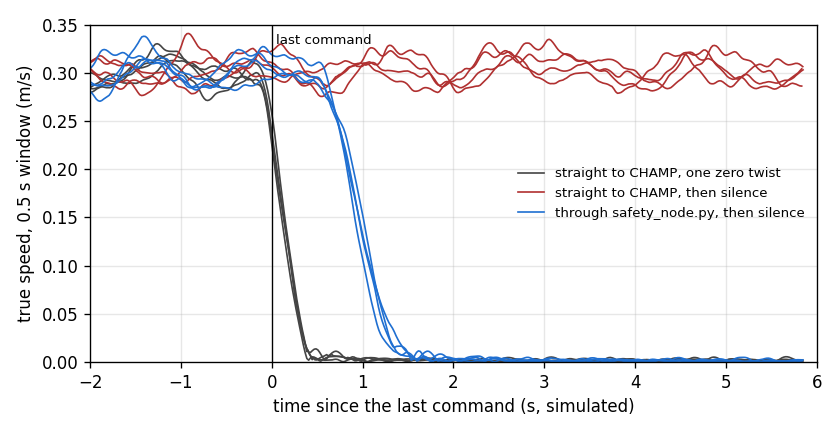
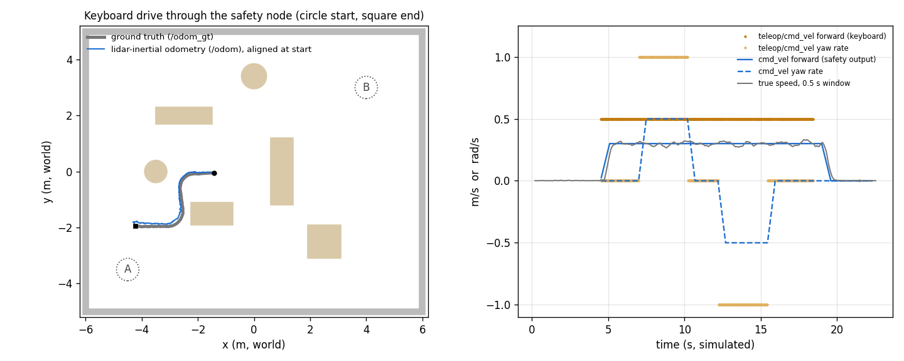

# Project 2. Teleoperation with a safety layer

## Goal

Drive the Go2 from the keyboard, then put a small node of your own between the keyboard and the robot. The node limits speed
and acceleration and stops the robot when commands stop arriving (a dead-man timeout). CHAMP, the gait controller, has no such
timeout: it walks on the last `/cmd_vel` it received for as long as nothing else arrives. You measure how long the robot takes
to stand still after the last command, with and without your node, and you unit-test the limiter without ROS.

## What you will learn

- Running `teleop_twist_keyboard` and remapping its output topic.
- Why a keyboard teleop alone is unsafe on this robot, measured on the simulator's ground truth.
- Writing a node that sits in a command chain: subscribe, filter, republish on a timer.
- Velocity clipping, an acceleration (slew-rate) limit and a dead-man timeout, and how to predict the stopping distance they give.
- Keeping the logic in a plain Python class so `pytest` can test it with no ROS graph.
- Handling Ctrl-C and SIGTERM in an rclpy node so it can send a last zero before it exits.

## Before you start

Do [project 1](../p01_first-steps/README.md) first: it shows how to start the stack, read `/odom_gt`, and why a zero twist is the
only way to stop CHAMP. [Chapter 7](../../docs/07-make-it-walk.md) has the CHAMP limits used below (0.3 m/s forward, 0.25 m/s
sideways, 0.5 rad/s yaw).

Every terminal starts with:

```bash
cd go2-nav-sim
source env.sh
```

and the stack must be running (`scripts/up.sh`, which prints `stack up`). This project only uses the simulator; Nav2 can stay up
because it publishes on `/cmd_vel` only while it has a goal. In my runs with Nav2 up and idle, a robot left walking was still
walking 6 s later, so nothing else sent it a zero.

The scripts are plain Python files and need no build: `python3 projects/p02_teleop-and-safety/<script>.py`.

| File | What it is |
|---|---|
| `limiter.py` | the limiter and dead-man logic, no ROS |
| `safety_node.py` | the node: `teleop/cmd_vel` in, `cmd_vel` out |
| `test_limiter.py` | 7 unit tests for `limiter.py` |
| `measure_stop.py` | walks forward, goes silent, measures the time to standstill from `/odom_gt` |
| `key_drive.py` | types keys into `teleop_twist_keyboard` from a script, so a keyboard drive can be repeated |
| `record_reliable.py` | `projects/common/record_cam.py` with a reliable subscription (see [If it goes wrong](#if-it-goes-wrong)) |
| `plot.py` | the two figures, and the summary of all stop measurements |
| `results/` | my CSVs and bags behind every number below; your own runs go to `~/p02_runs` (step 6), so they never overwrite these |

## Steps

### 1. Check that the keyboard teleop is installed

```bash
ros2 pkg executables teleop_twist_keyboard
```

Expected:

```
teleop_twist_keyboard teleop_twist_keyboard
```

Check: if the line is missing, install it with `sudo apt install ros-humble-teleop-twist-keyboard`.

### 2. Drive without a safety layer

```bash
ros2 run teleop_twist_keyboard teleop_twist_keyboard
```

It prints a key map. `i` walks forward, `,` backwards, `j` and `l` turn on the spot, `u` and `o` walk in an arc, `k` stops. It
starts at `speed 0.5 turn 1.0`, above CHAMP's limits; CHAMP clips them to 0.3 m/s and 0.5 rad/s.

Press `i` once and take your hands off the keyboard. The robot keeps walking. `teleop_twist_keyboard` publishes one message per
key event and nothing when no key is pressed, and CHAMP holds the last message. Press `k` to stop it.

Check: in a second terminal, `ros2 topic hz /cmd_vel` prints nothing while you do not touch the keyboard, and
`ros2 topic echo --once /odom_gt --field pose.pose.position.x`, run twice a few seconds apart, gives a larger number the second
time, until you press `k`.

Close the teleop with Ctrl-C (it sends a zero twist as it exits).

### 3. Run the unit tests

The limiter lives in `limiter.py`, which imports nothing from ROS. Test it first:

```bash
python3 -m pytest -q projects/p02_teleop-and-safety
```

Expected:

```
.......                                                                  [100%]
7 passed in 0.24s
```

Check: the tests also pass in a shell where `env.sh` was not sourced, which shows they need no ROS.

### 4. Start the safety node

```bash
python3 projects/p02_teleop-and-safety/safety_node.py
```

Expected:

```
[INFO] [...] [cmd_safety]: teleop/cmd_vel -> cmd_vel  v_max [0.3, 0.25, 0.5]  a_max [0.5, 0.5, 1.0]  timeout 0.6 s  20.0 Hz
```

Check, from another terminal:

```bash
ros2 node info /cmd_safety            # Subscribers: /clock, /teleop/cmd_vel   Publishers: /cmd_vel, ...
ros2 param get /cmd_safety timeout    # Double value is: 0.6
ros2 topic info /cmd_vel -v | grep -c 'Node name: cmd_safety'    # 1
```

The last command counts the publishers on `/cmd_vel` named `cmd_safety`; it must print `1`. The full
`ros2 topic info /cmd_vel -v` lists more: with the stack from `scripts/up.sh` it printed `Publisher count: 7` (`cmd_safety`,
`velocity_smoother` and five `behavior_server` entries, all from Nav2, which publish only while Nav2 has a goal) and
`Subscription count: 1` (`quadruped_controller_node`, CHAMP). Seven is normal here; only `cmd_safety` appearing twice is a
problem (see [If it goes wrong](#if-it-goes-wrong)). [Project 11](../p11_command-arbitration/README.md) puts `twist_mux` in front
of CHAMP so that one node, `cmd_safety`, is the only publisher on `/cmd_vel`.

The node reads its parameters once, at start-up. To change one, stop the node and start it again with
`--ros-args -p timeout:=0.3`. Give floats as floats: `-p "a_max:=[1, 1, 2]"` stops the node with
`InvalidParameterTypeException: ... of type 'INTEGER_ARRAY', expecting type 'DOUBLE_ARRAY'`; write `-p "a_max:=[1.0, 1.0, 2.0]"`.

### 5. Drive through the safety node

Remap the teleop's output to the node's input:

```bash
ros2 run teleop_twist_keyboard teleop_twist_keyboard --ros-args -r cmd_vel:=teleop/cmd_vel
```

Hold `i` for a few seconds, then let go. The robot speeds up over about 0.6 s, walks, and stops about 1.3 s after you let go. The
safety node logs:

```
[WARN] [...] [cmd_safety]: no command for 0.6 s: stopping
```

Check: while you hold `i`, `ros2 topic echo /teleop/cmd_vel --field linear.x` shows `0.5` and
`ros2 topic echo /cmd_vel --field linear.x` shows `0.3`: the node clipped the command.

Close the teleop with Ctrl-C. Leave the safety node running; steps 6 and 7 use it.

### 6. Measure the stopping time

Restart the stack so the robot is back on A, facing +x:

```bash
scripts/up.sh
```

Leave the safety node from step 4 running. The restart sets simulated time back to about 0, and the node logs that once:

```
[WARN] [...] [cmd_safety]: simulated time went back 42.5 s (simulator restarted): last command dropped
```

It then stays silent until a new command arrives on `teleop/cmd_vel`, so it does not interfere with the first two runs below, which
publish straight to `/cmd_vel`. If that line does not appear and the first two runs print `standstill 0.00 s ... 0.00 m walked`,
you are running an older copy of `safety_node.py` without the clock check: it kept resending its last zero after the restart
([If it goes wrong](#if-it-goes-wrong)). Ctrl-C it, start it again, and repeat the runs.

Your results go to `~/p02_runs`, outside the repository, so my files in `results/` and `figures/` stay as they are:

```bash
mkdir -p ~/p02_runs
```

The three runs below walk about 6 m in total along y = -3.5, which is free of obstacles up to x = 5.5. Each run walks at 0.3 m/s
for 4 s of simulated time, then either sends one zero twist or goes silent, then watches the ground truth for 6 s. At the end the
script always sends a zero on `/cmd_vel`.

```bash
python3 projects/p02_teleop-and-safety/measure_stop.py --topic /cmd_vel --zero --csv ~/p02_runs/direct_zero.csv
python3 projects/p02_teleop-and-safety/measure_stop.py --topic /cmd_vel --csv ~/p02_runs/direct_silence.csv
python3 projects/p02_teleop-and-safety/measure_stop.py --topic /teleop/cmd_vel --csv ~/p02_runs/safety_silence.csv
```

Expected, one line per run (my fourth run of each, made straight after a restart with the safety node left running):

```
/cmd_vel zero=True: standstill 0.38 s after the last command, 0.04 m walked in that time
/cmd_vel zero=False: NOT stopped 6.0 s after the last command; walked 1.85 m since, speed at end 0.286 m/s
/teleop/cmd_vel zero=False: standstill 1.28 s after the last command, 0.29 m walked in that time
```

Your numbers will differ by a few hundredths; the [results](#results) table has all my runs.

Check:

```bash
python3 projects/p02_teleop-and-safety/plot.py --dir ~/p02_runs
```

prints one line per CSV in `~/p02_runs` and writes `~/p02_runs/stop_time.png`. Without `--dir`, `plot.py` reads my CSVs in
`results/` and rewrites `figures/stop_time.png`.

### 7. Record a drive and plot it

Restart the stack once more, so the drive starts on A facing +x, where the scripted drive below was planned. The safety node can
stay running; it logs the time jump again.

```bash
scripts/up.sh
```

Four terminals:

```bash
python3 projects/p02_teleop-and-safety/safety_node.py                                   # terminal 1, already running from step 4
ros2 bag record -o ~/p02_runs/drive_bag /odom_gt /odom /cmd_vel /teleop/cmd_vel         # terminal 2
python3 projects/p02_teleop-and-safety/record_reliable.py ~/p02_runs/teleop_drive.mp4 \
    --topic /spectator/cam/image_raw                                                    # terminal 3
python3 projects/p02_teleop-and-safety/key_drive.py "i 4, u 3.2, i 2, u 3.2, i 3, - 3"   # terminal 4
```

`ros2 bag record` refuses to write into a folder that already exists (`Output folder '...' already exists.`), so delete or rename
`~/p02_runs/drive_bag` before a second recording.

Terminal 4 runs my drive from a script, so it can be repeated. Each item is a key and how long to hold it, in simulated seconds;
`-` releases all keys. From A it walks east along y = -3.5, arcs left to face north, walks north, arcs left to face west, walks
west and lets go. The robot's centre passes 0.58 m from the wood pallet, the closest obstacle. It prints one line per item, with
the simulated time at which the item started (yours will differ):

```
   28.95  i for 4.0 s
   32.96  u for 3.2 s
   36.18  i for 2.0 s
   38.19  u for 3.2 s
   41.40  i for 3.0 s
   44.42  - for 3.0 s
```

To drive by hand instead, run `ros2 run teleop_twist_keyboard teleop_twist_keyboard --ros-args -r cmd_vel:=teleop/cmd_vel` in
terminal 4 and finish by letting go of all keys. At 0.3 m/s and 0.5 rad/s, `i 1` is about 0.3 m and `j 3.2` about a quarter
turn. A hand drive gives a different path, so the numbers below will not match.

When the robot has stood still for 3 s, Ctrl-C terminals 2 and 3. Terminal 3 prints the frame count
(`.../teleop_drive.mp4: 292 frames` for my drive). Plot:

```bash
python3 projects/p02_teleop-and-safety/plot.py ~/p02_runs/drive_bag --dir ~/p02_runs
# drive: 29.8 s simulated, true path 4.91 m, odometry end error 0.070 m, end at (-4.51, -1.89)
```

The duration counts from the start of the bag, so it includes the time you took to start terminal 4 (7.6 s in my run); the path
length and the end point do not depend on it.

The video shows the whole arena. To crop and enlarge it 2× around the drive, as in `media/teleop_drive.mp4`:

```bash
ffmpeg -i ~/p02_runs/teleop_drive.mp4 -vf "crop=480:270:100:160,scale=960:540" -c:v libx264 -crf 26 -pix_fmt yuv420p \
    ~/p02_runs/teleop_drive_crop.mp4
```

`crop=480:270:100:160` keeps a 480 × 270 pixel window whose top-left corner is at pixel (100, 160) of the 960 × 540 frame, the
south-west part of the arena. For a drive elsewhere, move the corner.

Check: `~/p02_runs/teleop_drive.png` exists, and in its right panel the keyboard dots stop before the blue output line ramps down.

### 8. Stop

Ctrl-C the safety node. It publishes one zero twist before it exits, so the robot is left standing even if it was walking. Then:

```bash
scripts/stop.sh
```

## How the code works

### `limiter.py`

The class keeps the last command (`target`), the last output (`out`) and the time of the last command (`t_cmd`):

```python
def command(self, t, cmd):
    """A new command arrived at time t (seconds)."""
    self.target = tuple(clamp(c, -m, m) for c, m in zip(cmd, self.v_max))
    self.t_cmd = t

def stale(self, t):
    # t < t_cmd: the clock went back (the simulator was restarted), so the last command belongs to another run
    return self.t_cmd is None or t < self.t_cmd or t - self.t_cmd > self.timeout

def step(self, t):
    """Output for time t, or None when there is nothing to send (idle and already stopped)."""
    if self.t_cmd is not None and t < self.t_cmd:
        self.t_cmd = None              # clock went back: forget the old command, or it revives when t passes t_cmd again
    target = (0.0, 0.0, 0.0) if self.stale(t) else self.target
    dt = 0.0 if self.t_out is None else max(0.0, t - self.t_out)
    self.t_out = t
    # move each axis towards its target by at most a_max * dt
    self.out = tuple(o + clamp(g - o, -a * dt, a * dt) for o, g, a in zip(self.out, target, self.a_max))
    if self.stale(t) and self.out == (0.0, 0.0, 0.0):
        self.zeros_sent += 1
        # ponytail: a few zeros, then silence, so a stopped limiter never fights another /cmd_vel publisher (Nav2)
        return self.out if self.zeros_sent <= 5 else None
    self.zeros_sent = 0
    return self.out
```

Three rules, applied to each axis (forward, sideways, yaw) separately:

1. Velocity limit: a command is clipped to ±`v_max` when it arrives. The defaults equal CHAMP's own limits, so the clip changes
   nothing CHAMP would not change, but the output now shows what the robot will really be asked to do.
2. Acceleration limit: each step moves the output towards the target by at most `a_max · dt`. With 0.5 m/s² and a 20 Hz timer
   that is 0.025 m/s per step, so 0 to 0.3 m/s takes 0.3 / 0.5 = 0.6 s. Reversing from +0.3 to -0.3 takes 1.2 s and passes through
   zero.
3. Dead-man timeout: if no command has arrived for `timeout` seconds, the target becomes zero and the acceleration limit ramps the
   output down.

When the output reaches zero the node sends five zeros and then goes quiet. A node that kept sending zeros forever would fight any
other publisher on `/cmd_vel`, such as Nav2 in later projects.

A restart of the simulator sets simulated time back to about 0 while the node keeps running. My first version only had the
timeout test `t - t_cmd > timeout`: after a restart `t - t_cmd` was negative, so the old command counted as fresh, and the node
published its last command (a zero) at 20 Hz until the new clock passed the old `t_cmd`. That zero overrode every other
publisher on `/cmd_vel`. Now a clock that goes back makes the command stale and `step()` forgets it, so the node stays silent
until a new command arrives. A first fix that only changed `stale()` was not enough: the old command came back for 0.6 s when the
new clock passed the old `t_cmd`, and the node logged `no command for 0.6 s: stopping` 52 s (wall clock) after the restart. The unit test
`test_clock_jump_back_is_stale` covers both.

From the three rules, the robot stops after it has walked for the timeout at full speed and then decelerated:

```
t_stop ≈ T + v / a + t_CHAMP        d_stop ≈ v·T + v² / (2a) + d_CHAMP
```

With v = 0.3 m/s, T = 0.6 s, a = 0.5 m/s² and CHAMP's own response to a zero (0.37 s, 0.04 m, the first row of the results
table), that gives 1.57 s and 0.31 m. I measured 1.28 to 1.43 s and 0.288 to 0.295 m. The distance agrees. The time is about 0.2 s
shorter than the sum, which suggests that CHAMP's delay does not simply add at the end of a slow ramp (my inference: chapter 7
measured that CHAMP walks slower than commanded at small speeds, 0.063 m/s for a 0.1 m/s command, so the robot drops below the
0.02 m/s standstill threshold before the command reaches zero).

The same holds for turning. A turn key released at 0.5 rad/s keeps the robot turning for 0.5 · 0.6 + 0.5² / (2 · 1.0) = 0.43 rad,
about 24°, before it stops (computed from the formula, not measured). Press `k` when the heading is right instead of letting go.

### `safety_node.py`

The node is a thin shell around the limiter: a subscription stores commands, a 20 Hz timer publishes the output.

```python
def on_cmd(self, m):
    self.lim.command(self.now(), (m.linear.x, m.linear.y, m.angular.z))

def on_timer(self):
    t = self.now()
    if self.lim.t_out is not None and t < self.lim.t_out:
        self.get_logger().warn(f'simulated time went back {self.lim.t_out - t:.1f} s (simulator restarted): '
                               'last command dropped')
    stale = self.lim.stale(t)
    if stale and not self.was_stale:
        self.get_logger().warn(f'no command for {self.lim.timeout} s: stopping')
    self.was_stale = stale
    out = self.lim.step(t)
    if out is not None:
        self.send(*out)
```

Points worth checking:

- The output is published by the timer, not by `on_cmd`. A dead-man must act when nothing arrives, and only a timer runs then.
- Time is simulated time (`use_sim_time` is set in the constructor). The timeout is measured on the same clock the robot moves on.
  If Gazebo runs at half speed, 0.6 s of simulated time is 1.2 s on your watch.
- The timeout must be longer than the gap between key events while a key is held. A held key repeats only after a delay: 500 ms
  on my machine (`xset q` prints `auto repeat delay: 500  repeat rate: 33`). With a timeout below that, the robot jerks at every
  key press ([exercise 3](#try-this)).
- `main()` takes over SIGINT and SIGTERM from rclpy (`SignalHandlerOptions.NO`) and turns both into `KeyboardInterrupt`. rclpy's
  own handler shuts the context down on SIGINT (`record_cam.py`, which keeps it, failed on Ctrl-C with `the given context is
  not valid`), and a publish needs a valid context.

```python
rclpy.init(signal_handler_options=SignalHandlerOptions.NO)
for s in (signal.SIGINT, signal.SIGTERM):
    signal.signal(s, signal.default_int_handler)
node = Safety()
try:
    rclpy.spin(node)
except KeyboardInterrupt:
    pass
node.send(0.0, 0.0, 0.0)            # leave the robot standing, not walking on our last output
```

### `measure_stop.py`

It records `/odom_gt` positions and computes the speed over a sliding 0.5 s window. The robot counts as standing from the first
window, after the last command, whose speed is below 0.02 m/s and after which no window is above it:

```python
for t, v in speeds:
    if t < t_last:
        continue
    if v >= STILL:
        t_stop = None
    elif t_stop is None:
        t_stop = t
```

Speed from positions, not from the twist field, because the legs make the trunk sway. Standing still, this windowed speed was at
most 0.0054 m/s (mean 0.0020 m/s over 6 s), well under the 0.02 m/s threshold. Each speed is stamped at the centre of its window,
so the times have a resolution of about a quarter of a second.

### `key_drive.py`

`teleop_twist_keyboard` reads single key presses from its terminal. `key_drive.py` gives it a pseudo-terminal (`pty.openpty()`)
and writes a key every 1/30 s while a key is "held", which is what the X server does with a held key. The durations are measured on
`/clock`, read by a node spinning in a second thread. On exit it sends Ctrl-C, so teleop publishes its zero and quits.

## Results

Measured in two sessions on a shared machine. In the first, two other Gazebo instances were running, the load average was between
56 and 126, and `gz stats` showed a real-time factor between 0.33 and 0.90. The second session (the fourth run of each case in the
table, and the drive) followed the steps in order, with the safety node left running across both restarts; the load average was
about 60 (`uptime`: 59.20, 60.89, 61.82). All times are simulated seconds.

Stopping after the last command, walking forward at 0.3 m/s (`measure_stop.py`, step 6; the runs of each case were done in
different parts of the arena; numbers from `python3 projects/p02_teleop-and-safety/plot.py`, files `results/<case>.csv`,
`<case>_2.csv`, `_3` and `_4`):

| Commands reach CHAMP | Ends with | Time to standstill (4 runs) | Distance walked after the last command |
|---|---|---|---|
| directly | one zero twist (`--zero`, the `k` key) | 0.39, 0.35, 0.37, 0.38 s | 0.041, 0.035, 0.039, 0.037 m |
| directly | silence | not stopped after 6.1 s; speed at the end 0.303, 0.306, 0.304, 0.286 m/s | 1.84, 1.84, 1.84, 1.85 m in 6.1 s |
| through `safety_node.py` (defaults) | silence | 1.43, 1.33, 1.31, 1.28 s | 0.295, 0.293, 0.288, 0.288 m |



Without the node, silence is not a stop: in all four runs the robot was still walking at 0.286 to 0.306 m/s 6 s after the last
command. With the node, silence stops the robot in 1.28 to 1.43 s and 0.29 m; a deliberate zero is still the fastest stop.

The keyboard drive in step 7 (`results/drive_bag`, the scripted drive from A): 29.8 s from the start of the bag, of which the first
7.6 s were before the first key, and 4.91 m of true path. The keyboard sent 0.5 m/s and 1.0 rad/s; the node passed on at most
0.3 m/s and 0.5 rad/s. `key_drive.py` types 30 keys per wall-clock second; they arrived at 41.0 messages per simulated second
because the simulation ran slower than real time. After the last key event the node's last 0.3 m/s output came 0.57 s later, the
output reached zero 1.22 s after it, and the robot was standing at 1.34 s. In my first session's drive (a different path, now
replaced) the same three numbers were 0.56, 1.16 and 1.32 s.



<video controls muted playsinline src="media/teleop_drive.mp4"></video>

The video is the same drive from the spectator camera, recorded with `record_reliable.py` (292 frames, 29.2 s, simulated time) and
cropped with the `ffmpeg` command in step 7. The robot walks east from A, turns north and then west, and stops on its own after
the last key.

The blue odometry line ends 0.070 m from the truth on this drive. In four drives in the first session that end error ranged from
0.008 m (right after a restart) to 0.727 m (after the robot had stood for about 10 minutes, at a real-time factor of 0.36). The estimator
is the subject of [chapter 9](../../docs/09-state-estimation.md); this project uses ground truth for every number above.

Unit tests: `python3 -m pytest -q projects/p02_teleop-and-safety` gives `7 passed`. They check the clip, the ramp
(the first step is exactly `a_max · dt`, no step is larger, and 0.3 m/s is reached), the timeout (output held for 0.6 s, ramps to
zero by 1.2 s, five zeros, then nothing), restarting after a timeout, silence before the first command, a reversal through
zero in 1.2 s, and silence after the clock goes back (a simulator restart), also when the new clock passes the old command time.

## Try this

1. Predict, then measure, the stop with `timeout:=0.3` and `a_max:=[1.0, 1.0, 2.0]`. Restart the node with
   `python3 projects/p02_teleop-and-safety/safety_node.py --ros-args -p timeout:=0.3 -p "a_max:=[1.0, 1.0, 2.0]"` and run the
   third command of step 6 with a new CSV name, such as `--csv ~/p02_runs/ex1_fast_stop.csv`.

   Answer: the formula gives 0.3 · 0.3 + 0.3² / (2 · 1.0) + 0.04 = 0.175 m. I measured
   `standstill 0.82 s after the last command, 0.17 m walked in that time` (`results/exercises/ex1_fast_stop.csv`). Halving the
   timeout and doubling the deceleration saved 0.12 m and 0.5 to 0.6 s. The cost is exercise 3.

2. Kill the safety node with `kill -9` while the robot walks through it. Start
   `python3 projects/p02_teleop-and-safety/measure_stop.py --topic /teleop/cmd_vel --hold 3 --watch 3`, and as soon as
   `ros2 topic echo /cmd_vel --field linear.x` shows 0.3, run `kill -9 $(pgrep -f safety_node.py)` in another terminal. What does
   the robot do, and why does Ctrl-C not have the same effect?

   Answer: it walks on. I measured `NOT stopped 3.0 s after the last command; walked 0.88 m since, speed at end 0.283 m/s`
   (`results/exercises/ex2_kill9.csv`); only the zero that `measure_stop.py` sends at the end stopped it. SIGKILL cannot be caught,
   so the node never sends its final zero, and CHAMP holds the last output. Ctrl-C is caught, and the node publishes a zero before
   it exits (checked with `ros2 topic echo /cmd_vel`, which printed `x: 0.0`). A dead-man protects against a silent teleop, not
   against its own death. That needs a timeout in the last link, the controller itself, which CHAMP does not have.

3. Set the timeout below the keyboard's repeat delay, `--ros-args -p timeout:=0.3`, hold `i` in the teleop terminal and watch
   `ros2 topic echo /cmd_vel --field linear.x`. Then do the same with the default 0.6 s.

   Answer: with 0.3 s the output rises, falls back before the key starts repeating, then rises again, so every key hold starts
   with a speed command that dips. I emulated the 500 ms repeat delay with
   `key_drive.py "i 0.04, - 0.5, i 2, - 1.5"` and recorded `/cmd_vel` (`results/exercises/ex3_timeout_0.3` and `ex3_timeout_0.6`,
   bag times are wall-clock). With 0.3 s the output went 0.025, 0.075, 0.125, 0.175, then down to 0.125 and 0.075, then up again
   and reached 0.3 m/s 1.33 s after the first key event. With 0.6 s it rose without a dip and reached 0.3 m/s at 0.82 s. The
   timeout must exceed the longest normal gap between commands from your input device.

## If it goes wrong

| Symptom | Cause | Fix |
|---|---|---|
| `/cmd_vel` shows two interleaved ramps (0.25, 0.3, 0.2, 0.3, 0.15, ...) and the stop takes longer than expected | Two safety nodes were running. My first version kept rclpy's default SIGINT handling; started in the background with `&`, the process inherits SIGINT as ignored, so `kill -INT` did nothing and the old node kept publishing next to the new one | `ros2 topic info /cmd_vel -v \| grep -c 'Node name: cmd_safety'` prints 2 instead of 1. (The total `Publisher count` is 7 with Nav2 up, so do not go by it.) Stop the extra node. `safety_node.py` now installs its own SIGINT and SIGTERM handlers |
| After `scripts/up.sh`, `measure_stop.py --topic /cmd_vel` prints `standstill 0.00 s ... 0.00 m walked` and the robot never moves | A safety node from before the restart, of the version without the clock-jump check. The restart sets simulated time back to about 0; that version treated its last command (the teleop's final zero) as fresh and republished it at 20 Hz until the new clock passed the old command time, overriding the 0.3 m/s | Use the current `safety_node.py`, which logs `simulated time went back ... last command dropped` and stays silent. With an old copy, Ctrl-C the node and start it again after every `scripts/up.sh` |
| `record_cam.py` writes a video of 1 to 3 frames | It subscribes best effort. A 960 × 540 image is 1.5 MB, sent in many fragments; on my loaded machine a best-effort subscriber received 1 spectator image in 25 s and a reliable one 116 | Use `record_reliable.py` (same arguments). [Project 1](../p01_first-steps/README.md#if-it-goes-wrong) has the same fix as an edit to `record_cam.py` |
| The robot stands still while `/cmd_vel` says 0.3 m/s | It walked into an obstacle. In one of my drives the robot hit the orange cylinder; its true speed fell to about 0.03 m/s while the command stayed at 0.3 | Neither the teleop nor the safety node looks at the sensors. Back off with `,`, or turn away with `j` or `l` |
| `pytest` stops with `ModuleNotFoundError: No module named 'rclpy'` while collecting `stop_test.py` | pytest collects `test_*.py` and `*_test.py`. The measuring script was first called `stop_test.py`, so pytest imported it, and it imports rclpy | Name scripts so they match neither pattern; it is now `measure_stop.py` |
| `key_drive.py` ends with `terminate called without an active exception` and a core dump | The `/clock` node was spinning in a thread when Python exited | Call `rclpy.try_shutdown()`, which makes `rclpy.spin` return, then `join()` the thread, as the script now does |

Next: [project 3](../p03_move-in-shapes/README.md)
