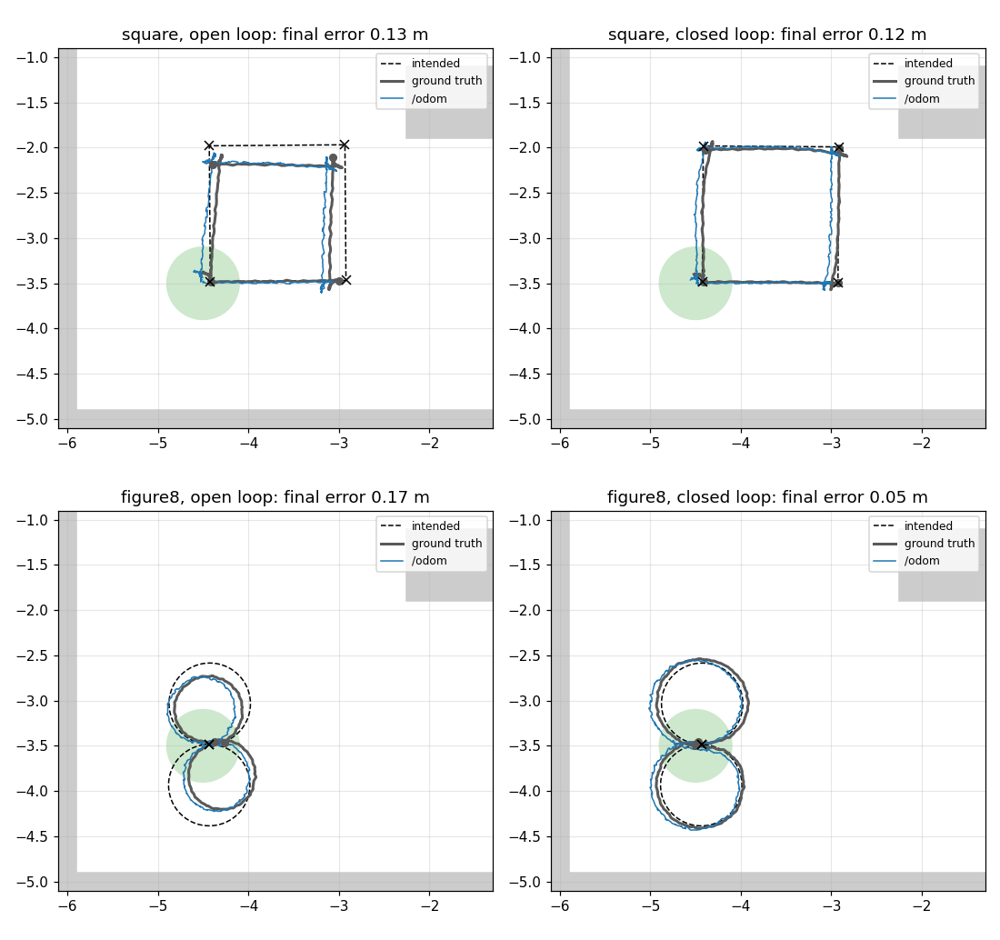
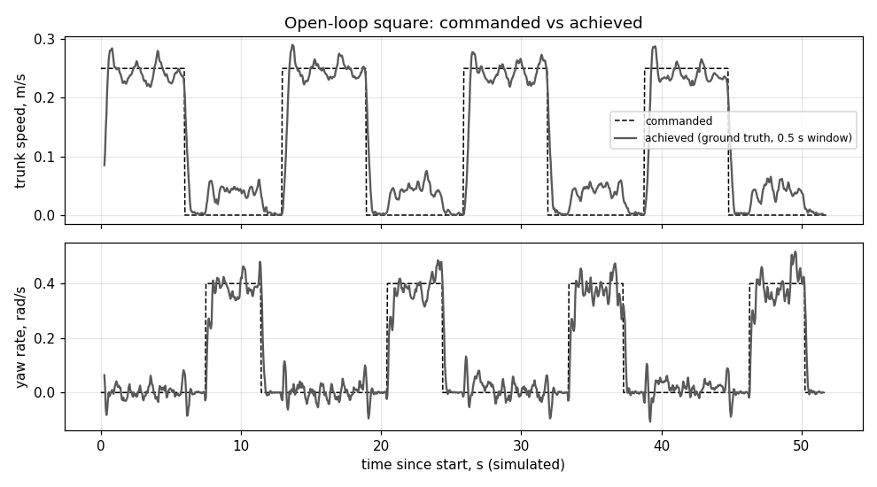

# Project 3. Move in shapes: open loop vs closed loop

## Goal

Make the Go2 walk a 1.5 m square and a figure-eight in two ways. Open loop: send timed velocity commands and hope the robot
does what it was told. Closed loop: read the pose on `/odom` and keep turning until the heading is right, keep walking until
the distance is covered. You score both against the simulator's ground truth, find out where the open-loop error comes from
(the robot does not reach the speed you command), and see how much of the closed-loop error is left over from the pose
estimate itself.

## What you will learn

- Writing an open-loop motion as a schedule of `(duration, v, w)` segments, timed on simulated time.
- Writing a closed-loop motion as a small state machine (turn, walk, settle) driven by `/odom`.
- Steering onto a line with a lookahead point ("carrot") instead of aiming at the goal point.
- Measuring commanded vs achieved speed from `/odom_gt`, and predicting the open-loop error from it.
- Separating controller error from estimation error by closing the loop on ground truth.
- Keeping the pure logic out of the ROS node so it can be unit-tested.

## Before you start

You need [project 1](../p01_first-steps/README.md): starting the stack, `/cmd_vel`, the rule that CHAMP keeps walking on the
last command, and reading a pose and heading from `nav_msgs/Odometry`.

Every terminal starts with:

```bash
cd go2-nav-sim
source env.sh
```

Start the stack:

```bash
scripts/up.sh
# stack up
```

Run each shape right after `scripts/up.sh`. The restart puts the robot back on marker A facing +x and resets `/odom`, which
drifts while the robot stands (see [If it goes wrong](#if-it-goes-wrong)). Each shape starts from wherever the robot is, so
from A there is room: the square needs 1.5 m ahead and to the left, the figure-eight 0.9 m to each side; from A the
trunk centre stayed 0.49 m from the inner face of the south wall on the figure-eight's lower lobe.

The scripts are plain Python files and need no build:

| File | What it does |
|---|---|
| `shapes.py` | the shapes, the open-loop schedules and the closed-loop `Follower`; no ROS in it |
| `drive.py` | the node: runs one shape in one mode, publishes `/cmd_vel`, logs `/odom` and `/odom_gt` to `results/<shape>_<mode>.csv` |
| `analyze.py` | scores the logs against ground truth, prints the tables, draws `figures/*.png` |
| `record.py` | records a camera to MP4 (`projects/common/record_cam.py` with a reliable subscription) |
| `test_shapes.py` | unit tests for `shapes.py` |

## Steps

### 1. Run the unit tests

```bash
python3 -m pytest -q projects/p03_move-in-shapes
# 6 passed
```

The tests drive the closed-loop `Follower` on a perfect simulated robot (it does exactly what it is commanded) and check that it
passes within 5 cm of every corner of the square and ends within 8 cm of the start of the figure-eight. If they fail, the
simulator runs will not be better.

Check: `6 passed`.

### 2. Walk the square open loop

```bash
python3 projects/p03_move-in-shapes/drive.py square open
```

The script waits for `/odom` and `/odom_gt`, then plays this schedule four times: walk 0.25 m/s for 6.0 s (1.5 m), stand
1.5 s, turn 0.4 rad/s for 3.93 s (90 degrees), stand 1.5 s. My run:

```
[INFO] [...] [drive_shapes]: square open: start at odom (0.00, 0.01, -0.1 deg)
[INFO] [...] [drive_shapes]: finished after 51.8 s of simulated time
log: .../projects/p03_move-in-shapes/results/square_open.csv
```

The robot comes back close to A, but the square it walks is smaller than 1.5 m and not square.

Check: `finished after 51.8 s` (the schedule is 4 × (6.0 + 1.5 + 3.93 + 1.5) = 51.7 s, plus one tick).

### 3. Walk the square closed loop

Restart, then run the same shape with feedback:

```bash
scripts/up.sh
python3 projects/p03_move-in-shapes/drive.py square closed
```

```
[INFO] [...] [drive_shapes]: square closed: start at odom (0.01, 0.00, 0.1 deg)
[INFO] [...] [drive_shapes]: finished after 50.1 s of simulated time
```

Here nothing is timed. At each corner the robot turns until `/odom` says the heading points along the next side (within
2 degrees), walks until `/odom` says the side is done (within 2 cm), stands 1.5 s, and at the end turns back to its start heading.

Check: the robot stops at each corner, and the CSV labels go `walk0, corner0, turn1, walk1, ...`:

```bash
cut -d, -f2 projects/p03_move-in-shapes/results/square_closed.csv | uniq | tr '\n' ' '
# label walk0 corner0 turn1 walk1 corner1 turn2 walk2 corner2 turn3 walk3 corner3 final_turn stop
```

### 4. Walk the figure-eight open loop

```bash
scripts/up.sh
python3 projects/p03_move-in-shapes/drive.py figure8 open
# [INFO] [...] [drive_shapes]: finished after 33.0 s of simulated time
```

The figure-eight is two circles of radius r = 0.45 m that touch at the start: the left one counter-clockwise, then the right one
clockwise. Open loop that is v = 0.18 m/s with w = v / r = +0.4 rad/s for 2πr / v = 15.7 s, then the same with w = -0.4 rad/s.

Check: about 33 s, and the robot ends near A but not on it.

### 5. Walk the figure-eight closed loop

```bash
scripts/up.sh
python3 projects/p03_move-in-shapes/drive.py figure8 closed
# [INFO] [...] [drive_shapes]: finished after 39.7 s of simulated time
```

Closed loop, the figure-eight is 24 points, one every 30 degrees on each circle. The robot walks from point to point at
0.18 m/s without stopping and only turns on the spot at the start (0.85 s of `turn0`).

Check: about 40 s, and `cut -d, -f2 ... | uniq` shows `turn0` once, then `walk0` to `walk23`.

### 6. Score the runs and draw them

```bash
python3 projects/p03_move-in-shapes/analyze.py
```

It prints the tables in [Results](#results) and writes `figures/shapes.png` and `figures/commanded_vs_achieved.png`.

Check: four rows, `square_open`, `square_closed`, `figure8_open`, `figure8_closed`, and the two PNG files.

### 7. Record a video of a run

In a second terminal, start the recorder, then run a shape in the first, then stop the recorder with Ctrl-C:

```bash
python3 projects/p03_move-in-shapes/record.py /tmp/figure8.mp4 --topic /spectator/cam/image_raw
```

The video is paced by simulated time at 10 frames per second. My figure-eight run gave 420 frames for 39.7 s of driving plus the
seconds before and after. I cropped the robot's corner of the arena and played it at twice the speed:

```bash
ffmpeg -i /tmp/figure8.mp4 -vf "crop=480:270:20:190,scale=960:540,setpts=PTS/2" -r 20 -c:v libx264 -crf 26 -an figure8_closed.mp4
```

Check: `ffprobe` reports a duration close to the number of frames divided by 10.

### 8. Stop everything

```bash
scripts/stop.sh
```

## How the code works

### Open loop: a schedule

`shapes.py` describes the open-loop square as a list of `(duration, v, w, label)` and looks up the command for the time since
the start:

```python
def square_schedule(side=SIDE, v=0.25, w=0.4, settle=1.5, v_real=None, w_real=None):
    T_side, T_turn = side / (v_real or v), math.pi / 2 / (w_real or w)
    seg = []
    for k in range(4):
        seg += [(T_side, v, 0.0, f'side{k}'), (settle, 0.0, 0.0, f'corner{k}'),
                (T_turn, 0.0, w, f'turn{k}'), (settle, 0.0, 0.0, f'turned{k}')]
    return seg

def command_at(schedule, t):
    for dur, v, w, label in schedule:
        if t < dur:
            return v, w, label
        t -= dur
    return None
```

The whole plan rests on two products: distance d = v · T and angle θ = w · T. If the robot walks at 0.231 m/s instead of 0.25,
6.0 s gives 1.39 m, not 1.5 m, and nothing in the program notices. `v_real` and `w_real` are for [Try this](#try-this) 1.

### The node: one timer on simulated time

`drive.py` runs everything from one 20 Hz timer. With `use_sim_time` the timer and `get_clock()` follow `/clock`, so a 6 s
segment lasts 6 s of simulated time even when Gazebo runs at 0.6 of real time:

```python
def tick(self):
    if self.done or self.odom is None or self.gt is None:
        return
    t = self.get_clock().now().nanoseconds * 1e-9
    if self.t0 is None:
        self.start(t)
    cmd = (shapes.command_at(self.plan, t - self.t0) if self.mode == 'open' else self.plan.step(t, *self.odom))
    if cmd is None:
        cmd, self.done = (0.0, 0.0, 'stop'), True
    v, w, label = cmd
    tw = Twist(); tw.linear.x, tw.angular.z = float(v), float(w)
    self.pub.publish(tw)
    self.log.writerow([...])
```

The last command is always a zero (`stop`), and `stop()` publishes five more zeros on exit or Ctrl-C, because CHAMP keeps
walking on whatever it heard last. The ground truth is only logged, never used for control.

`start()` fixes the shape at the robot's pose when the run begins: the closed-loop points are rotated by the start heading a0
and shifted to the start position (x0, y0) in the `odom` frame, x' = x0 + x cos a0 - y sin a0, y' = y0 + x sin a0 + y cos a0.

### Closed loop: turn, walk, settle

`Follower.step(t, x, y, yaw)` returns the next `(v, w, label)` from the measured pose. Each leg runs from the previous waypoint
P to the next one T. The geometry of a leg:

```python
def leg(self, x, y, yaw):
    (px, py), (tx, ty) = self.prev, self.pts[self.i]
    L = math.hypot(tx - px, ty - py) or 1e-9
    ux, uy = (tx - px) / L, (ty - py) / L
    s = (x - px) * ux + (y - py) * uy                       # robot's projection onto the leg
    cx, cy = px + (s + self.lookahead) * ux, py + (s + self.lookahead) * uy
    return L - s, wrap(math.atan2(cy - y, cx - x) - yaw)
```

- `s` is how far along the leg the robot is: the dot product of (robot - P) with the leg's unit vector u. `L - s` is the
  distance left. It goes negative if the robot overshoots, so the test `left < reach_tol` also catches a robot that passed
  beside the point.
- The heading error is measured to a carrot 0.4 m further along the line than the robot. If the robot is to the side of the
  line, the carrot pulls it back; as it gets onto the line the carrot lies straight ahead. My first version aimed at T itself.
  That fails near T: a 3 cm sideways offset becomes a large bearing error when T is 10 cm away, and the robot swerved
  ([If it goes wrong](#if-it-goes-wrong)).
- `wrap` keeps the error in (-π, π], so the robot never turns 350 degrees one way instead of 10 degrees the other.

The state machine around it:

```python
left, err = self.leg(x, y, yaw)
if self.mode == 'turn':
    if abs(err) > self.turn_tol:
        return 0.0, self._turn(err), f'turn{self.i}'
    self.mode = 'walk'
if left < self.reach_tol:                                 # reached (or passed) this waypoint
    self.prev, self.i = self.pts[self.i], self.i + 1
    if self.stop_each:
        self.mode, self.t_mode = 'settle', t
    elif self.i < len(self.pts) and abs(self.leg(x, y, yaw)[1]) > self.pass_tol:
        self.mode = 'turn'
    return self.step(t, x, y, yaw)
v = min(self.v, max(0.1, left)) if self.stop_each else self.v     # slow down only before a stop
return v, clip(self.k_head * err, self.w_max), f'walk{self.i}'
```

- Turn on the spot with w = 1.5 · err, clipped to 0.5 rad/s, with a floor of 0.12 rad/s so the last degrees do not crawl,
  until the error is under 2 degrees.
- Walk at 0.25 m/s, slowing to `left` m/s over the last 0.25 m (but not below 0.1) so the robot does not overshoot much, and
  steer with w = 1.0 · err.
- For the square (`stop_each=True`) stand for 1.5 s at each corner, then turn. For the figure-eight go straight on to the next
  leg; turn on the spot only if the next leg is more than 45 degrees off.

Every decision uses `/odom`. If `/odom` is wrong, the robot ends exactly where the wrong estimate says the corner is.

## Results

All runs on one machine with other simulations running (Gazebo at 0.57 to 0.90 of real time), each right after a fresh
`scripts/up.sh`. Produced by `python3 projects/p03_move-in-shapes/analyze.py`; the full output is in
`results/analyze_output.txt` and the logs in `results/*.csv`, so you can re-score them without the simulator.



Ground truth is grey, `/odom` blue, the intended shape dashed and anchored at the robot's true start pose. Grey dots are where
the corners were measured. `/odom` is drawn in its own frame, which starts up to 8 cm from the true start because the
robot slides when it lands after spawning.

| Run | Corner errors, m | Final position error, m | Final heading error, deg | Time, s |
|---|---|---|---|---|
| Square, open loop | 0.08, 0.19, 0.21, 0.01 | 0.13 | -4.7 | 51.8 |
| Square, closed loop on `/odom` | 0.01, 0.01, 0.05, 0.02 | 0.12 | 1.1 | 50.1 |
| Figure-eight, open loop | 0.06 (crossing) | 0.17 | -0.8 | 33.0 |
| Figure-eight, closed loop on `/odom` | 0.07 (crossing) | 0.05 | 3.9 | 39.7 |

How the errors are defined:

- A square corner is the true position (`/odom_gt`) at the end of the 1.5 s stand after each side, compared with the
  corner of a perfect 1.5 m square placed at the true start pose. The fourth corner is back at the start.
- The figure-eight crossing is the true position when the first lobe ends, compared with the start.
- The final errors are taken when the script stops: the square has turned back to its start heading by then, the figure-eight has
  not turned at all.

Read the open-loop square row carefully: its fourth corner is 1 cm from the start, yet corners two and three are 0.19 and
0.21 m off. Short sides and short turns produce a smaller, skewed square that still closes. The final error alone would hide
that; the corners show it.

The closed-loop square's corners are within 5 cm, but its final error is 0.12 m: the last corner is 2 cm from the start, and
the turn on the spot back to the start heading then moved the trunk 0.12 m. Every 90-degree turn on the spot moved the trunk
0.17 to 0.18 m along a small arc in the open-loop run (table below). The gait turns about a point that is not the trunk origin.

`/odom` itself was good over these short runs: its displacement from the start differed from the truth by 0.02 to 0.05 m at the
end of each run, and its heading drifted 2.2 to 4.1 degrees (either way) relative to the truth (`analyze_output.txt`, last columns). That
drift is most of the closed-loop figure-eight's 3.9-degree final heading error.

### Where the open-loop error comes from

Commanded vs achieved, from ground truth, for every segment of the open-loop runs (rows from `analyze_output.txt`,
"mean" over the whole segment, "steady" without its first 1.5 s and last 0.5 s):

| Segment | Commanded | Achieved, mean | Achieved, steady | Result |
|---|---|---|---|---|
| Square side, 4 × 6.0 s | v 0.25 m/s | 0.229 to 0.238 m/s | 0.238 to 0.247 m/s | 1.365 to 1.413 m walked instead of 1.5 |
| Stand after a side, 1.5 s | 0 | 0.021 to 0.025 m/s | | 0.030 to 0.036 m of coasting |
| Square side, heading | w 0 | | | veered 3.3 to 8.1 degrees left per side |
| Square turn, 4 × 3.93 s | w 0.40 rad/s | 0.370 to 0.390 rad/s | 0.377 to 0.400 rad/s | 81.6 to 87.2 degrees instead of 90 |
| Square turn, trunk | v 0 | 0.044 to 0.047 m/s | | trunk moved 0.17 to 0.18 m |
| Figure-eight lobe, 2 × 15.7 s | v 0.18, w ±0.40 | v 0.153 to 0.154, w ±0.409 | | 367.5 and -366.9 degrees per lobe |



So the first side came out at 1.374 m + 0.036 m of coasting = 1.41 m, and the first corner was 0.08 m short, which is the
first corner error. After that, each corner adds a turn that is 3 to 8 degrees short and a side that veers a few degrees left,
and the shape skews. The gait takes up to a second to reach speed (the ramps in the figure), and turning while walking
slows it: on the figure-eight the robot walked at 85 % of the commanded 0.18 m/s while turning slightly faster than commanded.
Its radius was therefore v / w = 0.153 / 0.409 = 0.37 m instead of 0.45 m: lobes 0.77 m tall instead of 0.90 m, which is what
the figure shows.

The closed loop does not need to know any of this. It keeps going until `/odom` says the target is reached, so the remaining
error is set by `/odom` and by the trunk moving when the robot turns on the spot.

### Video

The closed-loop figure-eight from the spectator camera, cropped and played at 2× speed (21 s):

<video controls muted playsinline src="media/figure8_closed.mp4"></video>

The closed-loop square, 2.5× speed (22 s):

<video controls muted playsinline src="media/square_closed.mp4"></video>

## Try this

1. Calibrate the open loop. Time the square with the speeds the robot really reached (mean over a side and over a turn from
   the table: 0.233 m/s and 0.379 rad/s). `drive.py` takes them as two extra arguments; the commands stay 0.25 and 0.4, only
   the durations change (6.44 s per side, 4.14 s per turn):

   ```bash
   scripts/up.sh
   python3 projects/p03_move-in-shapes/drive.py square open 0.233 0.379
   python3 projects/p03_move-in-shapes/analyze.py      # adds a square_open_calibrated row
   ```

   Answer from my run: corners 0.07, 0.14, 0.15, 0.06 m (uncalibrated: 0.08, 0.19, 0.21, 0.01), final error 0.13 m, final
   heading -7.1 degrees. Better in the middle by 5 to 6 cm, not fixed. The speeds differ from side to side and turn to turn
   (0.229 to 0.238 m/s, 0.370 to 0.390 rad/s), and the 3 to 8 degrees of veer on each straight side is not in the timing at
   all. Calibration removes the average error, not the variation.

2. Close the loop on ground truth. Remap the topic the controller reads, so it steers on the simulator's true pose:

   ```bash
   scripts/up.sh
   python3 projects/p03_move-in-shapes/drive.py square closed --ros-args -r odom:=odom_gt
   python3 projects/p03_move-in-shapes/analyze.py      # adds a square_closed_on_odom_gt row
   ```

   Answer from my run: corners 0.02, 0.01, 0.01, 0.01 m, final error 0.13 m, final heading -1.9 degrees. With perfect sensing
   the controller itself is good to 1 to 2 cm; on `/odom` the corners were 0.01 to 0.05 m, so up to about 4 cm of that is
   estimation error. The final 0.13 m is the trunk moving during the last turn on the spot, and it is there with perfect
   sensing too. To end on the start position, finish with the turn and then walk back, or end the square without the final
   turn.

3. Predict the open-loop figure-eight from the speeds. Using only the figure-eight rows of the speed table (v 0.153 m/s,
   w 0.409 rad/s, 15.7 s per lobe), predict the lobe height and the heading at the crossing, then check them in
   `results/figure8_open.csv`.

   Answer: radius 0.153 / 0.409 = 0.374 m, so each lobe is 0.75 m tall instead of 0.90 m. Each lobe turns
   0.409 × 15.7 = 6.42 rad = 368 degrees, so the robot crosses the start heading 8 degrees left of where it began. Measured in
   the CSV: lobes 0.765 and 0.770 m tall (max minus min of `gt_y`), heading at the crossing +7.5 degrees.

## If it goes wrong

| Symptom | Cause | Fix |
|---|---|---|
| `projects/common/record_cam.py` writes a video of 1 or 2 frames | It subscribes best effort. A 960 × 540 image is 1.5 MB and goes out in many UDP fragments; on a loaded machine one lost fragment loses the image and best effort does not resend it. With it, 25 s of recording gave 17 frames and 60 s gave 2; with `record.py`, 25 s gave 222 frames, one per 0.1 s of simulated time | Use `record.py` from this project, which swaps in a reliable QoS profile and otherwise runs `record_cam.py` unchanged |
| Closed loop: the robot swerves just before each corner and arrives at an angle | Steering at the corner point itself: near the point a small sideways offset becomes a large bearing error. My first version arrived at the first corner 31.8 degrees off the side's heading (on `/odom`) and took 9.6 s for a 1.5 m side, creeping at the minimum speed while it turned | Steer at a carrot on the leg's line, ahead of the robot's projection (`Follower.leg`). After the change the side took 7.7 s and the heading at the corner was 3.1 degrees off |
| The closed-loop shape comes out rotated, or `drive.py` reports a start heading far from 0 right after a restart was minutes ago | `/odom` drifts while the robot stands. In one session where I left the robot standing for 5 to 6 minutes of wall-clock time after `up.sh`, `/odom` gave a heading of -18.7 degrees while the true heading was -0.9 degrees ([chapter 4](../../docs/04-ros2-from-scratch.md#check-it-against-ground-truth) measures the gyro drift behind this) | Run `scripts/up.sh` just before each shape. Closed-loop runs start from the robot's own pose, so a constant offset does no harm; drift during the run does |
| Closed-loop square: corners within a few cm, final error over 0.1 m | The final turn on the spot moved the trunk 0.12 m in both closed-loop squares I ran | Judge the square by its corners, or see Try this 2 |
| Ctrl-C on the recorder prints a traceback ending in `RCLError: failed to initialize wait set: the given context is not valid` | `record_cam.py` catches `KeyboardInterrupt`, but rclpy's own Ctrl-C handler shuts the context down first, so the exit is not clean | Harmless: ffmpeg still closes the file. My recorder exited this way and the MP4 played back at its full 58.2 s. `kill -TERM <pid>` exits cleanly and prints the frame count |
| `drive.py` prints its usage and exits | Wrong arguments: shape is `square` or `figure8`, mode `open` or `closed`, and the two calibration speeds go only after `square open` | `python3 projects/p03_move-in-shapes/drive.py square open` |
