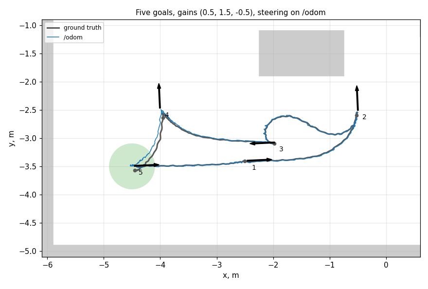
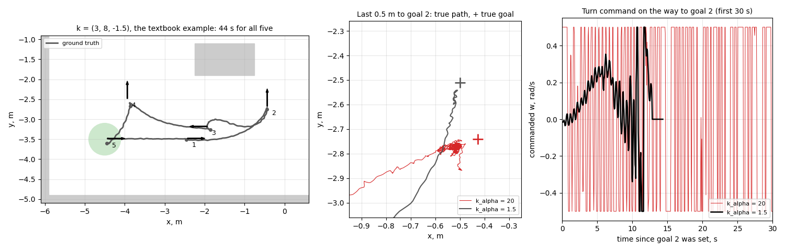

# Project 4. Your own go-to-pose controller

## Goal

Write a node that walks the Go2 to a pose (a position and a heading) using only `/odom`, with the polar-coordinate controller
from the mobile-robotics textbooks. You send it to five poses in open space, measure how far from each it stops, both as
`/odom` sees it and as the simulator's ground truth sees it, and plot the paths. Then you raise the gains, watch the robot
hunt around the goal instead of arriving, and measure why it does.

## What you will learn

- Describing the robot relative to a goal pose with three numbers: distance ρ (rho), bearing α (alpha) and goal angle β (beta).
- Turning those into a velocity command v = k_ρ ρ, w = k_α α + k_β β, and checking the gains against a stability condition.
- Saturating a command to the robot's limits without bending the path it would have taken.
- Handling what the textbook model leaves out: goals behind the robot, a minimum walking speed, and the final heading.
- Telling controller error from estimation error by scoring the same run on `/odom` and on `/odom_gt`.
- Why gains that are stable on paper, and in an ideal simulation, make a legged robot hunt.

## Before you start

You need [project 1](../p01_first-steps/README.md) (starting the stack, `/cmd_vel`, reading a pose from
`nav_msgs/Odometry`) and [project 3](../p03_move-in-shapes/README.md) (closing the loop on `/odom`, `wrap`, a timer on
simulated time, `/odom` drift while the robot stands). The video step reuses project 3's `record.py`.

Every terminal starts with:

```bash
cd go2-nav-sim
source env.sh
```

Start the stack:

```bash
scripts/up.sh
# stack up
```

Run each experiment right after `scripts/up.sh`, so the robot starts on marker A facing +x and `/odom` has not drifted.
The five goals are given relative to the start pose and lie within 4.0 m ahead and 1.0 m to the left of it. From A that is
open floor: the nearest obstacle, the pallet centred at (-1.5, -1.5), has its corner 0.84 m from goal 2. That holds on
the path the robot takes when every goal ends `done`. A goal that ends in `timeout` leaves the robot where it stopped,
possibly turned far from the goal heading, and the path to the next goal starts there and can cross the pallet (Try
this 3 explains how a reader's robot ended up against it).

| File | What it does |
|---|---|
| `polar.py` | the controller: `polar()`, `saturate()`, `strong_stability()` and the `GoToPose` state machine; no ROS in it |
| `go_to_pose.py` | the node: runs the goals in turn on `/odom`, publishes `/cmd_vel`, prints the errors, logs every 20 Hz tick to `results/NAME.csv` (`--name`, default `my_run`) |
| `analyze.py` | scores the logs per goal, prints the tables, draws `figures/trajectories.png` and `figures/gains.png` from my logs, or `figures/my_trajectories.png` and `figures/my_gains.png` from yours with `--mine` |
| `test_polar.py` | unit tests: the controller driving an ideal unicycle |
| `results/` | my 11 logs (`run`, `repeat`, `repeat2`, `on_odom_gt`, `on_odom_gt_2`, `high_gains`, `k_alpha_20`, `k_alpha_20_2`, `k_alpha_20_3`, `no_vmin`, `no_vmin_2`) and `analyze_output.txt` |

The node is one process, so there is no launch file.

Your logs go to `results/my_*.csv` and your figures to `figures/my_*.png`, so the tables and figures in this README keep
matching the files they came from. Every command below already uses a `my_` name. A `--name` without `my_` (for example
`--name run`) overwrites my log of that name.

## Steps

### 1. Run the unit tests

```bash
python3 -m pytest -q projects/p04_go-to-pose
# 5 passed
```

The tests drive `GoToPose` on an ideal unicycle (it does exactly what it is commanded, 20 times a second). They check the
polar coordinates on one hand-worked case, that `saturate()` keeps the ratio w/v, that the default gains pass the stability
test, that goals ahead, to the side and behind are all reached within 5 cm and 3 degrees without exceeding 0.3 m/s or
0.5 rad/s, and that a goal behind the robot is reached walking backward.

Check: `5 passed`.

### 2. Walk to the five goals

```bash
scripts/up.sh
python3 projects/p04_go-to-pose/go_to_pose.py
```

The node waits for `/odom` and `/odom_gt`, takes the pose at that moment as the start, and walks to these goals, given as
(x forward, y left, heading in degrees) relative to the start:

| Goal | 1 | 2 | 3 | 4 | 5 |
|---|---|---|---|---|---|
| Pose | (2.0, 0.0, 0) | (4.0, 0.8, 90) | (2.5, 0.3, 180) | (0.5, 1.0, 90) | (0.0, 0.0, 0) |

They make it go straight, curve left onto a heading, back up to a point behind it, cross back, and back up to the start
(goals 3 and 5 lie behind the robot when they are set, so it walks to them backward). After each goal it stands for 1.5 s
and prints the error. My run:

```
[INFO] [...] [go_to_pose]: gains k_rho=0.5 k_alpha=1.5 k_beta=-0.5, strongly stable: True
[INFO] [...] [go_to_pose]: start at odom (...)
[INFO] [...] [go_to_pose]: goal 1 (2.0, 0.0, 0): done after 10.2 s; error on odom 0.052 m +0.9 deg, true 0.046 m -0.5 deg
[INFO] [...] [go_to_pose]: goal 2 (4.0, 0.8, 90): done after 12.9 s; error on odom 0.095 m -0.9 deg, true 0.087 m -3.4 deg
[INFO] [...] [go_to_pose]: goal 3 (2.5, 0.3, 180): done after 12.8 s; error on odom 0.022 m -2.1 deg, true 0.023 m -6.0 deg
[INFO] [...] [go_to_pose]: goal 4 (0.5, 1.0, 90): done after 12.7 s; error on odom 0.092 m +1.4 deg, true 0.179 m -5.4 deg
[INFO] [...] [go_to_pose]: goal 5 (0.0, 0.0, 0): done after 6.2 s; error on odom 0.060 m +2.8 deg, true 0.081 m -5.4 deg
log: .../projects/p04_go-to-pose/results/run.csv
```

I logged mine with `--name run`; yours goes to `results/my_run.csv`. "error on odom" is what the controller believes;
"true" compares `/odom_gt` with the same goal placed at the true start pose.

To stop the robot early, press Ctrl-C in the node's terminal. The node sends zero velocity before it exits, prints
`interrupted: sending zero velocity` and the `log:` line, and the robot stands still. I interrupted this step at 7.0 s,
while the robot walked at 0.105 m/s: in the next 35 s its true position moved 0.02 m. If the robot ever keeps walking
after the node has gone (CHAMP repeats the last command it received), send zero from any terminal:

```bash
ros2 topic pub -t 5 /cmd_vel geometry_msgs/msg/Twist {}
```

Check: five `done` lines (not `timeout`), each goal in about 5 to 14 s of simulated time (5.7 to 13.2 s in my runs and
a reader's).

### 3. Score the run and draw it

```bash
python3 projects/p04_go-to-pose/analyze.py --mine
```

It prints one table per log of yours, two measurements used in [How the code works](#how-the-code-works), and writes
`figures/my_trajectories.png`. `figures/my_gains.png` needs your logs from steps 4 and 5 as well; until then the script
prints `skipped figures/my_gains.png`. `analyze.py` without `--mine` scores my logs and redraws the figures in this README.
The first lines with my log:

```
run
| Goal | Time, s | Outcome | /odom error at end of drive, m | /odom error, m | deg | True error, m | deg | True path, m | Turn reversals |
|---|---|---|---|---|---|---|---|---|---|
| 1 | 10.2 | done | 0.050 | 0.052 | +0.9 | 0.046 | -0.5 | 2.11 | 5 |
...
```

Columns:

- Time: from the first logged row of the goal to the first `done` row. The node's own time counts from the tick before,
  so it can differ by 0.1 s (12.9 against 12.8 s for goal 2).
- `/odom` error at end of drive: the distance on `/odom` when the controller switched from walking to turning on the spot.
- `/odom` error and True error: when the node printed them, 1.5 s after `done`.
- True path: length of the `/odom_gt` path for that goal.
- Turn reversals: how often the commanded w changed sign, counting only commands above 0.25 rad/s.

Check: five rows with outcome `done`, and `figures/my_trajectories.png`.

### 4. Try the textbook gains

```bash
scripts/up.sh
python3 projects/p04_go-to-pose/go_to_pose.py --name my_high_gains --gains 3 8 -1.5
```

k = (3, 8, -1.5) is the example in Siegwart et al. (reference in `polar.py`). My run:

```
[INFO] [...] [go_to_pose]: gains k_rho=3.0 k_alpha=8.0 k_beta=-1.5, strongly stable: True
[INFO] [...] [go_to_pose]: goal 1 (2.0, 0.0, 0): done after 7.0 s; error on odom 0.045 m -5.0 deg, true 0.032 m -4.3 deg
[INFO] [...] [go_to_pose]: goal 2 (4.0, 0.8, 90): done after 9.4 s; error on odom 0.080 m -3.3 deg, true 0.073 m -2.8 deg
[INFO] [...] [go_to_pose]: goal 3 (2.5, 0.3, 180): done after 12.0 s; error on odom 0.092 m -3.0 deg, true 0.110 m -4.5 deg
[INFO] [...] [go_to_pose]: goal 4 (0.5, 1.0, 90): done after 10.2 s; error on odom 0.111 m +2.8 deg, true 0.201 m -6.4 deg
[INFO] [...] [go_to_pose]: goal 5 (0.0, 0.0, 0): done after 5.7 s; error on odom 0.089 m +0.9 deg, true 0.118 m -9.7 deg
```

Check: all five `done`, faster than step 2 (44.0 s against 54.6 s in my runs).

### 5. Measure a gain that is too high

Keep k_ρ and k_β, raise k_α from 1.5 to 20. This run takes 2.5 to 8 minutes, because each of the five goals can hunt
until the 90 s timeout. Keep the Gazebo window in view while it runs. If the robot walks off the open floor between
marker A and the pallet, press Ctrl-C: the node sends zero velocity and the robot stops (step 2).

```bash
scripts/up.sh
python3 projects/p04_go-to-pose/go_to_pose.py --name my_k_alpha_20 --gains 0.5 20 -0.5
```

The outcome changes from run to run. In two of my three runs (`k_alpha_20`, `k_alpha_20_2`) all five goals ended
`done`, in 155.0 and 155.7 s in total. The third (`k_alpha_20_3`) took 281.1 s, and goals 2 and 4 ended in `timeout`:

```
[INFO] [...] [go_to_pose]: gains k_rho=0.5 k_alpha=20.0 k_beta=-0.5, strongly stable: True
[INFO] [...] [go_to_pose]: goal 1 (2.0, 0.0, 0): done after 43.4 s; error on odom 0.075 m -2.5 deg, true 0.095 m -6.9 deg
[INFO] [...] [go_to_pose]: goal 2 (4.0, 0.8, 90): timeout after 90.1 s; error on odom 0.144 m -85.2 deg, true 0.143 m -85.6 deg
[INFO] [...] [go_to_pose]: goal 3 (2.5, 0.3, 180): done after 13.4 s; error on odom 0.182 m -1.2 deg, true 0.163 m -2.4 deg
[INFO] [...] [go_to_pose]: goal 4 (0.5, 1.0, 90): timeout after 90.1 s; error on odom 0.081 m +69.4 deg, true 0.083 m +47.2 deg
[INFO] [...] [go_to_pose]: goal 5 (0.0, 0.0, 0): done after 44.5 s; error on odom 0.167 m -2.8 deg, true 0.290 m +37.5 deg
```

The stability test still says `True`, yet in this run the goals took 13 to 90 s instead of about 5 to 14, and two were never
reached. Near each goal the robot turns left and right in place while barely moving forward. A `timeout` in this step is
part of the result: the hunt lasted longer than 90 s.

Minutes of turning in place also spoil the `/odom` heading. `/odom` takes x and y from the lidar odometry and the
heading from integrating the IMU's yaw rate (`src/go2_nav_sim/config/ekf.yaml`), and that integral drifts while the robot turns. In
`k_alpha_20_3` the `/odom` heading had drifted 41 degrees from the true heading by goal 5, which is why goal 5 reports
-2.8 degrees on `/odom` and +37.5 degrees true (with the default gains the drift over a whole run was 10, 10 and 11
degrees in `repeat`, `repeat2` and `run`). Once the gap is large, the controller steers by a heading that points the
wrong way and walks away from the goal; a reader's run walked about 10 m backward across the arena on goal 5 this way.
The node stops this: when `/odom` puts the robot 0.5 m further from the goal than when the goal was set, it ends the
goal with `abort`, prints a warning and skips the remaining goals. Restart the stack after an `abort`.

Score your runs:

```bash
python3 projects/p04_go-to-pose/analyze.py --mine
```

Check: in the `my_k_alpha_20` table, Turn reversals is in the hundreds (448, 477 and 802 in my three runs, against 14 for
`run`), and the line `my_k_alpha_20, goal 2: within 0.3 m after ...` shows tens of seconds spent within 0.3 m of the
goal (56.2 s in `k_alpha_20`, 78.8 s in `k_alpha_20_3`, but 11.3 s in `k_alpha_20_2`, where goal 1 hunted for 65.9 s
instead). `figures/my_gains.png` is drawn once you also have `my_high_gains` from step 4.

### 6. Record a video

Restart the stack in the first terminal:

```bash
scripts/up.sh
```

In a second terminal, start the recorder:

```bash
python3 projects/p03_move-in-shapes/record.py /tmp/p04_raw.mp4 --topic /spectator/cam/image_raw
```

Back in the first terminal, run step 2 again. When it prints `log: ...`, stop the recorder with Ctrl-C. My recording ran
68.3 s (683 frames at 10 per second of simulated time). Crop the corner of the arena the robot uses and play it at three
times the speed:

```bash
ffmpeg -i /tmp/p04_raw.mp4 -vf "crop=480:270:110:170,scale=960:540,setpts=PTS/3" -r 20 -c:v libx264 -crf 26 -pix_fmt yuv420p -an /tmp/five_goals.mp4
ffprobe -v error -show_entries format=duration -of default=noprint_wrappers=1 /tmp/five_goals.mp4
# duration=22.850000
```

Check: the duration is about a third of the recording.

### 7. Stop everything

```bash
scripts/stop.sh
```

## How the code works

### Polar coordinates

`polar.py` describes the robot relative to the goal with three numbers:

```python
def polar(x, y, yaw, gx, gy, gyaw):
    """Robot pose (x, y, yaw) and goal pose (gx, gy, gyaw) in one frame -> (rho, alpha, beta)."""
    rho = math.hypot(gx - x, gy - y)
    bearing = math.atan2(gy - y, gx - x)
    return rho, wrap(bearing - yaw), wrap(gyaw - bearing)
```

- ρ is the distance to the goal position.
- α is how far the goal lies off the robot's nose: the bearing of the line robot → goal minus the robot's heading.
- β is how far the goal heading is from that line.

The robot is on the goal pose when ρ = 0 and its heading equals the goal heading. `wrap` keeps both angles in (-π, π],
as in project 3.

### The control law and its gains

```
v = k_ρ ρ
w = k_α α + k_β β
```

v closes the distance. k_α α turns the nose toward the goal. k_β β (with k_β < 0) turns it away from the straight line, so
the robot swings out and arrives along the goal heading instead of only at the goal point. Linearised around the goal, the
closed loop is stable when k_ρ > 0, k_β < 0 and k_α - k_ρ > 0. `strong_stability()` tests the stricter condition from the
same book, under which the robot also never reverses its direction of travel on the way:

```python
def strong_stability(k_rho, k_alpha, k_beta):
    return k_rho > 0 and k_beta < 0 and k_alpha + 5 / 3 * k_beta - 2 / math.pi * k_rho > 0
```

For the default gains (0.5, 1.5, -0.5): 1.5 - 0.83 - 0.32 = 0.35 > 0. How I chose them:

- k_ρ = 0.5 s⁻¹: v = 0.5 ρ reaches the 0.3 m/s limit for ρ > 0.6 m, so the robot walks at full speed until the last 0.6 m
  and then slows with a 1/k_ρ = 2 s time constant.
- k_α = 1.5 s⁻¹: a bearing error of 19 degrees asks for the full 0.5 rad/s. The trunk's heading sways with every step
  (next section); 1.5 times that sway is about 0.06 rad/s of noise on w.
- k_β = -0.5 s⁻¹: with k_ρ = 0.5 and k_α = 1.5 the strong condition holds for k_β > -0.71, and -0.5 leaves a margin of
  0.35. Try this 2 shows what β does.

### Saturation that keeps the path

The robot accepts at most 0.3 m/s and 0.5 rad/s. Clipping each one alone changes the ratio w/v, which is the curvature of
the path. `saturate()` scales both by the same factor:

```python
def saturate(v, w, v_max=V_MAX, w_max=W_MAX):
    s = max(1.0, abs(v) / v_max, abs(w) / w_max)
    return v / s, w / s
```

The robot then walks the same curve, slower. This has a consequence for high gains: whenever w is saturated, v shrinks with
it. That is what stalls the robot in step 5.

### What the textbook leaves out

`GoToPose.step()` wraps the law in a small state machine, `drive` → `align` → `done`:

```python
if self.phase == 'drive':
    rho, alpha, _ = polar(x, y, yaw, gx, gy, gyaw)
    if self.direction is None:            # chosen once per goal: forward if the goal is in front, else backward
        self.direction = 1 if abs(alpha) <= math.pi / 2 else -1
    if rho < self.pos_tol:
        self.phase = 'align'
    else:
        flip = 0.0 if self.direction > 0 else math.pi    # walking backward = forward with the heading flipped
        rho, alpha, beta = polar(x, y, yaw + flip, gx, gy, gyaw + flip)
        v, w = self.direction * self.k[0] * rho, self.k[1] * alpha + self.k[2] * beta
        up = max(1.0, self.v_min / abs(v))   # CHAMP barely walks below 0.1 m/s: scale up, same ratio w/v
        v, w = saturate(v * up, w * up)
        return v, w, 'drive'
if self.phase == 'align':
    err = wrap(gyaw - yaw)
    if abs(err) < self.yaw_tol:
        self.phase = 'done'
    else:
        w = max(-W_MAX, min(W_MAX, 1.5 * err))
        return 0.0, math.copysign(max(abs(w), self.w_min), err), 'align'
```

- Goal behind. The law assumes the goal lies ahead (|α| ≤ 90 degrees). For a goal behind, the controller walks backward:
  it computes the coordinates with the robot's heading and the goal heading turned by 180 degrees, and negates v. The
  direction is chosen once per goal, so it cannot flip back and forth on the way. Goals 3 and 5 are reached this way: in
  `results/run.csv` their `v_cmd` goes down to -0.300.
- Speed floor. v = k_ρ ρ falls below 0.1 m/s at ρ = 0.2 m. The gait makes little progress at such speeds:
  [Try this](#try-this) 3 removes the floor, and a goal then either stands 0.06 to 0.12 m short until the 90 s timeout
  (goal 1 of `no_vmin`) or creeps the last centimetres and ends `done` late (goal 1 of `no_vmin_2`). So v and w
  are scaled up together until v is 0.1 m/s. `saturate()` runs after that, so a saturated w can still pull v below 0.1
  (the lowest forward `v_cmd` in `run` was 0.027 m/s).
- Final heading. The robot reaches the 5 cm circle before its heading has come round: at the end of the drive phase the
  heading in `run` was off by +10, -23, -29, +49 and +47 degrees for goals 1 to 5 (ideal unicycle, Try this 2: -6 degrees).
  The `align` phase turns the rest on the spot with w = 1.5 · err, at least 0.1 rad/s, until the error is under 3 degrees.

### The node

`go_to_pose.py` runs everything from one 20 Hz timer on simulated time, as in project 3. Each tick it steps the controller on
the latest `/odom` pose, publishes the command, logs the row, and after 1.5 s in `done` prints the errors and starts the next
goal:

```python
v, w, phase = self.ctl.step(*self.odom)
if phase == 'drive' and errors(self.odom, self.target)[0] > self.d0 + LEASH:
    phase = 'abort'
elif phase not in ('done', 'abort') and t - self.t_goal > TIMEOUT:
    phase = 'timeout'
if phase in ('timeout', 'abort'):
    v, w = 0.0, 0.0
    self.ctl.phase = phase
tw = Twist(); tw.linear.x, tw.angular.z = float(v), float(w)
self.pub.publish(tw)
self.log.writerow([...])
if phase in ('done', 'timeout', 'abort'):
    self.t_done = self.t_done or t
    if t - self.t_done >= SETTLE:
        self.report(t, phase)
```

The goals are placed once, at the start, by rotating them with the start heading a0 and shifting them to the start position:
x' = x0 + x cos a0 - y sin a0, y' = y0 + x sin a0 + y cos a0 (`place()`). This is done twice, with the `/odom` start pose for
the controller and with the `/odom_gt` start pose for scoring. `/odom_gt` is never used for control.

`stop()` publishes five zero twists, because CHAMP keeps walking on the last command. `main()` calls it in a `finally`
block, so it runs on a normal end, on Ctrl-C, on `kill -TERM` and on an exception:

```python
rclpy.init(signal_handler_options=SignalHandlerOptions.NO)
signal.signal(signal.SIGTERM, signal.default_int_handler)
node = Runner(args)
try:
    while not node.done:
        rclpy.spin_once(node, timeout_sec=0.1)
except KeyboardInterrupt:
    node.get_logger().warn('interrupted: sending zero velocity')
finally:
    node.stop()
```

The first line matters. By default `rclpy.init()` installs its own Ctrl-C handler, which shuts the ROS context down
before Python raises `KeyboardInterrupt`. `stop()` then fails with `RCLError: Failed to publish: publisher's context is
invalid`, no zero twist goes out, and the robot keeps walking. A reader hit exactly this with the first version of the
node: the robot walked on for about 35 s until they published zero by hand. With `SignalHandlerOptions.NO` Ctrl-C is a
plain `KeyboardInterrupt`, the context is still valid in `stop()`, and the second line makes `kill -TERM` behave the
same way.

`d0` is the `/odom` distance to the goal when the goal was set, and `LEASH` is 0.5 m. In my 11 logs in `results/`, with
all the gains in this project, the distance never grew by more than 0.03 m above `d0`, so the leash only trips when the
robot walks away from the goal. It does not catch a robot that pushes against an obstacle: its distance to the goal
stays about where it was (If it goes wrong). After `abort`, `report()` skips the remaining goals, because the controller would steer
to them on the same `/odom` heading that has just failed.

### Why k_α = 20 hunts

On paper k = (0.5, 20, -0.5) is fine: `strong_stability` returns `True` (20 - 0.83 - 0.32 > 0), and on the ideal unicycle it
reaches every test goal:

```bash
python3 -c "
import sys; sys.path.insert(0, 'projects/p04_go-to-pose'); import polar, test_polar
print(polar.strong_stability(0.5, 20, -0.5), [test_polar.simulate(g, gains=(0.5, 20, -0.5))[0].phase for g in [(2, 0, 0), (2, 1, 1.57), (-1.5, 0.5, 0)]])"
# True ['done', 'done', 'done']
```

The legged robot differs from that model in one way that matters here: its trunk does not point steadily along its path.
`analyze.py` measures the sway while walking straight to goal 1 (1 to 5 s, slow heading change removed):

```
run: /odom heading sway walking straight (1-5 s): peak to peak 9.0 deg, std 2.3 deg
run: true heading sway walking straight (1-5 s): peak to peak 6.9 deg, std 2.2 deg
```

α is computed from that heading, so the controller passes the sway straight into w: 2.3 degrees (0.040 rad) times
k_α = 1.5 is 0.06 rad/s, times k_α = 20 is 0.80 rad/s, above the 0.5 rad/s limit. Near the goal it gets worse, because α
is the bearing to a point that is only centimetres away: with the goal 0.1 m ahead, a 2 cm sideways step of the trunk
changes α by atan(0.02 / 0.1) = 11 degrees. With k_α = 20 the command flips between +0.5 and -0.5 rad/s, and `saturate()`
cuts v by the same factor:

```
run, goal 2: within 0.3 m after 8.0 s, then 3.7 s of drive with median v 0.10 m/s and |w| at the 0.5 rad/s limit 16% of the time
k_alpha_20, goal 2: within 0.3 m after 11.9 s, then 56.2 s of drive with median v 0.02 m/s and |w| at the 0.5 rad/s limit 89% of the time
```

The default gains show the same effect, smaller: in the last 0.1 m to goal 2 the command swung to ±0.5 rad/s for about a
second before the drive phase ended (right panel of the second figure). The cure there is the 5 cm tolerance, not a lower
gain.

## Results

All runs on one machine with other simulations running, each right after a fresh `scripts/up.sh`. Produced by
`python3 projects/p04_go-to-pose/analyze.py`; the full output is in `results/analyze_output.txt`, the logs in `results/*.csv`.



Ground truth is grey, `/odom` blue (drawn from the true start pose, so the gap between the two is the estimate's drift),
goal poses black arrows, the point where the error was taken a grey dot, marker A (the start) a green disc of 0.4 m
radius. The paths separate on the way to goal 4 and back
to the start: at goal 4, `/odom` put the robot 0.092 m from the goal, the truth was 0.179 m.

<video controls muted playsinline src="media/five_goals.mp4"></video>

The same run from the spectator camera, cropped and played at three times the speed (22.9 s).

Per goal, default gains (`run`):

| Goal | Time, s | /odom error at end of drive, m | /odom error, m | /odom heading error, deg | True error, m | True heading error, deg |
|---|---|---|---|---|---|---|
| 1 (2.0, 0.0, 0) | 10.2 | 0.050 | 0.052 | +0.9 | 0.046 | -0.5 |
| 2 (4.0, 0.8, 90) | 12.8 | 0.043 | 0.095 | -0.9 | 0.087 | -3.4 |
| 3 (2.5, 0.3, 180) | 12.8 | 0.047 | 0.022 | -2.1 | 0.023 | -6.0 |
| 4 (0.5, 1.0, 90) | 12.6 | 0.042 | 0.092 | +1.4 | 0.179 | -5.4 |
| 5 (0.0, 0.0, 0) | 6.1 | 0.037 | 0.060 | +2.8 | 0.081 | -5.4 |

All runs, per run (mean over the goals, heading as mean of the absolute error):

| Run | Command | Goals done | Total time, s | /odom error at end of drive, m | /odom error, m | True error, m | True heading error, deg | True path, m | Turn reversals |
|---|---|---|---|---|---|---|---|---|---|
| `run` | `go_to_pose.py --name run` | 5 of 5 | 54.6 | 0.044 | 0.064 | 0.083 | 4.1 | 10.73 | 14 |
| `repeat` | `go_to_pose.py --name repeat` | 5 of 5 | 53.8 | 0.045 | 0.045 | 0.039 | 3.7 | 10.62 | 18 |
| `repeat2` | `go_to_pose.py --name repeat2` | 5 of 5 | 52.8 | 0.047 | 0.044 | 0.043 | 3.7 | 10.61 | 16 |
| `on_odom_gt` | `... --name on_odom_gt --ros-args -r odom:=odom_gt` | 5 of 5 | 52.1 | 0.048 | 0.044 | 0.044 | 1.9 | 10.65 | 10 |
| `on_odom_gt_2` | same, `--name on_odom_gt_2` | 5 of 5 | 52.1 | 0.047 | 0.031 | 0.031 | 1.5 | 10.64 | 15 |
| `high_gains` | `... --gains 3 8 -1.5` | 5 of 5 | 44.0 | 0.042 | 0.083 | 0.107 | 5.6 | 10.28 | 9 |
| `k_alpha_20` | `... --gains 0.5 20 -0.5` | 5 of 5 | 155.0 | 0.045 | 0.107 | 0.116 | 5.9 | 14.70 | 448 |
| `k_alpha_20_2` | same, `--name k_alpha_20_2` | 5 of 5 | 155.7 | 0.045 | 0.097 | 0.101 | 16.3 | 14.52 | 477 |
| `k_alpha_20_3` | same, `--name k_alpha_20_3` | 3 of 5 | 281.1 | 0.081 | 0.130 | 0.155 | 35.9 | 21.61 | 802 |
| `no_vmin` | `... --v-min 0 --goals 1 2` | 0 of 2 | 180.0 | 0.100 | 0.094 | 0.056 | 53.2 | 10.44 | 42 |
| `no_vmin_2` | same, `--name no_vmin_2` | 1 of 2 | 104.3 | 0.073 | 0.082 | 0.072 | 16.7 | 7.59 | 43 |

For a goal that ended in `timeout`, "error at end of drive" is the error at the timeout.

What the numbers say:

- The controller does what it is asked on `/odom`: every drive phase ended within the 5 cm tolerance (0.037 to 0.050 m).
- The error grows after that, during the turn on the spot, which was 10 to 49 degrees long (How the code works, final
  heading). Goal 2: 0.043 m at the end of the drive, 0.095 m after `align` turned the robot 23 degrees onto the goal heading.
  Project 3 found the same: the gait turns about a point that is not the trunk origin.
- The true heading error changes from run to run. In my three runs with the default gains (`run`, `repeat`, `repeat2`)
  all 15 true heading errors were negative (-0.5 to -6.9 degrees, mean of the absolute error 4.1, 3.7 and 3.7 degrees)
  while `/odom` reported -2.6 to +2.8 degrees: the `/odom` heading drifts during the run. A reader's two runs gave 8.1
  and 3.1 degrees, with one error of +2.6, so expect a spread of a few degrees around these numbers. Steering on ground
  truth gave 1.9 and 1.5 degrees in two runs (`on_odom_gt`, `on_odom_gt_2`) with errors of both signs, about half of
  the `/odom` runs. The position error does not improve in proportion (mean 0.044 and 0.031 m, against 0.039 to 0.083
  m), because the turn on the spot still moves the trunk.
- The textbook gains are 10.6 s faster over the five goals, because v = 3ρ stays at the 0.3 m/s limit until ρ < 0.1 m. They
  end with larger errors (0.107 m true against 0.083 and 0.039 m). With saturation on both, the gains mainly decide where
  the robot starts to slow down.
- k_α = 20 took 155.0, 155.7 and 281.1 s in my three runs, against 52.8 to 54.6 s with the default gains, and walked
  3.8 to 10.9 m further (14.70, 14.52 and 21.61 m against 10.73 m), almost all of it stamping near the goals. A hunt
  ends when the sway happens to carry the trunk inside the 5 cm tolerance, or at the 90 s timeout: the same goal 1 took
  32.1, 80.4 and 43.4 s in the three runs, and goals 2 and 4 of `k_alpha_20_3` timed out. The true heading error grows
  with the hunting (mean 5.9, 16.3 and 35.9 degrees), because the `/odom` heading drifts while the robot turns (step 5).
- Two runs with the same gains (`run`, `repeat`) differ by 0.044 m in mean true error and 0.8 s in total time, so single
  differences of a few centimetres between the other rows are not meaningful.



## Try this

1. Close the loop on ground truth. Remap the topic the node reads, so it steers on the simulator's true pose:

   ```bash
   scripts/up.sh
   python3 projects/p04_go-to-pose/go_to_pose.py --name my_on_odom_gt --ros-args -r odom:=odom_gt
   python3 projects/p04_go-to-pose/analyze.py my_on_odom_gt
   ```

   Both subscriptions now read `/odom_gt`, so "error on odom" and "true" print the same numbers. Expected outcome: the true
   heading errors shrink to a few degrees of either sign (mine: -0.7, -3.0, -2.7, +1.8, +1.5) instead of all being
   negative, and the position errors do not shrink, because the turn on the spot still moves the trunk (goal 4: 0.050 m at
   the end of the drive, 0.080 m after the turn).

2. Find out what k_β does, without the robot. This runs the controller on the ideal unicycle to the goal (2, 1, 90 degrees)
   and prints the heading error at the moment the drive phase ends, before `align` fixes it:

   ```bash
   python3 - <<'EOF'
   import sys, math; sys.path.insert(0, 'projects/p04_go-to-pose'); import polar
   for k in [(0.5, 1.5, -0.5), (0.5, 1.5, 0.0), (0.5, 1.5, 0.5), (3, 8, -1.5)]:
       ctl, x, y, yaw, t = polar.GoToPose((2, 1, math.pi / 2), k), 0.0, 0.0, 0.0, 0.0
       while ctl.phase == 'drive':
           v, w, _ = ctl.step(x, y, yaw)
           x, y, yaw, t = x + v * math.cos(yaw) * 0.05, y + v * math.sin(yaw) * 0.05, yaw + w * 0.05, t + 0.05
       print(k, polar.strong_stability(*k), f'drive ended after {t:.1f} s, heading error {math.degrees(polar.wrap(yaw - math.pi / 2)):+.0f} deg')
   EOF
   ```

   Before running it, predict which line arrives closest to 90 degrees. Answer:

   ```
   (0.5, 1.5, -0.5) True drive ended after 9.9 s, heading error -6 deg
   (0.5, 1.5, 0.0) False drive ended after 9.3 s, heading error -49 deg
   (0.5, 1.5, 0.5) False drive ended after 17.4 s, heading error -141 deg
   (3, 8, -1.5) True drive ended after 7.8 s, heading error -16 deg
   ```

   Without β (k_β = 0) the law is "aim at the point" and arrives 49 degrees off; with the wrong sign it arrives facing
   almost backward, after a detour. Every one of these still reaches `done`, because `align` turns the rest on the spot.
   On the Go2 that turn costs position (Results), so a good k_β is worth having.

3. Remove the speed floor. Run goal 1 with `--v-min 0`:

   ```bash
   scripts/up.sh
   python3 projects/p04_go-to-pose/go_to_pose.py --name my_no_vmin --v-min 0 --goals 1
   ```

   Watch the robot in Gazebo while it runs, and press Ctrl-C if it heads for an obstacle (step 2).

   Expected outcome: goal 1 either stalls 6 to 12 cm short until the 90 s `timeout`, or creeps the last centimetres at
   0.02 to 0.10 m/s and ends `done` late. Which one happens changes from run to run. My run of this command:

   ```
   [INFO] [...] [go_to_pose]: goal 1 (2.0, 0.0, 0): done after 17.7 s; error on odom 0.058 m +2.2 deg, true 0.065 m +3.9 deg
   ```

   The robot was 0.20 m short at 7.5 s, crept to 0.08 m short by 14 s with `v_cmd` 0.04 m/s, stayed 0.07 m short for 3 s
   and then ended `done` (`awk -F, '$2==1' projects/p04_go-to-pose/results/my_no_vmin.csv` shows `v_cmd` and `x`). The two
   logs in `results/` come from an earlier version of this step that ran goals 1 and 2. In `no_vmin`, goal 1 got to
   about 0.1 m short within 12 s and then stayed 0.06 to 0.12 m short for the remaining 79 s, with v = k_ρ ρ = 0.04 to
   0.05 m/s, stepping without moving forward, until the 90 s timeout ended it. In `no_vmin_2`, goal 1 crept from 0.20 m
   to 0.05 m short in 7 s at 0.03 to 0.10 m/s and ended `done after 14.3 s`. Either way the floor-free goal takes 14 to
   90 s, against 9 to 13 s with the floor.

   Why only goal 1: goal 2 starts wherever goal 1 left the robot. After a `timeout` that can be far off the goal
   heading. A reader's goal 1 timed out with the robot facing about -75 degrees, which put goal 2 behind it. The robot
   then walked backward on an arc to the north, into the pallet, and kept backing at -0.3 m/s against it, 0.21 to 0.37 m
   from its corner, until goal 2 timed out 90 s later. The 0.5 m leash did not trip, because pushing against the pallet
   does not take the robot further from the goal.

## If it goes wrong

| Symptom | Cause | Fix |
|---|---|---|
| `scripts/up.sh` prints `TIMEOUT waiting for: gazebo`, and `go_to_pose.py` then prints its `gains ...` line and nothing more | Gazebo did not come up within its wait. It happened to me once in nine starts, with a load average of about 100 on a 32-core machine. The node waits silently for `/odom` and `/odom_gt` | Stop the node with Ctrl-C, run `scripts/up.sh` again, and check `ros2 topic echo --once /odom` before starting the node |
| A goal prints `abort` and a warning `walking away from the goal on /odom`, and the remaining goals are skipped | `/odom` put the robot 0.5 m further from the goal than when the goal was set. The `/odom` heading has drifted away from the true heading (it is integrated from the IMU's yaw rate), so the controller steers the wrong way. Long turning in place at k_α = 20 causes this (step 5) | Run `scripts/up.sh` again, which resets `/odom`, before the next run. If the robot is heading for a wall before the node notices, press Ctrl-C in the node's terminal; it sends zero velocity before it exits |
| The robot turns left and right in place near a goal, and the goal takes tens of seconds | k_α too high: the trunk's heading sway is multiplied into w, w saturates, and `saturate()` cuts v with it (step 5) | Keep k_α · (heading sway) well below the 0.5 rad/s limit: with 2.3 degrees of sway, k_α = 1.5 gives 0.06 rad/s |
| The robot walks into an obstacle and keeps pushing against it, and no `abort` comes | The leash only measures how far `/odom` puts the robot from the goal, and pushing against an obstacle does not change that much; the lidar odometry also jumps while the trunk is against a box. It happens when a goal starts from where a timed-out goal left the robot (Try this 3) | Press Ctrl-C in the node's terminal, or run `ros2 topic pub -t 5 /cmd_vel geometry_msgs/msg/Twist {}`, then `scripts/up.sh` before the next run |
| The robot stops 5 to 10 cm short and the goal ends in `timeout` | v = k_ρ ρ below the speed at which the gait makes progress | Keep the 0.1 m/s floor (`--v-min`, default 0.1); Try this 3 |
| "error on odom" is 0.08 to 0.11 m although the tolerance is 5 cm | The turn on the spot in `align` moved the trunk: goal 2 of `run`, 0.043 m at the end of the drive, 0.095 m after the turn | Expected with this gait. Compare the `/odom error at end of drive` column in `analyze.py` with the final one to see it |
| The true heading error is several degrees, always of the same sign, while "error on odom" is within 3 degrees | `/odom` heading drift; the controller cannot correct what it cannot see | Restart before each run (project 3); confirm with Try this 1 |
| `analyze.py` showed `Time` 0.0 s for goals 2 to 5 | In my first version the node switched to the next goal before writing the row, so the first row of each goal still carried the previous goal's `done` | `tick()` now writes the row first and calls `report()` after it |
| The goals come out rotated or shifted against the arena | The goals are relative to where the robot stands when the node starts | Run right after `scripts/up.sh`, so the start is marker A facing +x |
| Ctrl-C on the recorder prints a traceback ending in `ExternalShutdownException` | rclpy's own signal handler shuts the context down first | Harmless: my recording stopped this way was complete (679 frames, 67.9 s). `kill -TERM <pid>` exits cleanly and prints the frame count |
