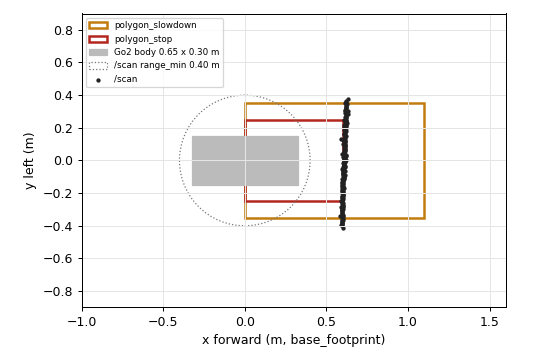

# Project 11. Command arbitration

In the stack from `scripts/up.sh`, Nav2 publishes on `/cmd_vel` directly, and so would a keyboard teleop started next to it:
CHAMP then walks on whichever message arrived last. Here `twist_mux` picks one source by priority (keyboard 100 over Nav2 10),
an e-stop topic locks it, and Nav2's Collision Monitor sits between the mux and the robot with a stop zone and a slowdown zone
sized to the Go2. You measure three things on the simulator's ground truth: how fast a keypress takes over from a live Nav2
goal, how fast the lock brings the robot to a standstill, and how far from a box the Collision Monitor stops it.

| | |
|---|---|
| Goal | Put one node in charge of who may drive the robot, lock it with an e-stop, stop it before an obstacle, and measure each of the three on ground truth. |
| Time | 2 h |
| Before you start | [Project 2](../p02_teleop-and-safety/README.md): this project reuses its `safety_node.py` (the dead-man) and its finding that CHAMP walks on the last `/cmd_vel` until it receives a zero. [Chapter 10](../../docs/10-mapping-and-navigation.md): how Nav2 is started and how `go_to_goal.py` sends a goal. |
| You will learn | How `twist_mux` chooses between velocity sources (priorities, per-source timeouts, `std_msgs/Bool` locks); remapping the topics of nodes started by someone else's launch file (`SetRemap`) without editing that file; why a lock alone does not stop this robot, and which link of the chain has to turn silence into a stop; configuring the Nav2 Collision Monitor (polygons in `base_footprint`, the sensor's blind range, the lifecycle manager it needs); reading latency and stopping distance from logged messages and `/odom_gt`, with each delay assigned to one link of the chain. |

The CHAMP limits are 0.3 m/s forward, 0.25 m/s sideways and 0.5 rad/s yaw. Every terminal starts with:

```bash
cd go2-nav-sim
source env.sh
```

`twist_mux` and the Collision Monitor come with ROS 2 Humble's Nav2 packages. Check that both are installed:

```bash
ros2 pkg executables twist_mux; ros2 pkg executables nav2_collision_monitor
```

```
twist_mux joystick_relay.py
twist_mux twist_marker
twist_mux twist_mux
nav2_collision_monitor collision_monitor
```

The scripts need no build: `python3 projects/p11_command-arbitration/<script>.py`.

| File | What it is |
|---|---|
| `arbitration.launch.py` | Nav2 (the unchanged `nav.launch.py`) with its output remapped, `twist_mux`, the Collision Monitor and the dead-man |
| `config/twist_mux.yaml` | the two inputs and the lock, with their priorities and timeouts |
| `config/collision_monitor.yaml` | the stop and slowdown polygons |
| `config/arbitration.rviz` | RViz in `base_footprint`: robot, `/scan`, both polygons |
| `arbitration_check.py` | reads the two YAML files without ROS: zone geometry, mux order, helpers for `measure.py` |
| `tests/test_arbitration.py` | 6 unit tests on the configs and helpers, no ROS |
| `measure.py` | the three measurements: `override`, `estop`, `box` |
| `zones_snapshot.py` | top view of the zones and the current scan (the figure in task 4) |
| `plot.py` | the figure with one run of each measurement |
| `results/` | my CSVs and logs behind every number below; your runs go to `~/p11_runs` |

## Task 1: Check the configuration

### 1.1 Run the unit tests

Objective: check the zone geometry, the mux order and the log helpers before any simulator runs.

```bash
python3 -m pytest -q projects/p11_command-arbitration/tests
```

Expected:

```
......                                                                   [100%]
6 passed in 0.06s
```

Check: `6 passed`.

### 1.2 Print the zones and the mux order

Objective: see where each zone reaches and which input wins.

```bash
python3 projects/p11_command-arbitration/arbitration_check.py
```

Expected:

```
PolygonStop: x +0.00..+0.60  y -0.25..+0.25  ahead of the body 0.275 m, beside it 0.100 m, visible depth 0.20 m
PolygonSlow: x +0.00..+1.10  y -0.35..+0.35  ahead of the body 0.775 m, beside it 0.200 m, visible depth 0.70 m
mux order: e_stop (e_stop) 255, teleop (teleop/cmd_vel) 100, navigation (nav/cmd_vel) 10
```

"Visible depth" is how far the zone reaches past 0.40 m, the `range_min` of `/scan` (`src/go2_nav_sim/config/scan.yaml`).
Returns nearer than that are dropped, so a zone whose front edge lies inside 0.40 m can never fire.

Check: the mux order lists the lock first and Nav2 last.

## Task 2: Put the mux in the chain

### 2.1 Start the stack and replace its Nav2

Objective: run Nav2 with its output going into the mux instead of straight to CHAMP.

```bash
scripts/up.sh                  # prints "stack up"
scripts/stop.sh nav            # stops the Nav2 that up.sh started; the simulator and estimation keep running
ros2 launch projects/p11_command-arbitration/arbitration.launch.py
```

Leave the launch running in this terminal. Among its output:

```
[twist_mux]: Topic handler 'topics.navigation' subscribed to topic 'nav/cmd_vel': timeout = 0.500000s , priority = 10.
[twist_mux]: Topic handler 'topics.teleop' subscribed to topic 'teleop/cmd_vel': timeout = 0.600000s , priority = 100.
[twist_mux]: Topic handler 'locks.e_stop' subscribed to topic 'e_stop': timeout = None , priority = 255.
[collision_monitor]: [PolygonStop]: Creating Polygon
[collision_monitor]: [PolygonSlow]: Creating Polygon
[lifecycle_manager_monitor]: Managed nodes are active
[lifecycle_manager_localization]: Managed nodes are active
[cmd_safety]: teleop/cmd_vel -> cmd_vel  v_max [0.5, 0.5, 1.0]  a_max [100.0, 100.0, 100.0]  timeout 0.6 s  20.0 Hz
```

Check: `Managed nodes are active` appears three times (the monitor, localisation, navigation).

Common mistakes: starting the launch with `&` in a script. A background process inherits SIGINT as ignored, so `kill -INT` does
not stop it; when I then started a second copy, two `collision_monitor` nodes had the same name, the new lifecycle manager logged
`Failed to change state for node: collision_monitor ... Aborting bringup`, and the old `twist_mux` kept publishing. Run the launch
in a terminal and stop it with Ctrl-C.

### 2.2 Check the chain

Objective: confirm that only one node publishes to CHAMP and that Nav2's output reaches the mux.

```bash
ros2 topic info /cmd_vel -v | grep -E "count|Node name"
ros2 topic info /nav/cmd_vel -v | grep -E "count|Node name"
```

Expected (the pattern also matches the `Node namespace` lines):

```
Publisher count: 1
Node name: cmd_safety
Node namespace: /
Subscription count: 1
Node name: quadruped_controller_node
Node namespace: /
```

```
Publisher count: 6
Node name: behavior_server
Node namespace: /
Node name: behavior_server
Node namespace: /
Node name: behavior_server
Node namespace: /
Node name: behavior_server
Node namespace: /
Node name: behavior_server
Node namespace: /
Node name: velocity_smoother
Node namespace: /
Subscription count: 1
Node name: twist_mux
Node namespace: /
```

`/cmd_vel_nav` still runs from `controller_server` to `velocity_smoother`, as in the stock stack.

Check: `/cmd_vel` has exactly one publisher, `cmd_safety`. In the stack from `scripts/up.sh` it had seven, all from Nav2
(project 2, step 4).

## Task 3: Override and lock

### 3.1 Override a Nav2 goal from the keyboard

Objective: see the priority work by hand before measuring it.

Terminal 2 sends the robot to marker B:

```bash
python3 src/go2_nav_sim/scripts/go_to_goal.py
```

Terminal 3 starts the keyboard with its output remapped to the mux input:

```bash
ros2 run teleop_twist_keyboard teleop_twist_keyboard --ros-args -r cmd_vel:=teleop/cmd_vel
```

Once the robot walks, hold `j`. The robot stops following the path and turns left on the spot. Let go: about 0.6 s later Nav2
drives again. Terminal 4 shows what reaches CHAMP:

```bash
ros2 topic echo /cmd_vel --field angular.z
```

While `j` is held it prints `1.0`; it prints `0.3` when an obstacle is inside the slowdown zone, because the Collision Monitor
scales the whole twist, turning included. CHAMP clips 1.0 to its 0.5 rad/s limit.

Check: `ros2 topic echo /nav/cmd_vel --field angular.z` keeps printing while you hold the key. Nav2 never stops publishing;
the mux ignores it.

### 3.2 Measure the override

Objective: measure the delay from a key event to each topic in the chain.

Stop the keyboard (Ctrl-C) and the goal if it still runs. `measure.py override` starts a goal, waits until Nav2 has walked the
robot at more than 0.15 m/s for 3 s, starts `teleop_twist_keyboard` on a pseudo-terminal and types `j` 30 times a second for
2 simulated seconds:

```bash
python3 projects/p11_command-arbitration/measure.py override --csv ~/p11_runs/override_1.csv
```

Expected (my first run; the goal is marker B):

```
key -> teleop/cmd_vel      0 ms
key -> cmd_vel_mux         1 ms
key -> cmd_vel_cm         31 ms
key -> cmd_vel            42 ms
Nav2 back on cmd_vel 0.66 s (simulated) after the last key event
Nav2 kept publishing during the override: 41 messages in 2.0 s
nav2: RESULT SUCCEEDED  sim_time 93.2 s  ground-truth final error 0.20 m  final pos (3.90, 2.82)
```

The delays are wall-clock, measured from the moment the script writes the key. `cmd_vel_cm` is the Collision Monitor's output.
The message count depends on how fast the simulator runs: `velocity_smoother` publishes 20 times per wall-clock second, so
2 simulated seconds give about 40 messages divided by the real-time factor. I counted 41 to 45 at a factor of 0.93 to 1.03 and
52 at 0.78. The last line may read `RESULT FAILED` (see [If it goes wrong](#if-it-goes-wrong)); the lines above it are still
valid. For the next run, send the robot back with `--goal -4.5 -3.5 3.14` (marker A).

Check: the delay to `cmd_vel` is below 0.15 s, and "Nav2 back" is just over the teleop timeout of 0.6 s. My four runs gave
39 to 63 ms; a second tester measured 102 ms at a load average of 83, because the dead-man's 50 ms timer tick and a loaded
machine add up.

### 3.3 Lock the robot by hand

Objective: see that the lock silences every input, the keyboard included.

```bash
ros2 topic pub --once /e_stop std_msgs/msg/Bool "{data: true}"
timeout 6 ros2 topic pub -r 10 /teleop/cmd_vel geometry_msgs/msg/Twist "{linear: {x: 0.2}}" > /dev/null &
timeout 4 ros2 topic echo /cmd_vel_mux --field linear.x | grep -c '^0'
```

Expected: `0`. Nothing leaves the mux while the lock is set, although the keyboard input has priority 100. Release it and repeat:

```bash
ros2 topic pub --once /e_stop std_msgs/msg/Bool "{data: false}"
timeout 6 ros2 topic pub -r 10 /teleop/cmd_vel geometry_msgs/msg/Twist "{linear: {x: 0.2}}" > /dev/null &
timeout 4 ros2 topic echo /cmd_vel_mux --field linear.x | grep -c '^0'
```

Expected: about 26 (I counted 26; the publisher sends 10 per second after it starts).

Check: `ros2 topic echo --once /odom_gt --field pose.pose.position.x` read before and after the locked 6 s gave 0.182 and 0.179 m
in my run: the robot did not walk. After the unlocked 6 s it read -0.296 m (the robot faced -x), and 2 s later -0.295 m: it
stopped by itself once the publisher ended.

### 3.4 Measure the lock during a Nav2 goal

Objective: measure the time from the lock to standstill.

```bash
python3 projects/p11_command-arbitration/measure.py estop --goal -4.5 -3.5 3.14 --csv ~/p11_runs/estop_1.csv
```

The script locks the mux once Nav2 walks, holds the lock for 8 s, then releases it. Expected (my fourth run):

```
lock at 136.78 s: standstill 1.02 s after the lock, 0.19 m walked; 8 messages on cmd_vel from 0.5 s after the lock on
unlock: Nav2 command reaches cmd_vel again 0.07 s later
nav2: RESULT SUCCEEDED  sim_time 116.5 s  ground-truth final error 0.27 m  final pos (-4.24, -3.44)
```

Standstill is the first time from which the true speed, over a 0.5 s window, stays below 0.02 m/s (`stop_time` from project 2).
The 8 messages are the dead-man's zeros (see [the dead-man link](#the-dead-man-link)). The unlock line is the first command
above 0.05 m/s on `cmd_vel`, not motion on `/odom_gt`. As in 3.2, the goal may end `RESULT FAILED`; the lock and unlock lines
are still valid.

Check: standstill comes within about 1.1 s of the lock: the dead-man's 0.6 s plus CHAMP's stop of up to 0.39 s, plus up to one
50 ms tick. I measured 0.80 to 1.02 s.

## Task 4: Stop before a box

### 4.1 Face free floor

Objective: put the robot on marker A facing +x, with 2.5 m of free floor ahead.

After 3.4 the robot stands on A facing -x, towards the wall. Turn it:

```bash
python3 src/go2_nav_sim/scripts/go_to_goal.py -4.5 -3.5 0.0
```

```
RESULT SUCCEEDED  sim_time 95.6 s  ground-truth final error 0.18 m  final pos (-4.57, -3.34)
```

Right after `scripts/up.sh` and task 2 the robot already faces +x on A; from there there is room for three box runs in a row.

Check: the line reads `RESULT SUCCEEDED`.

### 4.2 Walk at the box

Objective: measure where the Collision Monitor slows and stops the robot.

```bash
python3 projects/p11_command-arbitration/measure.py box --keep --csv ~/p11_runs/box_1.csv
```

The script spawns a 0.4 × 0.8 × 0.5 m box whose face is 2.0 m ahead of `base_footprint`, then sends 0.3 m/s forward on
`teleop/cmd_vel` (a held `i` key) for up to 25 s. Expected (my first run):

```
box spawned: SpawnEntity: Successfully spawned entity [p11_box]; face 2.00 m ahead of base_footprint at (-2.26, -3.49)
slowdown: cmd_vel 0.090 m/s at 0.88 m walked (box face 1.12 m from base)
stop: first zero on cmd_vel at 1.38 m walked (box face 0.62 m from base)
end after 14.8 s: walked 1.395 m, base 0.605 m from the box face, gap body front to box 0.280 m
```

<video controls muted playsinline src="media/box_stop.mp4"></video>

The video is box run 1 from the chase camera (`python3 projects/common/record_cam.py box_stop.mp4 --topic /chase/cam/image_raw`,
220 frames, 22.0 s simulated). The robot walks at 0.3 m/s, slows down about 1.1 m before the box and stops with its head about
0.3 m from it.

Check: the end line shows a positive gap, 0.28 to 0.32 m in my four runs. A negative gap means the body reached the box.

### 4.3 Look at the zones from above

Objective: see the box face inside the stop zone, then remove the box.

With the box still there:

```bash
python3 projects/p11_command-arbitration/zones_snapshot.py ~/p11_runs/zones.png
ros2 service call /delete_entity gazebo_msgs/srv/DeleteEntity "{name: p11_box}"
```

```
polygon_slowdown: 4 corners, 150 scan points inside
polygon_stop: 4 corners, 24 scan points inside
```



The same view is in RViz with `rviz2 -d projects/p11_command-arbitration/config/arbitration.rviz`. The box face appears about
0.6 m ahead, its points spread over about 5 cm in x.

Check: both polygons have more than three points inside (`max_points: 3`); in my fourth run the counts were 117 and 11.

### 4.4 Plot your runs

Objective: draw the three measurements of this session in one figure.

```bash
python3 projects/p11_command-arbitration/plot.py --dir ~/p11_runs
```

```
/home/<you>/p11_runs/arbitration_runs.png
```

Check: the figure has three panels like the one in [Results](#results), from your `override_1.csv`, `estop_1.csv` and `box_1.csv`.

## Task 5: Stop the stack

### 5.1 Stop the launch, then the rest

Objective: leave no node running.

Ctrl-C in the launch terminal stops Nav2, the mux, the monitor and the dead-man. Then:

```bash
scripts/stop.sh
ros2 node list --no-daemon
```

`scripts/stop.sh` alone does not stop `twist_mux`, `collision_monitor` or `safety_node.py`, because they are not in its list.

Check: `ros2 node list --no-daemon` prints nothing. In my run the launch exited 5 s after Ctrl-C and no node was left.

## How the code works

### The chain

```
teleop/cmd_vel (priority 100) --+
nav/cmd_vel    (priority 10)  --+--> twist_mux --> cmd_vel_mux --> collision_monitor --> cmd_vel_cm --> dead-man --> cmd_vel --> CHAMP
e_stop         (lock, 255)    --+
```

### `config/twist_mux.yaml`

```yaml
    topics:
      navigation:
        topic: nav/cmd_vel
        timeout: 0.5
        priority: 10
      teleop:
        topic: teleop/cmd_vel
        timeout: 0.6              # longer than the 500 ms keyboard repeat delay (p02), or a held key flickers back to Nav2
        priority: 100
    locks:
      e_stop:
        topic: e_stop
        timeout: 0.0              # 0: the lock holds the last value it received; it is not a heartbeat
        priority: 255
```

On every message, `twist_mux` passes it on only if no input with a higher priority has sent a message within its own timeout,
and no lock with a higher priority is set. An input counts as gone `timeout` seconds after its last message. That is why Nav2
came back 0.62 to 0.66 s after the last key in every run: 0.6 s of teleop timeout, plus the wait for Nav2's next message. A lock
with priority 255 blocks every input below 255, so even the keyboard. With `timeout: 0.0` the lock keeps its last value; with
a positive timeout it would also engage when its publisher went quiet, which turns it into a heartbeat that a sender must keep
alive.

### Nav2 remapped without editing `nav.launch.py`

```python
GroupAction([
    SetRemap('cmd_vel_smoothed', 'nav/cmd_vel'),
    SetRemap('behavior_server:cmd_vel', 'nav/cmd_vel'),
    IncludeLaunchDescription(PythonLaunchDescriptionSource(os.path.join(share('go2_nav_sim'), 'launch/nav.launch.py'))),
], condition=IfCondition(LaunchConfiguration('nav'))),
```

Nav2's `navigation_launch.py` remaps the velocity smoother's output `cmd_vel_smoothed` to `cmd_vel`, and the controller's
output to `cmd_vel_nav`, the smoother's input. A `SetRemap` in an enclosing group is applied before each node's own remaps, and
ROS uses the first rule that matches, so `cmd_vel_smoothed` goes to `nav/cmd_vel`. The behaviour server's `cmd_vel` (spin, back
up) has no remap of its own; the `behavior_server:` prefix limits the second rule to that node, so no other node in the group
that uses a `cmd_vel` topic is renamed.

### `config/collision_monitor.yaml`

```yaml
    PolygonStop:
      type: polygon
      points: [0.60, 0.25, 0.60, -0.25, 0.0, -0.25, 0.0, 0.25]
      action_type: stop
      max_points: 3
    PolygonSlow:
      type: polygon
      points: [1.10, 0.35, 1.10, -0.35, 0.0, -0.35, 0.0, 0.35]
      action_type: slowdown
      max_points: 3
      slowdown_ratio: 0.3
```

Points are x, y pairs in `base_footprint`. The body is 0.65 × 0.30 m, so its front edge is at x = 0.325. The stop zone reaches
0.275 m past it and 0.10 m to each side; the slowdown zone 0.775 m and 0.20 m. `max_points: 3` means more than three scan points
inside fire the action, so one stray return does not. The zones start at x = 0; [Results](#a-stop-zone-around-the-whole-body)
shows what a zone around the whole body did.

The robot stops where the box face crosses the stop edge. The gap left between body and box is

    gap = x_stop - x_front - d_after = 0.60 - 0.325 - d_after

where d_after is the distance walked after the first zero. At 0.09 m/s (inside the slowdown zone) d_after was 0.006 to 0.015 m,
so the formula gives 0.260 to 0.269 m. I measured 0.280 to 0.321 m, because the first zero came with the face 0.62 to 0.66 m
from the base instead of 0.60 m: by ground truth, the monitor fired 2 to 6 cm early. The face points in the top view spread over
about 5 cm, so a few of them cross 0.60 m before the face does on average.

The monitor is a lifecycle node and does nothing until configured and activated. The launch file starts a lifecycle manager
named `lifecycle_manager_monitor` for it with `autostart: true`.

### The dead-man link

```python
ExecuteProcess(cmd=['python3', SAFETY, '--ros-args', '-r', 'teleop/cmd_vel:=cmd_vel_cm', '-p', 'timeout:=0.6',
                    '-p', 'v_max:=[0.5, 0.5, 1.0]', '-p', 'a_max:=[100.0, 100.0, 100.0]'], ...)
```

A lock does not publish a zero: it makes `twist_mux` publish nothing. The Collision Monitor publishes only when a command comes
in, so it goes quiet too, and CHAMP walks on the last command it received ([Exercise](#exercise): 1.91 m in 8 s). Project 2's
`safety_node.py` as the last link turns silence into a stop: 0.6 s after its last input it ramps to zero. Here the acceleration
limit is set to 100 so it passes commands through unchanged; an earlier version with 20 rad/s² needed two 50 ms ticks to reach a
key's 1.0 rad/s from Nav2's -0.18 rad/s. The time from the lock to standstill is then

    t_stop ≈ t_deadman + t_champ

where t_deadman = 0.6 s (plus up to one 50 ms tick) and t_champ is how long CHAMP takes to stand still after a zero (0.35 to
0.39 s from 0.3 m/s in project 2). The first zero came 0.60 to 0.66 s after the lock, and standstill 0.18 to 0.36 s after that:
less than from 0.3 m/s, because Nav2 was walking at 0.075 to 0.25 m/s when the lock came.

### `measure.py`

One node subscribes to every topic of the chain and to `/odom_gt`, logging each message with its wall-clock and simulated
time. The override test detects the key by its shape (`is_key` in `arbitration_check.py`): `linear.x` 0 and `angular.z` 1.0,
or 0.3 when the slowdown zone has scaled it. A first version looked for `angular.z > 0.9` and reported 1724 ms in one run,
because the key reached CHAMP at 0.3 rad/s inside the slowdown zone and only counted once the robot had turned away from the wall.

## Results

Measured on a shared machine with other simulators running. Before the override and lock runs the load average was between 37
and 108 (`uptime`, logged in `results/runs.txt`), and `gz stats` showed a real-time factor of 0.82 at one check. Run 4 of each
test comes from a later session, after a fresh `scripts/up.sh`. Outputs of `measure.py` are in `results/runs.txt` and
`results/runs_box_and_exercises.txt`; the CSVs are `results/<test>_<n>.csv`.

Override of a live Nav2 goal by the `j` key (`measure.py override`; wall-clock delays from the key event):

| Run | Goal | to `cmd_vel_mux` | to `cmd_vel_cm` (after the monitor) | to `cmd_vel` (CHAMP) | Nav2 back after the last key (simulated) | Nav2 messages during the 2 s override | Real-time factor during the override |
|---|---|---|---|---|---|---|---|
| 1 | B | 1 ms | 31 ms | 42 ms | 0.66 s | 41 | 1.00 |
| 2 | A | 1 ms | 21 ms | 63 ms | 0.62 s | 41 | 1.03 |
| 3 | B | 2 ms | 39 ms | 39 ms | 0.64 s | 45 | 0.93 |
| 4 | B | 1 ms | 32 ms | 55 ms | 0.65 s | 52 | 0.78 |

The mux adds 1 to 2 ms. The Collision Monitor adds 20 to 37 ms, and the dead-man up to one 50 ms tick of its timer (0 to 42 ms).
The real-time factor is 2.0 simulated seconds over the wall-clock span of Nav2's messages in the CSV; Nav2 published at 20.0 Hz
wall clock in all four runs. Runs 1, 3 and 4 reached the goal (0.20, 0.37 and 0.21 m from it); run 2 ended `FAILED` 0.40 m from
marker A, after the override.

Lock during a Nav2 goal (`measure.py estop`, lock held 8 s; times simulated):

| Run | Goal | Command at the lock | First zero on `cmd_vel` | Standstill after the lock | Walked after the lock | Nav2 command reaches `cmd_vel` again after the unlock |
|---|---|---|---|---|---|---|
| 1 | A | 0.172 m/s | 0.60 s | 0.89 s | 0.11 m | 0.10 s |
| 2 | B | 0.075 m/s | 0.62 s | 0.80 s | 0.03 m | 0.36 s |
| 3 | A | 0.250 m/s | 0.63 s | 0.95 s | 0.16 m | 0.07 s |
| 4 | A | 0.250 m/s | 0.66 s | 1.02 s | 0.19 m | 0.07 s |

Runs 1, 3 and 4 reached the goal (0.29, 0.20 and 0.27 m from it). Run 2 ended `FAILED` at (-2.88, -1.41), between the orange
cylinder and the west end of the pallet: after the unlock the planner logged `GridBased: failed to create plan with tolerance
0.30` 15 times, while the spin and back-up recoveries completed and the Collision Monitor logged no stop
(`results/estop_2_nav2.log`). An earlier session, with the whole-body stop zone below, a lock run to B failed at (-3.00, -1.31)
with the same planner message (`results/exercises/full_body_zone_estop.csv`). Of my 8 override and lock goals with this
configuration, 2 ended `FAILED`; a second tester's lock run to A (standstill 1.01 s, 0.19 m walked) also ended `FAILED` at
(-4.35, -2.21), with the planner message 16 times in the launch log. I did not find the cause.

Stop before a box (`measure.py box`, box face 2.0 m ahead, 0.3 m/s forward):

| Run | Slowdown starts: walked (box face from base) | First zero: walked (box face from base) | End: base to box face | Gap body front to box |
|---|---|---|---|---|
| 1 | 0.88 m (1.12 m) | 1.38 m (0.62 m) | 0.605 m | 0.280 m |
| 2 | 0.89 m (1.11 m) | 1.37 m (0.63 m) | 0.624 m | 0.299 m |
| 3 | 0.90 m (1.10 m) | 1.37 m (0.63 m) | 0.623 m | 0.298 m |
| 4 | 0.87 m (1.13 m) | 1.34 m (0.66 m) | 0.646 m | 0.321 m |

The zones fired within 0 to 6 cm of their configured edges (1.10 and 0.60 m). In the slowdown zone the command was 0.090 m/s
and the true speed 0.052, 0.052, 0.053 and 0.051 m/s (mean over the 1.0 to 1.3 m stretch): CHAMP walks slower than commanded
at such a small command.

![Left: the key's yaw rate (dashed) replaces Nav2's (amber) on cmd_vel (blue) at once; from 1.7 s the slowdown zone scales it to 0.3, and Nav2's command is back on cmd_vel 0.66 s after the last key. Middle: after the lock, cmd_vel holds the last command for 0.6 s, then the dead-man sends zeros, and the true speed reaches zero 0.89 s after the lock; after the unlock Nav2's command reaches cmd_vel again and the true speed follows. Right: true speed against distance walked; it drops to about 0.05 m/s where the box face enters the slowdown zone and to zero where it enters the stop zone, 0.28 m before the body would touch the box](figures/arbitration_runs.png)

The figure is run 1 of each table (`python3 projects/p11_command-arbitration/plot.py`).

### Without the Collision Monitor

```bash
ros2 launch projects/p11_command-arbitration/arbitration.launch.py monitor:=false nav:=false
python3 projects/p11_command-arbitration/measure.py box --timeout 15 --csv ~/p11_runs/box_no_monitor.csv
```

The robot walked into the box: `walked 1.755 m, base 0.245 m from the box face, gap body front to box -0.080 m`
(`results/exercises/box_no_monitor.csv`). The head and front feet pressed against the box until the script sent its zeros at
15 s; the "first zero on cmd_vel" line in that output is those final zeros, not a stop. `twist_mux` and the dead-man do not look
at sensors.

### A stop zone around the whole body

My first configuration set the `PolygonStop` points to `[0.60, 0.25, 0.60, -0.25, -0.45, -0.25, -0.45, 0.25]`. On a run from A
to B (`go_to_goal.py`) the goal failed near the orange cylinder; in the last 31 s the monitor logged `Robot to stop due to
PolygonStop polygon` 21 times, the spin recovery twice ended with `Exceeded time allowance before reaching the Spin goal`, and
the back-up recovery twice with `Collision Ahead - Exiting DriveOnHeading` (`results/exercises/full_body_zone_deadlock.log`). An
obstacle beside or behind the base stops every motion, including the turn that would take the robot away from it, because the
Humble Collision Monitor does not look at the direction of the command. With the front-only zone the same spot still made the
planner fail (lock run 2), but the recoveries completed. Put the stop zone where the robot is going.

Unit tests: `python3 -m pytest -q projects/p11_command-arbitration/tests` gives `6 passed`. They check that the stop zone covers
the body width, reaches at least 0.15 m past the scan's blind range and starts at the base; that the slowdown zone contains the
stop zone with a ratio between 0 and 1; the mux order (teleop 100, Nav2 10, lock above both with timeout 0); the log search
`first_after`; the gap formula; and that `is_key` accepts the key at full and scaled rate but not a Nav2 command.

## Exercise

Leave the dead-man out and repeat 3.4 towards B. After `scripts/up.sh` and `scripts/stop.sh nav`:

```bash
ros2 launch projects/p11_command-arbitration/arbitration.launch.py deadman:=false
python3 projects/p11_command-arbitration/measure.py estop --goal 4.0 3.0 0.65 --csv ~/p11_runs/estop_no_deadman.csv
```

Predict first what the robot does during the 8 s lock.

Answer: it walks on. I measured `NOT stopped 8 s after the lock, 1.91 m walked; 0 messages on cmd_vel from 0.5 s after the
lock on` (`results/exercises/estop_no_deadman.csv`). The last command before the lock was 0.25 m/s, and 1.91 m in 8 s is
0.24 m/s. With the monitor as the last link nothing reaches CHAMP, because the monitor publishes only when a command arrives.
The robot walked towards the orange cylinder; after the unlock Nav2 sent turns only, the monitor logged `Robot to stop due to
PolygonStop polygon` with the cylinder in the stop zone, and the goal did not finish within the script's 240 s. A lock that
only silences inputs needs a link after it that stops the robot on silence.

## If it goes wrong

| Symptom | Cause | Fix |
|---|---|---|
| Two `twist_mux` or `collision_monitor` nodes in `ros2 node list`, and the launch log shows `Failed to change state for node: collision_monitor` and `Aborting bringup` | An older launch was still running. I had started it with `&` from a script, so it ignored SIGINT, and `scripts/stop.sh` does not stop these nodes | Stop the old launch with Ctrl-C in its terminal (or `kill -TERM` on its process), check `ros2 node list`, then start one launch |
| `measure.py override` or `estop` ends with `nav2: RESULT FAILED`, and the launch log shows `GridBased: failed to create plan with tolerance 0.30` many times (15 and 16 in two runs) | Not found. It happened in 3 of 9 override and lock goals with this configuration (2 of my 8, one of a second tester's), always after the override or the lock | The measured lines above the `RESULT` line are still valid. Before the next run, put the robot back on A: Ctrl-C the launch, `scripts/stop.sh`, then `scripts/up.sh`, `scripts/stop.sh nav` and the launch of 2.1 |
| `measure.py override` or `estop` ends with `timeout after 120 s simulated: Nav2 walking`, and the launch log shows `GridBased: failed to create plan` for every goal | I had restarted `arbitration.launch.py` with the robot away from marker A; all three goals of the next batch failed this way | Restart from `scripts/up.sh`, `scripts/stop.sh nav` and 2.1, with the robot on A |
| The delay to `cmd_vel` in 3.2 is above 0.1 s | The dead-man forwards on a 50 ms timer, and a loaded machine delays every process (102 ms at a load average of 83 in one run) | Expected on a busy machine. Above 0.15 s, check `uptime` and `gz stats` before you look for a fault |
| The keyboard turns the robot at 0.3 rad/s instead of 1.0 (`ros2 topic echo /cmd_vel --field angular.z`) | An obstacle is inside the slowdown zone, and the monitor scales every component of the twist by 0.3 | Expected behaviour. Walk away from the obstacle, or lower the zone's reach |
| `measure.py box` prints `spawn failed: ... already exists` | A box from a run with `--keep` is still in the world | `ros2 service call /delete_entity gazebo_msgs/srv/DeleteEntity "{name: p11_box}"` |
| `zones_snapshot.py` stops with `no message on: ['polygon_slowdown', 'polygon_stop']` | The monitor publishes its polygons only while commands pass through it | The current script sends zero twists on `teleop/cmd_vel` while it waits; if it still fails, check that `lifecycle_manager_monitor` reported `Managed nodes are active` |
| The robot keeps walking after the lock | The dead-man is not in the chain (`deadman:=false`, or `safety_node.py` died) | `ros2 topic info /cmd_vel -v` must name `cmd_safety` as the only publisher |

## Further reading

- `ros-teleop/twist_mux`, humble branch, `config/twist_mux_topics.yaml` and `config/twist_mux_locks.yaml`: the example priorities
  and locks this configuration follows.
- Nav2 Collision Monitor configuration guide:
  https://docs.nav2.org/rolling/configuration_and_development/configuration_guide/core_servers/collision_monitor/
  (this project uses the Humble 1.1 parameter names, which differ from the rolling page in places).
- Nav2 tuning guide, footprint section: https://docs.nav2.org/rolling/configuration_and_development/tuning_guide/ (how the
  planner's `robot_radius` of 0.33 m relates to the zones here).
