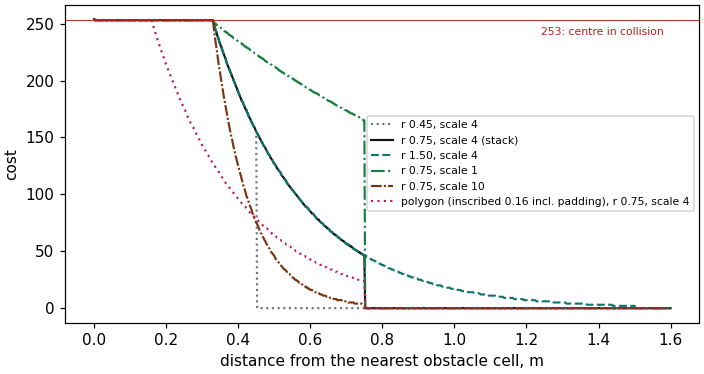
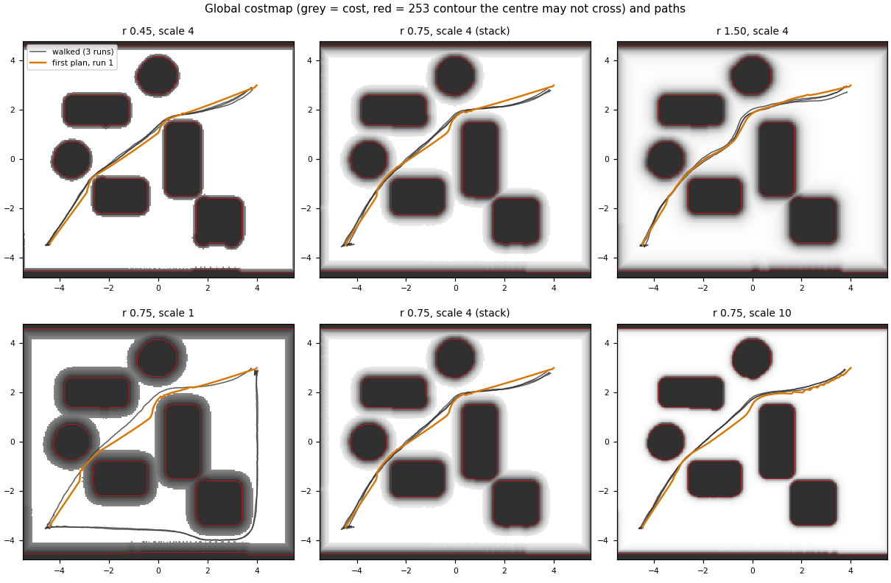
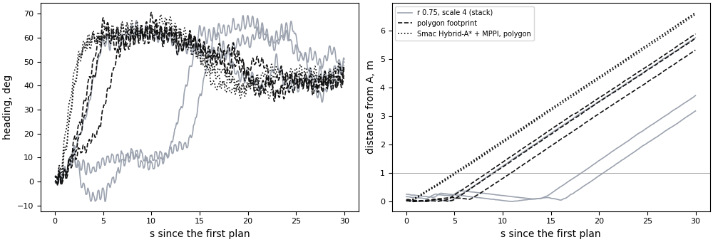
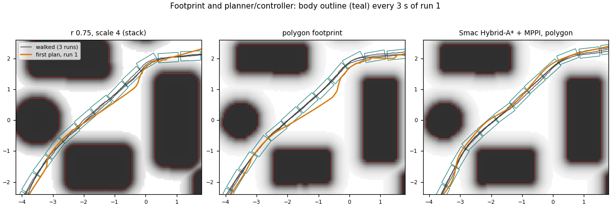

# Project 12. Tune Nav2 with evidence

| | |
|---|---|
| Goal | Change one Nav2 setting at a time, drive the Go2 from marker A to marker B three times per setting, and score every run from its bag. Seven settings: three inflation radii, three cost scaling factors, a rectangular footprint instead of the 0.33 m circle, and Smac Hybrid-A* + MPPI instead of NavFn + Regulated Pure Pursuit (RPP). The runs point at one cause of lost time, and an eighth setting tests it. At the end you pick the settings the numbers support and say why, in the terms the Nav2 tuning guide uses. |
| Time | About 2.5 h of your own work, plus about 75 min of unattended simulation for the 24 runs (64 min for the first 21 here, at a load average between 40 and 99). |
| Before you start | [Chapter 10](../../docs/10-mapping-and-navigation.md) (Nav2, AMCL, the arena, the 0.33 m footprint compromise) and `scripts/up.sh` working. |
| You will learn | what `inflation_radius` and `cost_scaling_factor` do to the costmap, predicted with Nav2's formula before you run anything; how to run Nav2 from project-local copies of the stack's parameter file; how to record a small bag per run and score it with `src/go2_nav_sim/scripts/bag_metrics.py` plus a few tuning metrics; why a polygon footprint changes nothing measurable with NavFn, and when it starts to matter; how to tell a setting's effect from run-to-run noise (three runs, ranges instead of single numbers, and "leaving A" split from "the rest of the way"). |

<video controls muted playsinline src="media/smac_mppi_a_to_b.mp4"></video>

*One Smac Hybrid-A* + MPPI run from A (green disc) to B (red disc), spectator camera: 58.5 s of simulated time (49.2 s of
navigation) shown at 2.5 times speed.*

Every terminal starts with:

```bash
cd go2-nav-sim
source env.sh
```

Nothing here is built and nothing under `src/` is changed. The project's files:

| File | What it does |
|---|---|
| `make_params.py` | writes `params/<setting>.yaml`: the stack's `config/nav2_params.yaml` with the setting's changes |
| `up_tuned.sh` | `scripts/up.sh` with your params file (`nav.launch.py params_file:=...`), without the passive mapper |
| `run_ab.sh` | one scored run: fresh stack, small bag, `go_to_goal.py`, stop the robot, close the bag, `score.py` |
| `run_all.sh` | 3 runs of every setting, interleaved, with a retry when the stack does not come up |
| `score.py` | `bag_metrics.py` on the bag plus the outcome, plans, time to leave A and clearances; writes `<run>.json` and `.npz` |
| `tuning.py` | the logic without ROS: Nav2's inflation cost, the map distance grid, footprint clearance, log parsing |
| `plot.py` | the results table and `figures/*.png` |
| `results/` | my 24 scored runs (`.json`), first costmap and paths (`.npz`) and mission logs; your runs never overwrite them |
| `tests/` | unit tests for `tuning.py` and `make_params.py` |

A run needs a fresh stack because the robot has to start on A. Each run therefore restarts the simulator, which is most of
the hour.

## Task 1: Prepare the settings

### 1.1 Run the unit tests

Objective: know that the formula, the map reader and the parameter writer are right before you trust any number.

```bash
python3 -m pytest -q projects/p12_tune-nav2
```

```
..........                                                               [100%]
10 passed in 0.73s
```

The tests check the inflation formula against chapter 10's number (cost 172 at 0.425 m from an obstacle), that the
arena map is read the right way up (an obstacle at the brick box centre (1.0, 0.0), free space at A), that the body
clearance depends on heading, that `make_params.py` changes only what a setting names, and that my recorded polygon
costmap matches the formula with the padded inscribed radius of Task 1.3.

Check: `10 passed`.

### 1.2 Write the parameter files

Objective: one Nav2 params file per setting, each differing from the stack's file only in what the setting names.

```bash
python3 projects/p12_tune-nav2/make_params.py
```

```
params/base.yaml: unchanged
params/infl_r045.yaml: inflation_radius=0.45
params/infl_r150.yaml: inflation_radius=1.5
params/scale_1.yaml: cost_scaling_factor=1.0
params/scale_10.yaml: cost_scaling_factor=10.0
params/polygon.yaml: footprint=[[0.325, 0.15], [0.325, -0.15], [-0.325, -0.15], [-0.325, 0.15]]
params/smac_mppi.yaml: footprint=[[0.325, 0.15], [0.325, -0.15], [-0.325, -0.15], [-0.325, 0.15]], nav2_smac_planner/SmacPlannerHybrid, nav2_mppi_controller::MPPIController
params/polygon_norot.yaml: footprint=[[0.325, 0.15], [0.325, -0.15], [-0.325, -0.15], [-0.325, 0.15]], {'use_rotate_to_heading': False}
```

Each change goes into both the local and the global costmap. The polygon is the 0.65 × 0.30 m body from chapter 10,
centred on `base_footprint`. `smac_mppi` keeps the polygon, so compare it with `polygon`, not with `base`: then only the
planner and the controller differ. `polygon_norot` is for Task 4.

Check: `diff projects/p12_tune-nav2/params/polygon.yaml src/go2_nav_sim/config/nav2_params.yaml` shows only the
`footprint` / `robot_radius` lines, twice.

### 1.3 Predict the costmaps before you run

Objective: write down the cost each setting gives a cell at a few distances from an obstacle.

Nav2's inflation layer gives a cell at distance d from the nearest obstacle cell a cost that depends on three numbers (see
[How the code works](#how-the-code-works)). `tuning.inflation_cost` is that formula. Evaluate it at a few distances:

```bash
cd projects/p12_tune-nav2
python3 -c "
from tuning import inflation_cost as c
for lab,ins,r,k in [('r0.45 k4',.33,.45,4),('r0.75 k4',.33,.75,4),('r1.50 k4',.33,1.5,4),('r0.75 k1',.33,.75,1),('r0.75 k10',.33,.75,10),('polygon r0.75 k4',.16,.75,4)]:
  print(lab, [c(d,ins,r,k) for d in (0.2,0.43,0.6,1.0,1.4)])
"
cd ../..
```

```
r0.45 k4 [253, 168, 0, 0, 0]
r0.75 k4 [253, 168, 85, 0, 0]
r1.50 k4 [253, 168, 85, 17, 3]
r0.75 k1 [253, 228, 192, 0, 0]
r0.75 k10 [253, 92, 16, 0, 0]
polygon r0.75 k4 [214, 85, 43, 0, 0]
```

0.43 m is the middle of the narrowest gap in the arena (0.86 m, chapter 10). Read the table as a prediction:

- The radius only decides where the field is cut off. Up to 0.45 m all three radii give the same cost.
- Scale 1 makes every cell within 0.6 m of an obstacle cost 192 or more (165 at 0.75 m), so the whole middle of the
  arena is expensive.
- The polygon's inscribed radius is 0.16 m: half the body width, 0.15 m, plus Nav2's `footprint_padding` of 0.01 m (Task
  2.1). The "centre in collision" band (253) shrinks from 0.33 m to 0.16 m and every cost drops. Without the padding the
  prediction is 206 at 0.2 m; my recorded polygon costmap holds 209 to 214 there.



*Nav2's inflation cost against distance from the nearest obstacle cell. At or above the red line (253) the robot centre
counts as in collision and NavFn will not plan through.*

Check: `r0.75 k4` at 0.43 m is 168, close to chapter 10's 172 at 0.425 m.

## Task 2: Inspect the footprint Nav2 uses

### 2.1 Read the footprint from a running costmap

Objective: confirm that the costmap uses the polygon, with its padding, and that NavFn is still the planner.

```bash
projects/p12_tune-nav2/up_tuned.sh projects/p12_tune-nav2/params/polygon.yaml
ros2 param get /global_costmap/global_costmap footprint
ros2 param get /global_costmap/global_costmap robot_radius
ros2 param get /global_costmap/global_costmap footprint_padding
ros2 topic echo --once /global_costmap/published_footprint
ros2 param get /planner_server GridBased.plugin
```

```
stack: ROS_DOMAIN_ID=42 GAZEBO_MASTER_URI=http://localhost:11345 params=.../go2-nav-sim/projects/p12_tune-nav2/params/polygon.yaml
stack up
String value is: [[0.325, 0.15], [0.325, -0.15], [-0.325, -0.15], [-0.325, 0.15]]
Double value is: 0.1
Double value is: 0.009999999776482582
header:
  stamp:
    sec: 27
    nanosec: 46000000
  frame_id: map
polygon:
  points:
  - x: -4.18604040145874
    y: -3.302074670791626
    z: 0.0
  - x: -4.1908860206604
    y: -3.622037887573242
    z: 0.0
  - x: -4.860809326171875
    y: -3.6118922233581543
    z: 0.0
  - x: -4.855963230133057
    y: -3.291928768157959
    z: 0.0
---
String value is: nav2_navfn_planner/NavfnPlanner
```

`robot_radius` reads 0.1, Nav2's default: once `footprint` is set the radius is ignored. The published footprint is
0.67 × 0.32 m in the `map` frame around A: the body plus the 0.01 m `footprint_padding` on each side.

Check: the corners are about 0.67 m apart in x and 0.32 m in y.

### 2.2 Check the live costmap's grid

Objective: know the grid the predictions of Task 1.3 are drawn on.

```bash
ros2 topic echo --once /global_costmap/costmap --field info --qos-durability transient_local --qos-reliability reliable
bash scripts/stop.sh
```

```
map_load_time:
  sec: 0
  nanosec: 0
resolution: 0.05000000074505806
width: 260
height: 220
origin:
  position:
    x: -6.5
    y: -5.5
...
```

A 13 × 11 m grid of 5 cm cells. At this resolution the band between 0.16 m and 0.33 m that the polygon frees is three to
four cells wide. To look at the costmap itself, run `rviz2 -d src/go2_nav_sim/rviz/go2.rviz --ros-args -p
use_sim_time:=true` as in chapter 10 before `stop.sh`: its `GlobalCostmap` display shows this topic. `score.py` records
the same costmap as `costmap_raw`, and Task 3.3 draws it for every setting.

Check: `resolution` 0.05 and `width` 260.

## Task 3: Score the settings

### 3.1 One scored run by hand

Objective: one A-to-B run on the stack's own settings, scored from its bag.

```bash
projects/p12_tune-nav2/run_ab.sh base ~/p12_runs/try/base_1
```

`run_ab.sh` starts a fresh stack on `params/base.yaml`, records a bag without images (`/clock /tf /tf_static /odom
/odom_gt /amcl_pose /plan /cmd_vel /global_costmap/costmap_raw`, 36 MB for one run), runs `go_to_goal.py` (AMCL started
from the true pose, then a goal at B), publishes a zero `/cmd_vel` so the robot stops, closes the bag and scores it.
`scripts/record_bag.sh` is not used here: it records the cameras (about 8 MB/s) and not the costmap. My first run:

```
stack: ROS_DOMAIN_ID=42 GAZEBO_MASTER_URI=http://localhost:11345 params=.../go2-nav-sim/projects/p12_tune-nav2/params/base.yaml
stack up
[INFO] [...] [basic_navigator]: goal -> (4.00, 3.00, yaw 0.65)
[INFO] [...] [basic_navigator]: Navigating to goal: 4.0 3.0...
[INFO] [...] [basic_navigator]: distance remaining 11.35 m, recoveries 0
...
[INFO] [...] [basic_navigator]: distance remaining 0.32 m, recoveries 0
RESULT SUCCEEDED  sim_time 55.2 s  ground-truth final error 0.24 m  final pos (3.77, 2.91)
{"setting": "base", "run": "base_1", "result": "SUCCEEDED", "nav_time_s": 55.2, "recoveries": 0, "duration_s": 65.9, "path_m": 11.61, "mean_speed_ms": 0.176, "odom_ate_aligned_cm": 1.2, "odom_ate_anchored_cm": 1.3, "odom_final_err_cm": 3.8, "odom_drift_pct": 0.33, "odom_rpe_1m_pct": 1.6, "amcl_rmse_cm": 9.4, "amcl_max_cm": 21.9, "amcl_updates": 171, "goal_error_m": 0.24, "goal_tolerance_m": 0.25, "leave_A_s": 9.0, "plans": 83, "first_plan_m": 11.35, "min_centre_clearance_m": 0.636, "min_body_clearance_m": 0.424, "first_plan_min_clearance_m": 0.602}
```

The fields from `duration_s` to `goal_tolerance_m` are `bag_metrics.py`'s; the rest are `score.py`'s. You can score any
bag again without the simulator: `python3 projects/p12_tune-nav2/score.py ~/p12_runs/try/base_1 --setting base`.

Check: `RESULT SUCCEEDED`, `nav_time_s` between about 50 and 70, and `~/p12_runs/try/base_1.json` exists.

### 3.2 Run every setting three times

Objective: 21 scored runs, interleaved so that a slow spell on the machine is spread over all settings.

```bash
projects/p12_tune-nav2/run_all.sh
```

It runs round 1 of all seven settings, then round 2, then round 3. A stack that does not come up is retried; a run that
does not reach B would be kept as a result. My log:

```
base run 1: RESULT SUCCEEDED  sim_time 55.2 s  ground-truth final error 0.24 m  final pos (3.77, 2.91)
infl_r045 run 1: RESULT SUCCEEDED  sim_time 54.9 s  ground-truth final error 0.26 m  final pos (3.83, 2.81)
infl_r150 run 1: RESULT SUCCEEDED  sim_time 68.7 s  ground-truth final error 0.33 m  final pos (3.84, 2.72)
scale_1 run 1: RESULT SUCCEEDED  sim_time 115.3 s  ground-truth final error 0.23 m  final pos (3.92, 2.78)
scale_10 run 1: RESULT SUCCEEDED  sim_time 58.3 s  ground-truth final error 0.29 m  final pos (3.81, 2.79)
polygon run 1: RESULT SUCCEEDED  sim_time 54.9 s  ground-truth final error 0.26 m  final pos (3.76, 2.88)
smac_mppi run 1: stack did not come up (attempt 1): TIMEOUT waiting for: gazebo
smac_mppi run 1: RESULT SUCCEEDED  sim_time 49.9 s  ground-truth final error 0.23 m  final pos (3.78, 2.95)
base run 2: RESULT SUCCEEDED  sim_time 67.0 s  ground-truth final error 0.28 m  final pos (3.85, 2.76)
...
smac_mppi run 3: RESULT SUCCEEDED  sim_time 50.7 s  ground-truth final error 0.19 m  final pos (3.82, 2.97)
```

The full log is 22 lines; all 21 runs reached B. `ground-truth final error` is at most 0.33 m because Nav2 stops within
its 0.25 m `xy_goal_tolerance` of where AMCL thinks the robot is, and AMCL is off by about 0.1 m.

Everything stays in `~/p12_runs/all/`: bags, `.json`, `.npz` and the mission logs (`.log`). `results/` keeps my runs, so
you can compare yours with them. To replace mine with yours, run it with `P12_COPY_RESULTS=1`.

Check: 21 `.json` files in `~/p12_runs/all/`. Interrupted? Run it again: scored runs are skipped.

### 3.3 Make the table and the figures

Objective: one table row per setting over its three runs, and the costmap and paths of each setting side by side.

```bash
python3 projects/p12_tune-nav2/plot.py --dir ~/p12_runs/all
```

It prints the table of [Results](#results) for your runs and writes `inflation_sweep.png`, `footprint_planners.png`,
`inflation_profile.png` and `start.png` into `~/p12_runs/all/`. Without `--dir` it reads my runs in `results/` and
rewrites `figures/`.



*The first global costmap of run 1 for each setting (grey = cost, red = the 253 contour), the first plan (amber) and
the three walked paths (grey). Top: radius 0.45, 0.75, 1.50 m at scale 4. Bottom: scale 1, 4, 10 at radius 0.75 m.*

Check: in the scale 1 panel two of the three walked paths leave along the south wall and come up the east side to B,
while the first plan goes through the middle.

## Task 4: Test the explanation

### 4.1 Run RPP without the turn on the spot

Objective: check whether the time lost at A comes from RPP turning on the spot.

[Results](#what-the-numbers-say) shows that the NavFn + RPP runs lose their time standing at A while RPP is in its
rotate-to-heading mode. If that is the cause, switching the mode off should remove most of the difference to MPPI:

```bash
SETTINGS=polygon_norot projects/p12_tune-nav2/run_all.sh
```

```
polygon_norot run 1: RESULT SUCCEEDED  sim_time 52.0 s  ground-truth final error 0.27 m  final pos (3.80, 2.83)
polygon_norot run 2: RESULT SUCCEEDED  sim_time 53.0 s  ground-truth final error 0.25 m  final pos (3.84, 2.80)
polygon_norot run 3: RESULT SUCCEEDED  sim_time 52.0 s  ground-truth final error 0.25 m  final pos (3.82, 2.83)
```

Check: three `polygon_norot_*.json` files in `~/p12_runs/all/`.

### 4.2 Compare it with the other settings

Objective: put the new setting in the same table.

```bash
python3 projects/p12_tune-nav2/plot.py --dir ~/p12_runs/all
```

Check: the table gains the row `polygon, RPP without rotate-to-heading` with "Leaving A" under 8 s in all three runs.

## How the code works

**The inflation cost.** `tuning.inflation_cost` is `InflationLayer::computeCost` from Nav2 Humble:

```python
def inflation_cost(d, inscribed, radius, scale):
    if d <= 0.0:
        return LETHAL                       # 254: the obstacle cell itself
    if d <= inscribed:
        return INSCRIBED                    # 253: the robot centre here means a collision
    if d > radius:
        return 0
    return int((INSCRIBED - 1) * math.exp(-scale * (d - inscribed)))
```

So for inscribed radius r_i < d ≤ `inflation_radius`, cost = 252 · exp(−`cost_scaling_factor` · (d − r_i)). The inscribed
radius is `robot_radius` for a circle, and the distance from the centre to the nearest edge of the padded footprint for a
polygon (0.15 + 0.01 = 0.16 m here; a fit to the recorded costmap gives a mean cost error of 1.0 with 0.16 m against 4.8
with 0.15 m). NavFn treats every cell of 253 or more as an obstacle and otherwise adds the cost to the path length, so a
higher cost pushes the path towards the middle of a gap, and a high cost everywhere makes the planner weigh long detours
against short expensive routes.

**Changing one thing.** `make_params.make` copies the stack's parameter dictionary and edits only the named keys:

```python
for cm in ('local_costmap', 'global_costmap'):
    q = P[cm][cm]['ros__parameters']
    if radius is not None:
        q['inflation_layer']['inflation_radius'] = radius
    ...
    if footprint is not None:
        q.pop('robot_radius'); q['footprint'] = footprint
```

Smac Hybrid-A* replaces the `GridBased` planner block and MPPI the `FollowPath` block. The values that matter for a
comparison with RPP are kept equal: MPPI's `vx_max` 0.25 m/s and `wz_max` 0.5 rad/s are RPP's `desired_linear_vel` and
the velocity smoother's `max_velocity`, and `motion_model: DiffDrive` keeps MPPI from using sideways steps RPP cannot
command. Smac's `minimum_turning_radius` is 0.3 m: the Go2 can turn on the spot, and 0.3 m keeps the search small.

**The metrics.** `score.py` reads the bag once. The time to leave A is measured from the first `/plan` (header stamp,
simulated time) to the first `/odom_gt` pose 1 m from A:

```python
away = np.hypot(gt[:, 0] - A[0], gt[:, 1] - A[1]) > 1.0
res['leave_A_s'] = round(float(gt_t[np.argmax(away)] - plan0_t), 1)
```

The clearances use `src/go2_nav_sim/maps/arena.pgm`, not the costmap: a distance transform gives the distance from every
free cell to the nearest obstacle cell, looked up at the true robot centre (centre clearance) and at points every 2.5 cm
along the 0.65 × 0.30 m body outline rotated by the true heading (body clearance), at 10 Hz. Both are minima over the
whole run.

**Keeping the reference runs.** `run_all.sh` writes only to its runs directory. Its last line copies into `results/`
only when you ask:

```bash
[ "${P12_COPY_RESULTS:-0}" = 1 ] || exit 0
```

## Results

```bash
python3 projects/p12_tune-nav2/plot.py
```

Mean over 3 runs, (min-max) in brackets. "Leaving A" is from the first plan until the robot is 1 m from A; "rest of the
way" is navigation time minus that. Recoveries are summed over the 3 runs.

| Setting | Reached B | Nav time, s | Leaving A, s | Rest of the way, s | True path, m | First plan, m | Min centre clearance, m | Min body clearance, m | Recoveries | AMCL RMSE, cm |
|---|---|---|---|---|---|---|---|---|---|---|
| r 0.45, scale 4 | 3/3 | 55.0 (54.9-55.1) | 9.5 (9.1-10.0) | 45.5 (45.1-45.9) | 11.44 (11.42-11.46) | 11.18 (11.15-11.20) | 0.50 (0.46-0.53) | 0.35 (0.32-0.36) | 0 | 8.2 (7.7-9.1) |
| r 0.75, scale 4 (stack) | 3/3 | 62.1 (55.2-67.0) | 15.8 (9.0-20.4) | 46.3 (46.1-46.6) | 12.10 (11.61-12.40) | 11.47 (11.35-11.56) | 0.61 (0.60-0.64) | 0.44 (0.42-0.46) | 0 | 9.1 (8.4-9.4) |
| r 1.50, scale 4 | 3/3 | 67.9 (55.4-79.6) | 21.3 (8.4-33.0) | 46.6 (46.2-47.0) | 12.73 (11.65-13.77) | 11.34 (11.33-11.35) | 0.61 (0.60-0.64) | 0.44 (0.40-0.46) | 1 | 12.5 (9.6-16.6) |
| r 0.75, scale 1 | 3/3 | 117.3 (63.6-172.9) | 16.8 (9.2-24.1) | 100.5 (46.5-148.8) | 17.62 (12.29-22.23) | 11.49 (11.46-11.51) | 0.73 (0.57-0.81) | 0.57 (0.40-0.66) | 7 | 12.3 (9.1-15.9) |
| r 0.75, scale 10 | 3/3 | 56.0 (53.4-58.3) | 10.3 (7.6-12.9) | 45.7 (45.4-46.0) | 11.63 (11.38-11.85) | 11.46 (11.34-11.52) | 0.62 (0.60-0.64) | 0.46 (0.46-0.46) | 0 | 8.6 (7.3-9.9) |
| polygon footprint | 3/3 | 55.4 (54.5-56.8) | 9.4 (8.4-10.8) | 46.0 (45.8-46.1) | 11.57 (11.53-11.62) | 11.56 (11.37-11.68) | 0.63 (0.63-0.64) | 0.45 (0.43-0.46) | 0 | 10.2 (8.3-12.0) |
| Smac Hybrid-A* + MPPI, polygon | 3/3 | 50.4 (49.9-50.7) | 5.1 (4.9-5.2) | 45.3 (45.0-45.5) | 11.33 (11.32-11.34) | 11.24 (11.21-11.27) | 0.58 (0.57-0.60) | 0.41 (0.39-0.42) | 0 | 12.0 (9.9-14.4) |
| polygon, RPP without rotate-to-heading | 3/3 | 52.3 (52.0-53.0) | 6.6 (6.2-7.1) | 45.7 (45.5-45.9) | 11.32 (11.27-11.39) | 11.51 (11.28-11.62) | 0.64 (0.64-0.64) | 0.46 (0.45-0.46) | 0 | 8.1 (7.1-9.7) |

### What the numbers say

**Most of the spread is at A, not on the way.** Apart from scale 1, "rest of the way" is 45.0 to 47.0 s for every run of
every setting. The navigation time differs because of the first metre. In 7 of the 18 NavFn + RPP runs leaving A took
more than 12 s (up to 33.0 s); with MPPI it took 4.9 to 5.2 s every time. The plan leaves A at about 60 degrees, the robot
faces 0 degrees, and RPP first turns on the spot (`use_rotate_to_heading`: the heading error is above
`rotate_to_heading_min_angle`, 0.6 rad). In the slow base run 2, `/cmd_vel` in the bag shows zero forward speed for the
first 14 s after the first command, apart from 0.8 s at 2.6 to 3.4 s. In that time `angular.z` keeps changing sign: from
6 to 14 s it swings between −0.26 and +0.32 rad/s, its median over each 2 s is 0.04 to 0.11 rad/s, and the robot's
heading creeps from about 8 to 19 degrees. Only from 14 to 16 s does the command stay positive (median 0.28 rad/s); the
heading goes from 18 to 54 degrees and the robot walks off at 0.16 to 0.25 m/s. So RPP's rotate command averages a small
rate around which it oscillates, and the robot barely turns. Why the command changes sign I did not isolate. MPPI walks
forward while it turns, so it never stands and turns.



*Heading (left) and distance from A (right), ground truth, for the 3 runs of the stack's settings (grey), the polygon with
NavFn + RPP (black dashed) and Smac + MPPI (black dotted). Two grey runs stay between −8 and 15 degrees for about 10 s
before they turn.*

The start stall makes single runs misleading. `base` (62.1 s) looks slower than `polygon` (55.4 s), but its rest of the way
is 46.3 against 46.0 s; the difference is two stalls at A. Compare settings on "rest of the way" and clearances, and on
how often they stall, not on one navigation time.

**Inflation radius.** Going from 0.75 to 0.45 m cut the minimum body clearance from 0.44 to 0.35 m and saved 0.8 s on the
way. Going from 0.75 to 1.50 m changed neither (0.44 m, 46.6 s) and had the one recovery among the radius runs, during a
33 s stall at A (the progress checker wants 0.2 m in 20 s). The plans already pass through the middle of every gap with
0.75 m; a field reaching further out has nothing left to push.

**Cost scaling factor.** Scale 1 is the one setting that clearly failed: 7 recoveries, 2 of 3 runs over 100 s, a true path
up to 22.2 m for an 11.5 m plan. With every cell within 0.6 m of an obstacle costing 192 or more, the planner's two
routes, the 11.5 m middle route and a 15.3 m route along the south wall, cost about the same, and the replanned path (once
a second) switched between them while the robot walked (you can see it in `/plan` in the bag of run 1: the plans of
11.46 m and 15.33 m alternate in the first 5 s). On that route it reached B heading north (81 and 88 degrees against the
goal's 37) and then stayed within 0.35 m of B, on the edge of the 0.25 m tolerance, for 49 s (run 1) and 93 s (run 3),
where all 7 recoveries happened. Scale 10 against 4: 0.46 against 0.44 m body clearance and 45.7 against 46.3 s on the
way. That is within the run-to-run spread.

**Polygon against circle, NavFn + RPP.** No measurable difference: 0.45 against 0.44 m body clearance, 46.0 against
46.3 s on the way, first plans within 0.1 m of each other. This is what the tuning guide says to expect. NavFn is a
holonomic planner: it plans for a point and only sees the footprint through the inscribed-radius band, which the polygon
makes thinner (0.16 m instead of 0.33 m). RPP uses the footprint only for its collision check along the path ahead.



*The narrowest part of the route, run 1 of each setting, with the body outline (teal) every 3 s. Left: the stack (circle
0.33 m). Middle: polygon, NavFn + RPP. Right: polygon, Smac Hybrid-A* + MPPI.*

**Smac Hybrid-A* + MPPI against NavFn + RPP, both with the polygon.** 50.4 s against 55.4 s, with a 0.8 s spread against
2.3 s. 4.3 s of the 5.0 s is the start (5.1 against 9.4 s), 0.7 s is the way (45.3 against 46.0 s). The path is shorter
(11.33 against 11.57 m) and runs closer to obstacles: 0.41 against 0.45 m body clearance. AMCL was 1.8 cm worse
(12.0 against 10.2 cm), which this comparison cannot explain; 3 runs are too few to call it an effect. In
one more pair of runs, kept as `results/smac_check.nav.log` and `results/polygon_check.nav.log` (Nav2's log, which
`up_tuned.sh` otherwise overwrites every run), the planner server warned `Planner loop missed its desired rate of
20.0000 Hz. Current loop rate is 14.2857 Hz` once with Smac and never with NavFn. CPU use was not measured.

**The follow-up (Task 4).** With RPP's turn on the spot switched off, NavFn + RPP left A in 6.2 to 7.1 s and needed
52.3 s (52.0-53.0) in all, against 55.4 s with the turn and 50.4 s for Smac + MPPI. Its body clearance, 0.46 m, is as
large as any setting's except scale 1 (0.57 m), against 0.41 m for MPPI, and its AMCL error, 8.1 cm, was the lowest of
all settings. So about 3 of the 5 s that MPPI gained came from not standing to turn, which a one-line RPP change also
gets. The price is not in this table: without the turn RPP walks an arc to face the path, which needs room; from A the
plan's first leg is only about 60 degrees off the robot's heading, and a goal behind the robot was not tested.

### Recommendation

For this arena and this robot, from these 24 runs:

1. Keep `inflation_radius` 0.75 m and `cost_scaling_factor` 4.0. Smaller radius costs 9 cm of body clearance; larger radius
   and larger scale changed nothing measurable.
2. Never lower `cost_scaling_factor` towards 1 here: it is the only costmap change that cost runs (7 recoveries, up to
   172.9 s).
3. Use the polygon footprint only together with a planner or controller that uses it (the Smac Hybrid-A* planner, or the
   MPPI controller with `consider_footprint`). With NavFn the polygon changed nothing.
4. Keep NavFn + RPP and set RPP's `use_rotate_to_heading: false`. It removed the stalls at A (leaving A 6.2 to 7.1 s
   against 7.6 to 33.0 s over 18 runs with the turn), kept 0.46 m of body clearance and needed no new plugins. Smac
   Hybrid-A* + MPPI was 1.9 s faster still (50.4 against 52.3 s) but passed 5 cm closer to obstacles; that trade is not
   worth making in this arena. To win the clearance back with MPPI, its `CostCritic.cost_weight` (3.81 here) is the
   first parameter to raise; I did not run that.

All four points rest on 3 runs per setting, one start and one goal. Before changing `config/nav2_params.yaml` for
everyone, repeat point 4 with goals behind the robot, where the turn on the spot is the safer way to face the path.

### How this follows the Nav2 tuning guide

The guide (Further reading) makes three points that this project tests:

- It recommends a wide, smooth inflation field (larger radius and scale together) so robots stay in the middle of spaces.
  Here the stack's 0.75 m already kept the centre 0.60 to 0.64 m from obstacles; wider fields added nothing in an arena
  whose narrowest gap is 0.86 m, and the flat field of scale 1 made routes compete instead of guiding the robot.
- It says `robot_radius` is right for circular robots and for holonomic planners such as NavFn, which ignore an SE2
  footprint anyway. The polygon with NavFn measured the same as the circle.
- Its table of plugins by robot type lists legged robots under Smac Hybrid-A* (planner) and MPPI and RPP (controllers).
  Both controllers reached B 3 of 3 times here. The guide's rotate-in-place section covers the other finding: how a
  controller turns towards the path matters, and here RPP's turn on the spot is where the NavFn + RPP runs lost their time.

## Exercise

How many of the 18 NavFn + RPP runs with the turn on the spot (every setting except `smac_mppi` and `polygon_norot`)
took more than 12 s to leave A? Use the `.json` files, not the table.

Answer:

```bash
python3 -c "
import json, glob
R = [json.load(open(f)) for f in glob.glob('projects/p12_tune-nav2/results/*.json')]
R = [r for r in R if r['setting'] not in ('smac_mppi', 'polygon_norot')]
print(len(R), sum(r['leave_A_s'] > 12 for r in R), sorted(r['leave_A_s'] for r in R))
"
```

```
18 7 [7.6, 8.4, 8.4, 9.0, 9.1, 9.1, 9.2, 9.3, 10.0, 10.3, 10.8, 12.9, 17.1, 18.1, 20.4, 22.5, 24.1, 33.0]
```

The values split into a group near 9 s and a group from 12.9 s up, the stalls. Two of the stalls are in `base`, two in
`infl_r150`, two in `scale_1` and one in `scale_10`; none in `infl_r045` or `polygon`. With 3 runs per setting that
pattern can be chance, which is why the table's "rest of the way" is the fairer comparison.

## If it goes wrong

| Symptom | Cause | Fix |
|---|---|---|
| `TIMEOUT waiting for: gazebo` in `<run>.out` | On a loaded machine `gz stats` did not answer in time (load average 40 to 99 during these runs) | `run_all.sh` retries up to 3 times; it needed one retry in 24 runs |
| `<run> already exists (ros2 bag record will not overwrite it)` | `ros2 bag record -o` refuses an existing directory | Use a new name, or delete the old run's directory and files |
| `projects/common/record_cam.py` reports `0 frames` | Best-effort subscription on a loaded machine (project 1 explains) | Record with `projects/p01_first-steps/record.py`, which is `record_cam.py` with a reliable subscription; it wrote 585 frames for the video above |
| `robot_radius` reads 0.1 although you set 0.33 | A `footprint` is set as well, and then Nav2 ignores `robot_radius` | Set one of the two. `make_params.py` removes `robot_radius` when it sets a footprint |
| `Controller period is less then model dt, consider setting it equal` from MPPI | `model_dt` 0.067 s is a little longer than 1/15 Hz = 0.0667 s | Harmless here; set `model_dt` to exactly `1 / controller_frequency` to silence it |
| One setting looks much slower from a single run | A stall at A (see Results), not the setting | Compare "rest of the way" over 3 runs |
| `plot.py` shows a mix of your runs and mine | You ran it without `--dir`, or with `P12_COPY_RESULTS=1` after only some settings | `plot.py --dir ~/p12_runs/all` reads only your runs |

## Further reading

- Nav2 tuning guide (inflation, footprint against radius, planner and controller per robot type):
  https://docs.nav2.org/rolling/configuration_and_development/tuning_guide/
- S. Macenski et al., "The Marathon 2: A Navigation System", IROS 2020: https://arxiv.org/abs/2003.00368
- `AtsushiSakai/PythonRobotics`: small Python versions of A*, hybrid A* and model predictive path following, to read next
  to the Nav2 plugins.
