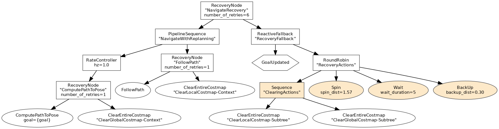
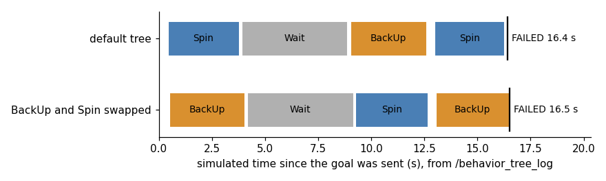
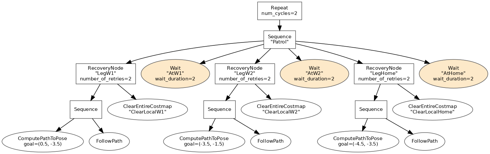
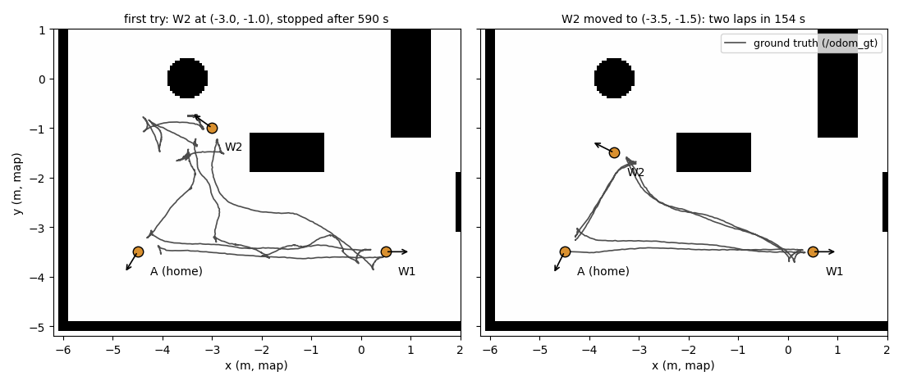

# Project 13. Behaviour trees: read, change and write one

| | |
|---|---|
| Goal | Open the behaviour tree that Nav2 runs for every goal, draw it, change the order of its recoveries in your own copy, load the copy into `bt_navigator` and show from the tree's own log that the robot now recovers in the new order. Then write a small tree of your own that patrols three waypoints twice, with no Python node in the loop. |
| Time | 1.5 h |
| Before you start | [Chapter 10](../../docs/10-mapping-and-navigation.md), Task 4, where you start Nav2 and AMCL and send goals with `go_to_goal.py`. |
| You will learn | how Nav2's `navigate_to_pose_w_replanning_and_recovery.xml` is built (control nodes, conditions, actions, and the `RecoveryNode` / `RoundRobin` pair that decides what to try when planning fails); how `bt_navigator` picks its tree (`default_nav_to_pose_bt_xml`) and how to check which tree is loaded; how to read `/behavior_tree_log` to see each node change state, in simulated time; how to write a tree from nodes that ship with Nav2 Humble, and what goes wrong when a waypoint is badly placed. |

Every terminal starts with:

```bash
cd go2-nav-sim
source env.sh
```

Groot2 (the graphical tree editor the Nav2 docs use) is not installed in this course. A tree is a short XML file: you edit it
in a text editor and draw it with `bt_tools.py`, which needs only Graphviz (`dot`).

The files of this project:

| File | What it does |
|---|---|
| `trees/default.xml` | an unmodified copy of Nav2 Humble's `navigate_to_pose_w_replanning_and_recovery.xml` |
| `trees/recovery_swapped.xml` | the same tree with `Spin` and `BackUp` swapped |
| `trees/patrol.xml` | the patrol tree (A → W1 → W2 → A, twice) |
| `trees/patrol_tight_w2.xml` | the first version of the patrol, kept to reproduce the failure in "If it goes wrong" |
| `nav_bt.launch.py` | Nav2 + AMCL as `nav.launch.py` starts them, with `bt_xml:=<tree>` |
| `bt_log.py` | prints `/behavior_tree_log` one line per state change, and can log the true pose |
| `bt_tools.py` | ROS-free: draw a tree, list its recoveries and waypoints, summarise a log |
| `plot.py` | the two result figures |

## Task 1: Read Nav2's default tree

### 1.1 Check the copy and list its recoveries

Objective: know which node runs when the planner fails.

```bash
diff /opt/ros/humble/share/nav2_bt_navigator/behavior_trees/navigate_to_pose_w_replanning_and_recovery.xml \
     projects/p13_behaviour-trees/trees/default.xml && echo identical
python3 projects/p13_behaviour-trees/bt_tools.py recoveries projects/p13_behaviour-trees/trees/default.xml
```

```
identical
ClearingActions -> Spin -> Wait -> BackUp
```

Check: `identical`, and four recoveries in this order.

### 1.2 Draw the tree and read it from the top

Objective: say what each control node does with a failure.

```bash
python3 projects/p13_behaviour-trees/bt_tools.py draw projects/p13_behaviour-trees/trees/default.xml /tmp/default_tree.png
```

```
/tmp/default_tree.png: 18 nodes
```



Boxes are control nodes, the hexagon is a condition, ellipses are actions; the recoveries are shaded. Read it from the top:

- `RecoveryNode "NavigateRecovery"` ticks its first child. If that child fails, it ticks the second child (the recovery)
  and, if the recovery succeeds, tries the first child again. It gives up after `number_of_retries=6` recoveries.
- The first child, `PipelineSequence "NavigateWithReplanning"`, replans at 1 Hz (`RateController`) and follows the latest
  path. Each of the two has its own small `RecoveryNode` that clears a costmap once before failing upwards.
- The second child, `ReactiveFallback "RecoveryFallback"`, first checks `GoalUpdated` (a new goal cancels the recovery),
  then ticks `RoundRobin "RecoveryActions"`. A `RoundRobin` runs one child per tick and remembers where it stopped, so
  successive failures get ClearingActions, Spin, Wait, BackUp, ClearingActions, Spin.

Check: you can say which recovery runs third (Wait) and how many recoveries happen before the goal fails (6).

## Task 2: Make the default tree fail and log it

### 2.1 Start Nav2 with a tree you name

Objective: run Nav2 with a tree you name, so the later swap is the only change.

```bash
scripts/up.sh                       # terminal 1: sim, estimation, Nav2; wait for "stack up"
bash scripts/stop.sh nav            # terminal 1: stop the Nav2 that up.sh started; Gazebo and estimation keep running
ros2 launch projects/p13_behaviour-trees/nav_bt.launch.py     # terminal 2, leave it running
```

```
nav_bt: /tmp/nav2_params_bt_tf9wwvk1.yaml uses /opt/ros/humble/share/nav2_bt_navigator/behavior_trees/navigate_to_pose_w_replanning_and_recovery.xml
...
[lifecycle_manager-3] [INFO] [...] [lifecycle_manager_localization]: Managed nodes are active
[lifecycle_manager-11] [INFO] [...] [lifecycle_manager_navigation]: Managed nodes are active
```

`nav_bt.launch.py` copies `config/nav2_params.yaml`, adds `bt_navigator.default_nav_to_pose_bt_xml`, and starts the same
`nav2_bringup` launch file as `nav.launch.py` (without the passive mapper). Without `bt_xml:=` it loads Nav2's own file,
so this run is today's behaviour.

Check: both "Managed nodes are active" lines appear (localization and navigation).

### 2.2 Check which tree is loaded

Objective: read the tree's path from the running node, not from your launch command.

```bash
ros2 param get /bt_navigator default_nav_to_pose_bt_xml          # terminal 1
```

```
String value is: /opt/ros/humble/share/nav2_bt_navigator/behavior_trees/navigate_to_pose_w_replanning_and_recovery.xml
```

Check: the parameter names Nav2's file.

### 2.3 Send an unreachable goal and log the tree

Objective: force the recoveries to run, and record their order.

The goal (1.0, 0.0) is the centre of the brick wall (`box1` in Gazebo, `BOXES[1]` in `make_arena.py`: 0.8 m × 2.4 m at
(1.0, 0.0)). The planner can never reach it, so every recovery runs.

```bash
python3 projects/p13_behaviour-trees/bt_log.py | tee /tmp/default.log          # terminal 3
python3 src/go2_nav_sim/scripts/go_to_goal.py 1.0 0.0 0.0                       # terminal 4
```

Terminal 4:

```
[INFO] [...] [basic_navigator]: goal -> (1.00, 0.00, yaw 0.00)
[INFO] [...] [basic_navigator]: distance remaining 0.00 m, recoveries 3
...
[INFO] [...] [basic_navigator]: distance remaining 0.00 m, recoveries 14
RESULT FAILED  sim_time 17.9 s  ground-truth final error 6.68 m  final pos (-4.38, -3.96)
```

Terminal 3 (Ctrl-C it after the result; an excerpt):

```
    0.40  RecoveryFallback             IDLE     -> RUNNING
    0.40  RecoveryActions              IDLE     -> RUNNING
    0.40  Spin                         IDLE     -> RUNNING
    3.81  Spin                         RUNNING  -> SUCCESS
    3.81  RecoveryActions              RUNNING  -> SUCCESS
...
   16.41  NavigateRecovery             RUNNING  -> FAILURE
```

Check: `RESULT FAILED`, and the log ends with `NavigateRecovery ... -> FAILURE`.

Common mistakes: trusting the `recoveries` number in the feedback. It reached 14 for six recoveries in this run, and it
rose to 5 or 6 during the patrols of Task 4, which had no failed legs (their `Wait` stops are behaviour-server actions too).
The tree log is the record of what ran.

### 2.4 Summarise the log

Objective: reduce the log to the recoveries and their start times.

```bash
python3 projects/p13_behaviour-trees/bt_tools.py summary /tmp/default.log
```

```
    0.1 s  ClearLocalCostmap-Subtree
    0.4 s  Spin
    3.9 s  Wait
    9.0 s  BackUp
   12.7 s  ClearLocalCostmap-Subtree
   12.9 s  Spin
```

Check: six recoveries in the order of Task 1.

## Task 3: Change the recovery order

### 3.1 Swap two recoveries in a copy

Objective: change one thing in the tree.

`trees/recovery_swapped.xml` is `trees/default.xml` with `Spin` and `BackUp` exchanged inside `RoundRobin`:

```bash
cd projects/p13_behaviour-trees
diff trees/default.xml trees/recovery_swapped.xml
python3 bt_tools.py recoveries trees/recovery_swapped.xml
cd ../..
```

```
5a6
>   p13 change: BackUp runs before Spin in RecoveryActions (one swap, nothing else changed).
29,30d29
<           <Spin spin_dist="1.57"/>
<           <Wait wait_duration="5"/>
31a31,32
>           <Wait wait_duration="5"/>
>           <Spin spin_dist="1.57"/>
ClearingActions -> BackUp -> Wait -> Spin
```

Check: the diff touches only the comment and the `RoundRobin` children.

### 3.2 Load the copy

Objective: make `bt_navigator` use your file.

Stop `nav_bt.launch.py` in terminal 2 with Ctrl-C (or `bash scripts/stop.sh nav` in terminal 1), then:

```bash
ros2 launch projects/p13_behaviour-trees/nav_bt.launch.py bt_xml:=$PWD/projects/p13_behaviour-trees/trees/recovery_swapped.xml   # terminal 2
ros2 param get /bt_navigator default_nav_to_pose_bt_xml          # terminal 1, after "Managed nodes are active" twice
```

```
nav_bt: /tmp/nav2_params_bt_bd80zc85.yaml uses /home/.../go2-nav-sim/projects/p13_behaviour-trees/trees/recovery_swapped.xml
String value is: /home/.../go2-nav-sim/projects/p13_behaviour-trees/trees/recovery_swapped.xml
```

Check: the parameter shows your file. The path must be absolute: `bt_navigator` does not know your working directory.

### 3.3 Rerun the mission and compare the logs

Objective: show the change in the log, not in the XML.

Repeat 2.3 (log to `/tmp/swapped.log`). The result line was
`RESULT FAILED  sim_time 18.2 s  ground-truth final error 6.13 m  final pos (-4.03, -3.52)`, and:

```bash
python3 projects/p13_behaviour-trees/bt_tools.py summary /tmp/swapped.log
```

```
    0.1 s  ClearLocalCostmap-Subtree
    0.5 s  BackUp
    4.1 s  Wait
    9.2 s  Spin
   12.7 s  ClearLocalCostmap-Subtree
   13.0 s  BackUp
```



The chase camera during the swapped run: the robot backs up first, waits, then turns.

<video controls muted playsinline src="media/recovery_swapped_chase.mp4"></video>

To redraw the figure from your own logs, copy them to `results/default.log` and `results/swapped.log` and run
`python3 projects/p13_behaviour-trees/plot.py`.

Check: `BackUp` is the first action after the clearing step, and `Spin` is third.

### 3.4 Give up sooner

Objective: change how many recoveries the tree allows, and see when the goal fails.

Make a copy with `number_of_retries="2"` on `NavigateRecovery` (the two inner `RecoveryNode`s have `1` and stay as they are),
load it as in 3.2 and repeat 2.3:

```bash
sed 's/number_of_retries="6"/number_of_retries="2"/' projects/p13_behaviour-trees/trees/default.xml > /tmp/retries2.xml
ros2 launch projects/p13_behaviour-trees/nav_bt.launch.py bt_xml:=/tmp/retries2.xml           # terminal 2, after stopping the old one
python3 projects/p13_behaviour-trees/bt_log.py | tee /tmp/retries2.log                         # terminal 3
python3 src/go2_nav_sim/scripts/go_to_goal.py 1.0 0.0 0.0                                      # terminal 4
```

The saved run (`results/try_retries2.log`):

```bash
python3 projects/p13_behaviour-trees/bt_tools.py summary projects/p13_behaviour-trees/results/try_retries2.log
grep 'NavigateRecovery.*FAILURE' projects/p13_behaviour-trees/results/try_retries2.log
```

```
    0.1 s  ClearLocalCostmap-Subtree
    0.3 s  Spin
    4.26  NavigateRecovery             RUNNING  -> FAILURE
```

Two recoveries ran. `NavigateRecovery` failed at 4.26 s, as soon as the first `Spin` ended and planning failed once more,
instead of at 16.4 s.

Check: two lines in the summary and a `FAILURE` near 4 s.

## Task 4: Write a patrol tree

### 4.1 Read the patrol tree

Objective: a tree that visits A → W1 → W2 → A twice and stops 2 s at each point.

There are two ways to do this without new software. `py_trees` is not installed, and a Python state machine (as in
project 4's polar controller or Rico's `br2_fsm_bumpgo_py`) would sit outside Nav2 and need its own retry logic. A Nav2 BT
XML runs inside `bt_navigator`, where the planner and controller clients, the costmap-clearing services and the action
feedback are already loaded, and uses only nodes listed in `plugin_lib_names` in `nav2_params.yaml`. This project uses the
XML.

`trees/patrol.xml`, with one leg shown (the other two differ only in the goal):

```xml
<Repeat num_cycles="2">
  <Sequence name="Patrol">
    <RecoveryNode number_of_retries="2" name="LegW1">
      <Sequence>
        <ComputePathToPose goal="0;map;0.5;-3.5;0;0;0;0.0;1.0" path="{path}" planner_id="GridBased"/>
        <FollowPath path="{path}" controller_id="FollowPath"/>
      </Sequence>
      <ClearEntireCostmap name="ClearLocalW1" service_name="local_costmap/clear_entirely_local_costmap"/>
    </RecoveryNode>
    <Wait name="AtW1" wait_duration="2"/>
    ...
```

Each leg's recovery clears only the local costmap. A leg that fails in `FollowPath` (the controller) can be helped by that;
a leg that fails in `ComputePathToPose` (the global planner) cannot, because the planner reads the global costmap, so the
retries fail the same way and the leg fails.



```bash
python3 projects/p13_behaviour-trees/bt_tools.py waypoints projects/p13_behaviour-trees/trees/patrol.xml
```

```
( 0.50, -3.50)  yaw     0.0 deg
(-3.50, -1.50)  yaw   153.4 deg
(-4.50, -3.50)  yaw  -116.6 deg
```

Check: three waypoints, the last one A.

### 4.2 Run the patrol

Objective: run the tree from a fresh stack with the robot on A.

Terminal 1, a fresh stack, then stop its Nav2 (Gazebo and estimation keep running):

```bash
scripts/up.sh && bash scripts/stop.sh nav
```

Terminal 2, Nav2 with the patrol tree (it keeps running):

```bash
ros2 launch projects/p13_behaviour-trees/nav_bt.launch.py bt_xml:=$PWD/projects/p13_behaviour-trees/trees/patrol.xml
```

Terminal 3, after "Managed nodes are active" has appeared twice in terminal 2, the tree log and the true pose:

```bash
python3 projects/p13_behaviour-trees/bt_log.py --gt /tmp/patrol_gt.csv | grep -E 'Leg|At|Repeat' | grep -v 'IDLE     -> RUNNING'
```

Terminal 4, any goal starts the tree. The tree ignores the goal's pose; A is given so that the script reports the error at A:

```bash
python3 src/go2_nav_sim/scripts/go_to_goal.py -4.5 -3.5 -2.03
```

Output of the logger, from the first successful run in the Results table:

```
   21.21  LegW1                        RUNNING  -> SUCCESS
   23.22  AtW1                         RUNNING  -> SUCCESS
   54.35  LegW2                        RUNNING  -> SUCCESS
   56.38  AtW2                         RUNNING  -> SUCCESS
   71.43  LegHome                      RUNNING  -> SUCCESS
   73.48  AtHome                       RUNNING  -> SUCCESS
  101.24  LegW1                        RUNNING  -> SUCCESS
  103.31  AtW1                         RUNNING  -> SUCCESS
  135.22  LegW2                        RUNNING  -> SUCCESS
  137.27  AtW2                         RUNNING  -> SUCCESS
  152.16  LegHome                      RUNNING  -> SUCCESS
  154.25  AtHome                       RUNNING  -> SUCCESS
  154.25  Repeat                       RUNNING  -> SUCCESS
```

and `go_to_goal.py` ends with `RESULT SUCCEEDED  sim_time 155.8 s  ground-truth final error 0.32 m  final pos (-4.28, -3.26)`.

Check: `Repeat ... -> SUCCESS` and `RESULT SUCCEEDED`. The 0.32 m at A is inside what Nav2 accepts: `xy_goal_tolerance`
0.25 m on AMCL's estimate, plus AMCL's own error.

This patrol does not always succeed: one of the nine fresh-stack runs in Results failed when AMCL lost the robot (see
"If it goes wrong").

## How the code works

**Loading a tree.** `bt_navigator` reads `default_nav_to_pose_bt_xml` once, when it is configured, and uses that tree for
every `NavigateToPose` goal that does not name its own. The course's `nav2_params.yaml` does not contain the key, so
`nav_bt.launch.py` adds it to a copy:

```python
params = yaml.safe_load(open(os.path.join(me, 'config/nav2_params.yaml')))
params['bt_navigator']['ros__parameters']['default_nav_to_pose_bt_xml'] = LaunchConfiguration('bt_xml').perform(context)
```

`nav2_common`'s `RewrittenYaml`, which the Nav2 launch files use for overrides, only replaces keys that already exist in the
file (`substitute_params` in `nav2_common/launch/rewritten_yaml.py` walks the existing leaves), so passing the key as a
rewrite silently does nothing.

**Reading the log.** `bt_navigator` publishes `/behavior_tree_log` (`nav2_msgs/BehaviorTreeLog`): a batch of
`(node_name, previous_status, current_status)` per tick in which something changed. `bt_log.py` prints them with the
message's stamp (simulated time) relative to the first one, and drops two kinds of line that hide the rest: changes back to
`IDLE` (the tree resetting a node) and `GoalUpdated -> FAILURE`, which the `ReactiveFallback` re-checks on every tick while a
recovery runs (about 100 lines per second).

**Recovery order.** With `RoundRobin` the k-th recovery (counting from 0) is child `k mod 4`, so with retries `N = 6` the
sequence is children 0, 1, 2, 3, 0, 1. Swapping children 1 and 3 changes which action runs first and last, and nothing
else: the same six recoveries, the same `FAILURE` at the end.

**Waypoints in the XML.** A port such as `goal` accepts a string that `nav2_behavior_tree/bt_conversions.hpp` converts to a
`PoseStamped`: `stamp;frame;x;y;z;qx;qy;qz;qw`. `bt_tools.waypoints` parses it back. The yaw of each waypoint is the direction
of the leg that reaches it, `yaw = atan2(y_to - y_from, x_to - x_from)`, so the controller does not have to turn on the spot
on arrival; `qz = sin(yaw/2)`, `qw = cos(yaw/2)`. The unit test checks this for all three waypoints.

**Tests.** The XML handling and the log parser run without ROS:

```bash
/usr/bin/python3 -m pytest -q projects/p13_behaviour-trees/tests
```

```
...                                                                      [100%]
3 passed
```

## Results

All runs on the arena, one robot, `ROS_DOMAIN_ID` of my own, one run per row unless stated. "Fresh stack" means
`scripts/up.sh`, then `bash scripts/stop.sh nav`, then `nav_bt.launch.py` with the tree, as in 4.2.

| Run | Tree | Outcome | Sim time | Recoveries, in order (from `/behavior_tree_log`) |
|---|---|---|---|---|
| unreachable goal (1.0, 0.0) | default | FAILED after 6 recoveries | 16.4 s to `NavigateRecovery` FAILURE | Clear, Spin, Wait, BackUp, Clear, Spin |
| unreachable goal (1.0, 0.0) | Spin and BackUp swapped | FAILED after 6 recoveries | 16.5 s | Clear, BackUp, Wait, Spin, Clear, BackUp |
| patrol, W2 at (-3.0, -1.0) | `patrol_tight_w2.xml` | stalled at W2 on lap 2, stopped by me after 590 s wall | lap 1 119.0 s; lap 2 W2 leg 197.2 s | 199 "collision ahead" warnings at W2 |
| patrol, W2 at (-3.5, -1.5), fresh stack | `patrol.xml` | SUCCEEDED, 2 laps, final error 0.32 m | 154.3 s | none |
| patrol, W2 at (-3.5, -1.5), same stack again | `patrol.xml` | FAILED on leg W1 | 43.6 s | AMCL 2.5 m off (see "If it goes wrong") |
| patrol, W2 at (-3.5, -1.5), fresh stack | `patrol.xml` | SUCCEEDED, 2 laps, final error 0.36 m | 164.7 s | none |
| patrol, W2 at (-3.5, -1.5), fresh stack, 5 runs | `patrol.xml` | SUCCEEDED 5 of 5, 2 laps, final error 0.33 to 0.39 m | 158.0 to 175.2 s | none |
| patrol, W2 at (-3.5, -1.5), fresh stack, second tester, run 1 | `patrol.xml` | FAILED on leg LegHome, final error 0.47 m | 211.2 s to LegHome FAILURE; `go_to_goal.py` 213.1 s | AMCL at (-0.86, 0.40), true pose (-4.23, -3.12) (see "If it goes wrong") |
| patrol, W2 at (-3.5, -1.5), fresh stack, second tester, run 2 | `patrol.xml` | SUCCEEDED, 2 laps, final error 0.39 m | 158.8 s | none |

The five-run row is `patrol_run4` to `patrol_run8` in `results/`, five fresh stacks one after another: `Repeat` reached
`SUCCESS` at 166.0, 161.5, 161.3, 158.0 and 175.2 s, with final errors 0.33, 0.39, 0.36, 0.35 and 0.35 m, and no
`FAILURE` line in any tree log. The two "second tester" rows are from a reviewer who ran 4.2 on a fresh stack; their logs
are not in `results/`. Counting every fresh-stack patrol above, 8 of 9 succeeded.

Measured action durations in the two unreachable-goal runs (`bt_tools.intervals`): `Spin` (1.57 rad) 3.35 to 3.46 s;
`Wait` (5 s) 5.05 and 5.07 s; `BackUp` (0.30 m at 0.05 m/s) 3.48 to 3.63 s.

Commands that produced the table: Tasks 2 to 4 above, then

```bash
python3 projects/p13_behaviour-trees/bt_tools.py summary projects/p13_behaviour-trees/results/default.log
python3 projects/p13_behaviour-trees/bt_tools.py summary projects/p13_behaviour-trees/results/swapped.log
grep -E 'Leg|At|Repeat' projects/p13_behaviour-trees/results/patrol.log | grep -v 'IDLE     -> RUNNING'
python3 projects/p13_behaviour-trees/plot.py
```

The raw logs are in `results/`: `default.log`, `swapped.log`, `patrol.log` (+ `_gt.csv`, `_mission.txt`),
`patrol_first_try*`, `patrol_run2*` and `patrol_run3*` `patrol_run4*` to `patrol_run8*` (the rows of the table, in order). `try_retries2.log` is the
run behind 3.4 and `try_waitfirst.log` the run behind the Exercise.



## Exercise

**Make the robot wait first.** In a copy of `trees/default.xml`, put `Wait` before `Spin` and `BackUp` in
`RecoveryActions`, load it and send the unreachable goal of 2.3. What does the summary show in the first 5 s after the goal,
and does the robot move?

*Answer:* with the order ClearingActions, Wait, Spin, BackUp the summary of `results/try_waitfirst.log` starts
`0.1 s ClearLocalCostmap-Subtree`, `0.4 s Wait`, `5.6 s Spin`, `9.2 s BackUp`: the robot stands still for the first 5.6 s.
The goal failed at 18.52 s instead of 16.4 s; on an unreachable goal this order only delays the failure.

## If it goes wrong

- **The new tree is not used.** `ros2 param get /bt_navigator default_nav_to_pose_bt_xml` still shows Nav2's file. The
  key was passed as a `RewrittenYaml` override or a relative path; use `nav_bt.launch.py` with an absolute `bt_xml:=`.
- **A waypoint the robot cannot settle on.** The first patrol put W2 at (-3.0, -1.0), 0.72 m from the orange pillar at
  (-3.5, 0.0), with the arrival heading (144°) passing the pillar. On lap 2 the leg to W2 took 197 s: the controller logged
  `RegulatedPurePursuitController detected collision ahead!` 199 times, all in the last 100 s (wall clock) while the robot was
  within 0.27 m of W2 (`results/patrol_first_try_nav_warnings.log`), and one `Failed to make progress`. When the leg finally
  succeeded, the next `ComputePathToPose` to A failed three times in 20 ms (`GridBased: failed to create plan with tolerance
  0.30`) and the goal failed. The robot ended 0.35 m from the pillar's surface, about one robot radius (0.33 m); a start
  inside the inscribed cost makes the planner fail this way (my inference, I did not save the costmap). Moving W2 to
  (-3.5, -1.5), 1.1 m from the pillar, removed all of these warnings in the next run.
- **AMCL loses the robot during a patrol, on the same stack or a fresh one.** Running the patrol again on the same stack,
  right after a successful one, failed after 43.6 s on leg W1: `/amcl_pose` was (-0.46, -1.46) while the true pose was
  (-0.91, -3.92). The global costmap had W1 in inscribed cost (value 99 of 100) although nothing stands there, and the
  planner failed; with the robot placed 2.5 m off, the scans were most likely painted in the wrong place (my inference)
  (`results/patrol_run2_nav_warnings.log`). A fresh stack does not prevent this. A second tester's first fresh-stack run
  failed the same way: `LegHome -> FAILURE` at 211.17 s after `Controller patience exceeded`, then `GridBased` failed twice
  to plan to (-4.50, -3.50); at the end `/amcl_pose` was (-0.86, 0.40), the true pose (-4.23, -3.12), and the global costmap
  read 99 at W2. Their second fresh run and my seven succeeded. The tree cannot recover from a wrong AMCL pose: each leg's
  `RecoveryNode` clears only the local costmap (4.1), and `go_to_goal.py` re-initialises AMCL from ground truth only before
  the goal, not between legs. Watch for it during the run: `ros2 topic echo /amcl_pose --field pose.pose.position` against
  `ros2 topic echo /odom_gt --field pose.pose.position` (add (-4.5, -3.5) to `/odom_gt`, which starts at 0 on A). If they
  drift apart by more than about 0.5 m, stop Nav2 (`bash scripts/stop.sh nav`, then a zero `/cmd_vel`) and start the run
  again. [Chapter 10](../../docs/10-mapping-and-navigation.md) covers AMCL.
- **The robot keeps going after you stop the script.** Killing `go_to_goal.py` does not cancel the goal. In the first
  patrol the script was stopped by `timeout`, and the planner log shows the next leg being planned after that.
  `bt_navigator` keeps ticking the tree until it finishes; stop it with `bash scripts/stop.sh nav`, then publish a zero
  `/cmd_vel`.
- **`Behavior Tree tick rate 100.00 was exceeded!`** appeared up to 31 times per run. It means one tick took longer than
  10 ms on a loaded machine; it did not change any result above.

## Further reading

- F. Rico, *A Concise Introduction to Robot Programming with ROS 2*, 2025, chapters 3 and 6; code in `fmrico/book_ros2`
  (`br2_fsm_bumpgo_py`, `br2_bt_patrolling`).
- Nav2, "Groot2" tutorial: https://docs.nav2.org/rolling/tutorials/general_tutorials/groot_tutorials/groot2/groot2/
