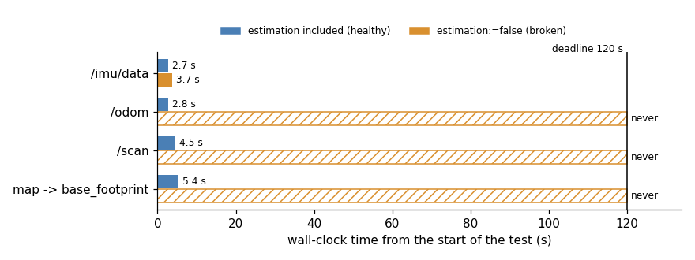

# Project 14. Test the stack: a launch smoke test

| | |
|---|---|
| Goal | One test that starts the simulation headless, checks that the lidar scan, the IMU and the odometry arrive within a deadline at the rates the configuration asks for, and that `map` → `base_footprint` can be looked up. Run it with `launch_test` and under `colcon test`, then break the stack on purpose and read the failure. |
| Time | 1.5 h |
| Before you start | The stack from [chapter 3](../../docs/03-install-and-first-run.md) and the TF tree from [chapter 5](../../docs/05-frames-and-tf2.md) (`map` → `odom` → `base_footprint`). |
| You will learn | how `launch_testing` works (a launch description that starts the system under test, `ReadyToTest`, and ordinary `unittest` test cases that run while it is up); why the rates are measured from message stamps (simulated time) and not from the wall clock; how to keep the pass/fail rules free of ROS so they can be unit-tested in milliseconds; what a failing smoke test prints, and how to go from that output to the missing launch file. |

Every terminal starts with:

```bash
cd go2-nav-sim
source env.sh
bash scripts/stop.sh        # the test starts its own Gazebo; a running stack in the same ROS domain would answer for it
```

The files:

| File | What it does |
|---|---|
| `smoke.launch.py` | the launch test: starts sim, estimation and map_server + AMCL, then one test case |
| `smoke_checks.py` | the pass/fail rules (deadline, expected rates, tolerance), no ROS imports |
| `tests/test_smoke_checks.py` | unit tests of the rules |
| `plot.py` | the figure below, from `results/healthy.json` and `results/broken.json` |
| `colcon_pkg/` | a package that registers the test with `colcon test` (Task 4) |

## Task 1: Check the pass/fail rules without ROS

### 1.1 Run the unit tests

Objective: know the rules work before you trust a two-minute test built on them.

```bash
/usr/bin/python3 -m pytest -q projects/p14_test-the-stack/tests
```

```
...                                                                      [100%]
3 passed in 0.02s
```

Check: three tests pass, including `test_each_kind_of_failure_is_reported`.

### 1.2 Read the rules

Objective: know where each expected number comes from.

The rules in `smoke_checks.py`:

| Item | Expected | Source |
|---|---|---|
| `/scan` | 10 Hz ± 10 % | lidar `update_rate` 10 in `urdf/sensors.xacro` |
| `/imu/data` | 100 Hz ± 10 % | the Go2 description's IMU plugin; [project 1](../p01_first-steps/README.md), step 4, measured 98.6 Hz |
| `/odom` | 50 Hz ± 10 % | `frequency: 50.0` in `config/ekf.yaml` |
| first message of each, and `map` → `base_footprint` | within 120 s of the start | `DEADLINE` |

Check: you can name the file each expected rate comes from.

## Task 2: Run the smoke test on a healthy stack

### 2.1 Run it

Objective: one command that says whether the stack comes up.

```bash
launch_test projects/p14_test-the-stack/smoke.launch.py
```

The launch output of 14 processes scrolls past; the lines that matter:

```
test_sensors_odometry_and_tf (smoke.launch.TestStackComesUp) ... [INFO] [robot_state_publisher-1]: process started ...
...
smoke: topic          first msg (s)   rate (Hz)   expected (Hz)
smoke: /scan                    4.5        10.0              10
smoke: /imu/data                2.7        99.8             100
smoke: /odom                    2.8        50.0              50
smoke: map -> base_footprint  5.4 s
...
ok
----------------------------------------------------------------------
Ran 1 test in 9.837s

OK
...
Ran 0 tests in 0.000s

OK
```

The second `Ran 0 tests` is the post-shutdown section, which this test does not use. `echo $?` after the command prints `0`.

The chase camera for the 5.2 s of simulated time the test ran: the robot is spawned on A and stands. Nothing moves, and
nothing has to; the test only checks that data flows.

<video controls muted playsinline src="media/smoke_healthy_chase.mp4"></video>

Check: `OK`, exit status 0, and `results/last_run.json` holds the numbers above.

Common mistakes: running the test while `scripts/up.sh` is still up in the same terminal setup. Both use the same
`ROS_DOMAIN_ID`, so the probe would read the old stack's topics and the test's own Gazebo would compete for the same
`GAZEBO_MASTER_URI`. Stop the stack first.

### 2.2 Find how much margin the deadline has

Objective: find the smallest `DEADLINE` that a healthy run still passes, without starting Gazebo again.

`check()` takes the measurements of one run, so you can replay a saved run against other deadlines. This uses healthy run 2
(`results/healthy.json`) and rebuilds 5 s of stamps at each measured rate:

```bash
cd projects/p14_test-the-stack
python3 - <<'EOF'
import json, smoke_checks as sc
r = json.load(open('results/healthy.json'))                         # healthy run 2
ticks = lambda hz: [100 + i / hz for i in range(int(hz * 5) + 1)]   # 5 s of stamps at the measured rate
stamps = {t: ticks(hz) for t, hz in r['rate_hz'].items()}
print(f"transform at {r['tf_s']:.2f} s")
for d in (5.4, 5.5, 120):
    print(d, sc.check(r['first_msg_s'], stamps, r['tf_s'], deadline=d))
EOF
cd ../..
```

```
transform at 5.44 s
5.4 ['map -> base_footprint: no transform within 5 s']
5.5 []
120 []
```

The transform is the last item to arrive, and `check()` fails only when it arrives after the deadline (`tf_seen > deadline`).
Over the three healthy runs in Results the latest transform was run 1's, at 6.6 s, so any deadline below 6.6 s would have
failed run 1. (The message prints the deadline rounded to whole seconds, hence "5 s".) Keep a margin for a cold start
(Gazebo loading models from disk the first time) and for a loaded machine; 120 s costs nothing when the stack is healthy,
because the test stops as soon as everything is in.

Check: 5.4 fails on the transform only, 5.5 and 120 pass.

## Task 3: Break the stack and read the failure

### 3.1 Leave out the estimation launch file

Objective: see what a failure looks like, and check that the test catches it.

`estimation.launch.py` starts `pointcloud_to_laserscan` (`/scan`), the lidar odometry and the EKF (`/odom`, and the
`odom` → `base_footprint` transform). The test has a launch argument to leave it out:

```bash
launch_test projects/p14_test-the-stack/smoke.launch.py estimation:=false
echo $?
```

After 120 s:

```
FAIL
======================================================================
FAIL: test_sensors_odometry_and_tf (smoke.launch.TestStackComesUp)
----------------------------------------------------------------------
Traceback (most recent call last):
  File ".../projects/p14_test-the-stack/smoke.launch.py", line 84, in test_sensors_odometry_and_tf
    self.assertEqual(fails, [], 'smoke test failed:\n  ' + '\n  '.join(fails))
AssertionError: Lists differ: ['/scan: no message within 120 s', '/odom:[73 chars]0 s'] != []
...
  /scan: no message within 120 s
  /odom: no message within 120 s
  map -> base_footprint: no transform within 120 s
----------------------------------------------------------------------
Ran 1 test in 120.250s

FAILED (failures=1)
smoke: topic          first msg (s)   rate (Hz)   expected (Hz)
smoke: /scan          never         0.0              10
smoke: /imu/data                3.7        99.7             100
smoke: /odom          never         0.0              50
smoke: map -> base_footprint  never
```

and `echo $?` prints `1`.

Check: exit status 1, and the three failure lines name `/scan`, `/odom` and the transform, not `/imu/data`.

### 3.2 Read the failure from the bottom

Objective: get from the failure lines to the launch file that did not run.

The IMU works, so Gazebo and the robot are up. `/scan` and `/odom` never came, and the transform failed because `odom` →
`base_footprint` comes from the EKF, which also did not run. Three failures with one cause: the estimation launch file. The
test cannot tell you that directly; the pattern of what came and what did not points to it.



Check: you can say which of the three failures would remain if only the EKF were missing (`/odom` and the transform;
`/scan` comes from `pointcloud_to_laserscan`).

### 3.3 Make a rate check fail

Objective: see the second kind of failure, a topic that arrives at the wrong rate.

Replay the same healthy run with `/odom` expected at 100 Hz instead of 50 Hz:

```bash
cd projects/p14_test-the-stack
python3 - <<'EOF'
import json, smoke_checks as sc
r = json.load(open('results/healthy.json'))
ticks = lambda hz: [100 + i / hz for i in range(int(hz * 5) + 1)]
stamps = {t: ticks(hz) for t, hz in r['rate_hz'].items()}
print(sc.check(r['first_msg_s'], stamps, r['tf_s'], expected={**sc.EXPECTED, '/odom': 100.0}))
EOF
cd ../..
```

```
['/odom: 50.0 Hz, expected 100 Hz +- 10%']
```

Changing `EXPECTED['/odom']` in `smoke_checks.py` to 100.0 and running `launch_test` gives this line in the assertion
message, and the other checks pass. The unit test `test_each_kind_of_failure_is_reported` shows the same format for the IMU.

Check: one failure, on `/odom` only.

## Task 4: Run it under colcon test

### 4.1 Register the test in a package

Objective: make the smoke test part of the normal test command of a ROS 2 workspace.

`colcon test` runs tests that a package registers in its `CMakeLists.txt`. The course's own package is shared, so this
project ships a small package in `colcon_pkg/` (a `package.xml` and the `CMakeLists.txt` below) that points at the test
file. It contains a `COLCON_IGNORE` file so that the course's own `colcon build` skips it; copy it into a workspace of
your own and remove that file there:

```cmake
cmake_minimum_required(VERSION 3.8)
project(p14_smoke)
find_package(ament_cmake REQUIRED)
if(NOT DEFINED ENV{SMOKE_TEST})
  message(FATAL_ERROR "set SMOKE_TEST to the absolute path of projects/p14_test-the-stack/smoke.launch.py")
endif()
if(BUILD_TESTING)
  find_package(launch_testing_ament_cmake REQUIRED)
  add_launch_test($ENV{SMOKE_TEST} TIMEOUT 300)
  add_launch_test($ENV{SMOKE_TEST} TARGET smoke_no_estimation ARGS "estimation:=false" TIMEOUT 300)
endif()
ament_package()
```

The second `add_launch_test` registers the broken run of Task 3 as its own test, `smoke_no_estimation`, by passing the
launch argument with `ARGS`. It is there so you can see a failure in `colcon test`; it is meant to fail.

Check: two `add_launch_test` lines, the second with `ARGS "estimation:=false"`.

### 4.2 Build and test the package

Objective: one healthy test that passes and one broken test that fails, both under `colcon test`.

From a terminal where `env.sh` is sourced, in the `go2-nav-sim` folder:

```bash
mkdir -p ~/p14_ws/src && cp -r projects/p14_test-the-stack/colcon_pkg ~/p14_ws/src/p14_smoke && rm ~/p14_ws/src/p14_smoke/COLCON_IGNORE
export SMOKE_TEST=$PWD/projects/p14_test-the-stack/smoke.launch.py
cd ~/p14_ws
colcon build --packages-select p14_smoke
colcon test --packages-select p14_smoke --event-handlers console_direct-
colcon test-result --all
```

```
Finished <<< p14_smoke [2min 20s]	[ with test failures ]

Summary: 1 package finished [2min 20s]
  1 package had stderr output: p14_smoke
  1 package had test failures: p14_smoke
```

```
.../build/p14_smoke/Testing/20261128-0658/Test.xml: 2 tests, 0 errors, 1 failure, 0 skipped
.../build/p14_smoke/test_results/p14_smoke/..._smoke.launch.py.xunit.xml: 1 test, 0 errors, 0 failures, 0 skipped
.../build/p14_smoke/test_results/p14_smoke/smoke_no_estimation.xunit.xml: 1 test, 0 errors, 1 failure, 0 skipped

Summary: 4 tests, 0 errors, 2 failures, 0 skipped
```

Each launch test is counted twice, once by CTest (`Test.xml`) and once by launch_testing (`*.xunit.xml`), so two tests
show up as four. With only the first `add_launch_test` line, the same commands gave `Finished <<< p14_smoke [14.9s]` and
`Summary: 2 tests, 0 errors, 0 failures, 0 skipped`. CTest ran the two tests one after the other (14.9 s + about 120 s),
so the two Gazebo instances did not overlap.

Check: the healthy test passes and `smoke_no_estimation` fails. Delete the second `add_launch_test` line once you have
seen it, so that a failure in `colcon test` again means the stack is broken.

Common mistakes: building without `SMOKE_TEST` set. CMake then stops with `set SMOKE_TEST to the absolute path of ...`;
without that check, `add_launch_test` got an empty path and failed with `Can't find launch test file "TIMEOUT"`.

## How the code works

**The launch description** (`generate_test_description`) is a normal launch file with two additions: the
`@pytest.mark.launch_test` decorator, and `launch_testing.actions.ReadyToTest()` at the end, which tells the framework it
may start the test cases. It includes `sim.launch.py` (headless by default), `estimation.launch.py`, and Nav2's
`localization_launch.py` (map_server + AMCL only; planner and controller are not needed to check frames).

```python
include('go2_nav_sim', 'launch/estimation.launch.py', condition=IfCondition(LaunchConfiguration('estimation'))),
include('nav2_bringup', 'launch/localization_launch.py',
        {'map': ..., 'params_file': ..., 'use_sim_time': 'true', 'autostart': 'true', 'use_composition': 'False'}),
launch_testing.actions.ReadyToTest(),
```

AMCL has `set_initial_pose: true` in `nav2_params.yaml`, so it publishes `map` → `odom` without anyone sending a pose.

**The test case** creates a node with `use_sim_time`, subscribes to the three topics with the sensor-data QoS, and keeps a
`tf2_ros.Buffer`. It spins until either everything is in (every topic has 5 s of simulated time of messages, and the
transform resolved once) or the deadline has passed with something still missing; a topic that started late gets 30 s more
to measure its rate. Then it hands the measurements to `smoke_checks.check` and asserts that the list of failures is empty.
Putting the failure strings in the assertion message is what makes the output in Task 3 readable.

**Rates from stamps.** For a topic with stamps `t_0 … t_n` (simulated seconds),

```
rate = n / (t_n − t_0)
```

`n` intervals, not `n + 1` messages (the first unit test checks this). Gazebo ran below real time on this machine (`gz stats`
showed a real-time factor of 0.82 at a load average of about 100 on 32 threads), so a wall-clock rate for a healthy IMU
would have come out near 0.82 × 100 = 82 Hz and failed the ±10 % band. The stamps say how often the data was produced in the simulation, which is what the configuration sets.

**Deadline from the wall clock.** Arrival is measured in wall-clock seconds, because the question there is "did it start
at all"; a sim that never starts has no simulated time to measure in.

**Exit status.** `launch_test` returns 0 only if every test case passed, so it can gate a script:
`launch_test ... && scripts/up.sh`.

## Results

| Run | Command | Outcome | Test time | First `/imu/data` | First `/odom` | First `/scan` | `map` → `base_footprint` | Rates (scan / IMU / odom) |
|---|---|---|---|---|---|---|---|---|
| healthy 1 | `launch_test …/smoke.launch.py` | OK | 11.4 s | 4.4 s | 4.4 s | 5.6 s | 6.6 s | 10.0 / 99.4 / 49.9 Hz |
| healthy 2 | same | OK | 9.8 s | 2.7 s | 2.8 s | 4.5 s | 5.4 s | 10.0 / 99.8 / 50.0 Hz |
| healthy 3 | `colcon test` (Task 4, one test) | 0 failures | 14.9 s (package) | 4.1 s | 4.1 s | 5.2 s | 6.3 s | 10.0 / 99.5 / 50.0 Hz |
| broken 1 | `… estimation:=false` | FAILED (3 failures) | 120.3 s | 4.7 s | never | never | never | 0 / 99.6 / 0 Hz |
| broken 2 | same | FAILED (3 failures) | 120.3 s | 3.7 s | never | never | never | 0 / 99.7 / 0 Hz |
| broken 3 | `colcon test`, `smoke_no_estimation` | 1 failure | about 120 s | 4.0 s | never | never | never | 0 / 99.4 / 0 Hz |

The machine had a load average between 74 and 125 on 32 threads during these runs (other simulations were running). The
numbers come from the `smoke:` lines of each run and from `results/last_run.json`; `results/healthy.json` and
`results/broken.json` are runs 2 and "broken 2", and `results/*_launch_test.log` are their full outputs. The figure:

```bash
python3 projects/p14_test-the-stack/plot.py
```

## Exercise

**Check one more topic.** Add `/odom_gt` (ground truth, `nav_msgs/Odometry`, 50 Hz from the `p3d_gt` plugin in
`urdf/sensors.xacro`) to the smoke test. Which two lines change, and what does the `smoke:` table print?

*Answer:* `TOPICS` in `smoke.launch.py` gets `'/odom_gt': Odometry`, and `EXPECTED` in `smoke_checks.py` gets
`'/odom_gt': 50.0`. Nothing else: the loop, the rate and the report iterate over these dictionaries. With both changes in a copy of the two
files, `launch_test` passed (`Ran 1 test in 10.208s`, `OK`, exit status 0) and the table gained one line:

```
smoke: topic          first msg (s)   rate (Hz)   expected (Hz)
smoke: /scan                    4.8        10.0              10
smoke: /imu/data                2.8        99.9             100
smoke: /odom                    2.8        50.0              50
smoke: /odom_gt                 2.8        50.0              50
smoke: map -> base_footprint  5.8 s
```

## If it goes wrong

- **`Found remap rule 'estimation:=false'. This syntax is deprecated.`** The first version called `rclpy.init()`, which
  read `launch_test`'s command line and took the launch argument for a ROS remapping. It now calls `rclpy.init(args=[])`.
- **`[ERROR] [lidar_odom.py-10]: process has died [pid …, exit code -2 …]`** at the end of every run, including passing
  ones. That is the lidar odometry node exiting on Ctrl-C (SIGINT, -2) with a Python traceback while the launch shuts
  down. The test does not check exit codes in a post-shutdown test for this reason; adding
  `launch_testing.asserts.assertExitCodes` would fail on it.
- **`gazebo_ros2_control: Parameter 'hold_joints' has already been declared`** (three `[ERROR]` lines) appears in every
  run and the controllers still load (`Configured and activated joint_group_effort_controller`). It does not affect the
  test.
- **The test hangs for 120 s and then fails on everything, including `/imu/data`.** Gazebo did not start: look for
  `gzserver` in the launch output, and check that no other Gazebo uses the same `GAZEBO_MASTER_URI`.

## Further reading

- ROS 2 documentation, `Testing/Integration.rst` (integration tests with launch_testing).
- `cra-ros-pkg/robot_localization`, `doc/`: the configuration and sign checklist for the EKF whose output `/odom` this test
  checks.
