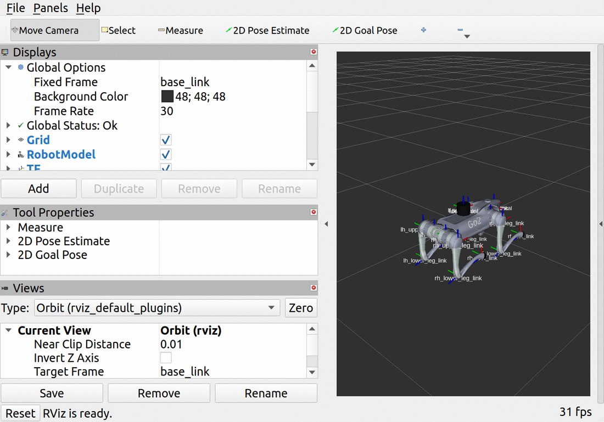
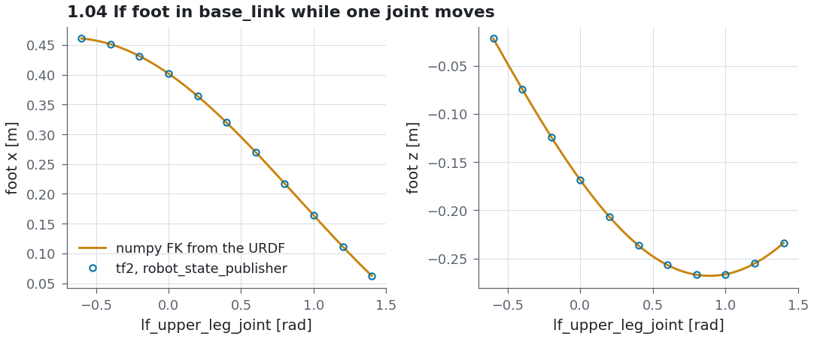
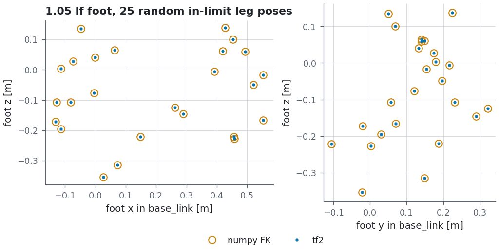
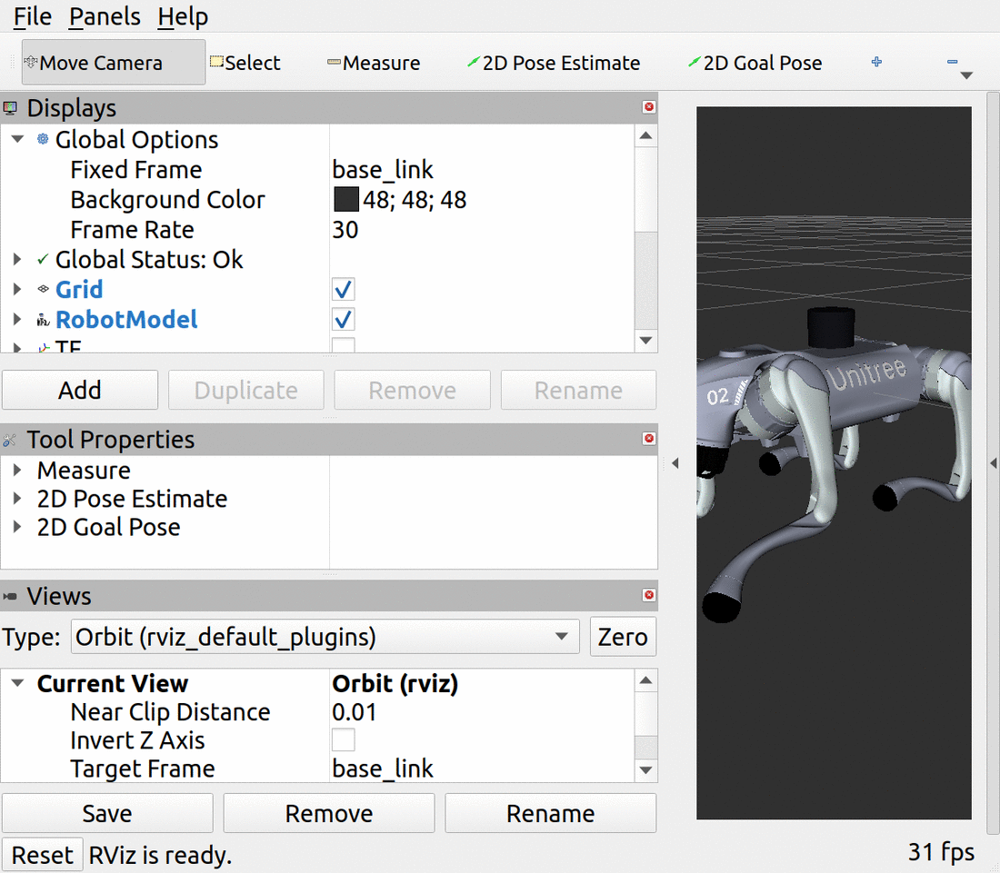
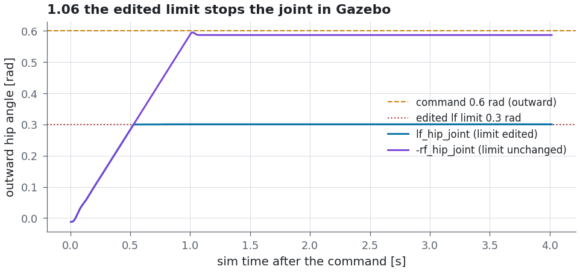
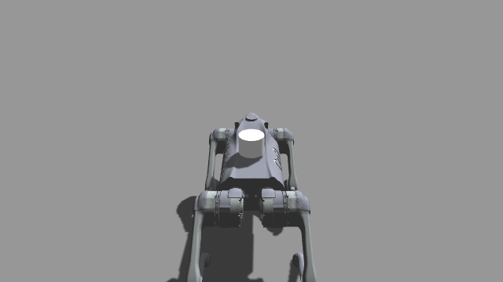
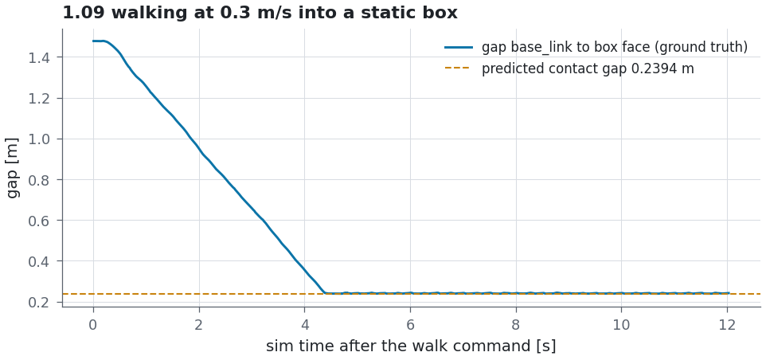
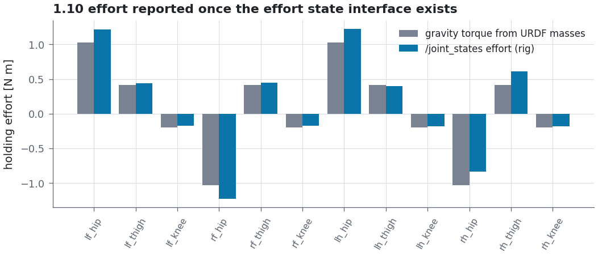

# Stage 1: import and inspect the robot

At the end of this stage you can load the Go2 description, see every link in RViz, name the 12 joints with their axes and
limits, check that the transforms RViz draws match forward kinematics, change a copy of the URDF (a joint limit, a sensor
frame), and put the robot into Gazebo on a floor with obstacles. Nine of the ten tasks pass. Task 1.10 fails: `/joint_states`
on the standard stack has no effort values.

Run everything from the repository root after `source env.sh`:

```bash
cd tasks/s01_import-and-inspect
/usr/bin/python3 run.py all          # 2 min 29 s here, longer on a busy machine; or one task: /usr/bin/python3 run.py 1.04
/usr/bin/python3 -m pytest -q tests  # 10 checks, no ROS needed
```

`run.py` starts what each task needs (robot_state_publisher, RViz, Gazebo), measures, stops it again and writes
`results/<id>.json`. Thresholds are in `acceptance.json`, written before the first run. Tasks 1.02 and 1.05 open an RViz window, so
they need a desktop session. Use `/usr/bin/python3`, the interpreter `rclpy` is built for.

| Task | Capability | Status | Key number | Where it lives |
|---|---|---|---|---|
| 1.01 | Import the Go2 model | verified | 24 links, 12 revolute joints, root `base_link` | [docs/06 Task 1](../../docs/06-import-the-go2.md#task-1-find-the-files-and-render-the-urdf) |
| 1.02 | Display in RViz | verified | 24 of 24 links resolved in tf2 | [docs/06 Task 2](../../docs/06-import-the-go2.md#task-2-inspect-the-robot-in-rviz), `figures/1-02_rviz.png` |
| 1.03 | The 12 actuated joints | verified | hips about x (4), thighs and knees about y (8) | `results/1.03.json` |
| 1.04 | Move one joint | verified | tf2 vs FK foot error 2.6e-16 m | `figures/1-04_one_joint.png` |
| 1.05 | Move the three joints of one leg | verified | 25 poses, max link error 2.8e-16 m | `figures/1-05_leg_poses.png` |
| 1.06 | Modify a joint limit | verified | edited joint stopped at 0.3008 rad of a 0.6 rad command | `urdf/go2_rig.urdf`, `launch/rig.launch.py` |
| 1.07 | Add a sensor link | verified | `rear_cam_link` at (-0.25, 0, 0.06), error 0 | `urdf/go2_extra.xacro`, [docs/06 Task 4](../../docs/06-import-the-go2.md#task-4-add-a-sensor-link) |
| 1.08 | Spawn in an empty world | verified | stands at 0.2154 m, tilt 0.008 rad | `worlds/empty.world` |
| 1.09 | Floor and obstacles | verified | stopped 0.2405 m from the box face, predicted 0.2394 m | `worlds/obstacles.world`, `media/1-09_walk_into_box.mp4` |
| 1.10 | Read joint states | failed | 248.4 Hz, effort NaN on all 12 joints | `results/1.10.json`, `figures/1-10_effort.png` |

### 1.01 Import the Go2 model

**Objective.** Expand the xacro into a URDF and confirm that it parses.

**Prerequisites.** The workspace built as in [chapter 3](../../docs/03-install-and-first-run.md).

**Theory.** None. A URDF is a tree: one root link, and every other link has exactly one parent joint.

**Implementation.** No new code. The commands are the ones in [docs/06 Task 1.3](../../docs/06-import-the-go2.md#13-render-the-model-without-starting-anything); `run.py` runs them and counts links and joints with `urdf_fk.Urdf`.

**Execution.**

```bash
xacro src/go2_nav_sim/urdf/go2_nav.xacro | check_urdf /dev/stdin | head -n 3
/usr/bin/python3 tasks/s01_import-and-inspect/run.py 1.01
```

**Demonstration.**

```
robot name is: go2
---------- Successfully Parsed XML ---------------
root Link: base_link has 4 child(ren)
```

**Measurement.** 24 links, 12 revolute joints, 11 fixed joints, root `base_link`.

**Acceptance.** Parsed, root `base_link`, 24 links, 12 revolute joints. Verified.

**Failure analysis.** Nothing failed. If `xacro` reports `package not found: go2_description`, `env.sh` was not sourced.

**Next task.** 1.02 draws the same 24 links.

### 1.02 Display the model in RViz

**Objective.** See every link of the URDF in RViz with the course's shared config.

**Prerequisites.** 1.01.

**Theory.** RViz draws a link only if tf2 can chain transforms from the fixed frame to it. `robot_state_publisher` publishes
the fixed joints once on `/tf_static` and the moving joints on `/tf` each time `/joint_states` arrives.

**Implementation.** No new code: [docs/06 Task 2.1](../../docs/06-import-the-go2.md#21-open-the-shared-rviz-config) starts
`robot_state_publisher`, a joint state publisher and RViz with `src/go2_nav_sim/rviz/go2.rviz`. `run.py` uses the
non-GUI `joint_state_publisher`, looks up `base_link` to every link with tf2 and captures the RViz window with ImageMagick `import`.

**Execution.** The three commands from docs/06 Task 2.1, then

```bash
/usr/bin/python3 tasks/s01_import-and-inspect/run.py 1.02
```

**Demonstration.**



**Measurement.** 24 of 24 links resolved in tf2. RViz ran for 12.2 s without exiting, and the screenshot's grey-level standard
deviation is 93.3, so the window was not blank.

**Acceptance.** 24 links resolved, RViz up for at least 10 s, pixel standard deviation at least 5. Verified.

**Failure analysis.** The map, scan, costmap and plan displays in `go2.rviz` show warnings here because nothing publishes those
topics yet; that is expected. One run failed with RViz up for 9.9 s: the test read the clock right after the screenshot, so a
window that opened quickly was observed for less than 10 s. `run.py` now keeps watching RViz until 12 s after the start and
records how long it stayed up.

**Next task.** 1.03 reads the joints that connect these links.

### 1.03 Identify the 12 actuated joints

**Objective.** List the actuated joints with name, axis and limits, read from the URDF and not from memory.

**Prerequisites.** 1.01.

**Theory.** A revolute joint turns its child about a unit axis $\hat a$ given in the joint frame. CHAMP's leg model expects the
hip about $x$ and the thigh and knee about $y$ ([docs/06 Task 5.4](../../docs/06-import-the-go2.md#54-adapt-this-to-your-own-quadruped)).

**Implementation.** `urdf_fk.Urdf` parses the expanded URDF. `run.py 1.03` compares the actuated joints with the first three
names per leg in `go2_config/config/joints/joints.yaml`.

**Execution.** `/usr/bin/python3 tasks/s01_import-and-inspect/run.py 1.03`

**Demonstration.** Read from `results/1.03.json`. The left legs have the same limits as the right.

| Joint (each leg: lf, rf, lh, rh) | Axis | Lower [rad] | Upper [rad] | Effort [N m] | Velocity [rad/s] |
|---|---|---|---|---|---|
| `<leg>_hip_joint` | x | -1.0472 | 1.0472 | 23.7 | 30.1 |
| `<leg>_upper_leg_joint` | y | -1.5708 | 3.4907 | 23.7 | 30.1 |
| `<leg>_lower_leg_joint` | y | -2.7227 | -0.83776 | 35.55 | 20.06 |

[docs/img/c06-go2-joints.png](../../docs/img/c06-go2-joints.png) shows where each joint sits on the robot.

**Measurement.** 12 actuated joints; 4 hip axes are $x$ and 8 thigh and knee axes are $y$; 12 of 12 have lower < upper and
positive effort and velocity limits; the set of names equals CHAMP's joint map.

**Acceptance.** All six checks in `acceptance.json`. Verified.

**Failure analysis.** Nothing failed. The knee range does not contain 0, so a joint state publisher starts the knee at
-1.78023 rad, the middle of its range.

**Next task.** 1.04 moves one of these joints.

### 1.04 Move one joint and check the rotation

**Objective.** Rotate `lf_upper_leg_joint` and check that the foot moves where forward kinematics says, in the right direction.

**Prerequisites.** 1.02, 1.03.

**Theory.** The pose of a link is the product along its chain of the fixed joint origin and the joint rotation:

$$T_{\text{base}\to\text{foot}}=\prod_k T(\text{xyz}_k,\text{rpy}_k)\,R(\hat a_k,q_k),\qquad
R(\hat a,q)=I+\sin q\,K+(1-\cos q)\,K^2,$$

where $K$ is the cross-product matrix of $\hat a$. For a point $p$ below a $+y$ axis ($p_z<0$), $\dot p=\omega\times p$ gives
$\dot p_x=\dot q\,p_z<0$: a positive thigh angle swings the foot backwards.

**Implementation.** `urdf_fk.py` (numpy) implements the product above. `run.py 1.04` publishes `/joint_states` itself, with
the thigh at 11 angles from -0.6 to 1.4 rad and the other joints at the slider defaults, and reads `base_link` to `lf_foot_link`
from tf2 at the stamp of each message. With the slider window from docs/06 Task 2.3 you do the same by hand.

**Execution.** `/usr/bin/python3 tasks/s01_import-and-inspect/run.py 1.04`

**Demonstration.**



**Measurement.** Largest foot position difference 2.6e-16 m; largest rotation difference of the joint 2.1e-8 rad (the
precision of `arccos` near 1). Foot x in tf2 falls monotonically from 0.4606 m at -0.6 rad to 0.0626 m at 1.4 rad.

**Acceptance.** Foot error ≤ 1e-6 m, rotation error ≤ 1e-6 rad, foot moves backwards for a positive angle. Verified.

**Failure analysis.** A `/joint_states` message that omits a joint leaves its frames out of `/tf`, and the lookup then fails
with an extrapolation error rather than a wrong number. `run.py` always publishes all 12 joints.

**Next task.** 1.05 moves all three joints of the leg.

### 1.05 Move the three joints of one leg

**Objective.** Move hip, thigh and knee together and check every link of the leg.

**Prerequisites.** 1.04.

**Theory.** The same product as in 1.04 with three non-zero angles.

**Implementation.** `run.py 1.05` draws 25 configurations uniformly inside the limits (seed 1), publishes each and compares
`lf_hip_link`, `lf_upper_leg_link`, `lf_lower_leg_link` and `lf_foot_link` with forward kinematics. It then holds hip 0.6, thigh -0.4,
knee -0.9 rad and captures RViz with `params/leg_view.rviz` (a copy of `go2.rviz` with the TF display off and the camera on the
left front leg).

**Execution.** `/usr/bin/python3 tasks/s01_import-and-inspect/run.py 1.05`

**Demonstration.**





**Measurement.** Largest error over 25 poses and 4 links: 2.8e-16 m.

**Acceptance.** At least 25 poses, foot and link errors ≤ 1e-6 m. Verified.

**Failure analysis.** Nothing failed. RViz and tf2 accept any pose inside the limits, including ones with the foot above the
hip (z > 0 in the side view); they do not check collisions. Gazebo does (1.09).

**Next task.** Stage 2 task 2.07 checks the same forward kinematics against a physics model.

### 1.06 Modify a joint limit in a copy of the URDF

**Objective.** Change one joint limit in a copy of the URDF and see the simulator enforce it.

**Prerequisites.** 1.03.

**Theory.** Gazebo turns the URDF `<limit lower upper>` into a joint stop. The trajectory controller does not clamp targets
to the limits, so a command past the limit is stopped by the physics alone.

**Implementation.** `run.py` (`make_rig`) expands upstream `robot.xacro` (no lidar or cameras), sets `lf_hip_joint` upper to
0.3 rad (was 1.0472), adds a `world` link fixed to `base_link` so the robot hangs in the air without CHAMP, and writes
`urdf/go2_rig.urdf`. `launch/rig.launch.py` starts `gzserver` with `worlds/empty.world`, spawns the copy and the two controllers.
The test commands both front hips 0.6 rad outward through `/joint_group_effort_controller/joint_trajectory`.

**Execution.**

```bash
/usr/bin/python3 tasks/s01_import-and-inspect/run.py 1.06   # writes the copy, starts the rig, measures, stops it
```

To look at the rig by hand instead, run only the launch line below, not together with `run.py`: both start a `gzserver`,
and two on one Gazebo master conflict.

```bash
ros2 launch tasks/s01_import-and-inspect/launch/rig.launch.py urdf:=$PWD/tasks/s01_import-and-inspect/urdf/go2_rig.urdf
```

**Demonstration.**



**Measurement.** `check_urdf` parses the copy and reads 0.3. Left hip maximum 0.3008 rad; right hip (limit unchanged) settled at
0.5868 rad.

**Acceptance.** Copy parses, limit 0.3, edited joint ≤ 0.32 rad, unedited joint ≥ 0.57 rad. Verified.

**Failure analysis.** The first rig run never activated the controllers: `gazebo_ros2_control` hands the URDF to ROS as a YAML
parameter (the same trap as in 1.07), and the colon-space in the copy's header comment made it fail with `Couldn't parse parameter override rule`. A URDF
loaded this way must not contain `: ` anywhere. The right hip stops 13.2 mrad short of 0.6 rad. Holding the leg out at 0.587 rad needs 1.29 N m
against gravity (`Urdf.holding_effort`); at the controller's p = 100 N m/rad (`ros_control.yaml`) that is a 12.9 mrad error,
plus or minus 2 mrad for the 0.2 N m joint friction.

**Next task.** 1.10 uses the same rig to read joint effort.

### 1.07 Add a sensor link and check TF

**Objective.** Add a sensor frame to a copy of the description and confirm its transform.

**Prerequisites.** 1.02.

**Theory.** A fixed joint with origin $(t, \text{rpy})$ gives the child pose $T(t,\text{rpy})$ in the parent frame. A yaw of
$\pi$ is the quaternion $(0,0,1,0)$.

**Implementation.** `urdf/go2_extra.xacro` is `go2_nav.xacro` plus the `rear_cam_link` and `rear_cam_joint` from
[docs/06 Task 4](../../docs/06-import-the-go2.md#task-4-add-a-sensor-link). `run.py 1.07` starts `robot_state_publisher` on it and
looks up `base_link` to `rear_cam_link`.

**Execution.**

```bash
/usr/bin/python3 tasks/s01_import-and-inspect/run.py 1.07
```

By hand, in two terminals:

```bash
ros2 run robot_state_publisher robot_state_publisher --ros-args \
  -p robot_description:="$(xacro tasks/s01_import-and-inspect/urdf/go2_extra.xacro)"
ros2 run tf2_ros tf2_echo base_link rear_cam_link
```

**Demonstration.** tf2 returned translation (-0.25, 0.0, 0.06); docs/06 Task 4.3 shows the same frame in `view_frames`.

**Measurement.** 25 links in the copy, parent `base_link`, translation error 0 m, rotation error 0 rad.

**Acceptance.** 25 links, parent `base_link`, errors ≤ 1e-6. Verified.

**Failure analysis.** The first run failed at the lookup: `robot_state_publisher`, started with
`-p robot_description:="$(xacro ...)"` as in docs/06, aborted because ROS parses that value as YAML and the copy's comment contained
`Task 1.07: a copy`. The comment now reads `Task 1.07, a copy`, `tests/test_stage_files.py` fails if a `: ` comes back, and
`run.py` passes the URDF in a parameter file, which is not affected. With the fix, the hand commands above print translation
(-0.250, 0.000, 0.060). The simulator still loads `go2_nav.xacro`; the copy changes nothing there.

**Next task.** Stage 6 reads the real sensor frames (`lidar_link`, `camera_optical`) the same way.

### 1.08 Spawn in an empty Gazebo world

**Objective.** Start the Go2 with CHAMP in a world that has only a floor, and check that it stands.

**Prerequisites.** 1.01; [docs/06 Task 6.2](../../docs/06-import-the-go2.md#62-follow-the-spawn-and-the-controller-start-up) explains the start-up order.

**Theory.** CHAMP holds the feet `nominal_height` = 0.225 m below the hip axes (`gait.yaml`). The hip axes are at `base_link`
height and the foot point is the centre of a 0.02 m sphere, so the predicted base height is $0.225+0.02=0.245$ m.

**Implementation.** `worlds/empty.world` has the arena's sun, physics (ODE, 1 ms step) and ground friction, and nothing else.
`sim.launch.py` takes it through its `world` argument. `odom:=gt` publishes `/odom_gt` from the simulator.

**Execution.**

```bash
ros2 launch go2_nav_sim sim.launch.py world:=$PWD/tasks/s01_import-and-inspect/worlds/empty.world odom:=gt
/usr/bin/python3 tasks/s01_import-and-inspect/run.py 1.08   # starts and stops the simulator itself
```

**Demonstration.** The launch log has `Successfully spawned entity [go2]`. Chase camera after 8 s:



**Measurement.** Over 10 s of sim time after an 8 s settle: base height 0.2154 m (std 0.0005 m; 0.2153 m in the run
before), largest roll or pitch 0.008 rad, horizontal drift 0.006 m. Both controllers active.

**Acceptance.** Spawned, 2 controllers active, height error ≤ 0.03 m, tilt ≤ 0.1 rad, height std ≤ 0.01 m. Verified, with
0.4 mm to spare on the height: the measured 0.2154 m is 29.6 mm under the prediction.

**Failure analysis.** The prediction assumes the joints reach CHAMP's targets. They do not quite: with p = 100 N m/rad the legs
give a little under the robot's weight. That this explains all 29 mm was not measured here; stage 3 task 3.05 measures height
tracking directly.

**Next task.** 1.09 adds obstacles to this world; stage 3 starts from this standing pose.

### 1.09 Floor and obstacles with collision geometry

**Objective.** Build a world with a floor and two obstacles, check their collision shapes, and see a collision stop the robot.

**Prerequisites.** 1.08.

**Theory.** The first collision shape to touch a wall straight ahead is the one furthest forward. In the URDF that is the hip
cylinder (radius 0.046 m, axis y) at $x=0.1934$ m, so the robot should stop with `base_link`
$0.1934+0.046=0.2394$ m from the face. The trunk box ends at 0.188 m, and the lidar and cameras have no collision shape.

**Implementation.** `worlds/obstacles.world` is `empty.world` plus a static box (0.4 × 1.2 × 0.5 m, front face 1.5 m ahead of the
spawn point) and a static cylinder (r 0.15 m, 0.6 m) off the path. `run.py 1.09` reads each model's collision geometry back from
Gazebo with `gz model -m <name> -i`, records the chase camera, and sends `/cmd_vel` 0.3 m/s forward for 12 s.

**Execution.**

```bash
ros2 launch go2_nav_sim sim.launch.py world:=$PWD/tasks/s01_import-and-inspect/worlds/obstacles.world odom:=gt
gz model -m box -i | grep -A3 'box {'
/usr/bin/python3 tasks/s01_import-and-inspect/run.py 1.09
```

**Demonstration.** [media/1-09_walk_into_box.mp4](media/1-09_walk_into_box.mp4) (15 s, chase camera): the robot walks into
the orange box and stays against it while the command lasts.



**Measurement.** Box and cylinder sizes from Gazebo equal the world file. Speed before contact 0.300 m/s. Gap over the last
2 s 0.2405 m against 0.2394 m predicted (0.2403 m in an earlier run). Box moved 0 m. Standing height before the walk 0.2161 m,
so `base_height_error_m` is 0.0289 m against the 0.03 m limit. The three runs on record gave 0.0289, 0.0291 and 0.0298 m.

**Acceptance.** Geometry matches, speed ≥ 0.15 m/s, gap error ≤ 0.05 m, box moved ≤ 1 mm, height error ≤ 0.03 m. Verified, with 0.2 to 1.1 mm to spare on the
height over those three runs. This is the same 29-30 mm sag as in 1.08, so a run can fail on the height check alone; if it
does, the cause is the leg stiffness described in 1.08, not the obstacle world.

**Failure analysis.** Pressed against the box, the trunk rolled or pitched by up to 0.079 rad and ended 0.061 m to the
side of its start line. A box lower than the hips (0.2154 m) would meet the feet or the calves first and the prediction above would not hold.

**Next task.** Stage 6 task 6.13 stops before the same wall using the lidar instead of hitting it.

### 1.10 Read joint states

**Objective.** Read position, velocity and effort of the 12 joints from `/joint_states` and measure the rate.

**Prerequisites.** 1.08.

**Theory.** The rate is counted in sim time: $f=(N-1)/(t_N-t_1)$ over header stamps. The controller manager runs at 250 Hz
(`ros_control.yaml`). On the rig, a joint holding a pose against gravity must apply
$\tau_j=-\hat a_j\cdot\sum_i (c_i-p_j)\times m_i g$, summed over the links below joint $j$ (`Urdf.holding_effort`).

**Implementation.** `run.py 1.10` records `/joint_states` for 5 s of sim time on the standard stack in the empty world. It then
starts the 1.06 rig, whose copy declares an effort state interface on every joint, holds a fixed pose and compares the reported
effort with the gravity torque from the URDF masses.

**Execution.**

```bash
ros2 topic echo --once /joint_states --field effort    # with sim.launch.py running
/usr/bin/python3 tasks/s01_import-and-inspect/run.py 1.10
```

**Demonstration.**

From `results/1.10.json`, standard stack:

```
"effort_len": 12,
"effort_finite_fraction": 0.0,
"effort_sample": ["nan", "nan", "nan"]
```



**Measurement.** Standard stack: 1249 messages, 12 names, 248.4 Hz in sim time (194.3 Hz wall clock on a loaded machine;
247.8 Hz, 249.0 Hz and 245.7 Hz in earlier runs), position and
velocity finite in every message, effort NaN in every message. Rig: effort finite in every message, largest difference from
the gravity torque 0.199 N m.

**Acceptance.** 12 names, rate within 10 Hz of 250, position, velocity and effort finite. **Failed**: effort finite fraction 0.0.

**Failure analysis.** The upstream `<ros2_control>` blocks declare only `position` and `velocity` state interfaces, so the
joint state broadcaster fills `effort` with NaN. The rig shows the fix: one `<state_interface name="effort"/>` per joint makes the
values appear, and they match gravity to within the 0.2 N m joint friction set in the URDF. Applying it to the standard stack
means changing the upstream description through `patches/upstream.patch`, which this stage does not do.

**Next task.** Stage 2 uses position and velocity from `/joint_states` for tracking error; torque tasks (2.04) need the effort
interface above or a simulator that reports joint torque.
