# Stage 2: joint and leg control

By the end of this stage you can command one Go2 joint by angle, velocity or torque, predict a PD step response from the
joint inertia, put a foot at a Cartesian point and move it along a line, a triangle and an arc, reject a foot target the leg
cannot reach, and move two legs with a fixed phase. Every task runs on a supported robot: the trunk is fixed in the air.

Why MuJoCo: in the Gazebo stack CHAMP owns all twelve joints, so single-joint control, single-foot motion and step climbing are
done here, where joint torques and contact forces are available.

**The support.** `lib.load_supported()` deletes the base free joint from the MJCF when the model is compiled (`MjSpec`), so the
trunk is part of the world body at $z = 0.70$ m. The lowest foot centre then sits at least 0.27 m above the floor and no task
has a ground contact (`tests/test_stage2.py::test_trunk_is_fixed_and_feet_are_free` checks `d.ncon == 0`). A grey post with no
collision geometry is drawn under the trunk so the videos show the support.

**The control interface.** All twelve actuators in `modules/assets/unitree_go2/go2.xml` are `<motor>` elements: a torque, gear 1,
clipped to ±23.7 N m (hip, thigh) and ±45.43 N m (knee). Each joint also has passive damping $b = 2$ N m s/rad, armature
0.01 kg m² and friction loss $f = 0.2$ N m. Position and velocity control below are loops in `lib.py` that compute a torque every
2 ms physics step.

| Interface | Used in |
|---|---|
| joint PD on torque, $\tau = k_p(q^*-q) + k_d(\dot q^*-\dot q) + b\,\dot q^*$ (gravity term off) | 2.01, 2.02 |
| velocity PI on torque | 2.03 |
| open-loop torque | 2.04 |
| joint PD + gravity compensation $g(q)$ | 2.05, 2.06, and holding the other eleven joints everywhere |
| foot path → closed-form IK every 2 ms → joint PD + $g(q)$ | 2.08 to 2.14 |

**Run everything** from this folder (one process, about 4 min on a loaded 32-core machine; wall times are in `results/*.json`):

```bash
cd tasks/s02_joint-and-leg-control
MUJOCO_GL=glfw DISPLAY=:0 flock /tmp/go2_render.lock ../../.venv-modules/bin/python run.py all   # renders 2.11 and 2.14
../../.venv-modules/bin/python -m pytest -q tests                                              # 6 tests, 11 s
```

`run.py <id>` writes `results/<id>.json` with the measured values and the pass/fail of each check. The thresholds are in
`acceptance.json`, written before the first run. Two entries there changed after it (2.04 and 2.14) and keep the old version and
the reason under `changes`. The renders used `DISPLAY=:0` because this machine had no `:1` X server at the time.

| Id | Capability | Status | Key measured number |
|---|---|---|---|
| 2.01 | rotate a single hip joint | verified | RMS tracking error 10.8 mrad, max 13.9 mrad |
| 2.02 | move a joint between two angles | verified | 0 rad beyond the knee range; 2 of 5 requests clamped |
| 2.03 | control joint velocity | verified | steady RMS velocity error 0.0056 rad/s at 0.8 rad/s |
| 2.04 | apply a controlled joint torque | verified | identified inertia 0.03355 vs 0.03357 kg m² predicted |
| 2.05 | PD controller | verified | damping ratio 0.544 measured, 0.546 predicted |
| 2.06 | change gains | verified | overshoot within 0.47 percentage points of prediction, 4 gain sets |
| 2.07 | foot position from joint angles | verified | FK vs MuJoCo max 2.6e-16 m |
| 2.08 | foot to a Cartesian position | verified | settled foot error max 0.29 mm |
| 2.09 | raise and lower one foot | verified | RMS tracking error 0.55 mm |
| 2.10 | foot forward and backward | verified | RMS tracking error 0.71 mm |
| 2.11 | foot along a triangle | verified | RMS 1.26 mm, max 3.25 mm at the corners |
| 2.12 | foot along an arc | verified | radial RMS error 0.71 mm |
| 2.13 | reject an unreachable foot target | verified | 5 of 5 rejected with the expected reason |
| 2.14 | coordinate two legs | verified | phase error 0 s at 2 ms resolution; see Failure analysis |

### 2.01 Rotate a single hip joint

**Objective.** Move the front-left hip (abduction) joint from 0 to 0.3 rad, to −0.3 rad and back with joint-space PD, and
measure the tracking error.

**Prerequisites.** 1.03 (joint names and axes), 1.10 (reading joint states).

**Theory.** The controller is $\tau = k_p(q^*-q) + k_d(\dot q^*-\dot q) + b\,\dot q^*$; the last term cancels the joint's
passive damping along the reference. Gravity is not compensated here, so at rest the joint settles where
$k_p(q^*-q) = g(q)$, that is $e = q - q^* = -g(q)/k_p$, with $g(q)$ the torque needed to hold the leg (task 2.04).

**Implementation.** `joint_traj` builds minimum-jerk segments for one joint; `lib.joint_controller` is the controller above.

```python
Q = joint_traj(HIP, [0, .3, .3, -.3, -.3, 0, 0], [1, .5, 1.5, .5, 1, .3])
log = lib.simulate(m, d, lib.joint_controller(m, lib.array_ref(Q), kp, kd, gravity=False), (len(Q) - 1) * DT)
```

**Execution.** `../../.venv-modules/bin/python run.py 2.01`

**Demonstration.**

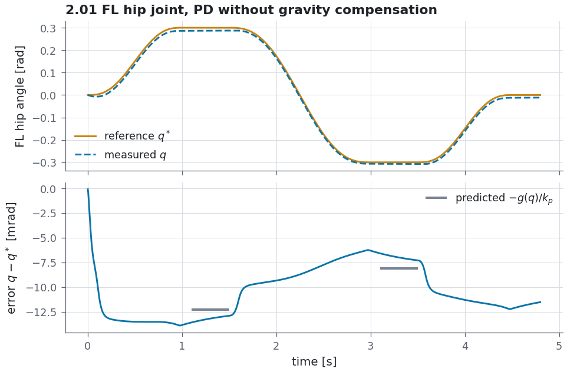

**Measurement** (`results/2.01.json`, $k_p = 100$ N m/rad, $k_d = 2$ N m s/rad):

| Quantity | Value |
|---|---|
| RMS / max tracking error | 10.8 / 13.9 mrad |
| hold at 0.3 rad: measured / predicted $-g/k_p$ | −13.0 / −12.3 mrad |
| hold at −0.3 rad: measured / predicted | −7.15 / −8.08 mrad |
| peak torque | 2.48 N m |

**Acceptance.** RMS < 20 mrad, max < 30 mrad, hold error within 3 mrad of $-g/k_p$ (friction band $f/k_p = 2$ mrad): passed
(0.93 mrad).

**Failure analysis.** The error is almost all gravity sag; it does not go to zero at any hold. The 0.8 to 0.9 mrad gap to the
prediction is inside the friction band: the joint stops wherever $|k_p e + g| \le f$. Halving $k_p$ doubles both.

**Next task.** 2.02 uses the same controller on the knee and adds a limit guard.

### 2.02 Move a joint between two angles

**Objective.** Move the front-left knee through five requested angles, two of them outside its range, without the joint ever
leaving the range.

**Prerequisites.** 2.01.

**Theory.** The knee range from the MJCF is $[-2.7227, -0.83776]$ rad. A request $q_r$ becomes
$q^* = \operatorname{clip}(q_r,\ q_{\min} + m,\ q_{\max} - m)$ with margin $m = 0.05$ rad, so PD overshoot does not reach the limit.

**Implementation.**

```python
def clamp_request(q, lo, hi, margin=0.05):
    c = float(np.clip(q, lo + margin, hi - margin))
    return c, c != q
```

**Execution.** `../../.venv-modules/bin/python run.py 2.02`

**Demonstration.**

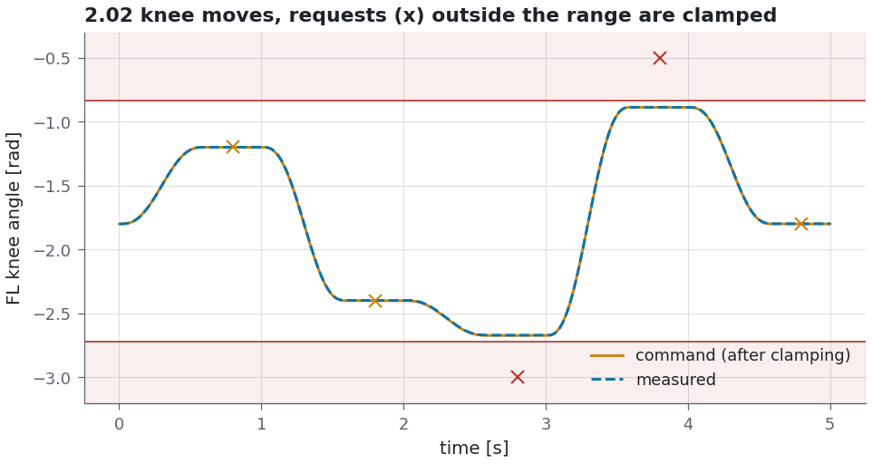

**Measurement** (`results/2.02.json`, $k_p = 150$, $k_d = 2$):

| Request [rad] | Command [rad] | Clamped | Final error [mrad] |
|---|---|---|---|
| −1.2 | −1.2 | no | 0.75 |
| −2.4 | −2.4 | no | 2.23 |
| −3.0 | −2.6727 | yes | 2.18 |
| −0.5 | −0.88776 | yes | 0.10 |
| −1.8 | −1.8 | no | 1.81 |

Measured knee range over the run: −2.6705 to −0.8870 rad.

**Acceptance.** No sample outside the range (0 rad excess), final errors < 10 mrad, exactly 2 requests clamped: passed.

**Failure analysis.** Without the clamp a −3.0 rad request drives the knee into MuJoCo's soft joint limit, which is a constraint
force that the PD then pushes against; this was not run. The clamp only guards targets: a torque command (2.04) bypasses it.

**Next task.** 2.03 controls velocity instead of angle.

### 2.03 Control joint velocity

**Objective.** Make the front-left hip joint follow a ±0.8 rad/s square-wave velocity command.

**Prerequisites.** 2.01.

**Theory.** With $J\dot v = \tau - b v - g(q) - f$ and the loop $\tau = b v^* + k_v e + k_i\int e\,dt$, $e = v^* - v$,

$$\frac{v}{v^*} = \frac{(k_v+b)s + k_i}{J s^2 + (k_v+b)s + k_i}.$$

With $J = 0.03357$ kg m², $k_v = 2$, $k_i = 100$ the poles are at −35.7 and −83.5 rad/s, the zero at $-k_i/(k_v+b) = -25$ rad/s.
The integral removes the constant parts of $g(q) + f$; a P-only loop ($k_i = 0$) keeps an error of $(g + f)/(k_v + b)$.

**Implementation.** A per-joint override replaces the PD torque of the hip; the other 11 joints stay on PD.

```python
def override(m, d):
    e = v_ref(d.time) - d.qvel[j]
    state['i'] += e * DT
    tau = np.zeros(12)
    tau[j] = b * v_ref(d.time) + kv * e + ki * state['i']
    return np.arange(12) == j, tau
```

**Execution.** `../../.venv-modules/bin/python run.py 2.03`

**Demonstration.**

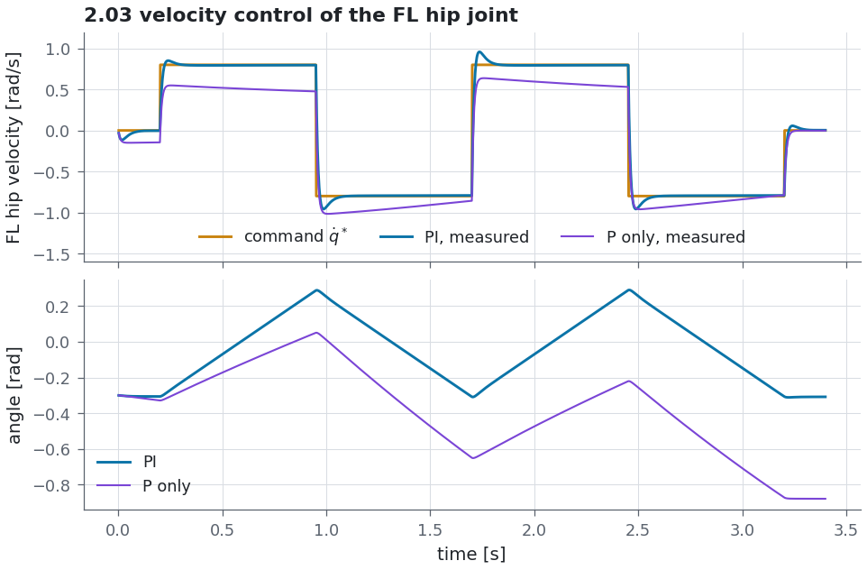

**Measurement** (`results/2.03.json`, steady windows start 0.15 s after each command change):

| Loop | Steady RMS error [rad/s] | Steady mean error [rad/s] |
|---|---|---|
| PI ($k_i = 100$) | 0.0056 | 0.0002 |
| P only | 0.203 | −0.180 |

**Acceptance.** PI steady RMS < 0.03 rad/s and angle inside the hip range: passed (angle −0.311 to 0.290 rad).

**Failure analysis.** The PI response overshoots at each reversal although both poles are real: the zero at −25 rad/s is slower
than the poles. The P-only loop drifts 0.18 rad/s slow and its angle walks to −0.88 rad by the end of the run (`p_only_final_angle_rad`), because gravity
and friction load the joint the same way on both strokes. A velocity loop has no angle feedback, so any velocity error integrates
into angle drift.

**Next task.** 2.04 removes the loop and applies torque directly.

### 2.04 Apply a controlled joint torque

**Objective.** Apply 2.0 N m open-loop to the front-left hip and predict the motion from the joint inertia, gravity, damping and
friction.

**Prerequisites.** 2.01.

**Theory.** For one joint with the others held,
$J\ddot q + b\dot q = \tau - g(q) - f\,\operatorname{sign}\dot q$. `LegModel` computes both terms from the body masses and
inertias in the MJCF:

$$g_i(q) = -z_i \cdot \sum_{b \ge i} (c_b - o_i) \times m_b\,\mathbf g, \qquad
J_i = a_i + \sum_{b \ge i} z_i^\top R_b I_b R_b^\top z_i + m_b \lVert z_i \times (c_b - o_i)\rVert^2,$$

with $z_i$, $o_i$ the joint axis and origin, $c_b$, $m_b$, $I_b$, $R_b$ the centre of mass, mass, inertia and orientation of
body $b$, and $a_i$ the armature. Both match MuJoCo (`qfrc_bias`, diagonal of `mj_fullM`) to 1e-10 in the tests. At
$q_0 = -0.6$ rad: $g = 0.479$ N m, $J = 0.03357$ kg m², so $\ddot q(0) = (2 - 0.479 - 0.2)/0.03357 = 39.3$ rad/s².

**Implementation.** The hip switches to torque mode between 0.3 and 0.6 s; the inertia is identified from the first 30 ms.

```python
torque = lambda m, d: (np.arange(12) == HIP if t_on <= d.time < t_off else np.zeros(12, bool), np.full(12, tau_cmd))
acc = (v[ks] - v[ks - 1]) / DT
rhs = tau_cmd - np.array([g(x) for x in log['q'][ks, HIP]]) - f - b * v[ks]
J_hat = float(acc @ rhs / (acc @ acc))
```

**Execution.** `../../.venv-modules/bin/python run.py 2.04`

**Demonstration.**

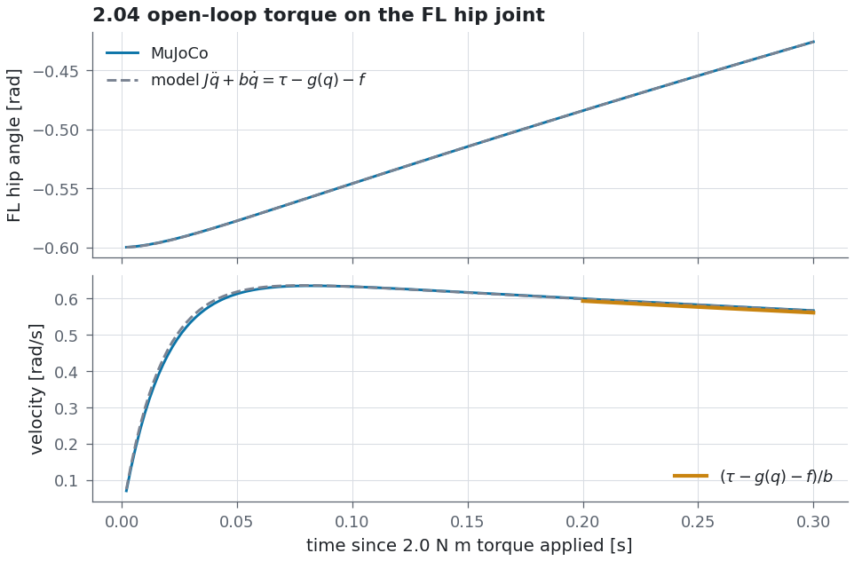

**Measurement** (`results/2.04.json`):

| Quantity | Measured | Predicted |
|---|---|---|
| inertia from the first 30 ms | 0.03355 kg m² | 0.03357 kg m² |
| acceleration over the first 2 ms step | 35.12 rad/s² | 35.15 rad/s² ($J + h b$, see below) |
| angle, RMS difference to the model over 0.3 s | 6.2e-5 rad | |
| velocity in the last 0.1 s vs $(\tau - g - f)/b$ | 1.1 % mean difference | |

**Acceptance.** Identified inertia within 10 %, terminal velocity within 10 %, trajectory within 0.01 rad RMS: passed.

**Failure analysis.** The first version of the check fitted $q = q_0 + \tfrac12 a t^2$ over 10 ms and read 27.0 rad/s² against
39.3: a 31 % miss and a failed task. The model was right and the check was wrong. Damping limits the speed with time constant
$J/b = 16.8$ ms, longer than the fit window. MuJoCo's Euler integrator also applies joint damping implicitly, so one step obeys
$(J + hb)\,\Delta v / h = \tau - g - f - b v_k$, and the first-step acceleration is 35.1, not 39.3 rad/s². The check now
identifies $J$ with the end-of-step velocity (threshold unchanged, old check in `acceptance.json` under `changes`). The other
hip-leg joints are held by PD, not locked: the inertia felt with them free would be 0.03231 kg m² (`J_free_kgm2_mujoco_check`,
from `mj_fullM`), 3.7 % lower.

**Next task.** 2.05 closes a PD loop around the same joint, using $J$ to predict it.

### 2.05 PD controller

**Objective.** Predict rise time, overshoot and settling of a 0.2 rad hip step from the joint inertia, then measure them.

**Prerequisites.** 2.04.

**Theory.** With gravity compensated, $J\ddot q + (k_d + b)\dot q + k_p q = k_p q^*$, so

$$\omega_n = \sqrt{k_p/J}, \qquad \zeta = \frac{k_d + b}{2\sqrt{k_p J}}, \qquad
\text{overshoot} = e^{-\pi\zeta/\sqrt{1-\zeta^2}}.$$

With $k_p = 100$, $k_d = 0$: $\omega_n = 54.6$ rad/s and $\zeta = 2/(2\sqrt{100 \cdot 0.03357}) = 0.546$: the joint's own
damping alone makes the loop well damped. Rise (10 to 90 %), settling (±5 %) and overshoot of the prediction come from the closed
form `lib.second_order_step`, measured by the same `lib.step_metrics` as the simulation. The measured damping ratio is
$\zeta = -\ln OS / \sqrt{\pi^2 + \ln^2 OS}$.

**Implementation.**

```python
log = lib.simulate(m, d, lib.joint_controller(m, step_ref(HIP, 0.0, step, t_step), kp, kd), t_step + T)
y_pred, zeta, wn = lib.second_order_step(J, kd + m.dof_damping[HIP], kp, t)
```

**Execution.** `../../.venv-modules/bin/python run.py 2.05`

**Demonstration.**

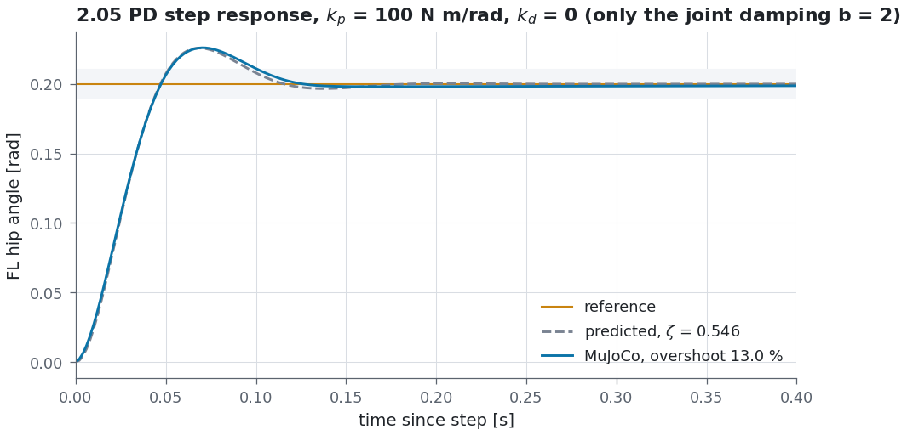

**Measurement** (`results/2.05.json`):

| Metric | Measured | Predicted |
|---|---|---|
| damping ratio | 0.544 | 0.546 |
| overshoot | 13.0 % | 12.9 % |
| rise time 10-90 % | 32 ms | 32 ms |
| settling time ±5 % | 102 ms | 98 ms |
| final error | 0.61 mrad | 0 |
| peak torque | 21.1 N m (limit 23.7) | |

**Acceptance.** $\zeta$ within 15 %, overshoot within 5 percentage points, rise within 15 %, settling within 30 %, final error
< 4 mrad: passed.

**Failure analysis.** The final error is friction: the joint stops anywhere within $f/k_p = 2$ mrad of the target. The step was
sized so the peak torque, $k_p \cdot 0.2 + g = 21.1$ N m, stays under the 23.7 N m clip; a larger step saturates and the
response is no longer second order.

**Next task.** 2.06 varies $k_p$ and $k_d$.

### 2.06 Change gains

**Objective.** Compare four gain sets on a 0.15 rad step and on a 1 Hz, 0.15 rad sine.

**Prerequisites.** 2.05.

**Theory.** $k_p$ sets the speed ($\omega_n \propto \sqrt{k_p}$) and lowers $\zeta \propto 1/\sqrt{k_p}$; $k_d$ adds damping
without changing $\omega_n$.

**Implementation.** `step_trial(kp, kd, step=0.15)` from 2.05, then the sine with analytic $\dot q^*$:

```python
ref = lambda t: (np.r_[0.15 * np.sin(w * t), Q_HOLD[1:]], np.r_[0.15 * w * np.cos(w * t), np.zeros(11)])
```

**Execution.** `../../.venv-modules/bin/python run.py 2.06`

**Demonstration.**

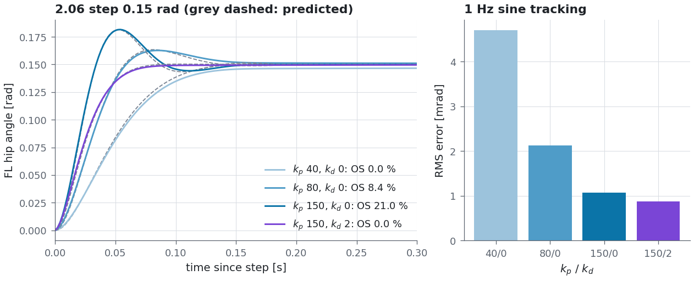

**Measurement** (`results/2.06.json`):

| $k_p$ / $k_d$ | $\zeta$ pred. | Overshoot meas. / pred. | Rise meas. / pred. | Sine RMS error | Peak torque |
|---|---|---|---|---|---|
| 40 / 0 | 0.863 | 0.0 / 0.47 % | 86 / 78 ms | 4.71 mrad | 7.1 N m |
| 80 / 0 | 0.610 | 8.4 / 8.9 % | 40 / 38 ms | 2.13 mrad | 13.1 N m |
| 150 / 0 | 0.446 | 21.0 / 20.9 % | 24 / 24 ms | 1.07 mrad | 23.6 N m |
| 150 / 2 | 0.891 | 0.0 / 0.21 % | 44 / 44 ms | 0.87 mrad | 23.6 N m |

**Acceptance.** Every overshoot within 5 percentage points, rise time falls as $k_p$ rises, $k_d = 2$ removes > 10 points of
overshoot at $k_p = 150$, sine error falls as $k_p$ rises: passed (worst overshoot miss 0.47 points, drop 21.0 points).

**Failure analysis.** The weakest set is $k_p = 40$: rise 10 % slower than predicted and a 2.4 mrad final error, because the
friction band $f/k_p = 5$ mrad is two thirds of the 7.5 mrad (5 %) settling band. At $k_p = 150$ the peak torque is 23.56 N m, 0.6 % under
the clip.

**Next task.** 2.07 moves from one joint to the foot.

### 2.07 Foot position from joint angles

**Objective.** Check the module 04 forward kinematics against MuJoCo's body and foot positions on the supported robot.

**Prerequisites.** 2.01; module 04 (FK derivation).

**Theory.** $p_\text{foot} = p_\text{base} + \prod_i [R_i,\ p_i][\operatorname{Rot}(a_i, q_i),\ 0]\,f$ with the trunk at
$p_\text{base} = (0, 0, 0.70)$ m and identity orientation (module 04 README for the symbols).

**Implementation.** For 500 random in-limit configurations per leg, `Leg.frames(q)` gives the hip, thigh and knee joint origins
and the foot centre; they are compared with `d.xpos` of the `hip`, `thigh`, `calf` bodies and `d.geom_xpos` of the foot sphere
after `mj_kinematics`.

**Execution.** `../../.venv-modules/bin/python run.py 2.07`

**Demonstration.** Recorded output: `2.07 verified foot_max_error_m=2.633e-16, joint_origin_max_error_m=2.22e-16`.

**Measurement** (`results/2.07.json`, 2000 configurations): foot centre max error 2.6e-16 m, joint origins max 2.2e-16 m, all four
legs.

**Acceptance.** Both < 1e-9 m: passed.

**Failure analysis.** Agreement is at floating-point rounding. It would break if the base were rotated (base-frame vectors are
used as world vectors here) or if a body in the MJCF had a non-identity orientation, which `Leg` asserts against.

**Next task.** 2.08 inverts it.

### 2.08 Foot to a Cartesian position

**Objective.** Send each foot to 27 grid targets with the closed-form IK and measure where MuJoCo puts the foot.

**Prerequisites.** 2.05, 2.07.

**Theory.** Module 04's closed form: hip angle from the lateral offset $d$, knee from the law of cosines in the leg plane, thigh
from the angle of the foot vector. Of the solutions inside the joint limits, `lib.ik_closest` takes the one nearest the
current joint angles. Residual foot error after a hold is set by friction: $f/k_p = 0.2/150 = 1.3$ mrad per joint.

**Implementation.** Joint-space minimum-jerk moves of 0.3 s between successive IK solutions, then a 0.3 s hold; all four legs
move together, each to its own grid ($\pm 60$, $\pm 30$, $\pm 50$ mm around the standing foot in $x$, $y$, $z$).

```python
q = lib.ik_closest(L, p0 + o, Q_HOLD[:3])
alg.append(np.linalg.norm(L.fk(q) - (p0 + o)))
```

**Execution.** `../../.venv-modules/bin/python run.py 2.08`

**Demonstration.**

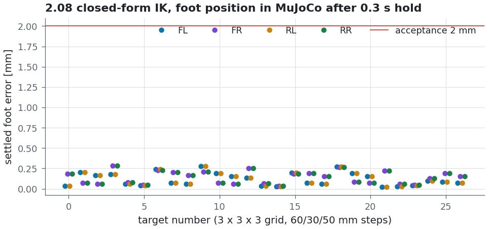

**Measurement** (`results/2.08.json`, 108 targets): $\lVert fk(ik(p)) - p\rVert$ max 3.0e-16 m; foot in MuJoCo after the hold:
median 0.11 mm, max 0.29 mm.

**Acceptance.** Algebraic < 1e-9 m, settled < 2 mm: passed.

**Failure analysis.** The settled error is the friction dead band; it is 7 times below the threshold,
set from the friction estimate before the run. FL and RL show identical numbers, as do FR and RR, because the grid is symmetric
and each pair is mirrored.

**Next task.** 2.09 moves the foot continuously instead of point to point.

### 2.09 Raise and lower one foot

**Objective.** Lift the front-left foot 80 mm straight up and lower it, three times.

**Prerequisites.** 2.08.

**Theory.** The path is sampled every 2 ms with minimum-jerk timing per segment,
$s(\tau) = 10\tau^3 - 15\tau^4 + 6\tau^5$, solved by IK at every sample; $\dot q^*$ is the central difference of the IK
solutions. Tracking error is $\lVert p(t) - p^*(t)\rVert$ (lag counts); path error is the distance to the nearest reference
sample (lag does not count).

**Implementation.** `lib.polyline` builds the path, `lib.foot_ref` the joint reference, `lib.foot_errors` the errors from MuJoCo's
foot position.

```python
log, P, s = run_paths(m, d, {'FL': lambda p0: lib.polyline([p0, p0 + [0, 0, .08]], [.6, .6], cycles=3)})
```

**Execution.** `../../.venv-modules/bin/python run.py 2.09`

**Demonstration.**

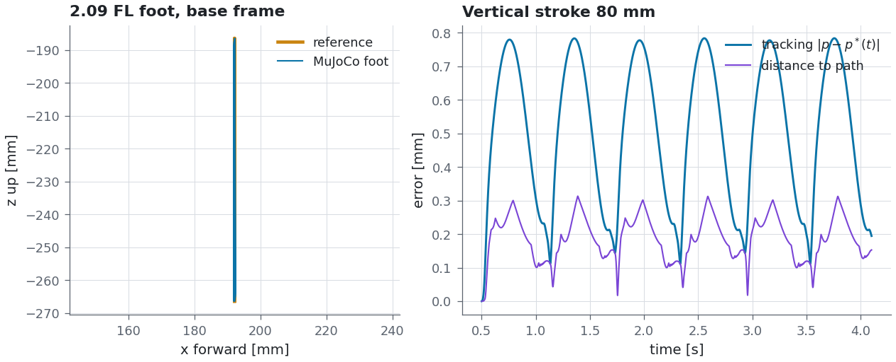

**Measurement** (`results/2.09.json`): tracking RMS 0.55 mm, max 0.78 mm; path RMS 0.20 mm; measured lift 79.9 mm.

**Acceptance.** RMS < 3 mm, max < 6 mm, lift within 3 mm of 80 mm: passed.

**Failure analysis.** The remaining error is lag of the PD loop behind the reference, so it is larger in tracking than in path
error. A straight vertical line is reachable only because the standing foot sits well inside the workspace; the same stroke from
a foot near full extension would hit `too_far` (2.13).

**Next task.** 2.10 runs the same in $x$.

### 2.10 Foot forward and backward

**Objective.** Move the front-left foot 60 mm forward and 60 mm back from its standing point, three cycles.

**Prerequisites.** 2.09.

**Theory.** As 2.09, path $p_0 \to p_0 + 60\,\hat x \to p_0 \to p_0 - 60\,\hat x$, 0.5 s per segment.

**Implementation.**

```python
lib.polyline([p0, p0 + [.06, 0, 0], p0, p0 - [.06, 0, 0]], [.5] * 4, cycles=3)
```

**Execution.** `../../.venv-modules/bin/python run.py 2.10`

**Demonstration.**

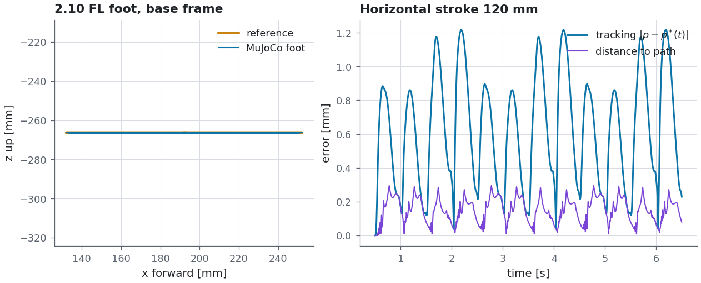

**Measurement** (`results/2.10.json`): tracking RMS 0.71 mm, max 1.22 mm; path RMS 0.17 mm; measured stroke 119.7 mm.

**Acceptance.** RMS < 3 mm, max < 6 mm, stroke within 3 mm of 120 mm: passed.

**Failure analysis.** The RMS error is 30 % larger than in 2.09 although the peak foot speed is lower (0.23 against 0.25 m/s,
computed from the paths); the cause was not isolated. Gravity compensation uses the model; a real leg with an unmodelled payload
would sag by $\Delta g / k_p$ per joint.

**Next task.** 2.11 joins straight segments with corners.

### 2.11 Foot along a triangle

**Objective.** Trace a triangle with the front-left foot (base 120 mm, apex 80 mm up), the shape used in Stanford CS 123 lab 3,
at 0.3 m/s along each edge.

**Prerequisites.** 2.09, 2.10.

**Theory.** Constant speed along the edges, so the foot velocity jumps at each vertex. The PD loop cannot follow a jump, so
expect a corner error of about $v/\omega_n$; with $\omega_n \approx 60$ rad/s, 0.3/60 = 5 mm (estimate written before the run).

**Implementation.**

```python
def triangle(p0, speed=0.3):
    V = [p0 + [-.06, 0, 0], p0 + [.06, 0, 0], p0 + [0, 0, .08]]
    return V, lib.polyline(V, [np.linalg.norm(V[(i + 1) % 3] - V[i]) / speed for i in range(3)], smooth=False, cycles=3)
```

**Execution.** `MUJOCO_GL=glfw DISPLAY=:0 flock /tmp/go2_render.lock ../../.venv-modules/bin/python run.py 2.11`

**Demonstration.** Amber dots: the reference triangle; blue dots: the last 0.4 s of the foot centre.

<video controls muted playsinline src="media/2-11_triangle.mp4"></video>

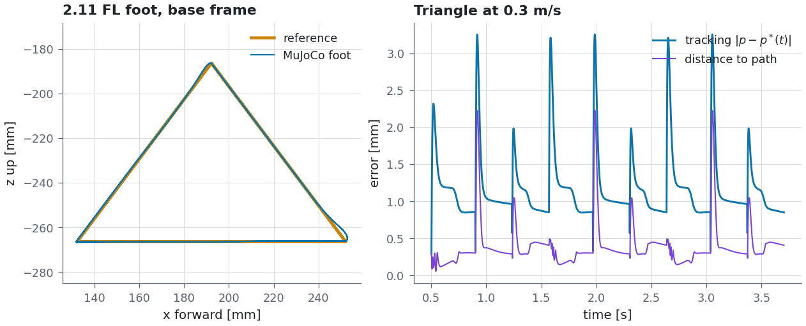

**Measurement** (`results/2.11.json`):

| Quantity | Value |
|---|---|
| tracking RMS / max | 1.26 / 3.25 mm |
| path RMS / max | 0.50 / 2.23 mm |
| closest approach to each vertex | 0.32, 0.30, 0.23 mm |
| peak joint torque, FL | 7.7 N m |

**Acceptance.** Tracking RMS < 4 mm, max < 10 mm, path RMS < 3 mm, vertex miss < 5 mm: passed.

**Failure analysis.** All error peaks sit at the vertices (right panel), 3.25 mm against the 5 mm estimate. The foot rounds each
corner (path error 2.2 mm) and then catches up. Smoothing the timing per edge (`smooth=True`, as in 2.09) removes the jumps but
stops the foot at each vertex.

**Next task.** 2.12 replaces the triangle with a swing arc.

### 2.12 Foot along an arc

**Objective.** Swing the front-left foot forward along a semicircle of radius 60 mm and return along the chord, three cycles.

**Prerequisites.** 2.11.

**Theory.** Swing: $p = p_0 + r(\cos\phi, 0, \sin\phi)$ with $\phi$ going from $\pi$ to 0 on minimum-jerk timing in 0.5 s;
stance: chord back at constant speed in 0.5 s. The radial error is $\lvert \lVert p_{xz} - p_{0,xz}\rVert - r \rvert$ over
the swing.

**Implementation.** `lib.arc_cycle(p0, r, T_swing, T_stance, cycles)`; this cycle is reused in 2.14 and stage 4.

**Execution.** `../../.venv-modules/bin/python run.py 2.12`

**Demonstration.**

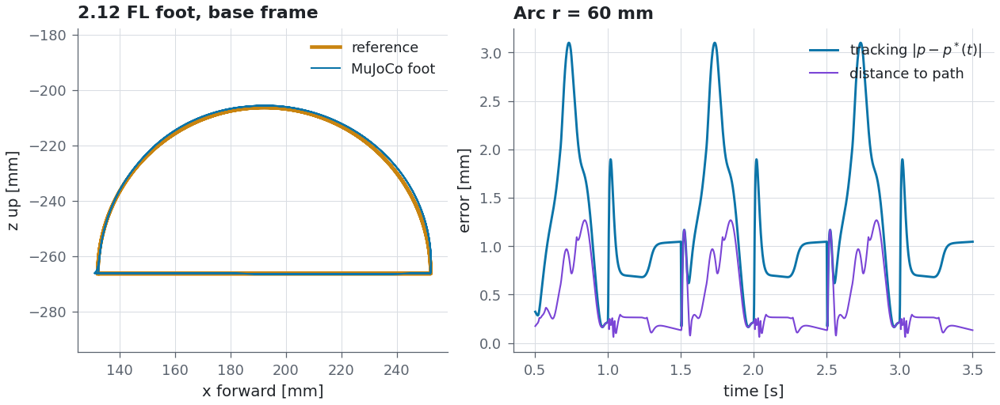

**Measurement** (`results/2.12.json`): tracking RMS 1.37 mm, max 3.10 mm; radial RMS 0.71 mm, max 1.26 mm; apex height error
0.69 mm.

**Acceptance.** Tracking RMS < 4 mm, max < 8 mm, radial RMS < 3 mm, apex within 3 mm: passed.

**Failure analysis.** The tracking peak (3.1 mm) falls mid-swing, where the foot is fastest: the arc is
$\pi r = 188$ mm long and minimum-jerk timing peaks at 1.875 times the mean speed, 0.71 m/s (computed from the path). The second
peak (about 1.9 mm, read from the figure) is at the swing-to-stance switch, where the reference velocity jumps from 0 to 0.24 m/s.

**Next task.** 2.13 handles a target the IK cannot solve.

### 2.13 Reject an unreachable foot target

**Objective.** Make the IK refuse a foot target outside the workspace, say why, and keep the leg where it was.

**Prerequisites.** 2.08.

**Theory.** Relative to the hip, $(x, y, z) = p - p_\text{hip}$. The leg-plane distance is
$\rho^2 = x^2 + y^2 + z^2 - d^2$, defined only if $y^2 + z^2 \ge d^2$ (else `inside_offset`). $\rho$ depends on the knee angle
alone, and over the knee range it spans $[\rho_{\min}, \rho_{\max}] = [90.5, 390.0]$ mm (else `too_close` or `too_far`). Inside
that shell, the target can still need a hip or thigh angle outside its limits (`joint_limit`).

**Implementation.**

```python
def ik_checked(L, target):
    x, y, z = np.asarray(target, float) - L.hip
    r2 = y * y + z * z - L.d ** 2
    if r2 < 0:
        return None, 'inside_offset'
    rho = np.sqrt(x * x + r2)
    if rho > L.rho_max + 1e-9:
        return None, 'too_far'
    if rho < L.rho_min - 1e-9:
        return None, 'too_close'
    sols = L.ik_closed_form(target)
    return (sols[0], None) if len(sols) else (None, 'joint_limit')
```

On rejection the command layer keeps the last valid joint target.

**Execution.** `../../.venv-modules/bin/python run.py 2.13`

**Demonstration.**

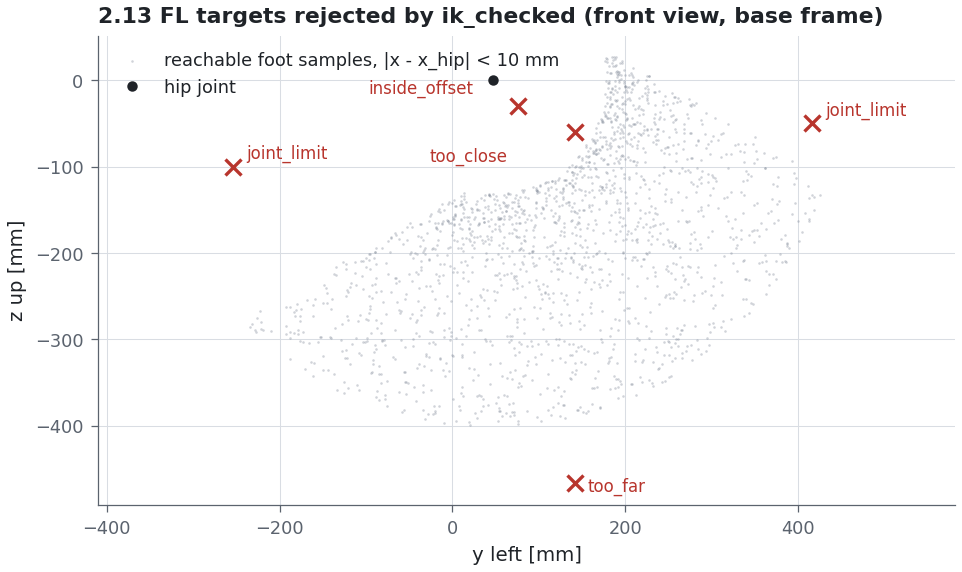

**Measurement** (`results/2.13.json`). Two independent checks: module 04's multi-start damped least squares, and the distance
to the nearest of 100 000 random reachable foot positions.

| Target (base frame) [m] | Expected | `ik_checked` | DLS converged | Nearest reachable sample |
|---|---|---|---|---|
| (0.192, 0.142, −0.466) | too_far | too_far | no | 77 mm |
| (0.193, 0.142, −0.060) | too_close | too_close | no | 20 mm |
| (0.193, 0.077, −0.030) | inside_offset | inside_offset | no | 90 mm |
| (0.193, 0.417, −0.050) | joint_limit | joint_limit | no | 50 mm |
| (0.193, −0.254, −0.100) | joint_limit | joint_limit | no | 162 mm |

200 reachable targets (FK of random in-limit angles): 200 accepted. In simulation, commanding the `too_far` target after a
reachable one moved the foot 0.035 mm (residual settling) during the 1 s it was active.

**Acceptance.** 5 of 5 rejected with the expected reason, DLS fails on all 5, all reachable targets accepted, foot motion
< 1 mm: passed.

**Failure analysis.** The checks ignore collisions: the inward `joint_limit` target would also put the foot under the trunk, and a
target that is reachable but passes the leg through the body is accepted. The classifier reports the first reason found, so a
target that is both too far and beyond a joint limit is reported as `too_far`.

**Next task.** 2.14 runs two legs at once.

### 2.14 Coordinate two legs on a supported robot

**Objective.** Run the 2.12 arc cycle on the front-left and rear-right legs in phase (the trot pair), and on front-left and
rear-left half a cycle apart, and measure the phase between the feet.

**Prerequisites.** 2.12.

**Theory.** Both legs read one reference clock; each has its own IK and PD. The phase is measured as the lag that maximises the
cross-correlation of the two foot heights, and as the difference of the apex times per cycle. Resolution: one 2 ms sample.

**Implementation.**

```python
make = lambda p0: lib.arc_cycle(p0, r, .5, .5, cycles=4)
log, P, s = run_paths(m, d, {leg: make for leg in pair}, rec=rec)
shifted = lambda p0: (lambda P: np.vstack([P[250], np.roll(P[1:], -250, axis=0)]))(make(p0))   # half a cycle
```

**Execution.** `MUJOCO_GL=glfw DISPLAY=:0 flock /tmp/go2_render.lock ../../.venv-modules/bin/python run.py 2.14`

**Demonstration.** Front-left and rear-right in phase (amber: reference arcs, blue: foot trail).

<video controls muted playsinline src="media/2-14_two_legs.mp4"></video>

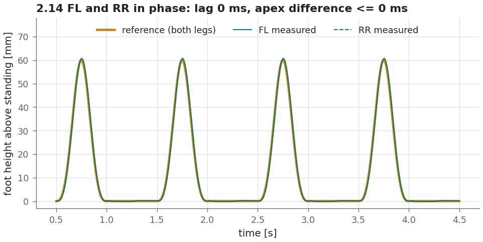

**Measurement** (`results/2.14.json`):

| Pair | Commanded offset | Measured lag | Apex offset per cycle | Tracking RMS per leg |
|---|---|---|---|---|
| FL, RR | 0 s | 0 s | 0, 0, 0, 0 s | 1.369, 1.369 mm |
| FL, RL | 0.5 s | 0.500 s | 0.5 s in all 4 cycles | 1.369, 1.373 mm |

**Acceptance.** Tracking RMS < 4 mm per leg, lag and phase error ≤ 4 ms, apex offset error ≤ 10 ms, for both pairs: passed.

**Failure analysis.** The in-phase test as first written could not fail. FL and RR are point-symmetric in the model, so their
foot heights agreed to 2.8e-16 m (`max_height_difference_m`). The FL/RL run was added after that, with its thresholds written into
`acceptance.json` as an addition. FL and RL differ (tracking RMS 1.369 vs 1.373 mm), but the phase is still exact at 2 ms
resolution: with one clock and lag differences far below a sample, timing cannot drift on a supported robot. On the ground,
contact forces load the stance leg and not the swing leg, and synchronisation has to be measured again (stage 4).

**Next task.** Stage 3 puts the feet on the floor: 3.02 stands up with the same joint PD and gravity compensation, now with the
base free.
