# Stage 3: posture and balance

By the end of this stage the Go2 stands on the floor with no support: it lies down, stands up, holds the stance, crouches,
raises and lowers its trunk, pitches and rolls it with the feet fixed, shifts its centre of mass (CoM) inside the support
polygon, lifts one foot on three legs, puts it down somewhere else and returns to where it started. Every task is the robot on
the floor of `modules/assets/unitree_go2/scene.xml`; nothing holds the trunk, no force is added to it, and contacts are MuJoCo's.

Why MuJoCo: in the Gazebo stack CHAMP owns all twelve joints, so single-joint control, single-foot motion and step climbing are
done here, where joint torques and contact forces are available.

**The control interface.** All twelve actuators in `go2.xml` are `<motor>` elements: a joint torque, gear 1, clipped to
±23.7 N m (hip, thigh) and ±45.43 N m (knee). Each joint also has passive damping $b = 2$ N m s/rad and friction loss
0.2 N m. The posture controller in `lib.py` computes the twelve torques every 2 ms physics step:

$$\tau = k_p(q^*-q) + k_d(\dot q^*-\dot q) + b\,\dot q^* + g_\text{leg}(q) - J(q)^\top R^\top f\,\hat z,$$

with $q^*$ from the closed-form IK of stage 2 applied to the foot targets in the body frame, $g_\text{leg}$ the torque that holds
each leg against its own weight (stage 2 `LegModel.gravity`, gravity rotated into the body frame), $J$ the foot Jacobian
(module 04) and $f$ the vertical force statics asks of each foot (task 3.03). $k_p = 150$ N m/rad, $k_d = 3$ N m s/rad.
The controller reads the joint encoders and the base orientation $R$ (an IMU would give it; here it comes from `d.qpos`).
The base position is read once, when the stance is anchored, to express the foot targets in world coordinates; it is never
fed back. Posture control here is therefore feed-forward: the body goes where the legs put it, and MuJoCo measures where that is.

| Interface | Used in |
|---|---|
| joint PD only ($k_p = 40$, $k_d = 2$, no weight term) | 3.01 |
| joint-space minimum-jerk move + weight feed-forward ramped from 0 to $mg$ | 3.02 |
| posture controller above: body pose and foot targets → IK every 2 ms → PD + $g_\text{leg}$ + $J^\top f$ | 3.03 to 3.12 |

**The posture API** (`lib.Posture`, for stage 5). `set_body_pose(p, rpy, T)`, `shift_com(xy, T)`, `com_into_triangle(leg)`,
`lift_foot(leg, height)`, `place_foot(leg, xy)`, `hold(T)`, `follow(p, rpy)`. Each call plans the whole motion first and raises
`lib.Rejected` with a reason (`too_far`, `joint_limit`, `clearance`, `margin`) before anything moves. `pose.log()` returns
everything measured.

**Run everything** from this folder. Tasks 3.01, 3.02, 3.08 and 3.11 render; run them under the machine-wide render lock, one
at a time. The renders used `DISPLAY=:0` because this machine had no `:1` X server (`mujoco.Renderer` failed on `:1`).

```bash
cd tasks/s03_posture-and-balance
../../.venv-modules/bin/python run.py 3.03 3.04 3.05 3.06 3.07 3.09 3.10 3.12
for t in 3.01 3.02 3.08 3.11; do MUJOCO_GL=glfw DISPLAY=:0 flock /tmp/go2_render.lock ../../.venv-modules/bin/python run.py $t; done
../../.venv-modules/bin/python -m pytest -q tests        # 7 tests, 4 s
```

The twelve runs took 806 s of wall time in total at a 1-minute load average of 48 to 76 on 32 cores (`wall_s` and
`load_avg_1min` in `results/*.json`). `acceptance.json` was written before the first run and has not changed (`changes` is
empty). Every task passed with a wide margin; the thresholds came from error budgets (soft-contact sinkage of a few mm, joint
friction band) that turned out much larger than the errors of a feed-forward stance on a flat floor. The Failure analysis
paragraphs say where the remaining error comes from.

| Id | Capability | Status | Key measured number |
|---|---|---|---|
| 3.01 | resting configuration | verified | peak torque 6.5 % of its limit; the chin sphere carries 27.6 % of the weight |
| 3.02 | stand up | verified | standing height 0.27464 m vs 0.27537 m predicted (0.74 mm) |
| 3.03 | hold standing for 10 s | verified | height change 0.72 µm, foot slip 2.5 µm |
| 3.04 | crouch to 0.18 m and back | verified | height RMS error 0.37 mm, max 0.81 mm |
| 3.05 | raise the body | verified | steady height error ≤ 7.5 µm at +20, +40, +60 mm; 0.42 m rejected (`too_far`) |
| 3.06 | lower the body | verified | trunk clearance 43.5 mm at 0.15 m; 0.12 m rejected (`clearance`) |
| 3.07 | pitch the body | verified | RMS error 0.089° on a ±8°, 0.5 Hz sine |
| 3.08 | roll the body | verified | RMS error 0.139° on a ±8°, 0.5 Hz sine |
| 3.09 | shift the centre of mass | verified | CoM error ≤ 3.3 mm for 40 mm shifts; CoP on the CoM within 0.017 mm |
| 3.10 | lift one foot on three legs | verified | margin ≥ 38.4 mm; three-leg force prediction within 0.004 N |
| 3.11 | place the lifted foot | verified | placement error 2.0 mm |
| 3.12 | return to the original posture | verified | after 3 cycles: base 0.13 mm, feet 0.45 mm, attitude 0.043° from the start |

### 3.01 Resting configuration

**Objective.** Put the Go2 in a folded resting pose on the floor that costs little torque and does not move.

**Prerequisites.** 2.05 (joint PD), 2.07 (FK).

**Theory.** $q_\text{rest} = (0, 1.36, -2.65)$ rad per leg is computed, not taken from the keyframe (the only keyframe, `home`, is
the standing pose). The knee sits 0.07 rad inside its fold limit $-2.7227$ rad. With that knee angle a thigh angle of 1.36 rad puts
the foot centre 0.106 m below the hip, level with the bottom of the trunk's collision sphere under the head (centre 0.06 m
below the base, radius 0.047 m), so feet and trunk can share the weight. At rest the floor carries all of it:
$\sum_c F_{z,c} = mg = 15.206 \times 9.81 = 149.2$ N.

**Implementation.**

```python
def rest(m, d, T=3.0, rec=None):
    sim.place_on_ground(m, d, Q_REST)
    pose = Posture(m, d, rec=rec)
    pose.joint_move(Q_REST, T, kp=40.0, kd=2.0, support=(0.0, 0.0))
```

**Execution.** `MUJOCO_GL=glfw DISPLAY=:0 flock /tmp/go2_render.lock ../../.venv-modules/bin/python run.py 3.01`

**Demonstration.**

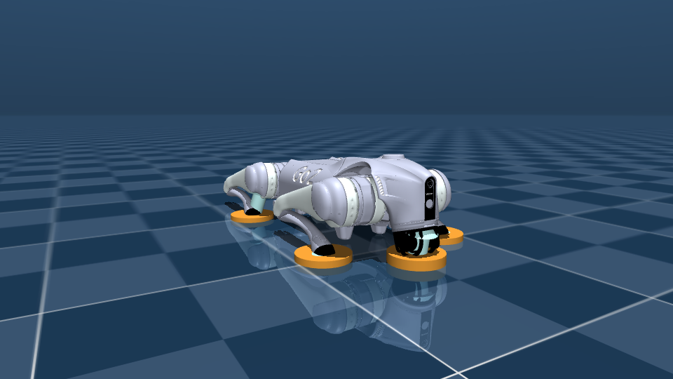

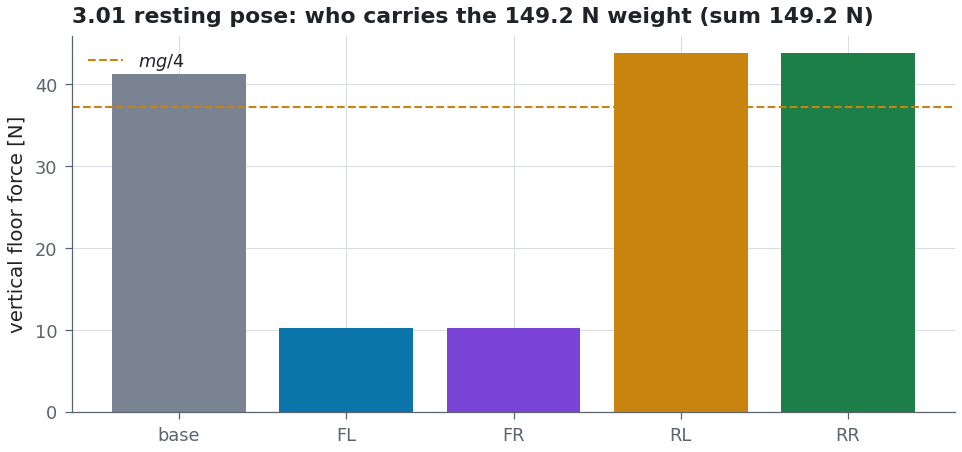

**Measurement** (`results/3.01.json`, after 3 s; "base" is the chin sphere of the trunk):

| Quantity | Value |
|---|---|
| base height, pitch | 0.0978 m, −1.97° |
| vertical force: chin / FL, FR / RL, RR | 41.2 / 10.2, 10.2 / 43.8, 43.8 N |
| sum of floor forces vs $mg$ | 8.8e-6 relative error |
| peak torque over the last 1 s | 2.95 N m, 6.5 % of its limit |
| base speed over the last 0.5 s | 0.73 mm/s max |

**Acceptance.** Weight carried within 2 %, torque below 20 % of the limit, base speed below 10 mm/s, roll and pitch within 3°:
passed.

**Failure analysis.** The trunk does not lie flat: it rests on the chin sphere and the rear feet, pitched 1.97° nose down,
and the front feet carry only 10.2 N each. The rear feet are pushed outward by 16.8 N each against 43.8 N normal
force (`foot_force_end_N`), a ratio of 0.38 held by friction; on a floor with a friction coefficient below 0.38 they would slide. The 0.73 mm/s residual motion
is the feet creeping on the soft contacts after the 3 s settle.

**Next task.** 3.02 starts from this state.

### 3.02 Stand up

**Objective.** Rise from the resting pose to the standing pose `Q_STAND` = (0, 0.9, −1.8) rad and end on four feet at the
predicted height.

**Prerequisites.** 3.01.

**Theory.** Joints follow a minimum-jerk path $q(t) = q_0 + (q_1 - q_0)(10s^3 - 15s^4 + 6s^5)$, $s = t/T$, $T = 1.5$ s. The
weight feed-forward is ramped with the same $s$, because the feet take over the load from the chin as the trunk lifts. The
predicted standing height is the kinematic height of `Q_STAND` (base above the foot centres, $-\bar f_z = 0.26637$ m from FK)
plus the 9 mm at which a loaded foot-sphere centre sits above the floor (soft contact, MODULE_SPEC): 0.27537 m.

**Implementation.**

```python
def stand_up(pose, T=1.5, settle=0.5):
    pose.joint_move(Q_STAND, T, support=(0.0, 1.0))   # weight in the feed-forward ramped 0 -> m g
    pose.joint_move(Q_STAND, settle)
    pose.anchor()                                     # the stance: P_i = p_base + R fk(q_i), read once
```

**Execution.** `MUJOCO_GL=glfw DISPLAY=:0 flock /tmp/go2_render.lock ../../.venv-modules/bin/python run.py 3.02`

**Demonstration.**

<video controls muted playsinline src="media/3-02_stand_up.mp4"></video>

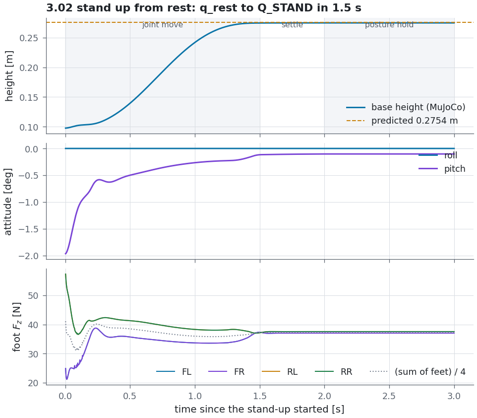

**Measurement** (`results/3.02.json`):

| Quantity | Value |
|---|---|
| final height / predicted | 0.27464 / 0.27537 m (0.74 mm low) |
| chin leaves the floor | 0.07 s after the start |
| largest roll or pitch during the rise | 1.97° (the resting pitch at $t = 0$) |
| peak torque | 12.0 N m; largest fraction of a joint's limit 36 % |
| contact-point travel, worst foot | 7.7 mm |
| end: feet in contact, other contacts | 4, 0; feet carry 100.0 % of $mg$ |

**Acceptance.** Height within 5 mm, attitude within 3°, torque below 80 % of the limit, foot travel below 10 mm, four feet and
no other contact at the end: passed.

**Failure analysis.** The 7.7 mm contact-point travel is the largest margin used in this task (77 % of the threshold). The
calf turns by about 0.4 rad between the two poses (thigh + knee angle goes from −1.29 to −0.90 rad) and the foot is a sphere
of radius 22 mm fixed to it: if it rolls without
slipping its centre moves $r\,\Delta\phi \approx 8.6$ mm (my estimate from the joint angles, not separately measured).
A faster stand-up or a slippery floor would turn that roll into slip. The 0.74 mm height shortfall is the sinkage being
slightly more than the 9 mm assumed.

**Next task.** 3.03 holds this pose; every later task starts with `lib.standing()` (rest, stand up, anchor).

### 3.03 Hold standing

**Objective.** Stand for 10 s with the posture controller and keep height, attitude and contacts.

**Prerequisites.** 3.02.

**Theory.** Statics of the stance. With the foot positions $x_i$ relative to the CoM projection, the vertical foot forces must
satisfy $\sum f_i = mg$ and $\sum f_i\,(x_i - c) = 0$: three equations, four unknowns. The controller picks the least-squares
solution weighted by $w_i$:

$$\min \sum_i f_i^2 / w_i \ \text{ s.t. } A f = b,\quad A = \begin{bmatrix} 1 & \cdots & 1 \\ x_1 - c_x & \cdots & x_4 - c_x \\ y_1 - c_y & \cdots & y_4 - c_y\end{bmatrix},\ b = \begin{bmatrix} mg \\ 0 \\ 0\end{bmatrix}
\ \Rightarrow\ f = W A^\top (A W A^\top)^{-1} b.$$

$J^\top R^\top f\hat z$ turns those forces into joint torques, so in steady state the PD term has nothing left to do.

**Implementation.**

```python
def force_distribution(dxy, w, weight):
    A = np.vstack([np.ones(len(dxy)), dxy.T])
    W = np.diag(w)
    f = W @ A.T @ np.linalg.solve(A @ W @ A.T, [weight, 0.0, 0.0])
    return np.maximum(f, 0.0)
```

**Execution.** `../../.venv-modules/bin/python run.py 3.03`

**Demonstration.**

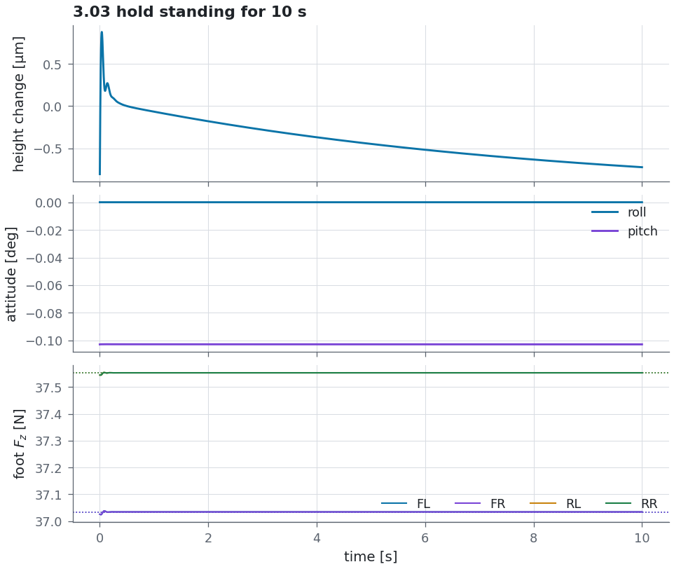

**Measurement** (`results/3.03.json`, from 0.5 s to 10 s):

| Quantity | Value |
|---|---|
| height | 0.27464 m, largest change 0.72 µm |
| largest roll or pitch | 0.103° (the standing pitch) |
| foot slip (contact point) | 2.5 µm |
| foot $F_z$ FL, FR / RL, RR, measured | 37.035 / 37.553 N |
| same from statics | 37.035 / 37.553 N |
| sum of foot forces vs $mg$ | 1.1e-9 relative error |

**Acceptance.** Height within 3 mm, attitude within 0.5°, all feet in contact for the whole interval, slip below 2 mm, weight
within 2 %: passed.

**Failure analysis.** On a flat floor the hold has no failure mode left in the simulation; the numbers are three orders of
magnitude inside the thresholds. The hold is open loop in the base position: a push or a slope moves the trunk and nothing
brings it back (stage 5, 5.16). The standing pitch of 0.103° nose down comes from the rear feet carrying 0.52 N more than the
front ones, because the CoM is 2.2 mm behind the base origin.

**Next task.** 3.04 moves the body with the same controller.

### 3.04 Crouch

**Objective.** Lower the trunk from standing height to 0.18 m in 1.5 s, hold, and rise again, with the feet fixed.

**Prerequisites.** 3.03.

**Theory.** A body pose $(p^*, R^*)$ and world foot targets $P_i$ give foot targets in the body frame
$f_i^* = R^{*\top}(P_i - p^*)$; the closed-form IK of stage 2 turns them into $q^*$. The feed-forward is static, so the body's
acceleration is left to the PD: peak $\ddot z = 5.77\,\Delta z/T^2 = 0.24$ m/s² for $\Delta z = 0.095$ m, $T = 1.5$ s, which is
3.7 N of unmodelled force.

**Implementation.**

```python
for k in range(N):                                    # Posture.path: every 2 ms sample is solved before moving
    q = Q[k] = self.ik(pp[k], rr[k], PP[k], q)        # f = R*^T (P_i - p*), s02.ik_closest per leg
```

```python
pose.set_body_pose(p=low, T=1.5); pose.hold(1.0)
pose.set_body_pose(p=p0, T=1.5); pose.hold(1.0)
```

**Execution.** `../../.venv-modules/bin/python run.py 3.04`

**Demonstration.**

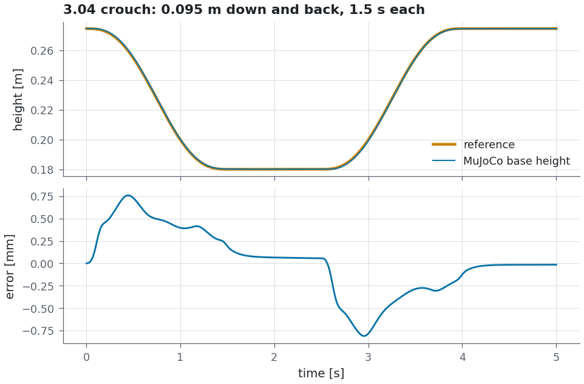

**Measurement** (`results/3.04.json`):

| Quantity | Value |
|---|---|
| height error RMS / max | 0.37 / 0.81 mm |
| final height error | 0.016 mm |
| largest roll or pitch | 0.27° |
| peak torque fraction | 19.9 % |

**Acceptance.** RMS below 4 mm, max below 8 mm, attitude within 1°, final error below 3 mm, contact throughout: passed.

**Failure analysis.** The error peaks (0.8 mm) where the reference accelerates most, at 0.4 s and 2.9 s, and the trunk lags
the reference on the way down and on the way up: the PD carries the inertial force. Adding $m\ddot z^*$ to the feed-forward
weight would remove most of it.

**Next task.** 3.05 and 3.06 use the same move to reach the height limits.

### 3.05 Raise the body

**Objective.** Raise the trunk by 20, 40 and 60 mm and reject a height the legs cannot reach.

**Prerequisites.** 3.04, 2.13 (IK rejection).

**Theory.** A foot target is out of reach when its sagittal distance from the thigh joint exceeds
$\rho_\max = 0.390$ m (knee at its straightest limit, stage 2 `LegModel.rho_max`). The planner solves the IK for every sample
before the first torque is sent, so an unreachable request never starts.

**Implementation.**

```python
try:
    pose.set_body_pose(p=p, T=1.0); reason = None       # p[2] = 0.42 m
except Rejected as e:
    reason = e.reason                                    # 'too_far' from s02.ik_checked
```

**Execution.** `../../.venv-modules/bin/python run.py 3.05`

**Demonstration.**

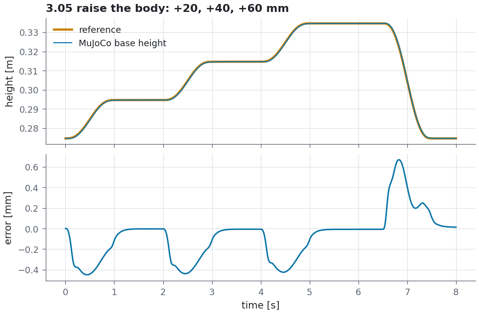

**Measurement** (`results/3.05.json`, steady value = mean of the last 0.3 s of each 1 s hold):

| Target [m] | Measured [m] | Error [µm] |
|---|---|---|
| 0.29464 | 0.29463 | 3.2 |
| 0.31464 | 0.31463 | 6.0 |
| 0.33464 | 0.33463 | 7.5 |

Highest reachable base height by bisection on the planner: 0.3984 m. The 0.42 m request was rejected with `too_far`; during
the 0.5 s hold after it the feet and base moved at most 4.1 µm.

**Acceptance.** Steady error below 4 mm, request rejected, motion below 0.5 mm: passed.

**Failure analysis.** The planner's limit (0.398 m) is a kinematic limit only. Near it the knee is almost straight, the
Jacobian loses rank and a small height error needs a large joint motion; no task here goes above 0.335 m.

**Next task.** 3.06 goes the other way.

### 3.06 Lower the body

**Objective.** Lower the trunk to 0.22, 0.18 and 0.15 m, measure its clearance above the floor, and reject a pose that would
put the trunk within 20 mm of it.

**Prerequisites.** 3.04.

**Theory.** The lowest trunk point is one of the eight corners of the collision box (half-sizes 0.1881, 0.04675, 0.057 m) or
the bottom of the chin sphere: $c = \min\big(\min_k (p + R\,b_k)_z,\ (p + R\,s)_z - r_s\big)$. Level at height $h$, the chin
decides: $c = h - 0.107$ m, so 0.12 m gives 13 mm, below the 20 mm guard.

**Implementation.**

```python
def trunk_clearance(p, R):
    corners = np.array([[sx, sy, sz] for sx in (-1, 1) for sy in (-1, 1) for sz in (-1, 1)]) * BOX
    return float(min((p + corners @ R.T)[:, 2].min(), (p + R @ CHIN[0])[2] - CHIN[1]))
```

MuJoCo checks it: `mj_geomDistance` between the floor and each trunk geom (`lib.mujoco_clearance`).

**Execution.** `../../.venv-modules/bin/python run.py 3.06`

**Demonstration.**

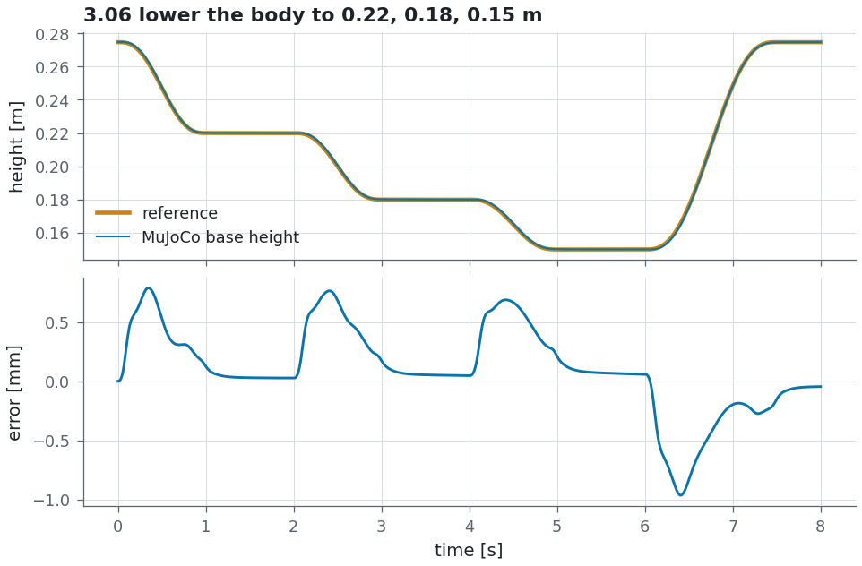

**Measurement** (`results/3.06.json`):

| Target [m] | Height error [µm] | Trunk clearance, MuJoCo [mm] | Predicted [mm] | Leg geoms, MuJoCo [mm] |
|---|---|---|---|---|
| 0.22 | 27 | 113.5 | 113.5 | 33.6 |
| 0.18 | 49 | 73.5 | 73.5 | 31.0 |
| 0.15 | 62 | 43.5 | 43.5 | 28.9 |

The 0.12 m request was rejected with `clearance` (predicted 13 mm). No contact other than the four feet at any sample.

**Acceptance.** Steady error below 4 mm, trunk clearance at least 20 mm, prediction within 3 mm of MuJoCo, low request
rejected, no other contact: passed.

**Failure analysis.** The guard covers the trunk only. At 0.15 m the closest robot geometry to the floor is a leg geom
(hip, thigh or calf, `legs_clearance_mujoco_m`), 28.9 mm up, not the trunk; a guard for the legs would need the same check on the thigh and calf geoms. The planner does not
know about obstacles: clearance is to the plane $z = 0$.

**Next task.** 3.07 rotates the body instead of translating it.

### 3.07 Pitch the body

**Objective.** Pitch the trunk to ±10° and track a ±8°, 0.5 Hz sine, feet fixed.

**Prerequisites.** 3.04.

**Theory.** $R^* = R_z(\psi)R_y(\theta)R_x(\phi)$; with the feet fixed in the world, pitching by $\theta$ moves the front feet
up and the rear feet down in the body frame by about $0.19\sin\theta$ m each (33 mm at 10°).

**Implementation.**

```python
t_s = np.arange(1, int(round(4.0 / DT)) + 1) * DT
pose.follow(rpy=r0 + np.outer(np.radians(8.0) * np.sin(2 * np.pi * 0.5 * t_s), np.eye(3)[axis]))
```

**Execution.** `../../.venv-modules/bin/python run.py 3.07`

**Demonstration.**

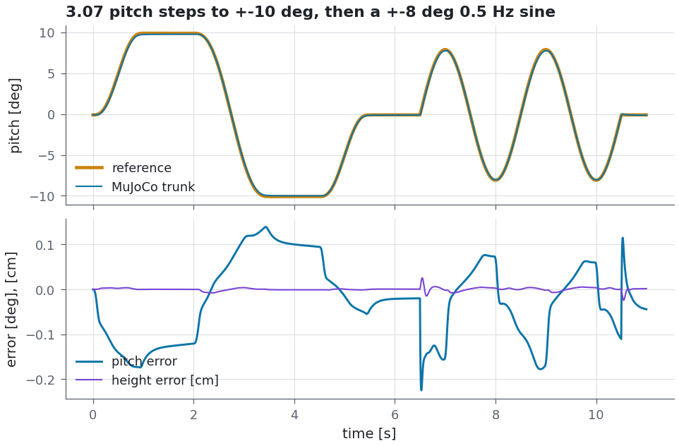

**Measurement** (`results/3.07.json`):

| Quantity | Value |
|---|---|
| sine RMS error, lag | 0.089°, 4 ms |
| largest error | 0.22° (at the start of the sine) |
| steady error at +10° / −10° / 0° | 0.12° / 0.10° / 0.02° |
| height change, roll change | 0.26 mm, 9e-5° |

**Acceptance.** Sine RMS below 1°, max below 2°, steady error below 0.5°, height within 5 mm, contact throughout: passed.

**Failure analysis.** The steady error at ±10° (0.1°) does not decay during the 1 s hold. The front and rear feet carry
different loads when pitched and sink by different amounts on the soft contact; 0.1° over the 0.39 m between front and rear
feet is a 0.7 mm sinkage difference (my inference; the per-foot sinkage was not logged). The 0.22° peak comes from starting the
sine at zero with a nonzero slope, a velocity step of 25°/s.

**Next task.** 3.08 does the same about the roll axis.

### 3.08 Roll the body

**Objective.** Roll the trunk to ±10° and track a ±8°, 0.5 Hz sine; then sweep height, pitch, roll and yaw for the video.

**Prerequisites.** 3.07.

**Theory.** As in 3.07 about the $x$ axis. The feet are 0.284 m apart laterally, so rolling 10° moves each foot target by
about 25 mm vertically in the body frame and rotates the hip abduction joints.

**Implementation.** `attitude_task(0, 'roll', ...)` in `run.py`, the same code as 3.07 with axis 0. The sweep:

```python
seq = [(p0 + [0, 0, -0.06], r0, 1.2), (p0 + [0, 0, 0.04], r0, 1.5), (p0, r0, 1.0)]
for i, a in ((1, 10), (0, 10), (2, 15)):                 # pitch, roll, yaw in degrees
    e = np.radians(a) * np.eye(3)[i]
    seq += [(p0, r0 + e, 1.0), (p0, r0 - e, 1.5), (p0, r0, 1.0)]
```

**Execution.** `MUJOCO_GL=glfw DISPLAY=:0 flock /tmp/go2_render.lock ../../.venv-modules/bin/python run.py 3.08`

**Demonstration.**

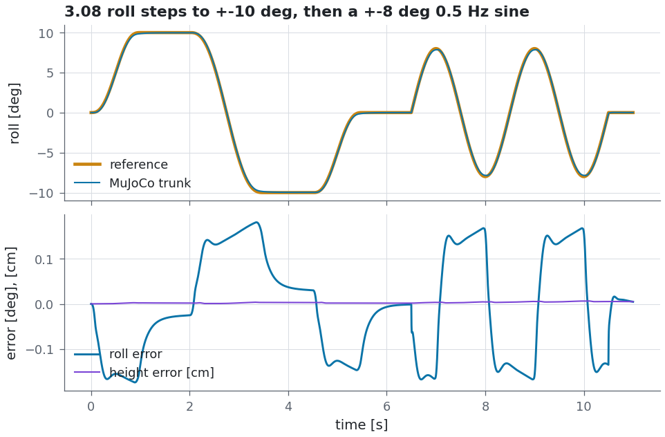

<video controls muted playsinline src="media/3-08_pose_sweep.mp4"></video>

**Measurement** (`results/3.08.json`):

| Quantity | Value |
|---|---|
| sine RMS error, lag | 0.139°, 6 ms |
| largest error | 0.18° |
| steady error at +10° / −10° / 0° | 0.026° / 0.031° / 0.002° |
| height change, pitch change | 0.065 mm, 0.0024° |
| sweep (14.7 s): RMS height / roll / pitch / yaw error | 0.23 mm / 0.081° / 0.070° / 0.28° |

**Acceptance.** Same thresholds as 3.07: passed.

**Failure analysis.** Yaw tracks worst in the sweep (0.28° RMS). In yaw the feet are loaded sideways and the sphere contacts
twist; the torsional friction coefficient in `go2.xml` is 0.02, so the feet can yield a little (my inference, the foot twist
was not logged). Roll has the larger sine error (0.139° against 0.089° for pitch) and the smaller steady error (0.031° against
0.12°). The roll error in the figure is close to a square wave that flips sign with the roll velocity, the shape a
Coulomb friction term (joint friction loss 0.2 N m, contact torsion) produces; which of the two dominates was not separated.

**Next task.** 3.09 translates the CoM instead of rotating the trunk.

### 3.09 Shift the centre of mass

**Objective.** Move the CoM projection 40 mm in eight directions, measure where it ends up, how far it is from the edge of the
support polygon, and reject a target that would leave less than 20 mm.

**Prerequisites.** 3.03, 3.04.

**Theory.** The CoM from the MJCF masses: $c = \big(m_b c_b + \sum_j m_j c_j(q)\big)/M$, $M = 15.206$ kg, with $c_j$ from the leg
kinematics. The static stability margin is the signed distance from the CoM projection to the nearest edge of the convex hull
of the contact points (counter-clockwise vertices $v_k$, edges $e_k$):

$$s = \min_k \frac{e_k \times (c - v_k)}{\lVert e_k\rVert},$$

positive inside. In static equilibrium the centre of pressure $\sum f_i p_i / \sum f_i$ lies exactly on the CoM projection.
The body translation that puts the CoM at a target is found by iteration, since moving the body moves the legs relative to it.

**Implementation.**

```python
def body_for_com(self, xy, P=None):
    p = self.p.copy()
    for _ in range(6):
        p[:2] += np.asarray(xy) - self.com_world(p, self.rpy, P)[:2]
    return p
```

Contact points come from MuJoCo (`d.contact[i].pos` of the foot geoms, `lib.contact_points`); the CoM model is checked against
MuJoCo's `subtree_com`.

**Execution.** `../../.venv-modules/bin/python run.py 3.09`

**Demonstration.**

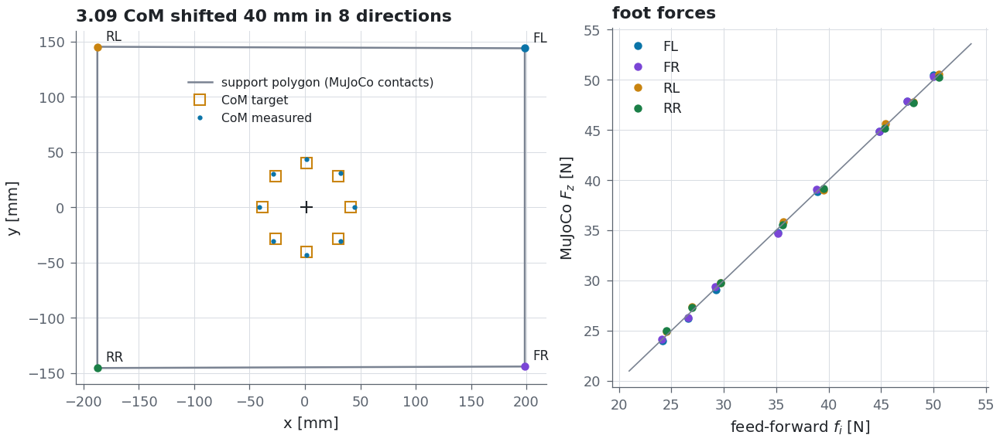

**Measurement** (`results/3.09.json`, mean of the last 0.3 s of each 1 s hold):

| Quantity | Value |
|---|---|
| CoM error, worst of 8 | 3.3 mm |
| CoP minus CoM, worst | 0.017 mm |
| margin, measured vs predicted, worst difference | 0.73 mm |
| smallest margin | 103.9 mm (lateral shifts, 90° and 270°) |
| foot $F_z$ minus feed-forward, worst | 0.46 N |
| CoM model vs MuJoCo | 1.1e-16 m |
| foot-centre displacement during a shift, worst | 3.2 mm |
| 200 mm forward request | rejected, `margin` |

**Acceptance.** CoM error below 5 mm, CoP within 3 mm of the CoM, margin within 5 mm of prediction, model within 1e-9 m,
unsafe request rejected: passed.

**Failure analysis.** The 3.3 mm CoM error is systematic and points in the direction of the shift every time. The feet are
the cause: all four foot-sphere centres moved 2.7 mm along with the body during the 0° shift (`foot_centre_displacement_m`),
and the whole robot moved with them, because the controller holds the feet where it thinks they are and never measures that.
The IK treats the foot as a point, but the foot is a 22 mm sphere fixed to the calf; when the calf turns, a sphere rolling
without slip moves its centre by $r\,\Delta\phi$. That model predicts 3.8 mm against the 2.7 mm measured
(`max_rolling_model_error_m` = 1.4 mm): the sphere rolls part of the way. The rolling friction in `go2.xml`
(0.01) resisting it is a likely reason for the rest, not checked. A contact-point model in the IK, or feedback on the measured CoM, would remove the bias.

**Next task.** 3.10 uses the margin to decide whether a foot can leave the ground.

### 3.10 Lift one foot on three legs

**Objective.** Shift the CoM 40 mm inside the triangle of FR, RL and RR, unload FL, lift it 60 mm, and hold for 2 s.

**Prerequisites.** 3.09.

**Theory.** With three feet the force distribution is no longer a choice: $A f = b$ has three equations and three unknowns,
so the vertical forces are fixed by the contact points and the CoM. The CoM target is the point nearest the current CoM that
has margin 0.04 m in the triangle (SLSQP on $\lVert x - c\rVert^2$ s.t. $s(x) \ge 0.04$). Unloading sets $w_\text{FL}$ from 1
to 0 over 0.5 s, which moves the feed-forward continuously to the three-leg solution.

**Implementation.**

```python
def lift_foot(self, leg, height, T_unload=0.5, T_lift=0.6, min_margin=MIN_MARGIN):
    mg = self.margin([l for l in LEGS if l != leg])
    if mg < min_margin:
        raise Rejected('margin', ...)
    w = self.w.copy(); w[LEGS.index(leg)] = 0.0
    a = self.move(T_unload, w=w)
    P = self.P.copy(); P[LEGS.index(leg), 2] += height
    return a, self.move(T_lift, P=P)
```

**Execution.** `../../.venv-modules/bin/python run.py 3.10`

**Demonstration.**

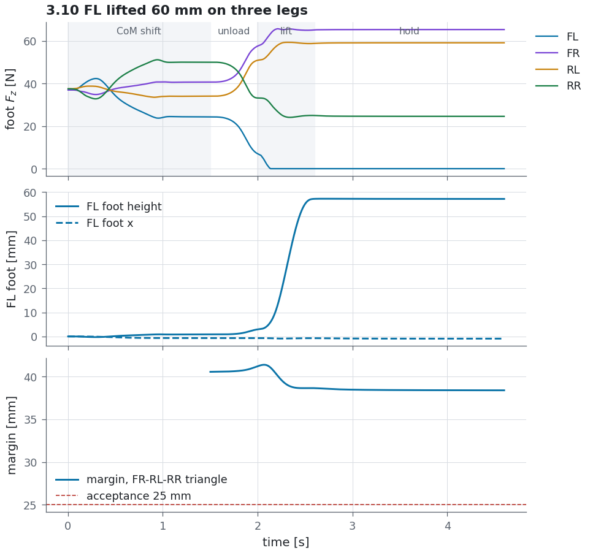

**Measurement** (`results/3.10.json`; the window starts with the unloading):

| Quantity | Value |
|---|---|
| smallest margin (MuJoCo contacts and CoM) | 38.4 mm |
| stance feet in contact | 100 % of samples |
| FL lift, smallest during the hold | 57.2 mm (60 mm commanded) |
| attitude change / height change | 0.48° / 0.62 mm |
| stance slip | 0.29 mm |
| $F_z$ FR, RL, RR in the hold: measured | 65.40, 59.17, 24.60 N |
| same, statics with 3 feet | 65.40, 59.17, 24.60 N (largest difference 0.004 N) |
| FL force at the end of the unloading | 7.0 N; below 1 N 0.61 s after unloading began |

**Acceptance.** Margin at least 25 mm, stance contact throughout, lift at least 50 mm, attitude within 1.5°, height within 5
mm, slip below 3 mm, force prediction within 5 N: passed.

**Failure analysis.** Two measured shortfalls. First, unloading through the feed-forward alone leaves 7.0 N on FL when the
ramp ends: the four-leg stance is statically indeterminate and the stiff joint PD still presses FL onto its target, so the
foot leaves the ground only 0.11 s into the lift. Second, the foot reaches 57.2 mm, not 60: in the body frame it is within
0.04 mm of its target (`fl_error_body_frame_m`), and the 2.8 mm are the trunk tilting 0.48° towards the lifted corner as the
three stance feet take different loads and sink by different amounts.

A run with the margin guard switched off shows why the CoM shift comes first. From the centred stance the CoM is 1.3 mm
from the FR–RL diagonal. Unloading FL takes the force off RR as well (it falls to zero during the lift); the robot balances
on the diagonal and tips over it while FL rises, rolling 18.3° and pitching 11.6° until FL lands again and RR stays in the air (`no_com_shift` in the results). The
default call `pose.lift_foot('FL', 0.06)` refuses this with `margin`.

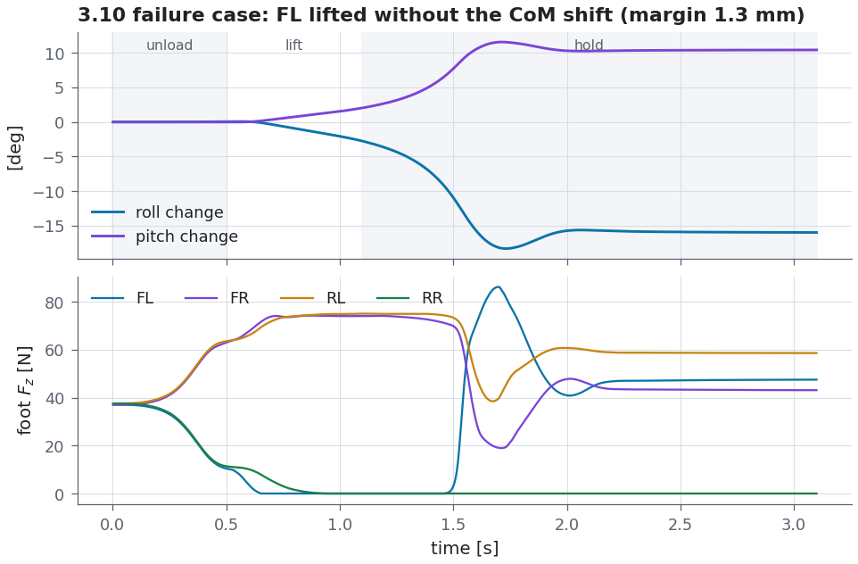

**Next task.** 3.11 puts the lifted foot down somewhere else.

### 3.11 Place the lifted foot

**Objective.** Move the lifted FL foot 60 mm forward, put it down, load it, and bring the CoM back over the new four-foot
stance.

**Prerequisites.** 3.10.

**Theory.** The foot target moves at the lift height, then down to the foot's standing height $z_0$ (the centre of a loaded
sphere, which includes the sinkage). Reloading ramps $w_\text{FL}$ back to 1; the CoM then goes to the same offset from the
foot centroid it had before the step.

**Implementation.**

```python
def place_foot(self, leg, xy, T_move=0.6, T_lower=0.6, T_load=0.5):
    i = LEGS.index(leg)
    P = self.P.copy(); P[i, :2] = xy
    a = self.move(T_move, P=P)
    P = P.copy(); P[i, 2] = self.z0[i]
    b = self.move(T_lower, P=P)
    w = self.w.copy(); w[i] = 1.0
    return a, b, self.move(T_load, w=w)
```

**Execution.** `MUJOCO_GL=glfw DISPLAY=:0 flock /tmp/go2_render.lock ../../.venv-modules/bin/python run.py 3.11`

**Demonstration.**

<video controls muted playsinline src="media/3-11_three_leg_step.mp4"></video>

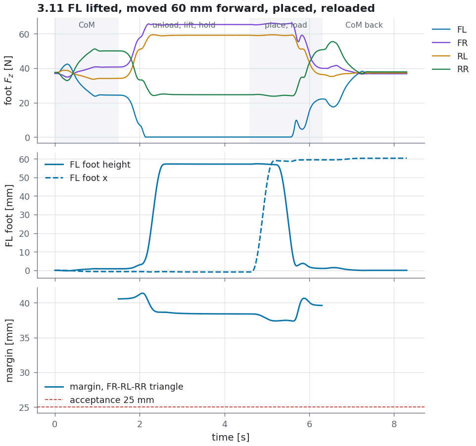

**Measurement** (`results/3.11.json`; window from the start of the unloading to the end of the reloading):

| Quantity | Value |
|---|---|
| placement error (MuJoCo contact point vs target, horizontal) | 2.0 mm (x 0.5 mm, y 1.9 mm) |
| smallest margin | 37.4 mm |
| stance slip | 0.31 mm |
| attitude change | 0.50° |
| FL $F_z$ at the end / feet in contact | 37.3 N / 4 |

**Acceptance.** Placement within 5 mm, margin at least 25 mm, slip below 3 mm, four feet at the end, attitude within 1.5°:
passed.

**Failure analysis.** The foot lands 1.9 mm inboard of the target. As in 3.09 the IK places the sphere centre and the hip
abduction angle changes while the foot is loaded; the sphere rolls sideways (my inference from the 3.09 rolling check; the
lateral roll was not measured separately). FL touches the floor before its target height, with a 10 N force bump at about
5.7 s in the figure; the 0.5° tilt of the trunk towards FL (`max_attitude_change_deg`) is the likely reason (my inference).

**Next task.** 3.12 steps back and checks that the robot returns to where it started.

### 3.12 Return to the original posture

**Objective.** Step FL out by 60 mm and back, return the body to its starting pose, three times, and measure how far the robot
ends from where it started.

**Prerequisites.** 3.11.

**Theory.** Repeatability is the error of the final state against the initial one after the same sequence: base position
$\lVert p_k - p_0\rVert$, attitude, contact points $\lVert x_{i,k} - x_{i,0}\rVert$, joints $\lVert q_k - q_0\rVert_\infty$, for cycle $k$.

**Implementation.**

```python
for k in range(3):
    lift(pose); place(pose, P0[0, :2] + STEP)              # step out, CoM back to the centre
    lift(pose); place(pose, P0[0, :2], recentre=False)     # step back
    pose.set_body_pose(p=p0, rpy=r0, T=1.0); lg = pose.hold(1.0)
```

**Execution.** `../../.venv-modules/bin/python run.py 3.12`

**Demonstration.**

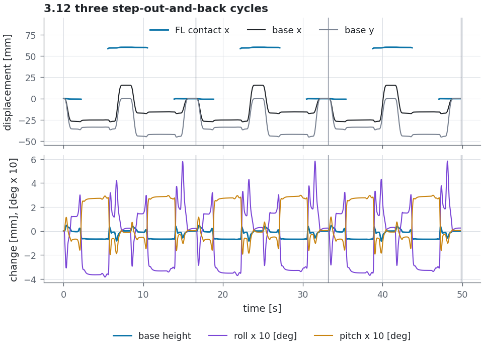

**Measurement** (`results/3.12.json`, mean of the last 0.3 s of each cycle):

| Cycle | Base [mm] | Attitude [°] | Feet, worst [mm] | Joints, worst [mrad] |
|---|---|---|---|---|
| 1 | 0.11 | 0.021 | 0.31 | 0.84 |
| 2 | 0.12 | 0.032 | 0.40 | 0.94 |
| 3 | 0.13 | 0.043 | 0.45 | 0.96 |

**Acceptance.** Base within 5 mm, attitude within 0.5°, feet within 5 mm, joints within 0.02 rad, three cycles completed:
passed.

**Failure analysis.** The errors grow with every cycle: the base by about 0.008 mm and the worst foot by about 0.07 mm per
cycle, the base always towards −x, −y (`base_position_error_xyz_m`). Nothing measures the drift, so it accumulates; at these
rates the feet would use the 5 mm threshold after about 65 more cycles and the base after about 600 (extrapolated, not run). Stage 5 needs either feedback on the base
position or re-anchoring the stance from measured contacts after each step.

**Next task.** Stage 4 (4.01, one footstep) and stage 5 (5.05, one foot onto a low platform) build on `lift_foot` and
`place_foot`.
