# Stage 6. Sensors and perception

At the end of this stage the Go2 reads its IMU, RGB-D camera and 3D lidar, turns them into numbers it can act on, and acts:
it finds the obstacles around it, stops 0.5 m before a face that was not there when it started walking, stops when its
range sensor goes quiet, and measures the height and edges of a raised platform from one depth image. Each task has an
acceptance test that runs against the simulator and scores the result on Gazebo's ground truth (`/odom_gt`), which no
algorithm here reads.

Run everything from the repository root:

```bash
cd go2-nav-sim
source env.sh
python3 -m pytest -q tasks/s06_sensors-and-perception/tests          # 10 tests, no simulator
python3 tasks/s06_sensors-and-perception/run.py all                  # every task; or one id, e.g. run.py 6.03
```

`run.py` starts the simulator and the estimation launch (for `/scan`) when they are not running, with logs in `logs/`, and
restarts them when a task needs the robot fresh on marker A or the platform world. Nav2 is not needed. Each task writes
`results/<id>.json` with its metrics, the thresholds from `acceptance.json` (written before the first run, never loosened)
and the verdict. Three tasks whose verdict changed between runs of the same code (6.01, 6.06, 6.17) run 5 times, each on a
fresh simulator, and count as verified only when all 5 pass; their results list every run under `per_run`. Stop the stack
with `bash scripts/stop.sh`. The video for 6.14 is recorded only with
`flock /tmp/go2_render.lock python3 tasks/s06_sensors-and-perception/run.py 6.14 --video`.

| Id | Capability | Status | Key number | Where it lives |
|---|---|---|---|---|
| 6.01 | stationary IMU | failed | 3 of 5 runs passed: tilt within 0.01 deg of truth in all, gyro mean up to 0.0103 rad/s against 0.005 | `run.py`, [chapter 8, 2.5](../../docs/08-robot-and-sensors.md#25-imu-gravity-points-up) |
| 6.02 | angular rate while turning | failed | mean rate within 0.28 %, but sample RMS 0.0200 rad/s against 0.02 | `run.py` |
| 6.03 | IMU noise and bias | failed | gyro white noise 139 to 495 times the configured value | `run.py`, `perception.allan_deviation` |
| 6.04 | heading from the gyro | failed | 0.75 deg after the turns; 1.45 to 6.5 deg drift in 30 s standing over five runs | `run.py` |
| 6.05 | RGB camera | verified | fx = 467.74 px, as 320 / tan(0.6) | `run.py`, [chapter 8, 2.4](../../docs/08-robot-and-sensors.md#24-camera-and-depth-grid-and-distance) |
| 6.06 | depth camera | verified | 5 of 5 runs passed: floor depth 1.16 to 1.44 % off the model (worst of 5 frames per run) | `run.py`, `perception.floor_depth` |
| 6.07 | distance to a wall, depth and scan | verified | depth 0.002 m, scan 0.025 m from the true 2.088 m | [p05 step 4](../../projects/p05_sense-and-stop/README.md#4-walk-to-the-start-of-the-test-lane-and-take-a-snapshot) |
| 6.08 | lidar point cloud | verified | floor ring 1.171 m against 1.179 m predicted | `run.py`, [chapter 8, 2.2](../../docs/08-robot-and-sensors.md#22-lidar-rings-on-the-floor-columns-on-obstacles) |
| 6.09 | cloud into `base_link` with tf2 | verified | floor at z = -0.213 m, true -0.216 m | `run.py`, [chapter 5](../../docs/05-frames-and-tf2.md) |
| 6.10 | floor and body removal | verified | 100 % of floor removed, 98.2 % of obstacle points kept | `perception.remove_floor_and_body` |
| 6.11 | detect one obstacle | verified | pallet face 2 mm, width 10 mm from truth | `perception.cluster` |
| 6.12 | detect several | verified | 6 of 6 visible obstacles, 0 false clusters | `perception.cluster`, `perception.visible` |
| 6.13 | stop before a wall | verified | 0.476 to 0.499 m for a 0.5 m target, 3 runs | [p05 steps 5-6](../../projects/p05_sense-and-stop/README.md#6-measure-the-stop-over-several-runs) |
| 6.14 | stop before a new obstacle | verified | 0.500 m after the box appeared 1.0 m ahead | `run.py`, `worlds/new_box.sdf`, p05 nodes |
| 6.15 | missing measurements | verified | zero sent 0.56 s after the node received the last scan; 0 m walked without readings | p05 `stop_at_obstacle.py` |
| 6.16 | detect a raised platform from depth | verified | top plane found, 7389 pixels, 0.48 deg from the floor | `perception.platform_from_points`, `worlds/platform.world` |
| 6.17 | platform height and edges | failed | 3 of 5 runs passed: height 0.118 m (true 0.12) in all, far edge 0.017 to 0.069 m short | same |

Files: `perception.py` (the logic, no ROS), `tests/test_perception.py`, `run.py` (ROS side and the acceptance tests),
`acceptance.json`, `worlds/make_worlds.py` (writes `platform.world` and `new_box.sdf` from one set of dimensions),
`results/`, `figures/`, `media/`.

The robot creeps while it stands: in one session it moved 0.31 m from A in about three minutes with zero commanded. Tasks
that need the robot on A restart the simulator when it is more than 0.3 m or 3 deg away.

### 6.01 Stationary IMU

**Objective.** Read `/imu/data` while the robot stands and check that it measures gravity and no rotation.

**Prerequisites.** Stage 1 (the robot spawns and stands); [chapter 8, 2.5](../../docs/08-robot-and-sensors.md#25-imu-gravity-points-up) reads the same topic by hand.

**Theory.** At rest an accelerometer measures the reaction to gravity in its own frame, $a = R^\top (0, 0, g)^\top$. Roll and
pitch follow without knowing yaw: $\phi = \operatorname{atan2}(a_y, a_z)$, $\theta = \operatorname{atan2}(-a_x, \sqrt{a_y^2 + a_z^2})$.

**Implementation.** `t601` in `run.py` records 20 s of IMU and ground truth and averages; `perception.tilt_from_accel`.

**Execution.** `python3 tasks/s06_sensors-and-perception/run.py 6.01`

**Demonstration.** `results/6.01.json`, last run: mean acceleration (0.033, -0.006, 9.800) m/s², 2020 samples at 99.6 Hz
of simulated time. `per_run` holds the checked numbers of all 5 runs.

**Measurement.** Over 5 runs $\big||\bar a| - 9.8\big|$ was 0.0000 to 0.0052 m/s² and the tilt from the accelerometer
within 0.01 deg of `/odom_gt` (last run: pitch -0.194 deg against -0.190 deg). The largest gyro mean per run was 0.0044,
0.0085, 0.0037, 0.0009 and 0.0103 rad/s; the last was the y axis. An earlier batch of 5 (`results/6.01_batch1.json`) passed
all 5, with 0.0005 to 0.0044 rad/s. The single-sample spread is large: accelerometer z standard deviation 0.90 m/s².

**Acceptance.** $\big||\bar a| - 9.8\big| \le 0.1$ m/s², tilt within 0.5 deg, every gyro mean $\le 0.005$ rad/s, rate
$\ge 95$ Hz, in each of 5 runs. Failed: 3 of 5 runs passed, both failures on the gyro mean. Gravity, tilt and rate passed
in every run. Across the two batches 8 of 10 runs passed; single runs before the 5-run rule failed at 0.0079, 0.0082 and
0.0064 rad/s.

**Failure analysis.** In a diagnostic run the gyro y mean integrated to 8.3 deg in 20 s while the true pitch changed by
0.1 deg, so it is not body rotation. CHAMP's stance controller makes the trunk vibrate (gyro standard deviation 0.06 to
0.09 rad/s, 300 to 450 times the configured noise). The offset changes from run to run, which is why the verdict did.
My inference, not checked: vibration above the IMU's 50 Hz Nyquist rate folds down to a near-constant offset.

**Next task.** 6.03 measures that vibration as noise; 6.04 shows what it does to heading.

### 6.02 Rotate and measure angular rate

**Objective.** Turn in place and compare the gyro's yaw rate with the true one.

**Prerequisites.** 6.01; stage 4 turning.

**Theory.** For a level body the gyro z axis measures $\dot\psi$. The commanded rate is not what CHAMP delivers, so the
reference is `/odom_gt` (angular velocity in the world frame, 50 Hz); the gyro is interpolated to those stamps.

**Implementation.** `t602`: stand 2 s, $\omega_z = +0.5$ rad/s for 8 s, stand 2 s, $-0.5$ rad/s for 8 s; statistics over
the last 5 s of each turn.

**Execution.** `python3 tasks/s06_sensors-and-perception/run.py 6.02`

**Demonstration.**

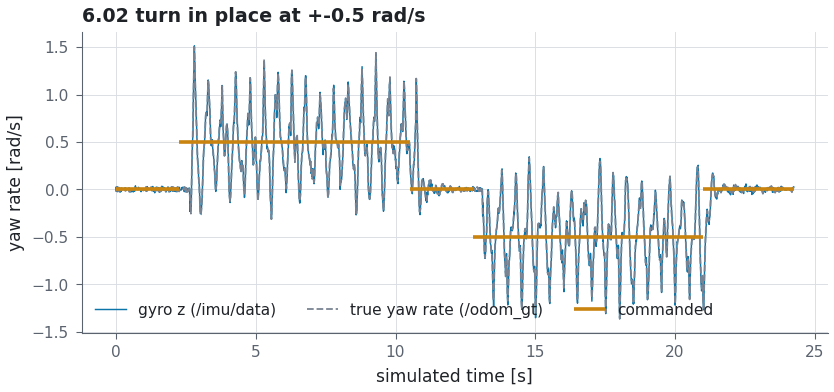

**Measurement.** Mean rate: true 0.4964 and gyro 0.4950 rad/s (+0.5 commanded), true -0.4873 and gyro -0.4866 rad/s (-0.5
commanded). RMS of sample differences 0.0200 and 0.0170 rad/s. CHAMP delivered 99.3 % and 97.5 % of the command.

**Acceptance.** Mean relative error $\le 1$ %: 0.28 %, passed. Sample RMS $\le 0.02$ rad/s: 0.02002, failed. An earlier run
gave 0.0182 and passed.

**Failure analysis.** The yaw rate swings by about ±1 rad/s with every step, so linear interpolation between 20 ms
ground-truth samples leaves a residual of the same size as the threshold. The 0.02 threshold was too tight for that
reference, not for the sensor; I keep it, and the task stays failed.

**Next task.** 6.04 integrates the same signal.

### 6.03 IMU noise and bias

**Objective.** Estimate the gyro's white noise and bias from a short stationary record, the way you would on a bench.

**Prerequisites.** 6.01.

**Theory.** With $\theta_k$ the integrated rate and $m = \tau / \Delta t$, the overlapping Allan variance is
$$\sigma^2(\tau) = \frac{1}{2\tau^2 (N - 2m)} \sum_k (\theta_{k+2m} - 2\theta_{k+m} + \theta_k)^2 .$$
White noise of density $N$ gives $\sigma(\tau) = N / \sqrt{\tau}$. The simulated gyro has $\sigma = 2 \times 10^{-4}$ rad/s
per sample at 100 Hz (`go2_description` `gazebo.xacro`), so $N = \sigma \sqrt{\Delta t} = 2 \times 10^{-5}$ rad/s/√Hz.

**Implementation.** `t603`: 60 s standing, `perception.allan_deviation` (tested on synthetic white noise in `tests/`).

**Execution.** `python3 tasks/s06_sensors-and-perception/run.py 6.03`

**Demonstration.**

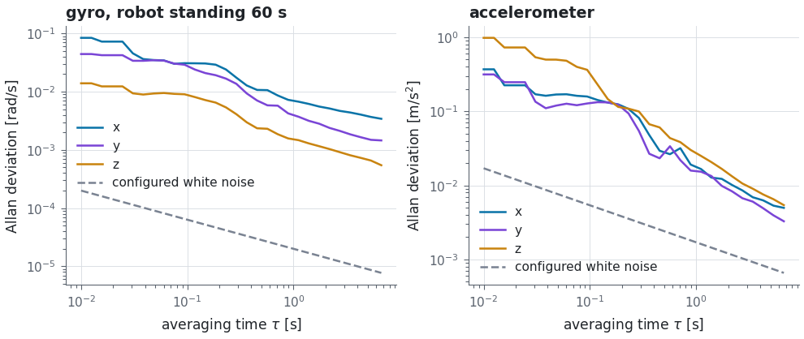

**Measurement.** $N$ at $\tau = 0.1$ s: 0.0099, 0.0087, 0.0028 rad/s/√Hz for x, y, z. Means 0.0023, 0.0047, 0.0005 rad/s.
The z curve reaches its lowest value, 0.00055 rad/s, at the longest $\tau$ tested (6.7 s). Accelerometer $N$: 0.048, 0.042,
0.101 m/s²/√Hz against 0.0017 configured.

**Acceptance.** Bias $\le 0.001$ rad/s and $N$ within a factor of 2 of the configured value. Failed: $N$ is 139 to 495 times
too large and the bias 4.7 times the limit.

**Failure analysis.** The robot cannot be still in this simulation: CHAMP holds it in stance and the trunk vibrates (6.01).
The record measures that vibration, not the sensor. Measuring the sensor needs the IMU off the robot, or the robot lying
with its joints unpowered, which this stack does not offer. Gyro z is the least affected axis.

**Next task.** 6.04 shows that this "bias" moves heading by degrees per minute.

### 6.04 Integrate the gyro for heading

**Objective.** Turn by a measured angle using only the gyro, then hold still and watch the integrated heading drift.

**Prerequisites.** 6.02, 6.03.

**Theory.** $\psi(t) = \int_0^t \omega_z \, dt$ (trapezoids, `perception.integrate`). A constant bias $b$ adds $b\,t$; white
noise adds a random walk with standard deviation $N \sqrt{t}$.

**Implementation.** `t604`: turn at +0.5 rad/s until the integrated gyro reads 90 deg, stand 3 s, turn back until it reads
0, stand 3 s, then stand 30 s.

**Execution.** `python3 tasks/s06_sensors-and-perception/run.py 6.04`

**Demonstration.**

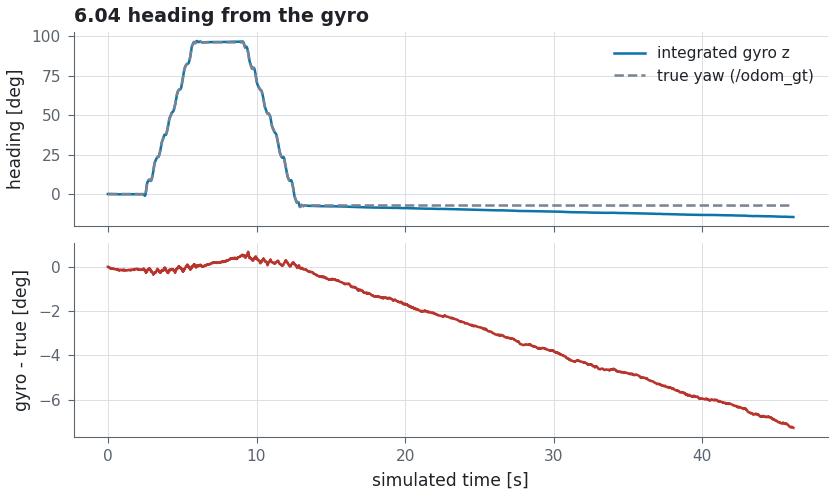

**Measurement.** Heading error at the end of the turns 0.50 and -0.75 deg. True yaw at those points 96.1 and -7.2 deg: the
robot keeps turning after the zero command, which the gyro tracks. Standing drift 6.5 deg in 30 s (mean gyro z while
standing -0.0039 rad/s). With the mean rate of the first 15 s of standing subtracted, the drift over the last 15 s fell
from -3.17 to 0.23 deg; in an earlier run the same correction only halved it (-1.75 to -0.92 deg).

**Acceptance.** Turn error $\le 1$ deg: passed. Standing drift $\le 0.1$ deg in 30 s: failed in all five runs on record
(1.45, 2.57, 3.00, 4.05 and 6.53 deg; turn error at most 0.75 deg).

**Failure analysis.** The configured white noise alone would drift $2 \times 10^{-5} \sqrt{30} \approx 0.006$ deg. The
measured drift comes from the vibration offset of 6.01, which changes from minute to minute, so a bias estimated while
standing helps only partly.

**Next task.** 7.01 (rotation from the gyro) and 7.11, where the lidar bounds this drift.

### 6.05 RGB camera

**Objective.** Read one image from `/camera/image_raw` and check its geometry.

**Prerequisites.** Stage 1, [chapter 5, 1.6](../../docs/05-frames-and-tf2.md#16-read-the-camera-optical-frame) (optical frame).

**Theory.** A pinhole camera with horizontal field of view $\alpha$ and width $W$ has $f_x = (W/2) / \tan(\alpha/2)$; for
$W = 640$ and $\alpha = 1.2$ rad (`sensors.xacro`) that is 467.74 px.

**Implementation.** `t605` grabs one image and `/camera/camera_info`.

**Execution.** `python3 tasks/s06_sensors-and-perception/run.py 6.05`

**Demonstration.**

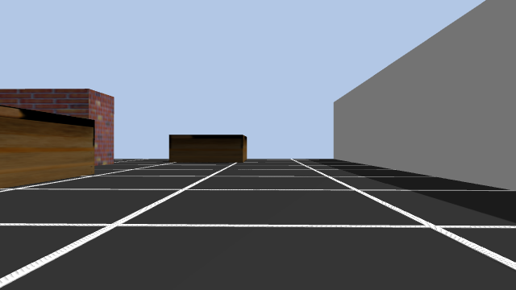

**Measurement.** 640 × 360, `rgb8`, frame `camera_optical`, $f_x = f_y = 467.74$, $c = (320.5, 180.5)$, 10.0 Hz of simulated
time, pixel standard deviation 70.9 (the image is not blank).

**Acceptance.** All checks passed: verified.

**Failure analysis.** On a loaded machine the camera rate falls (chapter 8 measured 1.6 to 5 Hz); the image itself does not
change.

**Next task.** 6.06 uses the same intrinsics for depth.

### 6.06 Depth camera

**Objective.** Read `/camera/depth/image_raw` and check it against the floor, whose geometry is known.

**Prerequisites.** 6.05.

**Theory.** A floor point on row $v$, with $y_n = (v - c_y)/f_y$, a camera $h$ above the floor and pitched by $\theta$
(positive nose down) has optical depth
$$z = \frac{h}{y_n \cos\theta + \sin\theta} .$$

**Implementation.** `t606`, `perception.floor_depth`. Five consecutive frames; for each, the camera height and pitch come
from `/odom_gt` interpolated at the frame's stamp. Per frame, the median over the 40 centre columns of the rows where the
model predicts 0.7 to 6 m; the checked number is the worst frame.

**Execution.** `python3 tasks/s06_sensors-and-perception/run.py 6.06`

**Demonstration.**

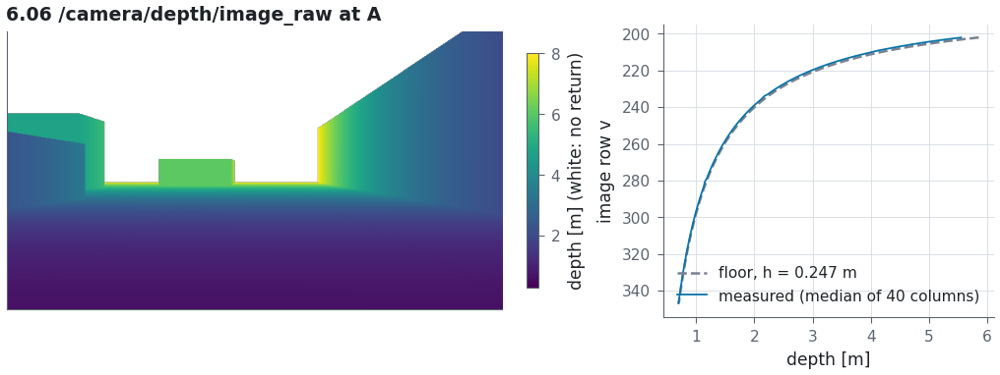

**Measurement.** `32FC1`. Last run: camera height 0.245 to 0.247 m, pitch at the frame stamps -0.02 to -0.24 deg, per-frame
median relative error 1.09 to 1.21 %. Worst frame per run over 5 runs: 1.21, 1.44, 1.16, 1.26 and 1.21 %.

**Acceptance.** Median error $\le 3$ % on every frame, in each of 5 runs: verified, 5 of 5. History (`acceptance.json`,
`changes`): a level camera failed at 3.7 % (`results/6.06_level_model_failed.json`). With pitch added but `/odom_gt`
read after the frame arrived, single runs gave 0.5 %, 3.8 %, 0.6 %, 1.1 %, 1.9 % and 1.5 %, so the verdict depended on the run.

**Failure analysis.** Near the horizon 0.4 deg of pitch moves the floor by 10 to 15 %, so the test checks the camera's
attitude at the image's instant. The trunk pitch swings by about 0.3 deg while standing (-0.39 to -0.01 deg in 3.3 s), and
the old reference sample came from another instant. On 20 consecutive frames the stamp-interpolated reference gave 1.06 to
1.46 %. The remaining 1.1 % is steady: the pitch that fits each frame best is 0.11 to 0.16 deg more nose-down than the
interpolated `/odom_gt` pitch on every frame, an offset between the camera and the trunk that this test does not
resolve. 6.16 avoids the reference altogether by fitting the floor plane in the depth image.

**Next task.** 6.07 (distance), 6.16 (planes).

### 6.07 Distance to a wall from depth and from the scan

**Objective.** Measure the distance to a flat face with both range sensors.

**Prerequisites.** 6.06; [project 5](../../projects/p05_sense-and-stop/README.md) steps 2 and 4 (`front_min`, `centre_depth`).

**Theory.** The scan is in `base_footprint` and the head is 0.28 m ahead of it, so gap $= r_{\min} - 0.28$. The depth
camera is at the head and its pixel value is already the perpendicular distance for a face square to it.

**Implementation.** Reuses project 5: `measure_stops.py --goto-start` walks to a 2.0 ± 0.1 m gap before the pallet's west
face and `snapshot.py` saves one scan and one depth image; `t607` applies p05's `obstacle.py` and scores on `/odom_gt`.

**Execution.** `python3 tasks/s06_sensors-and-perception/run.py 6.07`

**Demonstration.** `results/6.07_snapshot.npz` (plot it with p05's `plot.py --snap`).

**Measurement.** True gap 2.088 m. Depth 2.090 m (+0.002), scan 2.063 m (-0.025).

**Acceptance.** Scan $\le 0.05$ m, depth $\le 0.03$ m: verified.

**Failure analysis.** The scan reads short because the minimum over 100 noisy beams picks the most negative noise
([p05, exercise 3](../../projects/p05_sense-and-stop/README.md#try-this)).

**Next task.** 6.13 stops on this number.

### 6.08 Lidar point cloud

**Objective.** Read `/lidar/points` and check it against the floor.

**Prerequisites.** Stage 1; [chapter 8, 2.2](../../docs/08-robot-and-sensors.md#22-lidar-rings-on-the-floor-columns-on-obstacles) shows the same cloud in RViz with `go2.rviz`.

**Theory.** The lowest of the 16 beams points 15 deg down, so on a flat floor it draws a ring of radius $r = h / \tan 15°$,
with $h$ the lidar height.

**Implementation.** `t608`: points of the -15 ± 0.5 deg beam, median horizontal range.

**Execution.** `python3 tasks/s06_sensors-and-perception/run.py 6.08`; in RViz: `rviz2 -d src/go2_nav_sim/rviz/go2.rviz --ros-args -p use_sim_time:=true`.

**Demonstration.**

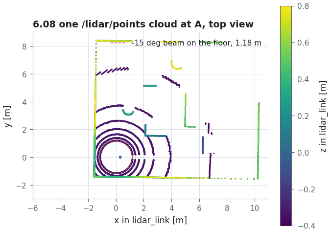

**Measurement.** Frame `lidar_link`, fields x, y, z, intensity, 12699 points. Lidar 0.316 m above the floor; ring 1.171 m
against 1.179 m predicted.

**Acceptance.** Ring error $\le 0.03$ m: 0.008, verified.

**Failure analysis.** I did not trace the 8 mm. A tilted trunk moves the ring forward on one side and back on the other,
which the median over all azimuths mostly cancels.

**Next task.** 6.09.

### 6.09 Cloud into the robot frame

**Objective.** Transform the cloud into `base_link` with tf2 and check where the floor lands.

**Prerequisites.** 6.08, [chapter 5](../../docs/05-frames-and-tf2.md).

**Theory.** $p_b = R\,p_l + t$ with $(R, t)$ the transform `base_link` ← `lidar_link` (URDF: $t = (0, 0, 0.10)$, $R = I$).

**Implementation.** `t609`: `tf_buffer.lookup_transform('base_link', 'lidar_link', Time())` and
`tf2_sensor_msgs.do_transform_cloud`; the floor is the median z of points below -0.1 m between 1 and 4 m.

**Execution.** `python3 tasks/s06_sensors-and-perception/run.py 6.09`

**Demonstration.**

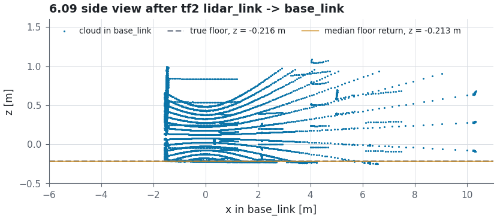

**Measurement.** Translation (0, 0, 0.100). Floor at -0.213 m, true base height 0.216 m. In `base_footprint` the same floor
is at +0.213 m: CHAMP publishes `base_footprint` → `base_link` as a constant 0.426 m, so that frame sits under the floor
([chapter 8, 1.2](../../docs/08-robot-and-sensors.md#12-measure-the-base_footprint-to-base_link-offset)).

**Acceptance.** Translation within 1 mm, floor within 0.02 m: verified.

**Failure analysis.** Any height threshold written for `base_footprint` as if it were on the ground is 0.21 m off.

**Next task.** 6.10 removes the floor in this frame.

### 6.10 Remove floor and body returns

**Objective.** Keep only returns from obstacles.

**Prerequisites.** 6.09.

**Theory.** Fit the floor plane $n \cdot p + d = 0$ with RANSAC (normal within 10 deg of up) and keep a point when
$n \cdot p + d > 0.05$ m and it is outside the body footprint $|x| \le 0.40$, $|y| \le 0.20$.

**Implementation.** `perception.ransac_plane`, `perception.remove_floor_and_body`; `filtered_cloud` in `run.py`.

**Execution.** `python3 tasks/s06_sensors-and-perception/run.py 6.10`

**Demonstration.**

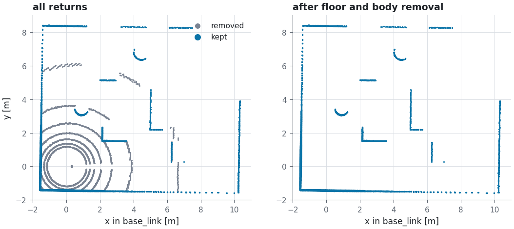

**Measurement.** Labels from ground truth: 3888 floor points (world z < 0.02 m), 7993 obstacle points (z > 0.10 m). All floor
points removed, 98.2 % of obstacle points kept; 142 returns fell inside the body footprint and none were kept.

**Acceptance.** Floor removed $\ge 99$ %, obstacles kept $\ge 98$ %, no body points: verified, with little margin on the
second check.

**Failure analysis.** The fitted floor normal leans 0.37 deg (x component 0.0064), so 10 m away the plane is 6 cm above
the true floor and the bottom of the far walls falls inside the 0.05 m tolerance; that is my reading of the 1.8 % lost.
A low obstacle of 5 cm or less disappears entirely.

**Next task.** 6.11, 6.12 cluster what is left.

### 6.11 Detect one obstacle

**Objective.** Find the pallet ahead as one cluster and measure its face.

**Prerequisites.** 6.10.

**Theory.** Euclidean clustering: two points closer than 0.15 m belong to the same object (KD-tree neighbour pairs and
connected components, `perception.cluster`). The lidar's 0.4 deg azimuth step puts neighbours 1.6 cm apart at 2.3 m.

**Implementation.** `t611`: p05 lane start, filtered cloud, clusters of at least 5 points whose centroid lies 0.3 to 4 m
ahead and within ±1.0 m sideways.

**Execution.** `python3 tasks/s06_sensors-and-perception/run.py 6.11`

**Demonstration.**

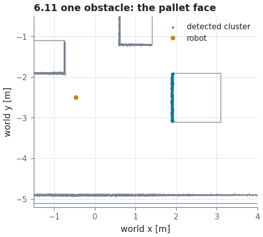

**Measurement.** 1 cluster in the region, 284 points. Face at x = 1.902 m (true 1.9), width 1.190 m (true 1.2).

**Acceptance.** One cluster, face $\le 0.05$ m, width $\le 0.10$ m: verified.

**Failure analysis.** The lidar sees only the face: the pallet top (0.45 m) is above the lidar's line of sight from 0.32 m.

**Next task.** 6.12.

### 6.12 Detect several obstacles

**Objective.** Cluster the whole room and match clusters to the known obstacles.

**Prerequisites.** 6.11.

**Theory.** An obstacle counts as visible when at least 3 of 720 rays from the lidar hit it first in a 2D ray cast against
the footprints in `make_arena.py` (`perception.visible`). A cluster matches an obstacle when its points' median distance to
that footprint is under 0.15 m.

**Implementation.** `t612`.

**Execution.** `python3 tasks/s06_sensors-and-perception/run.py 6.12`

**Demonstration.**

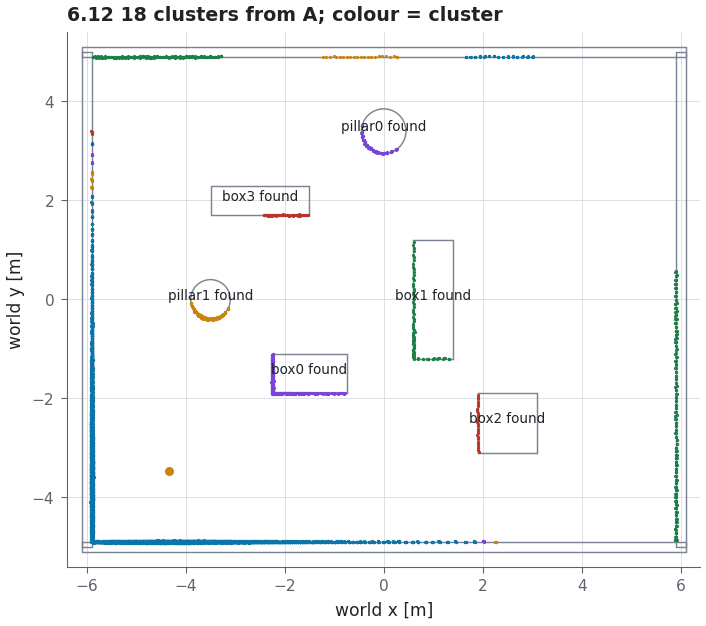

**Measurement.** 18 clusters (the walls split at occlusions). All 6 obstacles visible and found, median point distance to
the footprint under 1 mm, no unmatched cluster. Box 1 was visible to only 4 rays.

**Acceptance.** Recall 1.0, 0 false clusters, and the largest median point distance of a matched cluster to its footprint
$\le 0.05$ m (0.000 m here): verified.

**Failure analysis.** Clusters only separate objects more than 0.15 m apart; a box against a wall would merge with it.

**Next task.** Stage 9 maps with the same filtered cloud; 10.03 navigates among these obstacles.

### 6.13 Stop before a wall

**Objective.** Walk at a face and stop 0.5 m from it.

**Prerequisites.** 6.07; project 5 (the stop rule and its error budget).

**Theory.** Stop when $r - 0.28 \le 0.5$; the error is the scan bias, the distance walked between scans and in transit,
and the coast after the zero ([p05](../../projects/p05_sense-and-stop/README.md#where-the-stopping-error-comes-from)).

**Implementation.** Reuses p05: `sense.py` and `measure_stops.py --speeds 0.2 --runs 3`, on the pallet's flat west face.

**Execution.** `python3 tasks/s06_sensors-and-perception/run.py 6.13`

**Demonstration.** `results/6.13_p05_runs/stop.csv`; [p05's video](../../projects/p05_sense-and-stop/media/stop_0.3.mp4).

**Measurement.** Final true gaps 0.476, 0.499, 0.486 m; coast 0.019 to 0.027 m.

**Acceptance.** $|{\rm gap} - 0.5| \le 0.05$ m on every run: verified.

**Failure analysis.** None at 0.2 m/s; p05 shows the error growing to -0.054 m at 0.3 m/s.

**Next task.** 6.14.

### 6.14 Stop before a newly spawned obstacle

**Objective.** Stop for an obstacle that appears while the robot walks.

**Prerequisites.** 6.13.

**Theory.** The stop node has no map: it reacts to whatever is nearest in its ±20 deg sector, so a new object needs no
special handling, only a gap at appearance larger than the 0.5 m target plus the coast (0.02 to 0.03 m at 0.2 m/s, 6.13).

**Implementation.** `t614`: from the p05 lane start, start p05's `stop_at_obstacle.py` at 0.2 m/s, and 1 s after walking
begins call `/spawn_entity` with `worlds/new_box.sdf` (0.4 × 0.6 × 0.5 m, west face at x = 1.2, 0.7 m before the pallet).

**Execution.** `python3 tasks/s06_sensors-and-perception/run.py 6.14`

**Demonstration.**

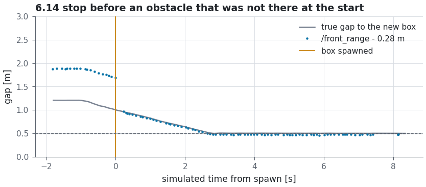

<video controls muted playsinline src="media/6.14_new_obstacle.mp4"></video>

*Chase camera, 9.9 s: the red box appears in front of the pallet and the robot stops before it.*

**Measurement.** True gap when the spawn returned 0.999 m. Final gap 0.500 m to the box, 1.200 m to the pallet. STOP line:
`range=0.774 gap=0.494 age=0.107`.

**Acceptance.** Gap at spawn $\ge 0.8$ m, $|{\rm gap} - 0.5| \le 0.06$ m, final gap $\ge 0$ (no contact): verified.

**Failure analysis.** Spawned closer than the stopping distance, the box would be hit; `run.py` reads the gap at spawn so
that case is visible in the result.

**Next task.** 10.08 (replan when blocked) uses the same event with Nav2.

### 6.15 Handle missing measurements

**Objective.** Show that the stop node does not walk without readings, and stops when they end.

**Prerequisites.** 6.13.

**Theory.** "No news is not good news": the node starts in a waiting state and, while walking, stops when no reading has
arrived for 0.5 s ([p05](../../projects/p05_sense-and-stop/README.md#stop_at_obstaclepy-walk-stop-and-stop-anyway-when-the-sensor-goes-quiet)).
At 0.2 m/s that costs at most $0.2 \times (0.5 + 0.1) = 0.12$ m plus the coast.

**Implementation.** `t615`: (a) start `stop_at_obstacle.py` with no `/front_range` for 3 s; (b) with `sense.py` running,
start walking and stop `sense.py` after 2 s.

**Execution.** `python3 tasks/s06_sensors-and-perception/run.py 6.15`

**Demonstration.**

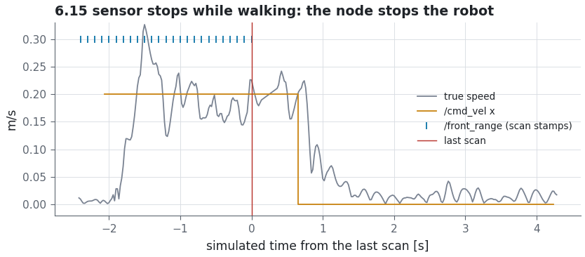

**Measurement.** (a) 0.3 mm moved, no non-zero command. (b) node output `TIMEOUT ...: no reading for 0.56 s, stopping`,
counted on the node's clock from when it received the last reading. From the last scan's header stamp to the zero: 0.651 s;
the difference is the scan's age on arrival. 0.159 m walked after the last scan's stamp.

**Acceptance.** $\le 0.02$ m without readings, TIMEOUT printed, zero within 0.65 s of the node receiving the last reading
(`zero_after_last_reading_s`, the node's receive clock), $\le 0.25$ m walked: verified, 0.56 s. The 0.65 s limit does not
apply to the stamp clock: measured from the last scan's stamp this run took 0.651 s, and another run 0.705 s (0.59 s from
receipt), which would fail.

**Failure analysis.** The robot walks blind for the timeout. A shorter timeout stops sooner but trips on normal gaps
between messages on a loaded machine ([p05, exercise 2](../../projects/p05_sense-and-stop/README.md#try-this)).

**Next task.** 4.20 (publisher lost) applies the same rule to `/cmd_vel`.

### 6.16 Detect a raised platform from depth

**Objective.** Find a raised horizontal surface in one depth image.

**Prerequisites.** 6.06, 6.10.

**Theory.** Back-project pixels, $p = z\,((u - c_x)/f_x, (v - c_y)/f_y, 1)$; fit the floor plane (RANSAC, normal within
10 deg of up); every point's height above it is $h = n \cdot p + d$. A horizontal surface puts its points into one height
bin, a vertical face spreads them over many, so the top is the most common height between 0.03 and 0.5 m, kept as the
largest connected patch.

**Implementation.** `perception.backproject`, `perception.platform_from_points`; `worlds/platform.world` is the arena plus
a 1.0 × 1.2 × 0.12 m box centred at (-2.2, -3.5), 1.5 m ahead of the camera at A (`worlds/make_worlds.py`).

**Execution.** `python3 tasks/s06_sensors-and-perception/run.py 6.16` (starts the platform world).

**Demonstration.**

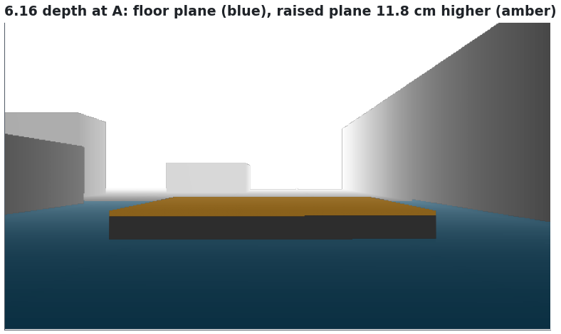

**Measurement.** Median of 3 frames, points within 4 m: 76804 floor, 7389 top pixels; normals 0.48 deg apart.

**Acceptance.** Detected, $\ge 1000$ pixels, $\le 2$ deg: verified.

**Failure analysis.** The first version took both planes by sequential RANSAC with 300 iterations. The top holds 6 % of the
points, so three random samples land on it with probability $0.06^3$; one run picked a horizontal slice through the walls
at 0.09 m instead (`results/6.17_ransac_failed.json`). The height histogram has no such failure mode.

**Next task.** 6.17; 11.01 (detect a step).

### 6.17 Estimate platform height and edges

**Objective.** Measure the platform's height and its four edges in the world frame.

**Prerequisites.** 6.16.

**Theory.** Height = median of $n \cdot p + d$ over the top points. Edges: express the top points in a frame on the floor
(x along the camera axis projected on the floor, z along $n$, `perception.ground_frame`), rotate by the robot's yaw and add
the camera's position from `/odom_gt`, take the 1st and 99th percentiles of world x and y.

**Implementation.** `t617`.

**Execution.** `python3 tasks/s06_sensors-and-perception/run.py 6.17`

**Demonstration.**

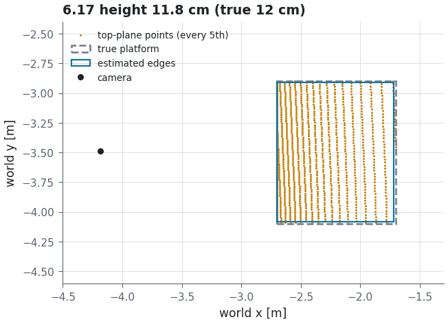

**Measurement.** Last run: height 0.1182 m (true 0.12). Edges: near x -2.700 (true -2.7), far x -1.717 (-1.7), right y
-4.084 (-4.1), left y -2.909 (-2.9). Over 5 runs the height was 0.1182 to 0.1184 m and the far x edge 0.017, 0.030, 0.033,
0.065 and 0.069 m short of the truth; it was the largest edge error in every run. The two farthest rows of top
points are 0.086 to 0.097 m apart, and the farthest row holds 116 to 233 points.

**Acceptance.** Height $\le 0.01$ m, every edge $\le 0.05$ m, in each of 5 runs. Failed: 3 of 5 runs passed, both failures
on the far x edge (0.065 and 0.069 m). The height passed in every run. An earlier batch passed 5 of 5 (largest edge error
0.047 m, `results/6.17_batch1.json`), and of four single runs before the 5-run rule one failed with the far edge 0.093 m short.

**Failure analysis.** The far edge is limited by the depth image's row spacing, not by the estimator. Seen from A, the top
is 0.13 m below the camera and its far edge 2.2 m away, so one image row covers about 0.09 m of it there (the figure shows
the rows spreading out with distance). The true edge lies anywhere between the last row that hits the top and the next row, which already misses it, so the far
edge reads 0 to one row spacing short, depending on where the rows fall for that start. The 99th percentile is not the cause:
the last row holds 1.6 to 3.1 % of the top points, so the percentile lands inside it. A 5 cm far edge needs rows at most
0.05 m apart; row spacing grows with the square of distance, so that means the camera within about 1.6 m of the far edge
(computed from the measured spacing, not run). Height is not affected: it is a median over about 7400 top points.

A second version measured the height as the difference of the two planes' offsets, which are taken at the camera: with
normals 0.5 deg apart and the platform 2 m away that read 0.103 m (`results/6.17_offset_failed.json`). Measure at the
platform.

**Next task.** Stage 5 step trials use the measured height; stage 11 (11.01 to 11.05) turns this into a step detector and
foothold estimate.
