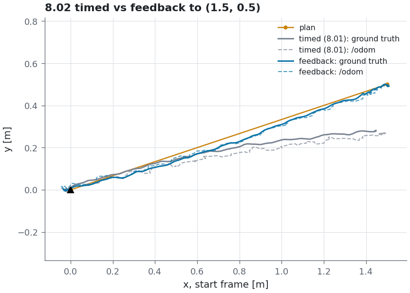
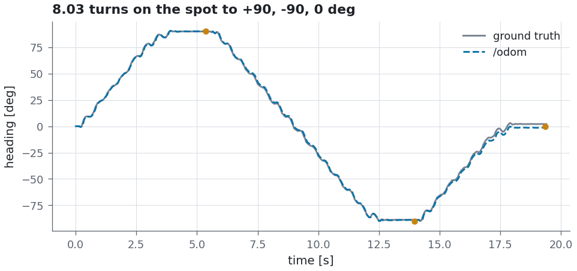
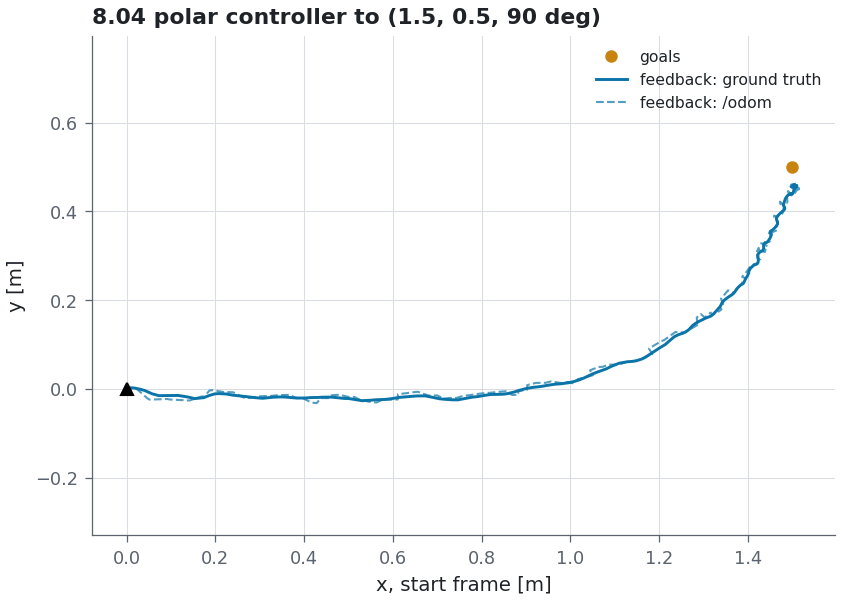
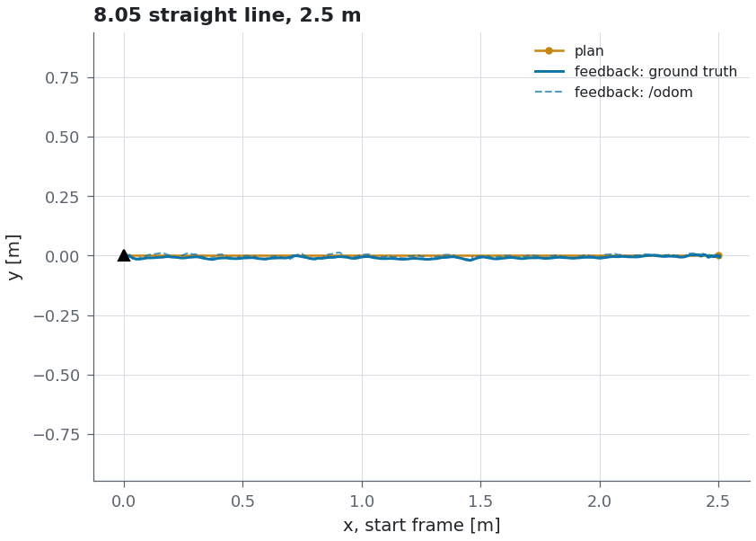
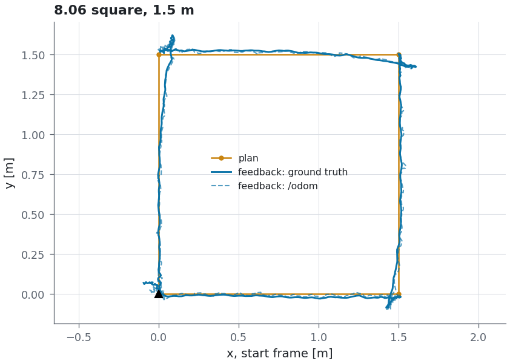
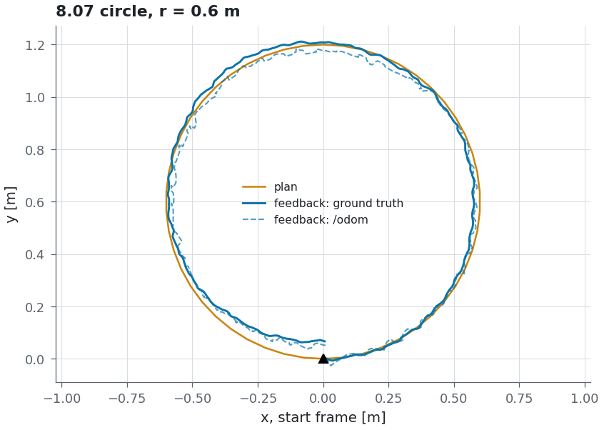
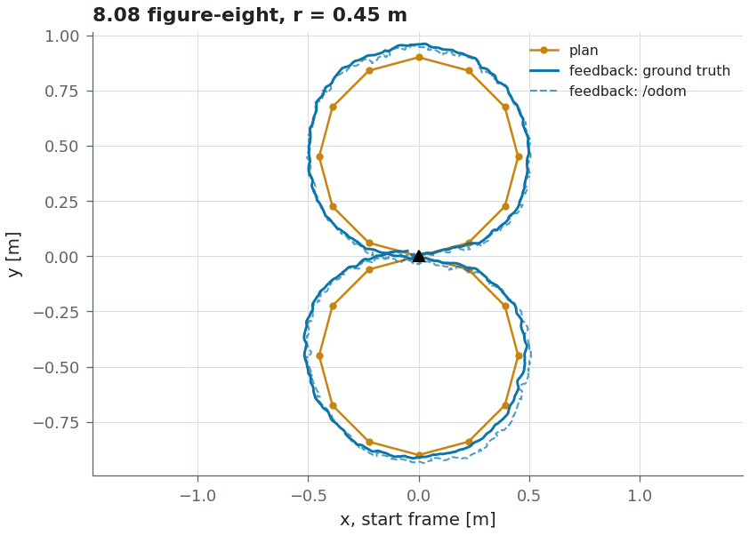
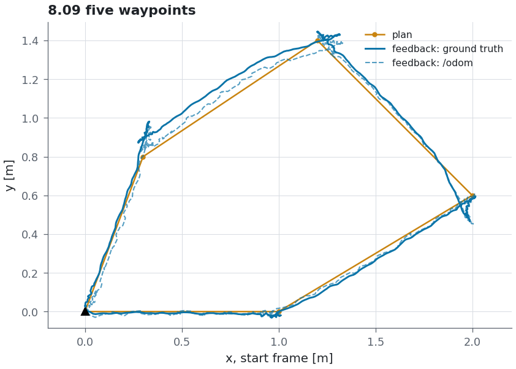
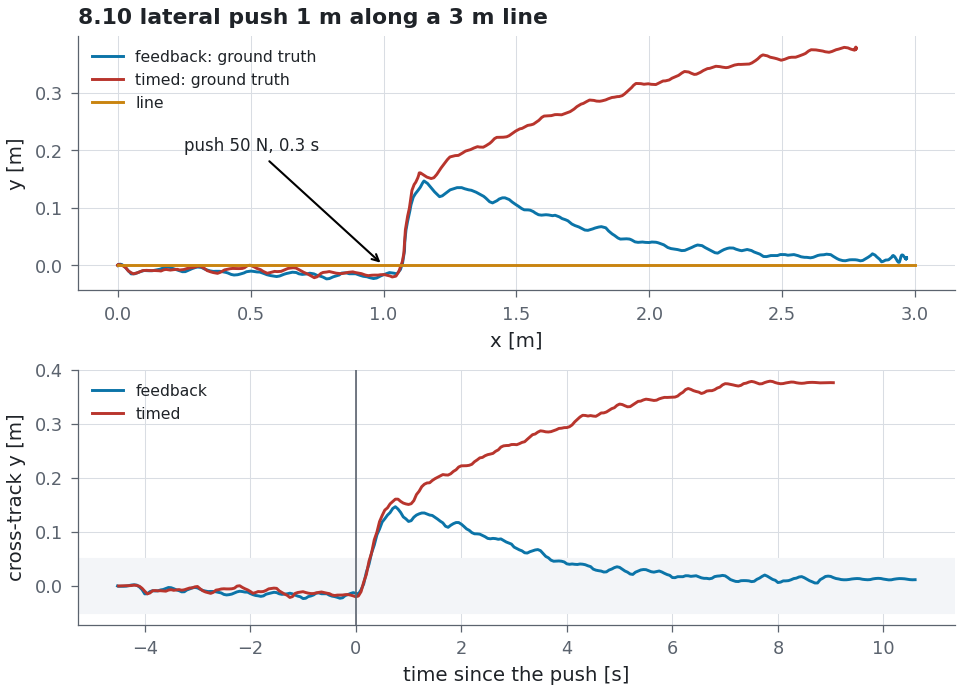
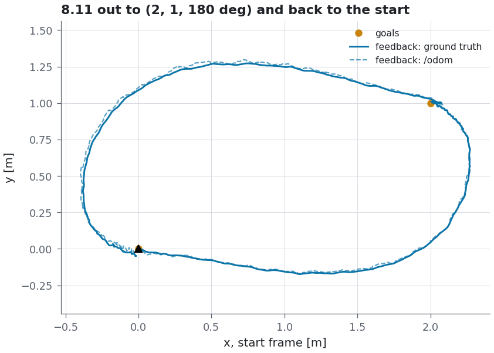

# Stage 8: feedback movement

At the end of this stage the Go2 reaches a point, a heading and a pose, walks a line, a square, a circle, a figure-eight and a
list of waypoints, and gets back onto its line after a sideways push. Returning to the start pose (8.11) failed on the
last run: the position was within 0.10 m, but the heading was 10.1 deg off because `/odom` yaw drifted. Every controller closes
the loop on `/odom` (the lidar-inertial odometry and EKF from [chapter 9](../../docs/09-state-estimation.md)), and every
error below is measured on `/odom_gt`, the simulator's ground truth, in the start frame of the run (origin at the true start
pose, x forward, y to the left).

The controllers are not new. The timed schedules and the carrot follower come from
[project 3](../../projects/p03_move-in-shapes/README.md) (`shapes.py`), the polar go-to-pose law from
[project 4](../../projects/p04_go-to-pose/README.md) (`polar.py`). This stage imports them and adds the missing pieces: a
heading controller, a circle tracker, a pose sequence, the push, and one acceptance test per task.

Run everything:

```bash
cd go2-nav-sim
source env.sh
cd tasks/s08_feedback-movement
python3 -m pytest -q tests           # 5 passed: every plan on a perfect robot, no simulator
python3 run.py all                   # 14.4 min measured; restarts Gazebo and the estimator before each run
```

`run.py <id>` runs one task. Before each run it stops the stack (`scripts/stop.sh`), starts `sim.launch.py` with
`worlds/arena_overhead.world` (the arena plus a camera above the 8.10 line) and `estimation.launch.py`, and waits until
the lidar odometry prints its first pose. The robot then starts on marker A facing +x with `/odom` at zero. Nav2 is not
started. `run.py <id> --keep` uses the stack that is already running; `run.py <id> --rescore` scores and draws the logged
`results/<id>.csv` again without the simulator. Thresholds are in `acceptance.json`, written before the first run.

| Task | Capability | Status | Key number (ground truth) | Where |
|---|---|---|---|---|
| 8.01 | reach a point with timed commands | verified | 0.228 m from the point | `run.py 8.01` |
| 8.02 | the same point with odometry feedback | verified | 0.006 m | `run.py 8.02`, p03 `Follower` |
| 8.03 | target orientation | verified | 2.05 deg worst of three | `motion.Headings` |
| 8.04 | target pose | verified | 0.042 m, -5.2 deg | p04 `GoToPose` |
| 8.05 | straight line | verified | 0.020 m largest cross-track | p03 `Follower` |
| 8.06 | square | verified | 0.023 m worst corner | p03 `Follower` |
| 8.07 | circle | verified | 0.023 m RMS radial | `motion.Circle` |
| 8.08 | figure-eight | verified | 0.060 m at the crossing | p03 `Follower`, p03 points |
| 8.09 | waypoints | verified | 0.081 m worst of five | p03 `Follower` |
| 8.10 | correction after a push | verified | back within 0.05 m in 3.65 s; timed run ends 0.38 m off | `run.py 8.10` |
| 8.11 | return to start | failed | 0.052 m, -10.1 deg (limit 6 deg) | p04 `GoToPose` |

Every number is from one `python3 run.py all` on one machine with other simulations running (load average 39 to 68 on 32
cores, read with `uptime` at the start, middle and end). It took 14.4 min wall clock; 8.10 alone took 4.8 min: it
starts the stack twice, renders a video and may wait for the render lock. In project 4 two identical runs differed by 0.044 m in mean error, so single-run
differences of a few centimetres between tasks here are not meaningful. The run before this one gave a different worst case
for several tasks (for example 8.06: 0.081 m worst corner, 8.11: -3.2 deg); where that matters it is quoted below.

| File | What it does |
|---|---|
| `motion.py` | the plans of all tasks, the adapters around the p03 and p04 controllers, the scores; no ROS |
| `run.py` | starts the stack, drives one plan at 20 Hz of simulated time, logs `/odom` and `/odom_gt`, scores, draws |
| `acceptance.json` | the thresholds and where each one comes from |
| `params/push.yaml` | the 8.10 push: link, force, duration, where along the line |
| `bin/gzserver` | starts Gazebo with the force plugin that provides `/apply_link_wrench` |
| `worlds/arena_overhead.world` | the arena plus an overhead camera for the 8.10 video |
| `tests/test_motion.py` | every plan on a perfect robot |

### 8.01 Reach a point with timed commands

**Objective.** Send the robot to (1.5, 0.5) m with a fixed schedule of velocity commands and measure where it ends up.

**Prerequisites.** 4.05 (walk 1 m), 4.10 (turn on the spot), 7.13 (compare odometry with ground truth).

**Theory.** A timed command assumes the robot does exactly what it is told. Turn to the bearing, then walk the distance:

$$\theta = \operatorname{atan2}(0.5, 1.5) = 18.4^\circ,\quad T_\text{turn} = \theta/\omega,\qquad d = 1.58\ \text{m},\quad T_\text{walk} = d/v$$

with $\omega = 0.4$ rad/s and $v = 0.25$ m/s. If the robot walks at $v_a$ instead of $v$, it stops $(v - v_a)\,T_\text{walk}$
short; a heading error $\delta$ moves the end point sideways by about $d\,\delta$. Nothing in the program sees either.

**Implementation.** `motion.timed_point()` builds the schedule `[(0.80 s, 0, 0.4, turn), (6.32 s, 0.25, 0, walk), (1.5 s, 0, 0, settle)]`,
played by `motion.Timed` with p03's `shapes.command_at`. `run.py` logs every tick to `results/8.01.csv`.

**Execution.** `python3 run.py 8.01`

**Demonstration.**



**Measurement.** End point (1.444, 0.279) m, 0.228 m from the target. Achieved speed during the walk 0.234 m/s for 0.25
commanded. Heading after the turn 15.6 deg (2.8 deg short); at the end 5.5 deg. `/odom` saw the same thing: it put the robot
0.238 m from the target.

**Acceptance.** `final_pos_err_m <= 0.30` (baseline for 8.02). Measured 0.228 m: verified.

**Failure analysis.** Split along the path to (1.5, 0.5), the 0.228 m error is 0.123 m short and 0.192 m to the right.
The speed shortfall predicts (0.25 - 0.234) × 6.32 = 0.10 m short. The sideways part comes from the heading: the turn
stopped 2.8 deg short, and with zero turn rate commanded the heading fell from 15.6 to 5.5 deg during the walk, so the robot
curved right. A timed plan cannot correct either. In the previous run the same split was 0.144 m short and 0.149 m right.

**Next task.** 8.02 runs the same target with feedback and must beat this number.

### 8.02 Reach the same point with odometry feedback

**Objective.** Reach (1.5, 0.5) m by steering on `/odom` until the estimate says the point is reached.

**Prerequisites.** 8.01, 7.12 (odometry and TF).

**Theory.** The carrot follower from [project 3](../../projects/p03_move-in-shapes/README.md#how-the-code-works) projects the
robot onto the leg from $p_0$ to the target $p_1$, puts a carrot $L = 0.4$ m further along the leg and steers at it:

$$s = (p - p_0)\cdot u,\quad c = p_0 + (s + L)\,u,\quad \omega = k_h\,\operatorname{wrap}(\operatorname{atan2}(c_y - y, c_x - x) - \psi)$$

It turns on the spot until the heading error is below 2 deg, walks while $|p_1 - p_0| - s > 0.02$ m, then stands 1.5 s.

**Implementation.** `shapes.Follower([(1.5, 0.5)])`, unchanged from p03. `run.py` converts `/odom` into the start frame
(`motion.to_start`) before each step.

**Execution.** `python3 run.py 8.02` (needs `results/8.01.json`).

**Demonstration.** The figure under 8.01: the blue path ends on the target, the grey one short of it and to the right.

**Measurement.** 0.006 m from the target on ground truth, in 11.0 s (timed: 8.65 s). After standing 1.5 s, `/odom` put the
robot 0.014 m from the target and 0.009 m from where it really was.

**Acceptance.** `final_pos_err_m <= 0.08` and better than 8.01. Measured 0.006 m against 0.228 m: verified.

**Failure analysis.** The remaining error is the estimate, not the controller: the controller stops at 0.02 m on `/odom`, and
`/odom` was 0.009 m off. Here the two partly cancelled. When the estimate drifts more (8.09) the true error grows with it.

**Next task.** The same follower walks lines, squares and waypoints (8.05, 8.06, 8.09).

### 8.03 Reach a target orientation

**Objective.** Turn on the spot to +90, -90 and 0 deg (relative to the start) and hold each heading.

**Prerequisites.** 8.02.

**Theory.** Proportional turn with a saturation and a floor, the turn law of p03's follower:

$$e_\psi = \operatorname{wrap}(\psi^* - \psi),\qquad \omega = \operatorname{sign}(e_\psi)\,\max\big(\omega_\min,\ \min(\omega_\max, k\,|e_\psi|)\big)$$

with $k = 1.5$, $\omega_\max = 0.5$ rad/s, $\omega_\min = 0.12$ rad/s (a floor, so the last degrees do not crawl), stop at $|e_\psi| < 2^\circ$.
`wrap` keeps the error in $(-\pi, \pi]$, so the robot always turns the shorter way.

**Implementation.** `motion.Headings`, which reuses `Follower._turn` from p03.

**Execution.** `python3 run.py 8.03`

**Demonstration.**



**Measurement.** True heading errors after standing 1.5 s: -0.03, +1.12, +2.05 deg; on `/odom`: +0.17, +1.04, -1.31 deg.
Total 19.4 s. The trunk did not stay in place: after the three turns its centre was 0.12, 0.25 and 0.35 m from the start.

**Acceptance.** `max_heading_err_deg <= 5.0`. Measured 2.05 deg: verified.

**Failure analysis.** The worst true error (+2.05 deg at the 0 deg target) is mostly the estimate: `/odom` said -1.31 deg,
so its yaw was 3.4 deg off after three turns. The controller stopped inside its 2 deg tolerance each time. Position is the
larger problem: during a "turn on the spot" CHAMP's gait turns about a point that is not the trunk centre, so each turn moves the trunk 0.1 m or more.
Project 3 found the same. This is the error that shows up at the corners of 8.06 and 8.09 and in the final heading of 8.04.

**Next task.** 8.04 combines position and heading.

### 8.04 Reach a target pose

**Objective.** Reach (1.5, 0.5) m with heading 90 deg.

**Prerequisites.** 8.02, 8.03.

**Theory.** The polar controller of [project 4](../../projects/p04_go-to-pose/README.md#polar-coordinates):

$$\rho = |g - p|,\quad \alpha = \operatorname{wrap}(\operatorname{atan2}(g_y - y, g_x - x) - \psi),\quad \beta = \operatorname{wrap}(\psi_g - \psi - \alpha)$$
$$v = k_\rho \rho,\qquad \omega = k_\alpha \alpha + k_\beta \beta,\qquad (k_\rho, k_\alpha, k_\beta) = (0.5, 1.5, -0.5)$$

Inside 0.05 m it switches to the turn of 8.03 for the last part of the heading.

**Implementation.** `motion.Poses([(1.5, 0.5, 90 deg)])` runs p04's `polar.GoToPose` and stands 1.5 s at the goal.

**Execution.** `python3 run.py 8.04`

**Demonstration.**



**Measurement.** 0.042 m and -5.2 deg from the goal pose, in 11.0 s. `/odom` said 0.047 m.

**Acceptance.** `final_pos_err_m <= 0.10`, `|final_heading_err_deg| <= 6.0`. Measured 0.042 m, -5.2 deg: verified.

**Failure analysis.** The drive phase ends at 0.05 m on `/odom`; the final turn on the spot then moves the trunk (8.03). The
heading error splits into -2.9 deg on `/odom` (the turn stops inside its 3 deg tolerance) and 2.3 deg by which the `/odom`
yaw was off at the end. Both parts have the same sign here, so the total is close to the 6 deg limit.

**Next task.** 8.11 uses the same controller for a round trip.

### 8.05 Walk a straight line

**Objective.** Walk 2.5 m along x and stay on the line.

**Prerequisites.** 8.02.

**Theory.** For a line along x the carrot gives a heading command of about $-\arctan(y/L)$. For small errors
$\dot y = v \sin\psi \approx -v\,y/L$, so a sideways offset decays with time constant $L/v = 0.4/0.25 = 1.6$ s.

**Implementation.** `shapes.Follower([(2.5, 0)])`.

**Execution.** `python3 run.py 8.05`

**Demonstration.**



**Measurement.** Largest cross-track error 0.020 m; the robot stopped 0.003 m past the end; 13.2 s.

**Acceptance.** `max_cross_track_m <= 0.05`, `|final_along_err_m| <= 0.08`. Measured 0.020 m, +0.003 m: verified.

**Failure analysis.** Nothing failed. The cross-track error stayed between -0.020 and +0.004 m for the whole line.

**Next task.** 8.10 pushes the robot off this kind of line.

### 8.06 Walk a square

**Objective.** Walk a 1.5 m square counter-clockwise, stopping at each corner, and end facing the start heading.

**Prerequisites.** 8.03, 8.05.

**Theory.** Four legs of 8.05 with a turn of 8.03 between them. The error at a corner is the controller's error on
`/odom` plus the gap between `/odom` and the truth: $e_\text{true} \le e_\text{odom} + |p_\text{odom} - p_\text{true}|$.

**Implementation.** `shapes.Follower(square_corners(), final_yaw=0)`: the closed-loop square of project 3
([step 3](../../projects/p03_move-in-shapes/README.md#3-walk-the-square-closed-loop)), imported, not copied.

**Execution.** `python3 run.py 8.06`

**Demonstration.**



**Measurement.** Corner errors on ground truth 0.021, 0.007, 0.023, 0.011 m. The same corners on `/odom`: 0.015, 0.008, 0.031,
0.043 m. The gap between `/odom` and the truth at the corners: 0.007, 0.001, 0.008, 0.038 m. Final heading 6.1 deg, 51.0 s.

**Acceptance.** `max_corner_err_m <= 0.10`. Measured 0.023 m: verified.

**Failure analysis.** The true corner error is the error on `/odom` plus the estimator gap. In this run the gap stayed under
0.04 m, and at the last corner the two partly cancelled (0.043 m on `/odom`, 0.011 m true). The run before had a gap that grew
corner by corner to 0.093 m and a worst corner of 0.081 m; project 3 measured 0.01 to 0.05 m. Better control will not
reduce the gap; a better estimate or an absolute fix (AMCL, stage 9) will.

**Next task.** 8.09 uses the same follower on arbitrary points.

### 8.07 Walk a circle

**Objective.** Walk one counter-clockwise circle of radius 0.6 m through the start.

**Prerequisites.** 8.05.

**Theory.** A circle needs a turn rate all the time, so feedback alone lags. Feed the curvature forward and correct the
radial error $e = |p - c| - r$ and the heading error to the tangent $\theta_e$:

$$\omega = \frac{v}{r} + k_e\,v\,e + k_h\,\theta_e$$

Linearised, $\ddot e + k_h \dot e + k_e v^2 e = 0$; with $v = 0.18$ m/s, $k_e = 10$, $k_h = 1.5$ that is
$\omega_n = 0.57$ rad/s and $\zeta = 1.3$. If the robot walks at $v_a < v$ but turns as commanded, the
proportional term needs a steady error $e = -(1 - v_a/v)/(k_e r)$ to keep the radius (my estimate). With $v_a = 0.94\,v$
(8.01, 0.234 for 0.25 m/s) that is $-0.011$ m.

**Implementation.** `motion.Circle` (new, 20 lines). The p03 follower on circle points was the first plan: on a perfect
robot it was up to 0.056 m off the circle, because the 0.25 m lookahead is longer than the 0.16 m legs. The tracker
above stays within 0.005 m on the same perfect robot (`tests/test_motion.py`).

**Execution.** `python3 run.py 8.07`

**Demonstration.**



**Measurement.** Radial error RMS 0.023 m, largest 0.072 m, mean -0.010 m (inside the circle); end 0.067 m from the start;
24.1 s.

**Acceptance.** `rms_radial_err_m <= 0.05`, `max_radial_err_m <= 0.10`, `final_pos_err_m <= 0.10`. Measured 0.023, 0.072,
0.067 m: verified.

**Failure analysis.** The mean -0.010 m is the steady error of a proportional law, close to the -0.011 m predicted from the
speed shortfall. An integral term on $e$ would remove it.

**Next task.** 8.08 joins two circles.

### 8.08 Walk a figure-eight

**Objective.** Walk two circles of radius 0.45 m that touch at the start, left one counter-clockwise, right one clockwise.

**Prerequisites.** 8.05, 8.07.

**Theory.** As in [project 3, step 5](../../projects/p03_move-in-shapes/README.md#5-walk-the-figure-eight-closed-loop):
24 points, one every 30 deg, followed at 0.18 m/s without stopping. The crossing error is the distance from the start after
the first lobe (the last point labelled `walk11`).

**Implementation.** `shapes.Follower(figure8_points(), stop_each=False, v=0.18, lookahead=0.25, reach_tol=0.05)`, the
arguments of p03's `drive.py figure8 closed`.

**Execution.** `python3 run.py 8.08`

**Demonstration.**



The video of the same controller is in project 3 (`projects/p03_move-in-shapes/media/figure8_closed.mp4`).

**Measurement.** Crossing 0.060 m, end 0.056 m from the start, end heading 6.1 deg, 40.3 s. Project 3's run: 0.07 and 0.05 m.

**Acceptance.** `crossing_err_m <= 0.10`, `final_pos_err_m <= 0.10`. Measured 0.060, 0.056 m: verified.

**Failure analysis.** There is no final turn, so the end heading is whatever the last leg left (p03 saw 2 to 11 deg). Both
position errors are within 0.01 m of p03's; with single runs that difference is not meaningful.

**Next task.** 8.09.

### 8.09 Follow waypoints

**Objective.** Visit (1.0, 0), (2.0, 0.6), (1.2, 1.4), (0.3, 0.8) and (0, 0) in order, stopping at each.

**Prerequisites.** 8.06.

**Theory.** As 8.06, with legs of different length and direction.

**Implementation.** `shapes.Follower(WAYPOINTS)`; the waypoints are in `motion.py`.

**Execution.** `python3 run.py 8.09`

**Demonstration.**



**Measurement.** Errors at the five waypoints 0.021, 0.016, 0.043, 0.081, 0.028 m on ground truth and 0.007, 0.019, 0.024,
0.032, 0.030 m on `/odom`; gap between the two 0.023, 0.003, 0.019, 0.050, 0.003 m. 50.3 s.

**Acceptance.** `max_waypoint_err_m <= 0.10` and all five reached. Measured 0.081 m, 5 of 5: verified.

**Failure analysis.** Same split as 8.06: the worst waypoint (0.081 m) is where `/odom` was 0.050 m off. The spikes at the
waypoints in the figure are the turns on the spot after each stop: the trunk moved 0.051, 0.124, 0.114 and 0.106 m during
the four turns, which is why the errors are taken at the end of the stop, before the turn.

**Next task.** Stage 10 sends waypoints through Nav2 instead (10.12).

### 8.10 Correct after a disturbance

**Objective.** Push the walking robot sideways and show that feedback brings it back onto its line, and that timed commands
do not.

**Prerequisites.** 8.05.

**Theory.** A force $F$ for $\Delta t$ gives the robot an impulse $J = F\,\Delta t$. With $F = 50$ N, $\Delta t = 0.3$ s and
$m = 15.1$ kg (sum of the link masses, `gz model -m go2 -i`), $\Delta v \le J/m = 1.0$ m/s; the feet take part of it. After
the push the follower of 8.05 sees a cross-track error and returns with time constant $L/v = 1.6$ s. A timed plan has no
error signal: whatever heading the push leaves, it keeps walking along.

**Implementation.** `run.py` walks 3 m along x twice, once with the follower and once with the timed schedule
`(12 s at 0.25 m/s)`. When `/odom` says x > 1.0 m it calls the Gazebo force plugin:

```bash
ros2 service call /apply_link_wrench gazebo_msgs/srv/ApplyLinkWrench \
  "{link_name: 'go2::base_link', wrench: {force: {y: 50.0}}, start_time: {sec: <now + 0.05 s>}, duration: {nanosec: 300000000}}"
```

ROS 1 called this service `apply_body_wrench`; in ROS 2 it is `apply_link_wrench`, and it exists only when gzserver loads
`libgazebo_ros_force_system.so`. `bin/gzserver` adds that plugin, and `run.py` puts `bin/` first on `PATH` for the launch.

The video is recorded with `projects/p03_move-in-shapes/record.py`, which is `projects/common/record_cam.py` with a reliable
subscription instead of best effort. On a loaded machine the best-effort recorder loses most of the large camera images
(project 3 counted 2 frames in 60 s); the reliable one has them resent.

**Execution.** `python3 run.py 8.10` (renders a video; on a shared machine it waits for `/tmp/go2_render.lock`).

**Demonstration.**

<video controls muted playsinline src="media/8.10_push.mp4"></video>

Overhead camera, feedback run, real speed (18 s): the robot is pushed up the image at 1 m and walks back to its line.



**Measurement.** Feedback run: largest deviation 0.147 m, back inside 0.05 m 3.65 s after the push and stayed there, 0.012 m
off the line at the end, no fall (trunk height never below 0.203 m; standing height 0.216 m). `/odom` was up to 0.082 m from
the truth after the push. Timed run: 0.379 m largest deviation, 0.376 m at the end. Its true heading, averaged over the logged
20 Hz rows, was -0.9 deg in the 0.5 s before the push and 12.7 deg from 0.5 to 1.5 s after it.

**Acceptance.** Push deviation at least 0.10 m, recovery within 6.0 s, final cross-track at most 0.05 m, no fall, timed run
at least 0.10 m off. Measured 0.147 m, 3.65 s, 0.012 m, no fall, 0.376 m: verified.

**Failure analysis.** The push turned the trunk as well as moving it, so the timed run walked off at an angle and the error
grew for the rest of the line. The feedback run came back more slowly than the linear model says: 1.7 s from 0.147 to
0.05 m predicted ($1.6 \ln 2.94$), 3.65 s measured. Part of the delay is the estimate. From 1.5 s to 6 s after the push
`/odom` put the robot 0.02 to 0.045 m closer to the line than it was (true y 0.114, 0.072, 0.034, 0.006 m at 2, 3, 5, 8 s;
`/odom` 0.085, 0.046, 0.009, 0.007 m), so the follower saw a smaller error than there was. Part is the control: on `/odom`
the robot was back within 0.05 m after 2.95 s, against 1.5 s predicted from its 0.128 m peak on `/odom`. In the previous run
the gap after 1 s stayed under 0.05 m and recovery took 5.0 s, so the split between the two varies from run to run.
The first try of the push did nothing: with
`start_time` left at 0, the plugin answered `success=True` and applied no force (five calls of 50 to 400 N for 0.3 to 1.0 s
moved the standing robot by at most 2 mm); with `duration -1` (forever) it worked. Setting `start_time` to the current simulated time fixed it.

**Next task.** 8.11; and stage 5 (5.16, recover from a small push while standing).

### 8.11 Return to the start

**Objective.** Go out to (2.0, 1.0) m facing 180 deg, then back to the start pose.

**Prerequisites.** 8.04.

**Theory.** The controller can only return to where `/odom` says the start is. The true return error is the control error
on `/odom` plus the drift of `/odom` over the round trip; the controller cannot see the second part.

**Implementation.** `motion.Poses([(2.0, 1.0, 180 deg), (0, 0, 0)])` with p04's `GoToPose`.

**Execution.** `python3 run.py 8.11`

**Demonstration.**



**Measurement.** Back at 0.052 m and -10.1 deg from the true start pose after 35.4 s and 7.1 m of trunk path. At the end
`/odom` was 0.033 m from the truth in position and its yaw 8.2 deg off (-1.9 deg on `/odom`, -10.1 deg true). At the first
goal the error was 0.069 m, and the `/odom` yaw was already 3.8 deg off.

**Acceptance.** `final_pos_err_m <= 0.10`, `|final_heading_err_deg| <= 6.0`. Measured 0.052 m, -10.1 deg: failed on
heading. The run before this one measured 0.076 m, -3.2 deg and passed; the threshold stays at 6 deg.

**Failure analysis.** The controller did its part: it stopped 1.9 deg from the goal heading on `/odom`, inside its 3 deg
tolerance. The other 8.2 deg is `/odom` yaw drift over the two 180 deg turns and 7.1 m of walking, which no controller on
`/odom` can see. Position was within the limit (0.052 m) because the position drift was small this time (0.033 m); in the
previous run it was the other way round (0.074 m position drift, -3.2 deg). Project 4 measured 0.081 m and -5.4 deg after
10.7 m. Removing the drift needs an absolute reference: AMCL on the map (stage 9) or loop closure.

**Next task.** 9.08 and 9.09 localise against the map, which bounds this drift.
